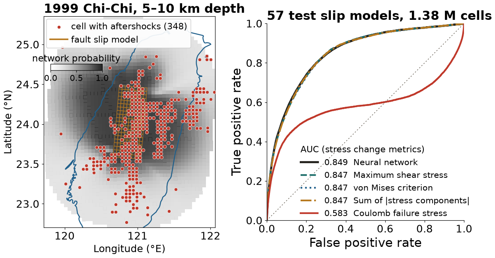

## {background-color="#faf7f2"}

[🧰]{.lecture-icon}

### Learning objectives and class products

By the end of the session, you should be able to evaluate whether a published computational result can be rerun, identify the computing resources a workflow requires, and distinguish an environment from a sandbox or container.

The class will produce a first reproducibility rubric. Each student will begin a repository that can supply evidence for that rubric.

::: {.dim}
Readings: [1.1](https://geo-smart.github.io/mlgeo-book/open-reproducible-science)–[1.5](https://geo-smart.github.io/mlgeo-book/version-control-git) · Lab: [1.9 workbench setup](https://geo-smart.github.io/mlgeo-book/workbench-setup-hw1)
:::

::: {.notes}
Open by naming the unfinished work from Wednesday. Today does not start a new topic. The class finishes the paper sprint, extracts evidence from it, and uses that evidence to write a rubric. The hardware and workbench material then answers one rubric question: what would another person need to rerun this result on another machine? The session produces two reusable artifacts rather than a page of notes: rubric version 0.1 and each student's course repository. Suggested 80-minute allocation: framing 2 minutes; evidence and literature 8; paper sprint 12; matrix, strong result, and rubric construction 16; computing concepts 14; compute-choice activity 7; workbench lab 16; exit ticket 5. If time runs short, compress the CPU/GPU and HPC slides to their takeaways; they are covered in 1.4.
:::

## Literature example: where aftershocks occur {.smaller}

::: {.badge-row}
[🗂️ Catalog & compiled product]{.gb .src} [🪨 Solid Earth]{.gb .sys .solid} [📈 Seismology]{.gb .disc .solid}
:::

:::: {.columns}
::: {.column width="36%"}
::: {.lit-card}
[A neural network with 13,451 parameters located aftershocks better than Coulomb stress change (AUC 0.849 against 0.583). A logistic regression on one stress metric, with 2 parameters, scores the same AUC.]{.lit-msg}

[DeVries, Viégas, Wattenberg & Meade (2018). *Nature*, 560, 632–634 · Mignan & Broccardo (2019). *Nature*, 574, E1–E3.]{.lit-cite}
:::

**One data sample is one 5 km cell** (slip model 1999CHICHI01MAxx, test set)

::: {.records}
| lon °E | lat °N | depth km | max shear MPa | ΔCFS MPa | network p | aftershocks |
|---:|---:|---:|---:|---:|---:|---:|
| 120.92 | 24.26 | 7.5 | 7.45 | 1.71 | 0.90 | 1 |
| 120.93 | 24.12 | 7.5 | 8.36 | 1.81 | 0.90 | 1 |
| 120.77 | 24.30 | 7.5 | 7.34 | −0.24 | 0.90 | 0 |
| 120.01 | 23.25 | 7.5 | 0.02 | −0.01 | 0.22 | 1 |
:::

[Train and test sets are split by slip model: 142 and 57. Six test models share a year and region code with a training model, such as Colfiorito 1997.]{.dim}
:::

::: {.column width="64%"}
{width="100%"}
:::
::::

::: {.takeaway}
Our rerun of the authors' open data and weights: network 0.849, Coulomb 0.583, maximum shear stress change alone 0.847.
:::

::: {.notes}
Four minutes; this is the one paper the lecture tells in full, and it walks across Wednesday's table. Geoscience first: after a large earthquake, where will the aftershocks be? The classic physical answer is the Coulomb failure stress change (ΔCFS): faults that the mainshock pushed toward failure host more aftershocks. DeVries, Viégas, Wattenberg and Meade (Nature, 2018) took 199 published fault slip models of 118 mainshocks (SRCMOD database), cut the volume within 100 km of each rupture and down to 50 km depth into 5 km cells, computed the static stress change at each cell center, and labeled a cell 1 if the ISC catalog lists an aftershock in it between one second and one year after the mainshock. The map is one test case, the 1999 Chi-Chi earthquake in Taiwan, at the 5–10 km depth slice the authors also plot: gold is the fault model, red dots the 348 cells with aftershocks at that depth, gray the network's probability. Then the table: each data sample is a cell with its position, its stress-change features, and a 0/1 label; the slip model it belongs to is the metadata column that decides the train/test split. The paper: a network with six hidden layers of 50 units and 13,451 parameters, trained on 142 slip models and tested on 57, reached AUC 0.849, against 0.583 for ΔCFS (abstract: more than 131,000 training and more than 30,000 test mainshock–aftershock pairs). Mignan and Broccardo (Nature, 2019, comment) showed that one input, the summed absolute stress, maximum shear, or von Mises stress, in a logistic regression with 2 parameters also gives AUC 0.85, and that distance to the rupture plus mainshock mean slip gives 0.86; the scalar metrics had already been ranked by the same group (Meade et al., 2017, GRL 44, doi:10.1002/2017GL075875). Our rerun, figscripts/aftershock_auc_rerun.py: the authors posted their code on GitHub (phoebemrdevries/Learning-aftershock-location-patterns) and the data and trained weights on a public Google Drive folder. The script downloads the 57 test CSV files (about 400 MB), rewrites the network's forward pass in numpy from TheBestWeights.h5 (the original is Python 2.7 with Keras on Theano), and reproduces 0.849 and 0.583 exactly on 1,378,120 test cells, 15,472 (1.1%) with aftershocks. Maximum shear, von Mises, and summed absolute stress each give 0.847; a one-input logistic regression is a monotonic function of its input, so its AUC is the AUC of that input. The 2-parameter distance-and-slip result (0.86) was not rebuilt here because it needs the SRCMOD slip models. One design question for the rubric: the split is by slip model, and six test models (Colfiorito 1997, Kagoshima 1997 twice, Hyuganada 1996, Nahanni 1985, and one 2010 event) share a year and region code with a training model, so nearby aftershock zones can sit on both sides of the split; the data scientist Rajiv Shah raised a related concern about overlap between training and test earthquakes, which the authors disputed. In the four-cell table: reproducible, yes; robust to a simpler baseline, no gain over it.
:::

## Measured reproducibility in four geoscience fields {.smaller}



::: {.takeaway}
Where geoscience reproducibility has been measured, a minority of results could be rerun: 1.6% of tested hydrology articles and 2 of 41 papers with open R code.
:::

::: {.notes}
Two minutes, one sentence per card. Stagge et al. (Scientific Data, 2019) sampled 360 of the 1,989 articles published in 2017 by six hydrology and water-resources journals and reproduced results for 1.6% of the tested articles; their 95% confidence interval for all 1,989 is 0.6 to 6.8%. The bottleneck was not secrecy: 44% had only some artifacts and 89% had no directions. Ireland et al. (Seismica, 2023), our closest field: 200 articles in 20 geophysics journals; about 86% had a data availability statement, the original data were reachable for 54%, and 49% named the software used. A statement is not access. Konkol, Kray and Pfeiffer (IJGIS, 2019) reran, in a clean container, the R code of 41 open-access papers (Copernicus geoscience journals plus Journal of Statistical Software): 2 ran without issues, 33 after fixes; they logged 173 technical issues; of 97 figures regenerated from 28 papers, 46 differed in results. Massonnet et al. (Geoscientific Model Development, 2020) ran the older EC-Earth3 version on two HPC systems and obtained statistically distinguishable climates, traced to the treatment of river runoff along the Antarctic coast; the newer version passed, and the consortium adopted the test. Their conclusion: assume Earth system models are not replicable under a change of HPC environment until shown otherwise. That is the hardware slide's argument. Context from outside the geosciences, if asked: Begley and Ellis (2012) confirmed 6 of 53 landmark cancer studies; the Open Science Collaboration (2015) replicated 36% of 100 psychology experiments; Stodden et al. (2018) reproduced 26% of 204 computational papers in Science. Baker's 2016 Nature survey, recomputed from the raw file on figshare (doi:10.6084/m9.figshare.3394951): 61 of 95 Earth and environmental scientists had failed to reproduce another group's result. Ask: which card would your sprint paper fall under?
:::

## Paper sprint completion {.smaller}

**12 minutes in pairs**

1. Confirm the paper, DOI, and scientific claim
2. Locate the data and its access conditions
3. Locate code, license, and dependency record
4. Identify the exact figure or table you would rerun
5. Record the first point where the evidence trail breaks

Then complete two sentences:

> Another team could rerun this result because the authors provide ___

> Another team would get stuck at ___ because ___

Then propose **one observable criterion** for the course rubric.

::: {.dim}
“Uses GitHub” describes a platform. “A fresh clone regenerates Figure 3 from documented commands” states an observable test.
:::

::: {.notes}
Resume the paper-to-project activity without repeating the introduction. Each pair should finish one evidence trail and turn it into a testable criterion. Ask them to write literal locations when possible: repository URL, archive DOI, environment file name, figure number, and evaluation split. “Code unavailable” is useful. “Not reproducible” is too vague. Each proposed criterion must describe evidence an evaluator can inspect. Collect one strong trail and one broken trail, then sort suggestions aloud into broad dimensions. The rubric slide supplies a candidate structure only after students have generated evidence themselves and seen the four-cell table.
:::

## Same or different data, same or different analysis

|  | **Same data** | **Different data** |
|---|---|---|
| **Same analysis** | **Reproducible** | **Replicable** |
| **Different analysis** | **Robust** | **Generalisable** |

::: {.dim}
Hold the research question fixed. The Turing Way definitions (book 1.1). The National Academies (2019) use the top row; some fields swap the two words, so the rubric names the test that was run.
:::

::: {.takeaway}
Each cell corresponds to a distinct claim. Rerunning a notebook on the original data tests only reproducibility, the upper-left cell.
:::

::: {.notes}
This is the table from Wednesday's slide, now with all four cells. Read each cell in our terms, using GNSS displacement as the running example. Reproducible: same NGL time series, same notebook, fresh clone, same trend. Robust: same series, but a different seed, split design, preprocessing choice, or model family, compared with a simple baseline. Replicable: the same pipeline on other stations, another region, or a later period. Generalisable: independent groups with different data and methods reach the same conclusion. The Turing Way gives its robust example as one pipeline in R and another in Python. The National Academies report used in Chapter 5.1 defines reproducibility with the same data, code and conditions, and replicability with each study obtaining its own data, which matches the top row. Older computational-science usage swaps the words; that is why the rubric asks for the test, not the label. Ask: which cell did your sprint paper claim, and which cell did its evidence support?
:::

## What each test establishes {.smaller}

| Passed | Rules out | Still possible |
|---|---|---|
| Reproducible | missing steps, unbuildable environment | a bug, a leak, a bad metric |
| Robust | dependence on one seed, split, or choice; no baseline | a quirk of this data set |
| Replicable | dependence on one station, region, period | a shared blind spot in the method |
| Generalisable | dependence on one data set and pipeline | nothing is settled for good |

::: {.takeaway}
The aftershock network passed the reproducible test (AUC 0.849 on rerun). Its advantage over a simple baseline failed the robust test: maximum shear stress alone scores 0.847.
:::

::: {.notes}
Point out that reproducibility is necessary and not sufficient; the Turing Way lists "being reproducible does not mean the answer is right" among its barriers to reproducible research. A bug reproduces perfectly. Map the two cases: the aftershock network passed reproducible (the literature slide: 0.849 again from the authors' files) and failed robust once a baseline was added (0.847 for maximum shear stress alone). The success story is the Northern Hemisphere temperature reconstruction, the hockey stick: Mann, Bradley and Hughes (1998, 1999); McIntyre and McKitrick (GRL, 2005) challenged the principal-component centering; Wahl and Ammann (Climatic Change 85, 33–69, 2007) reimplemented the method and found the reconstruction insensitive to those criticisms (robust); PAGES 2k (Nature Geoscience 12, 643–649, 2019) used a new multiproxy database and seven reconstruction methods and found the same multidecadal shape (replicable and generalisable). It passed all four, over two decades, by other groups. If time allows, add Resplandy et al. (Nature, 2018): an outside reader, Nicholas Lewis, found that systematic errors had been treated as random; the uncertainty grew about fourfold and the paper was retracted in 2019. Then map the course: homework is graded on reproducible; hidden-test leaderboards in Chapter 3 test a form of replicable; the final project should report robustness (seeds, split designs, baseline) and one replication on held-out locations or periods. Ask students to add one robustness criterion to the rubric on the next slide.
:::

## Class rubric v0.1 {.smaller}

| Dimension | Observable evidence |
|---|---|
| Scientific claim | one result and its success condition are stated precisely |
| Data and provenance | source, version, license, and processing history are recorded |
| Code and workflow | a fresh clone exposes the full path from data to result |
| Environment and compute | dependencies, hardware needs, and run commands are specified |
| Evaluation | split, baseline, metric, and uncertainty match the claim |
| Publication and credit | outputs are citable; people, data, software, and AI help receive credit |

**0** missing · **1** present but incomplete · **2** another team can verify it

::: {.takeaway}
Rubric criteria should describe inspectable evidence and the scientific claim that the evidence supports.
:::

::: {.notes}
Compare the class suggestions with this candidate structure. Merge or rename dimensions rather than declaring this table final. The scale defined here (0 missing, 1 present but incomplete, 2 another team can verify it) stays fixed for every later rubric version, including Monday's AI rows. The course rubric begins with computational reproducibility and honest evaluation. Save the class's revised wording for rubric version 0.2 on Monday.
:::

## Rubric calibration

Before using the rubric for grades, test whether two evaluators interpret it similarly.

1. Select one paper or repository
2. Score each dimension independently
3. Compare scores and identify the source of disagreement
4. Revise the criterion or add an example

Disagreement may reveal ambiguous wording, missing evidence, or a substantive difference in scientific judgment.

::: {.notes}
Introduce inter-rater agreement as a design problem rather than a statistic to calculate today. A rubric can look precise while allowing different interpretations of “documented,” “available,” or “verified.” Ask two pairs to score the same evidence and explain any difference. The class should revise criteria that produce disagreement because the expected evidence is unclear. Preserve disagreements that reflect legitimate scientific judgment, such as whether an evaluation metric matches the intended use.
:::

## Hardware resources {.compact}

**Hardware** is the physical machinery that executes and stores the work.

| Resource | What it does | Typical bottleneck |
|---|---|---|
| **CPU** | general instructions; many scientific tasks | serial code or too few cores |
| **GPU** | many similar operations in parallel | model/data transfer and GPU memory |
| **RAM** | working memory for running processes | arrays or tables do not fit |
| **Storage** | persistent files and checkpoints | capacity and read/write speed |
| **Network** | moves data between systems | bandwidth, latency, access rules |

::: {.takeaway}
The aftershock rerun reads 57 files (400 MB, 1.38 million cells): 2 min 40 s on a laptop the first time, 25 s once cached, with about 13 s of CPU time.
:::

::: {.notes}
Start from the literature slide. figscripts/aftershock_auc_rerun.py downloads 57 CSV files (about 400 MB on disk), runs a 13,451-parameter network on 1,378,120 cells, and computes five ROC curves. Timed on 2026-10-09 on an Apple M1 Max laptop with 64 GB of RAM: 2 min 39 s wall time on the first run, 25 s on a second run with the files cached, of which about 13 s were CPU time. The data fit in RAM many times over and a GPU would save almost nothing; storage and network decided the run time. A larger case changes the answer: a year of continuous waveforms from a regional network is terabytes, and then the data location decides where the computation runs (compute-choice activity). Then one general comparison. A pandas join on a moderate table usually needs CPU and RAM; a convolutional neural network often benefits from a GPU; neither helps if the data cannot move from storage quickly enough. A GPU is not a generally faster CPU. It accelerates workloads that expose large amounts of parallel work and use supported software. Ask students which resource limited the largest computation they have already attempted.
:::

## CPU and GPU execution models

| CPU | GPU |
|---|---|
| a small number of sophisticated cores | many simpler arithmetic units |
| strong performance for branching and sequential logic | strong performance for uniform parallel operations |
| usually accesses large system memory | usually uses separate, capacity-limited device memory |
| common target for preprocessing and general scientific code | common target for tensor operations and neural-network training |

Moving data between CPU memory and GPU memory has a cost. Small models, irregular algorithms, and slow data pipelines may gain little from a GPU.

::: {.notes}
Avoid equating GPU use with machine learning sophistication. The speedup depends on arithmetic intensity, parallelism, memory capacity, and software support. A GPU can remain idle while a CPU data loader or network filesystem limits throughput. Conversely, matrix and convolution operations can use thousands of parallel arithmetic units efficiently. Ask students to identify the parts of a typical training pipeline that remain on the CPU and the point where data transfer occurs.
:::

## Where computation runs {.smaller}

| Context | What it means | Good fit | Main tradeoff |
|---|---|---|---|
| **Local laptop** | hardware you control directly | exploration, small data, offline work | limited memory, storage, and uptime |
| **Back-end Linux server** | remote shared machine reached through a network | longer jobs, shared data, stable services | permissions and shared resources |
| **Cloud server** | rented remote compute created on demand | temporary scale, public services, special hardware | cost and data governance |
| **HPC system** | many managed compute nodes plus a scheduler | large parallel jobs, many experiments | queues, modules, storage policy |

A **computing center** operates shared hardware, storage, networking, schedulers, and support. Hyak is UW's HPC system.

::: {.notes}
Demystify remote computing. A server is a computer that provides resources over a network. A back-end Linux server may be one powerful machine or a service entry point. A cloud server is still physical hardware in a data center, but the user rents a virtual machine or managed service. An HPC system combines many nodes and uses a scheduler so users request resources rather than taking them directly. A computing center is the organization and facility that operates these systems. Ask students which context they have used, even indirectly through a web service.
:::

## How an HPC job reaches hardware {.compact}

| Stage | What happens |
|---|---|
| Login | connect to a login node; prepare code, data paths, and a job request |
| Resource request | cores, memory, GPUs, wall time, sometimes node type |
| Scheduling | the scheduler waits for a matching allocation |
| Execution | the job runs on compute nodes, usually without a desktop |
| Persistence | logs, checkpoints, and results go to approved storage before the allocation ends |

Requesting substantially more resources can increase queue time and allocation cost. Requesting too little can terminate the job.

::: {.notes}
Clarify the distinction between login nodes and compute nodes. Students should not run heavy jobs on a login node. The scheduler protects shared resources and records requests; it is not merely an inconvenience. Wall time, memory, and GPU requests become part of computational provenance because they can affect whether a workflow completes. Array jobs suit many independent files or parameter combinations, while distributed jobs require software that coordinates work across nodes.
:::

## Software boundaries

| Term | Question it answers |
|---|---|
| **Operating system** | Which processes, files, devices, and users does the machine manage? |
| **Computing environment** | Which interpreter, packages, libraries, and exact versions run the code? |
| **Sandbox** | Which files, network services, tools, and actions may this process access? |
| **Container** | Which operating-system-level dependencies travel with the application? |

::: {.takeaway}
A lockfile fixes package versions, a sandbox limits what a process may access, and a container also carries operating-system dependencies.
:::

::: {.notes}
Students often merge these words. The hardware can stay fixed while the environment changes. The same environment can run inside different sandboxes. A sandbox may block the network or restrict writes even when every required package is installed. A container packages a broader software stack than a Python environment but still runs on host hardware and a host kernel. Pixi manages the course environment. The Codex workspace and many notebook services also impose sandbox boundaries. Connect this vocabulary to error diagnosis: “package missing” differs from “permission denied” and from “out of GPU memory.”
:::

## Minimum computational provenance

A reproducible run should preserve enough information to reconstruct both software and execution context:

- source revision and uncommitted changes, if any
- data identifiers, versions, and preprocessing parameters
- environment specification and lockfile
- command, configuration, random seed, and requested resources
- logs, warnings, output checksums, and the result selected for reporting

::: {.takeaway}
A published figure does not record the software, data, and parameters that produced it, so that information has to be preserved alongside the figure.
:::

::: {.notes}
Different projects need different levels of capture. A small notebook may need a repository revision, environment lockfile, data DOI, and executed notebook. An HPC training run may also need scheduler directives, GPU type, random seed, checkpoint, and logs. Hardware identity matters when numerical libraries, nondeterministic GPU operations, or memory constraints can change behavior. The rubric should ask for material provenance rather than indiscriminate logging.
:::

## Compute choice activity

Choose a **location**, the likely **limiting resource**, and the **rubric evidence** you would record.

| Case | Decision prompt |
|---|---|
| 4 GB of GNSS data and exploratory plots | laptop, server, cloud, or HPC? |
| 2 TB of continuous waveforms searched overnight | where should data and computation meet? |
| CNN training on 100,000 satellite tiles | when does a GPU help? |
| restricted collaborator data | what should the sandbox prevent? |

::: {.dim}
Seven minutes in groups. State the assumptions behind one choice. Another group identifies a condition under which that choice would fail.
:::

::: {.notes}
There is no single correct platform. Grade the reasoning. The 4 GB case often fits a laptop if RAM and storage are adequate. The waveform search benefits from moving compute near the archive and may suit a server or HPC array job. CNN training often benefits from a GPU, but data loading can dominate. Restricted data may require an approved server or cloud enclave with network and export controls. Each answer must include reproducibility evidence: machine class, requested CPU or GPU, memory, environment lockfile, command, and any access restrictions.
:::

## Workbench lab

Open [1.9](https://geo-smart.github.io/mlgeo-book/workbench-setup-hw1) and produce evidence for the rubric:

1. Start `pixi install` for the book environment (1.9 Step 4)
2. In `MLGEO2026_UWNETID`, copy the student `pixi.toml` and `pixi.lock`
3. Add a smoke test; record its command and the tested machine in the README
4. Review the diff, commit with a real message, and push

```bash
cp ../mlgeo-book/environments/student/pixi.toml ../mlgeo-book/environments/student/pixi.lock .
pixi install
pixi task add smoke "python smoke_test.py"
pixi run smoke                     # last line printed: smoke test passed
```

::: {.takeaway}
The repository should specify a runnable target, the environment that supports it, and an observable success condition.
:::

::: {.notes}
Allow about 16 minutes. Start the large book install first (a few gigabytes), then complete the git and GitHub steps while packages download. Unfinished steps continue as HW1 through 1.9. The code block is 1.9 Step 6, run from inside the student repository. Watch for one known failure: a student who copies the book's top-level `pixi.toml` instead of `environments/student/pixi.toml` gets "does not appear to be a Python project" on every `pixi run`, because the book manifest installs `mlgeo_synth` from the book's own folder. The student manifest and lockfile pin the same package versions, install `mlgeo_synth` from a GitHub snapshot of the book, and leave out the book-building tools; because pixi reuses the packages from the book install, the second install takes a minute or two. `smoke_test.py` itself is printed in 1.9 Step 6; its first line reports the operating system and machine type, which go in the README. The smoke test matters on Monday: the peer rerun runs the command named in each README, so a repository without one gives the peer nothing to execute. Circulate with rubric language: ask students to show evidence, not say that setup “worked.” Common failures separate cleanly using today's vocabulary: command not found is a shell or PATH problem; dependency resolution is an environment problem; permission denied may be a sandbox or filesystem problem; killed processes often indicate memory limits. Students who finish should exchange repository URLs and attempt a fresh-clone check.
:::

## Exit ticket: input for rubric v0.2

Submit three lines before leaving:

- one rubric criterion you would keep
- one criterion you would sharpen, with observable evidence
- one computing choice your project may require

::: {.dim}
HW1 due Mon Oct 12 · Ch 1 quiz opens Tue Oct 6 · Monday begins by scoring your paper and workbench with the revised rubric
:::

::: {.notes}
Reserve the final five minutes. Collect responses in Canvas or the Gaia workspace. Use them to prepare Monday's rubric version 0.2. The continuity matters: Monday should begin with their words and their evidence rather than a new instructor-generated checklist. If several students still lack a functioning environment, direct them to the install clinic and allow the paper review and rubric work to count as today's completed intellectual product.
:::
