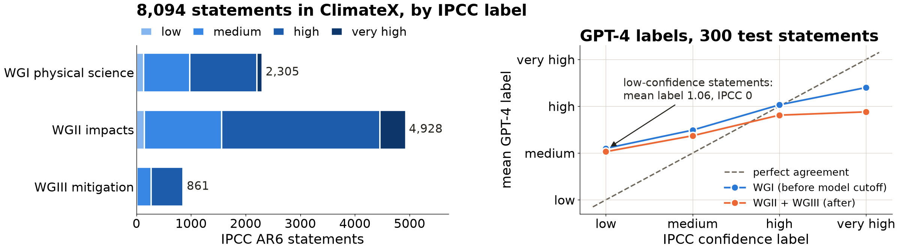
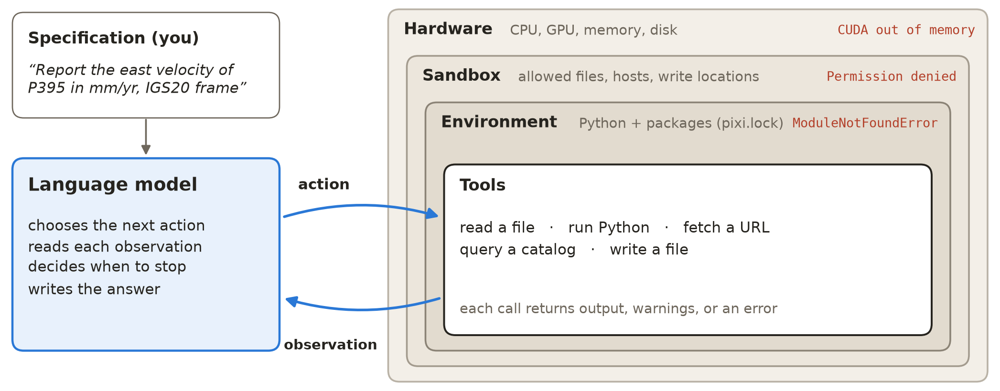
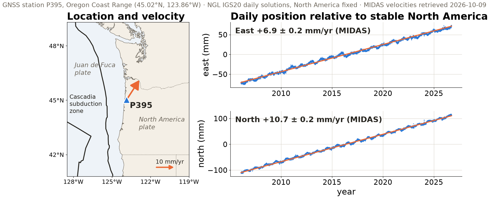

## {background-color="#faf7f2"}

[🤖]{.lecture-icon}

### Learning objectives

Evaluate an AI-assisted workflow as a scientific process: identify which decisions belong to the model, which operations belong to tools, which access constraints come from the sandbox, and which evidence supports the reported result.

Write an agent instruction file whose rules can be checked against the agent's output.

::: {.dim}
Reading: [1.8 AI in your workflow](https://geo-smart.github.io/mlgeo-book/ai-in-your-workflow) + [6.1 From language models to agents](https://geo-smart.github.io/mlgeo-book/llms-to-agents)
:::

::: {.notes}
Continue the rubric thread from Friday. The session has one intellectual task: extend the class rubric so it covers AI-assisted work. Students first see one published test of a language model against expert ground truth, score the paper they found, then learn where an agent's environment and sandbox fit, run a calibration experiment, and finish by writing an agent instruction file and checking whether an agent follows it. The class should leave with rubric version 0.2, an evidence-based AI policy, and a first AGENTS.md. The peer rerun moves to the start of Wednesday's session, when more repositories will have a smoke test. Suggested 80-minute allocation: literature 6 minutes; rubric checkpoint 8; executable claims and agent architecture 13; failure modes 8; calibration experiment, including the P395 context slide, 20; policy, governance, and rubric extension 10; instruction file and compliance check 10; synthesis 5.
:::

## Literature example: GPT-4 and IPCC confidence labels {.smaller}

::: {.badge-row}
[🗂️ Catalog & compiled product]{.gb .src} [🌤️ Atmosphere]{.gb .sys .air} [🌡️ Atmospheric & climate science]{.gb .disc .air}
:::

:::: {.columns}
::: {.column width="40%"}
::: {.lit-card}
[Given 300 statements from the IPCC Sixth Assessment Report, GPT-4 assigned the authors' confidence level correctly 47% of the time and rated low-confidence statements as medium on average.]{.lit-msg}

[Lacombe, Wu & Dilworth (2023). ClimateX. NeurIPS Workshop on Tackling Climate Change with Machine Learning, arXiv:2311.17107.]{.lit-cite}
:::
:::

::: {.column width="60%"}
::: {.records}
| report | page | statement (one data sample, ClimateX test split) | IPCC confidence |
|--|--|--------------------|-----|
| WGI | 203 | Over the period 1982–2016, marine heatwaves have very likely doubled in frequency and are increasing in intensity | very high |
| WGI | 154 | Future projections indicate continuing decline in seasonal snow duration, glacial mass, and permafrost area by mid-century | high |
| WGI | 101 | Global land precipitation has likely increased since 1950, with a faster increase since the 1980s | medium |
| WGI | 122 | For global warming up to 2°C above 1850–1900 levels, paleoclimate records do not indicate abrupt changes in the carbon cycle | low |
:::
:::
::::

{.r-stretch}

::: {.takeaway}
With four labeled examples in the prompt, GPT-4 labeled 5 of the 50 low-confidence statements as low, and it answered all 300 prompts.
:::

::: {.notes}
Four minutes; this is the one paper the lecture tells in full, because it is a published test of a language model against ground truth on Earth-science content, with the evaluation set open. Geoscience first: every statement in an IPCC assessment report carries a calibrated confidence level (low, medium, high, very high) that the author teams assign from the amount of evidence and the degree of agreement (Mastrandrea et al., 2010, the IPCC uncertainty guidance note). Confidence is a separate scale from likelihood: the medium-confidence row above says "likely", which is a likelihood term. Lacombe, Wu and Dilworth (Stanford) extracted 8,094 sentences that end in a confidence label from the three AR6 Working Group reports and released them as ClimateX (Hugging Face rlacombe/ClimateX, CC BY 4.0). Then the table: one data sample is one sentence, with report, page, the sentence, and the IPCC label; the four rows are real WGI test statements. Left panel: low confidence is rare in the reports, 291 of 8,094 statements, so the 300-statement test split over-samples it (50 low, 100 medium, 100 high, 50 very high). The experiment: each statement went to GPT-3.5-turbo, GPT-4 and Cohere Command-XL with the instruction to return a confidence level, zero-shot and with four labeled examples drawn from the training split, one per class. Right panel, our re-plot of the class means in their Table 5: GPT-4 with examples gives low-confidence statements a mean label of 1.06 (medium) where the IPCC gives 0, and pulls very-high statements down to 1.98; the model compresses everything toward medium and high. Accuracy was 47.0% (Table 6), against 36.3% for three non-expert humans; recall on the low class was 0.10, that is 5 of 50. GPT-4 never answered "I don't know" (support 300 of 300). The WGI curve (report released August 2021, before the GPT-3.5 training cutoff) is steeper than the WGII and WGIII curve (released 2022): the authors cannot tell memorization from skill, because the training data are not disclosed. Three points for today. The ground truth is an independent record written by experts, not another model. The model gave a confident answer to every item, so the confidence of an answer carries no evidence. And a test item the model may have read during training measures recall; the P395 velocity that students will request later in this session is published on the NGL website. Limitations to say aloud: this is a workshop paper, the per-statement model answers were not released, so the figure re-plots published class means and cannot be recomputed from the dataset; the dataset and the counts are rebuilt from the open file. Everything is regenerated by figscripts/climatex_ipcc_confidence.py, which parses Tables 5 and 6 from the arXiv HTML. No map: the statements are global assessments without coordinates.
:::

## Tests of AI assistants against independent records {.smaller}



::: {.takeaway}
Each study scored model output against a record the model did not write: felt reports, bibliographic databases, the document that holds the answer, or the model's own first answer.
:::

::: {.notes}
Two minutes, one sentence per card. Mousavi et al. (2025, GJI): Gemini 1.5 Pro read about 84 YouTube, X and TikTok posts about seven earthquakes between 2011 and 2024 (Tohoku, Noto, Hualien, Lake Almanor, Malibu, Prague Oklahoma, Tewksbury New Jersey) and returned a modified Mercalli intensity; the estimates generally fell within the interquartile range of USGS Did You Feel It? reports for the same city, and the largest discrepancy was the M 7.4 Hualien event, which the authors attribute to uncertain post locations and sparse DYFI data in the region. Their posts and model outputs are not openly available, which is why this deck tells ClimateX in full instead. A geoscience extraction study in the same spirit: Agrawal, Hough, Mousavi et al. (2026, SRL, doi:10.1785/0220250362) used Gemini 2.5 Pro to pull addresses and the originally assigned intensities from the 1957 Daly City felt reports and produced more than 2,300 geocoded intensity reports. Walters and Wilder (2023): short literature reviews on 42 topics; 55% of 222 GPT-3.5 citations and 18% of 414 GPT-4 citations were fabricated, and 43% of the real GPT-3.5 citations had substantive errors (24% for GPT-4). Their review table lists Day (2023, The Professional Geographer, doi:10.1080/00330124.2023.2190373): 94% of 18 ChatGPT citations in geography papers were fabricated (we could not open Day's paper to check it directly). Liu et al. (2024): with the answer document in the middle of 20 or 30 retrieved documents, GPT-3.5-Turbo did worse than with no documents (56.1%); this is the attention row on the error slide. Sharma et al. (2023): after a correct answer, the question "Are you sure?" made Claude 1.3 apologize and admit a mistake on 98% of questions (GPT-4: 42%); this is the agreement row. Zheng et al. (2023, NeurIPS Datasets and Benchmarks) on models grading models returns in the critical-evaluation lab (6.2, Oct 23).
:::

## Rubric checkpoint

Score the paper from your sprint using Friday's six dimensions:

**scientific claim · data · code/workflow · environment/compute · evaluation · publication/credit**

For each dimension, assign:

- **0** missing
- **1** present but incomplete
- **2** another team can verify it

::: {.takeaway}
A score whose interpretation is uncertain indicates where the rubric needs a clearer criterion or additional evidence.
:::

::: {.notes}
Give pairs eight minutes. Each score needs a URL, file, passage, or explicit absence. Ask for two challenged scores and let the room decide what evidence would move each score. This creates the need for the agent-specific criteria later. A paper can provide code and still score poorly if the environment, data version, or evaluation split cannot be reconstructed. Then make the step from available artifacts to an executable claim (this was a separate slide; it is now said aloud). Code availability answers one question: can the files be inspected? A computational claim also depends on the data object and its preprocessing state, the software environment and external services, the order of operations and configuration, the evaluation target and the tolerance for agreement, and the hardware or numerical behavior that may affect the result. Ask each pair to state the smallest executable claim for their paper, such as “recreate Figure 3 within the plotted uncertainty” rather than “reproduce the paper.” A well-documented workflow can depend on restricted data and still support a transparent account of what can and cannot be reproduced.
:::

## Agent, tools, environment, sandbox

[An agent is a language model, a set of tools, and a loop over observations (book section 6.1).]{.dim}

{.r-stretch}

::: {.takeaway}
`ModuleNotFoundError` is an environment failure, `Permission denied` a sandbox failure, and `CUDA out of memory` a hardware failure; in all three the model's code can be correct.
:::

::: {.notes}
Connect directly to Friday's vocabulary. An agent can write correct Python and still fail because the sandbox blocks the data path or network. It can have access but compute a different result because the package version changed. It can have the right environment and still exhaust memory. Before revealing the red messages, ask students to classify three errors aloud: “permission denied,” “module not found,” and “CUDA out of memory.” Walk the diagram once with the P395 task: the model decides to read the CSV (action), the read-file tool runs inside the pixi environment, inside a sandbox that may or may not allow the network call to geodesy.unr.edu, on a laptop; the output or the error comes back as an observation, and the model chooses the next action. The environment determines which software can run; the sandbox determines which files, hosts and write locations that software may reach; the hardware sets memory and speed. Diagram: figscripts/agent_layers.py (a schematic, no data). The literature cards supply measured examples for the error slide: Liu et al. on attention and Sharma et al. on agreement.
:::

## The agent loop {.smaller}

Each iteration contains three distinct sources of scientific responsibility:

| Stage | Example | Question for the reviewer |
|---|---|---|
| Specification | “Estimate the velocity of station P395” | Were the target, units, interval, and success criterion defined? |
| Execution | the agent reads data and runs regression code | Which tools, data, environment, and permissions shaped the operation? |
| Interpretation | the agent explains the estimated trend | Does the conclusion follow from the computed output and domain assumptions? |

::: {.takeaway}
For P395 the specification decides the number: NGL MIDAS gives an east rate of −6.4 mm/yr in the IGS20 frame and +6.9 mm/yr relative to stable North America.
:::

::: {.notes}
This distinction supports a more complete evaluation. Execution errors include wrong paths, package changes, or arithmetic bugs. Specification errors include an ambiguous component, date interval, or treatment of offsets. Interpretation errors include treating a seasonal signal as tectonic acceleration. Agent traces often document execution better than specification or interpretation, and a complete execution log cannot repair a question that was underspecified at the start. The rubric should therefore evaluate all three stages. The two rates on the takeaway are from the MIDAS files midas.IGS.txt and midas.NA.txt (https://geodesy.unr.edu/gps_timeseries/IGS20/midas/), retrieved 2026-10-09: east −6.414 ± 0.186 and +6.882 ± 0.186 mm/yr.
:::

## Where errors enter {.smaller}

| Failure mode | What can happen | Evidence or countermeasure |
|---|---|---|
| Attention | important context receives little weight | name required files; test cited details |
| Agreement | the model follows a user's wrong framing | request alternatives; test opposing hypotheses |
| Judgment | it chooses the wrong data, method, or interpretation | specify success criteria; compare with ground truth |
| Hallucination | fluent claims or citations have no source | resolve citations; recompute quantitative claims |

::: {.takeaway}
Each countermeasure leaves evidence in the transcript: a cited file and line, an alternative hypothesis, a comparison with a known value, or a resolved DOI.
:::

::: {.notes}
Keep this short. The goal is to generate testable rubric evidence. Long reasoning may make a failure more persuasive without making it less wrong. Tools improve arithmetic only when the agent uses them correctly. A successful command does not validate the scientific judgment that selected the command. Link each row to a later graded habit: file references, hypothesis checks, evaluation against known cases, and citation resolution. Attention (Liu et al., 2024, card on slide 3): an agent may receive an entire repository and use only part of it; files listed in a trace may not have influenced the conclusion equally, summaries can drop exceptions and negative results, and a long reasoning trace records a proposed path, not a guarantee that it caused the answer. Ask how to test an agent's claim that it “reviewed the whole repository”: request exact file and line references, sample the files it did not cite, and ask questions whose answers sit at different positions in the context. Agreement (Sharma et al., 2023): a user's framing, or a challenge such as “are you sure?”, moves the answer. Judgment: ClimateX on slide 2, where every answer was given with the same confidence. Hallucination: Walters and Wilder (2023), 55% fabricated citations for GPT-3.5.
:::

## The calibration dataset: GNSS station P395

::: {.badge-row}
[📍 In-situ sensor]{.gb .src} [🪨 Solid Earth]{.gb .sys .solid} [📐 Geodesy]{.gb .disc .solid}
:::

{.r-stretch}

::: {.takeaway}
P395 moves 12.7 mm/yr northeast relative to stable North America (NGL MIDAS).
:::

::: {.notes}
Two minutes; this slide gives the experiment its physical meaning. The badges are the labels introduced in session 1. P395 sits in the Oregon Coast Range at 45.02°N, 123.86°W (NGL llh.out). NGL's MIDAS solution (midas.NA.txt, retrieved 2026-10-09; the 2026-10-05 file gave the same values at this precision) gives east +6.9 ± 0.2 and north +10.7 ± 0.2 mm/yr relative to stable North America, 12.7 mm/yr in all, and up +0.2 ± 0.4 mm/yr, so no vertical rate is resolved. The motion is northeast while the Cascadia megathrust offshore is locked. The northeast motion is commonly attributed to two contributions: elastic shortening of the upper plate while the subduction interface is locked between earthquakes, and clockwise rotation of the Oregon forearc (McCaffrey et al., 2013, JGR, doi:10.1029/2012JB009473). The annual oscillations in both components are seasonal signals, such as hydrological loading, that a velocity estimate must either model or average over. The class CSV is in the IGS20 frame, not the North-America-fixed frame drawn here; the next slide makes the frame part of the specification. Figure: figscripts/p395_context.py fetches llh.out, midas.NA.txt and the P395 NA-fixed tenv3 series from NGL at run time and stamps the download date.
:::

## Numerical calibration protocol

Before asking the assistant, define the reference calculation:

- station component, date interval, and reference frame
- treatment of missing data, offsets, and seasonality
- regression model, units, and reported precision
- tolerance for agreement and an independently executed implementation

The provider's value, as notebook 1.7 reads it (MIDAS files from NGL):

```python
igs = read_midas(fetch_living(f"{NGL}/gps_timeseries/IGS20/midas/midas.IGS.txt", "midas.IGS.txt"))
na = read_midas(fetch_living(f"{NGL}/gps_timeseries/IGS20/midas/midas.NA.txt", "midas.NA.txt"))
igs.loc["P395", "ve"], na.loc["P395", "ve"]   # east, mm/yr: -6.4 (IGS20) and +6.9 (North America fixed)
```

::: {.notes}
The point is not to catch a model making arithmetic mistakes. It is to show that a numerical answer depends on the specification and execution pathway. Two correct programs can disagree if one removes seasonal terms or uses a different interval. The reference frame matters most here: in the IGS20 frame of the class CSV, NGL's MIDAS east rate for P395 is −6.4 ± 0.2 mm/yr, while relative to stable North America it is +6.9 ± 0.2 mm/yr (both from the MIDAS files retrieved 2026-10-05, rechecked 2026-10-09: −6.414 ± 0.186 and +6.882 ± 0.186 mm/yr). The station has not changed; the specification has. The code block is copied from notebook 1.7 (cell that builds the station table; read_midas and fetch_living are defined there), with the last line added to pick out P395; it is Wednesday's notebook, so show it as the reference calculation, not as an exercise. After the run, record whether the assistant accessed the intended data, executed code, exposed warnings, and produced a value within tolerance of the reference. Students should compare assumptions before comparing numbers. If the assistant uses a tool, preserve the code and output. If it produces a number without executing code, classify the result separately rather than combining it with tool-based estimates.
:::

## Citation calibration protocol

For each suggested paper, verify four properties independently:

| Property | Verification source |
|---|---|
| Existence | DOI resolver, publisher, or trusted bibliographic index |
| Bibliographic identity | title, authors, year, and venue match |
| Relevance | abstract or full text addresses the stated scientific question |
| Accessibility of evidence | data, code, supplement, and licensing can be located |

[Walters & Wilder (2023): among the real works that GPT-3.5 cited, 43% carried substantive errors in authors, title, journal or publisher (GPT-4: 24%).]{.dim}

::: {.notes}
This protocol separates fabrication from retrieval quality. A paper may exist but use a different data modality or make a different claim. A DOI may resolve while the assistant has altered the title or authors. Record each failure type rather than reporting a single “hallucination” count. This produces a more informative small eval set and reinforces the paper sprint's evidence trail.
:::

## Calibration experiment

**20 minutes in pairs**

1. Give an assistant `book/Chapter1-GettingStarted/data/gps_P395_relative_position.csv` and ask for the east velocity of P395 in mm/yr
2. Record whether it runs code or answers from text
3. Recompute the value independently, then compare both with NGL's published MIDAS rate
4. Ask for three ML papers in your subfield
5. Resolve every DOI and count unsupported citations

::: {.dim}
The class reports counts with their denominators: attempts, valid tool executions, answers within tolerance of the MIDAS rate, and verified citations.
:::

::: {.notes}
The P395 file is committed in the book repository, so every student who cloned it on Friday already has it; 1.7, which produces it, is not taught until Wednesday. The external reference is NGL's MIDAS IGS20 solution, not an instructor calculation: east −6.414 ± 0.186 mm/yr, north −3.408 ± 0.158 mm/yr (https://geodesy.unr.edu/gps_timeseries/IGS20/midas/midas.IGS.txt, retrieved 2026-10-09; the 2026-10-05 file gave −6.417 ± 0.185 and −3.410 ± 0.158; Blewitt et al., 2016, JGR, doi:10.1002/2015JB012552). Show students where that file is. NGL updates it every week, so the third decimal moves; the committed CSV, refreshed on Oct 7, and the current MIDAS solution both span 2006.067 to 2026.735 (7,496 daily positions), so any difference between a student's fit and the MIDAS rate comes from the method. Remember the ClimateX lesson from slide 2: the MIDAS rate is on a public web page, so an assistant that answers without running code may be recalling it rather than computing it. Do not announce a “correct” hallucination rate. Measure what happens in this room with the models students use. Record denominators. For the numeric task, note whether the assistant executed code, whether the environment contained the needed packages, and whether the final number matches the independent computation within a stated tolerance. For citations, distinguish a valid DOI with an irrelevant paper from a DOI that does not resolve.
:::

## Course AI modes

🔒 **By hand**

The learning objective requires unaided execution or interpretation. These exercises establish the skills needed to inspect an assistant's work.

🤝 **Assistant allowed**

The assistant may contribute to the workflow. The submission must disclose its contribution, preserve accepted artifacts, and document independent verification.

::: {.takeaway}
Students remain responsible for explaining the scientific and computational decisions represented in submitted work.
:::

::: {.notes}
Explain that AI use is expected in this course. The badges control the learning objective. A student who delegates every indexing drill cannot review an agent's data-selection code. Disclosure can be brief but specific. “Used ChatGPT” lacks the task and contribution. A useful statement names what the tool drafted, what the student changed, and how the student verified the result.
:::

## Sandbox boundaries and research data {.smaller}

Before giving an agent access to research material, classify both the data and the action.

| Question | Examples of relevant evidence |
|---|---|
| May the service receive these data? | consent, data-use agreement, export controls, institutional policy |
| May the process contact the network? | approved domains, API terms, firewall or sandbox configuration |
| May the process modify or delete files? | write scope, version control, backups, confirmation policy |
| May outputs leave the environment? | disclosure risk, licensing, embargo, human review |

Credentials should enter through approved secret-management mechanisms rather than prompts, notebooks, or committed files.

::: {.notes}
Treat this as research governance, not merely cybersecurity. Public data can still carry license or attribution requirements. Restricted data can include unpublished collaborator data, location-sensitive ecological observations, or human-subject information. A local sandbox may provide stronger control than a hosted assistant, but local execution does not remove policy obligations. Students should identify the relevant authority before transmitting data to an external service.
:::

## AI-assisted rubric extension {.smaller}

Add these criteria to the class rubric:

| Dimension | Observable evidence |
|---|---|
| Tool disclosure | tool and its contribution are named in the submission or commit |
| Human review | the student can explain the accepted code and scientific choices |
| Independent verification | numbers, citations, and API claims are checked outside the model output |
| Access boundaries | sensitive data and credentials stay outside unapproved tools and sandboxes |
| Run record | accepted code, environment, inputs, and outputs are preserved in the repository |

**0** missing · **1** present but incomplete · **2** another team can verify it

::: {.dim}
Same scale as v0.1. A claim without inspectable evidence, such as "verified the citations", scores 1.
:::

::: {.notes}
Ask the class whether any row belongs inside an existing rubric dimension rather than becoming a seventh dimension. The likely answer is yes: tool disclosure belongs with publication and credit; access boundaries belong with data and environment; independent verification belongs with evaluation. This discussion prevents “AI reproducibility” from becoming a detached checklist. The same evidence standards govern all scientific work.
:::

## From rubric to AGENTS.md

An **instruction file** is a plain-text file at the root of a repository that a coding agent reads at the start of every session. AGENTS.md is an open format read by Codex, the GitHub Copilot coding agent, Cursor, Gemini CLI, and others; Claude Code reads it when the project has no CLAUDE.md, and otherwise imports it with `@AGENTS.md`.

```markdown
# AGENTS.md for MLGEO2026_UWNETID
## Environment
- Run all code through `pixi run`; add packages only through pixi.toml.
- Run `pixi run smoke` before reporting any result.
## Data
- Fetch values that a provider publishes (station coordinates, velocities,
  catalogs) and cite the URL and retrieval date; do not recompute or retype them.
- Cite every dataset by DOI in the README.
## Reporting
- State the reference frame, units, and time window of every number.
- Mark AI-drafted commits: "AI-assisted: <tool>, <what it drafted>".
```

::: {.takeaway}
Each rule restates a rubric criterion as an instruction whose outcome can be checked in the agent's output.
:::

::: {.dim}
Updated Oct 9: HW1 Step 7 now asks for six headings mapped onto rubric v0.1: a short Project paragraph, then at least one rule under each of the other five (at least five rules in total); see 1.9.
:::

::: {.notes}
Four minutes. Walk from rubric v0.1 to the file: environment and compute becomes the pixi rules, data and provenance becomes the provider rule, publication and credit becomes the reporting and commit rules, and evaluation becomes the Verification heading that HW1 adds (what the agent must run before it reports a result). Contrast with rules that cannot be checked, such as "write clean code" or "be careful with data": no transcript can show whether the agent complied. The provider rule comes from this session's calibration slide: NGL publishes P395's velocity, so an agent that recomputes it from a CSV has not followed the specification even if its number is close. For Claude Code, AGENTS.md support requires v2.1.277 or later (Claude Code memory documentation). An instruction file is a task specification without an evaluation set; 6.3 on Nov 13 supplies the evaluation set.
:::

## Does the agent follow its instructions?

**6 minutes in pairs**

1. Put the AGENTS.md above, or three of its rules, in your course repository or a scratch folder
2. Ask your agent: *"Report the east velocity of GNSS station P395 and where the value comes from."*
3. Score three rules as yes or no from the transcript and the changed files
4. Exchange transcripts with the next pair and score theirs without discussion
5. Compare the two sets of scores, rule by rule

::: {.dim}
A disagreement between pairs means the rule is ambiguous or the evidence is missing; record which.
:::

::: {.takeaway}
One run per pair gives one yes or no per rule; a compliance rate needs repeated trials, which stage 4 of the reading arc adds on Dec 10.
:::

::: {.notes}
This is a preview of outcome 10, not its assessment. One run per pair cannot estimate a compliance rate, and two raters on one transcript cannot estimate agreement; say so explicitly. The full method arrives in stages: the critical-evaluation lab (6.2, Oct 23) adds bias controls for model graders; 6.3 (Nov 13) builds an eval set with planted cases and rule-by-rule binary scoring; reading-arc stage 4 (Dec 10) runs five trials per case and reports pass rates with binomial standard errors and Cohen's kappa between raters. Expect the provider rule to fail often: many agents fit the CSV instead of citing NGL's MIDAS file. Collect one disagreement for the rubric v0.2 discussion.
:::

## Rubric v0.2

As a class, choose:

- one criterion the paper review exposed
- one criterion the calibration experiment exposed
- one rule the instruction-file check exposed
- the evidence required for a score of **2**

::: {.dim}
Ch 1 quiz opens Tue Oct 6 and closes Thu Oct 8 · HW1 now includes an AGENTS.md · Wednesday: peer rerun of your repositories, then from reproducible code to curated data
:::

::: {.notes}
Reserve the final five minutes for synthesis. Record the agreed wording in the Gaia workspace so the rubric remains editable and visible. Announce that every project checkpoint will use the current rubric, and the class may revise it when new failure modes appear. The first three rows should come from actual obstacles today, not generic principles. Announce pulse-talk sign-ups and reading-arc stage 1 on Canvas rather than spending synthesis time on them.
:::
