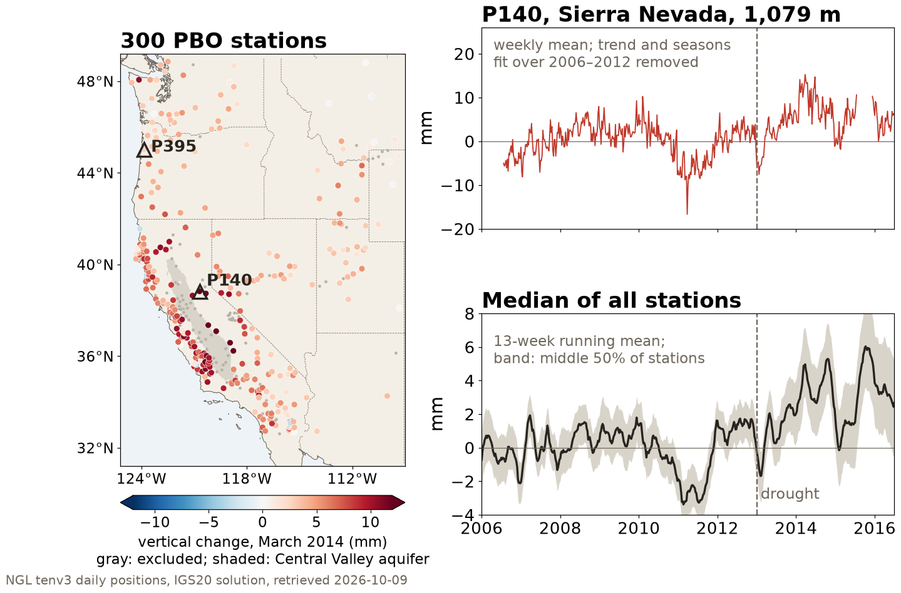
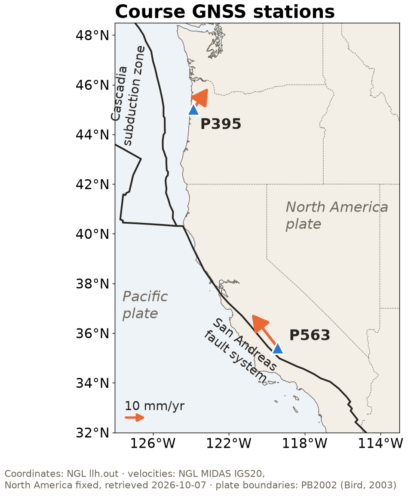
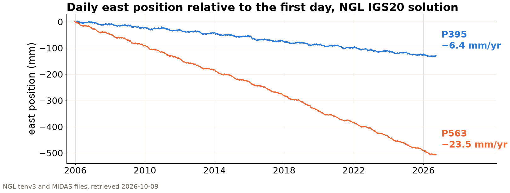

## {background-color="#faf7f2"}

[🛰️]{.lecture-icon}

### Today's question

Every geoscience project ends up handling at least two kinds of data.

**Which streams are yours, and what do they deserve to be stored in?**

::: {.dim}
Reading: [2.1 Data definitions](https://geo-smart.github.io/mlgeo-book/data-definitions) · [2.2 Data formats](https://geo-smart.github.io/mlgeo-book/data-formats-rendered) · [1.6 Data gallery](https://geo-smart.github.io/mlgeo-book/data-gallery) · [1.7 GNSS data](https://geo-smart.github.io/mlgeo-book/get-geodetic-gnss)
:::

::: {.notes}
Frame the session: Monday was about agents and verification culture, and it ended with an AGENTS.md whose data rules say where values come from. Today opens with the peer rerun moved from Monday, then turns from reproducible code to the data that code consumes. ML projects in the geosciences succeed or fail on the data, and most of the work is upstream of any model. Two goals for the next 20 minutes: name the three data streams that run through the whole course, and see that a storage format is a scientific decision with measurable consequences; then touch the first real dataset. Ask the room to restate Monday's three labels for their project (source, system, discipline); they map onto today's stream table.
:::

## Peer rerun

Exchange repository URLs with another pair.

1. Read only the README first
2. Clone into a fresh directory
3. Build the environment from the lockfile
4. Run the smoke test the README names (`pixi run smoke`)
5. Open the AGENTS.md and check that each rule could be verified
6. Log the first obstacle before asking for help

::: {.takeaway}
The first obstacle a peer meets is evidence about documentation, environment, access, or computational assumptions.
:::

::: {.notes}
Ten minutes, moved here from Monday so that more repositories have the HW1 smoke test (Step 6 of 1.9) and AGENTS.md (Step 7). pixi reuses the package cache, so the environment builds quickly. The product is the logged first obstacle, not a completed run. Students should not use their partner's verbal instructions until the obstacle is recorded. If the clone has no runnable target, that is itself a finding. Ask peers to classify the obstacle by Friday's layers: documentation, data access, environment, sandbox or permissions, hardware, or scientific ambiguity. Collect two obstacles about data access; they introduce the next slide.
:::

## Curation questions, session by session {.smaller .compact}

**Data curation**: selecting, documenting, checking, versioning, and licensing data so that someone else can find, understand, and reuse it. It is the rubric's *data and provenance* dimension, and the data rules in your AGENTS.md.

| Curation question | Book | Session |
|---|---|---|
| What is this dataset, where did it come from, and under what license? | 1.6–1.7, 2.1 | today |
| Does the stored form keep its meaning: types, units, metadata? | 2.2 | today |
| Does the table record what happened: missing values, types, joins? | 2.3–2.4 | Fri Oct 9 |
| Are arrays and irregular samples on a consistent time base? | 2.5–2.6 | Mon Oct 12 |
| What do its distributions and spectra show? | 2.7–2.8 | Wed Oct 14 |
| Are gaps, drift, and timing errors repaired, and the repairs recorded? | 2.9 | Fri Oct 16 |
| Which features carry the signal, checked against synthetic truth? | 2.10–2.12 | Mon Oct 19 – Wed Oct 21 |
| Is it AI-ready, with a data card another team can audit? | 2.13, 2.20 | Wed Oct 21 |

::: {.takeaway}
Chapter 2 is one curation workflow; each session answers one of these questions for your project data.
:::

::: {.notes}
Three minutes. This slide is the map for the next six sessions; return to it at the start of each. The final-project data card (2.20) collects the answers to every row for one dataset, and the critical-evaluation lab on Oct 23 applies the same questions to an AI's claims about data. Point out that the curation questions do not depend on the modality: GNSS positions, satellite scenes, and model output all need a provenance, a license, a stored form that keeps units, and a record of repairs.
:::

## Literature example: drought seen by GNSS {.smaller}

::: {.badge-row}
[📍 In-situ sensor]{.gb .src} [🪨 Solid Earth]{.gb .sys .solid} [💧 Land water]{.gb .sys .water} [📐 Geodesy]{.gb .disc .solid} [💧 Hydrology & land-surface modeling]{.gb .disc .water}
:::

:::: {.columns}
::: {.column width="36%"}
::: {.lit-card}
[GNSS stations built to measure plate motion rose by a median of 5 mm, and by up to 15 mm in California's mountains, as the 2013–2014 drought removed about 240 Gt of water.]{.lit-msg}

[Borsa, Agnew & Cayan (2014). *Science*, 345, 1587–1590.]{.lit-cite}
:::

**One data sample is one station-day** (NGL file P140.tenv3)

::: {.records}
| site | YYMMMDD | yyyy.yyyy | u0 (m) | up (m) | ant (m) | sig_u (m) |
|---|---|---:|---:|---:|---:|---:|
| P140 | 13MAR14 | 2013.1992 | 1079 | 0.215989 | 0.0083 | 0.003620 |
| P140 | 13MAR15 | 2013.2019 | 1079 | 0.216928 | 0.0083 | 0.003592 |
| P140 | 14MAR14 | 2014.1985 | 1079 | 0.228624 | 0.0083 | 0.005518 |
| P140 | 14MAR15 | 2014.2012 | 1079 | 0.226236 | 0.0083 | 0.005562 |
:::

[Dates appear as a two-digit-year code and as a decimal year; height is split into whole meters (u0) and the rest (up). March median of up: 0.2150 m in 2013, 0.2285 m in 2014.]{.dim}
:::

::: {.column width="64%"}
{width="100%"}
:::
::::

::: {.takeaway}
NGL positions today, 300 stations: median rise 4.6 mm by March 2014; the paper found 5 mm at 771.
:::

::: {.notes}
Four minutes; this is the one paper the lecture tells in full, and it uses the same archive and file format as today's P395 dataset. Geoscience first: from 2013 the western United States was in severe drought. Water in snow, soil, reservoirs, and shallow aquifers is a load on the elastic lithosphere; remove it and the ground rises. Borsa, Agnew and Cayan (2014) measured that rise with 771 continuous GNSS stations, mostly from the EarthScope Plate Boundary Observatory (PBO), a network built to measure tectonic deformation. They detrended and deseasoned each vertical series and found a median uplift of 5 mm by March 2014, up to 15 mm in California's mountains, which they inverted for a water deficit of about 240 Gt, a 10 cm layer over the whole region, comparable to the annual mass loss of the Greenland ice sheet. They excluded the Central Valley (aquifer pumping) and the Long Valley caldera. The data-stewardship point: this result needed nothing new in the field. It came from openly archived daily positions in a documented format, recorded for another purpose and reused by hydrologists. The table: each data sample is one station-day in an NGL tenv3 file. Point at the conventions a reader must know: the date as 13MAR14 (two-digit year) and as 2013.1992 (decimal year; the file also has MJD and GPS week), and height split into an integer part u0 and a fraction up, both in meters. The antenna-height column is metadata that changes when equipment changes. P140 sits at 1,079 m on the west slope of the Sierra Nevada (38.83°N, 120.69°W). The figure is our reconstruction from NGL's current IGS20 reprocessing, with a simplified method (figscripts/drought_uplift_2014.py): 411 PBO stations west of 109°W with data from before 2007 to after mid-2015; Central Valley aquifer system (USGS principal aquifers map), Long Valley area, stations subsiding faster than 3 mm/yr, stations with a step in 2013 to mid-2014, and noisy stations excluded, leaving 300; trend, annual and semiannual terms and NGL's listed steps fit over 2006–2012 and removed; March 2014 median residual mapped. Result: median 4.6 mm, middle half 3.2 to 7.0 mm, maximum 13.4 mm (P305, on the eastern edge of the San Joaquin Valley), 13.2 mm at P140, and 96% of stations rising; P395 rose 2.8 mm. The paper's 5 mm and 15 mm came from a different processing (2014, older reference frame) and 771 stations; the archive is living data, so today's files give slightly different numbers, which is why an analysis records which version it read. Ask the room: what in the bottom panel happens in 2011? (The wet winter of 2010–2011 loaded the crust and the median went down.)
:::

## Archives and formats behind other results {.smaller}



::: {.takeaway}
Continuous seismic archives and a common climate-model format made new analyses possible; a spreadsheet default altered gene lists in 19.6% of the genomics papers screened.
:::

::: {.notes}
Two minutes, one sentence per card. Shapiro et al. (2005): 30 quiet days (August–September 2004) of continuous 1-sample-per-second records from 62 California stations, mostly permanent regional network stations recording for earthquake monitoring, were cross-correlated to build 7.5 s and 15 s Rayleigh-wave group-speed maps; low speeds outline the sedimentary basins and high speeds the mountain cores. The method only works because the networks archived continuous records, in a standard format (SEED, at the IRIS and regional data centers), and not just earthquake snippets. Taylor et al. (2012): CMIP5 asked roughly 20 modeling groups to write their output in a common way (CF-compliant netCDF), served from a federated archive; the paper estimated more than 3 PB, nearly 100 times CMIP3, and the common format is what lets one script read every model. Blewitt et al. (2018, Eos): NGL gathers data from more than 130 archives and more than 17,000 stations, processes them with one strategy, and publishes positions as plain text files, updating the daily positions of about 10,000 stations every week; today's P395 file is one of them, and the paper is the citation to use. Ziemann et al. (2016) is genomics, kept because it is the best-quantified case of a file-format default changing published data: Excel, with default settings, converted gene symbols such as SEPT2 to dates, in 704 of 3,597 papers (19.6%) whose supplements had gene lists. The geoscience equivalents are quieter: CSV drops types and units, and two-digit years like 13MAR14 must be parsed with the right convention. Two references for the vocabulary, not on cards: the FAIR principles (Wilkinson et al., 2016, Scientific Data) and the Geoscience Paper of the Future (Gil et al., 2016, Earth and Space Science), the documentation standard the final project is graded against.
:::

## Three data streams in this course {.smaller}

| Stream | Geoscience examples | Shape | Typical labels |
|---|---|---|---|
| **Regular high-rate series** | 100 Hz seismograms, hourly tide gauges, daily GNSS | 1D, clocked by the instrument | [📍 In-situ sensor]{.gb .src} [📈 Seismology]{.gb .disc .solid} [📐 Geodesy]{.gb .disc .solid} |
| **Gridded fields** | climate rasters, satellite imagery, model output | 2D–4D arrays over region and time | [🛰️ Satellite & airborne]{.gb .src} [🖥️ Model & simulation]{.gb .src} [🌡️ Atmospheric & climate science]{.gb .disc .air} |
| **Irregular sparse points** | multi-well networks, field campaigns | samples wherever access allowed | [📍 In-situ sensor]{.gb .src} [💧 Land water]{.gb .sys .water} [💧 Hydrology & land-surface modeling]{.gb .disc .water} |

::: {.takeaway}
Chapter 2 gives each stream equal time, because most projects combine at least two of them.
:::

::: {.notes}
This is the chapter's organizing principle. Walk one example per row: a seismogram is clocked; the instrument fixes the sampling and never misses on purpose; a satellite field is a grid over a region, often with a time axis stacked on; a groundwater network is measured where the wells are and when the crew visits, with nothing regular about it. Ask teams to place their project data: most place two streams, which is the point. Preview: sessions 5 and 6 take tables and series/grids in turn; the irregular stream returns Monday with the multi-well network.
:::

## Arrays and data frames

- **Arrays**: values on a grid; the dimensions carry the meaning (time, latitude, depth)
- **Data frames**: one data sample per row, one variable per column; mixed types welcome
- Most projects need both: a gridded field of covariates *and* a table of observations

::: {.takeaway}
A grid whose position encodes time and location belongs in an array; one record per observation, with mixed types, belongs in a data frame.
:::

::: {.notes}
Define both aloud with a physical example: a 3D array of temperature over latitude, longitude, and time, where position in the array IS the coordinate; versus the earthquake catalog, where each row is one event, columns of time, position, magnitude, text description. Mention modality vocabulary from 2.1 without dwelling: in-situ, remote sensing, model output, geophysical (indirect subsurface). The 2.13 capstone joins the two containers (extracting raster covariates at station locations), so both matter to every team. Implementation names for the notebook, not the slide: NumPy/Xarray for arrays, pandas for data frames.
:::

## One temperature field stored as CSV and as Parquet {.smaller}

::: {.badge-row}
[🖥️ Model & simulation]{.gb .src} [🌤️ Atmosphere]{.gb .sys .air} [🌡️ Atmospheric & climate science]{.gb .disc .air}
:::

::: {.big-number}
133 kB [as CSV: every number spelled out in text]{.unit}
:::

::: {.big-number}
33 kB [as Parquet: the same table, typed and compressed]{.unit}
:::

::: {.dim}
One 40 × 80 temperature-anomaly field, 3,200 grid cells; synthetic (mlgeo_synth), measured in the executed 2.2 notebook.
:::

::: {.takeaway}
CSV writes each value as text characters; Parquet stores typed 8-byte numbers by column and compresses them, four times smaller here.
:::

::: {.notes}
These are the notebook's own measured numbers; students reproduce them in the exercise. The badges describe what the field imitates (model output for the atmosphere); it is synthetic and has no real coordinates, so no map. Why the factor of four: CSV writes "9.932382" as eight characters plus separators; Parquet stores an 8-byte float, columnwise, then compresses. At 3,200 cells the gap is 100 kB and nobody cares; at a decade of satellite fields it is the difference between an archive that is usable and one that is not. Also name what CSV throws away: the dtype (everything is text until re-parsed) and the metadata (units live in a README, if anywhere). CSV remains fine for small, human-inspected tables, and the course data gallery uses it deliberately.
:::

## Four formats for the same field {.smaller}

| Format | Built for | Same field on disk |
|---|---|---|
| **CSV** | small tables, human-readable anywhere | 133.0 kB |
| **Parquet** | large tables: columnar, typed, compressed | 33.0 kB |
| **netCDF / HDF5** | self-describing arrays: data + units + coordinates in one file | 33.9 kB |
| **Zarr** | chunked arrays: parallel, partial reads from cloud storage | 29.9 kB |

```python
table.to_csv('data/temperature_anomaly.csv', index=False)
table.to_parquet('data/temperature_anomaly.parquet', index=False)
ds.to_netcdf('data/temperature_anomaly.nc')
ds.to_zarr('data/temperature_anomaly.zarr', mode='w')
```

::: {.takeaway}
Parquet, netCDF and Zarr store this field in 30 to 34 kB; netCDF and Zarr also keep units and coordinates, and Zarr splits the array into chunks read separately.
:::

::: {.notes}
Read the size column, then the 'built for' column. The code is from the 2.2 notebook: table is the field flattened to one data sample per grid cell, ds the labeled array. netCDF: built by the climate community; the file carries its own dimensions, units, and attributes, so open it anywhere and it explains itself; netCDF4 is HDF5 underneath (the notebook opens the same file with both libraries). Zarr: not one file but a directory of compressed chunks plus small metadata, so a cloud object store can serve a thousand parallel readers each grabbing only their chunk, which is exactly the access pattern netCDF/HDF5 are slow at. Honorable mentions from 2.1 for the notes-curious: GeoTIFF/COG for rasters (the notebook's Natural Earth relief map, real data), GeoJSON/GeoParquet for vector geometries (the four Cascade volcanoes), STAC for catalogs. Rule of thumb: tables → CSV small / Parquet large; arrays → netCDF local / Zarr cloud.
:::

## GNSS stations P395 and P563: location and velocity {.smaller}

:::: {.columns}
::: {.column width="50%"}
{height="700px"}
:::
::: {.column width="50%"}
::: {.badge-row}
[📍 In-situ sensor]{.gb .src} [🪨 Solid Earth]{.gb .sys .solid} [📐 Geodesy]{.gb .disc .solid}
:::

**P395**, Oregon Coast Range, above the Cascadia subduction zone: 12.7 mm/yr to the northeast; vertical +0.2 ± 0.4 mm/yr, not resolved.

**P563**, southern San Joaquin Valley, California, in the Pacific–North America plate boundary zone: 18.6 mm/yr to the northwest; subsides at 7.2 ± 0.5 mm/yr.

::: {.dim}
Horizontal rates relative to stable North America (arrows). NGL MIDAS, IGS20 solution, retrieved 2026-10-07.
:::
:::
::::

::: {.takeaway}
Both stations record plate-boundary motion; P563 also subsides 7.2 mm/yr above a pumped aquifer.
:::

::: {.notes}
Two minutes; every dataset in this course is shown with its place and its physics. P395 (45.02°N, 123.86°W): MIDAS east +6.9 ± 0.2, north +10.7 ± 0.2, up +0.2 ± 0.4 mm/yr relative to stable North America; the northeast motion is commonly attributed to elastic loading of the coast while the megathrust is locked, with a contribution from rotation of the Oregon forearc (McCaffrey et al., 2013). P563 (35.42°N, 119.42°W): east −11.9, north +14.3, up −7.2 mm/yr; the northwest motion reflects shear across the Pacific–North America plate boundary zone, and the subsidence is consistent with groundwater extraction from the Central Valley aquifer system. Point back to Monday's coupling of systems: at P563 the land-water system moves the solid Earth, so one GNSS record carries two system labels ([💧 Land water]{.gb .sys .water} as well). All values come from NGL's files (llh.out and midas.NA.txt), fetched by figscripts/gnss_stations_map.py.
:::

## Daily east positions of P395 and P563, 2006 to 2026

::: {.badge-row}
[📍 In-situ sensor]{.gb .src} [🪨 Solid Earth]{.gb .sys .solid} [📐 Geodesy]{.gb .disc .solid}
:::

{.r-stretch}

::: {.takeaway}
7,496 daily positions at P395 and 7,555 at P563; in the IGS20 frame they move east at −6.4 and −23.5 mm/yr (NGL MIDAS).
:::

::: {.notes}
The course's first real dataset. Each point is one daily position solution; the y-axis is east position relative to the first day, in millimeters. The smooth drift is plate motion in the IGS20 global reference frame (define: the current international terrestrial reference frame; positions are relative to the whole Earth, so trends are real plate velocities). At P395, NGL's MIDAS solution gives an east rate of −6.4 ± 0.2 mm/yr in this IGS20 frame (westward), and +6.9 mm/yr relative to stable North America, as on the map slide; P563 moves east at −23.5 ± 0.2 mm/yr in IGS20 and −11.9 mm/yr relative to North America; students fit it themselves, with honest error bars, in section 2.6 on Monday Oct 12, and compare with NGL's value. Look closer: seasonal wiggles from water and snow loading, and small offsets from equipment changes or earthquakes; every later lesson (trend fitting, gap repair, splits) returns to this station. Credit aloud: Nevada Geodetic Laboratory, Blewitt et al. 2018. Counts and rates were refetched on 2026-10-09 from NGL's tenv3 files (P395.tenv3 last modified 2026-10-04) and midas.IGS.txt; the figure is regenerated by figscripts/gnss_east_series.py, a lecture-scale replot of the 1.7 notebook's first figure.
:::

## Checksums for a released file and for an updated file

- **Released file** (Natural Earth basemap): pin its checksum, so every run verifies the same bytes
- **Updated file** (NGL tenv3, rewritten as new days arrive): log the checksum of the copy you received
- For a publication or a grade, freeze a snapshot and pin its checksum

```python
path = pooch.retrieve(url=BASE_URL.format(station=station), known_hash=None,  # updated file
                      fname=f"{station}.tenv3", path=DATA_DIR)
print(f"{station}.tenv3 sha256:{pooch.file_hash(path)}")
```

::: {.takeaway}
Each run records the checksum of the exact file it read; P395.tenv3 last changed on 4 October 2026, so a copy from September is a different file.
:::

::: {.notes}
This is the habit from 1.6 and 1.7 that HW1 grades; the code is notebook 1.7's fetch_tenv3, and the drought example showed why it matters: today's NGL files give 4.6 mm where the 2014 processing gave 5 mm. Define checksum aloud: a fingerprint of the file's bytes; if one bit changes, the fingerprint changes. The download tool (pooch, named in the notebook) fetches, caches, and verifies in three lines. The subtlety students hit: a pinned hash on an updated file fails the next time NGL rewrites it, because the file really changed; read that failure as a record of a new version. Second habit from 1.6: every dataset carries a license and a citation; carry both forward into your repository. Ask: who can name the license of the data they plan to use? Most cannot, and that is this week's homework moment.
:::

## Stream, container, and format for today's datasets {.smaller .compact}

| Stream | Today's example | Container | Formats that earn it |
|---|---|---|---|
| Regular high-rate series | P395 daily positions (real, NGL) [📍 In-situ sensor]{.gb .src} [🪨 Solid Earth]{.gb .sys .solid} [📐 Geodesy]{.gb .disc .solid} | time-indexed table / 1D array | CSV small · Parquet, HDF5 at scale |
| Gridded fields | temperature-anomaly field (synthetic, mlgeo_synth) [🖥️ Model & simulation]{.gb .src} [🌤️ Atmosphere]{.gb .sys .air} [🌡️ Atmospheric & climate science]{.gb .disc .air} | labeled array | netCDF local · Zarr cloud |
| Irregular sparse points | Cascade volcano locations [🗂️ Catalog & compiled product]{.gb .src} [🪨 Solid Earth]{.gb .sys .solid} [🌋 Volcanology]{.gb .disc .solid} | table + geometry | GeoJSON · GeoParquet |

::: {.takeaway}
The first section of a project data card names each stream, its container, and its file format.
:::

::: {.notes}
The lecture in one screen; leave it up for questions. Each row: the stream, the dataset the students touched or will touch today, the container, and format choices with their size and feature trade-offs. Connect forward: chapter 2 ends with the AI-ready checklist (2.13) and the final-project data assignment (2.20), a data card documenting exactly these choices plus provenance and licensing. The vocabulary students leave with: stream, container, format, checksum, data card.
:::

## Run notebook 2.2

1. `pixi run jupyter lab` → `2.2_data_formats_rendered.ipynb`
2. Run the round-trips: JSON → CSV/Parquet → GeoTIFF/GeoJSON → netCDF → Zarr; reproduce the size table
3. Open `1.7_get_geodetic_gnss.ipynb`: download P395 with `pooch`, record the SHA256 your run prints
4. Browse the data gallery (1.6): pick one dataset near your project; find its license and citation, and give it its three labels

::: {.dim}
Friday: cleaning tabular data (2.3–2.4) · Ch 1 quiz closes Thu Oct 8 · HW1 due Mon Oct 12
:::

::: {.notes}
Timing for the 80-minute block (10:00–11:20): no pulse talks yet this week. Intro and admin about 5 minutes, peer rerun 10, deck 20 (including the curation map and the station map), guided notebook 35, synthesis 10 collecting task-4 answers: each team names one dataset, its stream, its license, and its three labels. Implementation names live here and in the notebook: pandas read_csv/to_parquet, rasterio for GeoTIFF, geopandas for GeoJSON, xarray to_netcdf/to_zarr, h5py to peek inside HDF5, pooch.retrieve with known_hash. The Natural Earth raster is a 50 MB download that unpacks to about 170 MB; have neighbors share if the room's wifi chokes. Remind: Ch 1 quiz closes tomorrow; HW1 (workbench) due Monday; paper-pulse sign-ups are open on Canvas.
:::
