## {background-color="#faf7f2"}

[🌊]{.lecture-icon}

### Today's question

Downsample a series, fill a gap, average a network — each changes the data.

**Can you change the sampling without inventing signal that was never measured?**

::: {.dim}
Reading: [2.5 Arrays](https://geo-smart.github.io/mlgeo-book/arrays) · [2.6 Resampling](https://geo-smart.github.io/mlgeo-book/resampling)
:::

::: {.notes}
Frame the session: Friday was tables; today the other two streams — gridded arrays and sensor series — and the operations that change their sampling. "Resampling" means two things and we do both: statistical resampling (bootstrap — redraw from a sample to measure uncertainty) and signal resampling (change a series' sampling rate or grid). They share one trap: done naively, each manufactures data that was never measured. Every repair today is graded against planted truth. Ask the room: who has ever called a resample-to-daily function, or interpolated across a gap, without checking what it did? Everyone — that is today.
:::

## Gridded data from micrometers to the globe {.smaller}

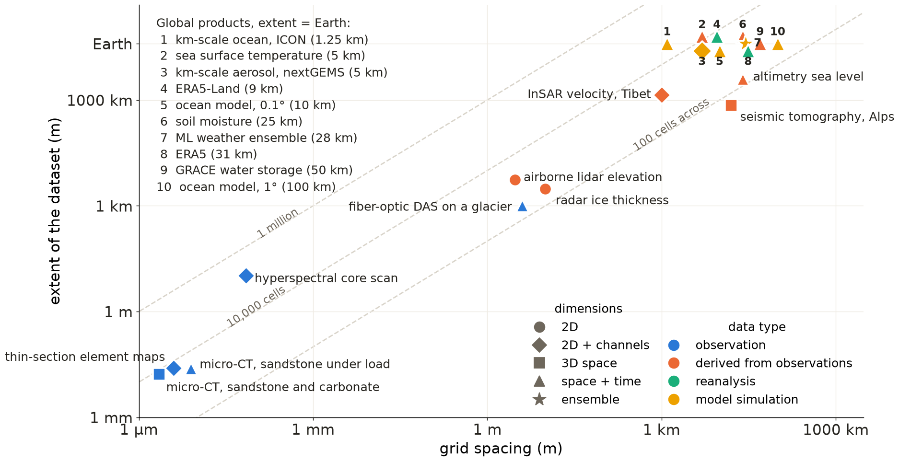{.r-stretch}

[Drawn for this course from spacings and extents stated in 18 [CC BY 4.0](https://creativecommons.org/licenses/by/4.0/) articles (list: figs/lit_gridded_gallery/SOURCES.md). Global products all span the Earth; markers stacked by up to ×1.6.]{.credit}

::: {.takeaway}
Grid spacing spans ten orders of magnitude, from 2.25 µm voxels to 100 km model cells; most grids are 100 to 10,000 cells across.
:::

::: {.notes}
Two minutes; this slide opens a six-slide gallery that replaces the reference list. Every point is a published dataset, placed by its grid spacing (horizontal) and the extent it covers (vertical), using the numbers stated in each paper; sources in figs/lit_gridded_gallery/SOURCES.md, all CC BY 4.0. Read three encodings. Color is the data type: an observation (an instrument wrote these numbers on a grid), a product derived from observations (irregular measurements interpolated or retrieved onto a grid), a reanalysis (a model pulled toward observations, like the grid in notebook 2.5), a model simulation. Marker is the dimensionality: a 2D map, a 2D map with several channels (element maps, spectra, velocity components), a 3D volume, space plus time, and an ensemble (many equally likely versions of the same field). The dashed lines count cells across the dataset: extent divided by spacing. Global products all span the Earth; their markers are numbered and named in the key, and stacked slightly so they do not overlap. Point out that a rock core and a global reanalysis have about the same number of cells across (one to a few thousand), which is why the same tools, and the same mistakes, apply to both. Ask: where would your project's data sit, and which marker does it get?
:::

## Laboratory: a sandstone core as a 4D grid {.smaller}

[🧪 Sample & laboratory]{.gb .src} [🪨 Solid Earth]{.gb .sys .solid} [📈 Seismology]{.gb .disc .solid}

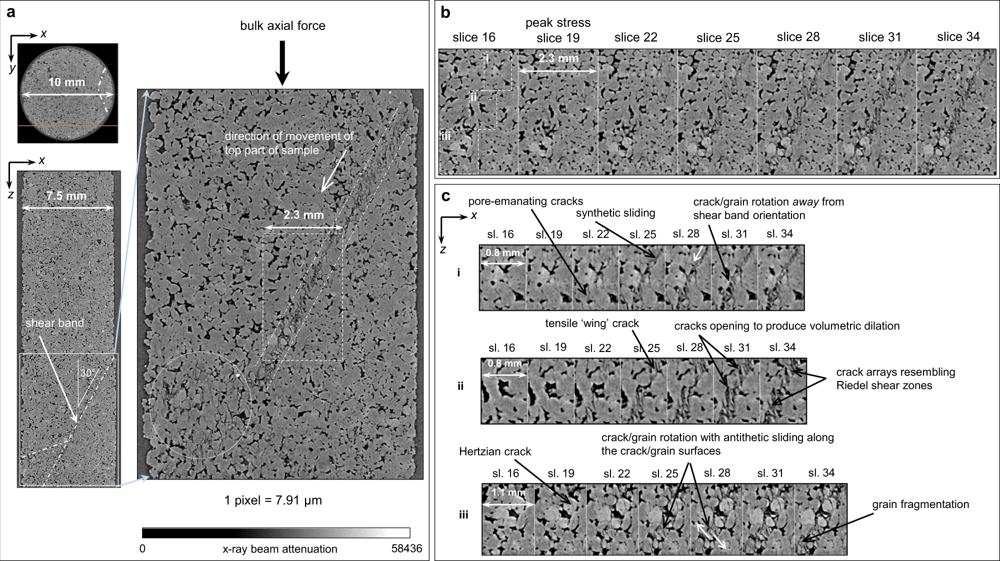{.r-stretch}

[Cartwright-Taylor et al. (2022), *Nature Communications* 13, 6169, Fig. 2, [doi:10.1038/s41467-022-33855-z](https://doi.org/10.1038/s41467-022-33855-z). [CC BY 4.0](https://creativecommons.org/licenses/by/4.0/).]{.credit}

::: {.takeaway}
Each volume is 1,596 × 1,506 × 3,080 voxels of 7.91 µm, about 15 GB at 16 bits, repeated every 85 s while the rock fails.
:::

::: {.notes}
Three minutes. A cylinder of Clashach sandstone, 10 mm across, loaded until it fails along a shear band, imaged by synchrotron X-ray micro-CT at Diamond Light Source while it deforms. Panel a: a horizontal slice and a vertical re-slice; the zoom states the grid spacing on the figure ("1 pixel = 7.91 µm") and the grayscale is X-ray attenuation in 16-bit counts, not a physical unit. Panel b: the same 2.3 mm window in successive tomograms (labelled 'slice 16' to 'slice 34' in the figure, but each is a full 3D volume at a later time), before and after peak stress (19); panel c: zooms of 0.8 to 1.1 mm where cracks open, grains rotate and break. This is a 4D grid (x, y, z, time). Two sampling questions for the room. In space: a crack narrower than about two voxels (16 µm) cannot be resolved, even if it is there. In time: each volume takes about 80 s to acquire and they come every 85 s, so anything faster (the acoustic emissions, the 'seismic events' of the title) is invisible to the grid; the paper's point is that the seismic events and the grain-scale mechanisms see different parts of the failure. The 15 GB is our arithmetic: 1596 × 1506 × 3080 voxels × 2 bytes.
:::

## Field: radar ice thickness, from survey lines to grids {.smaller}

[📍 In-situ sensor]{.gb .src} [🖥️ Model & simulation]{.gb .src} [🧊 Cryosphere]{.gb .sys .ice} [🧊 Glaciology]{.gb .disc .ice}

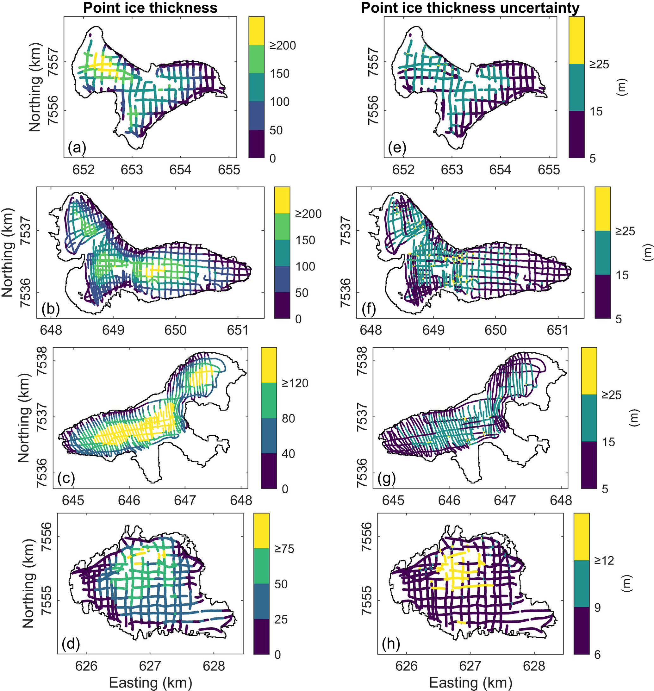{height="575px"} 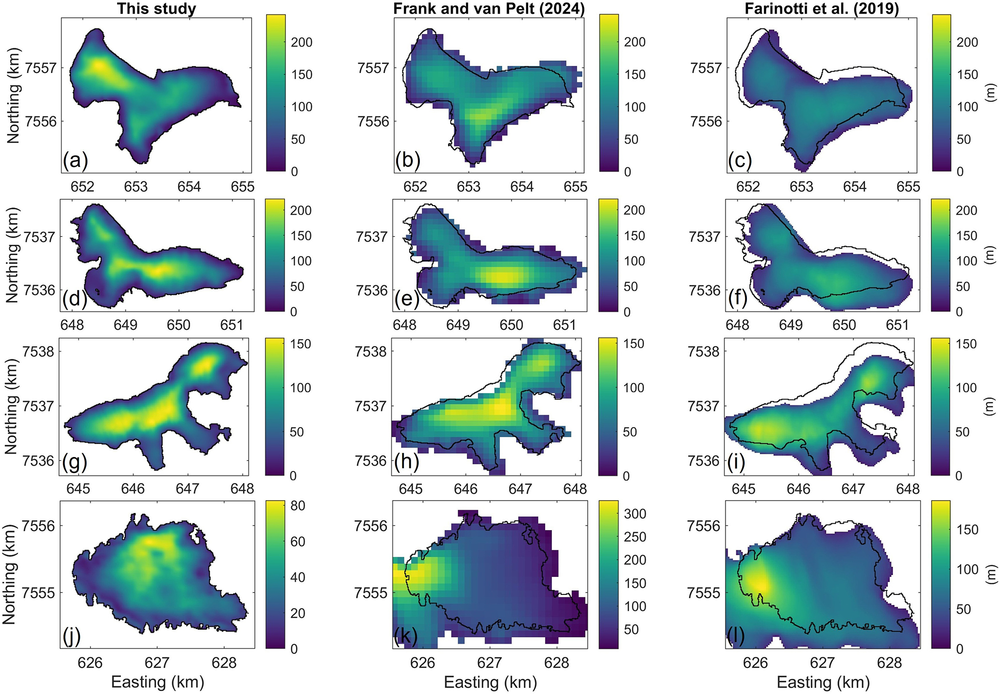{height="575px"}

[Wang et al. (2026), *Earth System Science Data* 18, 4241–4262, Figs. 3–4, [doi:10.5194/essd-18-4241-2026](https://doi.org/10.5194/essd-18-4241-2026); the middle and right grids re-plot Frank and van Pelt (2024) and Farinotti et al. (2019). [CC BY 4.0](https://creativecommons.org/licenses/by/4.0/).]{.credit}

::: {.takeaway}
Lines 20 to 300 m apart become a 10 m grid; on the same four glaciers, two published grids differ by 21 to 72 m on average.
:::

::: {.notes}
Three minutes; this is the lecture's "irregular data" in one picture. Left: radio-echo sounding on four reference glaciers in northern Sweden (Kebnekaise area). The axes are easting and northing in km in SWEREF 99 TM, Sweden's projected grid, not latitude and longitude: a grid always comes with a coordinate system, and converting between systems is part of using it. Ice thickness is measured every 4 to 6 m along each line, and the lines are 20 to 300 m apart, so the samples are dense in one direction and sparse in the other; right half of the left figure is each point's uncertainty, 5 to more than 25 m. Right: three gridded answers for the same glaciers: this study's 10 m grid (points interpolated with a mass-conservation inversion), a coarser model grid (Frank and van Pelt 2024, visibly blocky), and the global consensus estimate (Farinotti et al. 2019), drawn on older glacier outlines that no longer match the black line. The mean absolute difference between the first two is 36, 31, 21 and 72 m for the four glaciers (paper's text). The authors say their 10 m grid "does not represent the realistic spatial resolution away from the RES survey lines", because bed features smaller than about one ice thickness cannot be recovered from surface information: grid spacing is a choice made after the measurement; resolution is set by where the measurements are and by the physics of the inversion. Ask: if you trained a model on the 10 m grid, how many independent samples would you really have?
:::

## Satellite: soil moisture before and after gap filling

[🛰️ Satellite & airborne]{.gb .src} [💧 Land water]{.gb .sys .water} [💧 Hydrology & land-surface modeling]{.gb .disc .water}

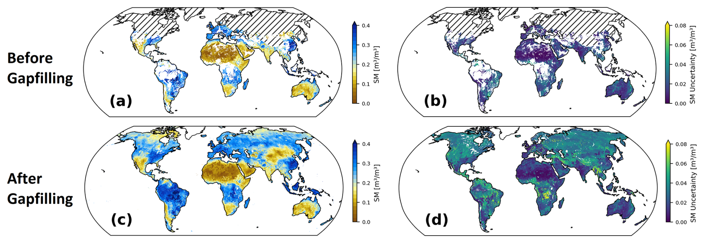{.r-stretch}

[Preimesberger et al. (2025), *Earth System Science Data* 17, 4305–4329, Fig. 6, [doi:10.5194/essd-17-4305-2025](https://doi.org/10.5194/essd-17-4305-2025). [CC BY 4.0](https://creativecommons.org/licenses/by/4.0/).]{.credit}

::: {.takeaway}
On 1 March 2007, frozen ground (hatched) and dense vegetation leave much of the land without a retrieval; filled values match in situ stations about as well as retrievals do (median R = 0.72), but they are estimates.
:::

::: {.notes}
Three minutes. ESA Climate Change Initiative soil moisture, the upper few centimeters of soil, in m³ of water per m³ of soil, on a regular 0.25° grid (about 25 km), daily, 1991 to 2023. Top row: the satellite record on one day (a) and its uncertainty (b). Large areas are empty: the hatching marks where ERA5 soil temperature is below 0 °C, because microwave sensors cannot retrieve liquid soil water from frozen ground. Apart from missing satellite overpasses in the early years, the paper ranks retrieval failures: "The most common cause are frozen soils", then "dense vegetation, which can mask contributions from the soil" (tropical rainforests are masked permanently in the original record), then radio-frequency interference and very dry barren soils. The filled values compare with in situ stations about as well as the originals (global median R = 0.72, unbiased RMSD 0.05 m³/m³, paper's evaluation). Bottom row: the gap-filled product (c) and its uncertainty (d). Most gaps are filled with a statistical method (discrete cosine transform with penalized least squares) that borrows from neighboring days and cells; the long frozen-soil gaps, the hatched areas here, are filled mainly by linear interpolation in time between the previous autumn and the following spring. Ice sheets stay excluded. Two discussion points. The gaps are not random: they follow temperature, vegetation and orbit, which is the informative missingness of 2.4 on a grid. And a filled value is an estimate, not a measurement; keep the flag that says which cells were filled, or a model trained on the product will learn the filling method as if it were soil physics.
:::

## Satellite: the local time each orbit samples drifts

[🛰️ Satellite & airborne]{.gb .src} [🌊 Ocean]{.gb .sys .ocean} [🌊 Oceanography]{.gb .disc .ocean}

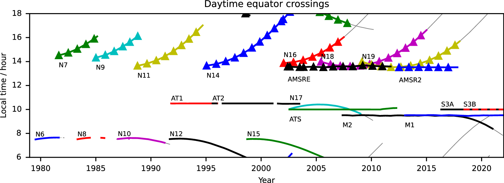{.r-stretch}

[Embury et al. (2024), *Scientific Data* 11, 326, Fig. 1, [doi:10.1038/s41597-024-03147-w](https://doi.org/10.1038/s41597-024-03147-w). [CC BY 4.0](https://creativecommons.org/licenses/by/4.0/).]{.credit}

::: {.takeaway}
NOAA-14 drifted from 13:40 local time in 1995 to after 18:00 by 2002; the record adjusts every observation to 10:30 or 22:30 so the daily warming cycle does not alias into the trend.
:::

::: {.notes}
Three minutes; this connects to the tide-gauge aliasing slide later today. Each line is one satellite carrying an infrared radiometer used for the ESA CCI sea surface temperature record since 1980 (N = NOAA platforms carrying AVHRR, the Advanced Very High Resolution Radiometer; AT = ATSR, the Along-Track Scanning Radiometer; M = MetOp; S3 = Sentinel-3 with SLSTR, the ATSR successor; AMSR-E and AMSR2 are microwave sensors). The vertical axis is the local solar time at which the satellite crosses the equator in daylight. A sun-synchronous orbit samples the ocean at the same local time every day, so it samples the daily warming cycle at one phase only, like keeping one tide-gauge reading a day. The orbits drift: NOAA-14 crossed near 13:40 in 1995 and after 18:00 by 2002. Sea surface temperature warms by up to 0.5 K during a typical day, and by more than 5 K on calm sunny days (paper's text), so a drifting sampling time turns the daily cycle into a spurious slow trend. The product's fix is to adjust every observation to the nearest 10:30 or 22:30 local mean solar time. The gridded product: 0.05° (about 5 km) daily, with gaps (level 3) and gap-free (level 4).
:::

## Models: finer grids resolve lakes and eddies {.smaller}

[🖥️ Model & simulation]{.gb .src} [🌤️ Atmosphere]{.gb .sys .air} [🌊 Ocean]{.gb .sys .ocean} [🌡️ Atmospheric & climate science]{.gb .disc .air} [🌊 Oceanography]{.gb .disc .ocean}

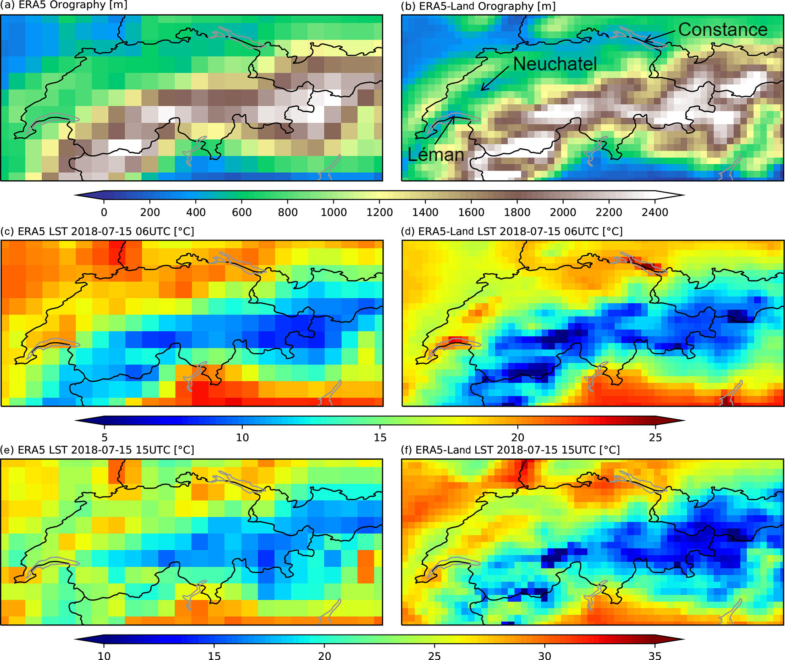{height="505px"} 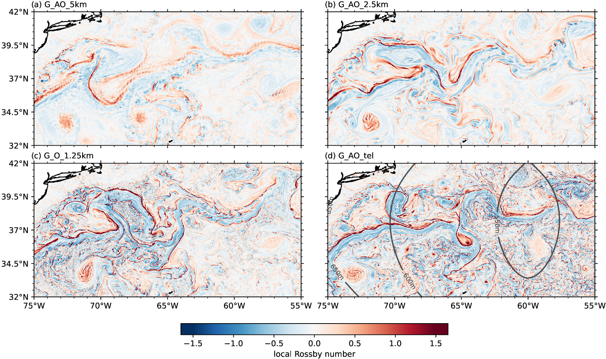{height="505px"}

[Left: Muñoz-Sabater et al. (2021), *Earth System Science Data* 13, 4349–4383, Fig. 4, [doi:10.5194/essd-13-4349-2021](https://doi.org/10.5194/essd-13-4349-2021). Right: Hohenegger et al. (2023), *Geoscientific Model Development* 16, 779–811, Fig. 17, [doi:10.5194/gmd-16-779-2023](https://doi.org/10.5194/gmd-16-779-2023). [CC BY 4.0](https://creativecommons.org/licenses/by/4.0/).]{.credit}

::: {.takeaway}
ERA5-Land at 9 km resolves lakes and valleys that ERA5 at 31 km averages away; in this North Atlantic run, small eddies and fronts need a grid spacing between 2.5 and 1 km.
:::

::: {.notes}
Three minutes. Left, the Alps around Switzerland: ERA5 (about 31 km, left column) and ERA5-Land (about 9 km, right column), both hourly and global. Top: the model's own terrain; ERA5 misses many peaks, ERA5-Land shows Lakes Geneva (Léman), Neuchâtel and Constance. Middle and bottom: land surface temperature on 15 July 2018 at 06:00 and 15:00 UTC; at 06:00 the lakes stay warmer than the land around them, visible only at 9 km. Caveat: ERA5-Land assimilates no observations of its own; it is a land-surface model driven by ERA5 weather interpolated to the finer grid and corrected for elevation, so its extra detail comes from terrain and lakes, not from finer weather. Right, the Gulf Stream in the ICON ocean model: local Rossby number (rotation of the flow divided by the planet's rotation) at 5, 2.5 and 1.25 km and on a telescoping grid that refines to about 530 m. At 5 and 2.5 km the Rossby number stays mostly below 1 (weak, with grid-scale noise at 5 km); small eddies and sharp fronts appear at 1.25 km and on the telescope grid; the paper places the critical grid spacing between 2.5 and 1 km for this configuration in boreal winter. Ask: if you trained an ML model on 31 km data, what would it never see, and what would it learn to average?
:::

## Arrays that know their coordinates {.smaller}

[🖥️ Model & simulation]{.gb .src} [🌤️ Atmosphere]{.gb .sys .air} [🌡️ Atmospheric & climate science]{.gb .disc .air}

- **NCEP/NCAR Reanalysis 1**: air temperature at the lowest model level (sigma 0.995, about 40 m above the model's ground), every 6 h, 2.5° grid, 2013–2014: **2,920 × 25 × 53** values
- One value is a model state pulled toward observations (Kalnay et al. 1996, class B), at grid points about 280 × 190 km apart at Seattle, at 00/06/12/18 UTC
- The file's own metadata say `level_desc: Surface` and `statistic: Individual Obs`; the provider's documentation says otherwise

::: {.takeaway}
Before using a grid value, say what it stands for: level, area, time, and how much of it is model.
:::

::: {.notes}
2.5 in one slide; the lab today is 2.6, so 2.5 is the reading. The grid is the xarray tutorial file, pinned to one commit and SHA-256 in the notebook. Its own metadata say level_desc "Surface" and statistic "Individual Obs"; both are misleading: it is the lowest model level (Kalnay: "about 5 hPa from the surface", about 40 m by the hydrostatic estimate in the notebook) and an analysis, class B ("the model also has a very strong influence"). So it is not a 2 m thermometer reading, and over the Olympics, Puget Sound and the Cascades it is an average over a smoothed T62 terrain (about 210 km). The two traps students meet in part 3: latitude is stored north to south, so slice(40, 50) is empty; and nearest-neighbor selection without a tolerance always returns something, even on the wrong side of a continent. Part 5 is the first "Agent, then verify" exercise: an instructor-written function with three faults (no tolerance, units label left as degK, in-place subtraction that changes the input grid) fails a check table; students give the failures to an agent, verify the fix, and log it in AI_logs. Point out that the Atlantic cell passes the plausibility checks; only the coordinate check catches it.
:::

## Which cell is Seattle?

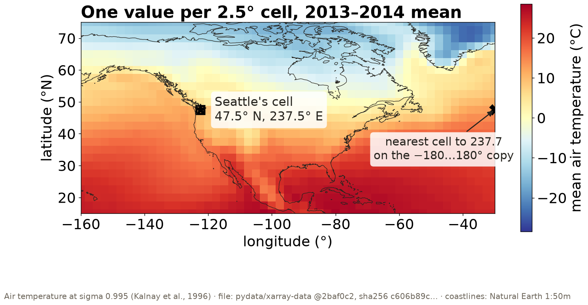{.r-stretch}

::: {.takeaway}
On a copy converted to −180…180°, `sel(lon=237.7, method="nearest")` returns −30°, in the Atlantic, with no error. A tolerance of half a grid step turns it into an error.
:::

::: {.notes}
One minute. Each colored square is one grid value; the coastline is drawn far finer than the data, which makes the grid look more precise than it is. The black box is Seattle's cell (47.5° N, 237.5° E). The X is what nearest-neighbor selection returns when the longitude convention changes under you: the grid's eastern edge, about 6,500 km away. In notebook part 5 that Atlantic cell even passes the plausibility checks (winter mean 9.9 °C against an upper bound of 10); only the coordinate check catches it. Figure: figscripts/reanalysis_grid_map.py, same pinned file and checksum as the notebook.
:::

## Keep one sample a day — and the tide invents a fortnight {.smaller}

::: {.big-number}
0.59 m [RMS error — keep each midnight reading]{.unit}
:::

::: {.big-number}
0.02 m [RMS error — average the day first, then keep one value]{.unit}
:::

::: {.dim}
The M2 tide (12.42-h period) lives above a daily series' Nyquist frequency. Subsampled, it does not vanish — it *folds* into a 14.8-day oscillation at nearly full tidal amplitude.
:::

::: {.takeaway}
Thirty times worse — and the artifact masquerades as a plausible fortnightly ocean signal.
:::

::: {.notes}
Set up the task: an hourly tide gauge, and a scientist who wants a daily series to study slow sea-level variability. The lazy move — keep the midnight sample — does not just lose the tide, it *transforms* it: sampling at 1 cycle/day can only represent frequencies below 0.5 cycles/day (define Nyquist here, from the literature slide), and M2 at 1.93 cycles/day folds to |1.93 − 2| = 0.068 cycles/day — a 14.8-day period. Fortnightly tidal modulation is a real oceanographic phenomenon, which is exactly why the artifact is dangerous: it is physically dressed. Numbers are the executed notebook's, graded against the generator's tide-free truth. The rule, stated once and repeated: before reducing a sampling rate, ask what lives above the new Nyquist and remove it first.
:::

## Three ways to make a daily series

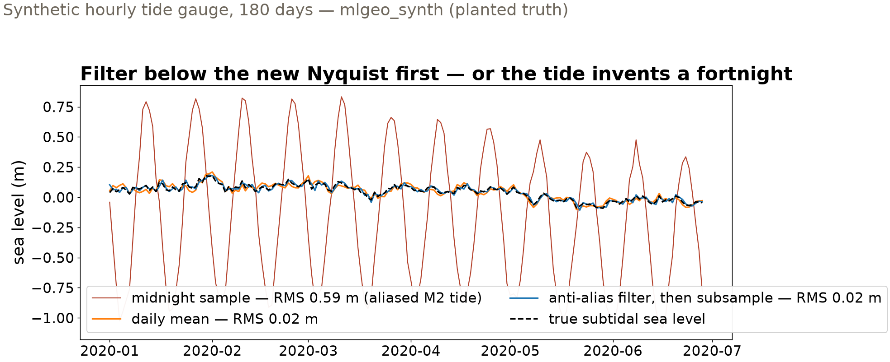{.r-stretch}

::: {.takeaway}
The daily mean — a humble 24-h average — already suppresses the tide; a proper anti-alias filter does slightly better. The midnight samples invent a half-meter oscillation that was never in the ocean.
:::

::: {.notes}
Walk the curves: red = midnight subsampling, swinging ±0.8 m at the folded 14.8-day period; orange = daily mean (a 24-hour boxcar is a crude low-pass filter — that is why the everyday resample-to-daily-mean idiom is largely safe); blue = decimation with a designed anti-alias filter; black dashed = the true subtidal sea level, known because the data are synthetic (mlgeo_synth) with the tide returned separately. Real-world anchor for the notes: satellite altimetry lives with this permanently — the TOPEX/Jason orbit revisits each point every ~10 days, aliasing M2 into a ~62-day signal that must be modeled away; mission orbits are *designed* around tidal aliasing. Ask the room: what is the highest frequency in *your* project's data, and what will your averaging do to it?
:::

## One sensor, two samplings {.smaller}

[📍 In-situ sensor]{.gb .src} [💧 Land water]{.gb .sys .water} [💧 Hydrology & land-surface modeling]{.gb .disc .water} · [🪨 Solid Earth]{.gb .sys .solid} [📈 Seismology]{.gb .disc .solid}

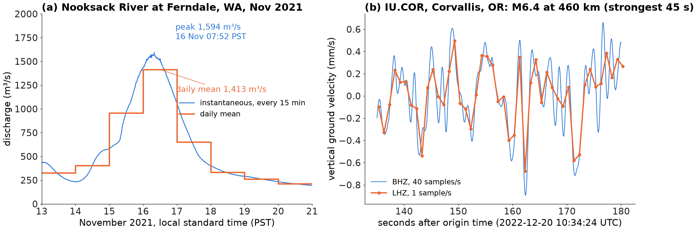{width="100%"}

[Data: USGS Water Services site 12213100 and USGS ComCat nc73821036, [public domain](https://www.usgs.gov/information-policies-and-instructions/copyrights-and-credits); IU.COR.00 BHZ, LHZ via EarthScope FDSN (response removed), Global Seismograph Network [doi:10.7914/SN/IU](https://doi.org/10.7914/SN/IU). Figure: figscripts/native_vs_distributed_series.py.]{.credit}

::: {.takeaway}
The daily mean (1,413 m³/s) is 11% below the instantaneous flood peak (1,594 m³/s); the 1 sample/s channel shows 24% less peak velocity than the 40 sample/s channel.
:::

::: {.notes}
Three minutes. Providers do the downsampling of the last slide for you: USGS with the daily mean, the seismometer's digitizer with anti-alias filters. Both panels are one instrument recorded once and distributed at two samplings. (a) The Nooksack River at Ferndale, WA, during the November 2021 atmospheric-river flood that flooded Everson and Sumas. USGS measures discharge continuously, "often at a fixed 15-minute interval" (USGS data categories page; the 07:52 value is an extra, off-schedule value USGS stored at the peak; the highest value on the 15-minute schedule is 1,574 m³/s at 07:45), and publishes daily values as "a statistical summary or metric of the continuous data", here the mean. Historically the daily value was the approved record and the instantaneous data were not published at all (USGS Office of Surface Water memo 2006.03). Anyone who downloads the daily series to study floods sees a peak 11% low, with no time of day; this gauge publishes only the daily mean, no daily maximum. (b) The M6.4 Ferndale, California earthquake of 20 December 2022 recorded 460 km north at Corvallis, OR. The same seismometer is digitized at a high rate and then low-pass filtered and decimated into channels: BHZ at 40 samples per second and LHZ at 1 sample per second (FDSN band codes; decimating digitizers apply anti-alias FIR filters that strongly attenuate, rather than alias, content near and above each channel's Nyquist frequency, 20 Hz and 0.5 Hz; IU.COR's own StationXML does not list those stages). LHZ follows the long-period motion and misses the sharp peaks. All numbers are computed by the figure script from today's provider data. Notebook 2.6 section 3.1b redoes panel (a) from a committed snapshot of the same record: students rebuild the USGS daily mean and find the repeated hour when daylight saving time ends. Ask: which product would you train a flood-peak model on, and which an earthquake-magnitude model?
:::

## Native and distributed resolution {.smaller .compact .tight}

| Kind | Data | Native | As distributed | Not in the distributed product |
|---|---|---|---|---|
| series | Stream gauge (USGS) | every 15 min | daily mean (min and max at some gauges) | the hour of the peak; at mean-only gauges, its size too |
| series | Seismometer (FDSN) | digitizer at a high rate | 40 (BH) and 1 (LH) samples/s, anti-alias filtered | all above each channel's Nyquist frequency |
| series | GNSS (EarthScope; Nevada Geodetic Lab) | phase every 15 or 30 s | 24-hour and 5-minute positions | motion faster than 5 min; in daily positions, the hour of an offset |
| series | Flux tower (FLUXNET2015) | wind and gas at 10 to 20 Hz | 30-minute fluxes, gap-filled | turbulence within each half hour |
| grid | Reanalysis (ERA5) | hourly, 31 km model grid | regular 0.25° grid | nothing finer than 31 km |
| grid | InSAR (Sentinel-1) | 5 × 20 m pixels, every 6 or 12 days | velocity and displacement series on a 100 m grid (European Ground Motion Service) | detail finer than 100 m; the line-of-sight direction |
| grid | Soil moisture (NASA SMAP radiometer) | footprint about 40 km | 36 km and 9 km grids | nothing finer than about 40 km |
| grid | Gravity (GRACE, JPL) | 3° mascons, monthly | 0.5° grid | nothing finer than 3° |

::: {.takeaway}
JPL's 0.5° GRACE grid has 259,200 cells but rests on 4,551 independent mascons: check the native sampling before choosing a grid or counting samples.
:::

::: {.notes}
Two minutes; the first four rows are time series at a point, the last four are grids (a reanalysis and three kinds of satellite imagery). Two details left off the slide: ERA5 accumulated fields (precipitation, fluxes) cover the hour ending at the time stamp, while analysed fields are instantaneous; and a GNSS earthquake offset in daily positions is located only to the day. Sources, each checked on the provider's page on 12 Oct 2026. Stream gauge: USGS data categories page and memo 2006.03 ("recorded time-intervals ... typically range from 5 to 60 minutes"). Seismometer: FDSN Source Identifiers band codes (B: 10 to 80 samples/s; L: about 1) and the EarthScope instrument-response short course (a 5120 → 320 → 80 → 40 sample/s FIR cascade). GNSS: EarthScope GNSS data management ("recorded at 15-s or 30-s intervals"), Blewitt, Hammond and Kreemer (2018, Eos, doi:10.1029/2018EO104623) for NGL's daily and 5-minute solutions. Flux tower: Pastorello et al. (2020, Scientific Data, doi:10.1038/s41597-020-0534-3), FLUXNET2015 and the ONEFlux processing. ERA5: ECMWF ERA5 data documentation (hourly, 0.28125° native; served on 0.25° by interpolation). InSAR: ESA Sentinel-1 mission pages (12-day repeat per satellite, 6 days with two; Sentinel-1B lost in December 2021) and the European Ground Motion Service Ortho product (100 m grid, updated annually). SMAP: NSIDC SMAP documentation (40 km footprint; 9 km enhanced product by Backus-Gilbert interpolation). GRACE: JPL mascon documentation (4,551 equal-area 3° caps; "only 4,551 independent estimates of uncertainty" behind a 0.5° grid). The general point for ML: two neighbouring grid cells or samples can come from the same measurement, which inflates the apparent sample size and leaks information between train and test sets.
:::

## Gaps: interpolation is a decision, not a default

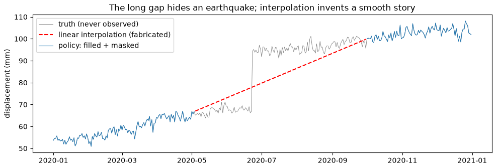{.r-stretch}

::: {.takeaway}
Synthetic GNSS with planted truth (mlgeo_synth): a 150-day outage hides a 25 mm earthquake step — interpolation draws a confident straight ramp through it. Policy: fill gaps ≤ 10 days (error below the 2.4 mm noise), mask the rest.
:::

::: {.notes}
The scenario: a daily GNSS record degraded with eight random short gaps plus one 150-day outage placed across an earthquake — a station knocked out by the shaking it was supposed to record is not hypothetical. Gray = truth (never observed), red dashed = what linear interpolation fabricates, blue = the stated policy. The graded numbers: short gaps interpolate at 0.7–2.4 mm RMS — at or below the 2.4 mm daily noise, because trend plus seasonal cycle barely move in a few days; the 150-day gap costs 8.1 mm RMS and, worse, the filled values are *confidently wrong* — smooth, plausible, and treated as measurements by any downstream trend fit or ML feature window. The policy is the lesson: a threshold derived from this station's signal rates (faster station → shorter threshold), written in the data card; NaN is an honest statement. Mantra from the notebook: fix what the data constrain, mask what they do not, write the threshold down.
:::

## Six ways to handle a gap {.smaller .compact}

| Choice | Assumes | Fails when | Used in |
|---|---|---|---|
| Leave it missing, with a flag | every later step reads the flag | a mean over the observed cells treats the gaps as average | satellite sea surface temperature, levels 2–3; HadCRUT4 |
| Drop the affected rows | gaps are unrelated to any value, measured or not (missing completely at random) | the gap is caused by the value: floods, frozen soil | notebook 2.4 |
| Interpolate: linear in time, kriging or optimal interpolation in space | the signal is smooth across the gap | a step or a front hides in the gap; features are smoothed | NOAA OISST; HadCRUT5 analysis |
| Statistical reconstruction: dominant spatial patterns, a smoother, a look-up of similar weather | the gap resembles patterns seen elsewhere | conditions in the gap are rare | ESA CCI soil moisture; flux towers |
| Fill from a model or reanalysis | the model is right where data are absent | the model's bias becomes data | FLUXNET weather from ERA-Interim |
| Train an ML model | training gaps look like the real ones | gaps fall in conditions or places absent from training | neural networks for sea surface temperature and sea level; boosted trees for flux towers; the GRACE gap |

::: {.takeaway}
Filled values are typically at least half of a flux-tower record (Vekuri et al. 2023): keep a flag for each filled value, and its uncertainty.
:::

::: {.notes}
Three minutes; this extends the previous slide from one station to the methods in use. Row by row, with sources (all in figs/lit_gap_filling/SOURCES.md). Leave missing: ESA CCI sea surface temperature keeps the cloud gaps in its level 2 and 3 products and gives each value a 0 to 5 quality level; only the level 4 analysis is gap-free, and the authors write that "the process of interpolation inevitably means feature resolution is degraded", so users studying fronts and eddies should use the gappy data (Merchant et al. 2019). HadCRUT4 left cells without data empty; as Cowtan and Way point out, leaving a cell out of an area-weighted mean is the same as filling it with the mean of the observed cells, next slide. Drop rows: dropping is safe only if the gaps are missing completely at random (MCAR); Rubin (1976) shows that likelihood methods can ignore the gap mechanism under the weaker missing-at-random condition, but row deletion cannot; this is notebook 2.4's MCAR and MNAR. Interpolate: NOAA's daily OISST grids satellite, ship and buoy SST by optimum interpolation; HadCRUT5's analysis variant fills gaps with a Gaussian-process method close to kriging, and ships the unfilled grid next to it (Morice et al. 2021). Statistical reconstruction: DINEOF fills gaps from the leading EOFs (empirical orthogonal functions, the dominant spatial patterns) (Beckers and Rixen 2003); ESA CCI soil moisture uses a DCT-PLS smoother (discrete cosine transform, penalized least squares) and fills long frozen-soil gaps by linear interpolation in time (Preimesberger et al. 2025); flux towers use marginal distribution sampling, a look-up of measurements made under similar weather (Reichstein et al. 2005). Model or reanalysis: FLUXNET fills tower weather from ERA-Interim downscaled to each site; the correction removes only 10 to 36% of the mismatch and wind speed is filled poorly (Vuichard and Papale 2015). ML: DINCAE, a convolutional autoencoder for satellite SST and altimetry (Barth et al. 2020, 2022); XGBoost for flux towers (Vekuri et al. 2023); AutoML to bridge the 11-month gap between GRACE and GRACE-FO (Sun et al. 2021); for the same gap, a benchmark without neural networks found a simple fit of trend plus annual and semi-annual terms scores well, and at one point gap filling underestimated the annual power by 20% (Lecomte et al. 2024). Notebook 2.6 section 3.2b tries three of these rows (linear, a fitted model with and without the catalogued earthquake step, gradient-boosted trees) on the synthetic GNSS outage and keeps a filled flag. The flags: FLUXNET2015 marks every meteorological value 0 measured, 1 filled from similar weather, 2 filled from reanalysis, and every filled flux 0 measured, 1 to 3 filled with high, medium or low confidence (Pastorello et al. 2020); ESA CCI soil moisture ships a filled/observed mask and a per-value uncertainty.
:::

## Two cases where the filling choice changed the result {.smaller}

[🗂️ Catalog & compiled product]{.gb .src} [🌤️ Atmosphere]{.gb .sys .air} [🌡️ Atmospheric & climate science]{.gb .disc .air} · [📍 In-situ sensor]{.gb .src} [🌱 Biosphere]{.gb .sys .bio} [🦠 Biogeosciences]{.gb .disc .bio}

:::: {.columns}
::: {.column width="50%"}
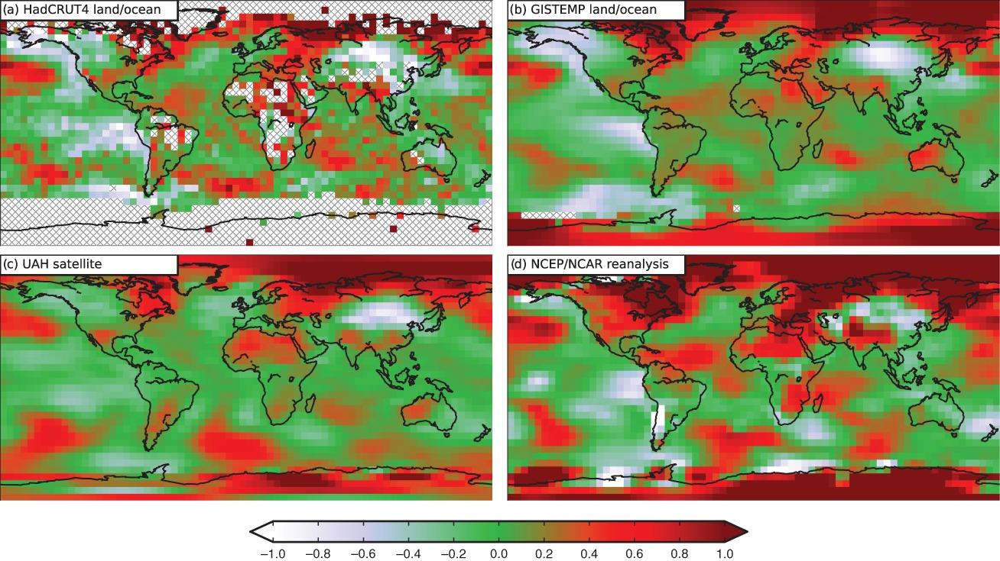{width="100%"}
:::
::: {.column width="50%"}
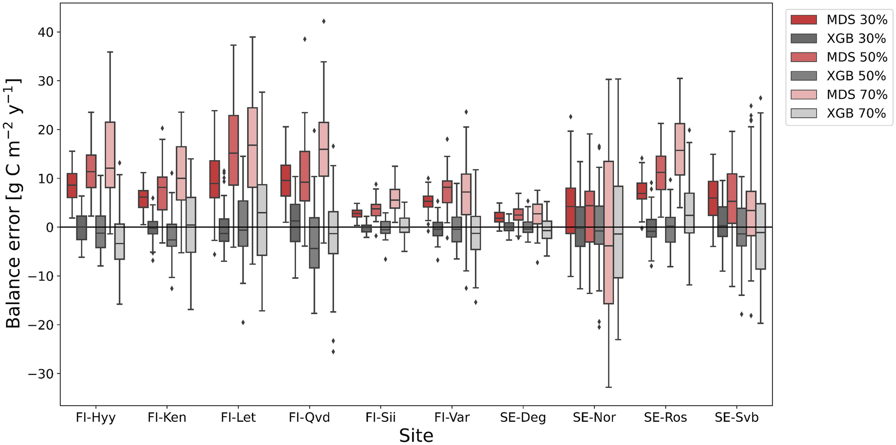{width="100%"}
:::
::::

[Left: Cowtan & Way (2014), *Quarterly Journal of the Royal Meteorological Society* 140, 1935–1944, Fig. 1, [doi:10.1002/qj.2297](https://doi.org/10.1002/qj.2297), [CC BY 3.0](https://creativecommons.org/licenses/by/3.0/). Right: Vekuri et al. (2023), *Scientific Reports* 13, 1720, Fig. 3, [doi:10.1038/s41598-023-28827-2](https://doi.org/10.1038/s41598-023-28827-2), [CC BY 4.0](https://creativecommons.org/licenses/by/4.0/).]{.credit}

::: {.takeaway}
Kriging the empty cells, mostly polar, raised the 1997–2012 warming trend from 0.064 (unfilled) to 0.108 °C per decade; at ten northern flux-tower sites, look-up filling biased the annual carbon balance toward emission by up to 42 g C m⁻² y⁻¹.
:::

::: {.notes}
Four minutes. Left, a map: temperature trends for January 1997 to December 2012 in °C per decade, in HadCRUT4 (a), which left cells without data empty (hatched), and three products that cover them: GISTEMP, the UAH satellite record and the NCEP/NCAR reanalysis. All three show the Arctic warming fastest, exactly where HadCRUT4 has no data (about 84% coverage, gaps at the poles and over Africa). Cowtan and Way's Table 3, trends in °C per decade: HadCRUT4 as published 0.046; the same data rebaselined with no filling 0.064; kriging 0.108; kriging plus satellite data 0.119. Compare 0.064 with 0.108 for the effect of filling alone; the step from 0.046 to 0.064 comes from the baseline change. Most of the bias is in northern winter (−0.086 °C per decade in December to February), when air over Arctic sea ice is unobserved. HadCRUT5 now ships both a non-infilled grid and a filled analysis (Morice et al. 2021). Right, a time series: eddy-covariance towers measure CO₂ exchange every half hour, and FLUXNET2015 sites are missing 68% of half-hourly CO₂ fluxes on average (as cited by Vekuri et al.). The authors built gap-free synthetic series for ten sites above 60° N, cut gaps shaped like the real ones (half an hour to 3 days, same lengths and timing), and filled them. Red: marginal distribution sampling, the standard look-up method; grey: XGBoost. At 30 to 70% gaps, the look-up filler overestimated the annual carbon balance in all but one case, by up to 42 g C m⁻² y⁻¹; XGBoost's median errors were −4 to 2. For scale, the mean annual net exchange reported for high-latitude boreal and tundra biomes is about −17 g C m⁻². The cause: northern radiation distributions are skewed, so similar-weather look-ups pick the wrong neighbours.
:::

## Testing a machine-learned gap filler {.smaller}

[🛰️ Satellite & airborne]{.gb .src} [🌊 Ocean]{.gb .sys .ocean} [🌊 Oceanography]{.gb .disc .ocean}

:::: {.columns}
::: {.column width="50%"}
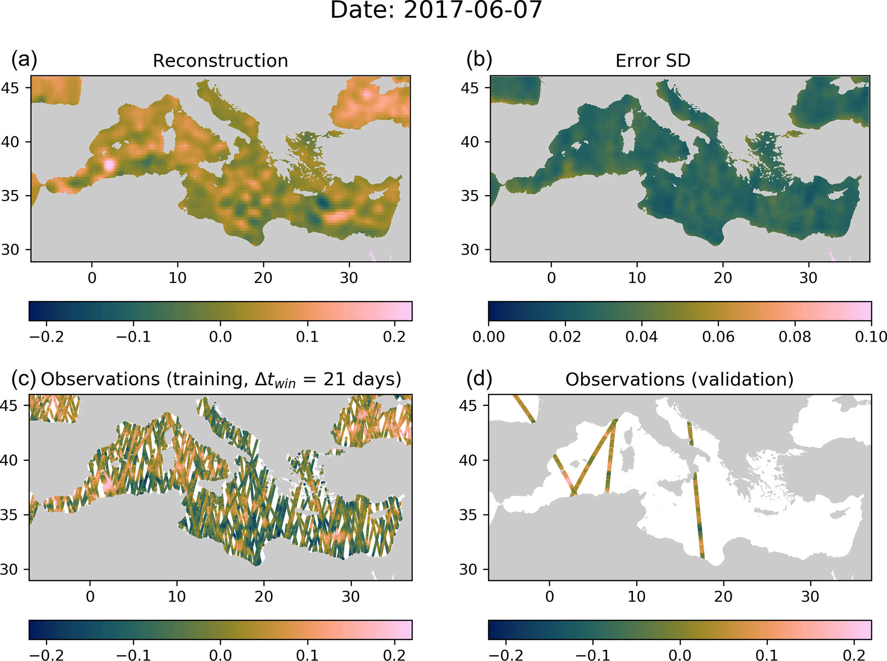{width="100%"}
:::
::: {.column width="50%"}
- **Hide test data the way gaps really look:** whole satellite tracks (panel d), real cloud masks, real gap lengths
- **Never score on data the model saw:** on one sea surface temperature image, the network misfits its own input by 0.15 °C and hidden pixels by 0.55 °C
- **Compare with a tuned interpolator:** 3.58 cm for the network against 3.60 cm for a tuned variational interpolator
- **Hold out places, not pixels:** random cross-validation R² 0.53, spatial 0.14 (Ploton et al. 2020)
- **Score filled values on their own:** soil moisture R 0.59 for filled values against 0.70 for observed ones
:::
::::

[Barth et al. (2022), *Geoscientific Model Development* 15, 2183–2196, Fig. 8, [doi:10.5194/gmd-15-2183-2022](https://doi.org/10.5194/gmd-15-2183-2022), [CC BY 4.0](https://creativecommons.org/licenses/by/4.0/).]{.credit}

::: {.takeaway}
Held out by place instead of by pixel, one biomass map's R² fell from 0.53 to 0.14: test a gap filler on gaps shaped like the real ones, in places it has not seen, against a tuned interpolator.
:::

::: {.notes}
Three minutes; this is the lecture's link to the evaluation thread of chapters 3 and 6. The figure: DINCAE 2.0, a convolutional autoencoder, reconstructing Mediterranean sea level anomaly (m) on 7 June 2017 from along-track satellite altimetry: (a) reconstruction, (b) its own error estimate, (c) the tracks used for training over a 21-day window, (d) tracks withheld for validation. Whole tracks go to one split only (70% train, 20% development, 10% test), so neighbouring points on a track never sit on both sides (Barth et al. 2022). Each bullet with its source. Real gap shapes: DINCAE 1.0 imposed the cloud masks of the first 50 images on the last 50 (Barth et al. 2020); Vekuri et al. 2023 drew artificial gaps from the real gap lengths and times. Own input versus hidden pixels: on one Adriatic MODIS image, DINCAE 2.0 differs from the data it was given by 0.15 °C RMS and from pixels hidden under added clouds by 0.55 °C (Barth et al. 2022, Fig. 5). Tuned baseline: on the test tracks, DINCAE 3.58 cm against 3.60 cm for DIVAnd, a variational interpolator tuned by Bayesian optimization; with SST as a second input, DINCAE reached 3.47 cm; the authors say the main gain is a more reliable error estimate. Places, not pixels: a random-forest biomass map in central Africa scored R² = 0.53 with random 10-fold cross-validation and 0.14 with spatial blocks, close to a model with no predictors (Ploton et al. 2020). Filled values on their own: in one ESA CCI soil moisture example area with 40% missing data, the anomaly correlation with in situ stations is 0.59 for filled values and 0.70 for observed ones (Preimesberger et al. 2025). Also check the error estimate itself: DINCAE 1.0's normalized errors had a standard deviation of 0.85, so it overestimated its error by about 15%. Notebook 2.6 section 3.2c makes the same point on the GNSS series: hidden away from the earthquake in blocks of 1 to 150 days, linear and boosted-tree fillers both score 1.6 to 3.1 mm; on the real 150-day outage, which hides the earthquake, they score 8.1 and 21.7 mm. A trajectory model with a step at the catalogued earthquake date scores 2.8 mm there: a model fills well when it contains the process.
:::

## The irregular stream: 25 wells, 40 years, no grid

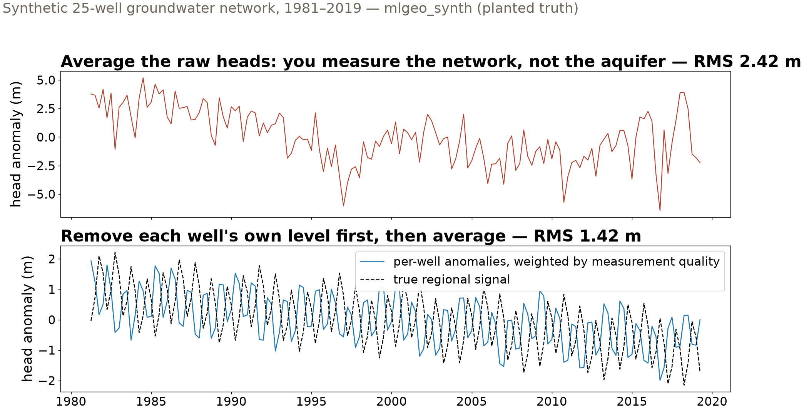{.r-stretch}

::: {.takeaway}
Averaging raw heads jumps by meters whenever a well enters or leaves the record. Remove each well's own level first, weight by measurement quality — and the true regional decline emerges: RMS 2.42 → 1.42 m.
:::

::: {.notes}
The third stream from lecture 4, finally in action: 2,902 visits across 25 wells, 1981–2019, every well with its own datum offset (meters!), noise level, active period, and visit schedule — operational hydrology as it actually looks. Top panel: the naive quarterly mean of raw heads; its meter-scale jumps are wells with high offsets entering and leaving — the curve is a history of *which wells were visited*, not of the aquifer. Bottom: two moves fix most of it — per-well anomalies (subtract each well's own mean, so offsets cancel; Hansen & Lebedeff's temperature method) and inverse-variance weights (1/σ², so a steel-tape reading cannot dilute a transducer record). Nothing sophisticated: the improvement comes from refusing to average incompatible things. Residual error is mostly each well sampling a different segment of the 40-year decline. Exercise 3 asks which move carries the load — have teams predict before running.
:::

## Error bars for noise with memory {.smaller}

::: {.big-number}
±0.019 mm/yr [velocity uncertainty — resample individual days]{.unit}
:::

::: {.big-number}
±0.148 mm/yr [velocity uncertainty — resample 100-day blocks]{.unit}
:::

::: {.dim}
GNSS noise is time-correlated. Resampling single days destroys that memory: the true velocity sat **8.6σ** outside the narrow bar — and **1.1σ** inside the honest one.
:::

::: {.takeaway}
The wider error bar is the correct one. The narrow bar was not conservative — it was wrong, and only the planted truth exposed it.
:::

::: {.notes}
Close the loop on the bootstrap thread. Section 2 of the notebook fit a 12 mm/yr synthetic GNSS trend and bootstrapped the slope by resampling (day, displacement) pairs: a beautifully tight histogram — with the true velocity 8.6 standard deviations outside it. Diagnosis: pair resampling treats residuals as independent, but flicker and random-walk noise have memory, and correlated noise is precisely what makes a trend uncertain. Fix (Künsch, literature slide): resample contiguous 100-day blocks of residuals so correlation survives up to the block length — the bar widens by roughly a factor of seven and the truth lands ~1σ from the estimate, which is what honesty looks like. Block length is itself a stated decision (longer than the noise correlation time — exercise 4 probes sensitivity). Sting for the room: on real data there is no planted truth to flag the narrow bar — Mao et al. is a whole field learning this in print. The same caveat applies to the real P395 velocity fit in the notebook.
:::

## One discipline, four streams {.smaller}

| Data situation | The trap | The principle | Graded result |
|---|---|---|---|
| Hourly tide gauge → daily | aliasing: high frequencies fold, disguised | low-pass below the new Nyquist, *then* subsample | 0.59 → 0.02 m RMS |
| Daily GNSS with outages | confident fabrication across gaps | fill what noise bounds, mask the rest, state the threshold | 150-day gap hid a 25 mm step |
| Irregular multi-well network | the average tracks the network, not the field | anomalies first, weight by quality | 2.42 → 1.42 m RMS |
| Trend in correlated noise | error bars that ignore memory | resample blocks, not samples | 8.6σ → 1.1σ |

::: {.takeaway}
Every resample is a claim about what happens between your samples. Make the claim explicitly — and grade it when you can.
:::

::: {.notes}
The lecture in one screen — leave it up for questions. Each row was a slide; the shared discipline is that a resampling choice (a filter, a threshold, a weighting, a block length) is a scientific decision with a stated rationale, recorded in the data card — never a library default accepted silently. All four graded results exist because the data were synthetic with planted truth; that is the course's recurring move (2.4's censoring, 2.10's detection floor, 3.8's split ladder): plant the truth, grade the method, *then* trust it on real data. Wednesday continues the signal thread with distributions and spectral transforms — where aliasing becomes visible in the frequency domain.
:::

## Now run it yourself — open 2.6

1. `pixi run jupyter lab` → `2.6_resampling.ipynb`, section 3
2. **3.1b** The Nooksack record: count the readings, find the repeated hour, rebuild the USGS daily mean, measure the peak it loses
3. **3.2b** Gap fillers on known truth, with a `filled` flag; which wins on short gaps, which on the 150-day outage, and why?
4. **3.2c** Hide test data at random, then score on the real outage; let an agent write a filler and check it the same way
5. Alias hunting (exercise 1): keep the *noon* sample instead of midnight; does the 14.8-day artifact move?

::: {.dim}
Wednesday: statistical considerations & spectral transforms (2.7–2.8) · HW1 and the Ch 1 quiz on Wednesday Oct 14
:::

::: {.notes}
Timing for the 80-minute block (10:00–11:20): pulse talks begin this week — two talks ~10 min, deck ~20 min, guided notebook ~40 min on tasks 2 to 4, with 5 as the conceptual check (the folding formula does not care which hour you keep, so the artifact stays at 14.8 days; students who expect it to move are still thinking in the time domain). Expected results from the executed notebook: 2,885 readings (2,880 + 4 from the 25-hour 7 November + 1 off-schedule peak), our daily means within 0.6% of USGS, the daily mean 11% below the 1,594 m³/s peak; gap RMS errors in mm, short / 16–24 d / 150 d: linear 1.56 / 1.83 / 8.09, boosting 1.25 / 1.92 / 21.68, trend + seasonal fit 8.45 / 8.57 / 15.47, trajectory model with the catalog step 2.21 / 1.75 / 2.80; random hiding scores 1.6–3.1 mm against 8.1 and 21.7 mm on the real outage, synthesis ~10 min. Implementation names live here: scipy.signal.decimate (anti-alias, zero-phase), pandas resample('D').mean() and interpolate(method='time'), tz-aware parsing to UTC, sklearn HistGradientBoostingRegressor for the boosted-tree filler, groupby-transform for per-well anomalies, sklearn.utils.resample for the bootstrap; the block bootstrap is a ten-line loop in the notebook. If time is short, sections 1–2 (randomization, bootstrap, Monte Carlo, the real P395 velocity fit) are self-study; Level 3 is the in-class core. Remind: HW1 is due Wednesday Oct 14; Wednesday needs 2.7–2.8 unread but downloaded.
:::
