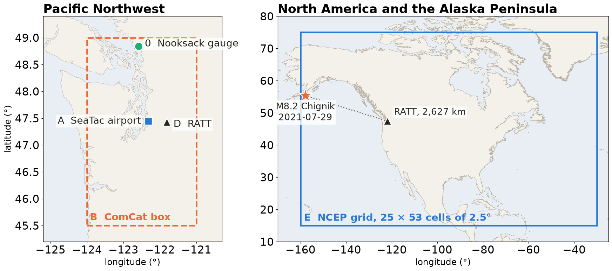
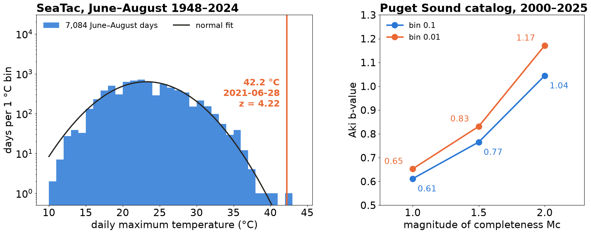
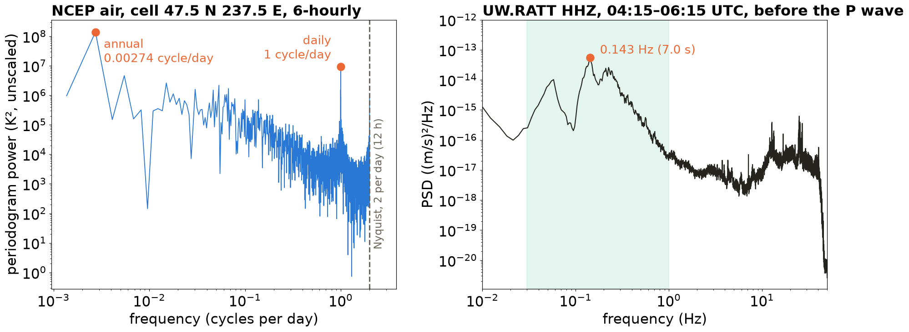

## {background-color="#faf7f2"}

```{=html}
<style>
.reveal .snip pre { font-size: 0.5em; line-height: 1.35; max-height: none; box-shadow: none; margin: 0.2em 0; }
.reveal .snip pre code { max-height: none; overflow: visible; white-space: pre-wrap; word-break: break-all; tab-size: 4; }
.reveal .snip.small pre { font-size: 0.72em; }
.reveal .snip.l pre { font-size: 0.54em; }
.reveal .snip.xl pre { font-size: 0.75em; }
.reveal .code-small pre { font-size: 0.66em; max-height: none; margin: 0.15em 0; }
.reveal .code-small pre code { max-height: none; overflow: visible; }
.vote { border-left: 0.18em solid #eb6834; padding-left: 0.5em; font-size: 0.8em; font-weight: 600; margin-top: 0.4em; }
.timer { float: right; font-size: 1.5em; font-weight: 800; color: #116b66; font-variant-numeric: tabular-nums;
         cursor: pointer; border: 0.08em solid #116b66; border-radius: 0.2em; padding: 0 0.25em; line-height: 1.2; }
.timer.done { color: #b3402a; border-color: #b3402a; }
.mode { display: inline-block; font-size: 0.62em; font-weight: 700; padding: 0.08em 0.45em; border-radius: 0.3em;
        border: 2px solid #26241f; margin: 0 0 0.25em 0; }
.reveal .mid table { font-size: 0.72em; }
.reveal .mid table th, .reveal .mid table td { padding: 0.1em 0.45em; }
.reveal .audit li { margin: 0.12em 0; }
.reveal .smallnum { font-size: 0.62em; }
.big-due { font-size: 1.15em; font-weight: 800; color: #b3402a; margin: 0.3em 0; }
</style>
```

[📂]{.lecture-icon}

### Today's question

Five stations: a river gauge, a weather table and an earthquake catalog from the Pacific Northwest, a seismogram of an Alaska Peninsula earthquake recorded near Seattle, and a reanalysis grid over North America.

**What does one number in each file mean, and can an agent read it as well as you can?**

::: {.dim}
In class: the lab notebook `lab_s07_reading_data.ipynb` · Reading: [2.7 Statistical considerations](https://geo-smart.github.io/mlgeo-book/statistical-considerations) · [2.8 Spectral transforms](https://geo-smart.github.io/mlgeo-book/data-spectral-transforms), with the [companion slides](lec07_statistics_spectra.html)
:::

::: {.notes}
10:00 to 10:08: two pulse talks first (existing routine), then this slide at 10:08 for 30 seconds. Today is a lab, not a lecture: three rounds of reading real files, two by hand and one with a coding agent, all graded by the same checker. Every file is a snapshot committed in the book with a provenance record and a SHA-256 (Secure Hash Algorithm, 256-bit) checksum, so every pair reads the same bytes. Statistics and spectra (2.7 and 2.8) are now the reading; the old Session 7 deck stays online as their companion. The geoscience: a 77-year weather record at Seattle-Tacoma airport; 26 years of Puget Sound earthquakes including Nisqually 2001 and the Mount St Helens dome building of 2004 to 2008; the Mww 8.2 Chignik, Alaska earthquake recorded 2,627 km away at Rattlesnake Lake; two years of a global reanalysis over North America; and the November 2021 atmospheric-river flood on the Nooksack River.
:::

## Today's plan, and why we work this way {.smaller}

:::: {.columns}
::: {.column width="52%"}
::: {.mid}
| Time | What |
|---|---|
| 10:00 | Pulse talks |
| 10:11 | What is this file? Five snippets, vote |
| 10:17 | Worked example: Nooksack River |
| 10:22 | Round 1, by hand: a table (A or B) |
| 10:40 | Round 2, by hand: an array (D or E) |
| 10:55 | Which moment, which spectrum |
| 10:59 | Round 3: an agent reads your table, then you verify |
| 11:13 | Key, computed live; scoreboard; exit |
:::
:::

::: {.column width="48%"}
::: {.lit-card}
[0.47 SD]{.lit-num}

[Higher exam scores, in standard deviations (SD), with active learning across 158 STEM studies; lecture-only students were 1.5 times as likely to fail.]{.lit-msg}

[Freeman et al. (2014), *PNAS* 111, 8410–8415, [doi:10.1073/pnas.1319030111](https://doi.org/10.1073/pnas.1319030111)]{.lit-cite}
:::

::: {.lit-card}
[33% and 45%]{.lit-num}

[Narrower gaps in exam scores and pass rates for underrepresented students, only with high-intensity active learning.]{.lit-msg}

[Theobald et al. (2020), *PNAS* 117, 6476–6483, [doi:10.1073/pnas.1916903117](https://doi.org/10.1073/pnas.1916903117)]{.lit-cite}
:::

::: {.lit-card}
[Learned more, felt less]{.lit-num .bad}

[In a randomized physics trial, students in active sections learned more but rated their learning lower.]{.lit-msg}

[Deslauriers et al. (2019), *PNAS* 116, 19251–19257, [doi:10.1073/pnas.1821936116](https://doi.org/10.1073/pnas.1821936116)]{.lit-cite}
:::
:::
::::

::: {.notes}
10:08 to 10:11, three minutes. Say the third card out loud first: today will feel harder than a lecture, and that feeling is not evidence that you are learning less. Deslauriers et al. randomized students in a large introductory physics course between lecture and active sections; the active group scored higher on the test and still rated their learning lower, because they read the extra effort as poor learning. The authors recommend telling students early why the class runs this way, which is what this slide is for. Freeman et al. is a meta-analysis of 225 studies: exam and concept-inventory scores rose by 0.47 standard deviations (158 studies), and students in lecture sections were 1.5 times as likely to fail. Theobald et al. found that active learning narrowed achievement gaps for underrepresented students by 33% on exams and 45% in pass rates, but only in courses that spent a large share of class time on activities. All three numbers are from the abstracts, read on 2026-10-12. Setup was announced on Canvas on Tuesday: git pull, a personal copy of the notebook, the check cell printing 10 of 10 data files OK. Show the seat-block slide from 09:55 so pairs sit in the block of their round-1 table as they arrive. Rules for today: work only in your personal copy of the lab notebook inside your mlgeo-book clone. Do not touch your HW1 repository; HW1 is due tonight at 11:59 pm. Predictions go into the card before any cell runs.
:::

## What is this file? 1 of 5

[📍 In-situ sensor]{.gb .src} [🌤️ Atmosphere]{.gb .sys .air} [🌡️ Atmospheric & climate science]{.gb .disc .air}

::: {.snip .l}

:::

[Lines 1, 17 and 9,875 to 9,877 of the station A snapshot, unedited.]{.credit}

::: {.vote}
Vote: table or array? Which reader? Is the number you see the physical value?
:::

::: {.notes}
10:11, about 70 seconds per snippet, six minutes for five. Routine for each: hands up for table (one finger) or array (two fingers), then one minute with a neighbour, then vote again. Resolve aloud only the first two questions: table or array, and which reader. Leave the third open: "is the number you see the physical value?" Every card asks for the unit and the document that states it, and the answers come with the key at 11:13, after the pairs and the agents have read the files. Snippet 1 is GHCN-Daily (Global Historical Climatology Network, daily) for Seattle-Tacoma airport, station USW00024233, 1948 to 2024: a table, one row per observation day, read with pandas read_csv. The rows are three wet days of January 1975 and one day of January 1948. Ask the room what the letter T beside a 0 could mean, and what the X and 0 at the end of each element could be. Do not answer.
:::

## What is this file? 2 of 5

[🗂️ Catalog & compiled product]{.gb .src} [🪨 Solid Earth]{.gb .sys .solid} [📈 Seismology]{.gb .disc .solid}

::: {.snip .xl}

:::

[Lines 1, 3,851 and 35,995 of the station B snapshot, unedited.]{.credit}

::: {.vote}
Vote: table or array? Which reader? Is the number you see the physical value?
:::

::: {.notes}
About 70 seconds. The USGS ANSS (Advanced National Seismic System) Comprehensive Earthquake Catalog, ComCat, queried for a box around Puget Sound, 2000 to 2025. Table, but an event catalog: one row per earthquake, irregular in time, read with read_csv and parse_dates on time. The time ends in Z, so it is UTC (Coordinated Universal Time); Seattle is 7 or 8 hours behind. The second row is a magnitude 0.13 event under the crater of Mount St Helens with a depth of −0.43 km. Ask what a negative depth could mean, and what md and ml in the magType column could be. Leave both open: station B pairs look them up in the provenance record.
:::

## What is this file? 3 of 5

[📍 In-situ sensor]{.gb .src} [🪨 Solid Earth]{.gb .sys .solid} [📈 Seismology]{.gb .disc .solid}

::: {.snip}

:::

[`xxd -l 64` of the station D waveform file (its first 64 bytes), then ObsPy's summary of the same file.]{.credit}

::: {.vote}
Vote: table or array? Which reader? Is the number you see the physical value?
:::

::: {.notes}
About 70 seconds. MiniSEED, the binary format every seismic data centre serves. Array: one trace of 720,001 samples at 100 per second, read with obspy.read. Bytes you can read by eye: the record sequence number 000001, the station RATT, the channel HHZ and the network UW. In the channel code the first H is the SEED band code for high broadband (sampled at 80 to 250 Hz, corner period 10 s or longer), the second H means a high-gain seismometer, and Z is vertical. Bytes 20 and 21 are the year (0x07e5 = 2021), 22 and 23 the day of year (0x00d2 = 210, 29 July), then 06:15:00. The samples are Steim-2 compressed integers in 4,096-byte records, so no number on screen is ground motion. Leave the physical-value question open: station D pairs find the conversion in the StationXML. UW.RATT is at Rattlesnake Lake in the Cascade foothills, part of the Pacific Northwest Seismic Network (doi:10.7914/SN/UW).
:::

## What is this file? 4 of 5

[🖥️ Model & simulation]{.gb .src} [🌤️ Atmosphere]{.gb .sys .air} [🌡️ Atmospheric & climate science]{.gb .disc .air}

::: {.snip .xl}

:::

[Lines of `ncdump -h` on the station E file that describe the grid and the variable air, unedited; other attribute lines omitted.]{.credit}

::: {.vote}
Vote: table or array? Which reader? Is the number you see the physical value?
:::

::: {.notes}
About 70 seconds. NetCDF, the self-describing array format of climate and ocean science. Array: a grid of 2,920 times by 25 latitudes by 53 longitudes, read with xarray open_dataset. Ask what "short" and "scale_factor" do to the number you print, and leave it open: station E pairs open the file twice, decoded and as stored, to find out. The grid is NCEP/NCAR Reanalysis 1 (Kalnay et al. 1996, BAMS 77, 437–471), 6-hourly air temperature at the lowest model level (sigma 0.995), 2013 to 2014, the same file as notebook 2.5. A reanalysis value is a model state pulled toward observations, not a thermometer reading.
:::

## What is this file? 5 of 5

[🗂️ Catalog & compiled product]{.gb .src} [🪨 Solid Earth]{.gb .sys .solid} [📈 Seismology]{.gb .disc .solid}

::: {.snip .l}

:::

[The first 105 and the last 85 of the 162,483 characters of the station D event file, which is one line long; the middle is omitted, nothing is edited.]{.credit}

::: {.vote}
Vote: table or array? Which reader? Is the number you see the physical value?
:::

::: {.notes}
About 70 seconds, then move on at 10:17 even if the vote is split. GeoJSON from the USGS event page of the 2021 Chignik earthquake: neither a table nor an array, one nested document describing one event, read with json.load. ObsPy's read_events does not read this file; that is a fact about the file the pairs at D will meet. Two numbers that are not what they look like: time is milliseconds since 1970-01-01 UTC (1627539349188 is 2021-07-29 06:15:49.188), and coordinates are longitude first, then latitude, then depth in km, the GeoJSON order, the reverse of how we say "lat, lon". Everything between the two fragments is about 160 kB of product metadata from the contributing networks. Chignik, Mww 8.2, ruptured the Alaska-Aleutian megathrust, where the Pacific plate subducts beneath North America.
:::

## Worked example: Nooksack River, November 2021 {.smaller}

[📍 In-situ sensor]{.gb .src} [💧 Land water]{.gb .sys .water} [💧 Hydrology & land-surface modeling]{.gb .disc .water}

:::: {.columns}
::: {.column width="40%"}
**Predict.** Discharge every 15 minutes for the 30 days of November. How many rows?

::: {.fragment}
**Observe.** `pd.read_csv(p).shape` gives **(2915, 5)**, not 2,880.
:::

::: {.fragment}
**Explain.**

- 30 daily means in the same file
- 4 local times on Nov 7 occur twice, PDT then PST
- 1 reading off the 15-min grid, 07:52 on Nov 16, at the flood peak
:::
:::

::: {.column width="60%"}
::: {.snip .small}

:::

[Line number, then the exact line of the station 0 snapshot. USGS site 12213100, Nooksack River at Ferndale, WA; [public domain](https://www.usgs.gov/information-policies-and-instructions/copyrights-and-credits).]{.credit}
:::
::::

::: {.takeaway}
2,880 + 30 + 4 + 1 = 2,915 rows; the peak, 56,300 cfs, is 1,594 m³/s.
:::

::: {.notes}
10:17 to 10:22, five minutes, instructor at the keyboard with the station 0 card projected. Ask for a number before running anything; most will say 30 × 96 = 2,880. Run the cell: 2,915. Let the room explain the 35 extra rows before showing the third fragment. The product column says two products share one file: 2,885 instantaneous readings and 30 USGS daily means. On 7 November 2021 the clocks fell back, so 01:00 to 01:45 happen twice, first in PDT then in PST; the tz column keeps them apart (2,301 PST rows, 584 PDT rows). They are different instants, not duplicates, and removing them deletes an hour of river. The last extra row is 07:52 on 16 November, an extra reading between 07:45 and 08:00 at the peak of the flood: 56,300 cubic feet per second, 1,594 m³/s. The geoscience: the atmospheric river of mid-November 2021 brought heavy rain to the North Cascades; the Nooksack overtopped its banks near Everson and the water flowed north through Sumas into the Sumas Prairie of British Columbia. Show the card fields as you fill them: data_model, reader, shape, units with their source (cfs, from USGS parameter code 00060 in the provenance record), time_base (local time with a tz column, not regular). Then run lab.check_card("0", card_0) to show what a pass looks like, and change one entry to show a FAIL with its hint. Numbers printed by figscripts/lec07_reading_data.py.
:::

## Five files, four seat blocks {.smaller}

{height="480px"}

::: {.mid}
| Seat block | Round 1, by hand (table) | Round 2, by hand (array) | Round 3, agent |
|---|---|---|---|
| 1, front left | A · GHCN-Daily SeaTac | D · RATT seismogram | A |
| 2, front right | A · GHCN-Daily SeaTac | E · NCEP air grid | A |
| 3, back left | B · ComCat Puget Sound | D · RATT seismogram | B |
| 4, back right | B · ComCat Puget Sound | E · NCEP air grid | B |
:::

::: {.vote}
The notebook picks your agent prompt from the driver's NetID: W-bare, the task only, or W-full, the task plus a context block (read the provenance record first, never clean a value).
:::

::: {.notes}
Show from 09:55 as people arrive, then again at 10:21 for anyone still moving. Pairs sit in the block of their round-1 table; one laptop per pair drives, and it must run the book's pixi environment. At any moment the instructor supports only two datasets: A and B in round 1, D and E in round 2. The map places every file: (left) the Nooksack gauge, SeaTac airport, Rattlesnake Lake and the ComCat query box (45.5 to 49.0 N, 124 to 121 W); (right) the NCEP grid (15 to 75 N, 160 to 30 W) and the Chignik epicentre off the Alaska Peninsula, 2,627 km (23.6°) from RATT along the great circle. Coordinates come from the provenance records: the USGS site file, ghcnd-stations.txt, the ComCat query, the StationXML and the USGS event. The prompt split: the notebook assigns W-bare or W-full from a hash of the driver's NetID, so about half the pairs get each and no seat sheet is needed. W-bare is the task and the card, and the agent may read only the data file. W-full adds a context block written like an AGENTS.md file, the plain-text instruction file that coding agents read in a repository: read the provenance record first, never clean a value, give the source of each unit, state every choice that changes a number. In the test runs on 13 October (Claude Code, before the W-bare scope line was added), both W-bare agents found and read the provenance record on their own, so the difference is expected mainly for chat-only tools; Friday's plot keeps code-running rows apart from chat-only rows. Green sticky note on the lid means working, red means stuck. Stuck order: the FAQ cell in the notebook, then the pair beside you at the same station, then a red note.
:::

## Round 1 · by hand · a table {.smaller}

[17:00]{.timer data-min="17"} [🔒 By hand]{.mode}

1. Done before class: `git pull`, your copy `lab_s07_<netid>.ipynb` open in `book/Chapter2-DataManipulation/`, the check cell printing `10 of 10 data files OK`.
2. 2 min: bounds and predictions, then `stamp` them, before any cell reads the file.
3. 3 min: order the Parsons lines. 9 min: explore. 3 min: fill `card_A` (or `card_B`) and run `lab.check_card`.

::: {.mid}
| Card key | What you write |
|---|---|
| `data_model`, `reader`, `shape` | what one row is; the read call; rows × columns |
| `units`, `time_base` | each unit and the document that states it; zone, start, end, step |
| `missing_and_flags` | how many, how encoded, what each flag means |
| `physical_bounds`, `min_max_si` | bounds with a reason, before looking (revise only with what you saw); then min and max in SI and where |
| `real_or_error`, `question10` | one surprising but real value, one error, each with a reason; your station's question |
:::

::: {.notes}
10:22 to 10:39, seventeen minutes. Click the clock to start it; click again to reset. A pair that did not set up before class does it now with the pair beside them: git pull, copy, check cell. Station A pairs read GHCN-Daily SeaTac; station B pairs read the ComCat Puget Sound catalog. The personal copy matters: the provided notebook stays untouched, so a later git pull never conflicts, and your copy is yours to keep. Nothing today goes into the HW1 repository. The checker, check_card, recomputes the truth from the snapshot file every time it runs and prints pass, FAIL or unfilled for each check with the tolerance it used; it never prints the true value, and its FAIL notes name common slips without giving the value. A Parsons block is the reader code with its lines shuffled; putting them in order is faster than writing the code and teaches the same reading. The bounds row is the judgment step: write the plausible range of daily maximum temperature at SeaTac, or of earthquake depth under Puget Sound, with a physical reason, before you see the data. The stamp keeps those first values; a pair may revise a bound after looking only with a reason that names what they saw, and the scoreboard line reports whether they did. Walk the room by block: at 10:25 every pair should have predictions written; at 10:30 a shape and dtypes; at 10:36 a check_card table. Swap driver and navigator at 10:39.
:::

## Round 2 · by hand · an array {.smaller}

[15:00]{.timer data-min="15"} [🔒 By hand]{.mode}

1. Swap driver and navigator. Same notebook copy, same ten card keys.
2. **D, RATT:** three files, one event. The waveform is stored as integers; the StationXML holds the sensitivity; the GeoJSON holds the origin.
3. **E, NCEP:** open the grid twice, decoded and as stored, and compare one value.
4. The reader cells have blanks: the function names are given, the file names and options are yours.

::: {.code-small}
```python
st = obspy.read(str(SNAP / EVENT))                  # D: EVENT, RESPONSE, ORIGIN
inv = obspy.read_inventory(str(SNAP / RESPONSE))    #    are your three file names
quake = json.load(open(SNAP / ORIGIN))
raw = xr.open_dataset(SNAP / GRID, mask_and_scale=DECODE)   # E: GRID and DECODE
```
:::

::: {.notes}
10:40 to 10:55, fifteen minutes; swap roles at 10:39. Blocks 1 and 3 do D, blocks 2 and 4 do E. D: the Mww 8.2 Chignik earthquake of 29 July 2021, recorded at UW.RATT, a broadband seismometer at Rattlesnake Lake, 2,627 km from the epicentre. The P wave arrives a few minutes after the 06:15:49 UTC origin and the surface waves follow for tens of minutes. The question10 noise spectrum uses the two hours before the event (the file ending 0415-0615); ask pairs what shakes the ground when no earthquake is happening. Three readers, three formats: obspy.read for MiniSEED, obspy.read_inventory for StationXML, json.load for GeoJSON. E: the NCEP/NCAR Reanalysis 1 grid from notebook 2.5. Two things to discover by hand: the order in which latitudes are stored, and the longitude convention. If a pair finishes early, they help the pair beside them at the same station rather than starting the agent. Stop at 10:55 even if cards are incomplete; unfilled is a valid checker result.
:::

## Which moment {.smaller}

::: {.content-visible when-profile="instructor"}
{.r-stretch}

::: {.dim}
Aki (1965) b from the mean magnitude above Mc, Utsu's half-bin correction, raw magnitudes, all magTypes pooled, the 2004–2008 Mount St Helens swarm included. Kurtosis of the June–August TMAX: 2.83 plain, −0.17 excess (the default in scipy).
:::

::: {.takeaway}
42.2 °C is 4.22 standard deviations above the June–August mean: a normal model expects 0.09 such days in 7,084. b rises from 0.61 to 1.04 as Mc goes from 1.0 to 2.0 (bin 0.1).
:::
:::

::: {.content-hidden when-profile="instructor"}
::: {.dim}
The figure and its numbers are shown in class at 10:55, after the by-hand rounds, and posted here after Friday's session.
:::

::: {.takeaway}
Which summer days count and which kurtosis definition you use move the SeaTac numbers; Mc and the bin width move the b-value.
:::
:::

::: {.notes}
10:55 to 10:59. The figure and the numbers are in the instructor build of this deck.
:::

::: {.content-visible when-profile="instructor"}
::: {.notes}
10:55 to 10:57, two minutes. Left: all 7,084 June to August days at SeaTac, 1948 to 2024, on a log axis so the tail shows. Mean 23.22 °C, standard deviation 4.50 °C. The 2021 heat dome peak, 42.2 °C on 28 June, is 4.22 standard deviations above the mean; a normal distribution with that mean and spread gives 1.2 × 10⁻⁵ per summer day, or 0.09 days in the whole record. It happened, and the day before (40.0 °C) had already beaten the previous annual-maximum record, so this is a real extreme to keep: rare under the model, not impossible, and the reason the tail of the distribution matters. The previous record was 39.4 °C in 2009. The bulk of the distribution is close to normal (plain kurtosis 2.83, excess −0.17): one statistic of the whole sample says nothing about the one day that matters. Say the definition: plain kurtosis is 3 for a normal distribution; excess kurtosis subtracts 3; scipy.stats.kurtosis returns excess by default, pandas too. Right: Aki's maximum-likelihood b-value for the Puget catalog moves from 0.61 to 1.04 as the magnitude of completeness rises from 1.0 to 2.0, with a 0.1 bin; with a 0.01 bin the values are 0.65, 0.83 and 1.17. Two causes: below about magnitude 2 the network misses small events, so the catalog is incomplete, and md and ml magnitudes have different precision (92% of md values sit on the 0.1 grid, 10% of ml values), so the bin width you assume changes the correction. A b-value without its Mc, bin width, magnitude types and swarm handling is not a result. Numbers printed by figscripts/lec07_reading_data.py.
:::
:::

## Which spectrum {.smaller}

::: {.content-visible when-profile="instructor"}
{.r-stretch}

::: {.dim}
Left: periodogram of the 2,920 six-hourly values at the cell nearest SeaTac, mean removed. Right: Welch spectrum, segments of 2^15 samples (328 s), counts divided by the StationXML sensitivity.
:::

::: {.takeaway}
The air temperature peaks at 1/365 and 1 cycle per day, with a 2-per-day Nyquist limit (12 h); the ground at RATT peaks at 0.143 Hz (7.0 s), the ocean microseism.
:::
:::

::: {.content-hidden when-profile="instructor"}
::: {.dim}
The figure and its numbers are shown in class at 10:55, after the by-hand rounds, and posted here after Friday's session.
:::

::: {.takeaway}
The segment length sets what a Welch spectrum can resolve; the sampling step sets the shortest period a grid series can show.
:::
:::

::: {.notes}
10:55 to 10:59. The figure and the numbers are in the instructor build of this deck.
:::

::: {.content-visible when-profile="instructor"}
::: {.notes}
10:57 to 10:59, two minutes. Left: the NCEP cell nearest SeaTac, 47.5 N, 237.5 E (two-year mean 10.24 °C). The two largest peaks are the annual cycle (0.00274 cycles per day, 1/365) and the daily cycle (1 cycle per day); the third is the semiannual harmonic. Four samples a day means the Nyquist frequency is 2 cycles per day: no variation shorter than 12 hours can be seen, and any that exists folds back, as the tide did in Monday's lecture. Right: RATT vertical ground velocity for the two hours before the Chignik P wave. The largest peak between 0.03 and 1 Hz is at 0.143 Hz, a period of 7.0 s: the secondary microseism, generated where ocean waves travelling in opposite directions meet and press on the sea floor at twice the wave frequency. It is there every day, earthquake or not. The peak frequency depends on the method: segments of 2^12 samples give 0.146 Hz, and segments of 2^10 samples (10 s, a frequency step of 0.098 Hz) cannot resolve the peak and put it at 0.195 Hz, so state the segment length with the number. Numbers printed by figscripts/lec07_reading_data.py. Then announce round 3.
:::
:::

## Round 3 · an agent reads your table {.smaller}

[7:00]{.timer data-min="7"} [🔍 Agent, then verify]{.mode}

1. Set `DRIVER_NETID`, `MY_TABLE` and `RUN`; hash the snapshots.
2. Start the agent in `mlgeo-book`, never in `MLGEO2026_UWNETID`. In VS Code, close your notebook tab first. Paste the printed prompt exactly.
3. Code-running agents write `agent_A.py` and `agent_A.json`. UW Purple: set the chat mode, paste the printout, run its code yourself.
4. Answer questions only with "use the files". Export the chat to `agent_A_transcript.md`.
5. At 7 minutes, stop and record `"timeout"`; that run still gets a scoreboard line.

::: {.notes}
10:59 to 11:13, fourteen minutes: one minute to hash, seven for the agent, four to check, two to score. Click the clock when the agent receives the prompt. One partner drives the agent; the other fills the RUN record (tool, model and version if shown, mode: agent runs code, or chat writes and we run; wall time; number of turns) and starts the transcript file. B pairs use agent_B in every file name. The prompt carries the full path of the pair's book folder and tells the agent to stop if it was started anywhere else: HW1 is graded as MLGEO2026_UWNETID stands tonight, and an agent started there could write into it. In VS Code, Copilot adds the open editor file to the chat by default, so a pair with its notebook copy open would hand the agent its hand card. Exporting the transcript: Claude Code, type /export; VS Code Copilot Chat, Command Palette, "Chat: Export Chat..."; any other tool, select the whole conversation and paste it. Hashing first is the integrity check: hash_snapshots records the SHA-256 of every snapshot file, and the notebook also hashes the checker module. UW Purple does not open files or run code; its pairs set RUN mode to "chat writes, we run" before printing the prompt (that version tells Purple it cannot run anything and must not predict output), paste the printout, save the code it writes and run it once from a terminal; their rows are kept apart on the scoreboard. If its code never writes the JSON file, the pair copies its answers into a card by hand and says so in the transcript. If a pair has no agent at all, they join the pair beside them and audit that run. Both prompts allow the agent to stop and write "unanswerable:" with a reason; the checker counts that as declined, apart from FAIL. Cut order if the room runs late: (1) score S1 to S5 only; (2) cold call two pairs instead of one per station; (3) give the round 2 reader line instead of the blanks; (4) stop any agent still running at 7 minutes and record the timeout.
:::

## Audit: the same checks for the agent and for you {.smaller}

::: {.code-small}
```python
agent_card = lab.load_agent_card("agent_A.json")
lab.compare("A", card_A, agent_card)                 # one checker, two cards
lab.compare_hashes(before, lab.hash_snapshots())     # a: raw data unchanged?
lab.audit_agent_script("agent_A.py", "A")            # b: values typed in? every file write
```
:::

::: {.audit}
Answer yes or no, each with its evidence:

a. Snapshot files unchanged
b. No number seen in the data typed into the script, no import of the checker; bounds typed from physics are allowed
c. No invented column, unit, file, DOI or citation
d. Every dropped, filled or "cleaned" value reported, with counts in and out
e. Every claim in the chat (a number, a command, a file read) appears in the printed output or the tool calls
f. Ambiguity flagged where a careful person would hesitate
g. Bounds set from physics before the data were read; the checker and the notebooks never opened
:::

::: {.dim}
22 professional analysts checked AI-generated analyses in 52 workflows, 39 with errors; 44 of 52 followed the AI's procedure and 25 of 52 inspected the data (Gu et al. 2024, CHI, section 6.1, [doi:10.1145/3613904.3642497](https://doi.org/10.1145/3613904.3642497)).
:::

::: {.notes}
11:07 to 11:13, inside round 3: four minutes to run these cells, answer a to g in the AUDIT cell with evidence for each, and run git status --short in a terminal (only new files may appear), then two minutes to score S1 to S8. compare runs check_card on both cards and prints them side by side, so the person and the agent are graded by the same checks and tolerances; its summary counts passes over the entries each card filled. audit_agent_script lists imports of the checker, every call that writes a file, and any value from the file or the key typed into the code, by line number only; the hash comparison is the authority on raw data. Gu et al. (2024) watched 22 professional analysts verify AI-generated analyses in 52 workflows, 39 of which involved errors. Most participants (18 of 22) followed all or part of the AI's procedure (44 of 52 workflows), and most (18 of 22) also inspected the data (25 of 52 workflows); the authors found data, code and the AI's explanation each pivotal for noticing an issue. That is why this audit has a data check (a and compare) and a process check (b to g). Pairs are graded on how complete their audit is, not on the agent's score: a complete audit of a bad run, with evidence for each item, earns full marks, and a "no" with its evidence is a finding.
:::

::: {.content-visible when-profile="instructor"}
::: {.notes}
Say aloud at 11:07, after the hand cards are done, to point the audit at the items the checker cannot judge. Station A: is the reported TMAX minimum the same value the card calls an error? Is the second O-flagged row, 1951-02-26, mentioned? Was the time zone taken from a file or from memory? Were the bounds written after the agent saw the maximum? Station B: is the md label on the M 6.8 Nisqually row discussed? Was the 0 s minimum interval between events followed up (two events at 2004-10-04 14:30:03.27)? Was any explanation of the 514 events at M 0.0 tested within each magType, or only asserted? Are md and ml pooled in the b-value? For f in general: tenths or degrees, trace or zero, depth below sea level or below the surface, md or ml.
:::
:::

## The key, computed from the files, live

::: {.code-small}
```python
lab.reveal_key("A")    # run by the instructor at 11:13, with the key file
lab.reveal_key("B")    # kept outside the book repository
```
:::

- The true values are recomputed from the snapshot files when the key runs
- Which values are real and which are errors sits in the checker only as hashes; the key text stays on the instructor's laptop
- For each item, tick in the scoreboard form: caught by hand, caught by the agent, or missed

::: {.takeaway}
The answers appear only in the output projected at 11:13; these slides, the notebook and the checker hold none as text.
:::

::: {.notes}
11:13 to 11:18, five minutes. Before class, set the environment variable LAB_S07_KEY to the path of the key file, or pass key_file= to reveal_key. Run reveal_key for A and for B in the provided notebook and project the output; do not paste it into the slides. While pairs tick their items, cold call one pair per station: "What did the agent get wrong that your card caught?" and "What did the agent catch that you missed?" If time is short, take only two pairs. Point to the physical reason behind each item the key lists as real: a value that is extreme but explained by the process (a heat dome, a swarm under a volcano) stays in the record with a flag if needed; an error is a value that the process cannot produce or a label that does not describe the data. The same function exists for D and E; their keys are used on Friday, when the agent works on a planted copy of the array file.
:::

::: {.content-visible when-profile="instructor"}
::: {.notes}
Close the five warm-up snippets now, in one minute. (1) GHCN stores temperature in tenths of °C and precipitation in tenths of mm: 83 is 8.3 °C and 330 is 33.0 mm on 1975-01-12. PRCP 0 with PRCP_M = T is a trace, too little to measure, not a dry day. The last letter of each element is the source flag (X and 0 are different archives). The unit is in the GHCN readme and the provenance record's columns field, not in the file. (2) Depth is in km, positive down; a negative depth is above the catalog's depth datum, which happens under high topography such as Mount St Helens: real, keep it. md (duration) and ml (local) are different magnitude scales with different precision in one column. (3) The samples are counts from a 24-bit digitizer; dividing by the overall sensitivity, 503,735,430 at 1 Hz, gives velocity in m/s. The StationXML labels its input V, which station D pairs met as the error. The start time ends in .000001: a 1 µs offset recorded in the file; real, keep it. (4) air is stored as a 16-bit integer with scale_factor 0.01 and units degK: a stored 27315 means 273.15 K; xarray applies the factor when it opens the file. Latitudes run north to south and longitudes 200 to 330 degrees east, so a Seattle longitude written as −122.3 lands elsewhere without an error.
:::
:::

## Scoreboard and exit {.smaller}

1. **Scoreboard:** paste the line the notebook prints (NetID, station, prompt, tool and model, mode, wall time or timeout, checks passed by hand and by the agent, hashes, audit, S1 to S8, failed checks) into the class form, linked on Canvas.
2. **Exit ticket** on Canvas, 2 minutes: one check on which your card and the agent's disagreed, and what in the file decides it. None differ? One thing the checker passed that your audit or the key shows is wrong or unsourced.
3. Keep your notebook copy and the `agent_*` files until Friday.

::: {.big-due}
HW1 and the Chapter 1 quiz are due tonight 11:59 pm.
:::

::: {.dim}
Friday: an agent on a planted copy of your array file, then register your table in your HW1 repository · Reading: 2.7 and 2.8 with the [companion slides](lec07_statistics_spectra.html)
:::

::: {.notes}
11:18 to 11:20, two minutes. The scoreboard collects one line per pair, so Friday opens with the class numbers: how often people and agents caught each trap, whether W-full did better than W-bare, and how much two pairs with the same tool agreed. Each comparison will have a small n per tool; we will show n beside every bar. The scoreboard line also lists the names of the failed checks for each card, so Friday's per-trap counts come straight from the form; a run that timed out still has a line, with the agent marked n/a. The exit ticket asks for one check on which the pair's card and the agent's card disagreed, which of the two the file supports, and what in the file or its documentation decides it; pairs whose cards agree name one thing the checker passed that their audit or the key shows is wrong or unsourced. The transcript in agent_A_transcript.md (or agent_B) goes into AI_logs/ of the course repository only after the HW1 deadline. Remind twice: HW1 and the Chapter 1 quiz close tonight at 11:59 pm, and nothing from today goes into the HW1 repository before then. Friday's registration step happens after the HW1 deadline.
:::

```{=html}
<script>
(function () {
  function fmt(s) { var m = Math.floor(s / 60), r = s % 60; return m + ":" + (r < 10 ? "0" : "") + r; }
  document.querySelectorAll(".timer").forEach(function (el) {
    var id = null, total = parseInt(el.dataset.min, 10) * 60;
    el.title = "Click to start; click again to reset";
    el.addEventListener("click", function (ev) {
      ev.stopPropagation();
      if (id) { clearInterval(id); id = null; el.classList.remove("done"); el.textContent = fmt(total); return; }
      var end = Date.now() + total * 1000;
      id = setInterval(function () {
        var s = Math.max(0, Math.round((end - Date.now()) / 1000));
        el.textContent = fmt(s);
        if (s === 0) { clearInterval(id); el.classList.add("done"); }
      }, 250);
    });
  });
})();
</script>
```
