## {background-color="#faf7f2"}

[〰️]{.lecture-icon}

### Today's question

Archived seismograms, GPS positions and river records arrive with filter effects, gaps and timing errors.

**Which corrections can an independent measurement confirm, and which samples must stay marked as missing?**

::: {.dim}
Reading: [2.9 Filtering data](https://geo-smart.github.io/mlgeo-book/filtering-data)
:::

::: {.notes}
One minute with the title. Frame the session: three problems of real data streams, each shown first on the course's own seismogram (UW.RATT, the same record as 2.8), then in published work from other fields, then in a real archive where nobody planted the problem. The three: filter phase (a filter can move or decorate an onset), gaps (a zero-filled gap makes a filter ring), clock errors (a timing error shifts every time and leaves the waveform intact). On the RATT record we damage a copy on purpose, so comparing with the intact record gives the error left by each correction. Ask the room: who has downloaded data with gaps, and what did you do about them?
:::

## Zero-phase and causal filters at a step {.smaller}

[📍 In-situ sensor]{.gb .src} [🪨 Solid Earth]{.gb .sys .solid} [📈 Seismology]{.gb .disc .solid}

:::: {.columns}
::: {.column width="60%"}
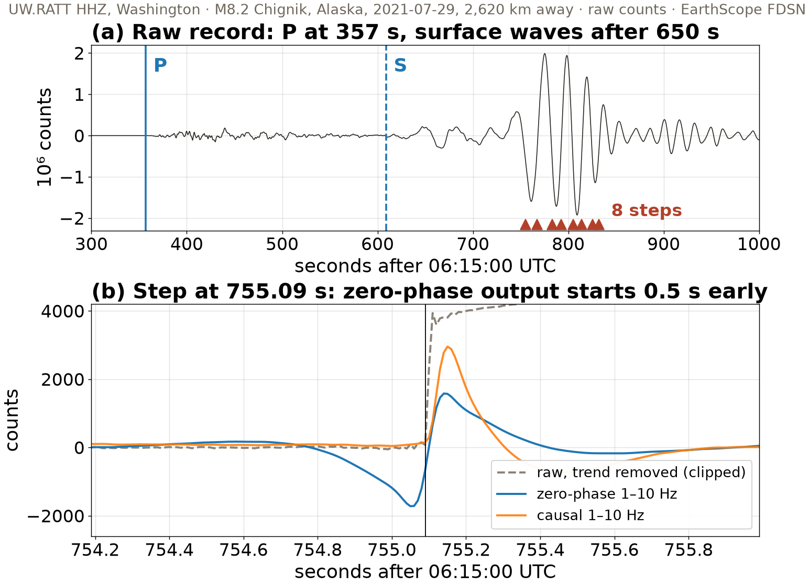{height="600px"}
:::
::: {.column style="width:40%; font-size:0.8em"}
- UW.RATT: M8.2 Chignik, Alaska, 2021, 2,620 km away; P at 357 s
- Raw record: 8 steps of 1,600 to 3,600 counts; the first at 755.09 s
- Zero-phase: output starts 0.52 s early, 1,718 counts against a 45-count background
- Causal: nothing before the step; peak 0.06 s after
:::
::::

[Data: UW.RATT HHZ via EarthScope FDSN, [doi:10.7914/SN/UW](https://doi.org/10.7914/SN/UW). Figure: figscripts/ratt_repairs.py; 1–10 Hz, 2-pole Butterworth; P and S from the iasp91 model.]{.credit}

::: {.takeaway}
A zero-phase filter keeps the step at 755.09 s but spreads energy 0.5 s ahead of it; a causal filter puts nothing ahead of it and delays and reshapes what follows.
:::

::: {.notes}
Two minutes. Panel (a): the raw counts from 06:15 UTC on 29 July 2021. The P wave arrives at about 357 s (iasp91, 23.6°, 32 km depth: 307.7 s travel time plus 49.2 s from 06:15:00 to the origin time); S at about 609 s (dashed line); the surface waves, 2 million counts peak, arrive after 650 s. The sharp change at 755.09 s, during the surface waves, is not the P wave. It is the first of 8 steps in the raw record (755.09, 767.00, 782.96, 792.25, 804.97, 814.11, 825.34 and 832.12 s). Sizes from figscripts/ratt_repairs.py (cubic fit to 0.3 s of raw samples on each side, rerun 17 October 2026): +3,563, −3,571, +2,961, −2,954, +3,284, −2,676, +2,526 and −1,649 counts, each completed within two or three samples. All eight occur on steep swings, at raw values between −367,000 and −635,000 counts and slopes of 208,000 to 540,000 counts/s, each jump opposing the motion; cause not identified, likely instrument or digitizer. The step is useful here because its true time is in the raw data, so we can measure what each filter does. Panel (b): gray dashed is the raw record with the pre-step trend removed (clipped at the top). Blue, zero-phase (sosfiltfilt): the filter runs forward then backward, so phase delays cancel and the step stays at the right time, but the output is symmetric and starts 0.52 s early, reaching 1,718 counts before the step against a 45-count background. Orange, causal (sosfilt): output depends only on the past, so nothing appears before the step (112 counts, below its 166-count background), but every frequency is delayed differently and the waveform after the step changes shape. Causal is the only option in real time (earthquake early warning) and whenever energy before an onset matters; zero-phase suits offline work where timing alignment matters, with the rule from the notebook: do not interpret small wiggles just before a sharp onset. The zero-phase filter applies the 2-pole filter twice, so its stopband falls off twice as fast. Ask: on zero-phase filtered data, where would you pick the P onset, and would the pick be early or late?
:::

## Filtered accelerogram and GPS, Norcia 2016 {.smaller}

[📍 In-situ sensor]{.gb .src} [🪨 Solid Earth]{.gb .sys .solid} [📈 Seismology]{.gb .disc .solid} [📐 Geodesy]{.gb .disc .solid}

:::: {.columns}
::: {.column width="44%"}
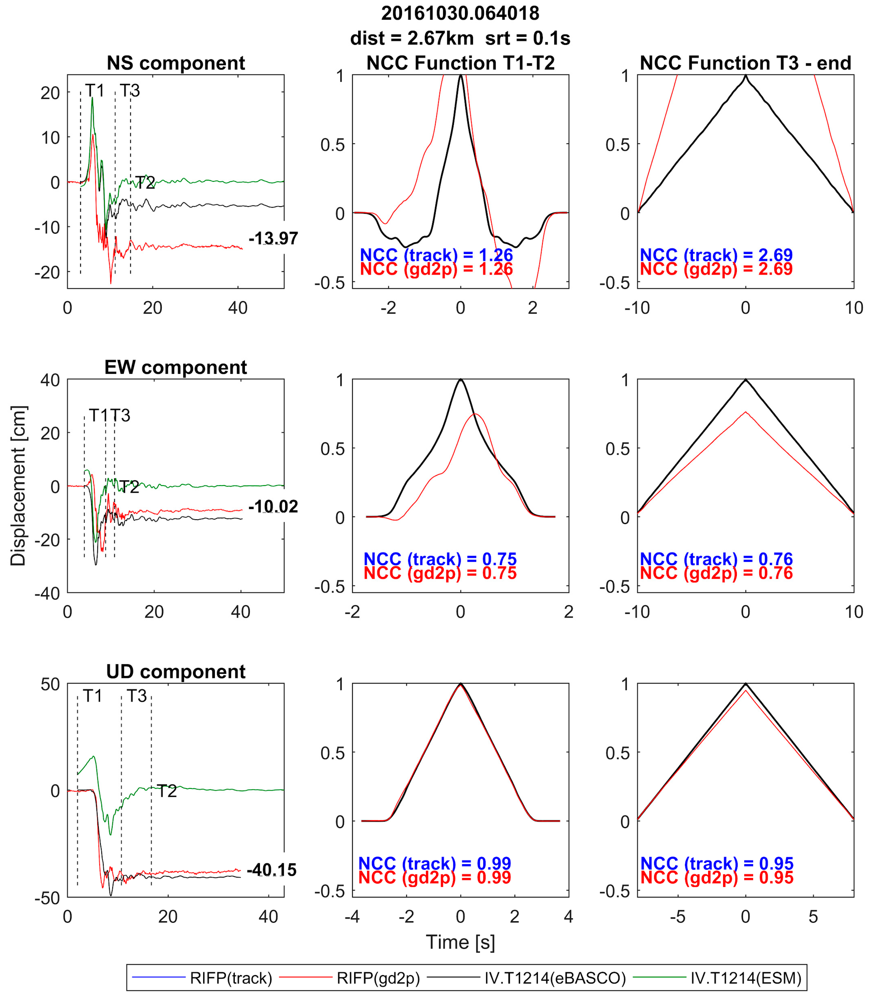{height="600px"}
:::
::: {.column style="width:56%; font-size:0.8em"}
- M~w~ 6.5 Norcia, Italy, 2016: accelerometer IV.T1214 and GPS station RIFP, 2.67 km apart
- Green, Engineering Strong Motion (ESM) database processing: low frequencies removed; all three components end near 0 cm
- Black, eBASCO (baseline correction, no high-pass): vertical matches GPS (red), normalized cross-correlation (NCC) 0.99

::: {.dim}
NCC above 1 on the north component is as published.
:::
:::
::::

[Schiappapietra, Felicetta & D'Amico (2021), *Geosciences* 11, 67, Fig. 5, [doi:10.3390/geosciences11020067](https://doi.org/10.3390/geosciences11020067). [CC BY 4.0](https://creativecommons.org/licenses/by/4.0/).]{.credit}

::: {.takeaway}
GPS records permanent offsets of −14, −10 and −40 cm (north, east, up); the high-pass filtered accelerogram ends near 0 cm on all three.
:::

::: {.notes}
One and a half minutes. Displacement from one accelerogram (30 October 2016) processed two ways, with GPS as an independent check (the bridge from seismology to geodesy). The ESM trace is "processed following the standard procedure ... that removes the low-frequency content of the signal", so the permanent offset (the fling step) is gone. eBASCO (extended baseline correction) "does not apply any filtering to remove the low-frequency content"; it still applies an acausal low-pass Butterworth and tapers, so say "no high-pass", not "unfiltered". On north, eBASCO ends near −5 cm against −13.97 cm from GPS, so the recovery is not perfect; the authors call only the east and up matches noteworthy. The north NCC values printed in the figure, 1.26 and 2.69, are as published; a normalized correlation above 1 points to a plotting or definition issue in the original, so do not quote them. A filter-phase reading, ours and not the authors': on the vertical, the green trace already sits at about +8 cm where it starts (about 2 s) and climbs to about +15 cm before the onset at about 5 s, while black and red are flat at zero; that is what an acausal filter does ahead of a sharp arrival, the same as the RATT step. The consequence for ground-motion databases, from their Fig. 6 and section 4.1, across about 600 records of 65 earthquakes. Peak ground acceleration (PGA) is unchanged: "PGAs are insensitive to the different low-frequency treatment of the signal", while peak ground displacement (PGD) from the filtered flat-file (the database's table of one peak value per record) is lower than eBASCO's, by 10 times or more for dozens of records; most records fall within 3 times. eBASCO's PGD is larger "because eBASCO preserves the information related to both the static and dynamic displacement". The flat-file values, from NESS (Near-Source Strong-motion flat-file), used a second-order acausal Butterworth on zero-padded records. Any ground-motion prediction equation fitted to flat-file PGD inherits the processing along with the ground motion. Background: Boore and Bommer (2005) on how filter and baseline choices change strong-motion parameters. Ask: which value in your project's dataset depends on a filter someone else chose?
:::

## Energy before sharp onsets in Egypt and Greenland {.smaller}

:::: {.columns}
::: {.column width="47%"}
[📍 In-situ sensor]{.gb .src} [🪨 Solid Earth]{.gb .sys .solid} [📈 Seismology]{.gb .disc .solid}

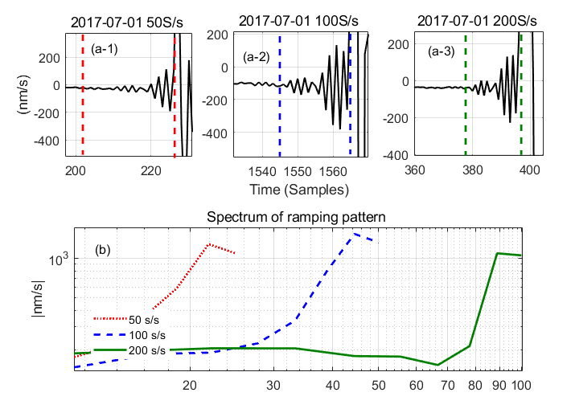{height="500px"}

::: {.dim}
Local M~L~ 1.9 event, 10.2 km away, at 50, 100 and 200 samples/s; spectra of the ramp peak at 22, 44 and 90 Hz.
:::
:::
::: {.column width="53%"}
[🧪 Sample & laboratory]{.gb .src} [🧊 Cryosphere]{.gb .sys .ice} [🌡️ Atmospheric & climate science]{.gb .disc .air}

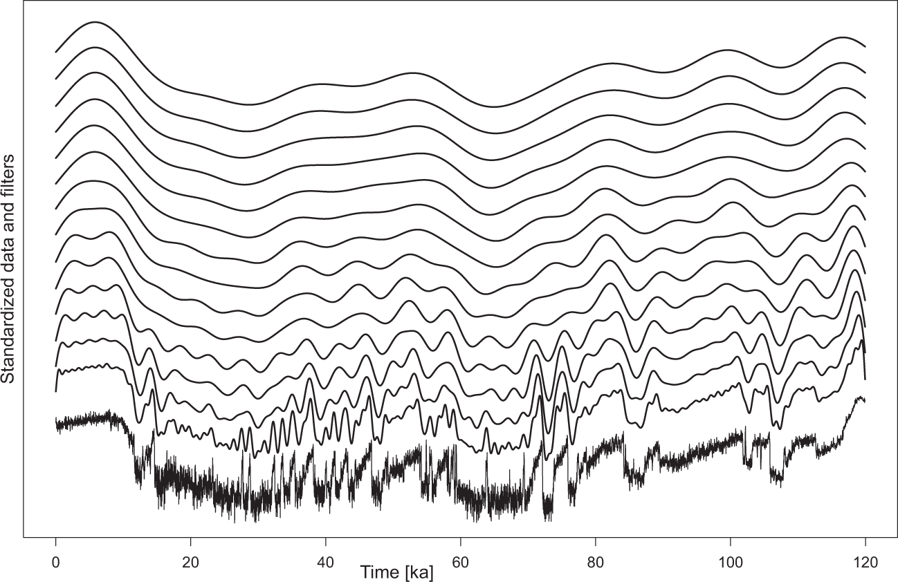{height="500px"}

::: {.dim}
Greenland δ¹⁸O, 0 to 120 ka (age increases to the right), raw at the bottom, low-passed with cut-off periods of 1 to 14 kyr upward.
:::
:::
::::

[Left: Ali et al. (2025), *IEEE Access* 13, 54383–54393, Fig. 3, [doi:10.1109/ACCESS.2025.3550167](https://doi.org/10.1109/ACCESS.2025.3550167). Right: Zeeden et al. (2020), *Scientific Reports* 10, 5455, Fig. 2, [doi:10.1038/s41598-020-61528-8](https://doi.org/10.1038/s41598-020-61528-8). [CC BY 4.0](https://creativecommons.org/licenses/by/4.0/).]{.credit}

::: {.takeaway}
In both records a sharp change acquires a lead-in: about 20 samples of ramp before the P wave at every sampling rate, and smooth rises that begin before each abrupt warming.
:::

::: {.notes}
One and a half minutes, two fields. Left: Egyptian National Seismic Network, site NADB (New Abu Dabbab, Red Sea coast). A "ramping" oscillation grows into the impulsive P onset; its spectrum peaks at 22 Hz at 50 samples/s, 44 Hz at 100 and 90 Hz at 200, always just below the Nyquist frequency, so it moves with the sampling rate and not with the Earth. The authors attribute it to "the finite impulse response (FIR) filter in the analog-to-digital conversion stage of the digitizer", and state that both digitizers use linear-phase filters: the same symmetric, zero-delay behavior as the zero-phase filter at the RATT step, built into the hardware. "These ramping patterns deceive automatic P-wave arriving picking algorithms, which choose the arrival before them". Our reading of the panels: the ramp lasts about 20 samples at each rate (0.4, 0.2 and 0.1 s), as expected from a fixed-length FIR. Caveat: the three rates come from two digitizers (a permanent Trident at 100, a temporary Centaur at 50 and 200), so rate and instrument are confounded. The authors then built an automatic detector for the ramp from 6,945 segments sorted into 4,040 with a ramp and 2,905 without; its reported accuracy is 97.67%. Background reference: Scherbaum and Bouin (1997, GJI) on FIR filter effects and apparent "nucleation phases" produced by the digitizer's own filter. Right: the Greenland oxygen-isotope record, a proxy for air temperature, low-passed with Taner filters (astrochron, R) as comparison targets for European loess. The paper does not say the filters are zero-phase; that is our inference from the symmetric bumps. Each Dansgaard-Oeschger warming is a step of a few decades in the raw record; after filtering it is a symmetric bump whose rise begins on the older side, that is to the right on this plot (our reading). The authors name the edge effect at the young end: filters "suggest rather low values at the young end of the dataset, which is clearly not suggested by the dataset itself." They filter on purpose, so this is not an error in their paper; it is what the filter does to a step. Ask: in a paleoclimate record, which way does "before" point on the plot?
:::

## GPS common mode and a reported precursor {.smaller}

[📍 In-situ sensor]{.gb .src} [🪨 Solid Earth]{.gb .sys .solid} [📐 Geodesy]{.gb .disc .solid}

:::: {.columns}
::: {.column width="50%"}
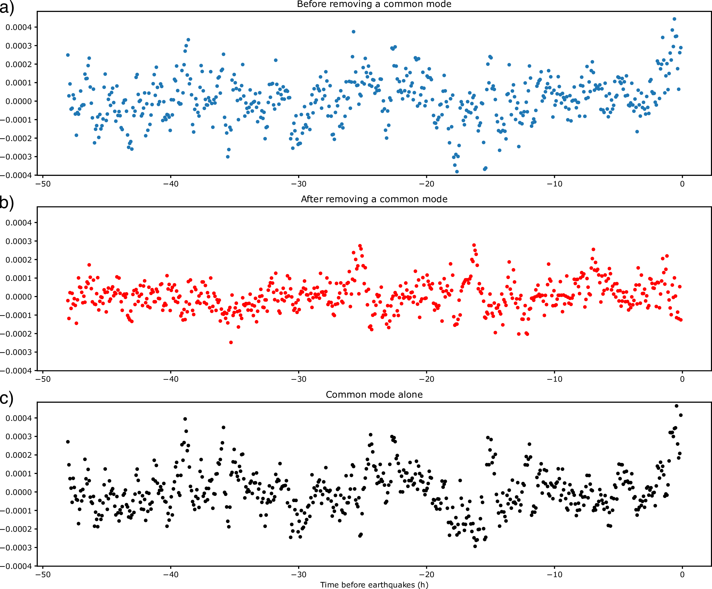{height="565px"}
:::
::: {.column style="width:50%; font-size:0.8em"}
- GPS positions stacked over 48 h before 31 large earthquakes, stations over 200 km away
- Panel (a), raw: a rise in the last 2 h; (b) common mode removed: no rise; (c) common mode alone: the rise
- A synthetic signal planted in the data is also removed by this filter

::: {.dim}
Common mode: motion shared by all stations of a network, such as reference-frame or orbit error.
:::
:::
::::

[Bletery & Nocquet (2024), *Seismica* 3(2), Fig. 4, [doi:10.26443/seismica.v3i2.1383](https://doi.org/10.26443/seismica.v3i2.1383). [CC BY 4.0](https://creativecommons.org/licenses/by/4.0/).]{.credit}

::: {.takeaway}
One spatial filtering step decides whether the 2-hour precursor appears in the stack, and the authors' synthetic test shows that this step also removes a signal known to be there.
:::

::: {.notes}
One and a half minutes; an open debate where processing is the crux. Bletery and Nocquet (2023, Science) reported an exponential acceleration of slip in the 2 hours before large earthquakes, from a stack of 5-minute high-rate GPS positions (Nevada Geodetic Laboratory solutions). The claim is contested: critics (Bradley and Hubbard 2023, Earthquake Insights blog) showed that correcting for common-mode noise "makes the signal vanish". This 2024 paper confirms that, then shows the filter "may inadvertently remove an existing tectonic signal": with a known signal planted in synthetic data (their Fig. 6), the common-mode filtering "performs poorly at separating the imposed signal from noise", with a misfit 20% larger than the common mode alone. The likelihood that common-mode noise alone produces the rise is "well below 1 %" by their estimate, and they conclude the signal "is not robust to common-mode filtering" and that their tests "do not irrefutably demonstrate" a precursory phase. The y axis is an unlabeled dot-product amplitude. Filter-phase link in the same paper: NGL's kinematic solutions use a forward-backward smoother that can, in principle, carry the coseismic offset into earlier epochs; the authors judge its constraint too small to matter but say it "could be tested in future studies". Same lesson as RATT: test the processing on synthetic data with a known answer before interpreting what survives. Ask: which version, (a) or (b), would you publish, and what test would convince you?
:::

## A 20 s zero-filled gap, filtered two ways {.smaller}

[📍 In-situ sensor]{.gb .src} [🪨 Solid Earth]{.gb .sys .solid} [📈 Seismology]{.gb .disc .solid}

:::: {.columns}
::: {.column width="52%"}
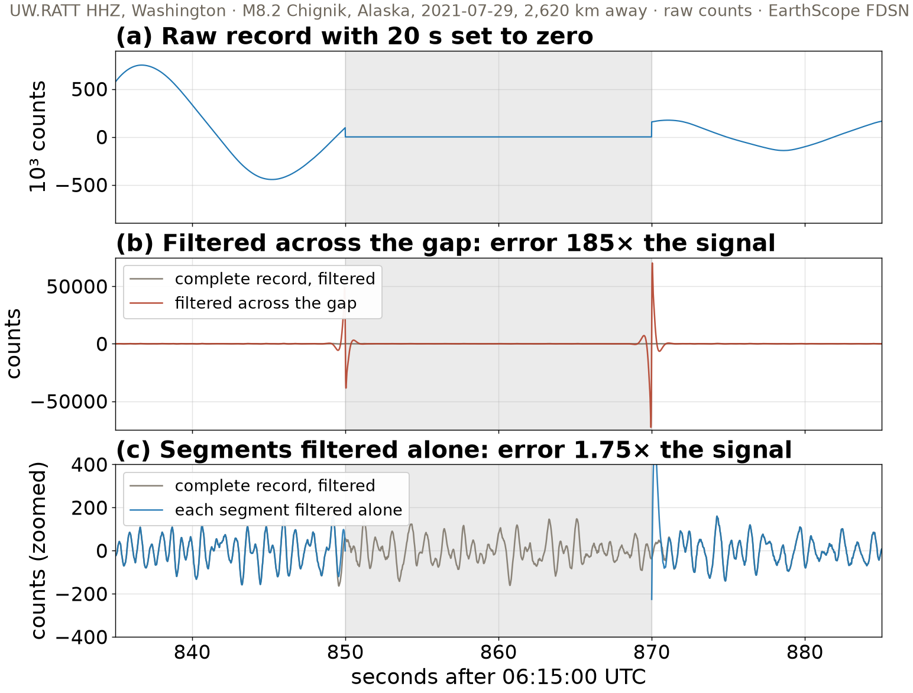{height="590px"}
:::
::: {.column style="width:48%; font-size:0.8em"}
- 850 to 870 s set to zero inside the surface waves: steps of about 96,000 and 156,000 counts
- Root-mean-square (RMS) error against the intact record, 0–2 s from the edges; local 1–10 Hz signal 70 counts RMS:

| Processing | Error | × signal |
|---|---|---|
| filter across the gap | 12,998 counts | 185 |
| each segment alone | 123 counts | 1.75 |
| each segment, 2–5 s | 0.04 counts | 0.0005 |

- Guard interval: about 2 s, two periods of the 1 Hz corner
:::
::::

[Data: UW.RATT HHZ via EarthScope FDSN, [doi:10.7914/SN/UW](https://doi.org/10.7914/SN/UW). Figure: figscripts/ratt_repairs.py; numbers rerun from the same record as notebook 2.9.]{.credit}

::: {.takeaway}
Filtering across the zero-filled gap gives an edge error 185 times the local signal; filtering each segment alone gives 1.75 times, confined to 2 s from each edge.
:::

::: {.notes}
Two minutes. Panel (a): a 20 s dropout delivered zero-filled, which is how a careless merge delivers gaps. The record at the edges is 95,903 and 156,410 raw counts (95,994 and 156,500 after detrending), so zero-filling makes two steps that size. Panel (b): the band-pass run straight across it rings at both edges, because a step contains all frequencies and the filter answers at its corner frequencies; inside the gap the output shows oscillations that look like ground motion. Amplitudes or arrival times measured in this window would be the filter's response to the two steps. Panel (c), on its own zoomed axis: the correction, filter each contiguous segment on its own and leave the gap as NaN, so it stays declared as missing. The residual 1.75 times the signal within 2 s of each edge is the filter's memory (the spike at 870 s): a few periods of the lowest passband frequency, 1 Hz. Record a guard interval of about 2 s at each segment edge in the processing history, so the amplitude and spectral measurements of section 2.11 skip it. The numbers: 185.1 and 1.75 times RMS over 0 to 2 s, and 0.038 counts RMS from 2 to 5 s, 2-pole zero-phase filter, rerun on 17 October 2026 by figscripts/ratt_repairs.py, same as the notebook output. Ask: what guard interval would a 0.1 to 1 Hz band need? (About 20 s: it scales with the longest period.)
:::

## A real 40 s telemetry gap at RATT, 2021 {.smaller}

[📍 In-situ sensor]{.gb .src} [🪨 Solid Earth]{.gb .sys .solid} [📈 Seismology]{.gb .disc .solid}

:::: {.columns}
::: {.column width="67%"}
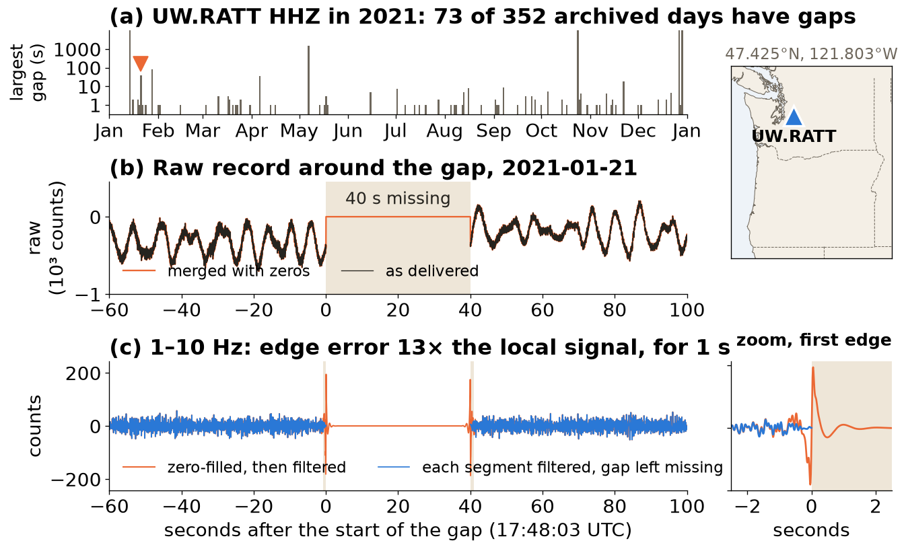{height="585px"}
:::
::: {.column style="width:33%; font-size:0.8em"}
- 21 January 2021, 17:48:03.67 UTC: two archived segments 40.00 s apart
- Merged with zeros: a step from the mean level, about −264 counts
- Peak edge error 194 counts, 13 times the 14.6-count local signal; above it for 0.7 s before and 1.0 s after
:::
::::

[Data: UW.RATT HHZ via EarthScope FDSN, [doi:10.7914/SN/UW](https://doi.org/10.7914/SN/UW); daily gap metrics from EarthScope MUSTANG (max_gap, num_gaps). Figure: figscripts/lec08_real_seismic_gap.py.]{.credit}

::: {.takeaway}
In 2021, 73 of 352 archived days at RATT have a gap and 9 have one longer than 10 s; at this 40 s gap, zero-filling gives a peak edge error 13 times the local signal for about 1 s.
:::

::: {.notes}
One minute; same station as the notebook, a gap nobody planted. Panel (a) comes from EarthScope's daily data-quality metrics (MUSTANG): the largest gap and the number of gaps per day (max_gap, num_gaps); the EarthScope availability service has been retired. Panel (b): the archive delivers two segments, 2021-01-21 17:48:03.67 UTC, 40.00 s apart; a merge that fills with zeros (orange) creates steps from the record's mean level, about −264 counts. Panel (c): band-pass 1–10 Hz, 4 poles, zero-phase. Peak edge error 194 counts against a local RMS of 14.6 counts, 13 times, with error above the local RMS for 0.7 s before and 1.0 s after the gap: the guard interval measured on real data. Why 13 and not 185? The two numbers are not the same measurement. The planted gap uses the RMS error over 0 to 2 s, a 2-pole filter, measured against the intact record. Here the 13 times is a peak, with a 4-pole ObsPy filter, measured against the segment-wise result, because no intact record exists. On the planted gap's metric this gap gives 2.8 times (40.8 counts RMS over 0 to 2 s, printed by figscripts/lec08_real_seismic_gap.py, rerun 17 October 2026). The rest of the difference is physical: here the step is only 264 counts on a quiet microseism day, while the planted gap sat in surface waves of 100,000 counts; the step size sets the damage. Ask: how would you find every gap in a year of your own data before filtering?
:::

## Spectra with a 50% gap, untapered and tapered {.smaller}

[🖥️ Model & simulation]{.gb .src} [🪐 Planets & exoplanets]{.gb .sys .planet} [🪐 Planetary science & astrobiology]{.gb .disc .planet} [synthetic test signal; method applied to Venus Express magnetometer data]{.dim}

:::: {.columns}
::: {.column width="52%"}
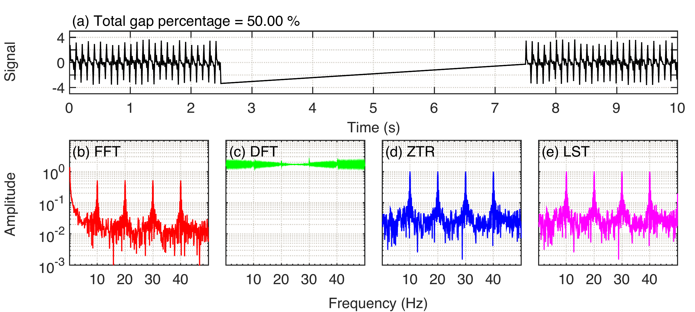{height="283px"}

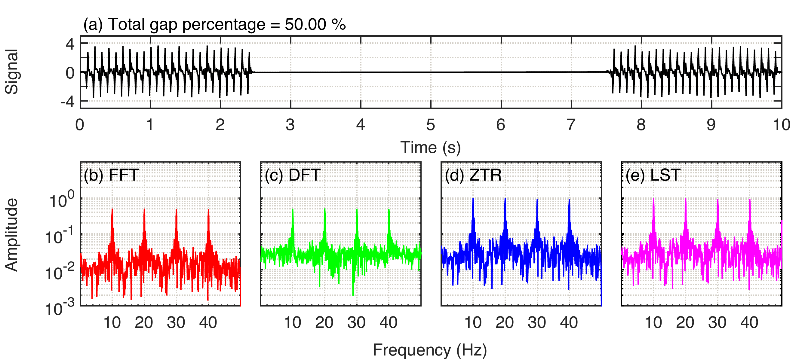{height="283px"}
:::
::: {.column style="width:48%; font-size:0.8em"}
- Four sines (10–40 Hz) plus noise, 10 s; the central 5 s removed
- Top, gap bridged by a line: FFT peaks halve and a false rise appears near 0 Hz
- Bottom, each segment tapered: the false rise is gone
- Peaks stay at 0.5 because half the samples are missing

::: {.dim}
FFT: fast Fourier transform; DFT: discrete Fourier transform; ZTR: Z-transform; LST: Lomb-Scargle periodogram.
:::
:::
::::

[Munteanu, Negrea, Echim & Mursula (2016), *Annales Geophysicae* 34, 437–449, Figs. 2 and 3 (200 dpi renders of the publisher PDFs), [doi:10.5194/angeo-34-437-2016](https://doi.org/10.5194/angeo-34-437-2016). [CC BY 3.0](https://creativecommons.org/licenses/by/3.0/).]{.credit}

::: {.takeaway}
Tapering each segment removes the false low-frequency energy from the gap edges; amplitudes stay at half because half the samples are missing.
:::

::: {.notes}
One minute; the frequency-domain view of the RATT gap. A space-physics methods paper with a synthetic signal, so the answer is known: four unit-amplitude sines at 10, 20, 30 and 40 Hz plus white noise, 100 samples/s. Panels (b) to (e) are four spectral estimators: FFT on the series with the gap linearly interpolated; DFT and ZTR evaluated on the samples that exist; LST, built for uneven sampling. Verbatim: the FFT "provides a Fourier spectrum whose amplitude is half of the original spectrum at all four eigen-frequencies", and FFT with linearly interpolated gaps "can lead to an underestimation of high-frequency amplitudes and an overestimation of low-frequency amplitudes". In Fig. 2 the DFT background sits above 1, from the offset at the gap edges: "If at least one end point has a value different from the mean value of the signal ... then the results are distorted." Fig. 3 applies a Tukey (tapered cosine) window to each segment, "which cancels the offset on either side of the gap", and the DFT then matches the FFT. The peaks stay at 0.5 because the transform divides by 1,000 points, of which 500 are data. ZTR and LST keep peaks near 1 but raise the background from about 0.01 to 0.03. Rescaling by the fraction of samples kept (here 2) is our inference, not a statement in the paper. The same paper applies the methods to Venus Express magnetometer data (Fig. 13), hence the planetary badges. Ask: which estimator would you use for a series with irregular gaps, and what would you report with it?
:::

## Apollo 12 record with bad frames removed {.smaller}

[📍 In-situ sensor]{.gb .src} [🪐 Planets & exoplanets]{.gb .sys .planet} [🪐 Planetary science & astrobiology]{.gb .disc .planet}

:::: {.columns}
::: {.column width="71%"}
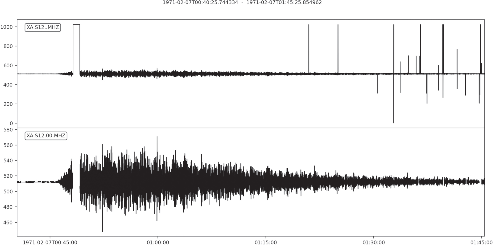{width="100%"}
:::
::: {.column style="width:29%; font-size:0.8em"}
- Apollo 12 mid-period vertical (XA.S12 MHZ), 7 February 1971, 10-bit samples
- Top, from tape: damaged frames pinned near 1023 or dropped to 0
- Bottom: damaged frames removed; the gap near 00:48 stays open
- Archive fill value −1: 894 samples in 52 runs, longest 58 s
:::
::::

[Nunn, Nakamura, Kedar & Panning (2022), *The Planetary Science Journal* 3, 219, Fig. 6, [doi:10.3847/PSJ/ac87af](https://doi.org/10.3847/PSJ/ac87af). [CC BY 4.0](https://creativecommons.org/licenses/by/4.0/). Sample counts: XA.S12.00.MHZ via EarthScope FDSN, [doi:10.7914/SN/XA_1969](https://doi.org/10.7914/SN/XA_1969).]{.credit}

::: {.takeaway}
The archive rejects 0.3% of the Apollo data as damaged and marks each missing sample −1, while the trace sits near 512; read naively, every gap is a step of about 512 units.
:::

::: {.notes}
One minute; the Moon. The Apollo Passive Seismic Experiment sent data to Earth in frames, each starting with a Barker code, a fixed bit pattern that marks the frame boundary. A damaged code means the frame was not transmitted correctly. Samples are 10-bit integers, 0 to 1023. Verbatim: "Transmission errors usually occurred in blocks", and "We felt that entirely excluding the damaged data ... was the best solution"; "We rejected all data with damaged Barker codes (approximately 0.3% of all the available data)." The block near 1023 is bad frames at the top of the 10-bit range, not instrument saturation; single spikes were also cleaned. Gaps are kept at their true length: "we inserted the correct number of empty samples between frames". The trap for students: "We substitute a value of –1 for each of these missing values", and "users should read the traces and replace the –1 values with masks or interpolate the data." We reran the query (EarthScope dataselect, XA.S12.00.MHZ, 00:40:25 to 01:45:26 UTC): 25,844 samples at 6.625 samples/s, 894 equal to −1 in 52 runs, longest 384 samples (57.96 s) from 00:48:11.29, the gap visible in the figure; valid values span 448 to 571. Same lesson as zero-fill, with a different fill value. The figure caption names no event; the next figure in the paper gives a P arrival at 00:45:45. Ask: which fill values does your own data provider use for missing data (−1, −999, 0, NaN)?
:::

## Outages and an antenna offset on Mount St. Helens {.smaller}

[📍 In-situ sensor]{.gb .src} [🪨 Solid Earth]{.gb .sys .solid} [📐 Geodesy]{.gb .disc .solid} [🌋 Volcanology]{.gb .disc .solid}

:::: {.columns}
::: {.column width="68%"}
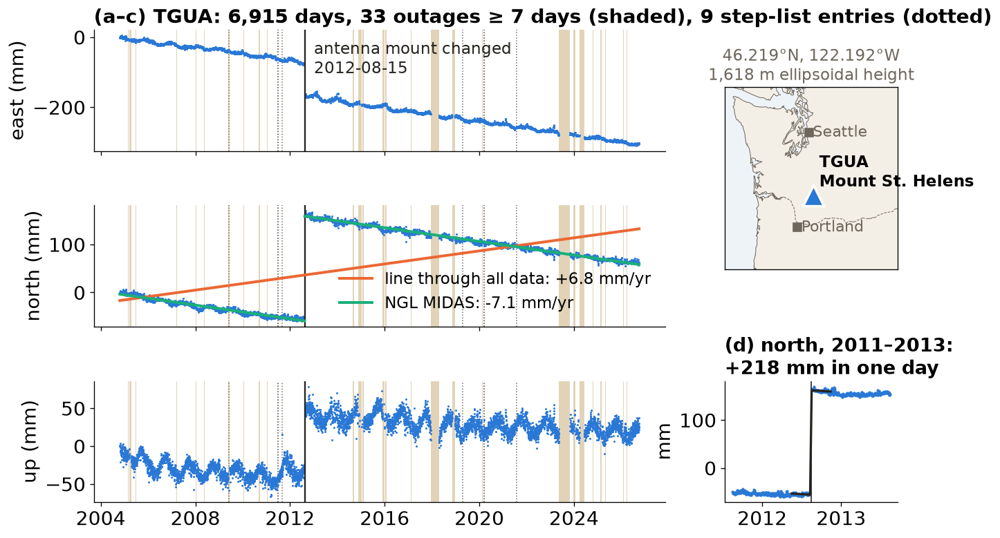{height="585px"}
:::
::: {.column style="width:32%; font-size:0.8em"}
- Station TGUA: 6,915 daily positions over 8,018 days since 2004; longest outages 164 and 128 days
- 9 entries in the Nevada Geodetic Laboratory (NGL) step list; 2012 antenna-mount change: −93 mm east, +218 mm north, +79 mm up
- MIDAS (median interannual difference adjusted for skewness): pairs one year apart, with NGL's step list
:::
::::

[Data: Nevada Geodetic Laboratory, IGS20 daily positions, steps.txt, llh.out (Blewitt et al. 2018, [doi:10.1029/2018EO104623](https://doi.org/10.1029/2018EO104623)); MIDAS (Blewitt et al. 2016, [doi:10.1002/2015JB012552](https://doi.org/10.1002/2015JB012552)). Figure: figscripts/lec08_real_gnss_steps.py.]{.credit}

::: {.takeaway}
A straight line through all 6,915 days gives +6.8 mm/yr north; NGL's MIDAS velocity is −7.1 ± 0.2 mm/yr, because a +218 mm offset at the 2012 antenna-mount change dominates the line.
:::

::: {.notes}
One and a half minutes; gaps and steps in a daily series. TGUA sits on Mount St. Helens at 1,618 m ellipsoidal height (coordinates from NGL's llh.out). From 21 October 2004 to 3 October 2026 NGL has 6,915 daily positions out of 8,018 days; 33 outages last 7 days or more, the longest 164 days from 15 May 2023, then 128 days from 12 December 2017 and 70 days from 28 March 2024. The files we used do not record why the station stopped; do not guess a cause. NGL's steps.txt has 9 entries for TGUA on 7 dates: 5 elevation-cutoff changes (processing, not hardware), 2 receiver changes, 1 antenna and radome change, and the 2012-08-15 antenna-mount change. That mount change moves the station by −93 mm east, +218 mm north and +79 mm up (computed in the script with a line plus step fit over ±90 days); the volcano did not move 22 cm in a day. MIDAS, from the Blewitt et al. (2016) abstract: it "selects data pairs separated by 1 year" to mitigate seasonality and steps, and because "slopes from data pairs spanning a step function produce one-sided outliers", it "removes outliers and recomputes the median". NGL's MIDAS file lists 9 steps assumed for TGUA, "determined from our steps database" (NGL MIDAS readme, checked 17 October 2026); how those steps enter the estimate we did not confirm in the paper text. The provider's value is −7.1 ± 0.2 mm/yr north (−7.14 ± 0.23), while a straight line through everything gets the sign wrong (+6.81). The correction, as for RATT, is segment by segment: estimate offsets at known equipment dates, leave outages missing. Ask: if you fitted this series for volcanic inflation without the step list, what would you report for 2012?
:::

## Estimated discharge under ice on the Tanana River {.smaller}

[📍 In-situ sensor]{.gb .src} [💧 Land water]{.gb .sys .water} [🧊 Cryosphere]{.gb .sys .ice} [💧 Hydrology & land-surface modeling]{.gb .disc .water}

:::: {.columns}
::: {.column width="64%"}
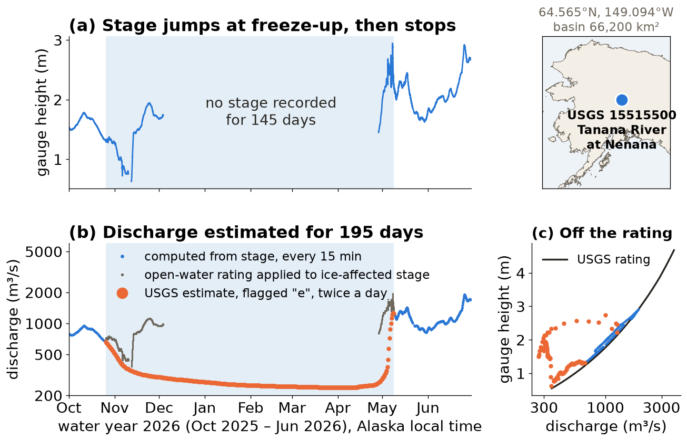{height="585px"}
:::
::: {.column style="width:36%; font-size:0.8em"}
- Discharge comes from stage (water level) through a rating curve measured in open water
- Under ice: discharge withheld for 4,453 stage records; stage missing for 145 days, December to April
- In its place: estimates flagged "e", twice a day, provisional
:::
::::

[Data: USGS Water Services, site 15515500 instantaneous values and NWISweb rating table, water year 2026, provisional; [public domain](https://www.usgs.gov/information-policies-and-instructions/copyrights-and-credits). Figure: figscripts/lec08_real_river_ice.py.]{.credit}

::: {.takeaway}
From 25 October 2025 to 8 May 2026 USGS publishes 391 estimated values flagged "e"; the open-water rating applied to ice-affected stage gives a median 2.5 times, at most 4.2 times, the estimate.
:::

::: {.notes}
One minute; a gap filled by the provider. The Tanana drains 66,200 km² of interior Alaska above Nenana. USGS computes discharge from water level (stage) through a rating curve measured in open water. Ice changes the channel: at freeze-up the stage jumps while flow falls, so the rating no longer applies. USGS withholds the computed values (4,453 stage records with discharge withheld) and publishes an estimate twice a day, flagged "e", built from winter field measurements and records at other gauges. Stage itself stops from 3 December 2025 to 28 April 2026 (145 days), when the sensor is under ice. Panel (c): the estimates (orange) fall far to the left of the rating curve. Whoever downloads this record without the qualifier column treats 195 days of estimates as measurements. Water year 2026 data are provisional and may be revised. Ask: in your provider's files, which column says whether a value was measured, estimated or filled?
:::

## A 0.5 s clock shift recovered by correlation {.smaller}

[📍 In-situ sensor]{.gb .src} [🪨 Solid Earth]{.gb .sys .solid} [📈 Seismology]{.gb .disc .solid}

:::: {.columns}
::: {.column width="62%"}
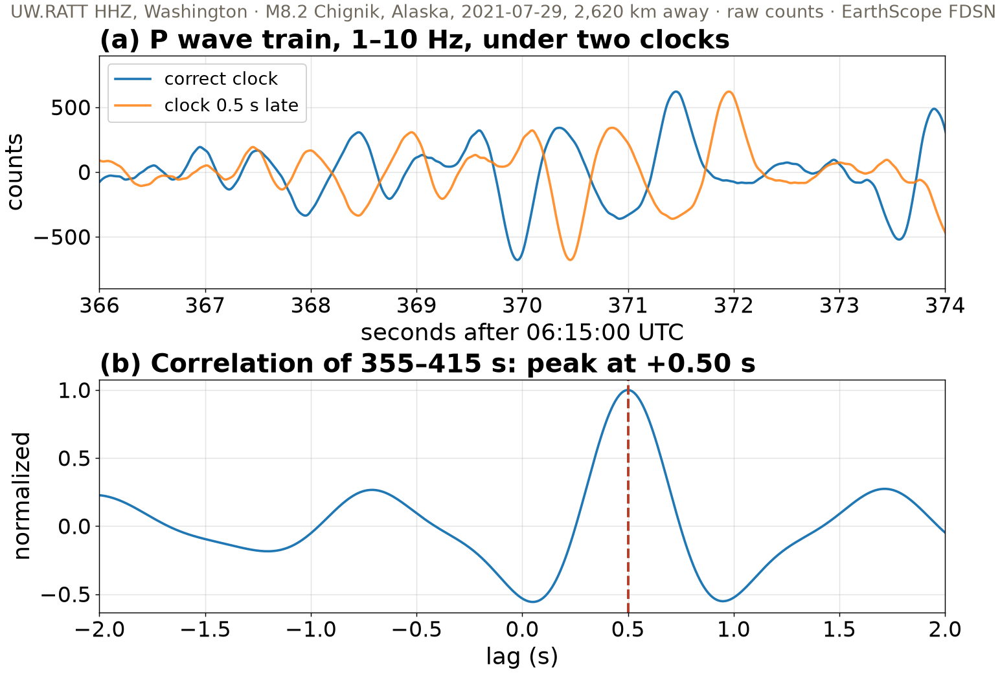{height="610px"}
:::
::: {.column style="width:38%; font-size:0.8em"}
- Record shifted by 50 samples (0.5 s): waveforms unchanged, every time wrong
- Correlation of the P wave train (355–415 s) with the correct record: peak at +0.50 s; parabola +0.500 s
- Real references: a co-located sensor, a neighbor station, or noise correlation over time
:::
::::

[Data: UW.RATT HHZ via EarthScope FDSN, [doi:10.7914/SN/UW](https://doi.org/10.7914/SN/UW). Figure: figscripts/ratt_repairs.py.]{.credit}

::: {.takeaway}
A 0.5 s timing error changes no waveform; correlation against the correctly timed record recovers +0.50 s.
:::

::: {.notes}
One minute. GPS clock failures shift station time by fractions of a second to minutes. Plot either record alone and it looks perfect, but every arrival time, every earthquake location computed from those times, every cross-correlation travel time is wrong by 0.5 s, 50 samples at 100 Hz. The correction measures the lag against a reference, shifts the timestamps, and records the shift applied. Be honest about this test: the recovery is exact by construction, because we correlate a record with a shifted copy of itself, so the waveforms match perfectly. It shows the method, not its accuracy. The next two slides are the real tests, where the reference is a different station. With a neighbor station, remove the predicted travel-time difference first. The correlation window here is the P wave train (355 to 415 s), the same as in the notebook. Sub-sample precision: fit a parabola through the correlation maximum and its two neighbors. The course's synthetic-data module (mlgeo_synth.degrade_series) adds the same kind of error to daily series for the team projects. Ask: what reference would you use for an ocean-bottom seismometer, where GPS does not reach?
:::

## Seafloor clock drift from ambient noise {.smaller}

[📍 In-situ sensor]{.gb .src} [🪨 Solid Earth]{.gb .sys .solid} [🌊 Ocean]{.gb .sys .ocean} [📈 Seismology]{.gb .disc .solid}

:::: {.columns}
::: {.column width="63%"}
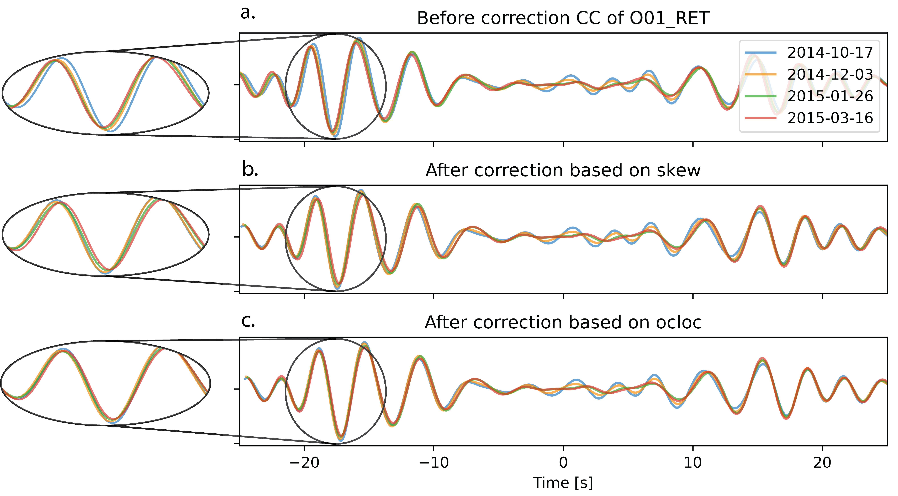{width="100%"}
:::
::: {.column style="width:37%; font-size:0.8em"}
- Noise correlations, seafloor station O01 with land station RET, 0.2–0.4 Hz; each trace averages 100 days
- Panel (a), uncorrected; (b) line from 0 at deployment to the skew (clock difference measured at recovery): overcorrected; (c) offset plus drift fitted by OCloC, the authors' code: aligned

| O01 | skew line | fitted |
|---|---|---|
| drift (s/yr) | −1.01 | −0.73 |
| error at deployment (s) | 0 | −0.31 |
:::
::::

[Naranjo et al. (2024), *Seismica* 3(1), Fig. 11, [doi:10.26443/seismica.v3i1.367](https://doi.org/10.26443/seismica.v3i1.367). [CC BY 4.0](https://creativecommons.org/licenses/by/4.0/).]{.credit}

::: {.takeaway}
O01's clock was already 0.31 s off at deployment, so a straight line from zero to the recovery skew (−1.02 s) overcorrects; fitting offset and drift aligns all four correlations.
:::

::: {.notes}
One and a half minutes. Ocean-bottom seismometers (OBS) cannot see Global Navigation Satellite System (GNSS) satellites: "GNSS signals do not reach the sea bottom." Their clocks are synchronized before deployment and compared again at recovery (the skew); the usual correction is a straight line between the two. The traces span 2014 to 2015. The noise correlation between two stations has a causal and an acausal side that should be symmetric; a clock error shifts both the same way and breaks that symmetry (their Fig. 1). RET is a land station on the Reykjanes peninsula, GNSS-timed, "devoid of clock errors". Verbatim: "Before correction, the later lapse cross-correlations shift monotonically to an earlier time"; after the skew-based correction they "shift monotonically to a later time". Table 1, row O01: OCloC (Ocean bottom seismometer Clock Correction) drift −0.734739 s/yr (σ 0.042760), skew-based drift −1.011740 s/yr, clock error at deployment −0.312892 s, at recovery −1.055899 s, measured skew −1.023125 s. Data from the IMAGE project (Integrated Methods for Advanced Geothermal Exploration). GEOFON serves the IMAGE Reykjanes network as 4L, with seafloor stations BS01 to BS23 (station service query, 17 October 2026); we have not matched the paper's O01 to a 4L code, so there is no figure script yet. Ask: what does fitting only a drift assume about the clock on the day of deployment?
:::

## A 270 s timing error at US.HDIL, Illinois {.smaller}

[📍 In-situ sensor]{.gb .src} [🪨 Solid Earth]{.gb .sys .solid} [📈 Seismology]{.gb .disc .solid}

:::: {.columns}
::: {.column width="63%"}
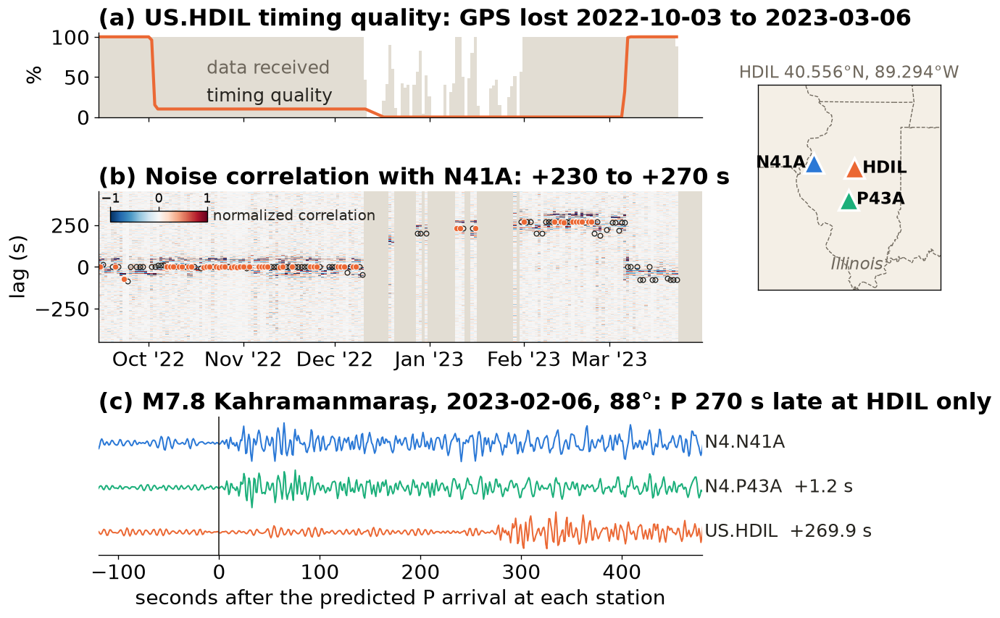{height="572px"}
:::
::: {.column style="width:37%; font-size:0.8em"}
- Timing quality: 10% from October, 0% from 17 December 2022 to 5 March 2023
- Noise correlation with N4.N41A, 133 km away: 0 s until 10 December, +230 s in mid-January, +270 s from 29 January, +268 s by late February
- Kahramanmaraş P wave, correlation 0.91 with N41A at both P43A and HDIL

::: {.dim}
Dots: daily lag; filled where the correlation exceeds 0.5, open from 0.3 to 0.5.
:::
:::
::::

[Data: US and N4 networks via EarthScope FDSN ([doi:10.7914/SN/US](https://doi.org/10.7914/SN/US), [doi:10.7914/SN/N4](https://doi.org/10.7914/SN/N4)); MUSTANG timing_quality and percent_availability; USGS ComCat us6000jllz. Figure: figscripts/lec08_real_clock_error.py.]{.credit}

::: {.takeaway}
GPS timing was lost from 3 October 2022 to 6 March 2023; noise correlation reaches +270 s by February, and the Kahramanmaraş P wave gives +269.9 s at HDIL, against +1.2 s at P43A.
:::

::: {.notes}
Two and a half minutes; a real clock error in the archive today. US.HDIL (Hopedale, Illinois) lost GPS timing on 3 October 2022 according to MUSTANG timing_quality, a daily metric EarthScope computes from the timing flags in the station's own data headers: 10% from 4 October to 11 December 2022, 0% from 17 December 2022 to 5 March 2023, 100% before and from 7 March. Panel (b): daily noise correlation with N4.N41A, 133 km away, 0.05 to 0.2 Hz, measured against a reference stack of the days before 10 December. Data arrived intermittently from 11 December to 31 January (percent_availability from 0 to 100% day by day; 100% on 10, 11 and 16 January), and the error grew at each restart while the clock had no GPS. Daily lags from figscripts/lec08_real_clock_error.py, rerun 17 October 2026 (correlation in brackets): near 0 s to 10 December; +115 and +118 s on 19 and 20 December (0.24 to 0.25); about +202 s on 28 to 31 December (0.38 to 0.47); +229.4 to +230.2 s on 10 to 16 January (0.40 to 0.57); +270.0 s from 29 January easing to +269.1 s by 11 February; +267.6 to +268.8 s from 12 to 25 February (0.31 to 0.67); +266.3 to +267.8 s on 2 to 6 March; −0.2 s on 7 March, the day lock returned. Panel (c): the M7.8 Kahramanmaraş, Türkiye, earthquake of 6 February 2023, 88° away, each trace aligned on its own predicted P time: N4.P43A arrives within 1.2 s (correlation 0.91 with N41A), HDIL 269.9 s late (correlation 0.91). Two independent measurements, the same answer for February. A trap in panel (b): from 11 to 23 March most days read −69 to −78 s (open dots, correlation 0.27 to 0.46), yet HDIL was back on time. Independent check, rerun 17 October 2026 with the same P-wave method: the M6.8 Ecuador earthquake of 18 March 2023, 44° away, gives an HDIL lag of 0 s against N41A (correlation 0.91; P43A 0 s, 0.89). The −69 to −78 s values are about twice the 35 to 38 s surface-wave lag between the stations: when the noise comes mostly from one side, the daily correlation locks onto the wrong lobe of the reference. The same lobe swap explains the +199 to +202 s days in February (5, 7 and 24 February, about 268 − 69). What EarthScope serves today still carries the error; whether it was ever corrected elsewhere we did not verify. For comparison, Hable et al. (2018, GJI) found timing errors of up to several minutes at 4 of 10 La Réunion land stations, whose RefTek RT 130 data loggers lost GPS synchronization through a software failure. Ask the room: why does the noise correlation say −77 s in mid-March while the earthquake says 0 s, and which would you trust? Then: if HDIL picks from January 2023 entered an earthquake catalog, where would the locations end up?
:::

## Clock drift on the Moon and at a flux tower {.smaller}

:::: {.columns}
::: {.column width="55%"}
[📍 In-situ sensor]{.gb .src} [🪐 Planets & exoplanets]{.gb .sys .planet} [🪐 Planetary science & astrobiology]{.gb .disc .planet}

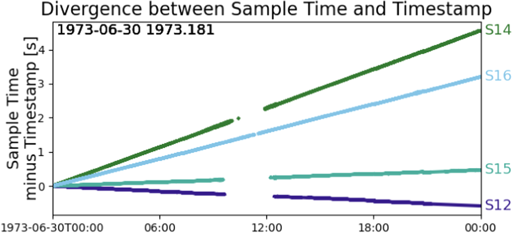{width="100%"}

::: {.dim}
Apollo stations S12, S14, S15 and S16 on 30 June 1973: sample time minus recorded timestamp; each sampler ran at a slightly different, varying rate.
:::
:::
::: {.column width="45%"}
[📍 In-situ sensor]{.gb .src} [🌤️ Atmosphere]{.gb .sys .air} [🌱 Biosphere]{.gb .sys .bio} [🦠 Biogeosciences]{.gb .disc .bio}

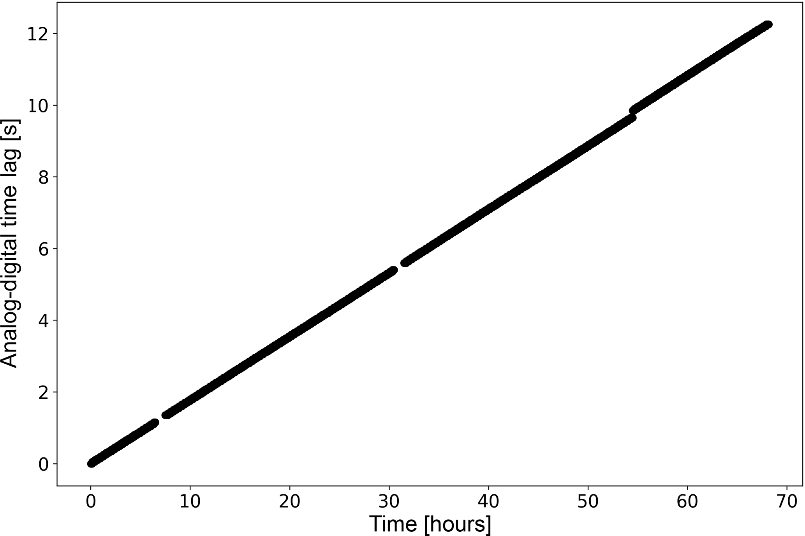{height="490px"}

::: {.dim}
One sonic anemometer's wind logged twice, digitally and through an analog-to-digital converter; lag measured on 30-minute chunks.
:::
:::
::::

[Left: Nunn, Nakamura, Kedar & Panning (2022), *The Planetary Science Journal* 3, 219, Fig. 8, [doi:10.3847/PSJ/ac87af](https://doi.org/10.3847/PSJ/ac87af). Right: Fratini et al. (2018), *Biogeosciences* 15, 5473–5487, Fig. 9, [doi:10.5194/bg-15-5473-2018](https://doi.org/10.5194/bg-15-5473-2018). [CC BY 4.0](https://creativecommons.org/licenses/by/4.0/).]{.credit}

::: {.takeaway}
After 24 h the Apollo samplers were off by between −0.55 s (S12) and +4.5 s (S14), read from the plot; two copies of one 20 Hz wind record drifted 12.3 s apart in 68 h, 50 µs per second.
:::

::: {.notes}
One minute; drift, the clock error that grows with time. Left: sample time minus recorded timestamp for the Apollo stations S12, S14, S15 and S16 over 30 June 1973. "Each of the data samplers controlling the sampling on the seismometers had a slightly different sampling rate that varied over time", and "There can be a positive or negative time shift of up to a few seconds after 24 h". The archive's ATT channel (time the signal was recorded on Earth) lets a figure script rebuild this from EarthScope. Right: eddy covariance measures fluxes of heat, water and CO₂ by correlating fast wind and gas records; timing errors between them bias the flux. Fratini et al. logged the same sonic-anemometer wind component twice, digitally and through an analog-to-digital converter, on one computer; the lag between the copies, measured by correlation on 30-minute chunks, grows linearly: "a fairly constant STE of about 50 µs s−1" (STE, systematic timing error). Our check: 12.25 s over 68 h is 50 µs/s. The abstract reports flux underestimates "as large as 10 %". The common method across the Moon, the seafloor, Illinois and a flux tower: correlate the record against a reference and measure the lag through time; a constant lag is an offset, a growing lag is drift, and both are corrected segment by segment between clock resets. Ask: in your project's data, which instrument keeps its own clock?
:::

## Three problems and their corrections {.smaller}

| Problem | What it does | Correction | Processing history | Measured today | Also seen in |
|---|---|---|---|---|---|
| Filter phase | zero-phase spreads energy ahead of an onset; causal delays it | causal for onset times and real-time use; zero-phase for offline alignment | filter type, corners, poles, causal or zero-phase | RATT step: zero-phase output 0.52 s early | Norcia offset lost; digitizer ramp, Egypt; Greenland δ¹⁸O; GPS precursor |
| Gaps | zero or −1 fill makes steps; filters ring at the edges | filter each segment, leave the gap missing, mark a guard interval | gap start and end, fill value, guard interval | planted, RMS: 185× → 1.75×; real 40 s gap, peak: 13×, 1 s guard | Apollo −1 samples; TGUA outages and offsets; Tanana ice estimates |
| Clock errors | waveform intact, every timestamp shifted | measure the lag against a reference; fit offset and drift | reference, lag, drift, correction applied | planted: +0.50 s; HDIL: +230 to +270 s | Iceland seafloor; Apollo; flux tower |

::: {.takeaway}
Every RATT number was measured against the intact record: 185× to 1.75× at gap edges, +0.50 s recovered, a 0.52 s zero-phase lead at a step of known time.
:::

::: {.notes}
One minute, then leave this up for questions; it replaces the synthesis slide. Each row combines the RATT test (where the intact record is known), the literature, and a real archive. Row 1: the choice is made per use; real-time and precursor studies need causal filters, offline alignment wants zero-phase, and either way the filter goes in the processing history. Row 2: gaps stay declared as missing; the guard interval scales with the longest period in the band; and every provider has its own fill value (zero after a merge, −1 in the Apollo archive, "e" estimates at USGS). The planted and real gap numbers are different measurements: 185× is an RMS over 0 to 2 s against the intact record; 13× is a peak against the segment-wise result (2.8× on the RMS metric). Row 3: ocean-bottom sensors are the classic setting, but HDIL shows land stations drift too. When these records are used in the machine-learning chapters later in the course, mask gaps, guard intervals and periods of bad timing first; otherwise the fitted relation reproduces the filter ringing and the shifted arrival times. Section 2.13 returns to the "Processing history" column and how to publish it with the data.
:::

## Open notebook 2.9

1. `pixi run jupyter lab` → `2.9_filtering_data.ipynb`
2. Reproduce the gap experiment; then move the gap into the P wave train (360 to 420 s) and measure the ringing again
3. Change the band to 0.1–1 Hz: how long does the guard interval get?
4. Compare causal and zero-phase output at the real P wave (about 357 s) and at the step at 755.09 s: why does the causal filter shift the P wave earlier?
5. Your team's data and your Session 7 track: which of the three problems applies? Write one line: what you will correct, and what you will leave missing

::: {.dim}
Today: pulse talks 10 min · slides 22 min · notebook 38 min · synthesis 10 min. Next session: synthetic data with a known answer and the detection floor (2.10–2.11)
:::

::: {.notes}
Timing for the 80-minute block (10:00 to 11:20): pulse talks about 10 min; slides about 22 min (the per-slide times in these notes add to 22: 1, 2, 1.5, 1.5, 1.5, 2, 1, 1, 1, 1.5, 1, 1, 1.5, 2.5, 1, 1 for slides 1 to 17, counting the title and question slides together); notebook about 38 min on tasks 2 to 4; synthesis about 10 min collecting task-5 answers, every team naming a problem and its correction. If the slides run long, skip the Munteanu spectra and the drift slide with one sentence each. Hydrology teams have gauge gaps during floods and ice, GNSS teams have offsets and outages, climate teams have station moves. Task 4: at the P wave most energy in the 1 to 10 Hz band lies near 0.6 to 1 Hz, below the band's centre, where a causal band-pass advances the phase (about 0.25 s at 1 Hz); the notebook prints the phase delay per frequency. Implementation names for the notebook, not the slides: scipy.signal.butter with output='sos' (second-order sections, numerically stable), sosfilt (causal) versus sosfiltfilt (zero-phase), np.flatnonzero and np.split for segment bookkeeping, scipy.signal.correlate with correlation_lags, obspy.taup for predicted arrival times. Task 3 answer: the guard interval scales with the longest period, about 20 s at 0.1 Hz, which can consume a short segment. Check the course calendar for the next due date: the session dates moved.
:::
