## {background-color="#faf7f2"}

[🎛️]{.lecture-icon}

### Today's question

A seismometer in Seattle records ocean waves, traffic, wind and earthquakes at the same time. Each of them is somebody's measurement.

**What is signal, what is noise, and who decides?**

::: {.dim}
Reading: [2.10 Synthetic noise](https://geo-smart.github.io/mlgeo-book/synthetic-noise), section 5 is today's team activity
:::

::: {.notes}
Timing for the 80-minute block (10:00 to 11:20): pulse talks 10 min; slides about 35 min (slides 1 to 15; the per-slide times in the notes add to 34.5); team activity 25 min (slide 16); gallery share-out 10 min, closing on the summary table and Friday (slides 17 and 18). That fills 79.5 of 80 minutes, so the activity starts at 10:45 whatever slide you are on; slide 13 (transforms) is the one to skip or leave for the notes. Monday's announcement: run `pixi run -e core jupyter lab` once before class (about 850 MB on first install, too much for classroom wifi). One minute here. Lecture 8 dealt with problems made by the recording system: filter phase, gaps, clocks. Today the unwanted part of the record comes from the Earth or from people: the ocean microseism, traffic, wind, the atmosphere over a radar image, a spotted star, a quarry blast in an earthquake catalog. These are real signals of other sources that overlap the one we want in time, frequency, space or class. Calling them noise is a decision tied to a question. Arc of the hour: one real day of seismic data; published figures in 1D, 2D and categorical data where one study's noise is another study's signal; then synthetic versions of each, with the colors (spectra) and the value distributions that make them realistic; then teams build a synthetic version of their own project data. Ask the room: name one thing your instrument records that you do not want, and one person who would want it.
:::

## One day of ground motion at Seward Park, Seattle {.smaller}

[📍 In-situ sensor]{.gb .src} [🪨 Solid Earth]{.gb .sys .solid} [🌊 Ocean]{.gb .sys .ocean} [📈 Seismology]{.gb .disc .solid}

:::: {.columns}
::: {.column width="72%"}
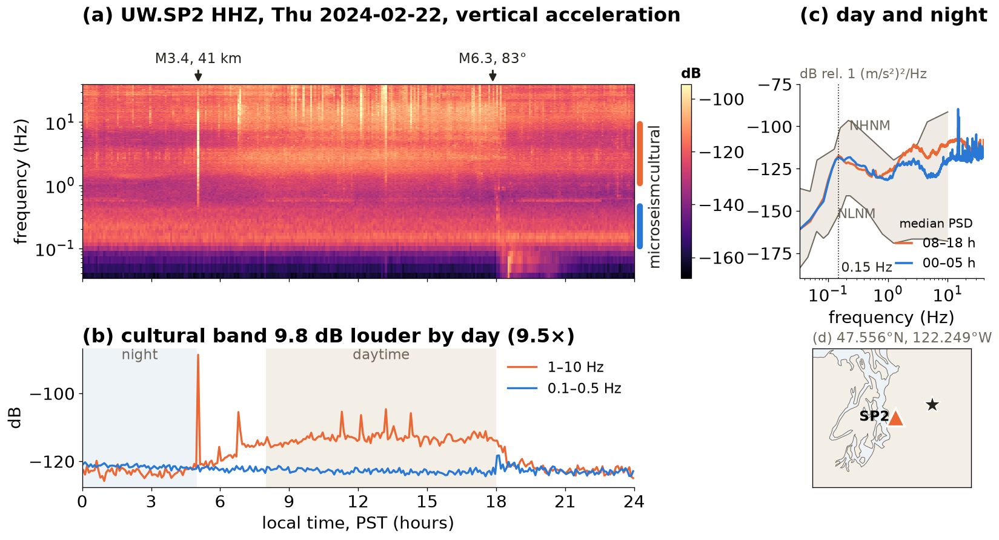{width="100%"}
:::
::: {.column style="width:28%; font-size:0.78em"}
- UW.SP2, broadband vertical, Thursday 22 February 2024, local time (PST); 288 windows of 5 min
- 1–10 Hz: median day (08–18 h) 9.5 times night (00–05 h), 9.8 dB
- 0.1–0.5 Hz microseism: day/night 0.71 (−1.5 dB); peak 0.150 Hz (6.7 s)
- Local magnitude M~L~ 3.4 at 41 km (05:03) and W-phase moment magnitude M~ww~ 6.3, southern East Pacific Rise, 83° (17:51)
:::
::::

[Data: UW.SP2 HHZ via EarthScope FDSN, [doi:10.7914/SN/UW](https://doi.org/10.7914/SN/UW); USGS ComCat; NLNM and NHNM from Peterson (1993), USGS OFR 93-322; coastlines: Natural Earth. Figure: figscripts/lec09_day_spectrogram.py.]{.credit}

::: {.takeaway}
On one Thursday, daytime traffic raises the 1–10 Hz band by 9.8 dB while the ocean microseism stays within 1.5 dB of its night level, and two earthquakes cross both bands.
:::

::: {.notes}
Three minutes. SP2 sits in Seward Park on the shore of Lake Washington (47.556°N, 122.249°W, station service coordinates), a Trillium Compact at 1 m depth. Each 5-minute window has a Welch power spectral density (PSD) of ground acceleration after removing the instrument response, in dB relative to 1 (m/s²)²/Hz. Panel (a): four contributions. Below 0.1 Hz the record is quiet except for the teleseism's surface waves after 17:51. The band near 0.15 Hz (6.7 s) is the secondary ocean microseism: ocean waves meeting waves traveling the other way press on the seafloor, and the pressure couples into Rayleigh waves that cross the continent; it does not care about the time of day. The 1 to 30 Hz band rises through the morning, holds through the working day and drops at about 18:30 local time: traffic on the roads around the park, buses, industry, people. Two earthquakes: the M~L~ 3.38 at 13:02:49 UTC (05:03 PST), 18.6 km deep and 41 km away, and the M~ww~ 6.3 on the southern East Pacific Rise at 01:51 UTC on 23 February (17:51 PST), 83° away, whose surface waves show below 0.1 Hz. Panel (c): median day and night spectra against Peterson's new low and high noise models (NLNM, NHNM), the envelope of quiet and noisy stations worldwide. Panel (b): band power through the day; the cultural band is 9.55 times louder by day (median 08 to 18 h against 00 to 05 h), and its 5-minute maximum is 5,225 times its minimum counting the M~L~ 3.4 window, 131 without it (99th over 1st percentile: 88). The microseism ratio is 0.71. All numbers from the script's run on 20 October 2026 (it fetches the data each time). Now the question: for an earthquake seismologist both bands are noise. For ambient-noise imaging the microseism is the signal (it is correlated between stations to map the crust); for an urban seismologist traffic is the signal; for a tsunami or slow-slip modeler the teleseism is a nuisance. Ask the room: draw a box on the spectrogram around what you would keep for your project.
:::

## Traffic and ocean waves in seismic noise {.smaller}

[📍 In-situ sensor]{.gb .src} [🪨 Solid Earth]{.gb .sys .solid} [🌊 Ocean]{.gb .sys .ocean} [📈 Seismology]{.gb .disc .solid} [🌊 Oceanography]{.gb .disc .ocean}

:::: {.columns}
::: {.column width="52%"}
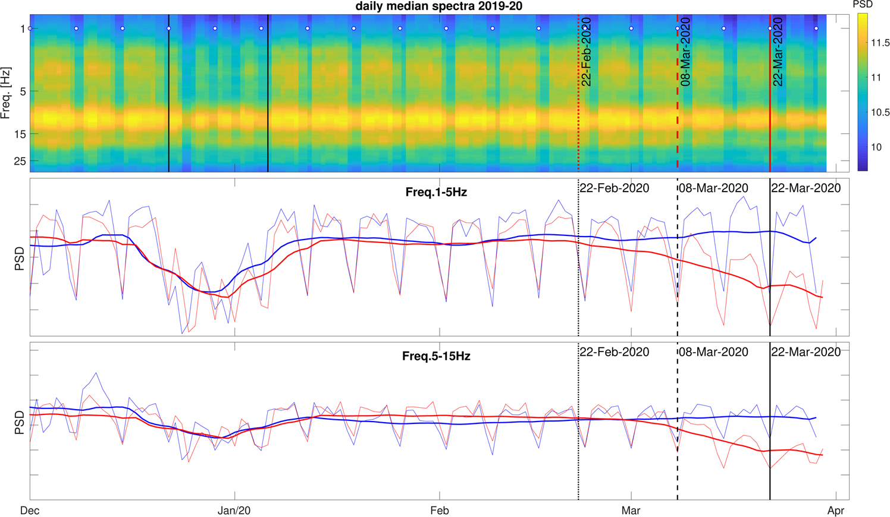{width="100%"}

::: {.dim}
Station MILN, Milan, Dec 2019 to Mar 2020: daily spectra; band power, 2019/20 (red) against 2018/19 (blue); lockdown decrees marked.
:::
:::
::: {.column width="48%"}
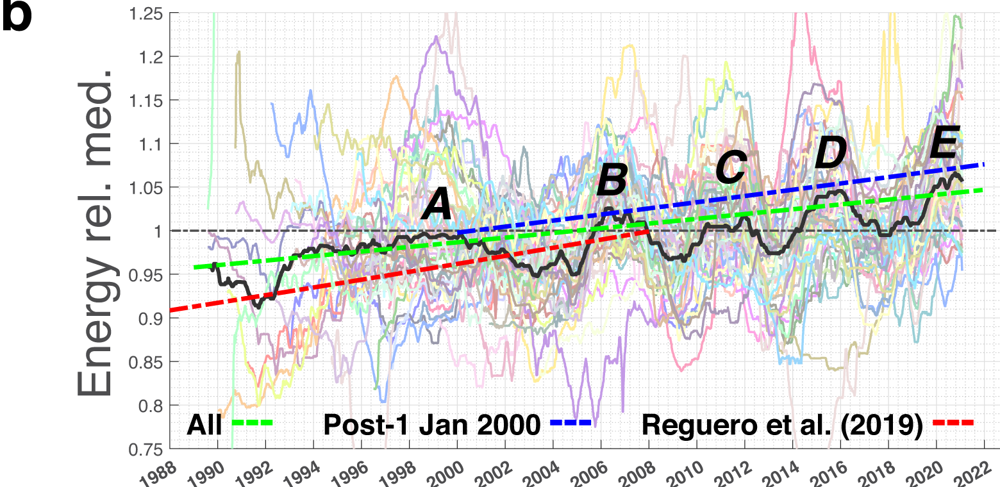{width="100%"}

::: {.dim}
Primary microseism energy (14–20 s) at 52 stations, each relative to its median; black: global median; green and blue: trends since the late 1980s and since 2000; A to E: El Niño and La Niña excursions.
:::
:::
::::

[Left: Poli et al. (2020), *Scientific Reports* 10, 9404, Fig. 2, [doi:10.1038/s41598-020-66368-0](https://doi.org/10.1038/s41598-020-66368-0). Right: Aster et al. (2023), *Nature Communications* 14, 6984, Fig. 7b, cropped, [doi:10.1038/s41467-023-42673-w](https://doi.org/10.1038/s41467-023-42673-w). [CC BY 4.0](https://creativecommons.org/licenses/by/4.0/).]{.credit}

::: {.takeaway}
In Milan the lockdown drop above 1 Hz matched an ordinary weekend; at 14–20 s, 52 stations record coastal wave energy rising 0.27% per year since the late 1980s.
:::

::: {.notes}
Three minutes, two studies where the "noise" is the measurement. Left, Poli et al. (2020): the dips every seven days are weekends, the long dip is the Christmas break, and the slow decline from late February follows the decrees that closed northern Italy. Quotes: "We find that the lockdown reduces ambient noise significantly in the 1–10 Hz frequency range"; "The energy drop associated with the lockdown is comparable with that occurring every weekend and during the winter break"; natural sources "such as rain, wind and sea/ocean waves are typically characterized by frequencies below 1 Hz, and are obviously not affected by the lockdown." In the text, anthropic noise dominates above about 2 Hz, "where most stations show a ~50% reduction" (that number comes from their Fig. 5, not this figure). The caption gives the bands as 1 to 5 and 10 to 15 Hz while the lower panel reads 5 to 15 Hz; quote the panel labels. The PSD axes carry no tick values. Right, Aster et al. (2023), panel (b) of their Fig. 7 (panels (a) and (c) are cropped out): 52 global seismographs, vertical primary microseism at 14 to 20 s, late 1980s to August 2022. The primary microseism is made where ocean waves shoal against the coast, so its amplitude records wave energy. In the cropped panel (a), seven station clusters track the ENSO (El Niño Southern Oscillation) index in the Southwest Pacific and the SOI (Southern Oscillation Index) in the Southeast Pacific and Southwest Atlantic; the El Niño and La Niña excursions A to E are marked on (b) too. Panel (b): the global median, trends 0.27 ± 0.03% per year for all data and 0.35 ± 0.04% per year since 2000. Increasing trends at 3σ at 41 stations (79%). Here the roles flip: earthquakes are the noise, and the authors "remove potential earthquake transients from global earthquakes with magnitudes ≥5.75" from the USGS catalog. Caveats: trends are normalized to 1 on 1 January 2005 and the blue and red lines are shifted by ±15% for clarity, so their offsets are not data. Ask: who in this room would remove the microseism, and who would publish it?
:::

## Weather in InSAR images and on a fiber {.smaller}

:::: {.columns}
::: {.column width="42%"}
[[🛰️ Satellite & airborne]{.gb .src} [🪨 Solid Earth]{.gb .sys .solid} [🌤️ Atmosphere]{.gb .sys .air} [📐 Geodesy]{.gb .disc .solid}]{style="font-size:0.8em"}

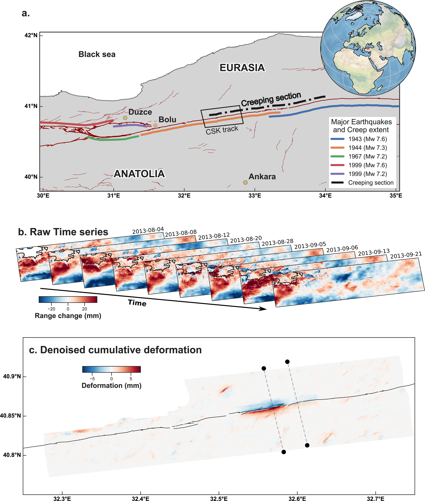{height="530px"}

::: {.dim}
Interferometric synthetic aperture radar (InSAR), North Anatolian Fault, 2013: raw (±20 mm), denoised (±5 mm).
:::
:::
::: {.column width="58%"}
[[📍 In-situ sensor]{.gb .src} [🪨 Solid Earth]{.gb .sys .solid} [🌤️ Atmosphere]{.gb .sys .air} [📈 Seismology]{.gb .disc .solid}]{style="font-size:0.8em"}

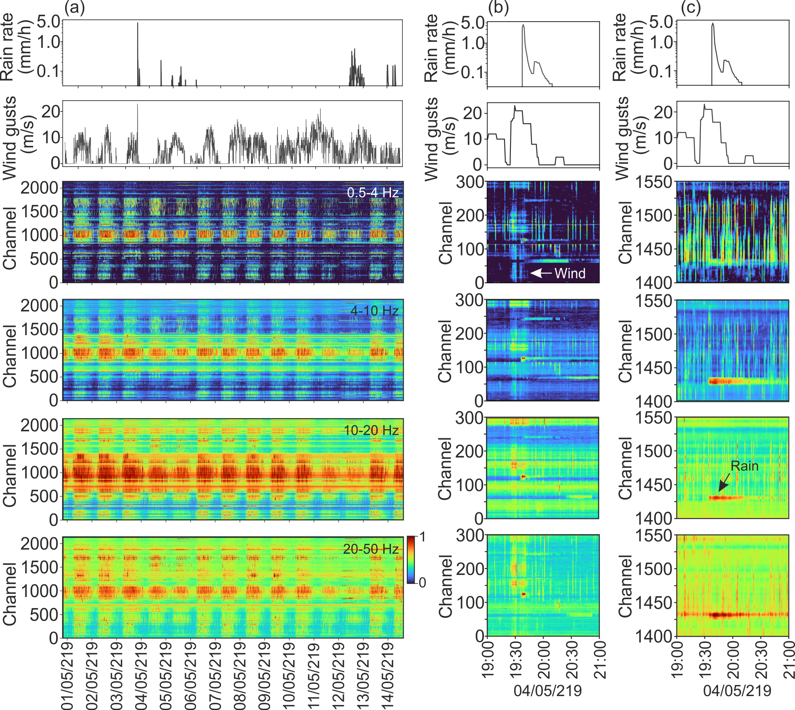{height="530px"}

::: {.dim}
Distributed acoustic sensing (DAS), Penn State, May 2019; (b), (c): one storm.
:::
:::
::::

[Left: Rouet-Leduc et al. (2021), *Nature Communications* 12, 6480, Fig. 3, [doi:10.1038/s41467-021-26254-3](https://doi.org/10.1038/s41467-021-26254-3). Right: Czarny, Zhu & Shen (2023), *Seismica* 2(2), Fig. 2, [doi:10.26443/seismica.v2i2.247](https://doi.org/10.26443/seismica.v2i2.247). [CC BY 4.0](https://creativecommons.org/licenses/by/4.0/).]{.credit}

::: {.takeaway}
Atmospheric delays of ±20 mm hide a 1 cm slip event; on the fiber, traffic fills the daytime, wind raises the first 500 channels and rain lights channels near drains.
:::

::: {.notes}
Three minutes, two 2D records. Left: interferometric synthetic aperture radar (InSAR) measures the change in distance between satellite and ground along the line of sight (LOS). The radar wave slows in water vapour, so turbulence and the vertical layering of the troposphere add delays that "may represent centimeters of apparent range change." Panel (b): nine COSMO-SkyMed frames, 4 August to 21 September 2013, on the creeping section of the North Anatolian Fault (a subset of the data of Rousset et al. 2016); the colour bar ticks run from −20 to 20 mm and the patterns are weather. Panel (c): after a deep autoencoder trained on synthetics, "a strong slip signal of about 1 cm (in LOS) on the fault", found "with no a priori knowledge of the fault's existence." The 2 mm detection and the 8.5 km slip length quoted in the abstract come from their Fig. 4, not this one. For a weather model the same delay is the signal: it is integrated water vapour. Right: DAS turns a telecom fiber into 2137 channels every 2 m (gauge length 10 m), along roads on the Penn State campus (the FORESEE array, Fiber-Optic For Environment Sensing). Panel (a): two weeks, four bands; "the higher amplitudes start around 8 AM and end around 8 PM", with a weekend decrease mostly at 0.5 to 4 Hz. Panel (b), first 300 channels in open ground: wind raises the PSD "only for the first 500 channels and when the wind gusts exceed 15 m/s". Panel (c), channels 1400 to 1550, same two hours of 4 May 2019: a few channels near storm sewers brighten minutes after the rain starts, "likely the acoustic effect of fluid flowing through the drainage system". The authors use traffic as their source for surface-wave imaging. The colour scale runs 0 to 1 with no stated normalization, and the date ticks read "219" for 2019, a typo in the figure. Ask: in panel (a), which band would a traffic engineer keep, and which would a hydrologist keep?
:::

## Catalogs and maps that disagree {.smaller}

:::: {.columns}
::: {.column width="53%"}
[🗂️ Catalog & compiled product]{.gb .src} [🪨 Solid Earth]{.gb .sys .solid} [📈 Seismology]{.gb .disc .solid}

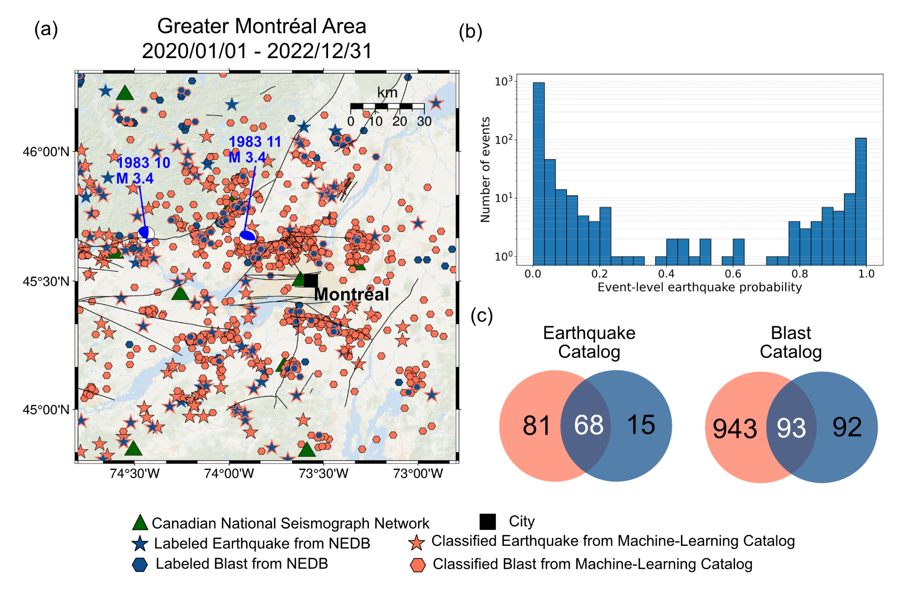{width="100%"}

::: {.dim}
Montréal, 2020–2022: machine-learning (ML) catalog against the analyst catalog (NEDB).
:::
:::
::: {.column width="47%"}
[🛰️ Satellite & airborne]{.gb .src} [🪨 Solid Earth]{.gb .sys .solid} [⛰️ Geology & geomorphology]{.gb .disc .solid}

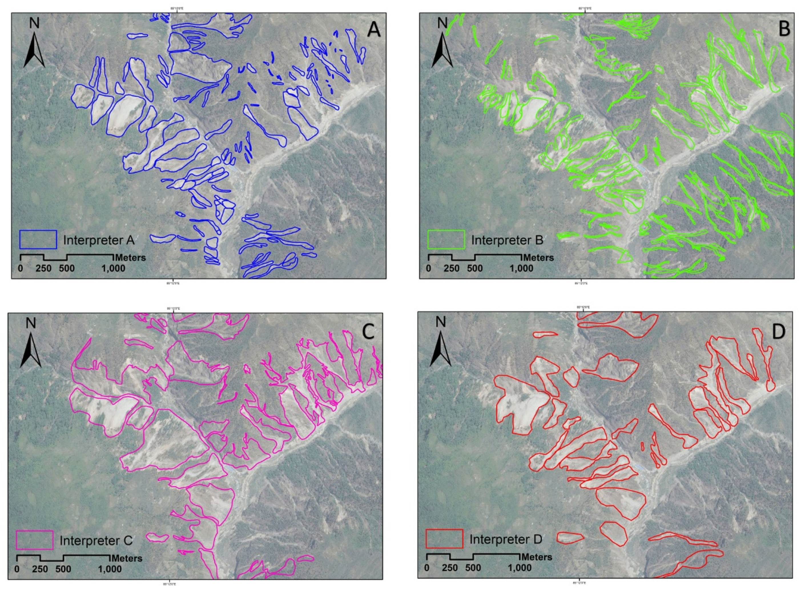{width="100%"}

::: {.dim}
2015 Gorkha earthquake landslides, Nepal: one hillslope, four interpreters.
:::
:::
::::

[Left: Chien & Liu (2026), *Seismica* 5(1), Fig. 7, [doi:10.26443/seismica.v5i1.1964](https://doi.org/10.26443/seismica.v5i1.1964). Right: Meena & Tavakkoli Piralilou (2019), *Geosciences* 9, 437, Fig. 10, [doi:10.3390/geosciences9100437](https://doi.org/10.3390/geosciences9100437). [CC BY 4.0](https://creativecommons.org/licenses/by/4.0/).]{.credit}

::: {.takeaway}
The Montréal catalogs share 68 earthquakes and 93 blasts of 1,292 events, most of the rest missing from one catalog; Gorkha inventories differ pairwise by a mismatch index of 0.58 to 0.75 (1 is no overlap).
:::

::: {.notes}
Three minutes; noise in the class column. Left: in eastern Canada quarries blast during working hours, and a detector tuned to earthquakes finds them too. A blast is real seismic signal of the wrong class. The analyst catalog is the Canadian National Earthquake Database (NEDB) of Natural Resources Canada; events are matched within 0.1° and 5 s. Chien and Liu classify every detection as earthquake, blast or noise with a convolutional network (mean test recall 0.9719 ± 0.0009). Panel (b): event probabilities pile up at 0 and 1, with a thin middle. Panel (c), Montréal map area only: earthquakes 81 ML only, 68 both, 15 NEDB only; blasts 943 ML only, 93 both, 92 NEDB only (read from the figure). Panel (c) is two separate Venn diagrams, so most of the mismatch is completeness: events missing from one catalog. An event can carry conflicting labels only if it is an ML blast and an NEDB earthquake (at most 15) or an ML earthquake and an NEDB blast (at most 92); the 943 ML-only blasts are events NEDB does not list as blasts. Over the whole Western Québec Seismic Zone (WQSZ), not this map: about 3,600 detections, 2,862 blasts and 512 earthquakes, against 1,070 blasts and 504 earthquakes in NEDB. Quote: "The public NEDB blast catalog should therefore be considered an analyst-reviewed but incomplete reference for blast events." So the reference labels are noisy too. Origin time alone does not settle it: "a substantial number of blast events also occur during evening or near-midnight hours." Right: four published inventories of the same earthquake, four mappers, different imagery (B used WorldView 2 and 3, the others Google Earth). B draws many narrow polygons, D a few large ones. Pairwise mismatch index E from their Table 3: A–B 0.752, A–C 0.674, A–D 0.58, B–C 0.729, B–D 0.732, C–D 0.577. The label "landslide" is a decision by a person looking at one image on one date. The paper has internal inconsistencies (counts in the text against Table 2), so quote only Table 3 and Table 4. A third case, from our group: Kharita, Denolle and West (2024, GJI, doi:10.1093/gji/ggae106, CC BY 4.0) trained a random forest to separate icequakes from earthquakes near Columbia Glacier, Alaska; one catalog icequake was predicted as an earthquake at all fourteen stations and five earthquakes at eleven or more, and "These results suggest that the events may have been incorrectly labelled during the human review process." Ask: if your labels came from an analyst, who checked the analyst?
:::

## Instrument problems and nuisance signals {.smaller}

:::: {.columns}
::: {.column style="width:55%; font-size:0.76em"}
| | Instrument problem (lecture 8) | Nuisance signal (today) |
|---|---|---|
| Origin | recorder, telemetry, clock, processing | another physical or human source |
| Examples | gap, step, clock drift, filter ringing | microseism, traffic, atmosphere, starspots, blasts |
| Someone's signal? | rarely | yes |
| Treatment | correct, or mask and record in the processing history | model it as a component, or give it a class |
| Kept in the data | corrected record and a flag | the separated source, as its own product |

::: {.dim}
Right: the second Kepler transit of Kepler-150 f under two of six fitted models; k free parameters, χ² (chi-square misfit) and AIC (Akaike information criterion, lower is better) for both transits, χ² in the panel for this one.
:::
:::
::: {.column width="45%"}
[[🔭 Telescope]{.gb .src} [🪐 Planets & exoplanets]{.gb .sys .planet} [🪐 Planetary science & astrobiology]{.gb .disc .planet}]{style="font-size:0.8em"}

[Planet, contamination and two spot crossings]{style="font-size:0.8em; font-weight:600"}

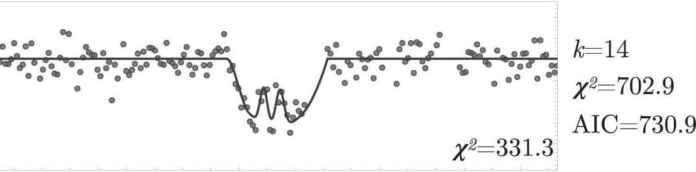{width="100%"}

[Planet and moon]{style="font-size:0.8em; font-weight:600"}

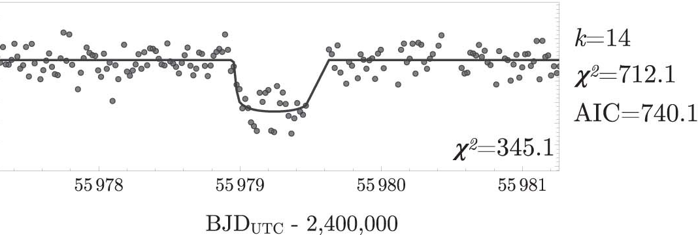{width="100%"}
:::
::::

[Kipping et al. (2022), *Nature Astronomy* 6, 367–380, Extended Data Fig. 3, cropped to two rows of the second transit, [doi:10.1038/s41550-021-01539-1](https://doi.org/10.1038/s41550-021-01539-1). [CC BY 4.0](https://creativecommons.org/licenses/by/4.0/).]{.credit}

::: {.takeaway}
Two starspot crossings fit the second transit better than an exomoon (χ² 702.9 against 712.1, 14 parameters each); the star varies by 10.9 mmag, the transit is 1.5 mmag deep.
:::

::: {.notes}
Two and a half minutes. Lecture 8's problems have no physical source outside the instrument: nobody wants the ringing of a filter. Rarely, not never: a clock error recovered from ambient-noise correlations is itself the measurement (Stehly et al. 2007; Sens-Schönfelder 2008). They are corrected or masked, and the processing history records what was done. A nuisance signal is somebody's measurement, so you do not throw it away: you model it alongside your signal, or you name it as a class. The exoplanet case shows why this matters. Kepler measures starlight from one star; a planet crossing it dims the light by about 1.4 × 10⁻³ (~1.5 mmag). Kepler-150 f's second transit has a floor that bounces up and down, which a moon trailing the planet could produce. But the star has "periodicity of 17.6 d and amplitude of 10.9 mmag. This far exceeds the depth of Kepler-150 f's transit (~1.5 mmag)". When a planet crosses a dark starspot, the dimming briefly weakens. The slide shows two of the six rows of their figure. All rows: planet only (AIC 746.3); plus contamination (738.9); plus 1, 2, 3 spots (736.3, 730.9, 734.0); planet plus moon (740.1). Quote: "a modification to the planet-only model that includes two spot crossings ... yields a Δχ2 = 9.2 improved fit to the transits versus the planet–moon model, despite using the same number of free parameters", and "we conclude that this is most probably spot-driven activity rather than an exomoon signature." Starspots are the nuisance for a planet hunter and the signal for a stellar physicist, and the choice between "spot" and "moon" is a choice between classes made by comparing models. The paper's headline candidate, Kepler-1708 b-i, is disputed in a later article; this Kepler-150 f result does not depend on that dispute. Exoplanet teams: the TESS template in 2.10 section 5.5 adds spots and granulation to a transit. Ask: in your data, which unwanted part has a source outside the instrument?
:::

## Two transients in four colors of noise {.smaller}

[🖥️ Model & simulation]{.gb .src} [🪨 Solid Earth]{.gb .sys .solid} [📐 Geodesy]{.gb .disc .solid} [synthetic, fixed seed]{.dim}

:::: {.columns}
::: {.column width="68%"}
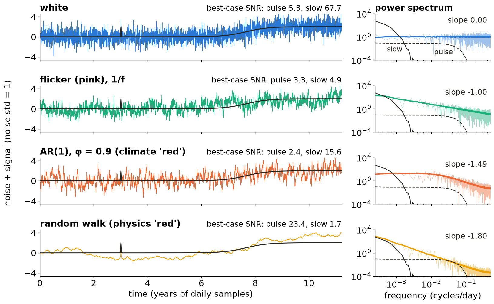{height="560px"}
:::
::: {.column style="width:32%; font-size:0.78em"}
- 4,096 daily samples (11.2 years); each noise scaled to unit variance
- Pulse (4-day width) and slow ramp (300 days), both 2 noise standard deviations high
- Signal-to-noise ratio (SNR) here: matched filter with the exact noise covariance, the best case

| Noise | Slope | SNR pulse | SNR slow |
|---|---|---|---|
| white | 0.00 | 5.3 | 67.7 |
| flicker (pink) | −1.00 | 3.3 | 4.9 |
| AR(1), φ = 0.9; red in climate papers | −1.49 | 2.4 | 15.6 |
| random walk (Brownian; red in physics) | −1.80 | 23.4 | 1.7 |
:::
::::

[Figure: figscripts/lec09_noise_1d.py (seed 2026, 200 realizations per noise model). AR(1): first-order autoregressive, φ = 0.9.]{.credit}

::: {.takeaway}
At equal variance, the slow transient's best-case SNR falls from 67.7 in white noise to 4.9 in flicker noise and 1.7 in a random walk, where the short pulse rises to 23.4.
:::

::: {.notes}
Two and a half minutes. The color of noise is the shape of its power spectrum, P(f) ∝ f^slope. Panels and table rows are ordered by fitted slope. White noise has equal power at all frequencies: each day independent of the last. A first-order autoregressive process (AR(1), x[t] = 0.9 x[t−1] + e[t]), which climate papers call red noise, is white at long periods and falls off as about f⁻² above a corner near 0.017 cycles per day; AR(1) has a corner, so its fitted slope depends on the band (−0.12 below 0.01 cycles per day, −1.58 between 0.05 and 0.5, −1.49 over the whole band). Flicker noise (1/f, slope −1) has no corner: GNSS position series and many climate records look like this. A random walk (1/f², slope −2 in theory, −1.80 fitted over this band) is what you get by summing white noise: a drifting monument, a clock. Its unit variance holds only in expectation: across realizations its sample standard deviation spans 0.46 to 1.66 (5 to 95%), and it grows with record length. The two transients are the shapes geodesists look for: a short burst, like a swarm or a short slow-slip event, and a slow ramp over about two years, like postseismic relaxation. Both have the same peak, 2 noise standard deviations. SNR here is the matched-filter signal-to-noise ratio, sqrt(sᵀC⁻¹s): the best any detector can do if it knows the noise covariance exactly. Read the table by column. Slow transient: its power sits at low frequency, exactly where colored noise is strongest, so the SNR falls from 67.7 to 1.7. Pulse: a random walk is smooth from day to day, so a 4-day pulse stands out against it (23.4); AR(1) puts its power at periods longer than about 60 days, which overlaps the pulse's spectrum (2.4). Sign conventions differ between fields: McPartland et al. (2025, Climate of the Past, doi:10.5194/cp-21-1917-2025) write S(f) ∼ f^−β with β = 1 "red" for tree rings and corals; GNSS papers write a spectral index κ = −1 for flicker noise; Masson et al. (2019, Solid Earth) use k negative. In physics and geodesy, β = 1 is pink or flicker, β = 2 red or Brownian. Ask: which transient would you miss in a GNSS series if you assumed white noise when estimating its uncertainty?
:::

## Colored noise at RATT and in GPS positions {.smaller}

:::: {.columns}
::: {.column width="56%"}
[📍 In-situ sensor]{.gb .src} [🪨 Solid Earth]{.gb .sys .solid} [🌊 Ocean]{.gb .sys .ocean} [📈 Seismology]{.gb .disc .solid}

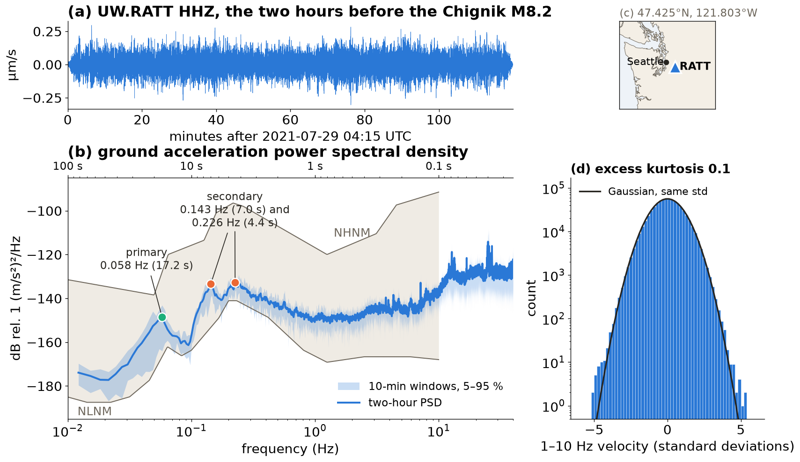{width="100%"}

::: {.dim}
Panel (d), 1–10 Hz: excess kurtosis 0.1; in the 1–20 Hz band it is 3.7 (notebook 2.10, section 5.1).
:::
:::
::: {.column width="44%"}
[📍 In-situ sensor]{.gb .src} [🪨 Solid Earth]{.gb .sys .solid} [📐 Geodesy]{.gb .disc .solid}

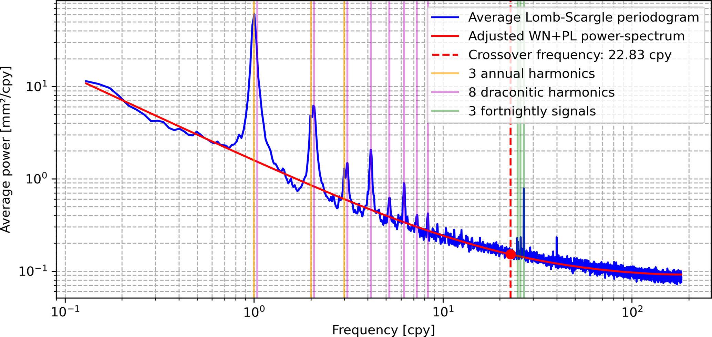{width="100%"}

::: {.dim}
Mean periodogram of vertical GPS positions at tide gauges, with a white-noise plus power-law (WN+PL) fit; cpy: cycles per year; draconitic: the 351.4-day period of the GPS orbits relative to the Sun.
:::
:::
::::

[Left: UW.RATT HHZ, course copy, [doi:10.7914/SN/UW](https://doi.org/10.7914/SN/UW); coastlines: Natural Earth; figscripts/lec09_ratt_noise_psd.py. Right: Gravelle et al. (2023), *Earth System Science Data* 15, 497–509, Fig. 5, [doi:10.5194/essd-15-497-2023](https://doi.org/10.5194/essd-15-497-2023). [CC BY 4.0](https://creativecommons.org/licenses/by/4.0/).]{.credit}

::: {.takeaway}
At RATT the secondary microseism peaks at 7.0 s, 20 dB above the low-noise model; GPS vertical noise falls as a power law with median index −0.94 down to a white floor above 22.8 cycles per year.
:::

::: {.notes}
Two and a half minutes. Left: the same two hours of UW.RATT (Rattlesnake Lake, King County) that notebook 2.10 uses as its noise reference, 04:15 to 06:15 UTC on 29 July 2021, ending 49 s before the M8.2 Chignik earthquake. Welch PSD with 327.68 s Hann segments; the shading is the 5 to 95% spread of 12 ten-minute windows. Peaks from the script: primary microseism 0.058 Hz (17.2 s) at −148.6 dB; secondary microseism 0.143 Hz (7.0 s) at −133.5 dB (NLNM −153.3, so 19.8 dB above) and 0.226 Hz (4.4 s) at −132.8 dB. The primary is made where waves shoal on the coast at their own period; the secondary at about half the period, where opposing waves interact. Here the long-period secondary peak sits at 2.47 times the primary frequency, not 2, because the two peaks come from different wave fields. Above 1 Hz, the cultural band again (−136.4 dB at 10 Hz, against −91.5 dB for the NHNM and 31.6 dB above the NLNM at −168.0: a quiet site at night). Panel (d): the 1 to 10 Hz velocity samples against a Gaussian of the same standard deviation, excess kurtosis 0.11, maximum 5.3 standard deviations; this quiet evening is close to Gaussian in this band (notebook 2.10 finds excess kurtosis 3.7 in the 1 to 20 Hz band of the same record, so the band matters). ComCat lists one M ≥ 5 in the window, M~ww~ 5.4 Macquarie Island at 05:00:54 UTC, about 115° away; nothing from it stands out. Right: Gravelle et al. average the Lomb-Scargle periodograms of detrended vertical positions at GPS stations near tide gauges, after correcting non-tidal atmospheric loading. Quote: "the power-law process induces a negative trend at low frequencies ..., whereas white noise causes a flattening at high frequencies. This flattening is especially visible above 22.8 cpy"; "The median value of the spectral indices is −0.94, i.e. close to −1.00, which confirms the prevalence of a flicker-like noise". On top sit peaks: the annual cycle and its harmonics (loading by water, snow and atmosphere, a geophysical signal) and the eight draconitic harmonics (an artifact of the satellite orbits; the first nearly coincides with the annual). Why it matters: velocity uncertainties "can be largely underestimated, up to a factor of 10 (Williams et al., 2004), if the temporal correlations are ignored." 601 stations were processed, 546 are in the final velocity field. Ask: which of these peaks is signal for a sea-level scientist, and which for an orbit specialist?
:::

## One deformation bowl under three kinds of 2D noise {.smaller}

[🖥️ Model & simulation]{.gb .src} [🪨 Solid Earth]{.gb .sys .solid} [🌋 Volcanology]{.gb .disc .solid} [synthetic, fixed seed]{.dim}

:::: {.columns}
::: {.column width="70%"}
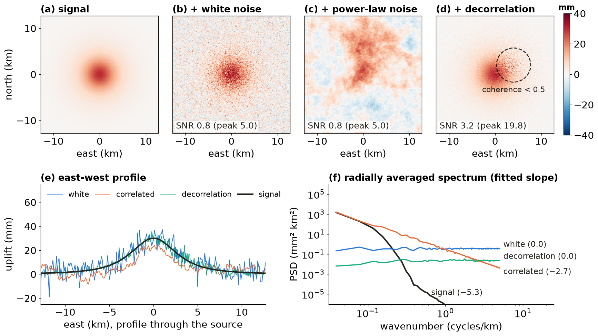{height="540px"}
:::
::: {.column style="width:30%; font-size:0.78em"}
- Mogi source 4 km deep, 30 mm peak uplift; 256 × 256 grid at 100 m
- Correlated noise: spectrum k^−8/3^, the slope Hanssen (2001) reports for tropospheric delay between about 0.5 and 6 km (3D turbulence); about −5/3 at larger scales
- Decorrelation: additive, standard deviation set by coherence γ: 0.8 mm at γ = 0.9, 7.7 mm at γ = 0.2 (dashed: γ < 0.5)
- SNR in panels: std(signal)/std(noise), peak/std in brackets

| Noise | std (mm) | corr. with truth | noise spectrum slope |
|---|---|---|---|
| white | 6.00 | 0.62 | 0.03 |
| correlated | 6.00 | 0.50 | −2.66 |
| decorrelation | 1.52 | 0.95 | 0.03 |
:::
::::

[Figure: figscripts/lec09_noise_2d.py (seed 2026). Delay slope: Hanssen (2001), *Radar Interferometry*; decorrelation noise: Rodriguez & Martin (1992), *IEE Proc. F* 139, 147–159.]{.credit}

::: {.takeaway}
At the same 6 mm noise level, correlated noise lowers the correlation with the true bowl to 0.50, against 0.62 for white; decorrelation noise is 4.4 mm where coherence is below 0.5 and 0.8 mm on coherent ground.
:::

::: {.notes}
Two minutes. The signal is the uplift above an inflating magma chamber, a Mogi point source (a pressure change in a small sphere) 4 km deep, scaled to 30 mm, the size of signals InSAR resolves at restless volcanoes; standard deviation over the grid 4.80 mm, half-peak radius 3.07 km. Three noises. White: independent pixels, 6 mm. Correlated: a power-law field with spectrum k^−8/3, also 6 mm; −8/3 is the slope Hanssen (2001) reports for tropospheric delay between about 0.5 and 6 km (3D turbulence), and at larger scales, which hold most of this 25.6 km grid's variance, his slope is about −5/3. Its blobs have the size of the bowl, so it can make or hide a bowl (panel c); that is the InSAR atmosphere of the Rouet-Leduc slide. Decorrelation: when the ground surface changes between the two radar dates (vegetation, snow, farming), the interferometric phase becomes noisy. The noise is additive and set by the coherence γ, not by the deformation: phase standard deviation sqrt(1 − γ²)/(γ sqrt(2L)) (the Cramér-Rao bound, Rodriguez and Martin 1992; Hanssen 2001), with L = 4 looks, capped at the uniform-phase value π/√3, converted to line of sight with λ/4π for C band (λ = 55.5 mm, Sentinel-1). The coherence map is 0.9 on bare ground and falls to 0.2 in a vegetated patch 4 km east and 2 km north of the source: noise 0.79 mm where γ > 0.85, 4.42 mm where γ < 0.5 (6.6% of the grid), 7.65 mm at the patch centre. Real InSAR displacement has no multiplicative speckle: speckle multiplies radar intensity (slide 13), and decorrelation phase noise is additive and grows as coherence drops. The table's noise spectrum slope is the fitted log-log slope of the radially averaged noise spectrum (panel f): 0 for white and decorrelation, −2.66 for the correlated field, while the signal falls steeply (−5.3 fitted, not a power law). The SNR labels in panels (b) to (d) are std(signal)/std(noise) and, in brackets, peak/std: 0.80 (5.0) for white and correlated, 3.16 (19.8) for decorrelation, whose noise is small on average and large where it matters. Same SNR, different damage: correlation with the true field 0.624 for white, 0.503 for correlated. Lesson: an SNR number does not describe 2D noise without its spatial spectrum. Rouet-Leduc et al. build their training synthetics the same way, with turbulent correlated noise, a topography-correlated delay and outlier pixels. Ask: which of the three would a smoothing filter remove, which would it keep, and which would a coherence mask remove?
:::

## Wrong labels, random and class-dependent {.smaller}

[🖥️ Model & simulation]{.gb .src} [🪨 Solid Earth]{.gb .sys .solid} [📈 Seismology]{.gb .disc .solid} [synthetic, fixed seed]{.dim}

:::: {.columns}
::: {.column width="68%"}
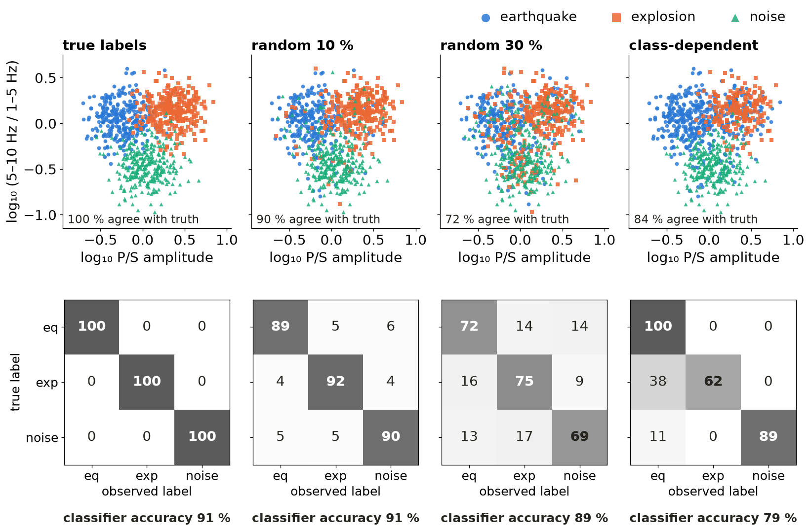{height="565px"}
:::
::: {.column style="width:32%; font-size:0.78em"}
- 300 events per class; two synthetic features
- Class-dependent: 40% of explosions and 15% of noise windows labeled earthquake
- Logistic regression trained on each label set, scored on true labels

| Labels | Agree | Accuracy | Explosion recall |
|---|---|---|---|
| true | 100% | 91.1% | 91.2% |
| random 10% | 90.2% | 90.9% | 91.2% |
| random 30% | 71.9% | 88.7% | 92.5% |
| class-dep. | 83.9% | 79.3% | 53.7% |
:::
::::

[Figure: figscripts/lec09_noise_categorical.py (seed 2026); noise types after Frénay & Verleysen (2014), *IEEE Transactions on Neural Networks and Learning Systems* 25, 845–869.]{.credit}

::: {.takeaway}
Random flips of 30% cost the classifier 2.4 points of accuracy; class-dependent flips of 16% overall cost 11.8 points and lower explosion recall from 91% to 54%.
:::

::: {.notes}
Two and a half minutes. Three source classes: earthquake, explosion, noise trigger, described by two features of the kind regional networks use, the log P/S amplitude ratio (explosions make relatively more P) and the log ratio of 5 to 10 Hz over 1 to 5 Hz energy (microseism-dominated noise windows are poorer in high frequencies). Both features are drawn from overlapping Gaussian clusters, so even the true labels allow 91.1% accuracy. Top row: what a user receives. Bottom row: confusion matrix of the label received (columns) against the true class (rows), in percent of each true class. Random flips change any label to any other class with equal probability: "noise completely at random" in the Frénay and Verleysen taxonomy. With many correct labels around them, wrong ones average out: 30% random noise costs 2.4 points. Class-dependent flips push one class into another, the way a quarry blast enters a catalog as an earthquake (the Chien and Liu slide; Wiemer and Baer 2000 on blast contamination of seismicity catalogs). The classifier learns the error: explosion recall 53.7%. Explosion recall rises slightly at 30% random flips (92.5% against 91.2%), within sampling noise for about 150 test explosions. Whether structured flips hurt accuracy depends on the classifier and the class geometry; in template E of notebook 2.10 a nearest-class-mean rule barely changes (0.75 to 0.76 at 15% wrong labels, mean of 20 catalogs) while random flips cost more (0.68), but the structured flips bias a science quantity, the earthquake day-to-night ratio (1.74 against 1.03). The slide uses log P/S and a frequency ratio; template E uses log S/P and the hour of day, a different feature set with the same lesson. The same pattern on real crop maps: Pelletier et al. (2017, Remote Sensing 9, 173, doi:10.3390/rs9020173, CC BY 4.0) injected label noise in land-cover training sets; "at 40% noise level, the RF OA values of the 5-class real dataset are equal to 72% and 60% for random and systematic noise respectively" (RF: random forest; OA: overall accuracy), and "the cross-validation procedure is impacted by the presence of class label noise", because the validation labels are noisy too. In CloudSEN12 (Aybar et al. 2022, Scientific Data 9, 782), thin cloud is the class expert labelers changed most during their own quality control (producer's accuracy 78% between labels before and after the check). Ask: in your catalog or map, which two classes would a tired analyst confuse?
:::

## Distributions of values, synthetic and real {.smaller}

[[Synthetic:]{.dim} [🖥️ Model & simulation]{.gb .src} &nbsp; [Earthquakes:]{.dim} [🗂️ Catalog & compiled product]{.gb .src} [🪨 Solid Earth]{.gb .sys .solid} [📈 Seismology]{.gb .disc .solid} &nbsp; [SeaTac rain:]{.dim} [📍 In-situ sensor]{.gb .src} [🌤️ Atmosphere]{.gb .sys .air} [🌡️ Atmospheric & climate science]{.gb .disc .air}]{style="font-size:0.72em"}

:::: {.columns}
::: {.column width="62%"}
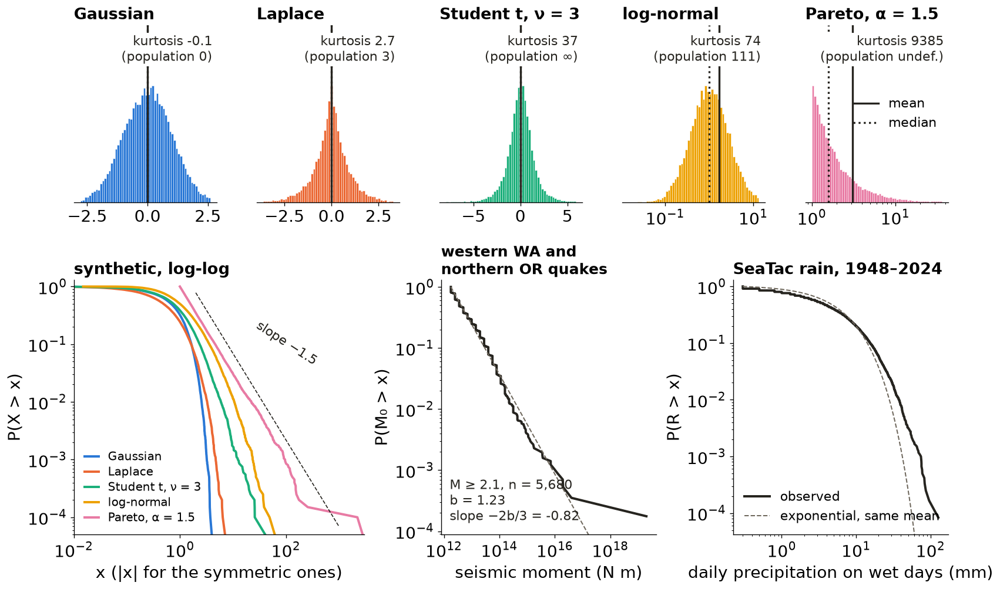{height="540px"}
:::
::: {.column style="width:38%; font-size:0.7em"}
| Synthetic, n = 20,000 | Excess kurtosis (population) | Beyond 3 std |
|---|---|---|
| Gaussian | −0.06 (0) | 0.24% |
| Laplace | 2.72 (3) | 1.42% |
| Student t, ν = 3 | 36.6 (∞) | 1.47% |
| log-normal, σ = 1 | 74.1 (111) | 1.79% |
| Pareto, α = 1.5 | 9,385 (undefined) | 0.14% |

- ν: degrees of freedom; Pareto 1.5 has infinite variance, so its kurtosis is undefined
- Earthquakes, 45.5–49°N, 121–124°W, 2000–2025, M ≥ 2.1: 5,680 events, b = 1.23
- SeaTac wet days: 11,998; largest 127.5 mm, 20 Oct 2003
:::
::::

[Data: USGS ComCat and NOAA GHCN-Daily USW00024233 (Seattle-Tacoma airport), course copies; Mc after Cao & Gao (2002), Woessner & Wiemer (2005). Figure: figscripts/lec09_distributions.py (seed 2026).]{.credit}

::: {.takeaway}
The 2001 M6.8 Nisqually earthquake carries 98.8% of the moment of all 5,680 events; an exponential fit gives SeaTac's 127.5 mm day a probability of 6.5 × 10⁻¹⁰, against 1 in 11,998 observed.
:::

::: {.notes}
Three minutes. Color says how values are correlated; the distribution says how large single values get. They are independent properties. Top row: five synthetic distributions with mean (solid) and median (dotted). A Gaussian arises when many small independent contributions add up; its tails fall as e^(−x²/2), so 0.27% of values lie beyond 3 standard deviations. Laplace and Student t (ν = 3 degrees of freedom) are symmetric with heavier tails: transients, gusts, passing trucks. The kurtosis column gives the sample value and, in brackets, the population value: infinite for Student t with 3 degrees of freedom, about 111 for a log-normal with σ = 1, undefined for Pareto with α = 1.5 because its variance is infinite. So the sample numbers for those three are not estimates of anything finite; notebook 2.10 prints 18,335.5 for another Student t draw. Log-normal and Pareto histograms are on a log x axis. Log-normal arises from products of many factors (grain sizes, permeability, rain amounts): skewed, all positive, mean 1.67 against median 1.00. Pareto, a power law P(X > x) = x^−1.5, has a finite mean and no finite variance: its running standard deviation was 7.48 at n = 1,000, 5.98 at 5,000 and 26.04 at 20,000, and never settles. The fraction beyond 3 std is a poor measure for it because its std is itself inflated. Bottom left: on log-log axes of exceedance probability, a power law is a straight line. Bottom middle: earthquakes in the box from Portland to the Canadian border (45.5 to 49°N, 121 to 124°W, Mount St. Helens included), catalog magnitudes converted to moment with M0 = 10^(1.5M + 9.1) N m (Hanks and Kanamori 1979), from local and duration magnitudes, so this is implied moment. The Gutenberg-Richter b-value gives the slope −2b/3 = −0.82. Mc (magnitude of completeness) here is 2.1 from b-value stability; maximum curvature plus 0.2 gives 0.7 on this box because it holds the 2004 to 2008 Mount St. Helens swarm and mixes ml and md. b keeps rising with the cutoff (0.51 at 0.5, 1.71 at 3.0) and is flat only from 2.1 to 2.5 (1.225 to 1.243), so 1.23 is the value on a short plateau of a curved frequency-magnitude distribution, not a regional b-value; the 98.8% moment share does not depend on it. Bottom right: daily rain on wet days (≥ 0.3 mm) at SeaTac, 1948 to 2024: skewness 3.20, excess kurtosis 18.48; the observed curve bends away from the exponential at the high end. Why it matters for noise: a 3-sigma clip assumes a Gaussian. On the catalog it would discard the largest earthquakes, which are the physics; on rain, the floods. Missing small events bend a power law at the low end too: Bernard et al. (2021, Earth Surface Dynamics 9, 1013, doi:10.5194/esurf-9-1013-2021) show that a 2D landslide inventory from aerial images rolls over near 20 m² while a lidar 3D inventory follows the power law to its 20 m² limit; the rollover there comes from under-detection. Ask: in your data, would the largest value be an outlier to remove or the event you study?
:::

## Transforms change the noise {.smaller}

[🛰️ Satellite & airborne]{.gb .src} [🌱 Biosphere]{.gb .sys .bio} [🦠 Biogeosciences]{.gb .disc .bio} [Copernicus Sentinel-1 (ESA), radar intensity over fields and villages]{.dim}

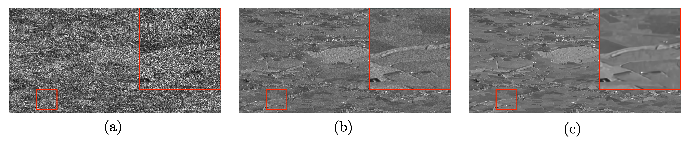{width="100%"}

::: {style="font-size:0.6em"}
| Transform | What happens to the noise | Example |
|---|---|---|
| Average over L looks or dates | variance divided by L if the looks or dates are independent and the scene unchanged | (b): 45 dates of the 1-look image (a) |
| Logarithm | multiplicative becomes additive; mean of logs biased by ψ(L) − log L | (c) was denoised in log space |
| First difference | random walk becomes white; white becomes blue | Global Navigation Satellite System (GNSS) daily positions |
| Band-pass filter | keeps the band's noise; colors it; rings at gaps | RATT 1–10 Hz (lecture 8) |
| Normalize (z-score) | signal and noise rescaled together; heavy tails inflate the std | per-station amplitudes |
| Spectrogram in dB | multiplicative changes become additive shifts; the log of a periodogram is biased low by 2.5 dB (Euler's constant) | SP2 microseism band |
:::

[Dalsasso, Yang, Denis, Tupin & Yang (2020), *Remote Sensing* 12, 2636, Fig. 4, [doi:10.3390/rs12162636](https://doi.org/10.3390/rs12162636). [CC BY 4.0](https://creativecommons.org/licenses/by/4.0/).]{.credit}

::: {.takeaway}
Averaging 45 Sentinel-1 dates divides speckle variance by 45 under Goodman's model; taking the log makes speckle additive but leaves it non-Gaussian, with a biased mean.
:::

::: {.notes}
Two minutes, optional: skip it if the clock is past 10:40. Every transform in the processing chain changes the noise you hand to a model. Panel (a): one Sentinel-1 radar image. Speckle is physical: "Because of the interference between echoes produced by elementary scatterers, the intensity fluctuates (speckle phenomenon)." Goodman's model: y = x × n, with n gamma distributed, E[n] = 1 and Var[n] = 1/L, so "Var[y] = x²/L: the noise is signal-dependent". Panel (b): "multitemporal averaging of 45 dates", which works only "assuming that no changes occurred"; the variance falls by 45 only if the speckle is also independent between dates, which it is not on stable, coherent scatterers such as buildings. Panel (c): (b) denoised with MuLoG+BM3D, a filter that works on log-intensities. After the log, speckle is additive but follows a Fisher-Tippett distribution, and "The mean E[ne] = ψ(L) − log(L) (ψ is digamma function) is non-zero, which indicates that averaging log-transformed intensities ye leads to a biased estimate of the log-reflectivity" (their Fig. 3 compares it with a Gaussian for L = 1, 5 and 20). The authors note that calling speckle noise "is sometimes considered misleading in the context of SAR imaging", which is today's point again: for an analyst of surface roughness the speckle statistics are information. Other rows: differencing a random walk returns the white steps; differencing white noise multiplies its spectrum by 4 sin²(πf), so high frequencies grow (blue). A band-pass keeps only the noise in the band and makes it correlated over about one period (lecture 8's ringing). A z-score changes no SNR, but a heavy-tailed record gets a large std from a few spikes. A spectrogram in dB is a log of power, so multiplicative changes become shifts; a single periodogram value is exponentially distributed, so its log is biased low by Euler's constant, 0.577 in natural log or 2.5 dB. Ask: which transform in your processing would change the distribution of your noise the most?
:::

## Building synthetic data with known truth {.smaller}

:::: {.columns}
::: {.column style="width:37%; font-size:0.8em"}
1. **Signal with known parameters**, kept as the answer key
2. **Realistic noise**: white, AR(1), power law, or spectrum-matched to a real record
3. **One nuisance from another real source**: a teleseism, soil temperature, El Niño, starspots, blasts
4. **One instrument problem from lecture 8**: gap, step, clock
5. **The distribution of the noise values**: Gaussian or heavy-tailed
6. **Seed, record, disclose** which samples are synthetic

::: {.dim}
Right: synthetic earthquake displacement at high-rate (1 sample/s) Global Navigation Satellite System (GNSS) stations plus real noise; columns: input, target and predicted time-frequency masks, denoised trace.
:::
:::
::: {.column width="63%"}
[🖥️ Model & simulation]{.gb .src} [📍 In-situ sensor]{.gb .src} [🪨 Solid Earth]{.gb .sys .solid} [📐 Geodesy]{.gb .disc .solid}

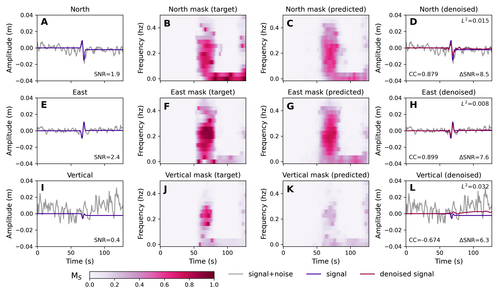{width="100%"}
:::
::::

[Thomas, Melgar, Dybing & Searcy (2023), *Seismica* 2(1), Fig. 3, [doi:10.26443/seismica.v2i1.240](https://doi.org/10.26443/seismica.v2i1.240). [CC BY 4.0](https://creativecommons.org/licenses/by/4.0/).]{.credit}

::: {.takeaway}
Thomas et al. combined 822,256 synthetic three-component signals with 729,303 real noise records; at amplitude SNR 0.4 the denoised vertical correlates with the truth at −0.67.
:::

::: {.notes}
Two minutes. The recipe is the one in notebook 2.10 section 5, and published studies follow it. Thomas et al. denoise high-rate GNSS (HR-GNSS) displacement, whose noise of "1 cm–2 cm" hides small earthquakes. Signals: simulated ruptures ("fakequakes") of magnitude 4 to 7.2. Noise: real records from "the 278 GNSS stations closest to the Ridgecrest events" on days between 1 June 2019 and 31 July 2020 "that did not have an earthquake above M4.3". Quote: "Training data are synthetic HR-GNSS records and actual noise recordings that are superimposed to generate noisy signals"; "The combinations of signal and noise and the time-shifting are data augmentation strategies." The truth is known for every training sample, which is what makes the masks in columns 2 and 3 possible. Their SNR is an amplitude ratio: peak signal over the standard deviation of the pre-event noise. On this example, north and east (SNR 1.9 and 2.4) are recovered (CC, their correlation coefficient, 0.879 and 0.899); the vertical, SNR 0.4, gives CC = −0.674, a wrong waveform rather than a weak one. Their Fig. 2 shows another design choice: peak ground displacement is "nearly uniform ... up to 1 m and then exponentially decreasing", a training distribution chosen by the authors, unlike the power law of real earthquakes. Masson et al. (2019, Solid Earth 10, 329, doi:10.5194/se-10-329-2019) do the same for GNSS velocities: 3,600 synthetic daily series with a velocity, annual and semiannual terms, offsets and colored noise (Kasdin 1995 generator), and find that series shorter than 4.5 years "are not suitable for studies that require precisions lower than mm yr−1". Step 6 is the course rule: a model validated only on synthetic data has not been validated. Ask: which of the six ingredients is hardest to make realistic for your project?
:::

## Detection floors measured on synthetics {.smaller}

:::: {.columns}
::: {.column width="50%"}
[🖥️ Model & simulation]{.gb .src} [📍 In-situ sensor]{.gb .src} [🪨 Solid Earth]{.gb .sys .solid} [📈 Seismology]{.gb .disc .solid}

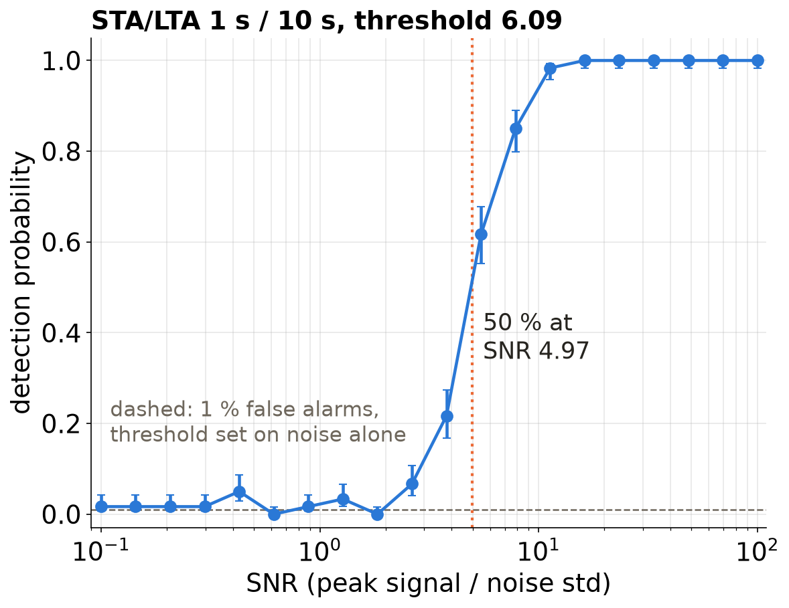{height="420px"}

::: {style="font-size:0.7em"}
- STA/LTA (short-term over long-term average, 1 s / 10 s) on spectrum-matched RATT noise
- Noise only, 200 trials: median peak 4.34, 99th percentile 6.09 sets the threshold
- Planted Ricker events, 60 trials per SNR: detection 0.07 at SNR 2.64, 1.00 at 16.24
:::
:::
::: {.column width="50%"}
[🖥️ Model & simulation]{.gb .src} [🪨 Solid Earth]{.gb .sys .solid} [📐 Geodesy]{.gb .disc .solid}

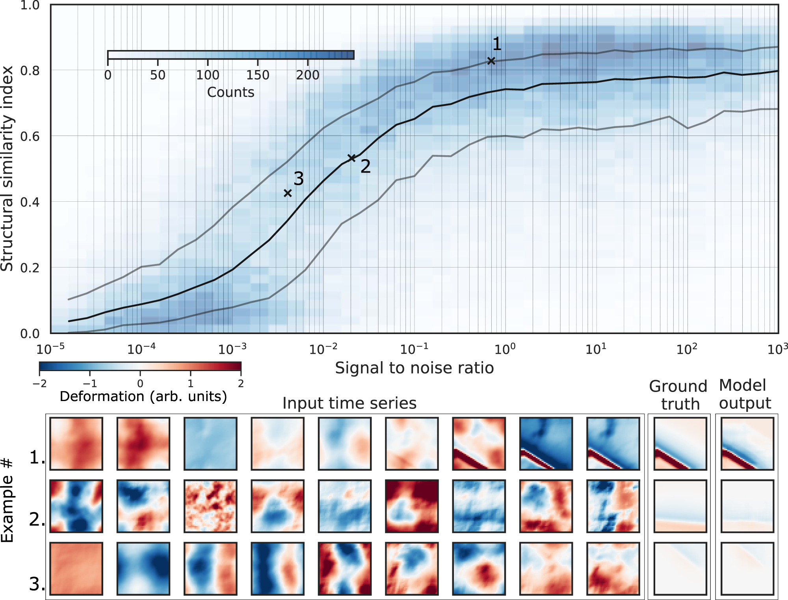{height="520px"}
:::
::::

[Left: figscripts/lec09_stalta_floor.py (notebook 2.10 section 4.4, same seeds). Right: Rouet-Leduc et al. (2021), *Nature Communications* 12, 6480, Fig. 2, [doi:10.1038/s41467-021-26254-3](https://doi.org/10.1038/s41467-021-26254-3). [CC BY 4.0](https://creativecommons.org/licenses/by/4.0/).]{.credit}

::: {.takeaway}
STA/LTA crosses 50% detection at amplitude SNR 4.97; the InSAR autoencoder recovers fault offsets down to a power SNR of about 0.5%, an RMS ratio near 0.07, using nine frames of 48 × 48 pixels.
:::

::: {.notes}
Two minutes. Known truth lets you measure the weakest signal a method can see. Left, notebook 2.10 section 4.4: the noise is RATT's with random phases (spectrum-matched, section 4.1). The threshold comes from noise alone: 200 noise-only windows, peak STA/LTA median 4.34, 99th percentile 6.09, so the false-alarm rate is 1% by design, before any event is planted. Then Ricker wavelets at 20 SNR levels, 60 trials each; SNR is peak amplitude over noise standard deviation. Detection is 0.07 at SNR 2.64, crosses 50% at 4.97 and reaches 1.00 at 16.24. These numbers were reproduced by rerunning the notebook offline on 20 October 2026 (CI=1, MLGEO_OFFLINE=1). Every catalog has such a floor; when it moves (new stations, more traffic), apparent seismicity rates change with no change in the Earth (Habermann 1987, *Bulletin of the Seismological Society of America* 77, 141–159). Right, Rouet-Leduc et al.: 10⁵ synthetic test series, each nine frames of 48 × 48 pixels with a fault offset, turbulent correlated noise, a topography-correlated delay and outlier pixels; "All other phase delays are identified as noise." The y axis is the structural similarity index (SSIM) between output and truth. "For SNRs above 20%, our algorithm provides a very accurate reconstruction ... (0.7 < SSIM < 1.0)"; "the overall deformation signal is recovered down to SNRs of ~0.5%". Their SNR is a power ratio, RMS²(signal)/RMS²(noise), so 20% is an RMS ratio of about 0.45 and 0.5% about 0.07; STA/LTA's SNR on the left is peak amplitude over noise standard deviation, a different definition. Examples 2 and 3 (SNR about 2 × 10⁻², 4 × 10⁻³, read from the plot) show no visible offset in the inputs. The two floors are not a ranking: the autoencoder pools 9 × 48 × 48 samples and was trained on noise drawn from the same generator as its test set, and the paper states the assumption that atmospheric noise is "second-order stationary". Ask: what would happen to the right-hand floor if the real atmosphere were not stationary?
:::

## Build a synthetic version of your data (25 min) {.smaller}

::: {style="font-size:0.84em"}
`pixi run -e core jupyter lab` (install before class) → open `2.10_synthetic_noise.ipynb`, Run All (about 10 s), then go to section 5. Pick the template closest to your project.

| Template | Data | Nuisance from another source | Instrument problem | Measured against the truth |
|---|---|---|---|---|
| A. Volcano or local seismic | 1D, 100 samples/s | Chignik P coda at RATT | 2 s gap, zero-filled | detections, false triggers |
| B. Soil moisture | 1D, daily | soil temperature on the probe | frozen days left blank | drydown time scale (12 days) |
| C. Gridded temperature | 2D, monthly | El Niño-like pattern | regional step from 2006 | trend map and its error bar |
| D. Transit light curve | 1D, 2 min | starspots and granulation | Transiting Exoplanet Survey Satellite (TESS) downlink gap | transit depth (1%) |
| E. Catalog labels | categorical | daytime cultural triggers and blasts | UTC and PST clocks mixed | label agreement, accuracy |

**Produce:** the printed numbers at two noise settings in your team notes, and the template's figure for one of them.

**Timing:** 3 min read the template · 10 min change color, level or distribution · 7 min compare with the truth · 5 min reflection (5.7)

**Share-out, 10 min:** each team shows one figure and one sentence: *what in your real data is signal for someone else?*
:::

::: {.notes}
Twenty-five minutes of team work, then ten of share-out. Teams pick by project: volcano teams template A; land-surface modeling and hydrology teams B; climate and gridded-field teams C; exoplanet teams D; any team with labels E. Each template has one Your-turn cell (a line to fill, a self-check, a fallback if left blank) and a hidden worked solution (names ending in _sol); tell students to try before opening it. What the worked solutions give, from the executed notebook (for you, not for the slide): A, false triggers per minute: random-phase twin 0.35, real minute 0.80, Student t noise about 4.6, with the P coda up to 5.2, with the gap 1.75 (the Your-turn cell itself, 10 minutes per setting without coda or gap, prints 0.5, 1.1 and 4.4). B, drydown time scale (truth 12 days): white noise sd 0.01 gives 8.9 days, AR(1) noise 11.9, temperature term 12.6. C, with month-to-month persistence φ = 0.95 the actual trend error is 0.235 °C per decade against a naive error bar of 0.043. D, transit depth (truth 0.010): a 0.2-day running median removes most of it (0.0009 to 0.0036); a 0.75-day median keeps 0.0100 to 0.0102. E, with 15% of the catalog wrong, all of them blasts labeled earthquakes (about three quarters of the blasts, 68 to 85% across the 20 catalogs), the earthquake day-to-night ratio is 1.74 against a true 1.03, while nearest-mean accuracy stays at 0.76 (random flips: 0.68), and the notebook asks which rule behaves like their model. Mixing UTC and PST clocks drops accuracy from 0.75 to 0.42. Circulate and ask each team which of its noises is someone else's signal. Share-out: one figure and one sentence per team, two minutes at most; collect the sentences, they feed Friday's rubric. Implementation names for the notebook only: make_noise (white, AR(1), power law; Gaussian, Student t, Laplace) and mlgeo_synth.spectrum_matched_noise.
:::

## Noise types across the course data {.smaller}

::: {style="font-size:0.74em"}
| Noise | Data | Physical origin | Distribution | Spectrum | Synthesize with | Treat by |
|---|---|---|---|---|---|---|
| Instrument noise | all | electronics, digitizer, photon counts | Gaussian (Poisson for photons) | flat, rising as 1/f at long periods | independent draws | averaging, band choice |
| Ocean microseism | seismic | ocean waves at coasts and in storms | near Gaussian | peaks at 3–20 s | spectrum-matched, random phases | band choice; or use it for imaging |
| Cultural noise | seismic, DAS | traffic, industry | heavy-tailed, daily and weekly cycles | above 1 Hz | real noise windows | time-of-day mask, or its own class |
| Flicker, random walk | Global Navigation Satellite System (GNSS), climate proxies | monument, orbits, environment | Gaussian | 1/f to 1/f² | power-law spectral synthesis | full covariance in uncertainties |
| Atmospheric delay | InSAR | water vapour, turbulence, layering | Gaussian, correlated | k^−8/3^ (0.5–6 km), k^−5/3^ larger, plus topography | power-law field | stacking, weather models |
| Speckle | radar intensity | interfering echoes | gamma, multiplicative | flat | signal × gamma(L) | multilooking, log transform |
| Stellar variability | light curves | spots, granulation | quasi-periodic | red plus rotation peak | sinusoids plus AR(1) | joint model, model comparison |
| Label noise | catalogs, maps | analyst choice, look-alike classes | random or class-dependent | none | flips at known rates | confusion matrix, relabeling |
:::

::: {.takeaway}
Each row is a real contribution with a source, a spectrum and a distribution; writing all three down is what makes a synthetic version of it realistic.
:::

::: {.notes}
Show this after the share-out, one minute, and leave it up for questions. Read it by column. Physical origin: everything except the first row is somebody's signal. Distribution and spectrum are separate columns because they are separate properties (slides 8 and 12). "Synthesize with" is the menu teams used in section 5. "Treat by" ranges from removing (band choice, masks) to modeling jointly (stellar variability, the GNSS noise covariance) to naming a class (blasts, cultural triggers). Numbers behind the rows are on the earlier slides: microseism peaks at RATT 17.2, 7.0 and 4.4 s; SP2 cultural band 9.8 dB louder by day and heavy-tailed (1 to 10 Hz excess kurtosis 22.7 by day, 1.3 at night); GNSS median spectral index −0.94 (Gravelle et al. 2023); tropospheric delay slope −8/3 between about 0.5 and 6 km, about −5/3 at larger scales (Hanssen 2001); speckle variance 1/L (Dalsasso et al. 2020); Kepler-150 f star variability 10.9 mmag against a 1.5 mmag transit (Kipping et al. 2022). Ask: which row is missing for your project?
:::

## Friday, a rubric for AI-ready data {background-color="#faf7f2"}

Friday's session: **AI readiness, building a rubric for AI-ready data, with agents** ([2.13](https://geo-smart.github.io/mlgeo-book/mlready-data))

- Bring your team's synthetic figure and its sentence: what is signal for someone else
- Rubric questions from today: which contributions are signal and which noise, and who decided; the color and distribution of the noise; label error rates; instrument problems flagged

::: {.dim}
Reading arc stage 1 due today · The critical-evaluation lab (6.2) moves to a later date
:::

::: {.notes}
One minute, end of the share-out. Friday turns today's distinctions into rubric items for a dataset another team or an agent will use: does the dataset say what its signal is and for which question, does it describe its noise (source, spectrum, distribution), does it give label error rates or at least who labeled and how, and does it flag instrument problems with the processing history from lecture 8. Teams should bring the sentence from the share-out; it becomes the first entry of their dataset description. Remind them that the critical-evaluation lab (6.2) is moved to a later session; check the course schedule.
:::
