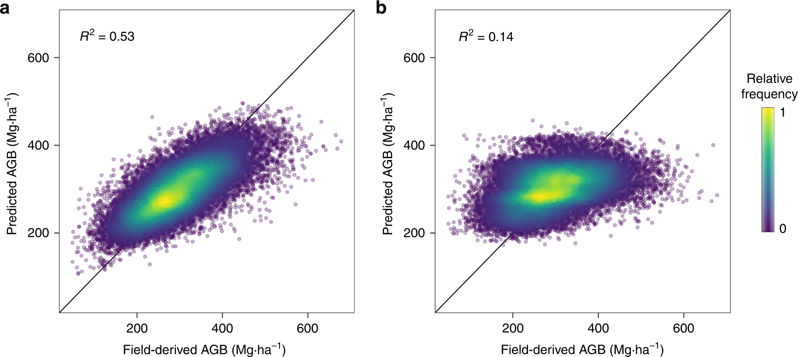
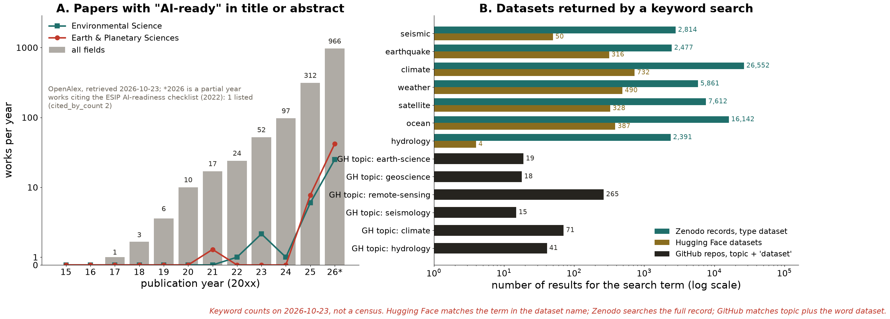
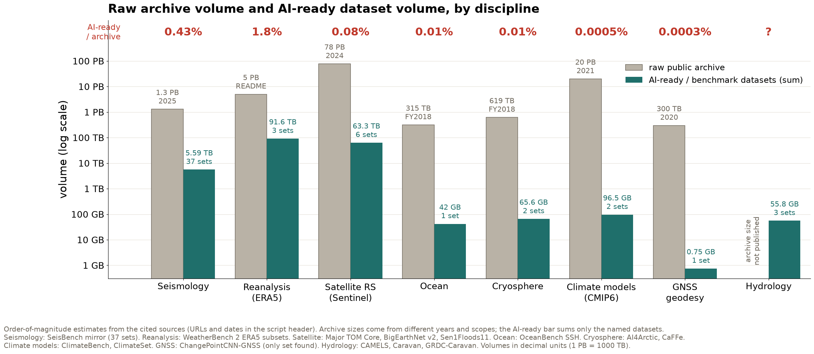
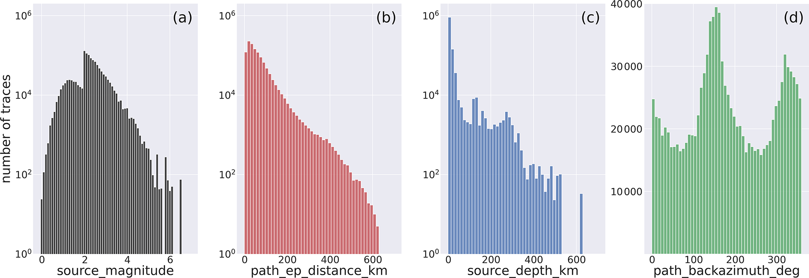
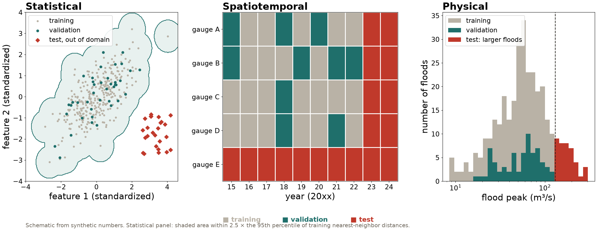

## {background-color="#faf7f2"}

[✅]{.lecture-icon}

### Today's question

Chapter 2 taught you to read, clean, repair, and describe geoscience data.

**When is a dataset ready to train a model, and to test whether the model works somewhere new?**

::: {.dim}
Reading: [2.13 AI-ready data](https://geo-smart.github.io/mlgeo-book/mlready-data)
:::

::: {.notes}
Closing session of Chapter 2. Twenty minutes to define a rubric for AI-ready data, then the rest of the class on notebook 2.13, where students score a dataset against it and run the partition experiments. Pose the question and separate its two halves: training a model asks whether the data are clean, consistent, and labeled; testing whether it works somewhere new asks whether the data can be split so that the test set is genuinely new. Most of today is about the second half, because it is the one geoscience datasets most often fail.
:::

## Literature example: validating a forest biomass map {.smaller}

::: {.badge-row}
[🛰️ Satellite & airborne]{.gb .src} [🌱 Biosphere]{.gb .sys .bio} [🦠 Biogeosciences]{.gb .disc .bio}
:::

:::: {.columns}
::: {.column width="34%"}
::: {.lit-card}
[One random-forest map of central African forest biomass, scored two ways: R² = 0.53 when test plots are drawn at random, 0.14 when whole regions are held out, and close to zero beyond 100 km from the training plots.]{.lit-msg}

[Ploton, P., et al. (2020). Spatial validation reveals poor predictive performance of large-scale ecological mapping models. *Nature Communications*, 11, 4540. Figure 4, CC BY 4.0.]{.lit-cite}
:::

[Inputs: satellite reflectance and climate layers. Target: field-measured aboveground biomass (Mg/ha). Same model, same data; only the partition changed.]{.dim}
:::
::: {.column width="66%"}
{width="100%"}

[(a) random 10-fold cross-validation; (b) spatial 44-fold cross-validation. Ploton et al. (2020), Fig. 4, CC BY 4.0.]{.dim}
:::
::::

::: {.takeaway}
A random split of spatially correlated plots reported R² = 0.53; holding out regions gave 0.14, the skill the map actually has away from field plots.
:::

::: {.notes}
Four minutes; the paper told in full. Geoscience first: forest biomass maps of central Africa feed carbon budgets and conservation decisions. They are built by training a model on field plots (trees measured and converted to aboveground biomass) and predicting everywhere from satellite reflectance and climate layers. Ploton et al. (2020) took one such random-forest map and validated it twice. Random 10-fold cross-validation, the usual practice, gives R² = 0.53 (RMSPE 56.5 Mg/ha, 19%). Spatial 44-fold cross-validation, holding out whole regions, gives R² = 0.14 (RMSPE 77.5 Mg/ha, 26%). With an exclusion buffer, R² falls to about 0.15 at 50 km from training plots and is virtually null beyond 100 km (their Fig. 5). Nearby plots share soils, climate and forest type, so a random split tests the model on near-copies of its training data. This is criterion B7 in one figure, and the reason the rubric asks which axis the test set lies outside. Numbers checked against the article text; figure reused under CC BY 4.0.
:::


## AI-ready data in publications and repositories

{.r-stretch}

::: {.takeaway}
Works using the phrase "AI-ready" went from 97 in 2024 to 966 in 2026 so far, but only 42 of this year's are in Earth and Planetary Sciences.
:::

::: {.notes}
Two minutes. Left: OpenAlex works with "AI-ready" in the title or abstract, retrieved this morning (23 Oct 2026; 2026 is a partial year): 52 in 2023, 97 in 2024, 312 in 2025, 966 so far in 2026; Earth and Planetary Sciences 9 in 2025 and 42 in 2026, Environmental Science 8 and 25. The phrase is new in our field. The ESIP Data Readiness Cluster's checklist for AI-readiness of open environmental datasets (2022, doi:10.6084/m9.figshare.19983722) has been cited only once or twice in OpenAlex. Right: datasets returned by a keyword search on Zenodo (full records, type dataset), Hugging Face (dataset names), and GitHub (repositories with a topic plus the word dataset). Climate returns 26,552 Zenodo datasets and 732 on Hugging Face; seismic 2,814 and 50. These are keyword counts on one date, not a census, and the three hosts search different fields, so compare within a host. Many datasets exist; few say whether they are AI-ready. Script: figscripts/ai_ready_bibliometrics.py.
:::


## A catalog of AI-ready Earth-science datasets {.smaller .compact}

| Dataset | System | One sample | Size | Partition shipped | Best shows |
|---|---|---|---|---|---|
| STEAD (Mousavi 2019) | solid Earth | 3-component waveform: earthquake or noise | ~1.2 M traces | none described | B3 noise class |
| INSTANCE (Michelini 2021) | solid Earth | 3-component trace, 120 s at 100 Hz | ~1.2 M traces, 620 stations | none described | A2, B2 |
| WeatherBench 2 (Rasp 2024) | atmosphere | global ERA5 state at one time | 1959 to 2023 | 2020 held out | B7 time |
| ClimateBench (Watson-Parris 2022) | atmosphere | annual maps given forcing | Earth system model runs | SSP245 scenario held out | B7 physics |
| CAMELS (Newman 2015, Addor 2017) | land water | one catchment's daily series | 671 catchments | none described | B1 units |
| Sen1Floods11 (Bonafilia 2020) | land water | 512 × 512 SAR chip, water mask | 4,831 chips, 11 floods | Bolivia held out | B5 labels |
| BigEarthNet v2 (Clasen 2024) | biosphere | Sentinel-1/2 patch, land-cover labels | 549,488 patches | geographic split | B7 space |
| CaFFe (Gourmelon 2022) | cryosphere | SAR image, calving-front label | 681 images | unseen glaciers | B7 space |
| OceanBench (Johnson 2023) | ocean | daily sea-surface-height map | 1 simulated year + real altimetry | held-out months, one satellite | B4 known truth |

::: {.takeaway}
Six of these nine datasets ship a partition that holds out a period, a region, or a forcing scenario.
:::

::: {.notes}
Two minutes; do not read the table. Ask each team to find the row closest to its project and the criterion that row shows best; they will use one row for the rubric activity. DOIs, checked on Crossref or DataCite today: STEAD 10.1109/ACCESS.2019.2947848; INSTANCE 10.5194/essd-13-5509-2021 (data 10.13127/instance); WeatherBench 2 10.1029/2023MS004019; ClimateBench 10.1029/2021MS002954 (data 10.5281/zenodo.5196512); CAMELS 10.5194/hess-19-209-2015 and 10.5194/hess-21-5293-2017; Sen1Floods11 10.1109/CVPRW50498.2020.00113; reBEN 10.48550/arXiv.2407.03653; CaFFe 10.5194/essd-14-4287-2022; OceanBench 10.48550/arXiv.2309.15599. "None described" means no partition appeared in the paper or README we read, not proof that none exists. Data licenses for CAMELS, Sen1Floods11, OceanBench and the WeatherBench 2 copy of ERA5 were not verified. Also verified, not on the slide: Caravan (Kratzert et al. 2023, 6,830 catchments, 10.1038/s41597-023-01975-w) and AI4Arctic sea ice (Stokholm et al. 2024, 513 + 20 scenes with ice-service chart labels, 10.5194/tc-18-3471-2024). BigEarthNet v1 used a random split; v2 replaced it with a geographic one to reduce spatial correlation between partitions.
:::

## How much of each archive is AI-ready?

{.r-stretch}

::: {.takeaway}
AI-ready datasets hold 1.8% of the ERA5 archive by volume, 0.43% of continuous seismic waveforms, 0.08% of Sentinel imagery, and 0.0003% of GNSS archives.
:::

::: {.notes}
Two minutes. Grey: the raw public archive of each discipline; teal: the summed size of the AI-ready or benchmark datasets drawn from it; red: the ratio. Order-of-magnitude estimates from cited sources, collected today; sources and dates are in figscripts/ai_ready_vs_archive.py. Seismology: EarthScope, NCEDC and SCEDC continuous waveforms, 1.3 PB (Ni et al. 2025, arXiv:2505.18874), against 37 SeisBench datasets totaling 5.59 TB (STEAD 91.5 GB, INSTANCE 168 GB, CREW 1.15 TB; INSTANCE and AQ2009 counted twice because they ship in counts and in ground-motion units). Reanalysis: ERA5 about 5 PB (ARCO-ERA5 README) against three WeatherBench 2 stores, 91.6 TB uncompressed. Satellite: Copernicus Data Space 78 PB (annual report 2024) against Major TOM Core, BigEarthNet v2 and Sen1Floods11, 63.3 TB. Ocean (PO.DAAC 315 TB) and cryosphere (NSIDC DAAC 619 TB) use FY2018 fact sheets, before SWOT and most ICESat-2 data, so current ratios are lower. Climate models: CMIP6 about 20 PB (2021) against ClimateBench and ClimateSet, 96.5 GB. GNSS: NSF GAGE more than 300 TB (2020; includes laser scanning, SAR and borehole data) against the one GNSS training set found, 0.75 GB. Hydrology: no published byte size for USGS NWIS, so no ratio. The archive sizes come from different years and scopes. The point survives the uncertainty: in every discipline, a fraction of a percent or less of the archive has been prepared to train and test models, which is why your project will build its own.
:::

## What an AI-ready dataset looks like: INSTANCE

::: {.badge-row}
[🗂️ Catalog & compiled product]{.gb .src} [🪨 Solid Earth]{.gb .sys .solid} [📈 Seismology]{.gb .disc .solid}
:::

{.r-stretch}

[Magnitude, epicentral distance, depth, back azimuth of about 1.2 million traces from about 50,000 Italian earthquakes. Michelini et al. (2021), *ESSD*, 13, 5509–5544, Fig. 3, CC BY 4.0.]{.dim}

::: {.takeaway}
The step at M 2 is deliberate: the authors kept most M ≥ 2 events and added 20,000 random M < 2 events to counter the Gutenberg–Richter imbalance.
:::

::: {.notes}
Two minutes. INSTANCE, the Italian seismic dataset for machine learning, is a good picture of a dataset described for learning. One sample is a 3-component trace, 120 s at 100 Hz, shipped both in counts and in ground-motion units (A2 homogenization), with more than 100 source, station and trace parameters (A4), from 620 stations (B1), plus 132,288 noise traces (B3; signal-to-noise peaks near 10 dB on the horizontal components and 6 dB on the vertical, their Fig. 10). Panel (a) is criterion B2: the authors reshaped the magnitude distribution on purpose, and say so. Panels (b) to (d) show what a model trained on it has and has not seen: few traces beyond 400 km, two back-azimuth peaks from the geometry of Italian seismicity. What it does not ship is a partition (B7), which every user then has to design. Numbers read from the paper (Sect. 2.1.1, 2.3, 3.1).
:::


## Analysis-ready and AI-ready {.smaller}

:::: {.columns}
::: {.column width="48%"}
### Analysis-ready

A scientist can compute with the data without redoing the provider's work.

- provenance, version, license
- homogenized: one unit system, reference frame, time base
- quality flags, gaps, and censoring documented
- standard format with readable metadata
:::
::: {.column width="52%"}
### AI-ready

The data also support training a model **and** testing whether it generalizes.

- enough independent samples, diverse and with a known distribution
- noise characterized: instrument versus natural variability
- labels with known quality, or structure for self-supervision
- can be partitioned into within-domain and out-of-domain sets
:::
::::

[In this course AI-ready and ML-ready name the same requirements: classic machine learning and deep learning differ in how many samples they need, not in what the data must provide.]{.dim}

::: {.takeaway}
Analysis readiness is necessary for AI readiness but not sufficient: a clean, well-documented record from one station in one decade can still fail every generalization test.
:::

::: {.notes}
Two minutes. Analysis-ready is the older idea: satellite agencies define analysis-ready data as products that need no further processing before use (CEOS CARD4L), and the analysis-ready, cloud-optimized movement (Abernathey et al. 2021) applied it to large gridded archives. AI-ready adds requirements that only matter when a model will learn from the data and be judged on held-out data. Use the GNSS example: P395 is analysis-ready (NGL homogenizes the processing, flags steps, publishes the file), but one station cannot test whether a model trained on Cascadia generalizes to the San Andreas.
:::

## Analysis readiness, with this quarter's examples {.smaller}

| | Criterion | What to check | Example from this course |
|---|---|---|---|
| **A1** Provenance | source, version or retrieval date, license, citation | NGL tenv3 files change daily: record the retrieval date (Session 4) |
| **A2** Homogenization | units, reference frame, time base, instrument changes | bucket versus engine-intake ship temperatures in 1945 (Session 5); P395 antenna steps (Session 1) |
| **A3** Quality and gaps | flags, gaps, sentinels, censoring and their cause | density zeros versus MgO zeros; a 5 mm detection limit (Session 5) |
| **A4** Structure and metadata | tidy tables or labeled arrays; units a script can read | CSV versus Parquet versus netCDF for the same field (Session 4) |

::: {.takeaway}
Every analysis-readiness criterion was already practiced in Chapter 2; the rubric collects them so a dataset can be scored.
:::

::: {.notes}
One minute; this slide is a recap, not new material. Point at the example column and ask which session each came from. A2 is the one projects skip: homogenization means the same quantity measured the same way through the whole record, or a documented correction where it was not (the SST bucket correction, the GNSS equipment steps, mixing local and duration magnitudes in ComCat).
:::

## Readiness by data modality {.smaller}

| Modality | One sample | Catalog example | Evidence to look for |
|---|---|---|---|
| station time series | a day or window at a station | GNSS P395, CAMELS streamflow | time base, gaps, splits by station and period |
| waveforms | multichannel record, fixed length | STEAD, INSTANCE | units or instrument response, sampling rate, pick labels |
| images and rasters | georeferenced patch with bands | BigEarthNet, Sen1Floods11, CaFFe | projection, cloud and label masks, geographic splits |
| gridded fields | map or 3D state at one time | ERSST, WeatherBench 2, ClimateBench | coordinates, area weights, held-out years or scenarios |
| tables and catalogs | one event or one rock | earthquake catalog, rock survey | units, detection limits, completeness |
| tracks and profiles | along-track or along-depth record | OceanBench altimetry tracks | irregular sampling, platform identity |
| text | one statement or report | ClimateX (Session 3) | label source and labeler agreement |

::: {.takeaway}
The 11 criteria are the same for every modality; the evidence to look for differs.
:::

::: {.notes}
Two minutes. Ask each team which row its project is in; several projects combine two (station series plus a gridded covariate, the raster-to-station join of 2.13's earlier version). The catalog examples come from the previous slide. Point at the right column: these are the places analysis readiness most often fails for each modality, and the place an agent should look first.
:::

## AI readiness: what the samples contain {.smaller}

| | Criterion | Question | Geoscience example |
|---|---|---|---|
| **B1** Diversity | how many independent units: stations, events, regions, years? | 1.8 million QTM earthquakes, but one region and one network (Session 1) |
| **B2** Distribution | how are targets and inputs distributed; how rare is the class of interest? | flood days are 1.3% to 6.3% of days at the four 2.13 gauges; granite to andesite 5.6 : 1; magnitudes follow a power law |
| **B3** Noise | which variability is the instrument and which is signal for another question? | ocean microseism is noise for earthquake detection and signal for wave climate (Session 9) |

::: {.takeaway}
Count independent units, not rows: 99% of the 36,518 Pacific Northwest earthquakes in Session 5 came from one network, so they say little about other networks.
:::

::: {.notes}
Three minutes. B1: rows are cheap, independence is not. Daily samples from one gauge are correlated over weeks, events in one aftershock sequence share a source, pixels in one scene share an illumination. The number that matters for generalization is the number of independent units. B2: the distribution of the training data sets what the model learns to predict well; a power-law magnitude distribution means very few large events, which are often the ones that matter. B3: Session 9's point returns: noise is defined by the question. Characterize the instrumental noise (sensor self-noise, processing scatter such as GNSS's 1.8 mm daily scatter) separately from natural variability that another question would call signal.
:::

## AI readiness: what a model can learn from {.smaller}

| | Criterion | Question | Geoscience example |
|---|---|---|---|
| **B4** Augmentation | which transformations keep the physics? | adding recorded noise to earthquake waveforms keeps the physics; time-reversing a flood hydrograph does not |
| **B5** Labels | who labeled, how consistently; or can structure replace labels? | analyst phase picks vary in quality; years of unlabeled continuous waveforms allow self-supervised training |
| **B6** Dimensionality | samples versus features; input shape; intrinsic dimension | STEAD: 3 components × 6,000 samples; first PCA mode of a temperature field: 95.5% of variance (2.12) |

::: {.takeaway}
An augmentation is valid only if the instrument could have recorded the transformed sample.
:::

::: {.notes}
Three minutes. B4: the test for an augmentation is physical: could the instrument have recorded the transformed sample? Shifting a waveform window, adding recorded noise at the measured level, rotating horizontal components of a seismogram, synthetic events with known truth (Session 9) pass. Time reversal of a causal process, mirroring an image whose shadows encode sun azimuth, or adding white noise to data whose noise is red do not. B5: labels in geoscience are often analyst decisions (phase picks, landslide outlines, IPCC confidence levels in Session 3); their consistency bounds the score any model can reach. Where labels are scarce, abundant unlabeled data with structure (continuous waveforms, satellite archives) support self-supervised learning. B6: the number of features against the number of independent samples, the shape of each input, and the intrinsic dimension from PCA (2.12).
:::

## B7: partitioning into within-domain and out-of-domain sets

{.r-stretch}

::: {.takeaway}
Training and validation come from the same domain; the test set lies outside it along a stated axis: statistical, spatiotemporal, or physical.
:::

::: {.notes}
Four minutes; this is the slide to slow down on. Left: statistical. In the space of input features, measure the distance of each new sample to the training set (here the nearest-neighbor distance, standardized with training statistics only). Samples farther than the training points are from each other are outside the domain, whatever their date or place; Meyer and Pebesma (2021) call the inside the area of applicability. Middle: spatiotemporal. Validation years are drawn at the training gauges; the test set is a later period and a gauge the model never saw. Right: physical. The test floods are larger than any flood in training: a different event size, and possibly different physics (overbank flow, dam operations). Ask: for your project, which axis matters most to the people who would use the model?
:::

## What each partition tests {.compact}

| Partition | Drawn from | Tests | Used for |
|---|---|---|---|
| Training | the domain | the model can fit the relationships | fitting parameters |
| Validation | the same domain, independent units | the model interpolates within the domain | choosing hyperparameters, stopping training |
| Test, statistical | far from training in feature space | extrapolation in the inputs | reporting generalization |
| Test, spatiotemporal | a later period or a new region | transfer in space or time | reporting generalization |
| Test, physical | a different process, event size, or physics | transfer to conditions not sampled | reporting generalization |

::: {.takeaway}
In notebook 2.13 one flood classifier scores 0.74 within the domain, 0.70 on later years, and 0.20 at a gauge it never saw (average precision).
:::

::: {.notes}
Two minutes. Machine-learning models are good interpolators: the validation score tells you the model learned the training domain. Only an out-of-domain test tells you whether it generalizes, and only along the axis you held out, so state the axis. The notebook makes this concrete with four synthetic Washington gauges (coastal rain, snowmelt, mixed, semi-arid flash floods) and one random forest. Average precision is 0.740 on held-out months at the three training gauges and 0.736 on a random split: here a random split is barely more flattering. It drops to 0.703 on 2022 to 2024 and to 0.200 at the semi-arid gauge G4, which the model never saw. 36% of G4 samples lie beyond the 95th-percentile distance from the training set, against 6% of validation samples. Floods larger than the 80th percentile of training floods are estimated at a median 0.69 of their observed peak. A random split of strongly autocorrelated data (daily samples within one flood) can still put near-copies of training samples in the test set; the notebook's cross-validation comparison at gauge G1 shows it: KFold 0.730, GroupKFold 0.707, TimeSeriesSplit 0.640. A published example of a partition error changing a conclusion: Frame et al. (2022, HESS, doi:10.5194/hess-26-3377-2022) tested a deep-learning runoff model on extreme floods; their 2023 corrigendum found a date error in the train/test split, and once corrected, the calibrated National Water Model beat the LSTM on events with return periods of 25 years or more. Connect forward: the week 7 robust-training session (3.8) builds the full validation ladder on these ideas.
:::

## Score a dataset with the rubric

Each criterion scores **0** missing · **1** present but incomplete · **2** another team can verify it

:::: {.columns}
::: {.column width="45%"}
**Analysis readiness**

- A1 Provenance
- A2 Homogenization
- A3 Quality and gaps
- A4 Structure and metadata
:::
::: {.column width="55%"}
**AI readiness**

- B1 Diversity · B2 Distribution
- B3 Noise · B4 Augmentation
- B5 Labels · B6 Dimensionality
- B7 Partitioning
:::
::::

**Pairs, 8 minutes:** give your assistant the agent version of this rubric (next slide) and one catalog dataset's documentation; check two of its scores yourself.

::: {.takeaway}
A score counts only with its evidence: the file, page, or count that another team can check.
:::

::: {.notes}
Five minutes including the activity setup; the activity runs at the start of the notebook time. The scale is the course rubric's scale from Session 2, unchanged. The assistant step is deliberate (the schedule promised a rubric built with agents): agents are quick at reading documentation and slow to admit what the documentation does not say. Ask pairs to report one score the agent got wrong and how they found out. Collect two or three; the usual errors are claiming splits are shipped when they are not (B7) and treating a large number of rows as diversity (B1).
:::

## The rubric, written for an agent

```markdown
Score each of the 11 criteria (A1-A4, B1-B7) 0, 1 or 2:
  0 missing; 1 present but incomplete; 2 another team could verify it.
For every score, quote the evidence: file and line, page and section, URL, or a count.
If you cannot find evidence, write "not found" and score 0; do not infer from reputation.
Count independent units (stations, events, regions, years), not rows.
B7: name the axis on which the test set lies outside the training domain:
  statistical, spatiotemporal, or physical.
Report a table: criterion, score, evidence, what is missing.
```

Full file: [ai_ready_rubric_for_agents.md](https://geo-smart.github.io/mlgeo-book/slides/2026/files/ai_ready_rubric_for_agents.md), one instruction per criterion. Copy it into your project's AGENTS.md.

::: {.takeaway}
The same 11 criteria, rewritten so that an assistant must quote evidence for every score and say "not found" when there is none.
:::

::: {.notes}
Three minutes, then the pair activity uses this file. Each course rubric so far (Session 2's reproducibility rubric, HW1's AGENTS.md rules) became checkable instructions; this one does the same for data. The two instructions that matter most: quote evidence for every score, and score 0 with "not found" instead of guessing. Agents fill gaps with what similar datasets usually provide; the second instruction is there to stop that. In the activity, pairs give the file and one catalog dataset's documentation to their assistant, then check two of its scores. Collect one score per pair that the agent got wrong.
:::

## Run notebook 2.13

1. `pixi run jupyter lab` → `2.13_MLready_data.ipynb`
2. Analysis readiness: convert ft³/s to m³/s, find the 91-day jump in the time base, replace the −999 values, write the description of the dataset and read it back
3. AI readiness: count gauges, years, and floods; flood-day fraction; noise level and signal-to-noise; one valid and one invalid augmentation
4. Partitioning: distance to the training set; held-out years and gauge G4; floods larger than any in training
5. Score the dataset on the 11 criteria, then list what your project dataset needs before check-in #1 (Nov 16)

::: {.dim}
Monday: supervision concepts, classification and regression (3.1–3.2) · Chapter 2 quiz opens Monday
:::

::: {.notes}
Timing for the 80-minute block (10:00–11:20): paper-pulse talks about 10 minutes, deck about 20, rubric activity 8, notebook about 35, closing 5 on task 5: each team names the criterion its project dataset scores lowest on. Most teams will name B7: their data come from a few stations or one period, so an out-of-domain test needs a plan now, not after training.
:::
