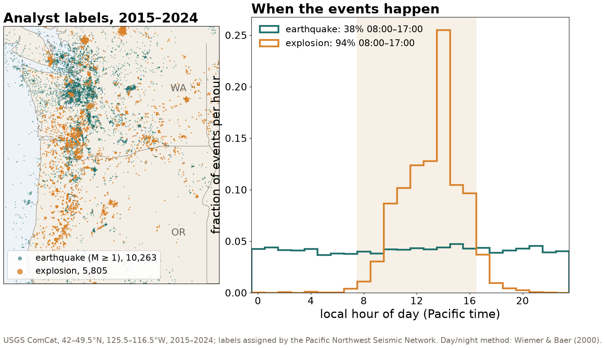

## {background-color="#faf7f2"}

[🧭]{.lecture-icon}

### Today's question

The Pacific Northwest Seismic Network has labeled every located event as an earthquake or an explosion. Nobody has labeled a single Argo float profile.

**What does your data offer a model: labels, structure, or feedback?**

::: {.dim}
Reading: [3.1 Concepts in supervision](https://geo-smart.github.io/mlgeo-book/concepts-supervision) · [3.2 Classification and regression](https://geo-smart.github.io/mlgeo-book/classification-regression)
:::

::: {.notes}
Chapter 3 opens today. Before any algorithm, ask what the data can supervise. Two datasets, opposite situations: one has a label for every sample, made by analysts for their own work (earthquake or explosion in the regional catalog); the other has millions of samples and no labels at all (the Argo float archive). Today covers the first situation, supervised learning, through its two forms: classification (a category) and regression (a quantity). Wednesday covers the second: structure without labels.
:::

## Literature example: telling blasts from earthquakes {.smaller}

::: {.badge-row}
[🗂️ Catalog & compiled product]{.gb .src} [🪨 Solid Earth]{.gb .sys .solid} [📈 Seismology]{.gb .disc .solid}
:::

:::: {.columns}
::: {.column width="28%"}
::: {.lit-card}
[Quarry blasts contaminate seismicity catalogs; because they happen during working hours, the ratio of daytime to nighttime events maps where they are and helps remove them.]{.lit-msg}

[Wiemer, S., & Baer, M. (2000). Mapping and removing quarry blast events from seismicity catalogs. *Bulletin of the Seismological Society of America*, 90, 525–530.]{.lit-cite}
:::

[Rebuilt with the USGS ComCat catalog for Washington and Oregon, 2015–2024: 10,263 earthquakes (M ≥ 1) and 5,805 events labeled explosion by the network's analysts.]{.dim}
:::
::: {.column width="72%"}
{width="100%"}
:::
::::

::: {.takeaway}
94% of labeled explosions occur between 08:00 and 17:00 local time, against 38% of earthquakes: the label carries a human schedule.
:::

::: {.notes}
Four minutes; the example told in full. Geoscience first: regional networks record earthquakes and also quarry and mine blasts, which have to be removed before seismicity is studied (b-values, rates, fault mapping). Wiemer and Baer (2000) used the fact that blasting happens during working hours: map the ratio of daytime to nighttime events and the quarries appear. Here it is with today's data: USGS ComCat, Washington and Oregon box, 2015 to 2024, retrieved for this lecture (figscripts/lec12_blasts_vs_quakes.py). The Pacific Northwest Seismic Network labels quarry and mine blasts "explosion"; only 16 events carry the separate "quarry blast" label. Left: explosions cluster at quarries and mines, earthquakes along Puget Sound, the Cascade volcanoes and eastern Washington. Right: 94% of explosions occur between 08:00 and 17:00 Pacific time, peaking near 14:00, against 38% of earthquakes, which is close to the 37.5% of an even spread over 24 hours; 93% of explosions fall on weekdays against 72% of earthquakes (5 of 7 days is 71%). This is supervised learning in its simplest form: the analyst's label is the target, and a feature that the analyst did not use directly (the hour) separates the classes. It also contains today's warning: a feature can separate classes for a reason that is not physics.
:::

## The same question in other geoscience problems {.smaller}



::: {.takeaway}
Labels come from analysts, field maps, or routine processing; how and where they were made sets what a model can learn from them.
:::

::: {.notes}
Two minutes, one sentence per card. Bergen et al. (2019) organized solid-Earth machine learning by what the data offer, which is today's question. PhaseNet's labels were not made for machine learning: they are years of routine arrival-time picks by network analysts, which is why they exist at scale. Steger et al. (2016) show the failure: landslide inventories that miss whole areas teach a model that unmapped slopes are stable, and quantitative validation can still look good while the map is geomorphically implausible. Settles (2009) is the general survey of active learning, where the model asks the analyst for the labels it needs most; it is a computer science report, included because analyst time is the bottleneck in many of our labels.
:::

## What the data offer decides the kind of learning {.smaller}

| Field problem | What the data offer | Kind of learning |
|---|---|---|
| Earthquakes and explosions in the regional catalog | a label for every sample | **supervised** |
| Millions of Argo float profiles | only the structure of the data | **unsupervised** |
| A few mapped landslides, thousands of unvisited hillslopes | a few labels and many unlabeled samples | **semi-supervised** |
| Decades of continuous seismic records | data that can predict a hidden part of itself | **self-supervised** |
| A glider choosing where to dive next | consequences, observed later | **reinforcement** |
| 100,000 events a year, analyst time for 2,000 | a model that can ask for labels | **active** |

::: {.takeaway}
The kind of learning follows from what your data contain: labels for every sample, a few labels, structure only, or feedback.
:::

::: {.notes}
Two minutes; the six scenarios of book 3.1, each as a story. Supervised: the network's verdicts are the supervision. Unsupervised: how many water masses are in the Argo archive? Structure first, labels never (Wednesday). Semi-supervised: a few mapped landslides and many slopes nobody visited. Self-supervised: hide a part of a seismogram and predict it from the rest; the data supervise themselves. Reinforcement: an ocean glider's choice of where to dive is rewarded later by what it measures. Active: the model sends the analyst the events it is least sure of. Ask each team: which row is your project in?
:::

## Classification and regression

:::: {.columns}
::: {.column width="50%"}
**Classification: a category**

*Is this catalog event an earthquake or an explosion?*

One sample: one event · features: hour, depth, magnitude, location · target: the analyst's label
:::
::: {.column width="50%"}
**Regression: a quantity**

*What is this rock's density, given its chemistry?*

One sample: one rock · features: 7 oxides (wt%) · target: bulk density (g/cm³)
:::
::::

::: {.takeaway}
The workflow is the same for both; the target and therefore the metric differ: counts of correct labels for classification, distance to the true value for regression.
:::

::: {.notes}
Two minutes. Name the four pieces for each problem before any model: one data sample, its features, its target, and the metric. The notebook uses the regional catalog for classification and the Session 5 rock table for regression, so students already know both datasets.
:::

## Earthquake or explosion: baseline, model, later years {.smaller}

```python
baseline = DummyClassifier(strategy="most_frequent").fit(X_train, y_train)
knn = KNeighborsClassifier(n_neighbors=k).fit(X_train, y_train)   # k chosen on validation
balanced_accuracy_score(y_test, knn.predict(X_test))               # test: 2022-2024, used once
```

| Partition | Events (earthquakes / explosions) | Classifier | Balanced accuracy |
|---|---|---|---|
| Validation, 2015–2021 | 1,427 / 669 | always "earthquake" (majority class) | 0.50 (accuracy 0.68) |
| Validation, 2015–2021 | 1,427 / 669 | k-nearest neighbors, k = 3 | 0.972 |
| Test, 2022–2024 | 3,132 / 1,783 | same model, used once | 0.958 |

::: {.takeaway}
The classifier beats the majority-class baseline by a wide margin, and its score holds on three later years it never saw: 0.958 balanced accuracy.
:::

::: {.notes}
Three minutes. Features: local hour, depth, magnitude, latitude, longitude, standardized with training statistics; earthquakes and explosions both cut at M 1 (5,128 explosions remain of 5,805, so that magnitude alone does not separate them). Training and validation are 2015 to 2021, validation a random 20% stratified by label; the test is 2022 to 2024, out of domain in time (criterion B7 of the 2.13 rubric). Balanced accuracy averages the recall of the two classes, so a model that always says "earthquake" scores 0.50 even though its accuracy is 0.68. k was chosen on validation from 1, 3, 9, 27, 81 (balanced accuracy 0.958 to 0.972). Test recall: earthquakes 0.951, explosions 0.965. Numbers from notebook 3.2, ComCat downloaded 2026-10-25.
:::

## A feature the analyst set: depth {.compact}

| Test 2022–2024, features used | Balanced accuracy | Blasts outside 08:00–17:00 labeled correctly (104) | Earthquakes 08:00–17:00 labeled correctly (1,221) |
|---|---|---|---|
| hour, depth, magnitude, location | 0.958 | 0.865 | 0.894 |
| without hour | 0.961 | 0.933 | 0.939 |
| without hour and depth | 0.838 | 0.760 | 0.888 |

[98.5% of explosions carry a depth uncertainty of 31.61 km, a placeholder: their depth was fixed near the surface after the event was labeled a blast (1.8% of earthquakes). 98.4% of explosions are shallower than 1 km, against 9.1% of earthquakes.]{.dim}

::: {.takeaway}
Most of the separation comes from depth, a value partly set by the analyst after labeling; without hour and depth, balanced accuracy drops from 0.96 to 0.84.
:::

::: {.notes}
Four minutes; the main lesson of the session. Dropping the hour barely changes the score, and even helps on the events that break the working-hours pattern (blasts at night, earthquakes during the day). The reason is depth: the network fixes the depth of a blast near the surface once it is identified, and records a placeholder depth uncertainty (31.61 km for 98.5% of explosions). A model that uses depth is partly reading the analyst's decision back, which is a form of leakage: the feature was produced by the same process as the label. The honest score for a model meant to label events before an analyst sees them is the one without hour and depth: 0.838. Ask the room: in your project data, which columns were produced after, or because of, the label? Connect to Session 5 (cleaning rules grounded in how a column was made) and to the 2.13 rubric (criterion B5, labels).
:::

## Rock density from chemistry, outside the training range {.compact}

| Model | Mean absolute error (g/cm³), validation, SiO₂ < 63 wt% | Test: silica-rich rocks, SiO₂ ≥ 63 wt% | Test: random 20% |
|---|---|---|---|
| mean of training densities | 0.056 | 0.267 | 0.130 |
| linear regression (chosen on validation) | 0.024 | 0.029 | 0.024 |
| degree-2 polynomial | 0.025 | 0.031 | 0.024 |
| random forest | 0.025 | 0.106 | 0.024 |

::: {.takeaway}
On validation the three models tie; on silica-rich rocks outside the training range the random-forest error grows fourfold while the linear error grows by a fifth.
:::

::: {.notes}
Three minutes. Regression on the Session 5 rock table (synthetic, mlgeo_synth, 5,000 rocks): target bulk density, features the seven oxides. Physical out-of-domain test: train and validate on rocks with SiO2 below 63 wt% (the intermediate and felsic boundary of the total-alkali-silica classification), test on the silica-rich rocks above it (2,794 granites and 16 andesites); compare with a random 20% test. A random split would report all three models as equal (0.024 g/cm3, close to the generator's noise of 0.03). Outside the range, the random forest predicts about 2.75 g/cm3 for every granite: tree models cannot predict beyond the targets they saw. The linear model extrapolates the chemistry-density relation and stays physical (all predictions between 2.5 and 3.3 g/cm3; observed 2.51 to 3.13). Choosing a model on validation alone would not have revealed this; the out-of-domain test did.
:::


## Run notebook 3.2

1. `pixi run jupyter lab` → `3.2_classification_regression.ipynb`
2. Classification: local hour by label; majority-class baseline; k-nearest neighbors with k chosen on validation; confusion matrix
3. Test once on 2022–2024; drop the hour, then the depth, and explain what changes
4. Regression: rock density from oxides; baseline, linear and nonlinear models; test on the most silica-rich rocks

::: {.dim}
Wednesday: dimension of the data and principal components (2.12), then clustering (3.3) · Chapter 2 quiz open until Wednesday
:::

::: {.notes}
Timing for the 80-minute block (10:00 to 11:20): paper-pulse talks about 10 minutes, deck about 20, notebook about 45, closing 5. Circulate on task 3: most students expect the classifier to collapse without the hour; it does not, because depth carries the separation. Ask them whether depth here is physics or processing (the placeholder depth uncertainty of 31.61 km). Implementation names live in the notebook (DummyClassifier, KNeighborsClassifier or RandomForestClassifier, confusion_matrix, DummyRegressor, LinearRegression).
:::
