## {background-color="#faf7f2"}

[📈]{.lecture-icon}

### Today's question

**How does a machine learn a rule from examples, and find groups when nobody gives it the answer?**

1. Regression: fit a line by making the squared errors small
2. k-means clustering: find groups without labels
3. PCA, then k-means: fewer axes, the same groups

::: {.dim}
Reading: [3.2 Classification and regression](https://geo-smart.github.io/mlgeo-book/classification-regression) · [3.3 Fitting a line, finding groups](https://geo-smart.github.io/mlgeo-book/clustering) · [2.12 Dimensionality reduction](https://geo-smart.github.io/mlgeo-book/dimensionality-reduction)
:::

::: {.notes}
Hi everyone. My name is Sangwoo, and I'm teaching today's class.

Today is about three classic tools in machine learning: regression, k-means, and PCA. These tools are old, but almost everything we do later in this course is built on them.

My goal is simple. For each method, I want you to understand two things: what problem it solves, and how it works, step by step. We won't do heavy math. We'll use pictures.

The plan: about 40 minutes of slides, then about 30 minutes with the notebook, and the last 10 minutes to talk about what you found.

Here is today's question. [Read the bold line.] How does a machine learn a rule from examples, and how does it find groups when nobody gives it the answer?

We'll use small datasets in Geoscience, for example, 5,000 rock compositions and 272 eruptions of a geyser.

We'll go in three parts. First, regression: we fit a line by making the errors small. Second, k-means clustering: we find groups without any labels. Third, PCA: we squeeze many columns into a few, and then we find groups again.

Quick question before we start. Who has ever fitted a straight line, in Excel or in Python? [Wait for hands.] Good. Then you have already done machine learning. Today we open the box and look inside.
:::

## Part 1 · Regression {background-color="#faf7f2" .center}

Learn a rule from examples that come with answers

::: {.dim}
**1 Regression** · 2 k-means clustering · 3 PCA
:::

::: {.notes}
Let's start with part one: regression. Today, we will talk about linear regression.

Regression is the most basic way to learn a rule from examples, where every example comes with the answer we want.
:::

## Height and weight: is there a rule?

[Synthetic: 50 adults made from a known rule, so every answer can be checked]{.dim}

:::: {.columns}
::: {.column width="57%"}
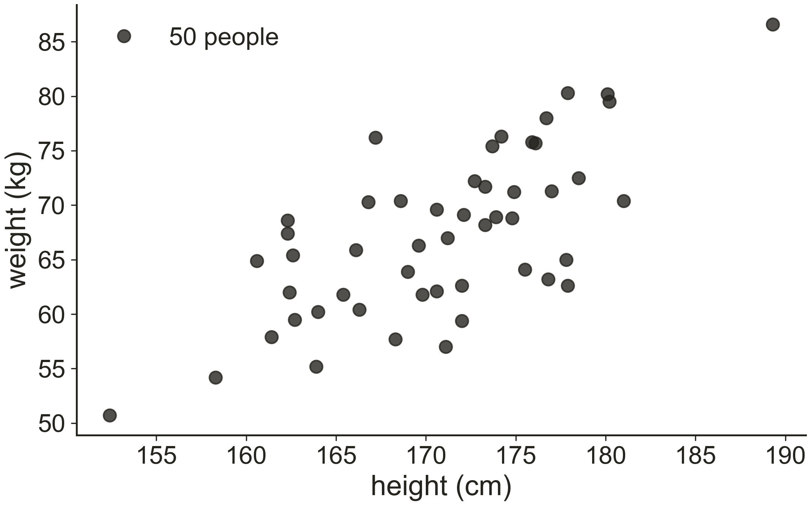{fig-alt="Weight against height for 50 synthetic adults; weight rises with height."}
:::
::: {.column width="43%"}
<br>

Taller people tend to be heavier, but no line passes through every point

- Regression: find the line closest to all the points at once
- … and say how far off it is
:::
::::

::: {.notes}
We start with something everyone understands: height and weight. Each dot is one person. There are 50 people.

[Point to the plot.] Taller people tend to be heavier. But the dots don't sit on one line. They are scattered.

So if I tell you someone is 180 centimeters tall, what average weight would you guess? [Pause.] You probably have a rule in your head. Regression writes that rule down, and it also tells us how wrong the rule is.
:::

## y = β~1~x + β~0~ + ε: data, parameters, error

:::: {.columns}
::: {.column width="55%"}
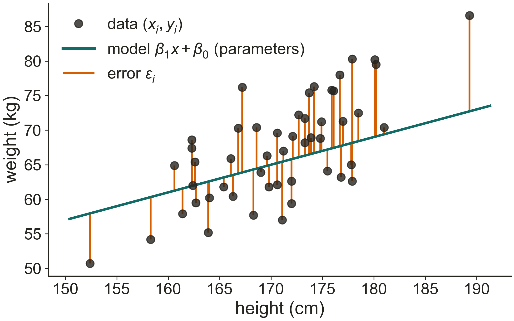{fig-alt="The same people with a guessed straight line and a vertical segment for each person's error."}
:::
::: {.column width="45%"}
**Data** (x~i~, y~i~)<br>[measured, one pair per person]{.dim}

**Parameters** β~0~, β~1~<br>[what we solve for]{.dim}

**Error** ε~i~ = y~i~ − (β~1~x~i~ + β~0~)<br>[what the line misses]{.dim}

[x = height − 170 cm, so β~0~ is the weight of a 170 cm person]{.dim}
:::
::::

::: {.takeaway}
We keep the data and choose the parameters; the errors are what the line misses. This first guess misses by 6.2 kg on average.
:::

::: {.notes}
Here is the model: y equals beta_1 times x, plus beta_0, plus epsilon. It looks like math, but it only has three kinds of things.

First, the data: x and y. Here x is height and y is weight. We measured them. We don't change them.

Second, the parameters: beta zero and beta one. These two numbers set the line: its slope and its level. Learning means choosing these two numbers.

Third, the error: epsilon. It's the part the line misses for each person. [Point to the orange lines.] Each orange line is one person's error.

One small trick: we measure height from 170 centimeters. Then beta zero is simply the weight of a person who is 170 centimeters tall. That's easy to understand.

This line is only a first guess. It misses by about 6 kilograms on average. Can we do better?
:::

## The objective: make the squared errors small

::: {.formula}
$$J(\beta_0, \beta_1) = \sum_i \varepsilon_i^2 = \sum_i (y_i - \beta_1 x_i - \beta_0)^2$$
:::

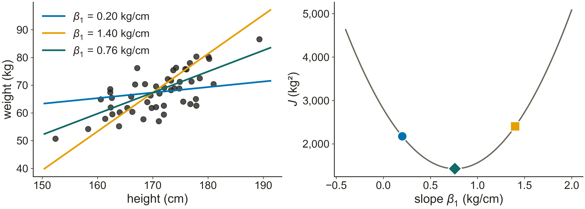{.r-stretch fig-alt="Three candidate lines on the data, and the sum of squared errors against slope: a bowl."}

::: {.takeaway}
The best slope sits at the bottom of the bowl.
:::

::: {.notes}
To find the best line, we need one number that says how good a line is.

Here is the idea: take every error, square it, and add them all up. We call this number J. [Point to the formula.]

Why do we square? Two reasons. First, an error above the line is positive, and an error below the line is negative. If we just add them, they cancel out, and a bad line could get a score of zero. Squaring makes every error count. Second, squaring makes big misses count much more than small ones.

[Point to the left panel.] Here are three lines with different slopes. The blue one is too flat. The orange one is too steep.

[Point to the right panel.] Here is J for every slope. It looks like a bowl. The best slope is at the bottom of the bowl.

So, in one sentence: here, machine learning means finding the parameters at the bottom of the bowl.

If someone asks: why not the absolute value of the errors? You can use it. It's less sensitive to a few very wrong points, but it gives a slightly different line, and there is no one-step formula for it.
:::

## Three ways to find the bottom of the bowl

```{=html}
<div class="pfig" style="width: 1460px">
  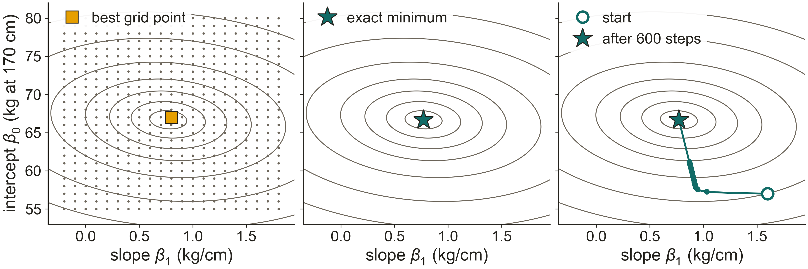
  <span class="pl" style="left: 6.0%; width: 30.5%">Grid search: try them all</span>
  <span class="pl" style="left: 37.6%; width: 30.5%">Inversion: one exact step</span>
  <span class="pl" style="left: 69.2%; width: 30.5%">Iterative: walk downhill</span>
</div>
```

::: {.takeaway}
All three reach β~1~ ≈ 0.77 kg/cm. You can choose the appropriate method for your situation.
:::

::: {.notes}
Now we have two parameters, so the bowl sits on a map of beta zero and beta one. The gray rings are like contour lines on a topographic map. The bottom of the bowl is inside the smallest ring.

How do we find the bottom? There are three ways.

[Left panel.] One: grid search. We try every combination on a grid and keep the best one. Simple and safe. But here it needs 546 tries, and the answer is only as good as the grid. With many parameters, the number of tries explodes.

[Middle panel.] Two: matrix inversion. For a straight-line model, we can compute the bottom exactly, in one step. I'll show you how on the next slide.

[Right panel.] Three: walk downhill. Start anywhere, look which way is down, take a small step, and repeat. Here it took 600 small steps. It's slow, but it works for almost any model. This is how neural networks learn. And k-means, later today, also works step by step.

All three end up at the same place: about 0.77 kilograms per centimeter.
:::

## Matrix inversion: y = Xβ

:::: {.columns}
::: {.column width="62%"}
::: {style="font-size: 0.72em; margin-top: 0.6em"}
$$
\begin{array}{cccccc}
\begin{bmatrix} y_1 \\ 64.9 \\ 63.2 \\ \vdots \\ y_{50} \end{bmatrix} & = &
\begin{bmatrix} 1 & x_1 \\ 1 & -9.4 \\ 1 & 6.8 \\ \vdots & \vdots \\ 1 & x_{50} \end{bmatrix} &
\begin{bmatrix} \beta_0 \\ \beta_1 \end{bmatrix} & + &
\begin{bmatrix} \varepsilon_1 \\ \varepsilon_2 \\ \varepsilon_3 \\ \vdots \\ \varepsilon_{50} \end{bmatrix} \\[6pt]
\mathbf{y} & & X & \boldsymbol\beta & & \boldsymbol\varepsilon \\
\scriptsize\text{weight (kg)} & & \scriptsize\text{ones and } x & \scriptsize\text{parameters} & & \scriptsize\text{errors} \\
\scriptsize 50 \times 1 & & \scriptsize 50 \times 2 & \scriptsize 2 \times 1 & & \scriptsize 50 \times 1
\end{array}
$$
:::

[In Python: `beta = np.linalg.inv(X.T @ X) @ (X.T @ y)`]{.small}
:::
::: {.column width="38%"}
```{=html}
<div style="position: relative; width: 400px">
  
  <span style="position: absolute; left: 75.5%; top: 35.7%; font-size: 0.55em">(x<sub>1</sub>, y<sub>1</sub>)</span>
</div>
```

::: {.small}
The best β, in one step:

$$X^\mathsf{T}X\,\boldsymbol\beta = X^\mathsf{T}\mathbf{y}$$

$$\boldsymbol\beta = (X^\mathsf{T}X)^{-1}X^\mathsf{T}\mathbf{y}$$

**β~0~ = 66.7 kg, β~1~ = 0.77 kg/cm**
:::
:::
::::

::: {.takeaway}
Stacking the 50 equations gives one matrix equation, and β = (X^T^X)^−1^X^T^y is the exact bottom of the bowl, in one step.
:::

::: {.notes}
Here is the one-step method.

We write the line for every person, and we stack all 50 equations on top of each other.

[Point to each block, left to right.] The weights go into one column, y. X has two columns: a column of ones, which goes with beta zero, and a column of heights, which goes with beta one. Then come the two parameters, and the 50 errors.

So 50 equations become one short equation: y equals X times beta, plus epsilon.

The best beta is given by this formula. [Point to the formula.] You don't need to remember how we get it. The important part: it's one line of code, and it gives the exact answer.

For our data, beta zero is 66.7 kilograms, and beta one is 0.77 kilograms per centimeter.

The catch: this trick only works for straight-line models like this one. For other models, we walk downhill instead.

If someone asks: where does the formula come from? At the bottom of the bowl, the bowl is flat, so its slope is zero. If you write that down and solve it, you get this formula.
:::

## The fit: 0.77 kg per cm

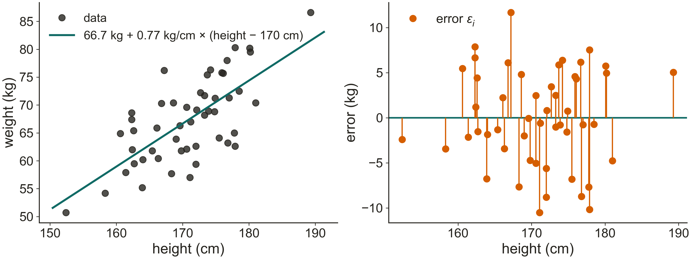{.r-stretch fig-alt="Best-fit line on the data, and the errors against height scattered around zero."}

::: {.takeaway}
Weight = 66.7 kg + 0.77 kg/cm × (height − 170 cm); the errors scatter around zero with no trend left, typically 5.3 kg.
:::

::: {.notes}
Here is our best line. [Point to the left panel.] A person who is 170 centimeters tall weighs about 66.7 kilograms, and every extra centimeter adds about 0.77 kilograms.

Remember, I made the data with 68 kilograms and 0.8. So we are close, but not exactly right. That's normal. 50 people is a small sample.

[Point to the right panel.] This shows the errors of the best line. Always check two things here. First, the errors should be spread around zero. Second, there should be no pattern left, like a curve. If you see a curve, a straight line is the wrong model.

Here it looks fine. A typical error is about 5 kilograms.
:::

## How sure are we? The covariance matrix

:::: {.columns}
::: {.column width="58%"}
```{=html}
<div class="pfig" style="width: 880px">
  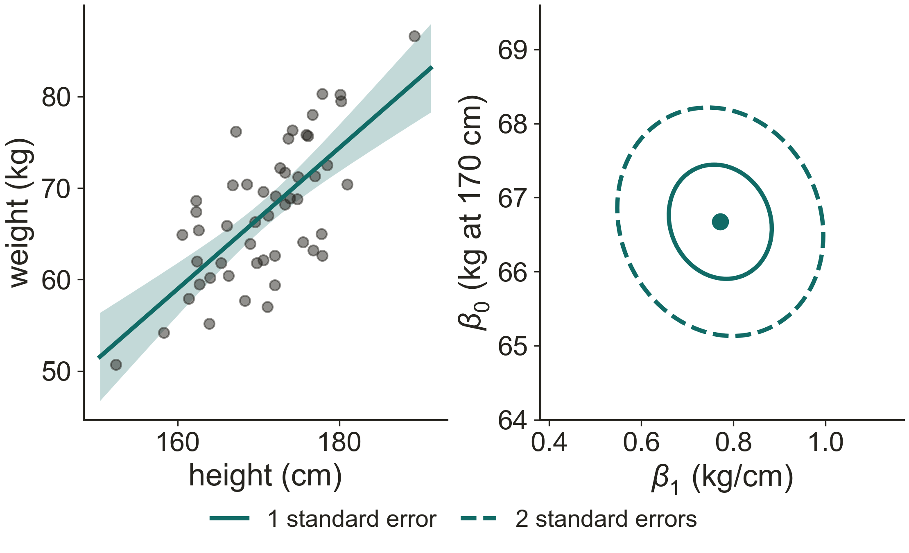
  <span class="pl" style="left: 9.2%; width: 40.0%">On the data</span>
  <span class="pl" style="left: 59.4%; width: 40.0%">In parameter space</span>
</div>
```
:::
::: {.column width="42%"}
<br>

$$C = \sigma^2 (X^\mathsf{T}X)^{-1}$$

[σ = 5.4 kg: spread of the errors]{.dim}

standard errors = √(diagonal of C):

**β~0~ = 66.7 ± 0.8 kg**<br>**β~1~ = 0.77 ± 0.11 kg/cm**

[off-diagonal: β~0~, β~1~ trade-off]{.dim}
:::
::::

::: {.takeaway}
β~1~ = 0.77 ± 0.11 kg/cm (one standard error); two standard errors, 0.55 to 0.99 kg/cm, is about a 95% confidence interval.
:::

::: {.notes}
Next question: how sure are we about this line? Our 50 people are the only data we have, so we take them as our truth. From how far the points sit from the line, we can say how sure we are. That gives us an uncertainty and a confidence interval.

The covariance matrix answers this with one formula. [Point to the formula.] Sigma is the typical size of the errors, about 5.4 kilograms.

From this matrix we get the standard error of each parameter. So the slope is 0.77, plus or minus 0.11 kilograms per centimeter.

[Point to the left panel.] The shaded band shows the lines that are still believable. It's narrow in the middle, where we have lots of data, and wider at the ends.

[Point to the right panel.] This is the same idea, drawn on a map of the two parameters. The dot is our best line. The solid ellipse is one standard error, and the dashed ellipse is two standard errors.

Two standard errors is about a 95% confidence interval. For the slope, that is 0.77 plus or minus 0.22, so from about 0.55 to 0.99 kilograms per centimeter. [Point to the bottom line.]

If someone asks: why divide by n minus 2? Because we used the same data to fit two numbers, so we have two fewer free pieces of information.
:::

## How sure are we? The bootstrap

:::: {.columns}
::: {.column width="58%"}
```{=html}
<div class="pfig" style="width: 880px">
  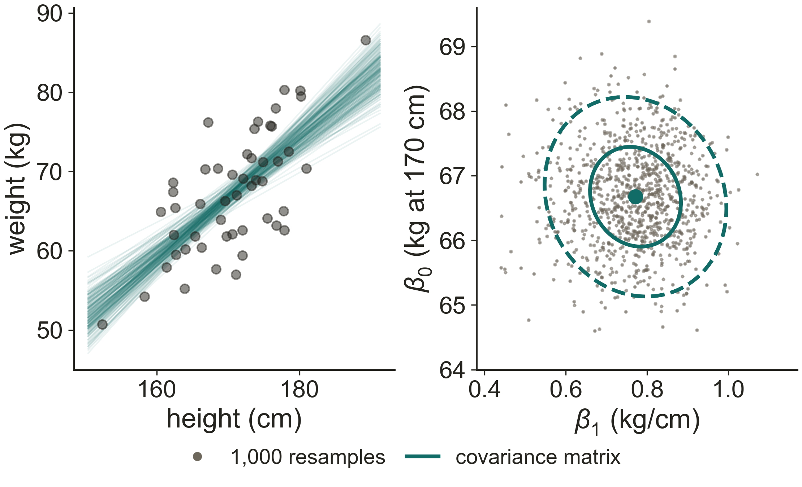
  <span class="pl" style="left: 9.2%; width: 40.0%">200 of 1,000 refits</span>
  <span class="pl" style="left: 59.4%; width: 40.0%">In parameter space</span>
</div>
```
:::
::: {.column width="42%"}
::: {.small}
Original samples: (x~1~, x~2~, x~3~, x~4~, x~5~, …, x~50~)<br>
Bootstrap samples: (x~3~, x~3~, x~4~, x~6~, x~8~, …, x~47~)
:::

::: {style="font-size: 0.85em"}
1. Draw 50 people from the 50, with replacement
2. Fit the line again
3. Repeat 1,000 times
4. The spread of the 1,000 fits is the uncertainty

**β~1~ ± 0.106 kg/cm: bootstrap**<br>**β~1~ ± 0.112 kg/cm: formula**
:::
:::
::::

::: {.takeaway}
Refitting 1,000 resamples gives ± 0.106 kg/cm for the slope, close to the ± 0.112 kg/cm of the formula.
:::

::: {.notes}
The formula on the last slide assumes a few things about the errors. The bootstrap is another way to get the uncertainty, with almost no assumptions. It's a simple trick: repeat many times.

Here is the recipe. [Point to the steps.] One: from our 50 people, pick 50 people at random, and allow repeats. So some people appear twice, and some don't appear at all. Two: fit the line again. Three: do this 1,000 times. Four: look at how much the 1,000 lines spread out. That spread is our uncertainty.

[Point to the left panel.] Here are 200 of these lines. [Point to the right panel.] And here are all 1,000 results on the parameter map. They fill the same ellipses as before.

The bootstrap says plus or minus 0.106. The formula said 0.112. They agree.

Why use the bootstrap? Because it works for almost anything, even when there is no formula. And computers are fast.

Quick question: if we had 200 people instead of 50, would the spread get bigger or smaller? [Pause.] Smaller. About half.
:::

## Many inputs: rock density from chemistry

[Synthetic rock table of notebook 3.2 (mlgeo_synth): 5,000 rocks, 7 major-element oxides (wt%), density]{.dim}

:::: {.columns}
::: {.column width="56%"}
```{=html}
<div class="photo-row">
  <figure>
    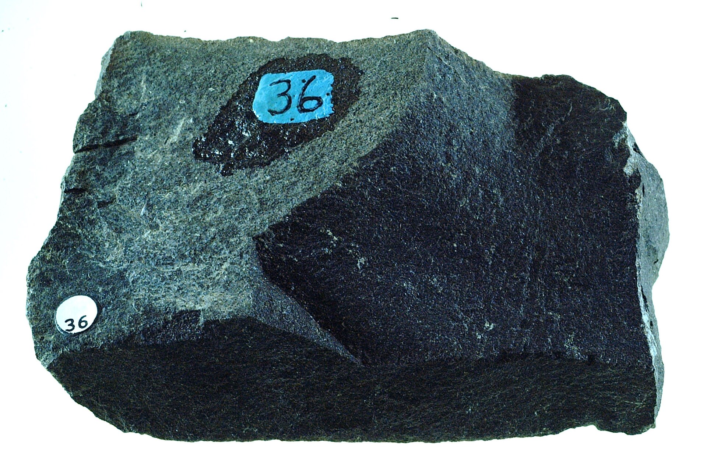
    <figcaption><b>Basalt</b><br>~49 wt% SiO<sub>2</sub> · ~2.95 g/cm<sup>3</sup></figcaption>
  </figure>
  <figure>
    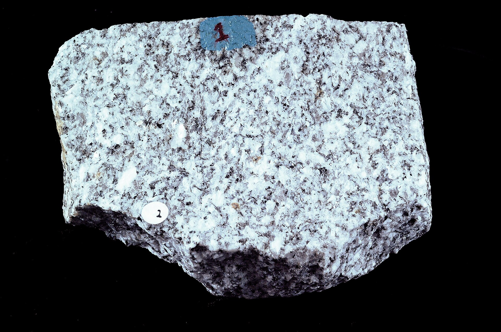
    <figcaption><b>Granite</b><br>~72 wt% SiO<sub>2</sub> · ~2.65 g/cm<sup>3</sup></figcaption>
  </figure>
</div>
```

::: {.credit}
Photos: GeoDIL 140 (M. Davis) and 18 (D. Perkins), CC0, via Wikimedia Commons
:::
:::
::: {.column width="44%"}
::: {.small}
density = β~0~ + β~1~SiO~2~ + β~2~Al~2~O~3~ + … + β~7~K~2~O + ε
:::

- One β per oxide: how much density changes per wt% of that oxide
- Basalt: rich in FeO, MgO, CaO, dense
- Granite: rich in SiO~2~, K~2~O, light
:::
::::

::: {.takeaway}
Same y = Xβ + ε, with 8 columns in X (a column of ones and 7 oxides) and 5,000 rows.
:::

::: {.notes}
Now let's go back to geoscience. These two rocks are basalt and granite. [Point to the photos.]

Basalt is dark and heavy. It has less silica and more iron, magnesium, and calcium. Its density is about 2.95 grams per cubic centimeter.

Granite is light in color and lighter in weight. It has a lot of silica and potassium. Its density is about 2.65.

Our table has 5,000 rocks: basalt, granite, and andesite, which sits in between. For each rock, we know seven oxides, in weight percent, and the density. This is the same table you used in notebook 3.2.

Question: can we predict density from the chemistry?

Good news: the model is the same as before. We just have more inputs, with one beta for each oxide. [Point to the equation.]

In matrix form, nothing changes. X now has 8 columns: a column of ones, plus the 7 oxides. And the same one-line formula gives us all 8 numbers.
:::

## Seven oxides predict density; SiO~2~ alone nearly as well

```{=html}
<div class="crop-row" aria-label="Predicted against measured density with all seven oxides, and density against SiO2 for basalt, andesite and granite.">
  <div class="crop" style="width: 650px">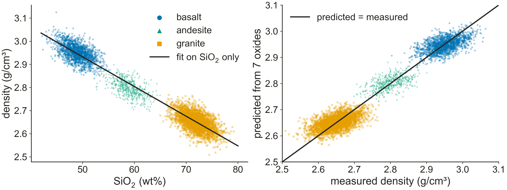</div>
  <div class="crop" style="width: 637px"></div>
</div>
```

::: {.takeaway}
Mean absolute error: 0.132 g/cm^3^ with no inputs, 0.025 with SiO~2~ alone, 0.025 with all 7 oxides. The oxides repeat each other.
:::

::: {.notes}
[Point to the left panel.] Here we use all seven oxides. The x-axis is the measured density, and the y-axis is the predicted density. Points close to the black line are good predictions.

[Point to the right panel.] Now just one input: density goes down as silica goes up. This one input already explains a lot.

Now look at the numbers. If we always guess the average density, we miss by 0.13 on average. With silica alone, we miss by 0.025. With all seven oxides, we also miss by 0.025.

So six extra columns help almost nothing. Why? Because the oxides move together. A rock with little silica has a lot of iron, magnesium, and calcium. The extra columns repeat what silica already told us.

Please remember this: many columns does not mean much new information. This is the reason for PCA at the end of today.
:::

## Part 2 · k-means clustering {background-color="#faf7f2" .center}

Find groups in data that come without answers

::: {.dim}
1 Regression · **2 k-means clustering** · 3 PCA
:::

::: {.notes}
That's the end of part one. Now, part two: k-means clustering.

Up to now, every example came with an answer, like weight or density. Now we take the answers away. What can we still learn?
:::

## Unsupervised learning: no answer column

```{=html}
<div class="pfig" style="width: 1460px">
  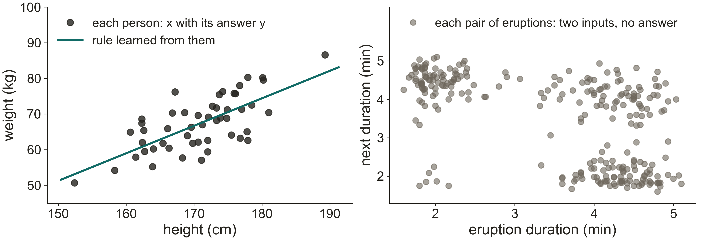
  <span class="pl" style="left: 6.7%; width: 43.4%">Supervised: every x comes with its y</span>
  <span class="pl" style="left: 55.4%; width: 43.4%">Unsupervised: inputs only</span>
</div>
```

::: {.takeaway}
Without answers the question changes: which samples belong together (clustering), and which directions carry the information (PCA)?
:::

::: {.notes}
Everything so far was supervised learning. [Point to the left panel.] Every person came with an answer, the weight, and we learned a rule from x to y.

[Point to the right panel.] Now look at this. These are eruptions of a geyser. Each point has two numbers, but there is no answer column. There is nothing to predict.

So the question changes. Which points belong together? That's called clustering. And which directions in the data carry the most information? That's PCA, our part three.

Let me ask you: how many groups do you see on the right? [Pause.] Most people see three. Some people also notice a few points in the lower-left corner. Keep your answer in mind.
:::

## Old Faithful: two eruption regimes

[Old Faithful geyser, Yellowstone: 271 pairs of consecutive eruptions (Azzalini & Bowman 1990)]{.dim}

:::: {.columns}
::: {.column width="40%"}
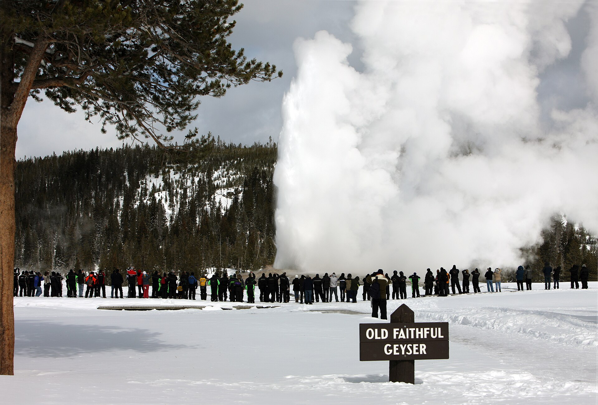{fig-alt="Old Faithful erupting in winter, with visitors behind a sign."}

::: {.credit}
Photo: NPS / Yellowstone National Park, public domain
:::
:::
::: {.column width="60%"}
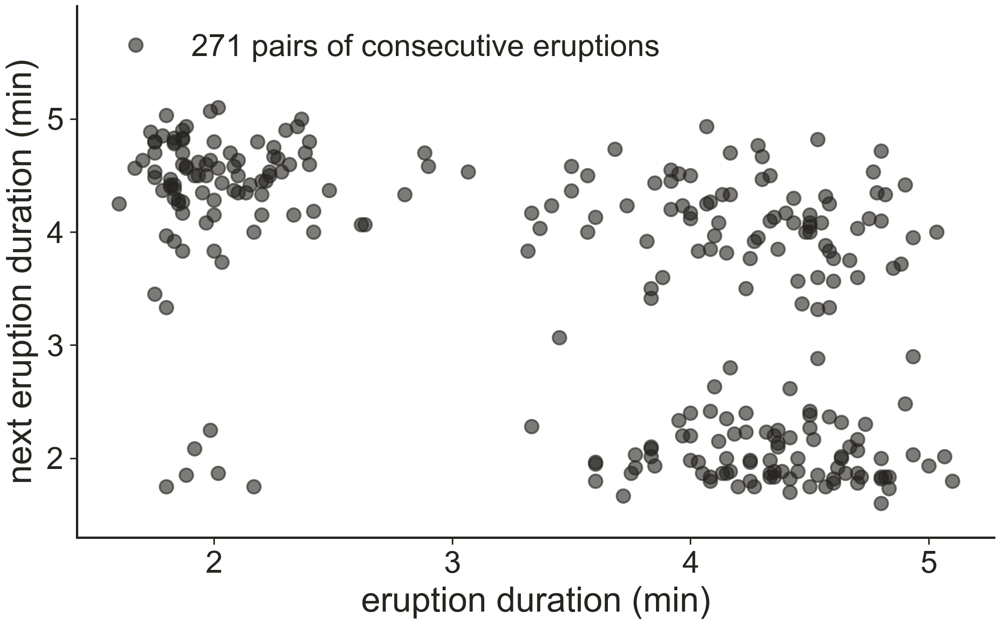{fig-alt="Next eruption duration against eruption duration for 271 Old Faithful pairs: three main groups and a rare fourth." height="500px"}
:::
::::

::: {.takeaway}
One sample is a pair of consecutive eruptions. Two regimes, short (~2 min) and long (~4.3 min), make three common kinds of pair; short then short happened only 6 times.
:::

::: {.notes}
This is Old Faithful, a famous geyser in Yellowstone. It erupts about every hour to hour and a half.

It has two kinds of eruptions: short ones, about 2 minutes, and long ones, a bit over 4 minutes.

In our data, one sample is a pair: one eruption and the next one. [Point to the axes.] The x-axis is how long one eruption lasted. The y-axis is how long the next eruption lasted.

Two kinds of eruptions give four kinds of pairs. [Point to each corner.] Short then long, up here. Long then long, here. Long then short, down here. And short then short, in this corner: only 6 pairs.

Question: after a short eruption, what comes next? [Pause.] Almost always a long one, 94 percent of the time. One common explanation: a short eruption does not empty the geyser, so the next one is long.

Nobody labeled these pairs. Can a computer find the groups by itself?
:::

## How k-means works: assign, update, repeat

::: {.formula}
distance: d(x, μ) = √[(x~1~ − μ~1~)^2^ + (x~2~ − μ~2~)^2^] &nbsp; on standardized durations
:::

```{=html}
<div class="r-stack">
  <div class="pfig fragment fade-out" data-fragment-index="1" style="width: 1460px">
    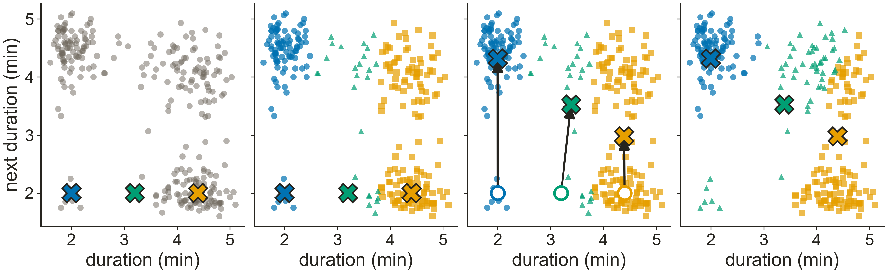
    <span class="pl" style="left: 4.6%; width: 22.9%">1. Start: 3 centers</span>
    <span class="pl" style="left: 28.7%; width: 22.9%">2. Assign to nearest</span>
    <span class="pl" style="left: 52.7%; width: 22.9%">3. Move to the mean</span>
    <span class="pl" style="left: 76.7%; width: 22.9%">4. Assign again</span>
  </div>
  <div class="pfig fragment" data-fragment-index="1" style="width: 1460px">
    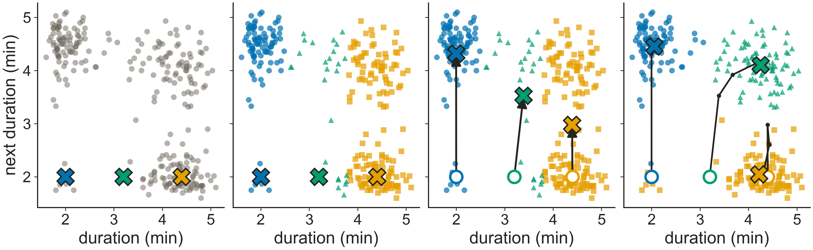
    <span class="pl" style="left: 4.6%; width: 22.9%">1. Start: 3 centers</span>
    <span class="pl" style="left: 28.7%; width: 22.9%">2. Assign to nearest</span>
    <span class="pl" style="left: 52.7%; width: 22.9%">3. Move to the mean</span>
    <span class="pl" style="left: 76.7%; width: 22.9%">4. Repeat until stable</span>
  </div>
</div>
```

::: {.takeaway}
Each step lowers J = Σ d(x~i~, μ)^2^, the total squared distance to the centers; after 5 updates each center sits in one of the three common kinds of pair.
:::

::: {.notes}
Here is k-means in four pictures. We ask for K equals 3 groups.

First, we need a way to measure "close." We use the normal straight-line distance. That's the formula at the top. It's just Pythagoras.

One detail: before we measure distance, we put every column on the same scale. Here both columns are in minutes, so it doesn't change much. But it matters a lot when the columns have different units.

Now the steps. [Panel 1.] Start: put three centers somewhere. Here I put them by hand, in a row along the bottom.

[Panel 2.] Assign: every point joins the closest center. Look at the orange squares. The orange center takes all the pairs on the right, top and bottom.

[Panel 3.] Update: each center moves to the middle of its points. See the arrows. Orange moves up, to the middle between its two groups.

[Panel 4.] Now we assign again, with the new centers. Look at the top right. Many orange squares became green triangles, because the green center is now closer to them. The few pairs at the bottom left turn green too, because blue moved away from them. In total, 50 pairs changed group.

[Click.] We just keep going: update, assign, update, assign, until nothing changes. The black lines show the path of each center.

Here it took only 5 rounds. The green center keeps climbing and takes the top group, and orange goes back down to the bottom group. In the end, each center sits in one of the three common kinds of pairs.

Every step makes J smaller. J is the total squared distance from each point to its center. It's the same idea as the squared errors in part one.
:::

## K = 1, 2, 3, 4: the centers walk to their groups

```{=html}
<div class="pfig" style="width: 1460px">
  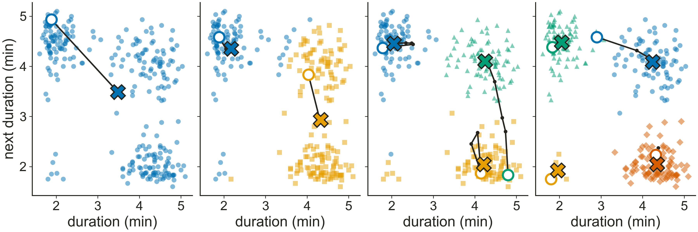
  <span class="pl" style="left: 4.6%; width: 22.9%">K = 1 · 1 update</span>
  <span class="pl" style="left: 28.7%; width: 22.9%">K = 2 · 4 updates</span>
  <span class="pl" style="left: 52.7%; width: 22.9%">K = 3 · 5 updates</span>
  <span class="pl" style="left: 76.7%; width: 22.9%">K = 4 · 3 updates</span>
</div>
```

::: {.takeaway}
K = 3 finds the three common kinds of pair, K = 4 also the 6 rare short-short pairs
:::

::: {.notes}
Now let's try K equals 1, 2, 3, and 4. The hollow circles show where the centers start, and the crosses show where they end.

With K equals 1, the one center just goes to the middle of everything. With K equals 2, we get short-first versus long-first. With K equals 3, we get the three common kinds of pairs. And with K equals 4, the fourth center finds the 6 rare short-short pairs.

Two warnings. First: k-means always gives you exactly K groups, even if the data don't really have K groups. So choosing K is our job.

Second: the result depends on where you start. A bad start can get stuck. For K equals 3, a bad start stopped at J equals 184, and a good start reached 74. So in practice, we run k-means many times from different starts, and keep the best one. Here I used 20 starts.
:::

## Each center owns a region

```{=html}
<div class="pfig" style="width: 1460px">
  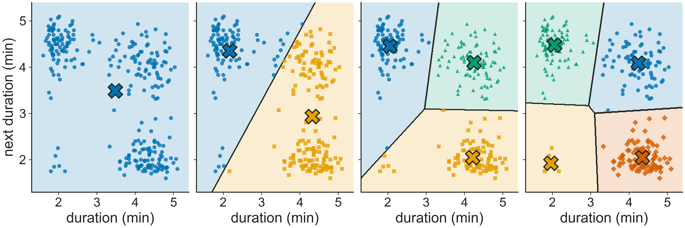
  <span class="pl" style="left: 4.6%; width: 22.9%">K = 1</span>
  <span class="pl" style="left: 28.7%; width: 22.9%">K = 2</span>
  <span class="pl" style="left: 52.7%; width: 22.9%">K = 3</span>
  <span class="pl" style="left: 76.7%; width: 22.9%">K = 4</span>
</div>
```

::: {.takeaway}
Every point of the plane goes to its nearest center, so the borders are straight lines halfway between centers: a Voronoi diagram (further study).
:::

::: {.notes}
Here is another way to look at k-means. Every spot on the map, not only our data, belongs to its closest center. So each center owns a region.

The border between two centers is a straight line, exactly halfway between them.

With K equals 4, the map is cut into four regions, one for each kind of pair. If a new pair falls in the lower-left region, we would call it short then short.

This kind of map has a name: a Voronoi diagram. You may have seen one before, for example as the area closest to each weather station or seismic station. It's a good topic for further study.

This also means that k-means groups are always round clumps. k-means cannot find a ring or a long curved band.
:::

## Choosing K: the elbow

```{=html}
<div class="crop-row">
  <div class="crop" style="width: 756px; overflow: visible">
    <div class="crop" style="width: 756px">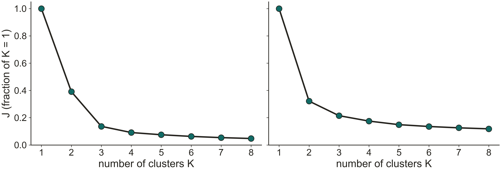</div>
    <span class="pl" style="left: 11.8%; width: 87.6%">Old Faithful</span>
  </div>
  <div class="fragment" style="position: relative; width: 691px">
    <div class="crop" style="width: 691px"></div>
    <span class="pl" style="left: 3.3%; width: 95.8%">Rocks: 7 oxides</span>
    <div class="crop" style="position: absolute; right: 1%; top: 2%; width: 352px; border: 1px solid #d9d3c7">
      
    </div>
  </div>
</div>
```

::: {.takeaway}
J always drops as K grows. Old Faithful bends at K = 3 or 4; the rocks bend at K = 2, yet hold 3 rock types. Further study: silhouette score.
:::

::: {.notes}
Now, how do we choose K?

J, the total distance to the centers, always goes down when we add more centers. If every point gets its own center, J is zero. So we can't just pick the smallest J.

The elbow method: plot J against K, and look for the bend, the "elbow." After the bend, adding more centers doesn't help much.

[Point to the left panel.] For Old Faithful, the bend is at K equals 3. But we know there are four kinds of pairs. The fourth group is so small, only 6 pairs, that it hardly changes J.

[Click.] [Point to the right panel.] For the rocks, the bend is at 2. But there are three rock types. Andesite is only 10 percent of the rocks, and it sits between the other two.

So the elbow is a judgment. Two people can look at the same curve and pick a different K. And small groups can hide.

For further study, look at the silhouette score. It's another way to choose K.
:::

## Part 3 · Principal component analysis {background-color="#faf7f2" .center}

PCA: find the few directions that carry most of the information

::: {.dim}
1 Regression · 2 k-means clustering · **3 PCA**
:::

::: {.notes}
That brings us to part three: principal component analysis, or PCA.

We saw that the rock table has many columns that repeat each other. PCA finds a few new columns that keep most of the information.
:::

## Rock chemistry without labels: 7 numbers per rock

:::: {.columns}
::: {.column width="58%"}
[Major-element oxides (wt%), first 8 of 5,000 rocks]{.dim}

::: {.tbl-sm}
| rock | SiO~2~ | Al~2~O~3~ | FeO | MgO | CaO | Na~2~O | K~2~O |
|---:|---:|---:|---:|---:|---:|---:|---:|
| 0 | 46.5 | 15.5 | 10.9 | 8.4 | 12.4 | 2.0 | 0.2 |
| 1 | 74.7 | 12.8 | 0.4 | 0.0 | 0.1 | 3.8 | 5.2 |
| 2 | 46.9 | 15.2 | 10.6 | 8.1 | 12.7 | 3.1 | 0.8 |
| 3 | 48.3 | 15.3 | 10.3 | 6.9 | 11.8 | 2.5 | 0.0 |
| 4 | 73.7 | 14.2 | 1.4 | 0.0 | 0.0 | 4.5 | 5.4 |
| 5 | 61.5 | 16.1 | 6.3 | 2.8 | 5.2 | 3.7 | 2.5 |
| 6 | 47.3 | 15.0 | 11.0 | 8.0 | 11.9 | 3.3 | 1.0 |
| 7 | 51.4 | 14.2 | 8.9 | 5.6 | 10.8 | 4.0 | 1.1 |
:::
:::
::: {.column width="42%"}
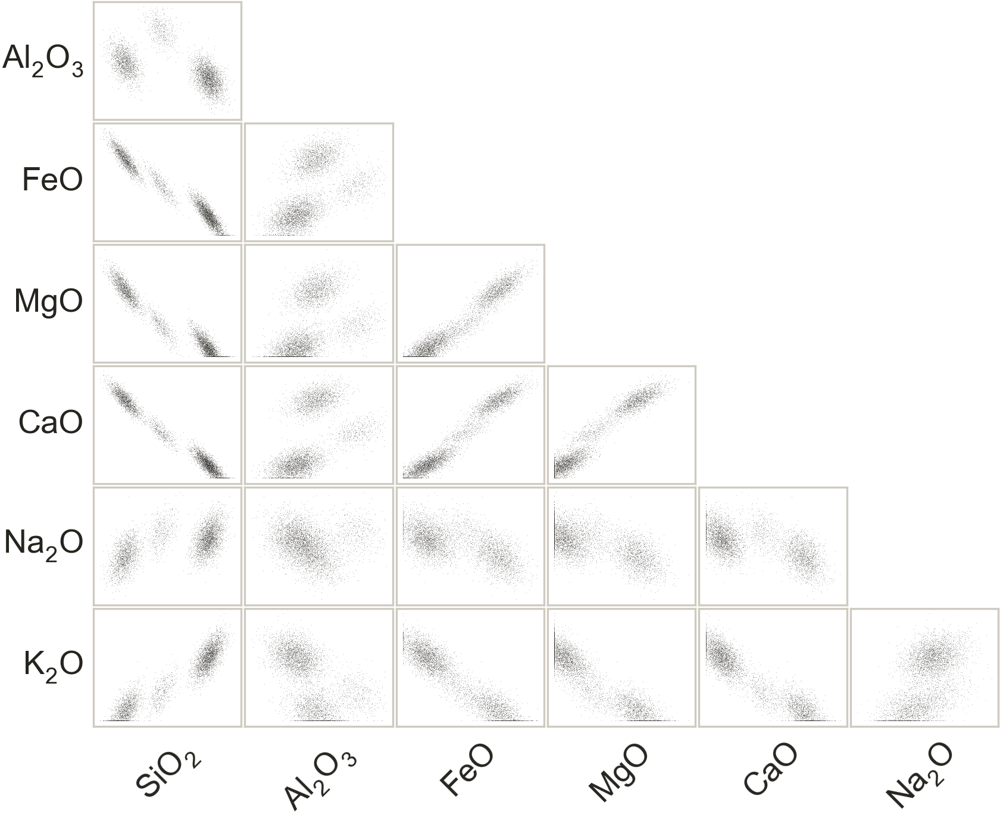{fig-alt="Scatter plots of all 21 pairs of seven oxides."}
:::
::::

::: {.takeaway}
Each rock is a point in 7 dimensions: no single plot shows it, and there are 21 pairs of oxides to look at.
:::

::: {.notes}
Let's go back to the rocks, and this time we hide the rock type.

[Point to the table.] Here are the first eight rocks. Each rock has seven numbers. So each rock is a point in seven dimensions, and we can't draw that.

[Point to the right.] To look at the data, we would need to plot every pair of oxides. That's 21 small plots. Some show three clouds, some show two, and some show just one line.

No single picture shows the whole story. But k-means measures distance with all seven numbers at once.

Look at these small plots. Which pairs seem to say the same thing? [Pause.] The ones that look like a straight line.
:::

## Why reduce the dimension first?

```{=html}
<div class="pfig" style="width: 1460px; margin-top: 0.4em">
  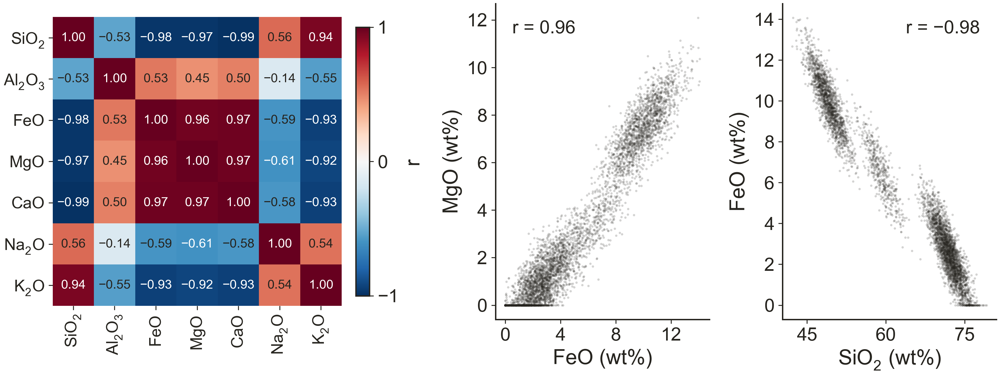
  <div class="overlay fragment fade-out" style="left: 40%; top: 0; width: 60%; height: 100%">
    <p style="font-weight: 700; color: #116b66">Pearson correlation coefficient</p>
    <p class="small">\[r = \frac{\sum_i (x_i - \bar x)(y_i - \bar y)}{\sqrt{\sum_i (x_i - \bar x)^2}\,\sqrt{\sum_i (y_i - \bar y)^2}}\]</p>
    <p class="small">r = +1: the two rise together on a straight line<br>r = 0: no straight-line link<br>r = −1: one rises as the other falls</p>
  </div>
</div>
```

::: {.takeaway}
FeO and MgO rise together (r = 0.96), SiO~2~ and FeO move opposite (r = −0.98): each such pair holds about one number of information in two columns.
:::

::: {.notes}
[Point to the formula.] First, how do we measure "linked"? The Pearson correlation coefficient, r. It goes from minus 1 to plus 1. Plus 1: the two rise together on a straight line. Zero: no straight-line link. Minus 1: one rises as the other falls.

[Point to the left panel.] This shows the correlation between every pair of oxides. Dark red means the two go up together. Dark blue means one goes up when the other goes down.

Most of this picture is dark. So most oxides are strongly linked.

[Click.] [Point to the middle panel.] For example, iron and magnesium rise together, with a correlation of 0.96. [Point to the right panel.] Silica and iron go in opposite directions: minus 0.98.

When two columns are this strongly linked, they hold about one number's worth of information in two columns.

Why is that a problem? Two reasons. First, k-means counts the same information twice in its distance. Second, it's hard to see the structure in so many plots.

But not every pair repeats. Silica and aluminum are much less strongly linked, so aluminum still carries its own information.

If someone asks about the flat row of points at zero magnesium: that's a quirk of this made-up table. It sets negative values to zero.
:::

## PCA: the best axis mixes the old ones

::: {.formula}
PC1 = −0.62 SiO~2~ + 0.48 Al~2~O~3~ + 0.62 FeO
:::

```{=html}
<div class="pfig" style="width: 1300px">
  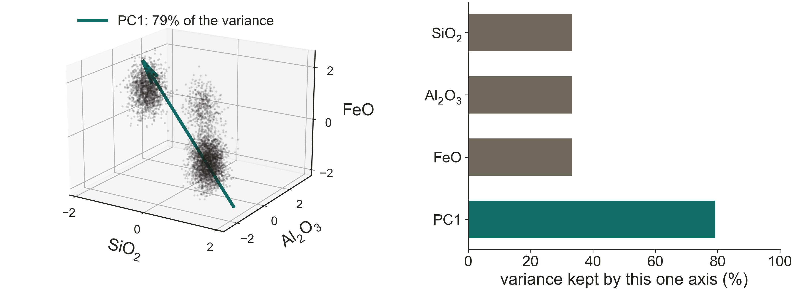
  <span class="pl" style="left: 8.3%; width: 31.1%">Three oxides, one new axis</span>
  <span class="pl" style="left: 58.9%; width: 39.2%">Variance kept by one axis</span>
</div>
```

[Variance is a number for how spread out the data are.]{.dim}

::: {.takeaway}
Picking one oxide keeps 33% of the variance; PC1, a weighted mix of all three, keeps 79%.
:::

::: {.notes}
Here is the idea of PCA. Let's use just three oxides, so we can draw them: silica, aluminum oxide, and iron oxide.

Question: what is the single best axis to describe these rocks?

One option is to pick one oxide, like silica. After we put the oxides on the same scale, each one keeps one third of the total spread: 33 percent. [Point to the gray bars.]

PCA does something smarter. It doesn't pick one axis. It makes a new axis by mixing all three. [Point to the formula.] PC1 equals minus 0.62 times silica, plus 0.48 times aluminum oxide, plus 0.62 times iron oxide.

[Point to the left panel.] Here is that new axis, in green. It cuts diagonally through the cloud, along its longest direction. It's not along any edge of the box.

PCA chooses the mix so that the rocks spread out as much as possible along the new axis. The result: this one axis keeps 79 percent of the spread. Much better than 33.

That's the main idea of PCA: the best axis is a mix of the old ones.

In plain words, PC1 goes from rocks with lots of silica, like granite, to rocks with lots of iron, like basalt.

If someone asks how the computer finds the mix: it uses a standard matrix method called eigenvectors of the covariance matrix. You don't need to do it by hand.
:::

## PC1 and PC2: three numbers become two

::: {.formula}
PC2 = 0.34 SiO~2~ + 0.88 Al~2~O~3~ − 0.33 FeO, at right angles to PC1
:::

```{=html}
<div class="pfig" style="width: 1300px">
  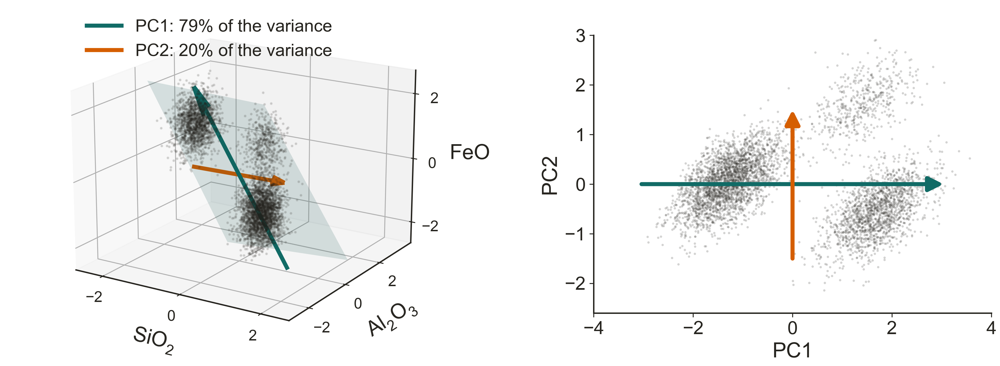
  <span class="pl" style="left: 7.1%; width: 34.2%">PC1 and PC2 span a plane</span>
  <span class="pl" style="left: 59.4%; width: 39.8%">Rocks projected onto the plane</span>
</div>
```

::: {.takeaway}
PC1 and PC2 keep 99% of the variance of SiO~2~, Al~2~O~3~ and FeO; only PC3 (1%), across the plane, is dropped.
:::

::: {.notes}
Now we find a second axis, PC2. It's the next best direction, at a right angle to PC1. [Point to the formula.] It's mostly aluminum oxide.

[Point to the left panel.] Together, PC1 and PC2 make a flat sheet, this shaded plane. Almost all the rocks lie close to this sheet. The cloud is nearly flat.

These two axes keep 99 percent of the spread. Only 1 percent is left, in the direction that sticks out of the sheet. That's PC3, and we can drop it.

[Point to the right panel.] Now we lay every rock flat onto that sheet. Each rock now has two numbers instead of three. And the three groups are still clearly apart.

Which group is high on PC2? [Pause.] The group at the top: the andesites, which have more aluminum.

PCA does exactly the same thing with any number of columns. Next, all seven oxides.
:::

## PCA on seven oxides: two axes keep 91%

```{=html}
<div class="pfig" style="width: 1460px">
  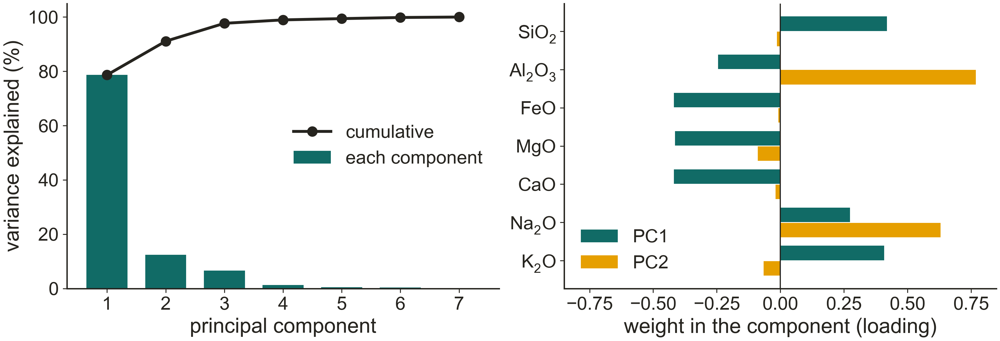
  <span class="pl" style="left: 6.7%; width: 43.2%">Variance kept by each axis</span>
  <span class="pl" style="left: 56.4%; width: 43.2%">What PC1 and PC2 measure</span>
</div>
```

::: {.takeaway}
PC1 (79%) sets SiO~2~, K~2~O, Na~2~O against FeO, MgO, CaO: the mafic-to-felsic axis. PC2 (12%) is mostly Al~2~O~3~ and Na~2~O.
:::

::: {.notes}
Now we use all seven oxides.

[Point to the left panel.] Each bar shows how much of the spread one new axis keeps. PC1 keeps 79 percent, and PC2 keeps 12 percent. Together, 91 percent. The last four axes together keep less than 3 percent.

[Point to the right panel.] These bars show the recipe of each axis: how much of each oxide goes into it.

PC1 puts silica, potassium, and sodium on one side, and iron, magnesium, and calcium on the other side. Geologists know this axis well. It goes from mafic rocks, like basalt, to felsic rocks, like granite. PC2 is mostly aluminum and sodium. It picks out the andesites.

A small note: here PC1 goes up with silica, but in the 3-D example it went down with silica. That's okay. An axis can point either way. It's still the same axis.

Quick question: which axis would you use to tell basalt from granite? [Pause.] PC1.
:::

## The table shrinks from 7 columns to 2

:::: {.columns}
::: {.column width="34%"}
[Same 8 rocks]{.dim}

::: {.tbl-sm}
| rock | PC1 | PC2 |
|---:|---:|---:|
| 0 | −3.72 | −0.41 |
| 1 | 3.14 | −0.77 |
| 2 | −3.05 | 0.23 |
| 3 | −3.16 | −0.04 |
| 4 | 2.96 | 0.69 |
| 5 | −0.24 | 1.44 |
| 6 | −2.85 | 0.27 |
| 7 | −1.66 | 0.33 |
:::
:::
::: {.column width="66%"}
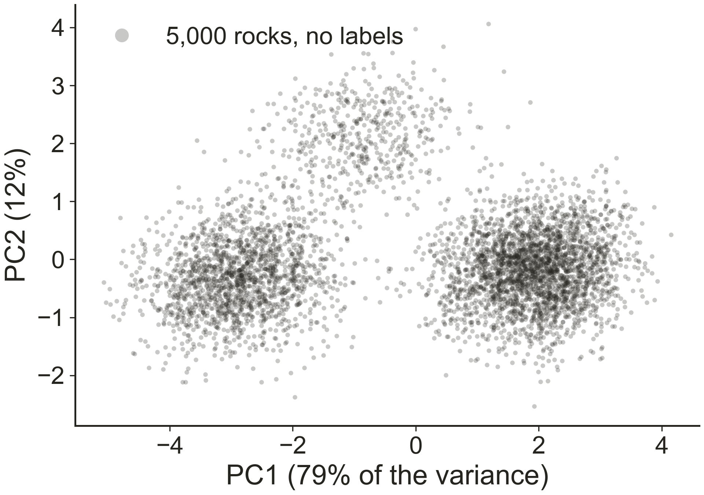{fig-alt="5,000 rocks on PC1 and PC2, without labels, in three groups." height="560px"}
:::
::::

::: {.takeaway}
The same 5,000 rocks, 2 numbers each instead of 7, with 91% of the variance kept: the table fits in one picture, and three groups appear.
:::

::: {.notes}
Here is the payoff.

[Point to the table.] These are the same eight rocks as before. Before, each rock had seven numbers. Now each rock has two, and we kept 91 percent of the information.

You can already read the rock types from these numbers. Rocks with PC1 around minus 3 are basalts. Rocks around plus 3 are granites. Rock number 5 has a high PC2: that's an andesite.

[Point to the right panel.] And here are all 5,000 rocks, with just these two numbers. Still no labels.

For the first time, the whole table fits in one picture, and we can see three groups with our own eyes. Now k-means has an easy job.
:::

## k-means (K = 3) on PC1 and PC2

```{=html}
<div class="pfig" style="width: 1460px">
  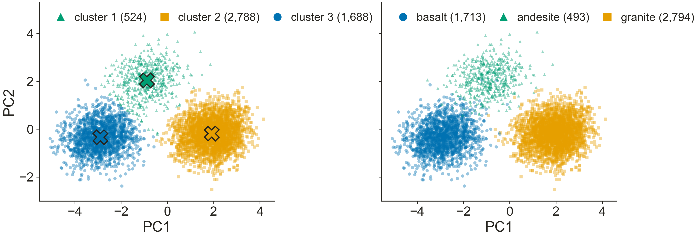
  <span class="pl" style="left: 5.6%; width: 33.7%">k-means, no labels</span>
  <span class="pl" style="left: 54.8%; width: 33.7%">The hidden rock types</span>
</div>
```

::: {.takeaway}
99.0% of the rocks land in the cluster of their own type (99.4% with all 7 oxides): PCA kept the grouping with 2 numbers instead of 7, and made it visible.
:::

::: {.notes}
So let's run k-means with K equals 3 on these two numbers.

[Point to the left panel.] These are the three clusters k-means found, with no labels at all. [Point to the right panel.] And these are the true rock types, which we kept hidden until now.

They look almost the same. 99 percent of the rocks land in the cluster of their own type. The few mistakes are at the border between basalt and andesite.

Let me be honest about one thing. If we run k-means on all seven oxides directly, we also get about 99 percent. These three rock types are very different, so this is an easy case.

So what did PCA give us? The same answer with two numbers instead of seven. A picture we can check with our own eyes. And axes with a clear geological meaning. With messier data, with many repeated columns, reducing first also helps the clustering itself.

And notice: we used the labels only at the very end, to check the result. Never to build it. That's what makes this unsupervised.
:::

## A harder case: seismic sources classification

[Pacific Northwest seismic events, 61 waveform features (Kharita et al. 2026, *Seismica*; Zenodo 14025693)]{.dim}

```{=html}
<div class="pfig" style="width: 1400px">
  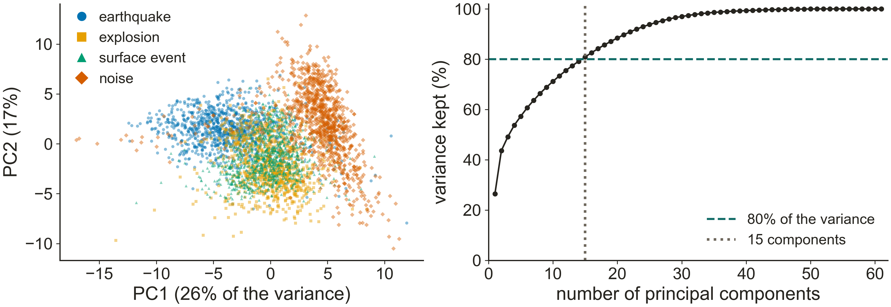
  <span class="pl" style="left: 6.7%; width: 40.8%">4,000 seismic events on PC1 and PC2</span>
  <span class="pl" style="left: 54.8%; width: 44.8%">15 components correspond to 80% of the variance</span>
</div>
```

::: {.takeaway}
PC1 keeps only 26% of the variance, and 15 of the 61 axes are needed for 80%. Explosions and surface events still overlap.
:::

::: {.notes}
Our rocks were an easy case. Let's look at a real, harder one.

These are 4,000 events recorded by the Pacific Northwest Seismic Network. Analysts labeled 1,000 of each type: earthquakes, explosions, surface events like rockfalls, and noise. For each event, we have 61 numbers computed from its waveform.

We do the same steps as with the rocks: put the columns on the same scale, and run PCA.

[Point to the left panel.] Here are the events on the first two PCA axes. The colors are the analyst labels, only for viewing. Earthquakes, the blue circles, are on the left. Noise, the red diamonds, is on the right. But explosions and surface events, the yellow squares and the green triangles, sit on top of each other in the middle.

But be careful. Look at the axis labels. PC1 keeps 26 percent of the spread, and PC2 keeps 17 percent. Together, that's less than half. So this picture shows less than half of the story.

[Point to the right panel.] This curve adds up the spread, one axis at a time. With the rocks, two axes kept 91 percent. Here we need 15 axes to reach 80 percent. [Point to where the lines cross.] So 61 numbers become 15, not 2.

Why so many? The oxides moved together, so a few axes were enough. These 61 features overlap much less, so the spread is shared by many axes.

So this is a harder problem. Even with all 15 axes, k-means puts most explosions and surface events into the same cluster. Clustering can only find what the features contain. The end of the notebook works through this dataset.
:::

## Summary: three classic methods {.compact}

| Method | Question | What it makes small | Today's example |
|:---|:---|:---|:---|
| Linear regression | How does y depend on x? | Σ ε~i~^2^, the squared errors | weight from height; density from 7 oxides |
| +) Covariance matrix, bootstrap | How sure is the fit? | (measures the spread) | slope 0.77 ± 0.11 kg/cm |
| k-means | Which samples belong together? | Σ d^2^, distances to the centers | kinds of eruption pair at Old Faithful |
| PCA | Which directions carry the information? | the variance left out | 7 oxides to 2 components, 91% |

::: {.takeaway}
Each method makes one number small: the squared errors, the squared distances to the centers, or the variance left out.
:::

::: {.notes}
Let's put it all together.

Linear regression asks: how does y depend on x? It makes the squared errors small.

The covariance matrix and the bootstrap ask: how sure are we?

k-means asks: which samples belong together? It makes the squared distances to the centers small.

PCA asks: which directions carry the information? It keeps the directions that leave out the least spread.

So here is the one idea that connects them all: each method makes one number as small as possible.

And there are two ways to reach the minimum: in one step, like the matrix formula, or step by step, like walking downhill or the k-means loop.

Everything later in this course builds on these ideas.
:::

## Run the notebook

1. `pixi run jupyter lab` → `book/Chapter3-MachineLearning/3.3_clustering.ipynb`
2. Part 1: the errors of a guess, the normal equations, the covariance matrix, the bootstrap, seven oxides (Try it 1–5)
3. Part 2: write the assign step of k-means (Try it 6); change K and the starting centers, watch the paths
4. PCA on seven oxides, k-means on two components, compare with the hidden rock types (Try it 7–8); then the seismic events

::: {.dim}
Further study: silhouette score · Voronoi diagrams · ridge and lasso regression
:::

::: {.notes}
Now it's your turn. Please open the notebook. [Point to step 1.]

The notebook follows the same order as the slides. In part one, you'll compute the errors, solve for the best line, and run the bootstrap. In part two, you'll write the key step of k-means yourself: finding the nearest center. In part three, you'll run PCA on the seven oxides, and then k-means. At the end, you'll see the harder seismic case.

Each "Try it" cell needs only one or two lines of code. If you get stuck, the answer is hidden in the cell right below. And if you leave a cell empty, the notebook still runs.

Please work with your neighbor. You have about 30 minutes. I'll walk around. In the last 10 minutes, we'll talk about what you found.

If you finish early, try these: change K for the rocks to 2 or 4. Change the random start for k-means. Or make 200 people instead of 50, and see what happens to the bootstrap.
:::
