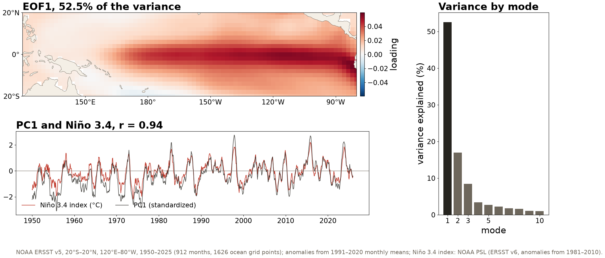

## {background-color="#faf7f2"}

[🌀]{.lecture-icon}

### Today's question

A monthly map of the tropical Pacific has 1,626 values; 76 years give only 912 maps.

**How many dimensions does a dataset really have, and which groups are in it?**

::: {.dim}
Reading: [2.12 Dimensionality reduction](https://geo-smart.github.io/mlgeo-book/dimensionality-reduction) · [3.3 Clustering](https://geo-smart.github.io/mlgeo-book/clustering)
:::

::: {.notes}
Two halves today, both about structure without labels. First half, closing Chapter 2: how big a data sample is (its dimension) compared with how many samples there are, and how principal components and EOFs find the few directions that carry the variance. Second half: clustering, which groups samples instead of compressing features. Timing for the 80-minute block (10:00 to 11:20): paper-pulse talks about 10 minutes, dimensionality deck about 10, notebook 2.12 about 25, clustering deck about 10, notebook 3.3 about 25.
:::

## Data dimension and data size {.compact}

| Dataset | One data sample | D | N | N / D | Size |
|:----------------------|:--------------------------------|-----------:|-----------:|--------:|---------:|
| Rock survey (synthetic) | one rock: 9 properties | 9 | 10,000 | 1,111 | 0.7 MB |
| GNSS station P395 | one day: east, north, up | 3 | 7,496 | 2,499 | 0.2 MB |
| STEAD earthquakes | 3 components × 6,000 times | 18,000 | ~1.2 M | ~67 | ~86 GB |
| ERSST tropical Pacific | one monthly SST map | 1,626 | 912 | 0.56 | 5.9 MB |
| ERA5, one variable | 0.25° global state, 13 levels | 13.5 M | ~95,000 | 0.007 | ~5 TB |

[D: numbers per sample. N: number of samples. Size in bytes (4-byte array values, 8-byte table values). Array rank (1D, 2D, 3D) is the shape, not the dimension.]{.dim}

::: {.takeaway}
The tropical Pacific record has 912 maps for 1,626 grid points: 0.56 samples per dimension.
:::

::: {.notes}
Three minutes; this is the vocabulary the rest of the course uses. The dimension D of a data sample is the number of values that describe it: 9 for a rock in the Session 5 table, 3 for a GNSS day, 3 components times 6,000 time samples for a STEAD waveform, 1,626 ocean grid points for one monthly SST map of the tropical Pacific, and 1440 x 721 x 13 for one ERA5 variable at 0.25 degrees on 13 pressure levels. The size of a dataset is the number of samples N, and its volume in bytes. Rank is something else: a waveform is a 2D array (components x time) but one sample of dimension 18,000. Learning cares about N compared with D. When N is not much larger than D, most of the space is empty, distances between samples become similar, and flexible models overfit. Geoscience fields are smooth, so neighboring values are correlated and the number of directions that carry the variance, the intrinsic dimension, is much smaller than D. That is what principal components measure, and it is criterion B6 of the 2.13 rubric. Sizes are computed from shapes (STEAD about 1.2 million traces; ERA5 states every 6 hours from 1959 to 2023), not read from the archives. In notebook 2.12 students compute the same quantities themselves: the rock table there has 5,000 rocks (N/D 556), and the stored SST array has 1,701 values per map because it includes 75 land points that are dropped before the decomposition.
:::

## Literature example: El Niño as the first EOF

::: {.badge-row}
[🛰️ Satellite & airborne]{.gb .src} [🌊 Ocean]{.gb .sys .ocean} [🌡️ Atmospheric & climate science]{.gb .disc .air}
:::

{.r-stretch}

::: {.takeaway}
Three modes carry 78% of the variance of 1,626 grid points; the first is El Niño, and its time series correlates with the Niño 3.4 index at r = 0.94.
:::

::: {.notes}
Four minutes; the result told in full from open data. Empirical orthogonal functions (EOFs) are principal components of a geophysical field: Lorenz introduced the name for statistical weather prediction in 1956, and they are now the standard first look at any climate field. Data: NOAA ERSST v5 monthly sea surface temperature (Huang et al. 2017, J. Climate, doi:10.1175/JCLI-D-16-0836.1), which merges ship, buoy and Argo measurements onto a 2-degree grid; it is an analysis product, so the 1950s rest on far fewer ships than today (the 1945 bucket story of Session 5 sits just before this record). Recipe, identical in notebook 2.12: tropical Pacific 20S to 20N, 120E to 80W, 1950 to 2025 (912 months, 1,626 ocean grid points); anomalies from the 1991 to 2020 monthly means; weights of the square root of the cosine of latitude; singular value decomposition. EOF1 (52.5% of the variance) is warming along the equator from the date line to South America: El Niño when its time series PC1 is positive, La Niña when negative. PC1 correlates with NOAA PSL's Niño 3.4 index (built from ERSST v6, anomalies from 1981 to 2010) at r = 0.94 over all 912 months. EOF2 carries 17.0% and EOF3 8.4%. In the notebook students read EOF2 from its map and time series: it is mostly the warming trend (western Pacific and subtropics warm, the cold tongue cools), and its time series also drops sharply in strong eastern-Pacific El Niño years (1965, 1972, 1982, 1997, 2015), so it carries part of the difference between El Niño events. The Niño 3.4 index is built from ERSST v6, so the comparison is independent in method, not fully in data. Caution to say aloud: EOFs are orthogonal by construction, so the second and later modes are not guaranteed to be separate physical processes. Script: figscripts/ersst_enso_eof.py.
:::

## PCA in three steps

1. Remove the mean of each variable (each grid point, each oxide)
2. Decompose the samples-by-dimensions matrix: singular value decomposition
3. Keep the first k directions; each carries a known share of the variance

```python
X = anomalies - anomalies.mean(axis=0)            # samples x dimensions
U, S, Vt = np.linalg.svd(X, full_matrices=False)  # Vt[0]: EOF1, U[:, 0] * S[0]: PC1
variance_share = S**2 / np.sum(S**2)
```

::: {.takeaway}
Principal components are orthogonal directions ordered by the variance they carry; a map of each direction is an EOF, and its time series is the principal component.
:::

::: {.notes}
Two minutes. The three lines are the ones students write in notebook 2.12. Name the objects: Vt holds the directions in the space of dimensions (for SST, maps; for rocks, combinations of oxides), U times S holds the coordinates of each sample along them (for SST, a time series). Standardize first when variables have different units (the rock table mixes wt% and g/cm3); do not standardize grid points of one field that share a unit, but weight them by area. scikit-learn's PCA does the same decomposition; the notebook uses both.
:::

## How many dimensions does a dataset need?

:::: {.columns}
::: {.column width="50%"}
**Intrinsic dimension:** the number of directions that carry most of the variance

- tropical Pacific SST: 3 modes carry 78% of 1,626 dimensions
- rock survey: the first component is the differentiation index (2.12)
- the share of variance kept is a choice; state it
:::
::: {.column width="50%"}
**Why it matters for learning**

- fewer inputs than samples: models can be fit and tested
- correlated inputs collapse onto a few directions
- the 2.13 rubric scores it as criterion B6
:::
::::

::: {.takeaway}
Report the number of components and the share of variance they keep, as you would report a filter's cutoff.
:::

::: {.notes}
Two minutes. The variance curve on the previous slide is the tool: modes 1 to 3 carry 52.5, 17.0 and 8.4%; mode 4 drops to 3.4%. There is no universal threshold (90%, 95%, a kink in the curve); the choice depends on whether the small modes are noise or the signal of interest, which is the Session 9 question again. In the notebook, students compute the curve for the rock table and the SST field and state how many components carry 90% of the variance.
:::

## t-SNE: a map for looking, not for measuring

- t-SNE places similar samples near each other in 2D, for visualization
- distances between groups, group sizes, and density in the map are not meaningful
- the layout changes with its settings (perplexity, random seed)
- use PCA to reduce dimensions for a model; use t-SNE to look at the data

::: {.takeaway}
A t-SNE map suggests groups; clustering, next, is how we test whether the groups exist in the data themselves.
:::

::: {.notes}
One minute, the bridge to the second half. Show the notebook's t-SNE of the rock table colored by rock type if time allows: the groups separate, but the gaps between them on the map are not distances in oxide space. Clustering works in the original or PCA-reduced space, where distances mean something, which is why the seismic exercise in 3.3 reduces 61 waveform features to 15 principal components before clustering.
:::

## Run notebook 2.12 (25 minutes)

1. `pixi run jupyter lab` → `2.12_dimensionality_reduction.ipynb`
2. Data dimension and data size: D, N, N/D, and megabytes for three datasets
3. PCA in three steps, then the variance curve of the rock table
4. EOFs of tropical Pacific SST: anomalies, area weights, SVD; compare PC1 with Niño 3.4 and read EOF2
5. Optional: t-SNE of the rock table; ICA

::: {.notes}
Circulate on task 4: the common mistakes are forgetting to remove the monthly climatology (EOF1 becomes the seasonal cycle) and forgetting the area weight. Students who finish early read EOF2's map and time series and decide whether it is a physical mode or the warming trend.
:::

## Clustering in the literature



::: {.takeaway}
Clustering earthquake spectra at The Geysers found source changes that cycle with water injection; the elbow rule for choosing k misleads on common cases.
:::

::: {.notes}
Two minutes. Holtzman et al. is the discovery story: cluster tens of thousands of earthquake spectra at The Geysers geothermal field with no labels, and the cluster occupancy turns out to cycle with the annual water-injection schedule, structure nobody had put a name to. Unglert et al. compared unsupervised pipelines on volcano seismic spectra and found that the tool changes what regimes you see, method choice is a scientific decision, which is today's distance-metric point at paper scale. Schubert is the cautionary one: the elbow criterion, the default ritual for choosing k, systematically misleads, and we reproduce its failure on our own data today. Refs update as the field moves; candidates from your reading arc are welcome.
:::


## Old Faithful: two regimes found without labels

{.r-stretch}

::: {.takeaway}
k-means with k = 2 on standardized eruption durations separates the two regimes visible in the scatter, using no labels and no physics.
:::

::: {.notes}
Left: 271 consecutive Old Faithful eruptions, each point pairing one eruption's duration with the next one's. The physics: a long eruption drains the reservoir, so recharge takes longer, duration carries memory. Read the structure precisely with the room: after a short eruption the next is reliably long (tight upper-left cloud); after a long eruption the next can be short or long. Right: k-means with k = 2 on the standardized data splits short-current from long-current eruptions; X marks the centroids. Emphasize what was NOT used: no labels, no physics, only Euclidean distance between points. That is both the power (discovery without labels) and the caveat (the algorithm would happily "find" clusters in structureless data too).
:::


## Distance and the k-means loop

- Every clustering method starts from a **distance**; k-means uses Euclidean distance in feature space
- Features with large numeric ranges dominate the distance, so **standardize first**
- **Guess** k centroids, **assign** each sample to the nearest, **re-center** at the cluster means, repeat
- The loop stops at a **local** minimum: run many restarts and keep the best

::: {.takeaway}
k-means finds groups under the distance you chose and from the start it was given, so the distance and the restarts are part of the result.
:::

::: {.notes}
Define distance concretely: Euclidean is the root-sum-of-squares across features. Other choices exist for other data, Manhattan for grid-like data, geodesic on the sphere, correlation-based for waveform similarity, covariance-based in geostatistics, the book lists them; the point is that each encodes a different meaning of "similar," and the clusters change with it. Standardization habit: k-means on raw mixed-unit features silently clusters on whichever feature has the biggest numbers. Friday shows the same failure in supervised classification with a unit change (hertz to millihertz). Also connect to 2.12: PCA reduces dimensions, clustering groups samples; on high-dimensional data the standard combo is PCA first, cluster the components, we do exactly that in today's exercise. You will code this loop from scratch in the notebook, four short functions, no library, because the mechanism matters: it explains why k must be chosen in advance (the loop needs centroids to start), why the result depends on initialization (local minima), and why the fix is repetition (the notebook's best-of-20 run). Then the scikit-learn version: KMeans with the k-means++ initialization and automatic restarts does all of this by default, say the names here, not on the slide. Distance returns in Chapter 4 as the building block of loss functions; the k-means objective is your first loss function, minimized by coordinate descent rather than gradients.
:::


## Choosing k: the elbow and the silhouette

{.r-stretch}

::: {.takeaway}
The elbow at k = 2 disappears when the regimes blur, and the silhouette (0.56 at k = 2) uses the same distance as the clusters; neither proves the groups are real.
:::

::: {.notes}
Left: within-cluster scatter versus k for Old Faithful, clear kink at k = 2, matching the two visible regimes; this is the elbow method working. Then the notebook's stress test: shrink the same standardized data toward the origin (middle panel) so the regimes bleed together, and the elbow curve (right) loses its kink, every k from 2 to 5 looks equally defensible. Nothing in the curve announces the failure. The notebook's second stress test (subsample to ~20% of the data) breaks it the same way. This is the Schubert critique from the literature slide, reproduced on 271 geyser eruptions. Rule for the room: use the elbow as a guide, cross-check with the silhouette score (next slide), and with the physics. Define it slowly from the dim line, a(i) is the average distance to your own cluster, b(i) to the nearest other cluster; well-clustered samples have b much larger than a. The executed notebook gives 0.561 for k = 2. Calibrate expectations: 0.56 is decent, not spectacular, the two regimes are real but the right-hand cloud is loose. The silhouette plot in the notebook shows the per-sample distribution, which is more informative than the average: look for clusters whose silhouettes sag toward zero. Same honesty as the elbow: the silhouette is computed from the same distance metric that made the clusters, so it can bless artifacts of a bad metric. When ground-truth labels exist, as in the exercise next, better scores exist: homogeneity, completeness, V-measure.
:::


## Pacific Northwest seismic sources without labels

{.r-stretch}

::: {.takeaway}
k-means separates earthquakes and noise, but explosions and surface events share a cluster: V-measure 0.38 against the analyst labels.
:::

::: {.notes}
The hand-off dataset: 4000 Pacific Northwest seismic events, earthquakes, explosions, surface events (rockfalls, avalanches, think Mt Hood), and noise, 1000 each, described by 61 physical waveform features; analysts labeled every event, but we hide the labels and cluster. Pipeline: standardize (mandatory, the features span orders of magnitude), PCA to 15 components (80% of the variance), k-means with k = 4. The crosstab scores homogeneity 0.363, completeness 0.393, V-measure 0.377, define V-measure as the harmonic mean of the first two, 0 random to 1 perfect. Read the physics in the matrix: cluster 2 is essentially earthquakes (764), cluster 1 noise (698); explosions and surface events pile into cluster 0 together, both are shallow near-surface sources without deep high-frequency energy, so their features overlap. The same dataset returns in the classification sessions (3.4, 3.5), where labels lift performance substantially, which is the point of labels.
:::


## Run notebook 3.3 (25 minutes)

1. `pixi run jupyter lab` → `3.3_clustering.ipynb`
2. Run the from-scratch k-means on Old Faithful; break it with a bad initialization, fix it with best-of-20
3. Seismic exercise: vary k from 2 to 8, track silhouette and inertia: does k = 4 stand out?
4. Compare: clustering without PCA, and agglomerative clustering with 4 clusters: does the V-measure move?

::: {.dim}
Chapter 2 quiz closes today · Fri: binary classification and imbalance (3.4) · **project proposals due Fri**
:::

::: {.notes}
Circulate on task 3: most teams will find k = 4 does not clearly stand out in silhouette or inertia, which is the diagnostics lesson on real data. Task 4 answers vary by run; the discussion is whether the changes are meaningful. Agglomerative clustering: build the dendrogram, choose a linkage (Ward behaves like the k-means objective; single linkage chains), and cut; the tree lets you inspect structure before choosing a number of clusters. Implementation names live in the notebook (KMeans, n_init, AgglomerativeClustering, silhouette_score, homogeneity_completeness_v_measure). Remind: Chapter 2 quiz closes tonight; proposals due Friday on Canvas.
:::
