## {background-color="#faf7f2"}

[🌀]{.lecture-icon}

### Today's question

Analysts at the Pacific Northwest Seismic Network labeled 4,000 events as earthquakes, explosions, surface events or noise.

**If we hide the labels, do the waveforms still fall into those four groups?**

::: {.dim}
Reading: [3.3 Clustering](https://geo-smart.github.io/mlgeo-book/clustering) · uses PCA from [2.12](https://geo-smart.github.io/mlgeo-book/dimensionality-reduction)
:::

::: {.notes}
Wed Oct 28 covers the start of this deck, from this question to the inertia slide (about 17 minutes), after the end of lecture 12 and lecture 13a; the remaining slides, from distance metrics onward, continue at the next session. Read the question aloud and ask for a show of hands: who thinks the four groups come back? Most people say yes; the answer, later in the deck, is "partly". Clustering is the first method in the course that never sees a label. Labels are used only afterwards, to judge what it found.
:::

## Literature example: water masses from Argo profiles {.smaller}

::: {.badge-row}
[📍 In-situ sensor]{.gb .src} [🌊 Ocean]{.gb .sys .ocean} [🌊 Oceanography]{.gb .disc .ocean}
:::

[Maze et al. (2017), *Progress in Oceanography* 151, 275–292 · rebuilt from 2023 Argo profiles (Ifremer ERDDAP)]{.dim}

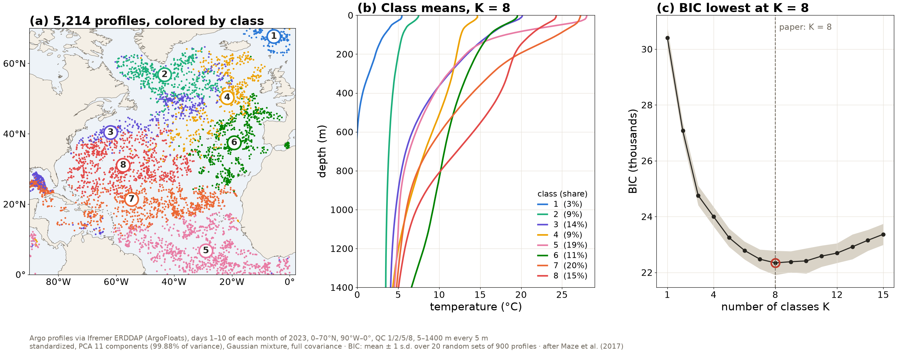{.r-stretch}

::: {.takeaway}
Grouping profiles by shape alone, with no positions given, recovers ocean regions such as the subpolar gyre and the Eighteen Degree Water.
:::

::: {.notes}
Four minutes; the example told in full. The ocean: Argo floats drift at depth, rise every 10 days and measure temperature from about 2,000 m to the surface. Maze et al. (2017) asked whether the North Atlantic's temperature profiles fall into a few types without being told where they come from. Method, the same as today's notebook in a different ocean: one sample is a profile on 280 depth levels from 5 to 1,400 m; standardize each level; PCA keeps 11 components (99.88% of the variance); a Gaussian mixture groups the profiles; the number of classes, 8, is where the BIC (a score that rewards fit and penalizes extra parameters) is lowest. We rebuilt it from open data (Ifremer ERDDAP, 5,214 profiles from 574 floats, the first 10 days of each month of 2023) and got the same two choices: 11 components and a BIC minimum at 8. Point at the map: no latitude or longitude went into the clustering, yet each class occupies a region. Class 2 is the subpolar gyre (Labrador and Irminger Seas). Class 8 is the western subtropical gyre, with 18 °C water at 300 m: the Eighteen Degree Water mode water. Class 6 is warmest at 1,000 m relative to its neighbors: the salty Mediterranean water spreading west. Ask the room: why do the classes form regions even though position was not used? Answer: profiles from the same water mass look alike, and water masses occupy regions. Two differences with the paper, to say honestly: our rebuild has a Nordic Seas class (158 profiles) that the paper's region did not separate, and the paper's southeastern subtropical gyre class has no clear counterpart here; one year of data is not fifteen. The paper's figures are not open-licensed, so the figure is ours (figscripts/argo_profile_clusters.py).
:::


## Clustering in other geoscience problems {.smaller}



::: {.takeaway}
Clusters found without labels became findings when they lined up with something measured independently: an injection schedule, a landslide, a flow regime.
:::

::: {.notes}
Two minutes, one sentence per card. Holtzman et al. (2018): 46,000 small earthquakes at The Geysers geothermal field, grouped by the shape of their spectra; each of four clusters peaks once a year, in turn, following the water-injection rate. Nobody gave the algorithm the injection data; the match is what makes the clusters believable. Seydoux et al. (2020): one day of continuous data at one Greenland station; a Gaussian mixture started with 10 groups kept 4, and one of them holds the repeating small signals before the 2017 Nuugaatsiaq landslide. Sonnewald et al. (2019): k-means on the terms of the ocean's vorticity budget splits the global ocean into dynamical regimes; the largest covers 43% of the ocean area. Schubert (2023) is the warning that returns on the "choosing k" slide: on uniform noise, which has a single cluster, every elbow rule tested picks four or more.
:::

## Old Faithful: what is one sample? {.smaller}

::: {.badge-row}
[🗂️ Catalog & compiled product]{.gb .src} [🪨 Solid Earth]{.gb .sys .solid} [🌋 Volcanology]{.gb .disc .solid}
:::

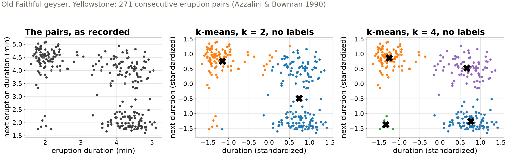{.r-stretch}

::: {.takeaway}
One sample is a pair of consecutive eruptions, so two eruption modes make up to four kinds of pair; k-means finds them without labels (silhouette 0.56 at k = 2, 0.69 at k = 4).
:::

::: {.notes}
Three minutes. Old Faithful in Yellowstone erupts in two modes: short (about 2 minutes) and long (about 4.5 minutes). Each point pairs one eruption's duration with the next one's, 271 pairs. Physics: a long eruption empties more of the reservoir, so recharge takes longer. Point at the left panel and ask the room: after a short eruption, what comes next? Answer: almost always a long one (94% in the notebook). After a long one? Either (52% short). Middle panel: k-means with k = 2 splits the pairs by the first eruption. Right panel: k = 4 finds the four kinds of pair, including the rare short-then-short group in the corner (6 pairs). The lesson: what counts as a group depends on what one sample is. The same data give two groups of eruptions and four groups of pairs. No labels and no physics were used, only distances between points.
:::


## Distance and the k-means loop

- Every clustering method starts from a **distance**; k-means uses Euclidean distance between samples
- Features with large numeric ranges dominate the distance, so **standardize first**
- **Guess** k centers, **assign** each sample to the nearest, **move** each center to the mean of its samples, repeat
- The loop stops at a **local** minimum, so run it from many starts and keep the best

```python
km = KMeans(n_clusters=4, init="k-means++", n_init=20, random_state=42).fit(X)
km.labels_, km.cluster_centers_, km.inertia_   # group of each sample, centers, total squared distance
```

::: {.takeaway}
The groups depend on the distance you chose and on where the loop started, so both are part of the result.
:::

::: {.notes}
Three minutes. Euclidean distance is the square root of the summed squared differences across features. Ask the room: if one feature is in meters and another in kilometers, which one decides the clusters? Answer: the one with the bigger numbers, which is why we standardize. Walk through the loop with your hands: drop k centers, everyone joins the nearest, centers move to the middle of their group, repeat until nothing changes. The quantity the loop lowers is the inertia, the sum of squared distances from each sample to its center. It can get stuck: in the notebook a bad start on Old Faithful gives inertia 183.9, while the best of 20 starts gives 74.0, the same as scikit-learn. That is why n_init=20. Students write two pieces of this loop themselves in the notebook (assign and update).
:::


## Inertia: what k-means makes small {.smaller}

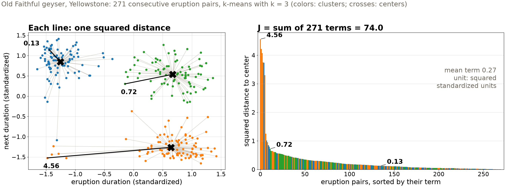{.r-stretch}

$$J = \sum_{i=1}^{n} \lVert \mathbf{x}_i - \boldsymbol{\mu}_{c(i)} \rVert^2$$

::: {.takeaway}
Inertia J adds up the squared distance from every sample to the center of its cluster: 74.0 for 271 eruption pairs at k = 3, with the few short-then-short pairs contributing the largest terms.
:::

::: {.notes}
Three minutes. Read the formula aloud in words: for every sample x_i, take the center mu of the cluster it belongs to, measure the distance, square it, and add over all samples. Left panel: each gray line is one term of that sum; three are labeled (0.13, 0.72, 4.56). Right panel: the 271 terms sorted from largest to smallest; the mean term is 0.27. Units are squared standardized units, so J has no physical unit; it is only useful to compare clusterings of the same data. Ask the room: what happens to J if we add a cluster? Answer: the best reachable J can only go down, because a new center can always sit on a far sample. With k = 271 every pair is its own cluster and J = 0. That is why J alone cannot choose k, and why we need the silhouette. The largest terms (4.56, 4.22, 4.07) are the rare short-then-short pairs, which have no center of their own at k = 3; a sample far from every center is something to look at, not to ignore.
:::


## Distance: what "similar" means {.compact}

| Distance | Measures | Geoscience use |
|---|---|---|
| Euclidean | straight line across standardized features | waveform features, geochemistry; the one k-means uses |
| Manhattan | sum of absolute differences | features with outliers |
| Correlation | 1 − correlation: shape, whatever the amplitude | waveforms, profiles: template matching |
| Great-circle | along the Earth's surface, in km | epicenters, stations, floats |

```python
D = haversine_distances(np.radians(latlon)) * 6371.0      # km between every pair of epicenters
labels = AgglomerativeClustering(n_clusters=3, metric="precomputed", linkage="average").fit_predict(D)
```

::: {.takeaway}
k-means uses only Euclidean distance; other distances go into hierarchical clustering as a precomputed matrix.
:::

::: {.notes}
Two minutes. The distance is a scientific choice, not a software default. Euclidean on standardized features is what we have used so far. Manhattan adds absolute differences, so one feature with a large difference weighs less than when it is squared. Correlation distance ignores amplitude and compares shape: two seismograms from the same source at different distances look alike under correlation even if one is a hundred times larger; this is the idea behind the template matching of the Session 1 paper (Ross et al. 2019). Great-circle (haversine) distance is the distance along the Earth's surface; treating longitude and latitude as x and y fails near the poles and across the 180° meridian. k-means moves centers to the mean of their samples, which only makes sense for Euclidean distance, so for the others the notebook computes the full matrix of pairwise distances and uses hierarchical clustering with average linkage. The next two slides are synthetic examples where the right distance matters.
:::


## Example 1: epicenters across the 180° meridian {.smaller}

::: {.badge-row}
[🖥️ Model & simulation]{.gb .src} [🪨 Solid Earth]{.gb .sys .solid} [📈 Seismology]{.gb .disc .solid}
:::

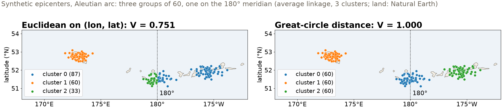{.r-stretch}

::: {.takeaway}
Treating longitude as x splits the group on the 180° meridian (V-measure 0.751); great-circle distance keeps all three groups whole (V-measure 1.000).
:::

::: {.notes}
Two minutes. Synthetic epicenters along the Aleutian arc: three groups of 60 events, one centered on the 180° meridian, so its longitudes are near +179 and −179. Two events 18 km apart on either side of the meridian are 359.9 degrees apart if longitude is treated as an ordinary number. Left: Euclidean distance on (longitude, latitude) cuts the dateline group in two (27 and 33 events) and merges one half with its eastern neighbor (cluster of 87). Right: great-circle distance recovers the three groups exactly. Ask the room: where else in the geosciences does longitude wrap around? Answers: the Pacific (Tonga, Fiji, Aleutians), polar data, ocean floats crossing the dateline. V-measure (defined a few slides later) compares the clusters with the groups the generator made: 1 is a perfect match.
:::


## Example 2: waveforms that differ in amplitude {.smaller}

::: {.badge-row}
[🖥️ Model & simulation]{.gb .src} [🪨 Solid Earth]{.gb .sys .solid} [📈 Seismology]{.gb .disc .solid}
:::

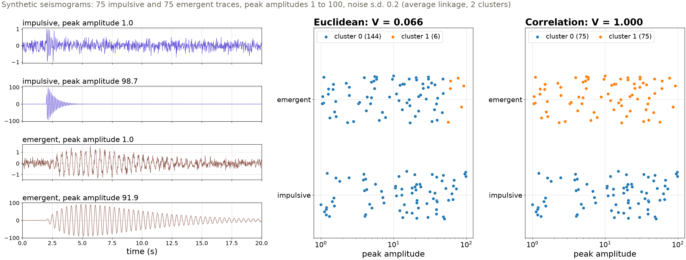{.r-stretch}

::: {.takeaway}
Euclidean distance groups the traces by energy (V-measure 0.066); correlation distance groups them by source shape, impulsive or emergent (V-measure 1.000).
:::

::: {.notes}
Two minutes. Synthetic seismograms: 75 impulsive sources (short, sharp onset) and 75 emergent sources (slow build-up, long duration), with peak amplitudes spread from 1 to 100 as distance from the source would spread them, plus noise. Left: one small and one large trace of each type. Middle: Euclidean distance puts 144 traces in one cluster and the 6 largest emergent traces in the other; it is grouping by energy (amplitude times duration), not by source type. Right: correlation distance ignores amplitude and separates the two shapes exactly. Ask the room: if you normalized every trace to its maximum first, which distance would Euclidean become close to? Answer: close to correlation, because normalizing removes amplitude. Within a type the mean correlation distance is 0.10; between types it is 1.00.
:::


## Silhouette: how well each sample fits its cluster {.smaller}

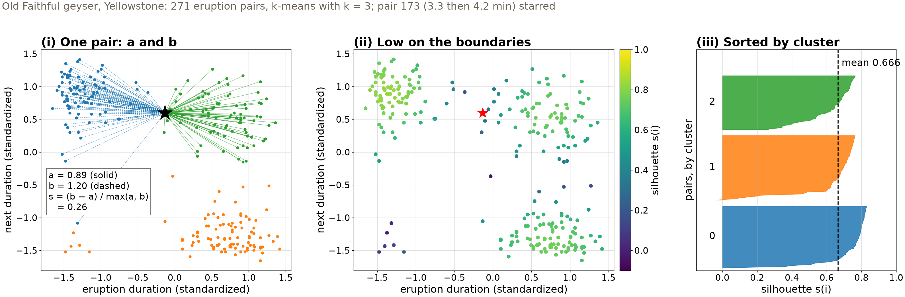{.r-stretch}

::: {.columns}
::: {.column width="38%"}
$$s(i) = \frac{b(i) - a(i)}{\max\{a(i), b(i)\}}$$

[a: own cluster · b: nearest other cluster]{.dim}
:::
::: {.column width="62%"}
| Mean s | > 0.70 | 0.51–0.70 | 0.26–0.50 | ≤ 0.25 |
|---|---|---|---|---|
| Structure | strong | reasonable | weak | none |

[Kaufman & Rousseeuw (1990)]{.dim}
:::
:::

::: {.takeaway}
The starred pair scores 0.26, barely in its cluster; the mean over all pairs, 0.67, is reasonable structure.
:::

::: {.notes}
Four minutes; take time here. Goal: unlike inertia, the silhouette asks two questions for each sample: is it close to its own cluster (a small) and far from the next one (b large)? Left panel: one eruption pair, starred, at k = 3. Solid lines go to the members of its own cluster, mean a = 0.89; dashed lines to the nearest other cluster, mean b = 1.20. So s = (1.20 − 0.89) / 1.20 = 0.26: it belongs where it is, barely. Middle: every pair colored by its own s. Values are high in the cores of the clusters and low on the boundaries between them and for the short-then-short pairs (−0.03 to 0.09). Right: the silhouette plot, the s values sorted within each cluster; the dashed line is the mean, 0.666. A cluster whose bar stays below the mean, or has negative values, is the weak one. Read the rule of thumb at the bottom right with the room (Kaufman and Rousseeuw 1990, table reproduced in Struyf, Hubert and Rousseeuw 1997): Old Faithful at 0.67 is reasonable structure; the seismic events at k = 4 score 0.205, no substantial structure by this rule, even though two of the four source types come back. Ask: what does a negative s mean? Answer: the sample is on average closer to another cluster than to its own.
:::

## Choosing k: the elbow and the silhouette {.smaller}

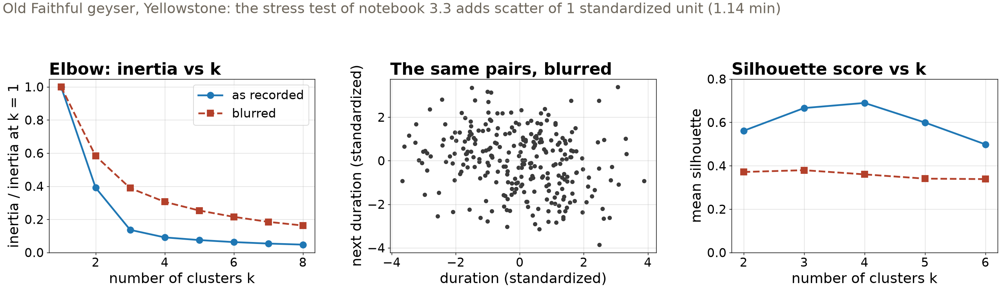{.r-stretch}

::: {.takeaway}
With the regimes visible, inertia drops sharply up to k = 3 and the silhouette peaks at k = 4; blur the same pairs by 1.1 minutes and both curves flatten (silhouette 0.34 to 0.38).
:::

::: {.notes}
Three minutes. Left: inertia divided by its value at k = 1. As recorded (blue), adding the second cluster removes 61% of the inertia, the third 25%, the fourth only 4.5%: a bend near k = 3. Right: the mean silhouette, defined on the previous slide, peaks at k = 4 (0.69). So the elbow and the silhouette do not even agree here. Middle: the notebook's stress test adds random scatter of one standardized unit (1.14 min) to every pair. The red curves bend gradually and the silhouette is flat: nothing in either curve says "there is no clear k". Ask the room: which k would you report for the blurred data? There is no good answer, which is the point. Schubert (2023) argues against the elbow for this reason. Use these curves as guides and check against the physics.
:::


## Why reduce the dimension first? {.smaller}

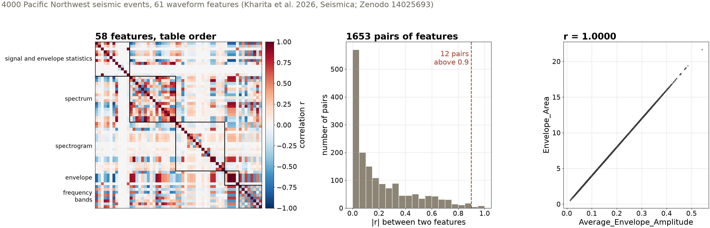{.r-stretch}

::: {.takeaway}
Many of the 61 waveform features measure nearly the same thing: 12 pairs correlate above 0.9, and one pair is identical (r = 1.0000), so a distance on all features counts those properties several times.
:::

::: {.notes}
Three minutes. One seismic event is described by 61 features computed from its waveform: statistics of the signal and of its envelope, the spectrum, the spectrogram, and the energy in frequency bands (58 vary; 3 are constant). Left: the correlation matrix, in table order; the dark blocks are families of features that move together. Middle: of 1,653 pairs, most are nearly uncorrelated (median |r| = 0.11), but 12 pairs have |r| > 0.9. Right: Envelope_Area and Average_Envelope_Amplitude are the same number up to a constant. Ask the room: if two features are copies, what happens to the distance? Answer: that property counts twice. The second reason to reduce is that with many dimensions most of the space is empty and distances between samples become similar (data dimension and data size, from the self-study slides with notebook 2.12). PCA addresses both.
:::


## PCA: rotate the axes onto the spread of the data {.smaller}

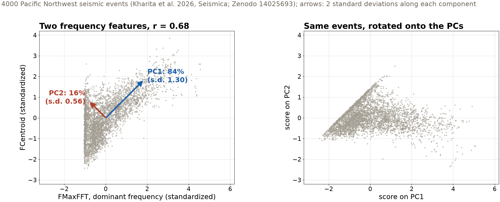{.r-stretch}

::: {.takeaway}
For two frequency features (r = 0.68), the first principal component points along the shared trend and carries 84% of the variance; the second carries the remaining 16%.
:::

::: {.notes}
Three minutes; this is PCA explained on two features you can see. Left: dominant frequency against spectral centroid for the 4,000 events, both standardized; they rise together (r = 0.68). PCA finds the direction along which the cloud is most spread (PC1, blue arrow, standard deviation 1.30) and the direction perpendicular to it (PC2, red, standard deviation 0.56). Right: the same events in the rotated coordinates. Nothing was removed; the axes were turned. The variance of each new axis, divided by the total, is the explained variance: 84% and 16%. With two standardized features the two directions are always the diagonals, which is why the weights are ±0.707; with 61 features the directions are not obvious, and that is where PCA helps. Keeping only the first components means keeping the directions with the most spread and dropping the rest. Steps: standardize, find the directions (eigenvectors of the covariance matrix, or the SVD), project.
:::


## PCA on the 61 seismic features {.smaller}

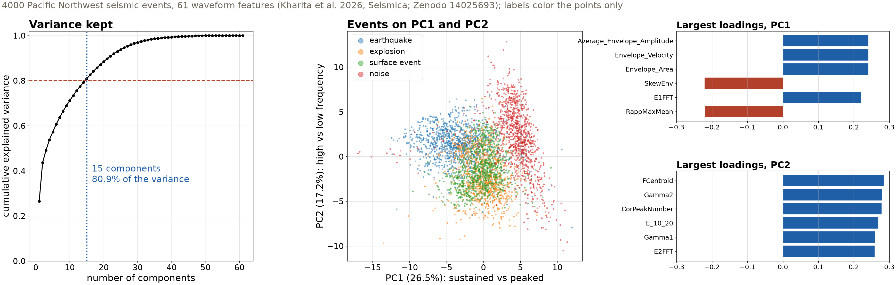{.r-stretch}

```python
pca = PCA().fit(Z)                                    # Z: 4,000 events x 61 standardized features
n_pcs = np.searchsorted(np.cumsum(pca.explained_variance_ratio_), 0.80) + 1   # 15
```

::: {.takeaway}
15 components keep 80.9% of the variance; PC1 (26.5%) contrasts sustained and peaked envelopes, and PC2 (17.2%) high and low frequency.
:::

::: {.notes}
Three minutes. Left: cumulative explained variance; 15 of 61 components reach 80% (rubric criterion B6, dimensionality, from Session 10). Middle: every event on the first two components, colored by the analyst label. The labels were not used to compute the components; they only color the points. Noise sits at high PC1, earthquakes at low PC1 (median scores 4.57 and −3.89); explosions and surface events overlap in the middle, which already predicts the clustering result two slides later. Right: the features with the largest weights (loadings) on each component, which is how a component gets a physical reading: PC1 weighs envelope amplitude and area against envelope skewness, so it separates long, sustained signals from short, peaked ones; PC2 weighs the spectral centroid and frequency-band energies, so it is a frequency axis. Ask: which component would you look at to separate earthquakes from noise? Answer: PC1.
:::


## t-SNE: a map of neighbors, for looking only {.smaller}

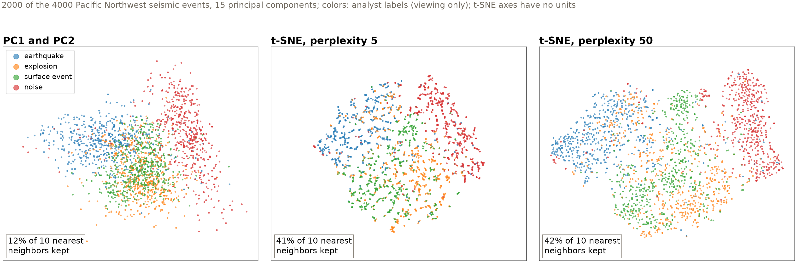{.r-stretch}

::: {.takeaway}
t-SNE keeps about 41% of each event's 10 nearest neighbors, against 12% for the PC1–PC2 view; distances between groups, group sizes and the axes carry no meaning.
:::

::: {.notes}
Three minutes. t-SNE (t-distributed stochastic neighbor embedding) places points on a page so that samples that are neighbors in the 15-dimensional space stay neighbors on the page. It does not try to keep large distances. Perplexity is roughly the number of neighbors each point pays attention to: at 5 the map breaks into small threads, at 50 the groups are smoother. Measured on 2,000 events: of each event's 10 nearest neighbors in 15 dimensions, the PC1–PC2 view keeps 12%, t-SNE keeps 41 to 42%. Rules for reading a t-SNE map: the axes have no units; the distance between two groups means nothing; the size of a group means nothing; a different perplexity or random seed gives a different picture. Use it to look and to form hypotheses, never to measure, and never cluster on the t-SNE coordinates. Here it shows earthquakes and noise as separate regions and explosions and surface events interleaved, the same story as the clustering.
:::


## Clustering as unsupervised classification {.smaller}

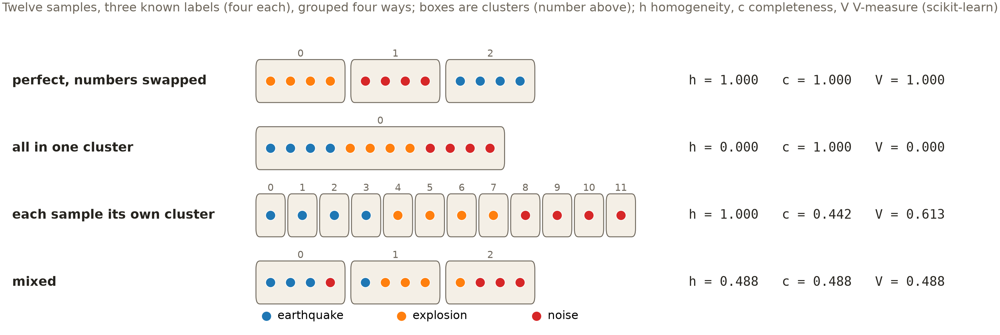{.r-stretch}

::: {.takeaway}
Homogeneity: does each cluster hold a single label? Completeness: does each label sit in a single cluster? V-measure, their harmonic mean, is 1 only when both hold.
:::

::: {.notes}
Three minutes. Clustering never sees the labels. When labels exist, we can still treat the result as an unsupervised classification and compare it with them afterwards, like a confusion matrix. Two complications: cluster numbers are arbitrary (cluster 0 is not "earthquake"), and the number of clusters need not equal the number of labels, so accuracy does not apply. Homogeneity asks whether each cluster contains members of one label only; completeness asks whether all members of one label ended up in the same cluster. Walk down the four rows: a perfect grouping with the numbers swapped scores 1, 1, 1; everything in one cluster is complete (every label sits in one cluster) but not homogeneous (h = 0); every sample in its own cluster is homogeneous but not complete (c = 0.44); a mixed case scores 0.49. V-measure is the harmonic mean of the two, so it is high only when both are. They are computed from entropies (Rosenberg and Hirschberg 2007), but the two questions are all you need. Next slide: the real seismic events.
:::


## Pacific Northwest seismic sources without labels {.smaller}

::: {.badge-row}
[📍 In-situ sensor]{.gb .src} [🪨 Solid Earth]{.gb .sys .solid} [📈 Seismology]{.gb .disc .solid}
:::

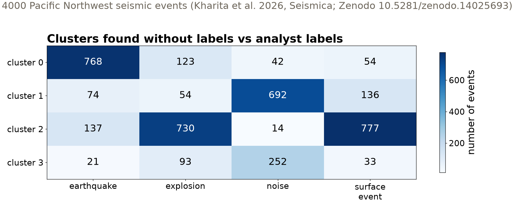{.r-stretch}

::: {.takeaway}
Earthquakes get one cluster and noise two; explosions and surface events share one (730 and 777 events). V-measure: 0.37.
:::

::: {.notes}
Four minutes; this is the answer to today's question. Data: 4,000 events from the Pacific Northwest Seismic Network, 1,000 of each type, labeled by analysts (Kharita et al. 2026, Seismica). Surface events are rockfalls, debris flows and avalanches, many on Mount Rainier and Mount Hood. Explosions are mostly quarry and mine blasts. Pipeline: standardize, 15 principal components, k-means with k = 4, then compare clusters with the hidden labels. Read the table row by row with the room. Cluster 0 is mostly earthquakes, cluster 1 mostly noise, cluster 2 mixes explosions and surface events, cluster 3 is mostly noise. Ask: why would explosions and surface events look alike? Answer: both happen at the surface, close to the stations, without the deep, impulsive high-frequency energy of earthquakes, so their waveform features overlap. Scores, as defined on the previous slide: homogeneity 0.357, completeness 0.386, V-measure 0.371. The silhouette of this clustering is 0.205. The answer to the opening question: two of the four groups come back without labels; the other two need labels, which is what supervised classification in 3.4 and 3.5 adds.
:::


## Same events, four ways of grouping {.compact}

| Method (k = 4) | Homogeneity | Completeness | V-measure |
|---|---|---|---|
| k-means on 15 principal components | 0.357 | 0.386 | 0.371 |
| k-means on all 61 features | 0.359 | 0.393 | 0.375 |
| Ward (hierarchical) on 15 components | 0.343 | 0.472 | 0.398 |
| Gaussian mixture on 15 components | 0.311 | 0.386 | 0.344 |

::: {.takeaway}
No method separates explosions from surface events; Ward scores highest only because one of its clusters holds most explosions and surface events together.
:::

::: {.notes}
Two minutes. All four methods land between 0.34 and 0.40. Ward's agglomerative clustering starts with every event alone and merges the pair of groups that increases the within-group variance least, until four remain. Its higher completeness comes from one very large cluster (929 explosions, 959 surface events and 527 earthquakes): keeping each label in one cluster is easy if one cluster holds almost everything. A Gaussian mixture lets each group have its own shape and size; here it does slightly worse. In the notebook, splitting the mixed cluster again into two does not separate explosions from surface events either. The scientific conclusion: with these 61 features, the difference between a blast and a rockfall is not where the variance is. A geoscientist's next step would be features that target it, for example the frequency content in the first seconds, or the location and time of day used in Session 12.
:::


## Run notebook 3.3

1. `pixi run jupyter lab` → `3.3_clustering.ipynb`; read "How this notebook is organized" first
2. Old Faithful: write the assign and update steps of k-means and the terms of the inertia
3. Scores against known groups on twelve samples; then the two distance examples (great-circle, correlation)
4. Silhouette by hand for one eruption pair, then for k = 2 to 6 and the blurred stress test
5. Seismic events: correlation of features, PCA to 80%, loadings, t-SNE, k-means with k = 4 against the labels

::: {.dim}
Chapter 2 quiz closes today · Fri Oct 30: project proposal talks ([Giving a scientific talk](https://geo-smart.github.io/mlgeo-book/project-talks))
:::

::: {.notes}
About 35 minutes, then 10 minutes for results. The notebook runs in about a minute; t-SNE takes about 25 seconds of that. Every "Your turn" cell has a hint and a worked solution under ⋯; if a cell is left empty the notebook fills in the reference so the rest runs, so nobody gets stuck for long. Where people get stuck: forgetting to standardize (task 2), mixing up rows and columns in the distance calculation (task 2), and reading the table against the labels (task 4): clusters are numbered arbitrarily, so cluster 0 has no meaning by itself. For the last 10 minutes, ask two or three groups: which k did the silhouette choose for the seismic events, and does that k match the four source types? (It picks k = 2, at 0.216; the highest V-measure is at k = 3, 0.432.) Remind the room: the Chapter 2 quiz closes tonight, and Friday is the proposal talks, with every team member speaking.
:::
