## {background-color="#faf7f2"}

[🎯]{.lecture-icon}

### Today's question

A town must decide whether a storm warrants a landslide warning. A seismic network must decide what each event is. **What does a classifier give them, and how do we grade it?**

| Part | Book section | What we do | Data |
|---|---|---|---|
| 1. Logistic regression | [3.6](https://geo-smart.github.io/mlgeo-book/logistic-regression) | the simplest classifier: from a weighted sum to a probability | landslide days in Sitka; explosions and earthquakes |
| 2. Binary decisions | [3.4](https://geo-smart.github.io/mlgeo-book/binary-classification) | threshold, then every metric, rare events, calibration, balancing | the same events and landslide days |
| 3. Multiclass | [3.5](https://geo-smart.github.io/mlgeo-book/multiclass-classification) | per-class scores, macro and micro averages, the leaderboard | four Pacific Northwest source types; Swiss avalanche danger levels |

::: {.notes}
This one session replaces the former separate decks for 3.4, 3.5 and 3.6, because the proposal talks took Friday's slot. This order was changed after the class of Nov 4, so that the probability comes first, then the threshold, then the metrics that depend on it. Timing for the 80 minutes (10:00 to 11:20): this deck about 50 minutes (Part 1 about 12, Part 2 about 26, Part 3 about 12), notebook 25 minutes, wrap-up 5 minutes. Ask the room before starting: on a landslide warning, what does a missed event cost? What does a false alarm cost? Keep those two costs in mind: today ends in a decision.
:::

## Part 1. Logistic regression: Sitka landslide days {.roomy}

::: {.columns}
::: {.column width="42%"}
{height="700"}
:::
::: {.column width="58%"}
[📍 In-situ sensor]{.gb .src} [💧 Land water]{.gb .sys .water} [⛰️ Geology & geomorphology]{.gb .disc .solid}

**Class to predict:** did a landslide start on this day, near the road network?

::: {.big-number}
5 [landslide days out of 6,606 days of rainfall records, 2002 to 2020]{.unit}
:::

::: {.big-number}
99.92% [accuracy of never issuing a warning]{.unit}
:::

A storm on 18 August 2015 started over 40 landslides; a debris flow killed three people.

**The decision:** what rainfall, or what probability, should trigger a warning?

::: {.credit}
Patton et al. (2023), *Nat. Hazards Earth Syst. Sci.* 23, 3261–3284, Fig. 1. [doi:10.5194/nhess-23-3261-2023](https://doi.org/10.5194/nhess-23-3261-2023). CC BY 4.0.
:::
:::
:::

::: {.notes}
This paper runs through today: it has two classes, extreme rarity, logistic regression as the model, and a threshold chosen with a community. Point at the map: steep, forested slopes above a road network with frequent, sustained rain. A landslide day is the positive class. The second number is arithmetic: 6,601 of 6,606 days had no landslide, so a system that never warns is right 99.92% of the time and would have missed all five events, including the fatal one. Ask: if a yes or no is not good enough, what should the model output instead? Next slide: a probability that rises with rainfall.
:::

## From rainfall to a probability: one predictor

::: {.columns}
::: {.column width="64%"}
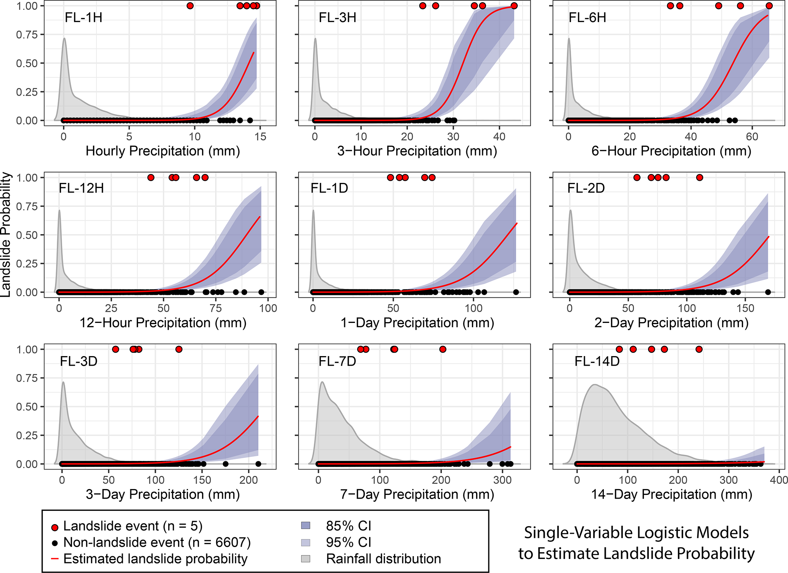{height="690"}
:::
::: {.column width="36%"}
Each panel is one logistic regression: landslide probability against rainfall over one window, from 1 h to 14 d.

- Red points: the 5 landslide days; black: the others
- Red curve: the fitted S-shaped curve, a sigmoid, with 85% and 95% intervals
- Gray: how often each rainfall occurs

The **3 h window fits best**. Long windows flatten the curve.

A probability of 0.01 corresponds to **21.3 mm in 3 h**: a cut on the probability is a cut on the rainfall.

::: {.credit}
Patton et al. (2023), Fig. 3. CC BY 4.0.
:::
:::
:::

::: {.notes}
This is logistic regression at its simplest, with a physical axis. Each panel has one predictor, the maximum rainfall in a window, so there are only two parameters. With five positive events, two parameters is about what the data can support, and this is a good reason to use logistic regression. The shaded bands are 85% and 95% confidence intervals: wide, because of five events. As windows lengthen, the curve flattens: rain over 14 days does not separate landslide days from the others, while a 3 h burst does. The translation of 0.01 to millimetres is what makes the warning usable in a forecast office, and it is the first time today we meet a threshold: Part 2 is about choosing one. Next slide: the same curve with many predictors.
:::

## Many predictors: score, probability, loss

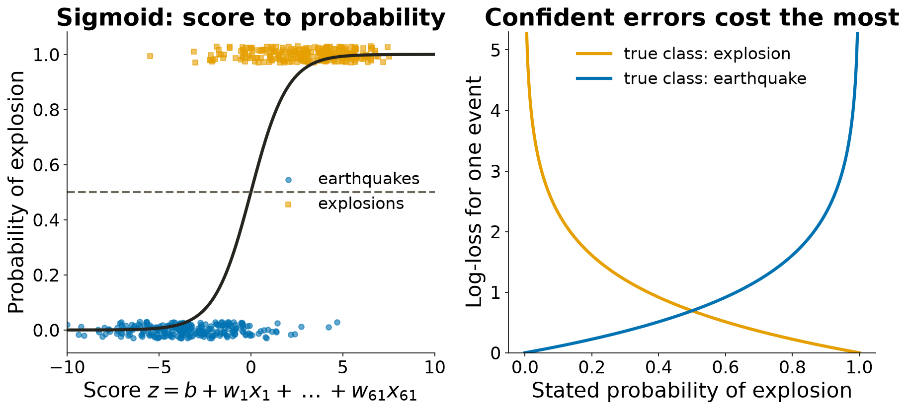{.r-stretch}

::: {.takeaway}
Weighted sum of standardized features, then the sigmoid $p = 1/(1 + e^{-z})$. Training lowers the mean log-loss $-[y \ln p + (1-y)\ln(1-p)]$: wrong at 0.99 costs 4.6, wrong at 0.55 costs 0.8.
:::

::: {.notes}
Despite the name, it is a classifier. It extends the weighted sum of the regression in 3.3. Left: every test event has a score z, a weighted sum of 61 standardized features. The sigmoid turns the score into a probability; events are plotted at 0 or 1 by their true class. The dashed line marks 0.5, the default threshold, which Part 2 moves. The decision boundary is z = 0: linear in the features. Right: the loss. Read the orange curve: if the event is an explosion and you state p = 0.99 the cost is 0.01, at 0.55 it is 0.60, at 0.01 it is 4.6. Blue is the mirror for earthquakes. That shape is why the model tries to avoid confident errors. For several classes, one weight vector per class and a softmax in place of the sigmoid. Notebook 3.6 implements the fit by hand.
:::

## Fitting: lower the log-loss {.fit}

::: {.columns}
::: {.column width="50%"}
Training searches for the weights that make the mean log-loss smallest.

| Stated probability of the true class | Log-loss |
|---|---|
| 0.99 | 0.01 |
| 0.55 | 0.60 |
| 0.45 | 0.80 |
| 0.01 | 4.61 |
:::
::: {.column width="50%"}
```python
from sklearn.linear_model import LogisticRegression

model = LogisticRegression(max_iter=5000)
model.fit(X_train_scaled, y_train)
p = model.predict_proba(X_test_scaled)
```

Standardize first, with the training split only: the weights then compare, and the fit converges faster.
:::
:::

::: {.takeaway}
Confident errors cost the most: 4.61 for a true class stated at 0.01. Notebook 3.6 writes the descent by hand, and every network in Chapter 4 trains with the same loop.
:::

::: {.notes}
Keep this short. The method is gradient descent: compute the gradient of the mean log-loss and step against it, scaled by a learning rate. Do not derive it today: 3.6 does, and checks the formula against automatic differentiation, and 4.0 returns to it. scikit-learn also adds a small L2 penalty by default, so its weights differ slightly from the unpenalized fit in 3.6.
:::

## Reading the weights: explosion against earthquake

::: {.columns}
::: {.column width="52%"}
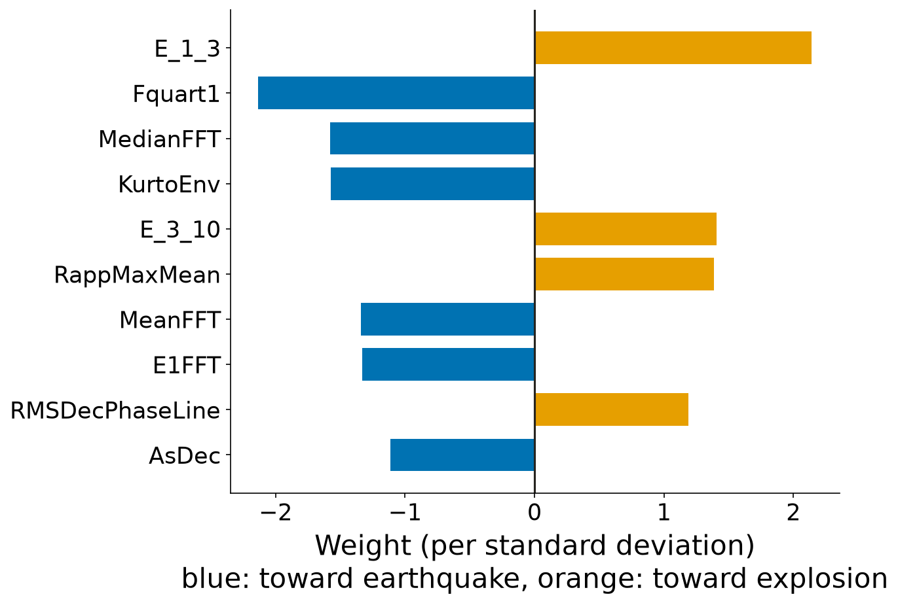{height="610"}
:::
::: {.column width="48%"}
A weight is the change in log-odds per one standard deviation of a feature, with **the other features held fixed**.

- Energy in the lower band (`E_1_3`) pushes toward explosion. This matches the paper, where explosions emphasize energy at 1–5 Hz
- `E_1_3` and `Fquart1` have opposite weights of the same size, ±2.14, and correlate at −0.69

::: {.dim}
Band names are read from the feature names in the table. Weights of correlated features share credit, so a single weight is not a physical law.
:::
:::
:::

::: {.takeaway}
Weights are one reason to start with logistic regression: each prediction can be traced to the features. Friday's forest has importances that need more care.
:::

::: {.notes}
Log-odds: ln(p / (1 − p)), which is exactly the score z. So +1 standard deviation of E_1_3 multiplies the odds of explosion by e^2.14, about 8.5, if nothing else changed. But nothing else stays fixed: 3.3 showed that 12 pairs of these features correlate above 0.9. Drop one and its partner absorbs the weight. Kharita et al. discuss the time-frequency attributions of explosions and earthquakes in their section on interpretability. Ask: which of these features would you trust at a different network? That prepares robust training on Monday.
:::

## Part 2. A threshold makes the decision {.dense}

::: {.columns}
::: {.column width="47%"}
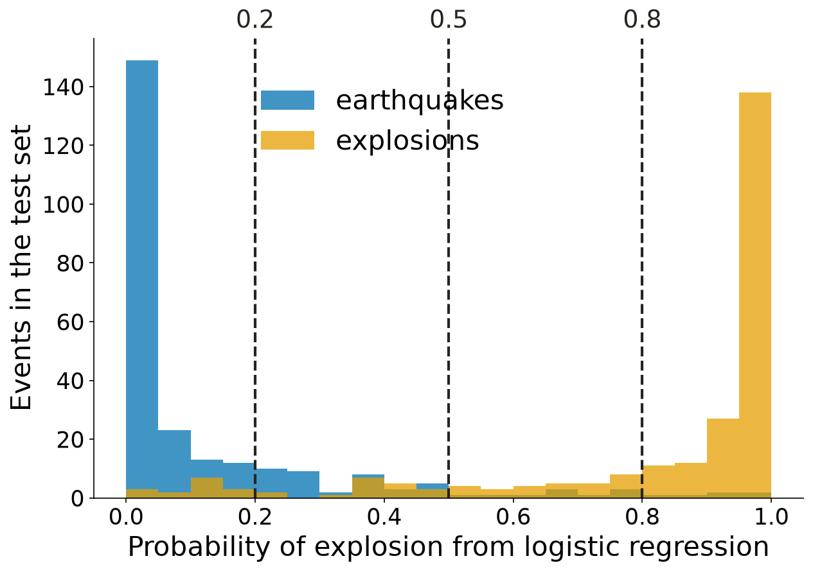{height="610"}
:::
::: {.column width="53%"}
**Explosion or earthquake?** Logistic regression on 61 waveform features. Each event gets a probability; a cut makes it a decision.

| Threshold | Explosions caught | Missed | False alarms | Earthquakes kept |
|---|---|---|---|---|
| 0.2 | 235 | 15 | 53 | 197 |
| 0.5 | 217 | 33 | 16 | 234 |
| 0.8 | 188 | 62 | 6 | 244 |

Out of 250 explosions and 250 earthquakes. Missed blasts stay in the earthquake catalog and bias hazard statistics. False alarms remove real earthquakes, or cost an analyst's time.

[📍 In-situ sensor]{.gb .src} [🪨 Solid Earth]{.gb .sys .solid} [📈 Seismology]{.gb .disc .solid}

::: {.dim}
Zenodo record 14025693. Test split of 500 events, seed 2026.
:::
:::
:::

::: {.takeaway}
Nothing was refit. Lowering the threshold from 0.8 to 0.2 cuts missed explosions from 62 to 15 and raises false alarms from 6 to 53.
:::

::: {.notes}
Explosions pile up near 1 and earthquakes near 0, and the threshold slides through the overlap. Ask for a show of hands: which threshold would you run, and for whom? Then make them say the cost. Scikit-learn's predict uses 0.5 by default, and that is a choice made for you. To change it: take predict_proba, compare with your own cut. The real base rate in a catalog is not 50%, so the precisions of the next slides would be lower in operation: later slides show why. Numbers: figscripts/lec16_classification.py, canonical seed 2026, explosions and earthquakes only, 25% test.
:::

## One threshold: the confusion matrix and its metrics {.dense}

::: {.columns}
::: {.column width="29%"}
The row for threshold 0.5 as a table. Positive class: explosion.

| Analyst | Predicted explosion | Predicted earthquake |
|---|---|---|
| explosion | **TP 217** | FN 33 |
| earthquake | FP 16 | **TN 234** |

TP, FN, FP, TN: true positive, false negative, false positive, true negative.
:::
::: {.column width="71%"}
| Metric | Formula | The question it answers | Value |
|---|---|---|---|
| Accuracy | (TP + TN) / all | what fraction is right? | .902 |
| Recall (sensitivity) | TP / (TP + FN) | of real explosions, how many are caught? | .868 |
| Specificity | TN / (TN + FP) | of real earthquakes, how many kept? | .936 |
| Precision | TP / (TP + FP) | of events called explosions, how many were? | .931 |
| Balanced accuracy | mean of recall and specificity | accuracy with both classes equal | .902 |
| F1 | 2 × precision × recall / sum | high only if both are high | .899 |
| Matthews correlation (MCC) | correlation of truth, prediction | uses all four cells, −1 to 1 | .806 |
:::
:::

::: {.takeaway}
At threshold 0.5 the model catches 217 of 250 explosions (recall .868), and 217 of its 233 explosion calls are correct (precision .931).
:::

::: {.notes}
Build it on the board from the four cells. Translate each to the network: a false negative is a blast left in the earthquake catalog, which pollutes hazard statistics; a false positive is an earthquake thrown out as a blast. All seven rows change when the threshold moves; the next slide moves it. F1 example worth doing aloud: precision 1.0 with recall 0.1 gives F1 0.18, not 0.55, because the harmonic mean follows the lower number. On balanced data these numbers look alike; a later slide changes the balance.
:::

## Every threshold: ROC and precision-recall curves

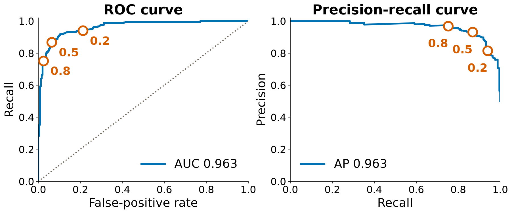{height="440"}

| Threshold | False-positive rate | Recall | Precision | F1 |
|---|---|---|---|---|
| 0.2 | .212 | .940 | .816 | .874 |
| 0.5 | .064 | .868 | .931 | **.899** |
| 0.8 | .024 | .752 | .969 | .847 |

::: {.takeaway}
Each threshold is one confusion matrix and one point on each curve. The areas, ROC AUC .963 and average precision (AP) .963, score the ranking over all thresholds; F1 favors 0.5 because it weighs both errors equally.
:::

::: {.notes}
Point at a red circle, then at the row of the table. ROC stands for receiver operating characteristic: recall against the false-positive rate. ROC AUC is also the chance that a random explosion gets a higher probability than a random earthquake. Average precision is the area under precision against recall, and it reads as the quality of the trigger list. A catalog curator who pays more for a missed blast should choose 0.2 even though F1 prefers 0.5. Friday's opening exercise draws one of these curves by hand from ten events.
:::

## Sitka: two thresholds on one precision-recall curve

::: {.columns}
::: {.column width="52%"}
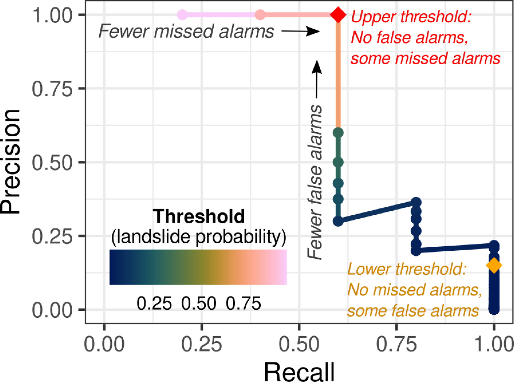{height="700"}
:::
::: {.column width="48%"}
| Daily probability | Hazard level | Recall | Precision |
|---|---|---|---|
| below 0.01 | low | | |
| 0.01 to 0.70 | moderate | 1.0 | 0.15 |
| above 0.70 | high | 0.6 | 1.0 |

At 0.01: no missed landslide day, 28 false alarms in 18 years. At 0.70: no false alarm, 3 of 5 days caught.

Emergency responders preferred fewer false alarms; other residents accepted more alarms. The thresholds were set with that input.

::: {.credit}
Patton et al. (2023), Fig. 11. CC BY 4.0. The caption gives 0.1 for the lower threshold; the text and the warning levels give 0.01.
:::
:::
:::

::: {.notes}
This is the decision slide of the lecture. The colour of the curve is the threshold. With only five positive days, any threshold below 0.023 gives recall 1 and any above 0.31 gives precision 1, so data alone do not fix the numbers: the authors used judgment and community input. Note the two levels: a model does not have to give a single yes or no. Moderate hazard means stay alert; below 0.01 tells residents they can relax, which the authors value in a place with frequent rain. Precision and recall on the row for 0.01 to 0.70 are for the lower threshold; those on the last row are for the upper. These are fit to all five events, and the paper checks them with leave-one-out validation.
:::

## Make explosions rare: which metrics notice?

::: {.columns}
::: {.column width="54%"}
| Metric | 50% explosions | 5% explosions |
|---|---|---|
| Never predict explosion (accuracy) | .500 | **.950** |
| Accuracy | .902 | **.965** |
| ROC AUC | .963 | .940 |
| Balanced accuracy | .902 | .755 |
| Precision | .931 | .717 |
| F1 | .899 | .602 |
| MCC | .806 | .593 |
| Average precision | .963 | **.621** |
| Recall | .868 | **.521** |
:::
::: {.column width="46%"}
::: {.big-number}
.965 [accuracy, 1.5 points above never predicting an explosion]{.unit}
:::

::: {.big-number}
.521 [recall: about half of the explosions are missed]{.unit}
:::

::: {.dim}
5%: 53 explosions with all 1,000 earthquakes, trained and scored by 5-fold cross-validation, mean of 20 random subsets. 50%: the test split of the earlier slides.
:::
:::
:::

::: {.takeaway}
Same features, same model. Accuracy rose while recall fell from .868 to .521. Report recall and precision of the rare class, never accuracy alone.
:::

::: {.notes}
Read down the table. The two top rows are the trap: accuracy goes up, as does the score of the trivial detector. ROC AUC barely moves. Everything that looks at the positive class falls. A network's real stream is unbalanced like this, and worse: Sitka is 0.08% positive. Variability: across the 20 subsets the standard deviation of recall is 0.06 and of average precision 0.07, so do not over-read the third decimal. Book section 3.4 repeats this on a synthetic detector with 2% events, where accuracy is 0.992 and recall 0.65: the same pattern. The class-weight knob in 3.4 trades precision for recall during training.
:::

## ROC and precision-recall with rare explosions

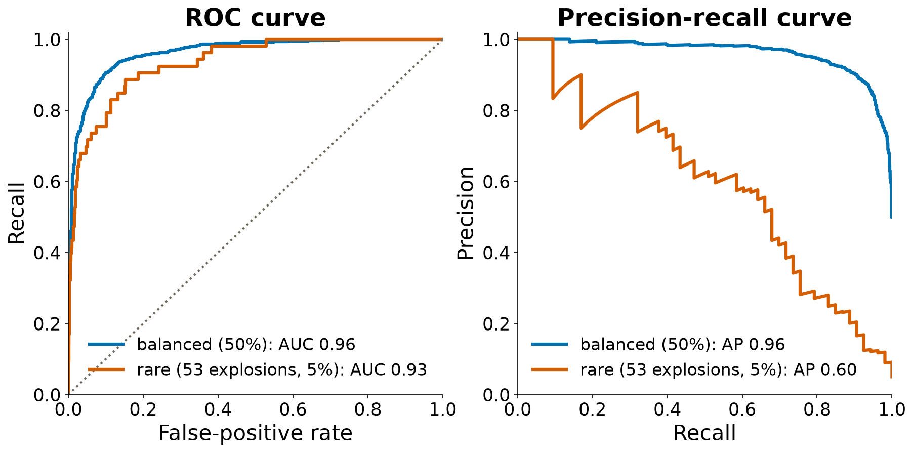{.r-stretch}

::: {.takeaway}
Rare explosions move the ROC curve little and the precision-recall curve a lot: the false-positive rate divides by all earthquakes, precision by the trigger list. One subset shown (AUC .93, AP .60); over 20 subsets, .94 and .62.
:::

::: {.notes}
Both curves sweep the same threshold. Left: the false-positive rate divides by every earthquake, about 1,000 of them, so 40 false triggers hardly register. Right: precision divides by the events flagged, which is the list an analyst must review. Saito and Rehmsmeier (2015, PLOS ONE 10, e0118432) make this argument for imbalanced data in general, and the Sitka paper cites them. The blue curve is 2,000 events with cross-validation, the red curve one random rare subset, so the AP shown differs from the mean over 20 subsets on the previous slide. Rule to leave with: with rare positives, read the precision-recall curve.
:::

## Calibration: stated against observed probability

::: {.columns}
::: {.column width="50%"}
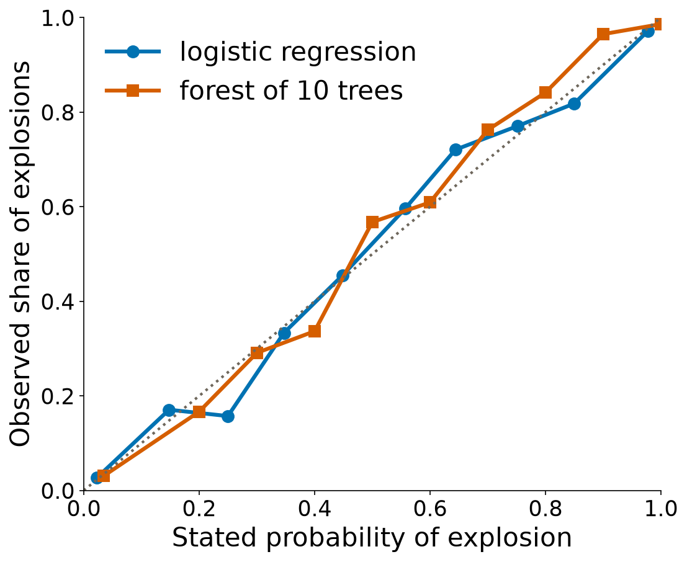{height="620"}
:::
::: {.column width="50%"}
A model is **calibrated** when stated probabilities match observed frequencies.

**Reliability diagram:** stated probability against observed share. Calibrated models follow the diagonal.

**Brier score:** mean squared error of the probability. Weather forecasters have used it since Brier (1950).

| Explosion or earthquake, 5-fold | Accuracy | Brier |
|---|---|---|
| Logistic regression | .902 | .074 |
| Forest of 10 trees | .880 | .087 |

The forest's probabilities are vote shares among only 10 trees. Forests come on Friday.
:::
:::

::: {.takeaway}
Sitka's warning levels are probabilities: 0.01 and 0.70 mean something only if the model is calibrated. Whoever sets the threshold takes your number at face value.
:::

::: {.notes}
Accuracy looks only at which side of 0.5 you are on. The Brier score and the reliability diagram read the number itself. Each point is a bin of events: x is the mean stated probability, y the observed share of explosions. Most events sit near 0 or 1, so the middle bins hold few events and wobble. Logistic regression minimizes log-loss, which rewards calibrated probabilities on the training distribution, though balancing or a change of base rate breaks it. Notebook 3.6 shows an overfit forest repaired by recalibration on the water table (Brier 0.239 to 0.220). Reference: Brier (1950), Monthly Weather Review 78, 1–3.
:::

## Balance the training set, test at the real proportion {.dense}

::: {.columns}
::: {.column width="48%"}
**Proper order:** split first; balance the training set only; score validation and test sets at the proportion you will meet in operation.

| Case | Train | Test | Precision | Recall |
|---|---|---|---|---|
| Balanced lab test | 50% | 50% | .931 | .868 |
| Same model, deployed | 50% | 5% | **.417** | .868 |
| Same model, deployed | 50% | 1% | **.120** | .868 |
| Same model, Sitka's rarity | 50% | 0.08% | **.011** | .868 |
| Proper test, no balancing | 5% | 5% | .704 | .500 |
| Proper test, class weights | 5% | 5% | .355 | .775 |

Share of explosions in each set. Deployed rows: recall .868 and false-positive rate .064 of the 50% test, applied to the new proportion. Last rows: logistic regression, 5-fold, mean of 10 subsets.
:::
::: {.column width="52%"}
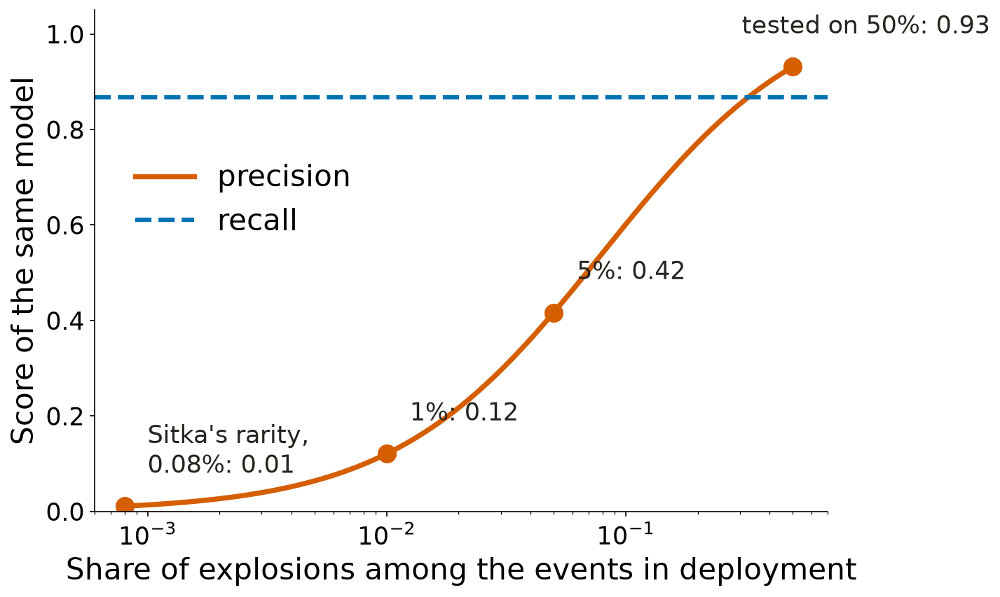{height="580"}
:::
:::

::: {.takeaway}
Recall does not depend on the proportion; precision does. False alarms per blast caught: 0.07 at 50%, 1.4 at 5%, 7.3 at 1%. A balanced test score does not describe the deployed system.
:::

::: {.notes}
This is the slide to take slowly. Start with the first row: this model was trained and tested on 50/50 and looks excellent. Now deploy it unchanged. If its behavior per class stays the same, recall and false-positive rate stay the same, and only the mix changes: precision = share × recall / (share × recall + (1 − share) × false-positive rate). Do the 5% case on the board: 0.05 × 0.868 = 0.043 true detections for 0.95 × 0.064 = 0.061 false alarms, so precision 0.42. A check by drawing 13 test explosions with the 250 test earthquakes, 500 times, gives 0.41. That assumes the same event types and noise in deployment, and real streams are usually harder. Balancing training is a legitimate choice to help a model learn the rare class. Balancing the test set changes the question being answered. The last two rows show the proper evaluation, both at 5%. Numbers: figscripts/lec16_balancing.py.
:::

## A real case: balanced training, network test {.dense}

::: {.columns}
::: {.column width="50%"}
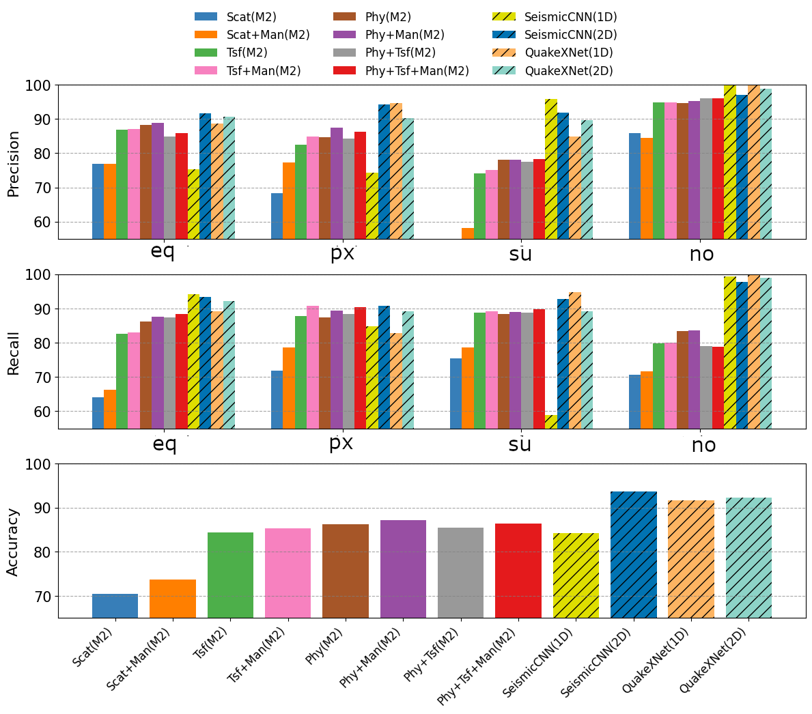{height="700"}
:::
::: {.column width="50%"}
The labeled catalog is **88% earthquakes**: 163,064 of 185,081 records.

| Stage | Data |
|---|---|
| Train and benchmark (figure) | curated, 10,000 traces per class, split 80:20 |
| Network test | about 10,000 events from routine operations: class imbalance, incomplete analyst picks, mixed station coverage |

| On the network test | Precision / recall |
|---|---|
| CNN (2D), earthquake | 96% / 95% |
| CNN (2D), explosion | 98% / 93% |
| CNN (2D), surface event | 92% / 97% |
| Random forest, surface event | recall 77% |

The balanced set allows a fair comparison of models; the network test shows how they behave in operation.

::: {.credit}
Kharita et al. (2026), *Seismica* 5(1), Fig. 5 and Section 4. CC BY 4.0.
:::
:::
:::

::: {.notes}
This is the workflow of the previous slide in a published study from this group, and it is the larger version of our course table. Figure 5 is the balanced benchmark: precision (top), recall (middle), accuracy (bottom) for deep models (hatched) and feature-based baselines (solid). The authors then did not stop there: they chose the best models and tested them on a network dataset with the problems of daily operations. The deep models lost little; the random forest fell to 77% recall on surface events. The paper also expanded surface events by adding stations within 30 km, one of the strategies of the next slide. CNN here is SeismicCNN 2D; the forest is ML_40 in the paper. Convolutional networks come in Chapter 4.
:::

## Strategies for rare classes: what each one costs {.dense}

| Strategy | What changes | Precision | Recall | F1 | AP | Brier | Cost |
|---|---|---|---|---|---|---|---|
| No balancing | nothing | .704 | .500 | .584 | .607 | .028 | misses half the explosions |
| **Move the threshold** to 0.2 | the decision only, no refit | .522 | .704 | .599 | .607 | .028 | more false alarms |
| **Class weights** | an error on the rare class costs more | .355 | .775 | .487 | .559 | .063 | probabilities inflate |
| **Oversample** | copies of rare samples in training | .357 | .764 | .486 | .539 | .062 | repeats the same events |
| **SMOTE** | new samples between rare neighbors | .370 | .745 | .494 | .545 | .058 | points may not be physical |
| **Undersample** | discards common samples in training | .189 | .826 | .307 | .322 | .144 | discards 95% of earthquakes |

: {tbl-colwidths="[19,28,7,6,6,6,6,22]"}

::: {.dim style="font-size:0.74em;line-height:1.2"}
**Without a number here:** collect more real rare events, as Kharita et al. did by adding stations within 30 km of surface events; augment with transformations that keep the physics (lesson 2.13); merge rare classes, as the avalanche study merged levels 4 and 5.
:::

::: {.takeaway}
5% explosions, logistic regression, scored at 5%. Each resampling method raised recall and lowered precision; none beat moving the threshold on F1 or average precision.
:::

::: {.notes}
All rows are the same 53 explosions and 1,000 earthquakes: 5-fold cross-validation, mean of 10 subsets, balancing applied inside each training fold only. SMOTE stands for synthetic minority oversampling technique: it draws a point on the line between a rare sample and one of its nearest rare neighbors. Here it is written directly in the figure script, because the imbalanced-learn package is not in the course environment. Do not over-generalize: this is one linear model on one dataset. Balancing can help flexible models, deep networks trained in batches, or very small rare classes, so test it in your own work. Implementation: class_weight="balanced", predict_proba with your own cut. Always do resampling inside the training fold.
:::

## When balancing matters {.dense}

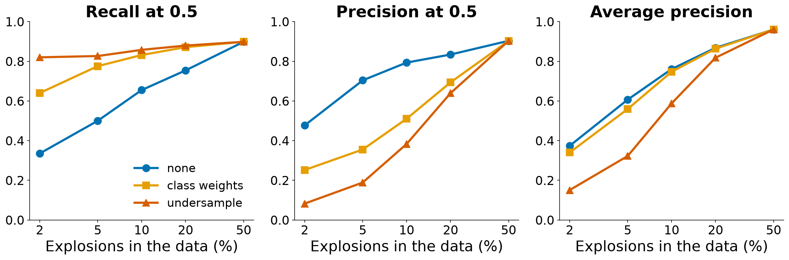{width="100%"}

::: {.columns}
::: {.column width="50%"}
**It changes the result when** the class is rare (here below about 20%) and you decide at the default 0.5: at 5%, recall .50 → .78 and precision .70 → .36. At 50% nothing changes.
:::
::: {.column width="50%"}
**It does not help when** you rank events or choose your own threshold: average precision does not improve. The avalanche study tried over- and undersampling, saw no gain, and used class costs instead.
:::
:::

::: {.credit}
Same data as the previous slide, mean of 10 subsets. Avalanche: Pérez-Guillén et al. (2022), Section 4. CC BY 4.0.
:::

::: {.notes}
Read the three panels left to right. Recall: without balancing it collapses as explosions become rare; with weights or undersampling it holds up. Precision: the price paid. Average precision, which does not depend on a threshold: balancing does not improve the ranking, and undersampling hurts it by discarding data. So balancing here acts mostly like a shift of the threshold. Ask: for your project, is the deliverable a ranked list, a yes or no at a fixed threshold, or a probability? The answer decides whether you need balancing. Pérez-Guillén et al. report that down-sampling and over-sampling showed no improvement, so they moved to cost-sensitive learning.
:::

## Two ways balancing goes wrong {.roomy}

::: {.columns}
::: {.column width="47%"}
**Oversampling before or after the split**

Copies of one explosion land in both training and test sets, so the forest recognizes them.

| Forest, 5% | Precision | Recall | F1 |
|---|---|---|---|
| **Before** split | .990 | 1.000 | .995 |
| **After** split | .760 | .492 | .590 |

First row: a leak, scored on a balanced test set.
:::
::: {.column width="53%"}
**Probabilities after balancing**

The model learns the balanced base rate, while only 5% of events are explosions.

| Logistic regression | Mean stated | Brier |
|---|---|---|
| No balancing | .052 | .028 |
| Class weights | .132 | .063 |
| Undersample | .248 | .144 |
| Weights, corrected | .047 | .031 |

Correction: odds × share / (1 − share).
:::
:::

::: {.takeaway}
Split first, balance training only. If someone will read your number as a probability, as in Sitka's warning levels, correct it back to the real base rate.
:::

::: {.notes}
Left: run in 3.4 style with a random forest, 53 explosions and 1,000 earthquakes, 25% test, mean of 10 subsets. The forest memorizes copies, so a score of .995 is a measurement of the leak. Whenever a score looks this good, ask when the resampling happened. Right: class weights tell the model that explosions are as common as earthquakes, so stated probabilities are about 2.5 times too high on average. The correction uses Bayes' rule: odds × share / (1 − share) when the training was balanced to 50%. Brier returns from .063 to .031, near the unbalanced model, and ranking does not change. The same applies to any deployed base rate that differs from training. Connects to the calibration slide above.
:::

## Part 3. Multiclass: four seismic source types

::: {.columns}
::: {.column width="44%"}
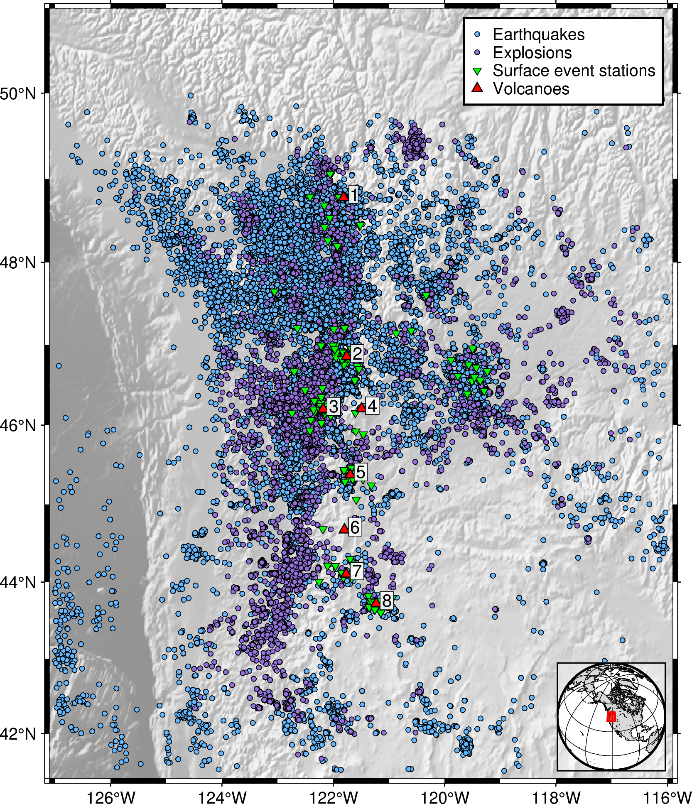{height="710"}
:::
::: {.column width="56%"}
[📍 In-situ sensor]{.gb .src} [🪨 Solid Earth]{.gb .sys .solid} [📈 Seismology]{.gb .disc .solid}

A regional network sorts what it records: **earthquake, explosion, surface event, noise**. A quarry blast called an earthquake pollutes the catalog; a missed landslide is a missed hazard.

| | Curated set in the paper | Our course table |
|---|---|---|
| Size | ∼200,000 waveforms, >70,000 events | 4 × 1,000 events |
| Input | waveforms, features, spectrograms | 61 physical features |
| Best result | random forest 89%, CNN above 92% | see the next slide |

::: {.credit}
Kharita, Denolle, Hutko, Hartog and Malone (2026), *Seismica* 5(1), Fig. 1. [doi:10.26443/seismica.v5i1.2068](https://doi.org/10.26443/seismica.v5i1.2068). CC BY 4.0. Catalog: Ni et al. (2023). Course table: Zenodo 14025693.
:::
:::
:::

::: {.notes}
The same events students clustered in 3.3, with a V-measure of 0.37 at K = 4. Today the labels are used in training. The map shows the catalog: earthquakes in blue, explosions in purple, stations recording surface events in green, volcanoes in red. Surface events cannot be located, so they are marked at stations. The course table is balanced by curation; the real stream is not. The paper's numbers are from its abstract: best random forest 89%, best spectrogram CNNs above 92%, which is a preview of Chapter 4.
:::

## Four-class confusion matrix and per-class scores

::: {.columns}
::: {.column width="50%"}
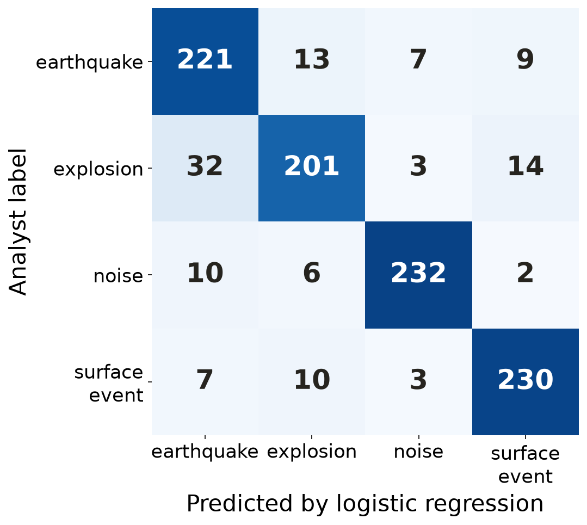{height="620"}
:::
::: {.column width="50%"}
| Class | Precision | Recall | F1 | AUC, one against rest |
|---|---|---|---|---|
| earthquake | .819 | .884 | .850 | .964 |
| explosion | .874 | .804 | .838 | .964 |
| noise | .947 | .928 | .937 | .983 |
| surface event | .902 | .920 | .911 | .983 |

**One against the rest, for explosions:**

- TP = 201, on the diagonal
- FN = 32 + 3 + 14 = 49, the rest of the row
- FP = 13 + 6 + 10 = 29, the rest of the column
- Precision 201 / 230, recall 201 / 250
:::
:::

::: {.takeaway}
Accuracy .884 hides the structure: 32 explosions called earthquakes is the largest error, and the cost lands on the catalog. Trivial baseline: .25.
:::

::: {.notes}
Rows are analyst labels and columns are predictions. This is logistic regression on the canonical leaderboard split, 1,000 test events. Do the explosion row and column with the class: any binary metric extends to many classes by treating one class against all the others, four binary problems, one line per class in the table. The physics of the largest error: at regional distance, quarry blasts and shallow earthquakes excite similar frequencies. Noise is cleanest. Also point at the AUC column: it ranks explosion and earthquake lowest, in agreement with the matrix.
:::

## Three ways to average over classes

::: {.columns}
::: {.column width="62%"}
| Average | How | 4 × 1,000 | Unequal classes |
|---|---|---|---|
| **Macro-F1** | mean of per-class F1, each class equal | .884 | **.810** |
| **Micro-F1** | pool TP, FP, FN over classes; equals accuracy | .884 | **.921** |
| **Weighted-F1** | mean of per-class F1, weighted by class size | .884 | .920 |

**Unequal set, F1 per class:** noise .966 (1,000 events), earthquake .897 (500), surface event .703 (50), explosion .675 (100). Mean of 20 random subsets, 5-fold cross-validation.
:::
::: {.column width="38%"}
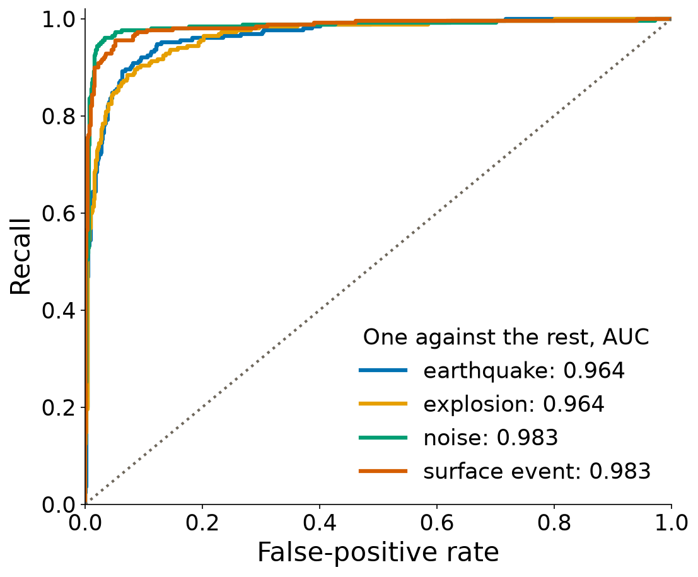{height="440"}

::: {.dim}
One-against-rest ROC curves, balanced test split.
:::
:::
:::

::: {.takeaway}
On balanced data the three agree. With unequal classes, micro follows noise and earthquakes (.921); macro shows the weak rare classes (.810). The leaderboard grades macro-F1.
:::

::: {.notes}
Choosing macro is a value judgment made explicit: every source type counts equally, whatever its size. Micro-F1 pools all the counts, and for single-label problems it equals accuracy. Weighted-F1 is close to micro whenever classes are unequal. The unequal set is 1,000 noise, 500 earthquakes, 100 explosions and 50 surface events: 5-fold cross-validation, mean of 20 random subsets. That proportion is an illustration, not a measured network ratio. Ask: why does a rare surface event deserve equal weight in the grade? Because it can be a landslide.
:::

## Avalanche danger: four ordered levels, one rare

::: {.columns}
::: {.column width="56%"}
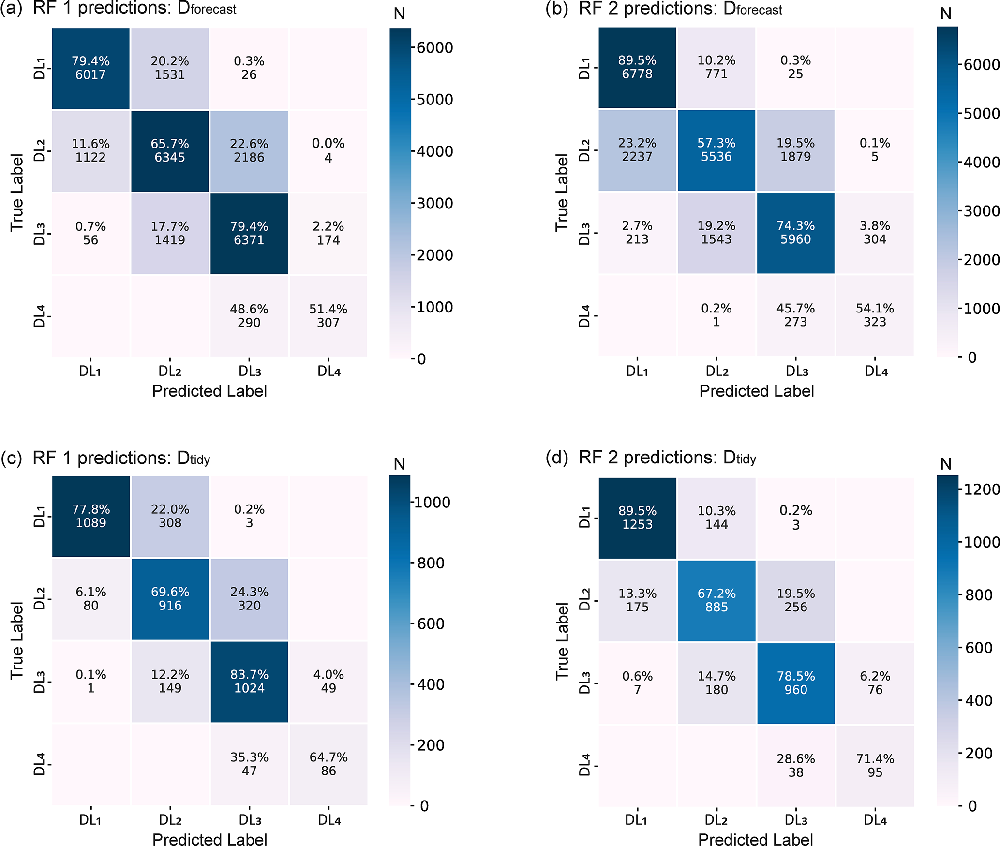{height="700"}
:::
::: {.column width="44%"}
[🖥️ Model & simulation]{.gb .src} [🧊 Cryosphere]{.gb .sys .ice} [🧊 Glaciology]{.gb .disc .ice}

Predict the Swiss avalanche danger level (1 low to 4 high) from weather stations and simulated snow cover.

- Models selected by **macro-F1**, so that minority levels count
- Accuracy 74–76%, against about 76% agreement among operational forecasts
- Level 4 is rare: 597 of about 25,800 test samples in panel (a)
- Errors sit next to the diagonal: most are off by one level

::: {.credit}
Pérez-Guillén et al. (2022), *Nat. Hazards Earth Syst. Sci.* 22, 2031–2056, Fig. 6. [doi:10.5194/nhess-22-2031-2022](https://doi.org/10.5194/nhess-22-2031-2022). CC BY 4.0.
:::
:::
:::

::: {.notes}
A second Earth system with the same tools. Two differences with our seismic problem. First, the classes are ordered: predicting level 3 when the truth is 2 is less serious than predicting 4, and accuracy treats them alike. The confusion matrix shows this structure, since fewer than 3% of errors are off by two levels. Second, the labels are forecasts by people: panels (a, b) use the bulletin's forecast levels and panels (c, d) a quality-controlled subset. Level 4 recall in panel (a) is 51%. The benchmark is human agreement, about 76%, which puts a ceiling on what accuracy can mean. Connect to lesson 2.13: who produced the labels?
:::

## Per-class reporting in a published comparison

::: {.columns}
::: {.column width="58%"}
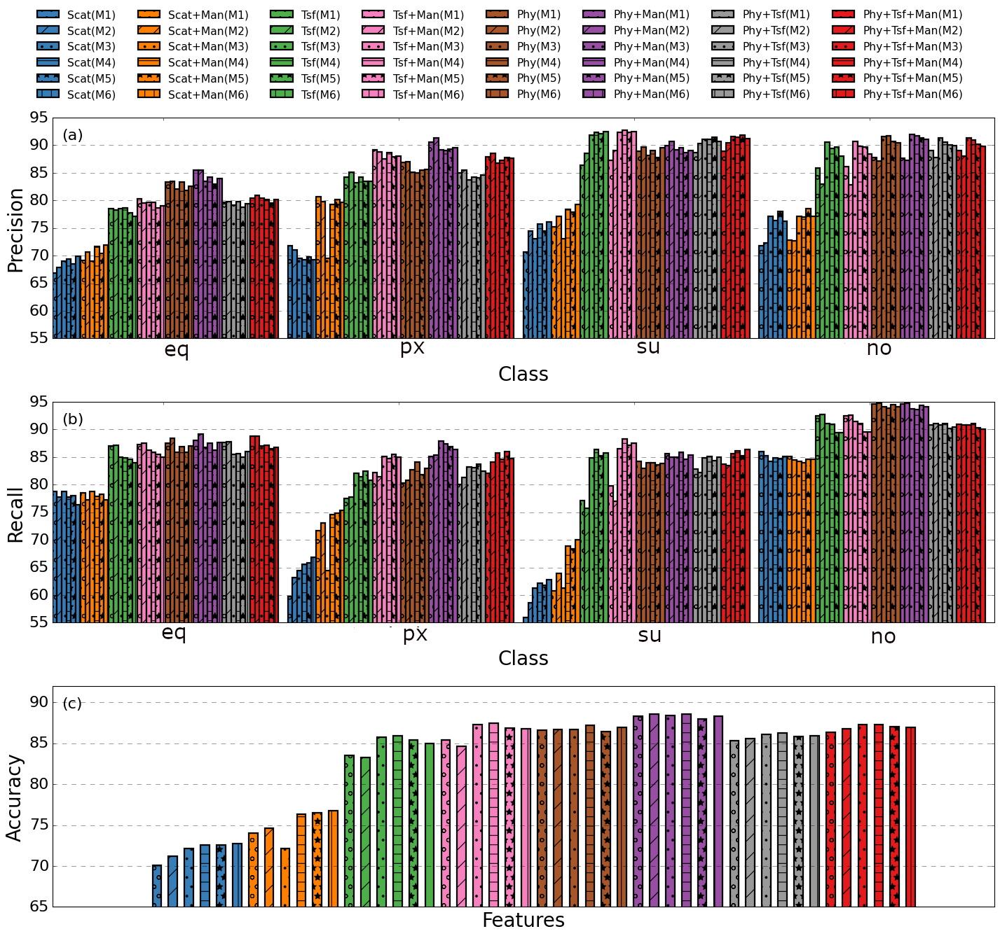{height="710"}
:::
::: {.column width="42%"}
Random forests on the curated Pacific Northwest set: eight feature sets (colors) and six waveform configurations (hatching).

**Panels (a, b):** precision and recall per class. **Panel (c):** overall accuracy.

- Noise (no) scores high with every feature set
- Explosions (px) and surface events (su) gain the most from better features
- Scattering features alone reach about 70% accuracy; the best sets about 88%
- Waveform configuration changes scores by only 1–2%

::: {.credit}
Kharita et al. (2026), *Seismica* 5(1), Fig. 4. eq earthquake, px explosion, su surface event, no noise. CC BY 4.0.
:::
:::
:::

::: {.notes}
Top two panels: precision and recall per class. Bottom: overall accuracy. Ask students to find which class improves most from scattering-only features (blue) to physical features (brown and purple): explosions and surface events. Noise is easy for every set. That is why you report per class. The paper's caption gives the 1 to 2% for waveform configuration; the 70 and 88 are read from panel (c). Students' 61 features belong to the physical family, so this figure is the larger study behind today's table.
:::

## Which metric answers which question {.mid}

| Your question | Metric | Today's example | Misleads when |
|---|---|---|---|
| Is there skill at all? | score against a baseline | .25 for four balanced classes | no baseline is stated |
| What fraction is right? | accuracy, micro-F1 | .884 four classes | classes are unequal: .965 with recall .521 |
| Are real events caught? | recall | .868, or .521 at 5% | alone: trigger on everything |
| Is the trigger list clean? | precision | .931; .15 at Sitka's lower threshold | alone: one sure trigger wins |
| Both, at one threshold? | F1, MCC | .899, .806 | error costs are unequal |
| Ranking, all thresholds? | ROC AUC, average precision | .963 and .963; .940 and .621 at 5% | ROC AUC with rare positives |
| Do all classes count? | macro-F1, per-class table | .810 against micro .921, unequal classes | a rare class has few samples |
| Is the probability true? | reliability diagram, Brier, log-loss | Brier .074 against .087 | the base rate changes in operation |

::: {.takeaway}
A missed event costs science or safety; a false alarm costs analyst time and trust. The metric and the threshold follow from those two costs.
:::

::: {.notes}
Leave this up for questions; it is what the Ch 3 quiz (Nov 10 to 12) asks about. Each "misleads when" cell was shown today. Book section 3.4 has the simulated scatter of random confusion matrices, showing why precision and recall must be reported together.
:::

## The classification leaderboard opens today {.roomy}

::: {.columns}
::: {.column width="50%"}
**The rules**

- Same split for everyone: 75% to train, stratified, `random_state=2026`
- Any model, any features; choose with cross-validation on the training set
- Predict the shared 1,000 test events and submit by pull request
- CI scores **macro-F1** and posts the standings; closes **Tue Nov 24**
- Score to beat: **.884**, logistic regression (forest: .883)
:::
::: {.column width="50%"}
**What this design cannot test**

- The tables have no event ID, station or origin time, so nothing can be grouped
- The same quarry can fall on both sides of a random split: the score credits recognition, more than generalization
- The public score is diagnostic; the grade rests on a hidden set

Mon Nov 9 (3.8) builds the splits this dataset cannot run.
:::
:::

::: {.notes}
The linear model with 62 numbers per class matches a forest of 100 trees here: Friday asks what a forest adds. Canonical split: section 3 of notebook 3.5. Changing it disqualifies the comparison. Most common mistake: scoring candidate models repeatedly on X_test, which is tuning to the test set (Blum and Hardt, 2015, on leaderboards). Because the dataset and seed are public, the test labels can be reconstructed, which is why the public score carries no grade: see leaderboard/INSTRUCTOR.md for the hidden-set recipe. Results file: results/predictions_<uwnetid>.csv.
:::

## Now run it yourself {.roomy}

1. `git pull`, then `pixi run jupyter lab` → `3.5_multiclass_classification.ipynb`; run sections 1 to 4 (data, split, scaling)
2. In a new cell, fit `LogisticRegression(max_iter=5000)` on `X_train_scaled`; compute `f1_score(y_test, pred, average="macro")`; compare with .884, then look at `classification_report`
3. Print `model.classes_` and `model.predict_proba(X_test_scaled)[:5]`: which class would you warn on, at what threshold?
4. Write `results/predictions_<uwnetid>.csv` from section "Class leaderboard" and open your pull request
5. If you have time: 3.4, section "Imbalanced detection". Choose a threshold and defend it in one sentence

::: {.dim}
Review order: 3.6, then 3.4, then 3.5. Gradient descent by hand is in 3.6. Due Mon Nov 9: homework on scoring clusters. HW-CML assigned today, due Fri Nov 20. Fri Nov 6: trees and forests (3.7, 3.9). Mon Nov 9: robust training (3.8).
:::

::: {.notes}
Timing: this deck about 50 minutes, these tasks 25 minutes, wrap-up 5 minutes. Circulate on task 2 and get every student to a valid submission file. Note that 3.6 uses a water-potability table of undocumented provenance, where logistic regression scores .598 against a baseline of .597: read it for the mechanics of the fit, and for what a near-null result looks like. Synthesis question: what metadata would this dataset need for a grouped split? That leads to Monday.
:::
