## {background-color="#faf7f2"}

[🌲]{.lecture-icon}

### Today's question

**What does a forest add to Wednesday's logistic regression, for classes and for numbers?**

| Part | What we do | Data |
|---|---|---|
| Start | draw a ROC curve by hand, then read it for two models | ten real seismic events |
| 1. Classes | one tree, many trees, thresholds, tree agreement | four Pacific Northwest source types; snow layers in the Swiss Alps |
| 2. Numbers | the same tree for a number, baselines, importance, range limits | soil moisture at Turnbull, WA; SoilGrids |
| 3. Maps | how much spatial correlation is a problem | soil moisture, western US; biomass, central Africa |
| 4. Practice | best practices for classifiers and regressors | everything above |

::: {.notes}
Timing for the 80 minutes (10:00 to 11:20): hand-drawn ROC 8 minutes, deck about 40 minutes, notebook 3.11 for 25 minutes, synthesis 7 minutes. To hold that, skip slides 5, 10, 11 and 12 (Swiss snow, four models, thresholds across models, tree agreement) and leave them as reading. If pulse talks run today, take their time from the notebook. Why the hand exercise: on Wednesday the deck used the threshold and the ROC curve before it had explained where the probability came from. We repair that first, then use the same ideas on a new model.
:::

## Draw a ROC curve from ten events {.ten}

::: {.columns}
::: {.column width="46%"}
| Rank | Probability of explosion | Analyst label |
|---|---|---|
| 1 | 0.97 | explosion |
| 2 | 0.90 | explosion |
| 3 | 0.72 | earthquake |
| 4 | 0.62 | explosion |
| 5 | 0.40 | earthquake |
| 6 | 0.37 | explosion |
| 7 | 0.15 | earthquake |
| 8 | 0.12 | explosion |
| 9 | 0.06 | earthquake |
| 10 | 0.02 | earthquake |
:::
::: {.column width="54%"}
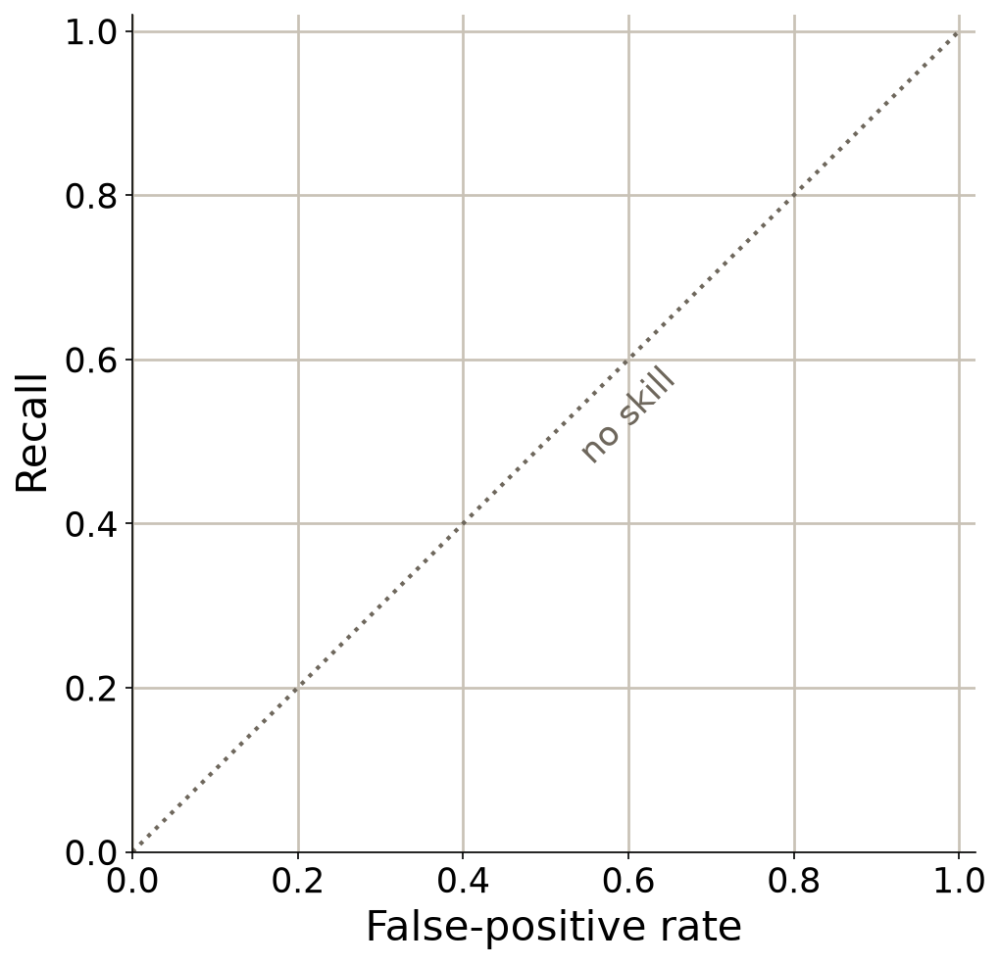{height="600"}
:::
:::

::: {.takeaway}
Start at (0, 0) and go down the list. Explosion: move up 0.2. Earthquake: move right 0.2. Circle where you stand at thresholds 0.8, 0.5 and 0.2.
:::

::: {.notes}
Five minutes in pairs, on paper. Ask them to draw the axes from 0 to 1 with five divisions. Why it works: lowering the threshold flags one more event at a time. If that event is an explosion, recall rises by 1/5; if it is an earthquake, the false-positive rate rises by 1/5. These are real test events from Wednesday's logistic regression, explosion against earthquake, with probabilities rounded to two decimals. They were chosen to include every kind of error, so this curve is worse than the model's full curve; say so on the next slide. Circulate and check rank 3, where the first false alarm appears.
:::

## Each threshold is one point on the curve {.ten}

::: {.columns}
::: {.column width="46%"}
| Threshold | Caught, of 5 | False alarms, of 5 | Recall | False-positive rate |
|---|---|---|---|---|
| 0.8 | 2 | 0 | 0.4 | 0.0 |
| 0.5 | 3 | 1 | 0.6 | 0.2 |
| 0.2 | 4 | 2 | 0.8 | 0.4 |

**AUC** is also a count. Of the 25 explosion and earthquake pairs, the explosion has the higher probability in 19: 19 / 25 = .76.

::: {.dim}
Ten events chosen to include every kind of error. Logistic regression, 61 waveform features, Zenodo record 14025693.
:::
:::
::: {.column width="54%"}
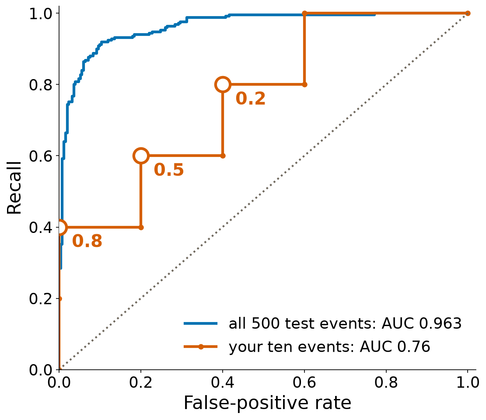{height="600"}
:::
:::

::: {.takeaway}
A threshold gives one confusion matrix, which gives one point. The curve collects all of them, and its area is .96 on all 500 test events.
:::

::: {.notes}
Put the table next to one student's drawing. Build one confusion matrix aloud: at 0.5, TP 3, FN 2, FP 1, TN 4. Then show that it is the point (0.2, 0.6). Then the area: walk through the pairs if there is time. Explosion at 0.97 beats all 5 earthquakes; 0.90 beats 5; 0.62 beats 4; 0.37 beats 3; 0.12 beats 2. Total 19 of 25. So AUC reads: pick one explosion and one earthquake at random; how often does the model rank them correctly? The blue curve uses the same model on all 250 explosions and 250 earthquakes of Wednesday's test split: AUC .963. Numbers: figscripts/lec17_trees_forests.py.
:::

## A forest on 146 snow layers in the Swiss Alps

::: {.columns}
::: {.column width="42%"}
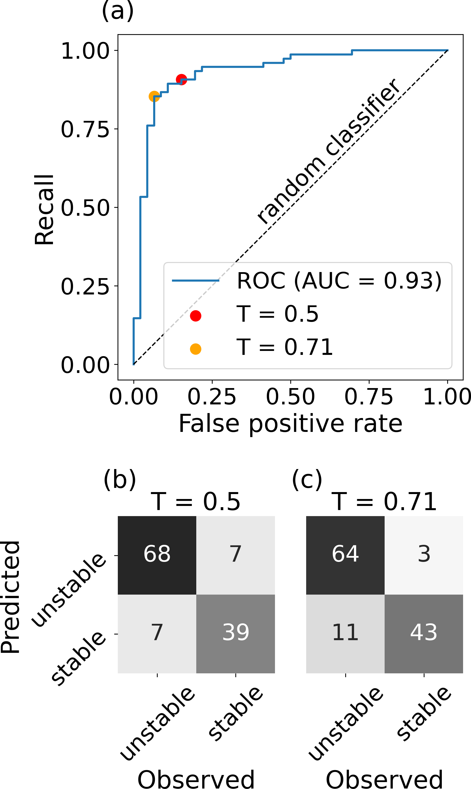{height="730"}
:::
::: {.column width="58%"}
[🖥️ Model & simulation]{.gb .src} [🧊 Cryosphere]{.gb .sys .ice} [🧊 Glaciology]{.gb .disc .ice}

**Is this simulated snow layer unstable?** 742 observed snow profiles were compared by hand with simulated ones.

- Features: 34 candidates from the snow model, 6 kept
- Training: 146 labeled layers, balanced
- Output: mean vote of 400 trees
- Test: 121 layers in an independent Swiss data set

| Threshold | Missed | False alarms | Accuracy | Recall | Precision |
|---|---|---|---|---|---|
| 0.50 | 7 | 7 | 88% | 91% | 91% |
| 0.71 | 11 | 3 | 88% | 85% | 96% |

The authors question whether 0.71 is an improvement for operations, because it misses more unstable layers.

::: {.credit}
Mayer, van Herwijnen, Techel and Schweizer (2022), *The Cryosphere* 16, 4593–4615, Fig. 7. [doi:10.5194/tc-16-4593-2022](https://doi.org/10.5194/tc-16-4593-2022). CC BY 4.0.
:::
:::
:::

::: {.notes}
This is the exercise of the last slide in a published study, with a forest. In panel (a), the red dot is threshold 0.5 and the orange dot is 0.71, which maximizes recall plus specificity minus one (Youden's J). In panels (b, c) rows are predicted and columns observed. Moving from 0.5 to 0.71 turns 4 false alarms into correct calls and 4 caught layers into misses, so accuracy stays at 88%. A forecaster who fears missing an avalanche problem may reject the "optimal" threshold. The target came from a stability test (rutschblock) and an estimate of local danger. Compared with observed avalanche activity around Davos over five winters, 69% of 252 avalanche days and 75% of 345 non-avalanche days were classified correctly. Ask: why could a forest work with only 146 samples? We return to this in a few slides.
:::

## A decision tree asks one question at a time

::: {.columns}
::: {.column width="52%"}
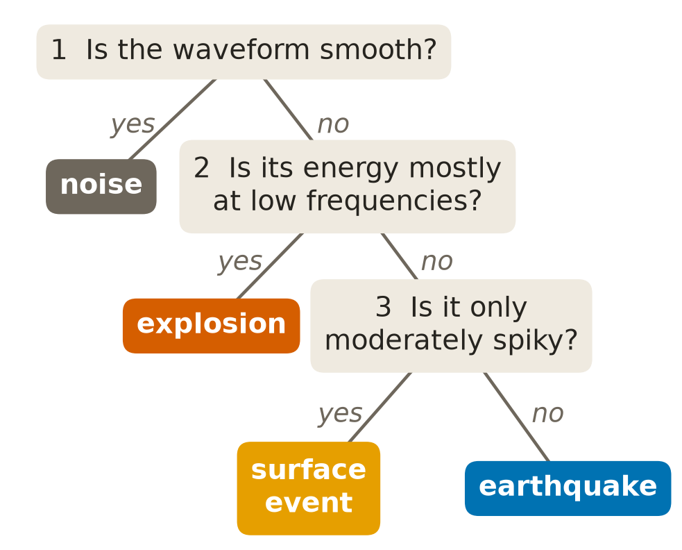{width="100%"}
:::
::: {.column width="48%"}
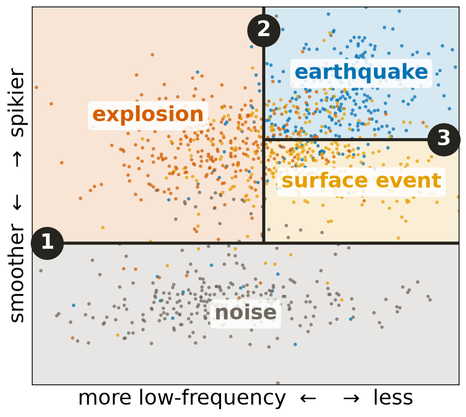{width="100%"}
:::
:::

::: {.takeaway}
Each question draws one straight line, so the tree cuts the events into boxes. A new event lands in one box and takes its most common label; to predict a number, its mean.
:::

::: {.notes}
Read the tree aloud as a seismologist would, then point to the same numbered line on the map. Question 1: noise has no impulsive onset, so its waveform is smooth. Question 2: explosions in this catalog carry more low-frequency energy. Question 3: surface events are less impulsive than earthquakes. The tree was not told any of this; it was given two columns and limited to four boxes. Ask: what would you have asked first? Exact cuts: KurtoSig 1.40, Fquart1 3.12, KurtoSig 8.78. Macro-F1 .70 on test events with these three questions and two features. The axes are stretched so the events can be seen, and the tree does not care: only the order of values matters, so no scaling is needed, unlike logistic regression. Fquart1 is read from the feature name as the first quartile of the spectrum. Same 3,000 training events as 3.5.
:::

## How does it pick the question? It tries them all

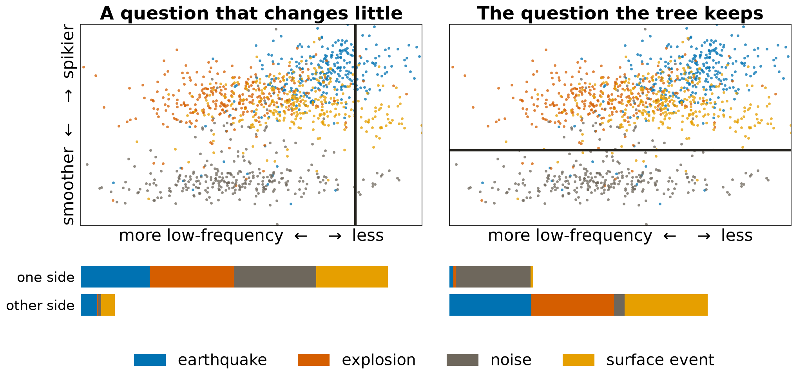{.r-stretch}

::: {.takeaway}
The tree tests every feature and every cut, and keeps the question that leaves each side purest. Then it repeats inside each box, never looking back.
:::

::: {.notes}
The bars show the source types on each side of the line, and their length is the number of events. Left: this cut barely helps, because the large group has about the same mix as before. Right: one side is almost all noise. Purity has a formula (Gini impurity, or variance for numbers), but the idea is this picture: after the question, how mixed is each group? The choice is greedy: the best question now, not the best sequence of questions. A word to keep apart: a split threshold acts on a feature, while Wednesday's decision threshold acts on a probability.
:::

## Keep asking and the tree memorizes

::: {.columns}
::: {.column width="68%"}
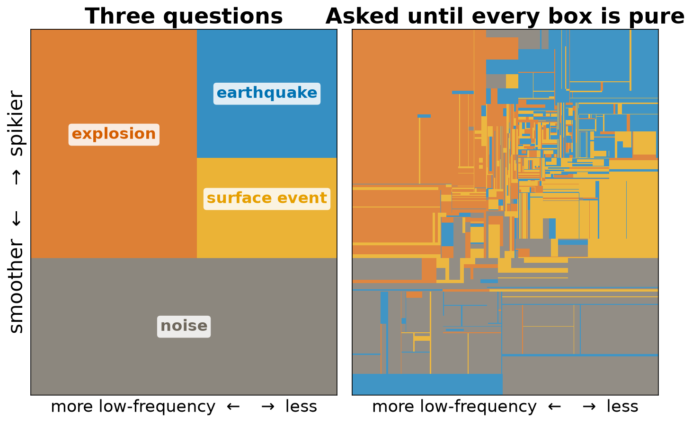{width="100%"}
:::
::: {.column width="32%"}
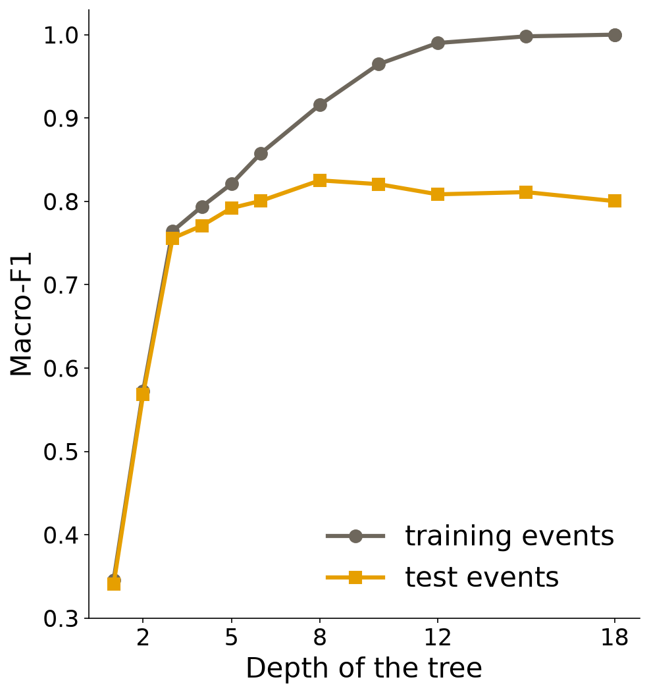{width="100%"}

::: {.dim}
Curve: all 61 features.
:::
:::
:::

::: {.takeaway}
Left to itself, a tree draws a box around almost every training event, outliers included. It becomes perfect on those events and worse on new ones, and a small change in the data can change the whole tree.
:::

::: {.notes}
Left and right use the same 3,000 events and the same two features. The right panel has about 890 boxes. Ask: what does a new event inside one of those slivers inherit? The label of one or two neighbors. Numbers if asked, all 61 features, macro-F1 train then test: depth 2 (4 leaves) .572, .568; depth 5 .821, .792; depth 8 .825 on test, the best; full depth (18, 290 leaves) 1.000, .800. Two features: three questions .70 on test, full tree .64. Limiting depth helps a little, but the deeper problem is variance: change a few training events and the first questions can change, along with everything below them. Ask: if one tree is unstable, what can we do with many unstable trees? Same idea as averaging noisy measurements, which only helps if their errors differ. That is the next slide.
:::

## Many trees: resample events, resample features

::: {.columns}
::: {.column width="57%"}
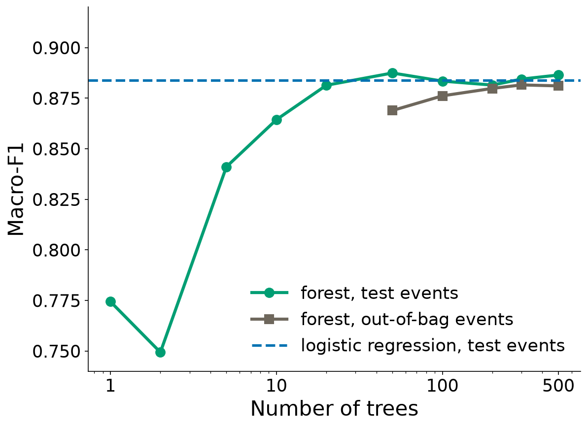{height="620"}
:::
::: {.column width="43%"}
Each tree differs from the others in two ways:

1. It trains on a **bootstrap**: events drawn with replacement. About 37% are left out
2. Each split considers a **random subset** of features

The forest takes a majority vote, or the mean for numbers.

**Out-of-bag score:** each event is predicted only by trees that never saw it, so no test set is spent.
:::
:::

::: {.takeaway}
One tree scores .774 and 300 trees score .884; the out-of-bag estimate is .882. Beyond about 50 trees the score only wobbles by ±.003.
:::

::: {.notes}
Breiman (2001, Machine Learning 45, 5-32) is the source. Bagging is the bootstrap plus aggregation. Random features decorrelate the trees: without them, every tree would use the same strong first split, and averaging correlated errors helps little. The 37% is (1 - 1/n)^n, which tends to 1/e. More trees do not overfit in the sense of a deeper tree: they only reduce the wobble of the average, so the cost is compute. The dashed line is logistic regression at .884. Scikit-learn's forest averages the class probabilities of the trees; for fully grown trees that is the same as the share of votes.
:::

## Four models on the same 1,000 test events

::: {.columns}
::: {.column width="56%"}
| Model | Macro-F1 | Recall: explosion |
|---|---|---|
| One full tree | .800 | .720 |
| Forest, 300 trees | .884 | .796 |
| Logistic regression, standardized | .884 | .804 |
| Logistic regression, raw features | .783 | |
| Boosted trees | **.898** | **.836** |

**Boosting:** trees grown in sequence, each one fit to the errors left by the trees before it.

Forests need no standardizing. Logistic regression does: on raw features it stopped before converging.
:::
::: {.column width="44%"}
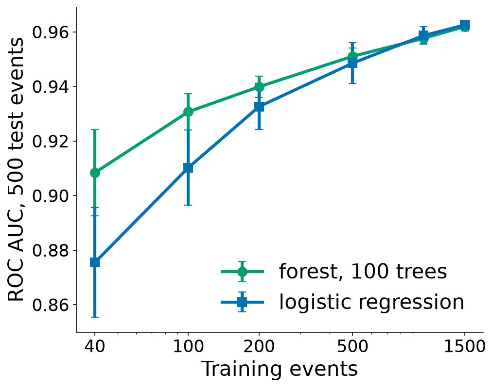{height="400"}

::: {.dim}
Explosion against earthquake, mean of 10 random subsets, bars 1 standard deviation.
:::
:::
:::

::: {.takeaway}
With all training events the forest ties logistic regression. With 40 events it leads, AUC .908 against .875, which fits a study that trained on 146 layers.
:::

::: {.notes}
Wednesday's seed: why use a forest if the linear model ties it? Here are three answers. It needs less preparation. It holds up better with few samples on this dataset, though the advantage is gone by about 500 events. It captures interactions without being told; boosting takes this further, at .898. Keep this honest: one split, one dataset, and differences of a few thousandths are noise. Explosions are still the weakest class for every model. The physics did not change: blasts and shallow earthquakes overlap in these features. Boosted trees are histogram gradient boosting with default settings. Leaderboard: closes Nov 24; .898 is now a number to beat, and it was reached on the test set once. Choose your own model with cross-validation on the training set.
:::

## Same ROC curve, different thresholds

::: {.columns}
::: {.column width="52%"}
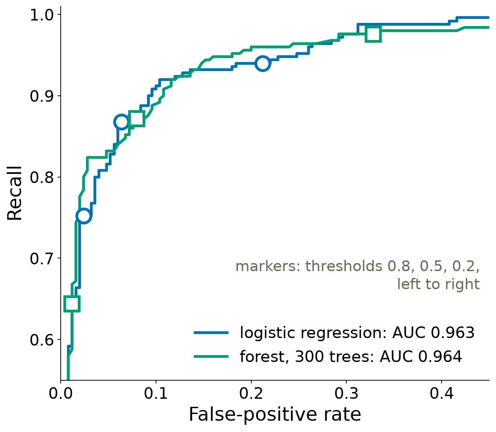{height="630"}
:::
::: {.column width="48%"}
A forest also outputs a probability: the mean over its trees.

| Threshold | Logistic: missed / false alarms | Forest: missed / false alarms |
|---|---|---|
| 0.2 | 15 / 53 | 6 / 82 |
| 0.5 | 33 / 16 | 32 / 20 |
| 0.8 | 62 / 6 | 89 / 3 |

250 explosions, 250 earthquakes.

| | ROC AUC | Average precision | Brier |
|---|---|---|---|
| Logistic | .963 | .963 | .075 |
| Forest | .964 | .965 | .078 |
:::
:::

::: {.takeaway}
AUC .963 and .964, yet threshold 0.8 misses 62 or 89 explosions. A threshold does not transfer between models: choose it for each one on validation data.
:::

::: {.notes}
This is why the same drawing is useful for a second model. The curves almost overlap, so the two models rank events about equally well. But the same number means something different: the forest's probabilities are spread differently from those of logistic regression, so each threshold lands at another point on the curve. Mayer et al. had to find their own threshold, 0.71 or 0.77, for the same reason. Calibration from Wednesday applies here too: Brier .078 against .075. In 3.11 students reproduce this table with their own function.
:::

## When the trees disagree

::: {.columns}
::: {.column width="60%"}
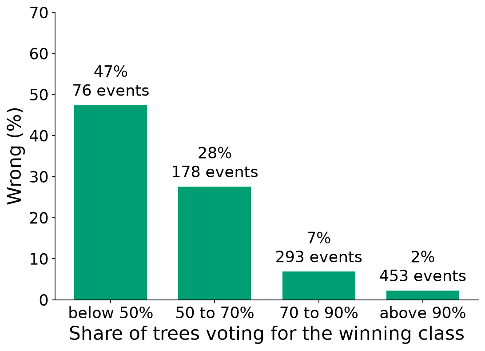{height="600"}
:::
::: {.column width="40%"}
For each of the 1,000 test events, count the trees voting for the winning class.

- Above 90% of the trees: 453 events, **2%** wrong
- Below 50% of the trees: 76 events, **47%** wrong

The labels are not needed to compute the agreement, so low-agreement events can go to an analyst first.
:::
:::

::: {.takeaway}
The 254 events with agreement below 70% are 1 in 4 test events and hold 85 of the 115 errors. Agreement ranks events; it is not yet a calibrated probability.
:::

::: {.notes}
Forest of 300 trees on the four source types. Errors in the two lowest bins: 36 + 49 = 85 of 115, which are the rates times the counts in the figure: .474 x 76 and .275 x 178. In the two highest bins: 20 + 10 = 30. Disagreement among trees trained on different resamples estimates epistemic uncertainty: what the model has not learned. It does not measure noise in the measurement itself (aleatoric). Same recipe returns in lesson 4.5 as deep ensembles (Lakshminarayanan et al., 2017). Book section 3.9 runs this with bagged trees.
:::

## Part 2. For a number, each box stores a mean

::: {.columns}
::: {.column width="52%"}
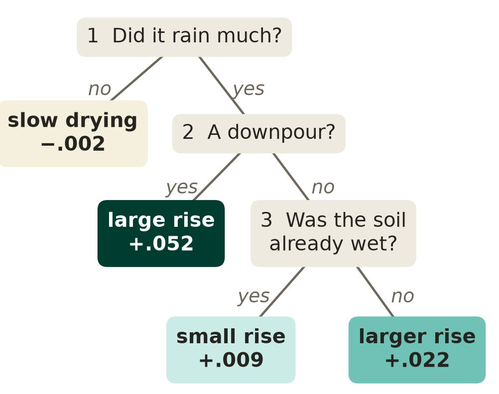{width="100%"}
:::
::: {.column width="48%"}
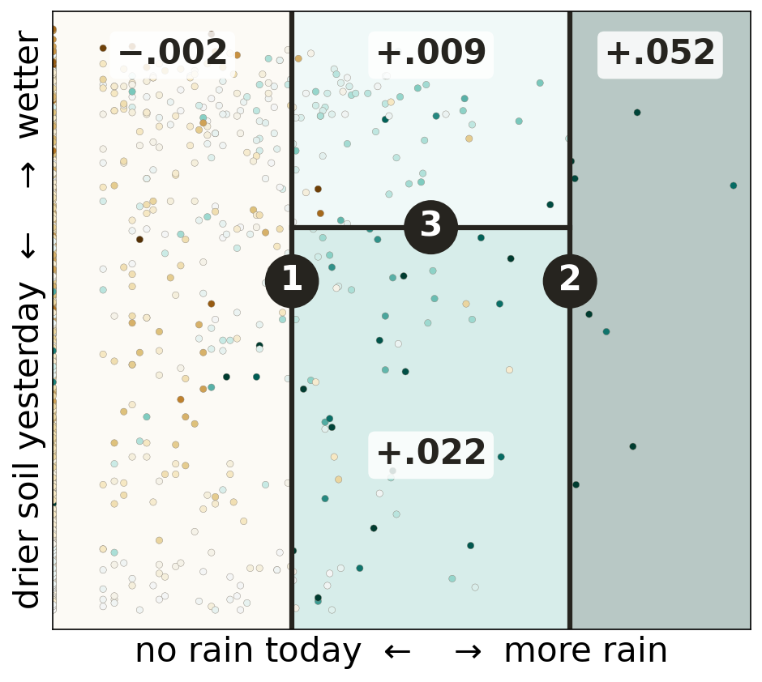{width="100%"}
:::
:::

::: {.takeaway}
Same questions, same boxes. The target is the daily change in soil moisture at Turnbull, and each box predicts the mean change of its training days (m³/m³).
:::

::: {.notes}
Read it as a hydrologist. Little or no rain: the soil keeps drying slowly. A downpour: a large rise. Moderate rain: the same water adds less to soil that is already wet. The tree found the last idea alone, from two columns. Each dot is one training day, colored by its real change, so the spread inside a box is visible. Cuts: rain 4.55 and 21.3 mm, moisture yesterday .231 m³/m³. Training days per box: 1,500 slow drying, 64 and 58 with moderate rain, and only 8 downpours, so +.052 rests on few days. R² on the test years, 2021 to 2024: .23 for these four boxes.
:::

## A regression tree predicts in stairs

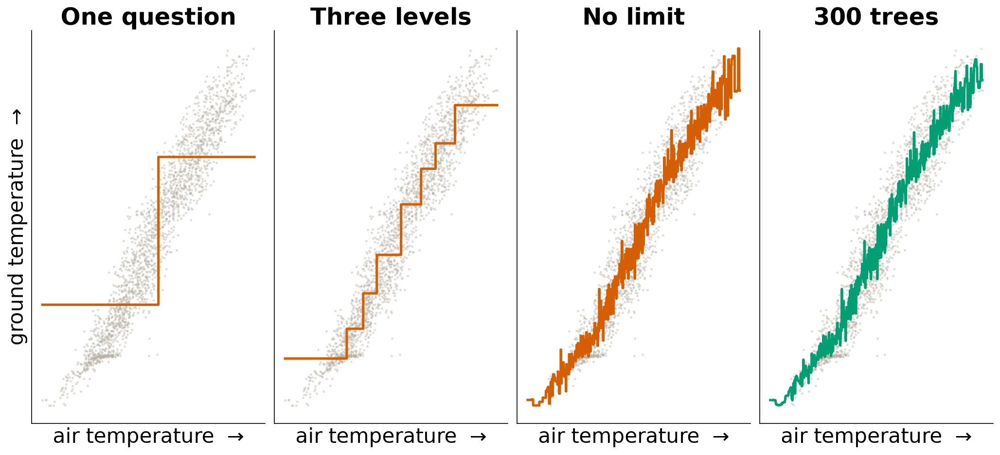{.r-stretch}

::: {.takeaway}
The tree keeps the question that most reduces the spread inside each group, the same idea as purity. More levels make more stairs; without a limit they follow single days; averaging many trees smooths them.
:::

::: {.notes}
One feature, so we can draw the prediction itself. Daily maximum ground surface temperature from air temperature at Turnbull, training years 2015 to 2020. Gray: training days. Red: one tree. Green: the mean of 300 trees, which is still built of steps, only fine ones. For classes the tree lowers impurity; for numbers, the variance inside each group. Numbers if asked, mean absolute error on 2021 to 2024: one question 8.1 °C, three levels 4.5, no limit 4.5, forest 4.4. On this clean relation a full tree does little harm. The harm comes with noisy targets: for the daily change on the previous slide, test R² is .23 for four boxes, -.43 for a full tree.
:::

## Does the forest beat the baselines? Turnbull, WA {.dense}

::: {.columns}
::: {.column width="54%"}
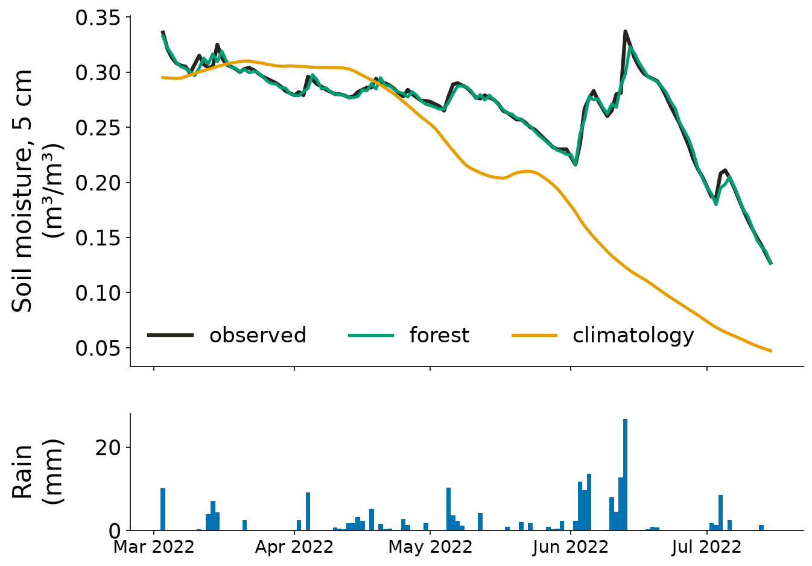{height="600"}
:::
::: {.column width="46%"}
[📍 In-situ sensor]{.gb .src} [💧 Land water]{.gb .sys .water} [💧 Hydrology & land-surface modeling]{.gb .disc .water}

Now today's soil moisture at 5 cm, with six features including yesterday's value.

| Soil moisture at 5 cm | Error (m³/m³) | R² | Error, rainy days |
|---|---|---|---|
| Climatology | .0284 | .848 | .0353 |
| Yesterday's value | .0042 | .995 | .0138 |
| Linear regression | .0036 | .997 | **.0103** |
| Forest, 300 trees | **.0033** | .997 | .0109 |

::: {.dim}
USCRN station WA Spokane 17 SSW. Train 2015 to 2020 (1,630 days), test 2021 to 2024 (1,172 days, 78 with 5 mm of rain or more). Features: yesterday's moisture at 5 and 10 cm, rain today and yesterday, air temperature, solar radiation. Error: mean absolute error. R²: share of variance explained.
:::
:::
:::

::: {.takeaway}
Repeating yesterday already gives R² .995, so that is the baseline to beat. The forest lowers the error by .0009 m³/m³; on rainy days the linear model does slightly better.
:::

::: {.notes}
The figure shows spring 2022 in the test years: the forest follows the observed curve so closely that the two overlap, while climatology misses the wet June. This station is one students used in Session 7 and the clustering homework. We split by time, train on the past and test on the future; Monday explains why. The trap: climatology has R² .85 and persistence .995 because soil moisture changes slowly. A high R² on a slow variable tells you little until you compare with persistence. Quiz question 5 uses the same idea. On rainy days the physics matters: all models miss wetting pulses more, and the linear rain term does as well as the forest. Sensor accuracy is a good thing to ask about: is .0009 m³/m³ a meaningful gain? Bell et al. (2013) describe the network. Book section 3.7 repeats the workflow on a synthetic temperature record with a forest-versus-climatology comparison.
:::

## Forests at global scale: SoilGrids at 250 m {.dense}

::: {.columns}
::: {.column width="58%"}
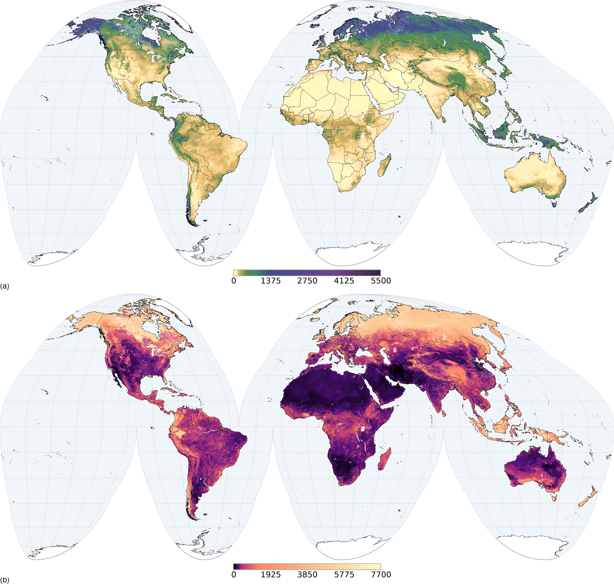{height="735"}
:::
::: {.column width="42%"}
[📍 In-situ sensor]{.gb .src} [💧 Land water]{.gb .sys .water} [💧 Hydrology & land-surface modeling]{.gb .disc .water}

**Soil properties for the globe**, from about 240,000 profiles and more than 400 environmental layers. Top: predicted soil organic carbon, 5 to 15 cm (dg/kg). Bottom: range of the prediction, 5% to 95% quantile.

A **quantile forest** keeps the training values in each leaf, so each location gets a distribution, not a single number.

Cross-validation stratified in space: model efficiency from **0.31** (coarse fragments) to **0.74** (bulk density).

"The least sampled areas present the highest prediction uncertainties."

::: {.credit}
Poggio et al. (2021), *SOIL* 7, 217–240, Fig. 7. [doi:10.5194/soil-7-217-2021](https://doi.org/10.5194/soil-7-217-2021). CC BY 4.0.
:::
:::
:::

::: {.notes}
This is the regression forest as a global product used by land-surface modelers. Point at the boreal belt: high carbon in the top panel and a wide range in the bottom panel, read from the color bars. In the bottom color bar, dark means a narrow range. Model efficiency coefficient is a skill score like R² on the 1:1 line. The authors also note the risk of predicting into unknown regions of feature space, which is the next slide. They first decorrelated and then eliminated covariates, partly to avoid biased variable importance, which is the slide after that. The caption inconsistency is in the paper: the title sentence says 5 to 95% and the panel label says interquartile range.
:::

## On a map, a forest can learn where or why {.dense}

::: {.columns}
::: {.column width="23%"}
[🖥️ Model & simulation]{.gb .src} [💧 Land water]{.gb .sys .water} [💧 Hydrology & land-surface modeling]{.gb .disc .water}

Annual mean soil moisture, 992 land cells at 0.5°, 1991 to 2020.

The **red box** was held out of training.

Features: longitude and latitude, or precipitation and air temperature.

::: {.credit}
CPC leaky-bucket model: Fan and van den Dool (2004), *J. Geophys. Res.* 109, D10102.
:::
:::
::: {.column width="77%"}
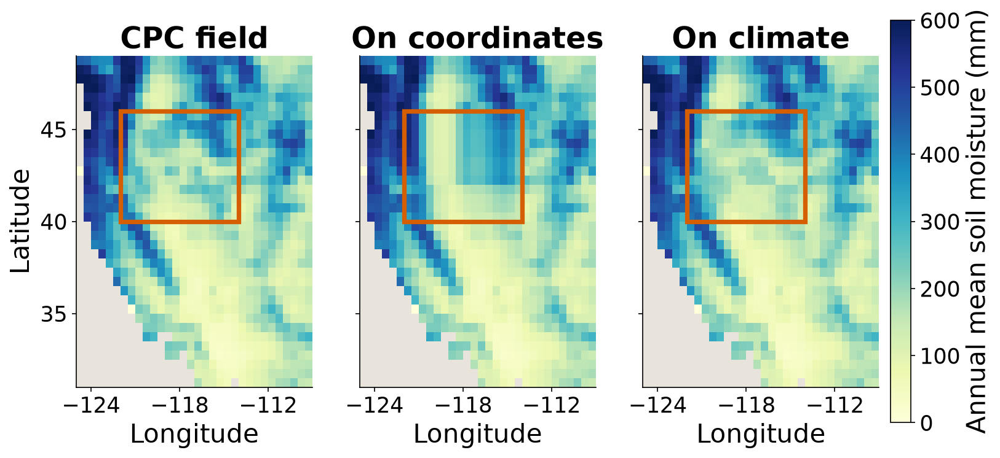{width="100%"}
:::
:::

::: {.takeaway}
Inside the box, the forest on longitude and latitude can only extend the boxes it drew around it (R² .18). The forest on precipitation and temperature recovers the pattern (R² .81).
:::

::: {.notes}
This is the box picture from an hour ago, drawn on a map: coordinates are two features, so the splits are straight lines of longitude and latitude. Look for stripes in the middle panel. Other regions of the same kind: coordinates -.78 to .63, climate .67 to .93; the numbers are in numbers.json. A fair warning: this soil moisture is a model driven by precipitation and temperature, so the climate features nearly contain the answer. That makes this the favorable case. The next slide shows the unfavorable one.
:::

## How much correlation is a problem? {.dense}

::: {.columns}
::: {.column width="57%"}
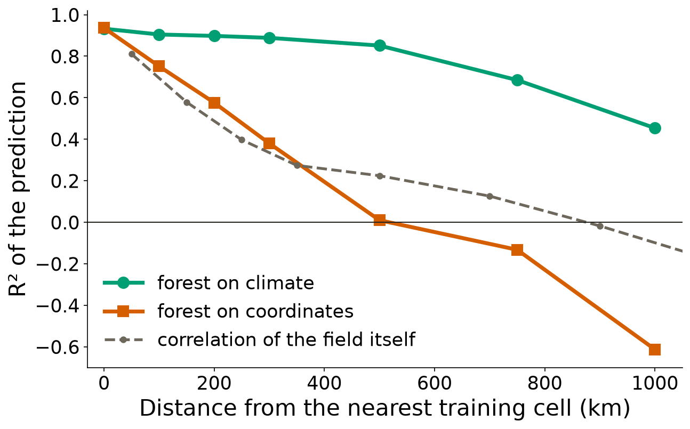{height="400"}

**Soil moisture, western US.** Each cell is predicted from training cells beyond a distance.
:::
::: {.column width="43%"}
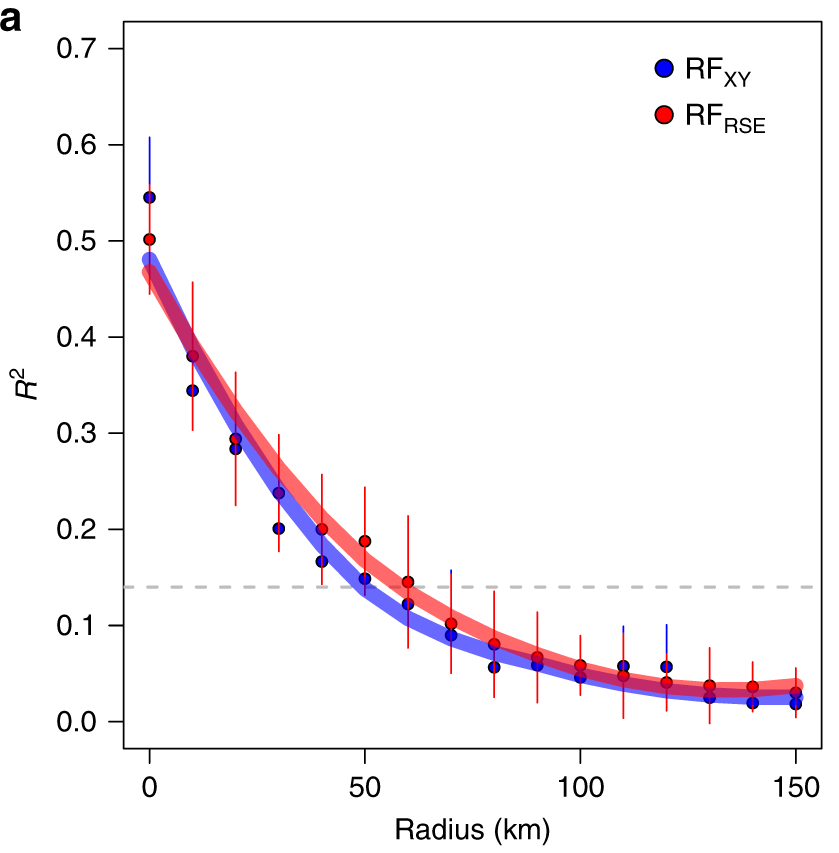{height="400"}

**Forest biomass, central Africa.** XY: coordinates. RSE: satellite and environment. Shorter distance axis.

::: {.credit}
Ploton et al. (2020), *Nat. Commun.* 11, 4540, Fig. 5a. [doi:10.1038/s41467-020-18321-y](https://doi.org/10.1038/s41467-020-18321-y). CC BY 4.0.
:::
:::
:::

::: {.takeaway}
There is no fixed limit: compare your prediction distance with the field's correlation distance. A random split gives both soil moisture forests R² .91; at 500 km they reach .01 and .85. In central Africa both fall together, so nearness was doing the work.
:::

::: {.notes}
Correlation does not break the fit: a forest assumes nothing about independence. It breaks the test, because a random split asks about neighbors. The dashed line is the field itself: correlation .81 within 100 km, .40 at 200 to 300 km, near zero by 900 km. The forest on coordinates loses its skill at about that same pace, because nearness is all it has: .94, .75, .58, .38, .01 at 0, 100, 200, 300, 500 km. Climate: .93, .90, .90, .89, .85, then .68 at 750 and .45 at 1,000 km. So there is no universal number of kilometers: measure the correlation distance of your field and the distance from your prediction sites to your training sites, and compare. Ploton: the dashed gray line is their spatial cross-validation at .14. Both models give similar R² at every radius, so the satellite features add little beyond location. A second cost: 992 correlated cells carry less information than 992 independent samples. Methods: buffered leave-one-out on 250 random cells, 80 trees each. Monday's lecture 18 builds the full validation ladder.
:::

## When spatial correlation matters {.dense}

| Situation | A problem? | What to do |
|---|---|---|
| Filling gaps: prediction sites as close to training as your test sites | **Not for the score.** A random split asks the right question if samples represent the map | Random folds (Wadoux et al., 2021) |
| Predicting a new region, beyond the correlation distance | **Yes.** Random folds report near-neighbor skill | Hold out blocks with a buffer as wide as your real distance (Roberts et al., 2017) |
| Longitude and latitude as features | **Depends on the task.** They score .91 in gaps, .01 at 500 km | Prefer features with a mechanism; test with a buffer |
| Out-of-bag score | **Yes on maps.** It leaves neighbors in: .91 for coordinates alone | Do not use it as a spatial test |
| Correlated features, not samples | **Not for predictions.** Importance splits among them | Read correlated features as a group |
| New conditions in feature space | **Yes, at any distance.** A forest cannot leave its training range | Report where the map applies (Meyer and Pebesma, 2022) |

::: {.credit}
Wadoux, Heuvelink and de Bruin (2021), *Ecol. Model.* 457, 109692. Roberts et al. (2017), *Ecography* 40, 913–929. Meyer and Pebesma (2022), *Nat. Commun.* 13, 2208.
:::

::: {.notes}
Leave this up and ask each team which row is theirs. The debate is real: Wadoux et al. argue that spatial folds misstate map accuracy when the sample represents the map, and that a clustered sample needs a different remedy. Roberts et al. argue for blocking when the goal is prediction beyond the sampled structure. They answer different questions, the same point as the validation ladder on Monday. Hengl et al. (2018, PeerJ 6, e5518) add distances to sampling sites as features, a further option for gap filling. The feature-space row leads to the next slide.
:::

## Outside the training range, a forest stops

::: {.columns}
::: {.column width="60%"}
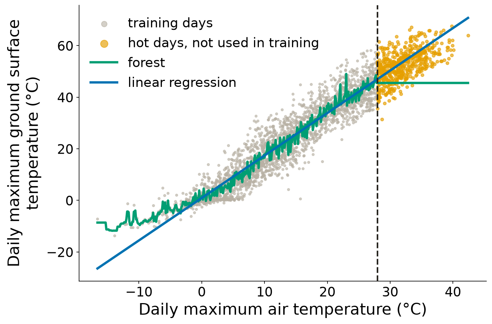{height="620"}
:::
::: {.column width="40%"}
Ground surface temperature from air temperature, trained only on days below 28 °C.

| Mean absolute error (°C) | Cool days, held out | Hot days |
|---|---|---|
| Forest | 4.1 | **7.9** |
| Linear | 4.0 | 4.0 |

| On hot days (°C) | Largest value |
|---|---|
| Observed | 67.6 |
| Forest | 45.5 |
| Linear | 70.8 |

::: {.dim}
USCRN WA Spokane 17 SSW, 2015 to 2024. Infrared ground sensor, daily maximum. 2,301 training days, 570 hot days.
:::
:::
:::

::: {.takeaway}
On cool days the two tie. On hot days the forest's error doubles because every prediction is an average of training values, so its curve goes flat above 28 °C.
:::

::: {.notes}
The test is designed: we removed hot days from training to see the behavior clearly, as 3.2 did with silica-rich rocks, where a granite received the density of an evolved andesite. Students should say the mechanism aloud: a forest cannot predict above the highest leaf mean. Not a reason to avoid forests, but a reason to ask whether your deployment leaves the training range: a warmer climate, a new volcano, a new sensor. It is a stronger limit than distance: a nearby site can still be outside the training range. The linear model is only safe here because the relation happens to be nearly straight; it would extrapolate just as confidently if the relation bent. Validation on cool days cannot tell them apart: 4.1 and 4.0.
:::

## Importance: what the forest used

::: {.columns}
::: {.column width="48%"}
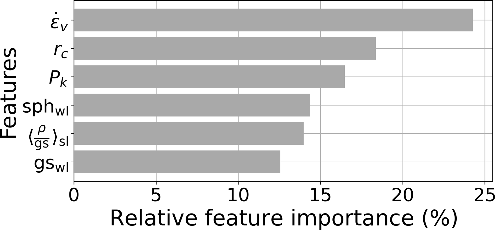{width="100%"}

**Snow instability.** Impurity importance of the final six features. Features correlated above r = 0.8 were removed first.

::: {.credit}
Mayer et al. (2022), Fig. 6. CC BY 4.0. ε̇ᵥ: viscous deformation rate; r_c: critical cut length; P_k: skier penetration depth.
:::
:::
::: {.column width="52%"}
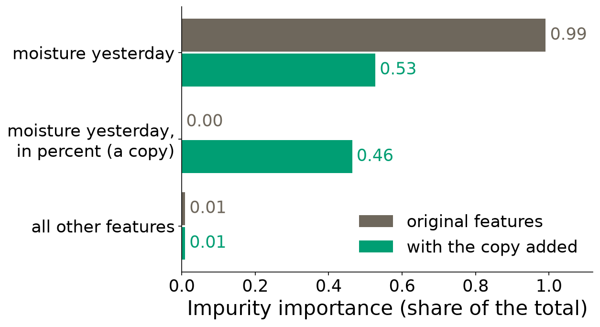{width="100%"}

**Soil moisture.** Add yesterday's moisture again, in percent. Its credit splits .99 into .53 and .46, while the error stays at .0033 to .0034 m³/m³.
:::
:::

::: {.takeaway}
Impurity importance divides credit among correlated features. Removing correlated features first, as Mayer et al. did, or shuffling groups of features on held-out data gives a fairer reading; neither shows cause.
:::

::: {.notes}
Impurity importance: how much a feature lowers impurity across all splits, computed on training data. Copying a feature tells us nothing new about soil, but its importance falls by half. Real features correlate in the same way: moisture at 5 and 10 cm, temperature and solar radiation. Permutation importance asks a better question: shuffle a feature in held-out data and measure the damage. Here shuffling yesterday's moisture raises the error from .0033 to about .12 m³/m³. It too suffers with correlated features, because the model can lean on the partner: interpret such a group together. Strobl et al. (2007, BMC Bioinformatics 8, 25) measured the bias of impurity importance. Importance describes the model, not the physics: shuffling a column does not change the soil. Book section 3.7 repeats this with a synthetic temperature record.
:::

## Part 4. Best practices: training a classifier {.dense}

| Practice | Seen in this course |
|---|---|
| 1. Choose the decision and the metric before fitting | Always answering "earthquake" at 5% explosions: accuracy .949, no use |
| 2. Split first, by what samples share: event, station, time, region | Oversampling before the split: F1 .995. After: .590 |
| 3. Fit a baseline and a simple model first | Logistic regression ties the forest at .884 |
| 4. Keep preprocessing in a pipeline fit on training folds | Logistic regression on raw features: .783 |
| 5. Start from defaults; tune by cross-validation on training data | Forest defaults .881 ± .015; no setting tested beat them by more than .001 |
| 6. Treat rare classes and choose the threshold on validation data | Same AUC, yet 62 or 89 explosions missed at 0.8 |
| 7. Report per-class errors and spread; open the test set once | Explosions are the weakest class in every model |

::: {.notes}
We start this list today and use it through the term. Row 5, 5-fold on the 3,000 training events, macro-F1: default 300 trees .881; 50 trees .872; 1,000 trees .880; log2 features .882; half the features .882; all features .874; minimum leaf 5 .872, 20 .841; depth 8 .865, depth 3 .798. The fold spread is about .015, so most of these differences are noise. Limits on depth and leaf size hurt here because the classes are well sampled and the features are many. Row 2 comes from lecture 16, a forest on 53 explosions and 1,000 earthquakes. Monday continues with row 2: what your validation score really measures. Numbers: figscripts/lec17_trees_forests.py and lec16_balancing.py.
:::

## Best practices: training a regressor {.dense}

| Practice | Seen in this course |
|---|---|
| 1. Beat the physical baselines: climatology and persistence | Error .0284 and .0042; forest .0033 m³/m³ |
| 2. Split by time or place, matching how you will predict | At 500 km, R² .85 with climate and .01 with coordinates |
| 3. Report error in units and by regime, not only R² | R² .997, yet rainy-day error is 3 times the mean error |
| 4. Noisy target: grow larger leaves | Daily moisture change, R²: leaf size 1 .09; leaf size 20 .28 |
| 5. Check how many features each split sees | One third instead of all (scikit-learn's default): error .0060 against .0047 |
| 6. Test beyond the training range | Hot days: error 4.1 to 7.9 °C |
| 7. Give a range with each prediction | Quantile forests, as in SoilGrids |

::: {.notes}
Rows 1, 2, 3 and 6 are from earlier slides. Row 4: 300 trees on rain and yesterday's moisture, test years 2021 to 2024, leaf size 1, 5, 20, 50 gives .09, .27, .28, .27; four boxes alone gave .23 and a single full tree -.43. These were scored on test years to show the effect; in a project choose leaf size by cross-validation on training years. Row 5: time-ordered 5-fold on the training years with all six Turnbull features. One third is worse here because yesterday's moisture dominates and many splits then cannot use it; defaults differ between libraries (R's randomForest uses one third for regression), so check yours. With many comparable features the answer may differ.
:::

## What each result tells you

| Question | Tool | Geoscience example | Number |
|---|---|---|---|
| Where is the ROC curve from? | one point per threshold | ten seismic events | AUC .76 by hand; .963 on 500 |
| Why not one tree? | train against test score | four source types | 1.000 against .800 |
| What do many trees add? | bootstrap, random features | four source types | .774 to .884; out-of-bag .882 |
| Do thresholds transfer? | same threshold, two models | explosion or earthquake | 62 or 89 missed at 0.8 |
| Which predictions need a person? | tree agreement | seismic catalog | 47% against 2% wrong |
| Did it learn anything? | climatology, persistence | Turnbull soil moisture | .0284, .0042, forest .0033 m³/m³ |
| What happens outside training? | test beyond the range | ground surface temperature | error 4.1 to 7.9 °C |
| Which features matter? | importance, with copies removed | Swiss snow; soil moisture | .99 splits into .53 and .46 |
| How far can a map model go? | training cells beyond a distance | western US soil moisture | .91 in gaps; at 500 km, .85 or .01 |

::: {.notes}
Leave this up during questions. The Ch 3 quiz opens Tue Nov 10 and closes Thu Nov 12. Monday: robust training, where the split itself becomes the question. The soil moisture split by time is a preview.
:::

## Now run it yourself: 3.11 {.roomy}

1. `git pull`, then `pixi run jupyter lab` → `3.11_forests_practice.ipynb`
2. Part 1: write `rates` and check your drawing. Part 2: tree depth against test score
3. Part 3: forest with `oob_score=True`, compare with logistic regression at .884
4. Part 4: thresholds for both models. Part 5: forest against climatology and yesterday's value
5. Part 6: add a copy of a feature. Part 7: train below 28 °C and predict hot days
6. **Your project:** which deployment conditions leave your training range?

::: {.dim}
Reference: [3.7](https://geo-smart.github.io/mlgeo-book/randomforest-regression). Monday: robust training, ensembles and AutoML (3.8, 3.9, 3.10). Ch 3 quiz Tue to Thu. Due Mon Nov 9: homework on scoring clusters. HW-CML due Fri Nov 20.
:::

::: {.notes}
Timing: exercise done, deck done, so about 25 minutes for the notebook and 7 for synthesis. Each task has a hint and a hidden solution, and if a pair gets stuck the notebook uses the reference result so later cells still run. If time is short, skip Part 2 and Part 6: Parts 1, 3, 4, 5 and 7 carry the main message. Synthesis: collect two or three answers to task 6. They seed the data-audit check-in on Nov 16.
:::
