## {background-color="#faf7f2"}

[🗺️]{.lecture-icon}

### Today's questions

::: {.roomy}
| Part | Question | Slides | Notebook |
|---|-------------------------|-----|-------|
| 1 | How do we partition, validate and test? | 25 min | 3.8, 25 min |
| 2 | When does combining models help? | 10 min | 3.9, 15 min |
| 3 | What does an automated search need from us? | 10 min | 3.10, 20 min |
| | One table to take away | 5 min | |
:::

::: {.notes}
Timing for 100 minutes: 35 minutes of slides and 60 of notebooks, in three rounds, then 5 of synthesis. If the class meeting is the scheduled 80 minutes (10:00 to 11:20), keep the slides and cut notebooks to 18, 10 and 12 minutes: skip 3.8 Part 3, 3.9 Part 3 and 3.10 Part 2. Part 1 now opens with four definition slides (partitions and cross-validation, validation against test, the three domain axes, leakage), about 11 minutes, so it runs 25 minutes; to stay in time, skip "How large should a block be?" and "Name what your samples share" and leave them as reading. These follow Friday: a forest was our model, and today we ask how to score it, how to combine it with others, and how to search among them. Every notebook runs on scikit-learn alone.
:::

## Part 1: a second test changed two published scores

::::: {.lit3}
:::: {.columns}
::: {.column width="50%"}
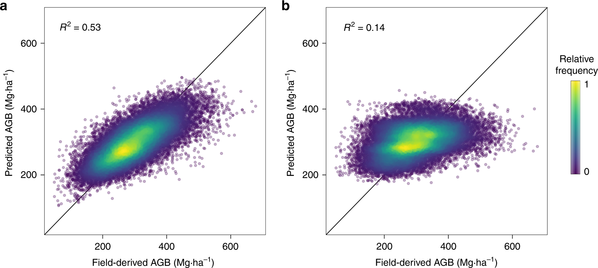{width="100%"}

[🛰️ Satellite & airborne]{.gb .src} [🌱 Biosphere]{.gb .sys .bio} [🦠 Biogeosciences]{.gb .disc .bio}

**Forest biomass, central Africa.** A random forest on satellite and climate layers, scored against field plots. Random 10-fold: R² = 0.53 (a). Whole regions held out: R² = 0.14 (b).

::: {.credit}
Ploton et al. (2020), *Nature Communications* 11, 4540, Fig. 4. [doi:10.1038/s41467-020-18321-y](https://doi.org/10.1038/s41467-020-18321-y). CC BY 4.0.
:::
:::
::: {.column width="50%"}
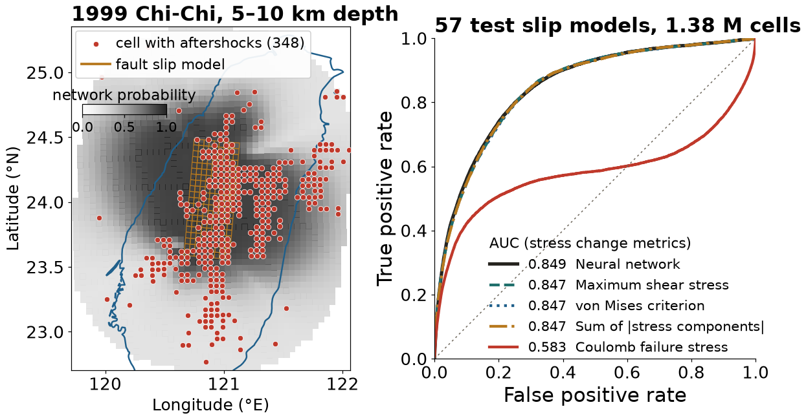{width="100%"}

[🖥️ Model & simulation]{.gb .src} [🪨 Solid Earth]{.gb .sys .solid} [📈 Seismology]{.gb .disc .solid}

**Aftershock locations, 199 fault slip models.** The 2018 paper found that maximum shear stress change explains over 98% of its network's output. A 2019 comment showed that this one quantity, in a two-parameter model, reaches the same AUC.

::: {.credit}
Our rerun of the open data and weights of DeVries, Viégas, Wattenberg & Meade (2018), *Nature* 560, 632–634; comment by Mignan & Broccardo (2019), *Nature* 574, E1–E3; reply by Meade (2019), *Nature* 574, E4.
:::
:::
::::

[Further reading: Roberts et al. (2017), validation when data share time, space or groups · Meyer & Pebesma (2021), where on a map a model applies.]{.dim}
:::::

::: {.notes}
Two minutes. On Friday the forest on map coordinates lost its skill as the test moved away from its training cells. Part 1 takes 15 minutes: that effect in time and on a map, then which training choices change the score that matters.

Left, Ploton et al. (2020): the same model and the same plots, scored twice. Random 10-fold cross-validation gives R² = 0.53 (RMSPE 56.5 Mg/ha); spatial 44-fold cross-validation, holding out whole regions, gives 0.14 (77.5 Mg/ha). Nothing in the model changed; the second test asked the question the map is used for. Students saw this figure in lecture 10.

Right, the aftershock study, which we told in full in lecture 2. How to present it, in about a minute:
- Disclosure first, briefly: "I served on the PhD committee of the first author." Students learn that disclosing a relationship is normal practice.
- Credit what the 2018 paper did. It asked a physical question, where aftershocks occur, and found that the network's output follows maximum shear stress change and the von Mises criterion, quantities with a physical meaning. The authors published their data and trained weights, which is the only reason the comment could test their model, and the only reason we could rerun it.
- The comment's point, stated as a measurement: one of those stress quantities, alone, matches the network's AUC (0.847 against 0.849 in our rerun). The baseline changed what the result means: the skill came from the stress metric, and the network's main contribution was pointing to it.
- The reply argued the aim had been physical insight into aftershock locations, not the network itself. Read the reply before quoting it; I only saw its bibliographic record.
- What students should take: this is how science is meant to work. A strong claim, open data, a public check, a public answer. Every one of their projects should run the simple baseline before someone else does.
Avoid "debunked", "failed" or "one neuron beat deep learning": those are headlines, not what the exchange showed.

Further reading, full references: Roberts, D. R., et al. (2017), Cross-validation strategies for data with temporal, spatial, hierarchical, or phylogenetic structure, Ecography 40, 913-929; Meyer, H. & Pebesma, E. (2021), Predicting into unknown space? Estimating the area of applicability of spatial prediction models, Methods in Ecology and Evolution 12, 1620-1633. Roberts et al. is the framework paper for anyone who wants the full menu of structured cross-validation. Meyer and Pebesma estimate where on a map a model's predictions can be trusted. Their figures are not openly licensed or could not be retrieved, so they appear as citations only.
:::

## Partition the data, then cross-validate

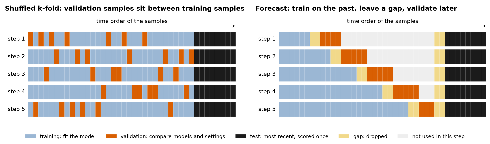{.r-stretch}

::: {.takeaway}
**Cross-validation** repeats one step k times: train on k − 1 folds, score the held-out fold, move on, until every sample has been validated once. The mean of the k scores compares models. The **test** period stays aside and is scored once.
:::

::: {.notes}
Three minutes. Definitions first, since everything in Part 1 uses them. Partitioning means deciding which samples the model may learn from (training), which ones we use to compare models and settings (validation), and which ones we keep to report the final score (test). One train/validation split gives one noisy score; cross-validation repeats the split k times (here 5) and averages, so every training sample is validated once. Left: shuffled folds. The orange validation samples sit between blue training samples, so each validation day has its neighbors, yesterday and tomorrow, in training. Right: the same five steps forward in time; each step trains on the past and validates on the next block, which is how a forecast is used. In both, the black test period is never touched while we choose. In code: KFold(shuffle=True) on the left, TimeSeriesSplit on the right. Schematic, no data; drawn by figscripts/lec18_cv_diagram.py.
:::

## Validation chooses, the test reports

::: {.mid}
| Partition | Drawn from | Used for | How often we look |
|---|---|---|---|
| **Training** | the domain | fitting the model's parameters | every fit |
| **Validation** | the same domain, independent units | choosing models, features, settings | many times |
| **Test, within domain** | the same domain, never used to choose | reporting how well the model interpolates | once |
| **Test, out of domain** | outside the training domain along a stated axis | reporting how well it generalizes along that axis | once |
:::

::: {.takeaway}
Every look at the validation score is a choice, so the best validation score is optimistic. In 3.10 the best search score was .845 and the untouched test .820.
:::

::: {.notes}
Two minutes. Validation and test answer different questions. Validation is for choosing, and because we choose the best of many, its score is biased upward: the more models and settings we compare, the larger the bias. The test set is for reporting, and it only stays honest if nothing was chosen with it: no settings, no features, no early stopping, no "let me try one more model". If you look at the test set and then change something, it has become a validation set, and you need a new test set. Within domain and out of domain are the two kinds of test, and lecture 10 (criterion B7) asked each team to name its out-of-domain axis. The .845 and .820 come from the lecture 18 figure script (search_optimism).
:::

## Three axes for an out-of-domain test

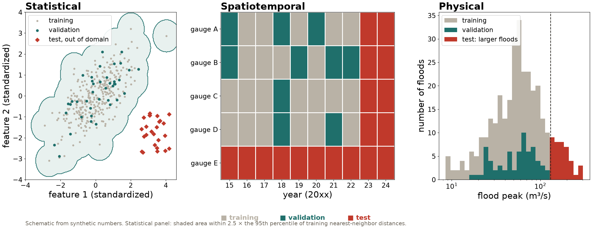{.r-stretch}

::: {.takeaway}
**Statistical:** inputs far from the training samples (lecture 17's days above 28 °C). **Spatiotemporal:** a later period or a new region (P395's future, the soil map's 6° blocks). **Physical:** a process or event size not in training (floods larger than any trained on).
:::

::: {.notes}
Three minutes; students saw this figure in lecture 10 (criterion B7), today we connect it to the scores. A model interpolates well inside its training domain; whether it generalizes is only known along the axis we held out, so a project must name that axis. Statistical: measured in the space of input features, for example the distance of each new sample to its nearest training sample, standardized with training statistics only (Meyer and Pebesma 2021 call the inside the area of applicability). Lecture 17: a forest trained below 28 °C saw its error rise from 4.1 to 7.9 °C on hotter days, while linear regression stayed at 4.0. Spatiotemporal: P395 forecasts later in time; the soil map's held-out blocks. Physical: larger floods than any in training, a new source type, a different tectonic setting; Frame et al. (2022, corrigendum 2023) is the hydrology example from lecture 10. Ask each pair: which axis matters for the people who will use your model?
:::

## Data leakage: the test leaks into training

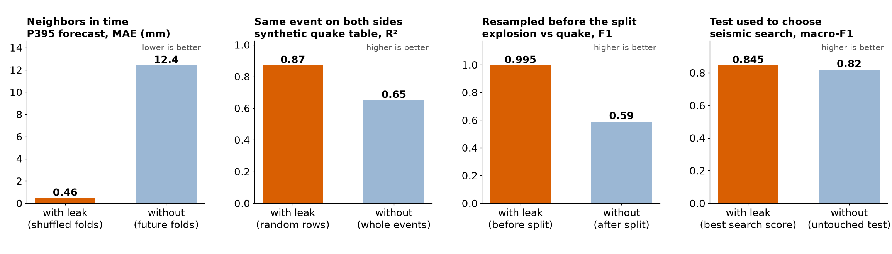{.r-stretch}

::: {.takeaway}
Leakage is any route by which information about the validation or test samples reaches the model while it is trained or chosen. Each pair is the same model and data; only the leak differs.
:::

::: {.notes}
Three minutes. Four routes, each with a number from this course. (1) Neighbors in time: shuffled folds put yesterday and tomorrow in training, so P395's validation error is 0.46 mm against 12.4 mm when validating on the future (lower is better). (2) Same event on both sides: one earthquake is recorded by many stations, and its magnitude is the same on every row; random rows let the forest recognize the event (R² .87 against .65 with whole events held out; synthetic table in 3.8). (3) Preprocessing on all data before the split: oversampling, scaling, feature selection or imputation fit on all samples carry test information into training; lecture 16's oversampling gave F1 .995 against .590. (4) Choosing with the test set: the best of many tries looks better than an untouched test (.845 against .820). A fifth route, target leakage, is a feature that already contains the answer: in 3.2, 98.5% of explosions had a depth error of exactly 31.61 km, an analyst convention, so depth error "detects" explosions. The fix in every case: split first, by what the samples share, and fit every preprocessing step inside the training folds (a scikit-learn Pipeline does this). Figure from figscripts/lec18_cv_diagram.py; values from the lecture 18 and lecture 16 figure scripts.
:::

## P395: a station that keeps moving

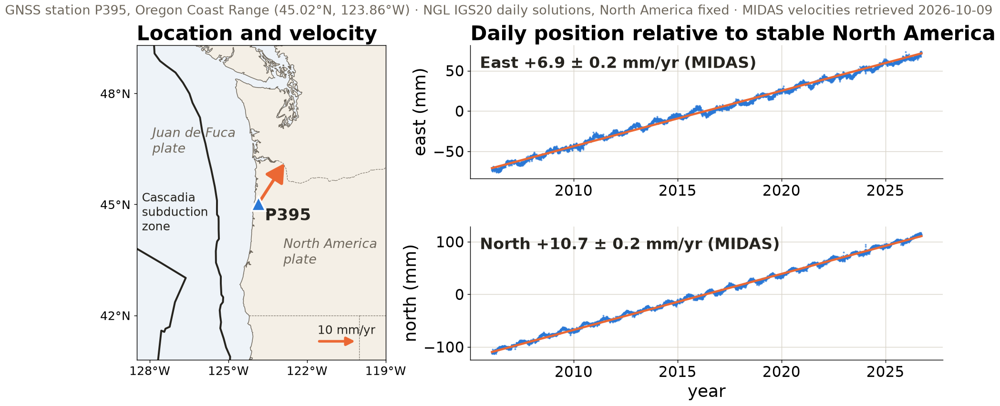{.r-stretch}

[📍 In-situ sensor]{.gb .src} [🪨 Solid Earth]{.gb .sys .solid} [📐 Geodesy]{.gb .disc .solid}

::: {.takeaway}
From 60 days of history, predict the mean position over the next 30 days, one sample every 5 days (1,482 samples, 2006 to 2026).
:::

::: {.notes}
NGL station P395, Oregon Coast Range, above the Cascadia subduction zone. This figure from Chapter 1 shows motion relative to North America. The forecasts on the next slides use east position in IGS20, as in the course file, where the station moves at -6.4 mm/yr (NGL MIDAS, table in 1.7). The steady motion plus seasonal wiggles is what we are forecasting. Neighboring samples share 55 of 60 history days and 25 of 30 target days, so they are correlated by construction. Ask: what could go wrong if we shuffle them?
:::

## The same forest on two splits of the same record

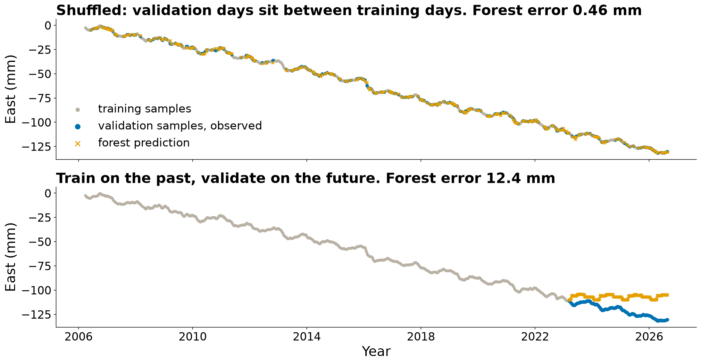{.r-stretch}

::: {.takeaway}
Shuffled folds: 0.46 mm. Training on the past and validating on the future: 12.4 mm. The forest flattens because it cannot predict beyond the values it has seen.
:::

::: {.notes}
Gray: training samples. Blue: validation samples. Orange: the forest. Top: every validation sample has neighbors in training that share most of its window, so the forest copies them. Bottom: all validation samples come after training, and the forest stays near the last values it saw, the same effect as Friday's hot days. Five folds, 100 trees. The future folds leave a gap of 6 samples so target windows do not overlap. R² goes from 1.00 to -3.8; R² below zero means worse than predicting the mean of the validation samples. Neither score is wrong: the top one answers how well the model reproduces days between days it has seen, and the bottom one answers how well it forecasts.
:::

## A baseline that needs no learning

::: {.roomy}
::: {.columns}
::: {.column width="42%"}
| Future folds | Error (mm) |
|---|---|
| Forest, 100 trees | **12.4** |
| Persistence: same as the last observed day | **1.17** |
| Linear regression, same six features | **0.82** |
| *Forest, shuffled folds* | *0.46* |

Persistence takes one line and beats the forest tenfold. The shuffled score alone would have ranked the forest first.
:::
::: {.column width="58%"}
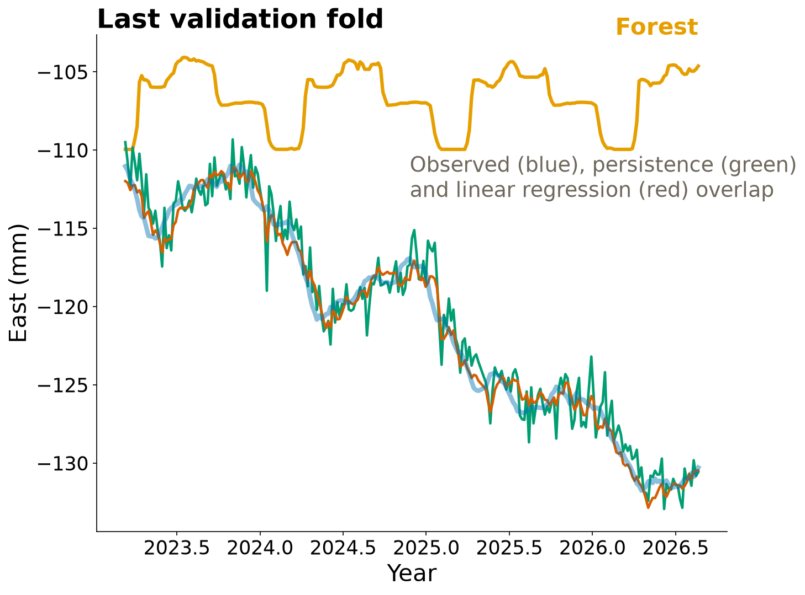{height="700"}
:::
:::
:::

::: {.notes}
Report a physical-units error next to any skill score, and always a baseline. Persistence and the linear model use what we know about this record: it changes slowly and steadily. This is the check that Mignan and Broccardo applied to the aftershock network on slide 3: before crediting the complex model, ask what a one-line rule achieves. The linear model is not always the answer; on Friday, the forest was slightly better than linear at Turnbull soil moisture.
:::

## P395 forecast error for six forest settings and a change of target

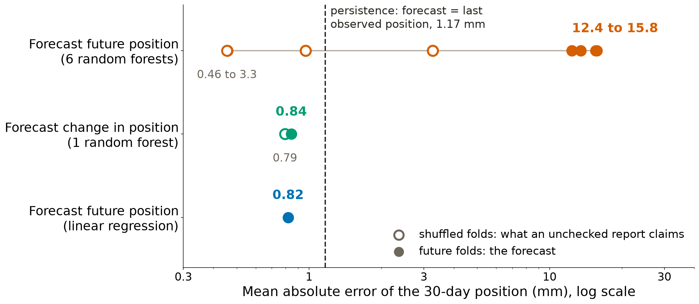{.r-stretch}

::: {.takeaway}
**Persistence** forecasts the next 30 days as the last observed position, with no learning: 1.17 mm. Six random forests forecasting the future position: 12.4 to 15.8 mm. One random forest forecasting the change in position: 0.84 mm.
:::

::: {.notes}
Persistence is the simplest forecast of a time series: tomorrow equals today, here the next 30-day mean equals the last observed daily position. Same samples and folds as before. Hollow circles: shuffled folds; filled: future folds. The six settings are maximum depth 3, 12 or unlimited, times a minimum of 1 or 20 samples per leaf, 100 trees each. Shuffled and future folds pick the same setting here (unlimited depth, leaf 1), so the choice of validation did not change the setting; it changed whether you would ship the forest at all. No setting can fix a forest that has to return a position it has never seen. Predicting the change since the last observed day (features: the 60-day and 10-day means minus the last day, the 60-day slope, the season) turns an extrapolation into an interpolation, because changes over 30 days stay in the range of the training data. The forest then matches linear regression (0.82). In 3.8 students run both. Numbers from lec18_scores_ensembles_automl.py, numbers.json, key practice_time.
:::

## The same effect on a map

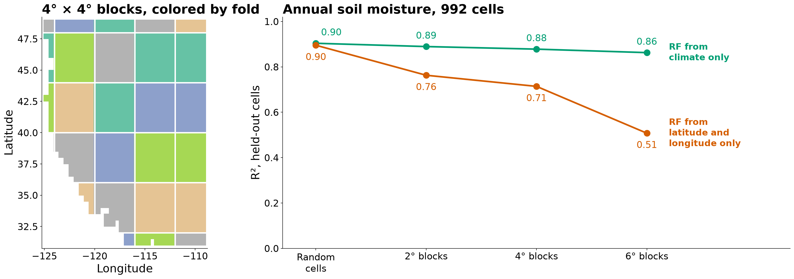{.r-stretch}

[🖥️ Model & simulation]{.gb .src} [💧 Land water]{.gb .sys .water} [💧 Hydrology & land-surface modeling]{.gb .disc .water}

::: {.takeaway}
A **block** is a square of the map, 2°, 4° or 6° on a side. All cells of a block go to the same fold, so each model is scored on a region with no training cells nearby. Two random forests predict annual soil moisture, one from climate only, one from latitude and longitude only. Random cells: R² .90 for both. 6° blocks: .86 from climate, .51 from latitude and longitude.
:::

::: {.notes}
Left: 4 by 4 degree blocks, colored by the fold that holds them out; each fold leaves out about a fifth of the blocks. Whole blocks stay on one side of the split, so a held-out cell has no training cell in its own block. Right: a ladder of splits, each asking about ground farther from training. 4 degrees is about 300 to 440 km here, and on Friday the correlation of this field fell to .40 at 200 to 300 km. Caution from Friday: CPC soil moisture is a leaky-bucket model driven by precipitation and temperature, so the climate features nearly contain the answer. Coordinates give interpolation, useful inside a surveyed region and of no use beyond it. Five folds, 200 trees, R² pooled over all held-out cells.
:::

## How large should a block be?

:::: {.dense}
::: {.columns}
::: {.column width="46%"}
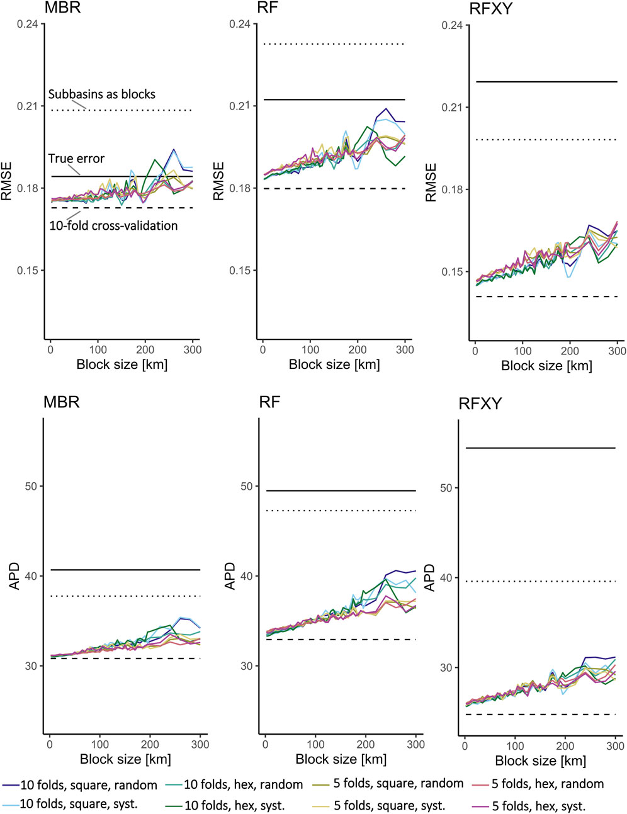{height="745"}
:::
::: {.column width="54%"}
[🛰️ Satellite & airborne]{.gb .src} [🌊 Ocean]{.gb .sys .ocean} [🌊 Oceanography]{.gb .disc .ocean}

**Baltic Sea chlorophyll from satellite reflectance.** Synthetic chlorophyll, so the true error is known. Solid: true error; dashed: random 10-fold.

- RFXY, a random forest from reflectance plus latitude and longitude, looks best under random 10-fold and has the largest true error
- The predictors stopped being correlated beyond 200 to 300 km

**Ask the class**

- What physical process sets the distance over which soil moisture stays correlated? How far is it?
- At P395, which time scales carry the physics, and is a 30-day gap longer than they are?
- In your project, what length or time scale must a block or a gap exceed?

::: {.credit}
Stock (2025), *Front. Remote Sens.* 6, 1531097, Fig. 5, [doi](https://doi.org/10.3389/frsen.2025.1531097). CC BY 4.0.
:::
:::
:::
::::

::: {.notes}
Stock also found that block size mattered most, and block shape and the number of folds little. Point at the top right panel, RFXY: the dashed line sits near .14 and the solid line near .22, read from the figure. The colored lines are block splits, rising toward the truth as blocks grow, without reaching it. Stock also found that leaving out whole subbasins performed best overall because it matched the mapping task, although large blocks sometimes overestimated errors. The advice: use correlograms of the predictors and domain knowledge, and try a range of sizes when they do not settle it. Connects to Part 3: a search would have chosen RFXY.

Ask the class, two or three minutes, one question at a time. Points to bring out. Soil moisture: correlated over the size of the weather systems that wet it (winter frontal storms over several hundred to a thousand kilometers, summer convection over tens of kilometers), with soil texture, vegetation and topography adding variation at kilometers. On Friday our CPC field had correlation .40 at 200 to 300 km and near zero by 900 km, so 6 degree blocks (about 450 to 670 km here) are close to the scale where neighbors stop sharing information; CPC is a 0.5 degree model, so it has no kilometer-scale variation at all. P395: daily noise, the seasonal cycle of hydrological loading (one year), episodic slow slip (months to years apart along Cascadia) and steady plate motion (decades). The 30-day gap only removes overlapping windows; the seasonal cycle and the trend still connect training and validation, which is why we validate on the future rather than adding a gap to a shuffled split. Projects: the block or the gap should exceed the scale over which the target and the features stay correlated, measured with a correlogram or a variogram, and match how the model will be used (a new region, a new year, a new event).
:::

## Judge a training choice by the outcome you need

::: {.practice}
**Generalization:** error where the model will be used (later days, unsampled regions). **Fine tuning:** small gains from settings (hyperparameters), same model, features and conditions.

| Choice | Score that looks good | Score on the outcome | Verdict |
|---|---|---|---|
| **P395:** shuffled folds for a forecast | 0.46 mm | 12.4 mm | **Bad:** ranks the forest first |
| **P395:** tune six forest settings | 0.46 to 3.3 mm | 12.4 to 15.8 mm | Fine tuning; none beats persistence (1.17) |
| **P395:** predict the change, not the position | 0.79 mm | 0.84 mm | **Good:** 15 times smaller error |
| **Soil map:** RF from latitude and longitude only | R² .90, random cells | .51, 6° blocks | **Bad** beyond the sampled region |
| **Soil map:** RF from climate only, settings picked on random folds | .86 to .90 | picked .863, best .864 | Acceptable for fine tuning |
| **Seismic:** tune forest settings | macro-F1 .884 | .884, default won | Fine tuning, no gain |
| **Seismic:** 300 or 1,000 training events instead of 3,000 | | .844, .864, .884 | Data mattered more than settings |
| **Seismic:** logistic regression, unscaled, 100 iterations | | .565, against .884 scaled | **Bad:** check the fit converged |
| **Seismic:** oversample before the split (lecture 16) | F1 .995 | .590 | **Bad:** leakage |
:::

::: {.takeaway}
A choice is bad when it raises the score you report without raising the score where the model will be used. In all three datasets, settings were the smallest lever.
:::

::: {.notes}
Two minutes; this is Part 1 on one screen. Read it by columns: the "looks good" score is what an unchecked report would claim, and the outcome score is the one that matches use. Shuffled folds are not always wrong: on the soil map with climate features, the setting they picked scored .863 in 6 degree blocks, against .864 for the best, so for fine tuning they were good enough. What they cannot do is tell you whether the features generalize: both models look like .90 on random cells. The seismic rows use the random split of 3.5 only, because the tables carry no event identifier, so they say nothing about new regions or years; differences below about .01 macro-F1 are within the spread of random splits. The oversampling row is lecture 16's explosion-against-earthquake test (53 explosions, 1,000 earthquakes, mean of 10 subsets). Two practices I tested gave no measurable harm on these data, and should not be presented as harmless: selecting features before the split (the seismic features are strong enough that selection picks the same ones), and choosing settings on the test set (a gain of about .007, within the noise). Those two came from a one-off test outside the repository, so quote them only as "no measurable effect here". Numbers from lec18_scores_ensembles_automl.py, keys practice_time, practice_region, practice_seismic; lecture 16 balancing script for the last row.
:::

## Name what your samples share

::: {.mid}
| Samples share | Why they are correlated | Validate by | From today |
|---|---|---|---|
| **Time** | consecutive samples share weather, season, drift | training on the past, validating on the future | P395: 0.46 to 12.4 mm |
| **Location** | repeated measurements at one location are near copies | holding out whole locations | |
| **Event** | one earthquake reaches many instruments | holding out whole events | synthetic: R² .87 to .65 |
| **Region** | nearby locations lie on one smooth field | holding out blocks as large as the correlation distance | CPC: R² .90 to .51 |
| **Rare class and groups** | a group can land in a fold with no positives | holding out groups, rare cases spread across folds | |
:::

::: {.takeaway}
Compare models with cross-validation inside the training data, and score the test set once, at the end.
:::

::: {.notes}
This table is Part 1 on one screen. Chapter 2.13's data audit asked this question before training, and the split applies it to evaluation. The event row uses a small synthetic table in 3.8, where the magnitude is identical across recordings of an event, so random folds let the forest recognize the event. In code: TimeSeriesSplit, GroupKFold, StratifiedGroupKFold; students' agents know them, and naming what the samples share is the scientist's part. Leave-one-out costs one fit per sample and leaves each sample's neighbors in training, so it is the shuffled split at its most optimistic.
:::

## Open 3.8 (25 minutes)

::: {.columns}
::: {.column width="52%"}
::: {.roomy}
1. `git pull`, then open `3.8_robust_training.ipynb`
2. Part 1: score the forest on shuffled folds, on future folds, and persistence
3. Part 1: tune six settings, then predict the change
4. Part 2: write the block labels, then score whole blocks
5. **Your project:** which choice in today's table would you test first?
:::
:::
::: {.column width="48%"}
Three splits, then a new target:

```python
cross_val_score(forest, X, y,
    cv=KFold(5, shuffle=True))

cross_val_score(forest, X, y,
    cv=TimeSeriesSplit(5, gap=6))

cross_val_score(forest, X, y,
    cv=GroupKFold(5), groups=blocks)

forest.fit(X_change, y - last_value)
```
:::
:::

::: {.dim}
Reading: [3.8](https://geo-smart.github.io/mlgeo-book/robust-training). Each task has a hint and a hidden solution. Part 3 (whole events) is optional.
:::

::: {.notes}
Pairs, 25 minutes. Circulate during the block labels, where students may need help with what the groups mean. Collect one answer to task 5: it seeds the data-audit check-in on Nov 16.
:::

## Part 2, ensembles: three ways to combine models

::: {.columns}
::: {.column width="50%"}
**Forest: independent trees, averaged**<br>**Boosting: each tree adds a correction**

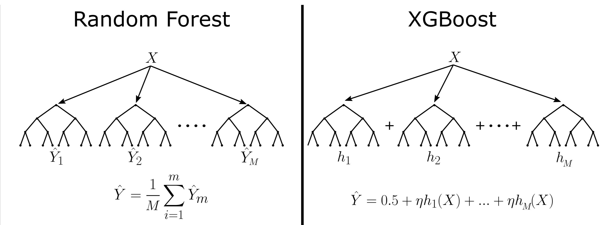

::: {.credit}
Feigl, Lebiedzinski, Herrnegger and Schulz (2021), *Hydrology and Earth System Sciences* 25, 2951–2977, Fig. 2, cropped. [doi:10.5194/hess-25-2951-2021](https://doi.org/10.5194/hess-25-2951-2021). CC BY 4.0.
:::
:::
::: {.column width="50%"}
**Stacking: a model learns from the models' forecasts**

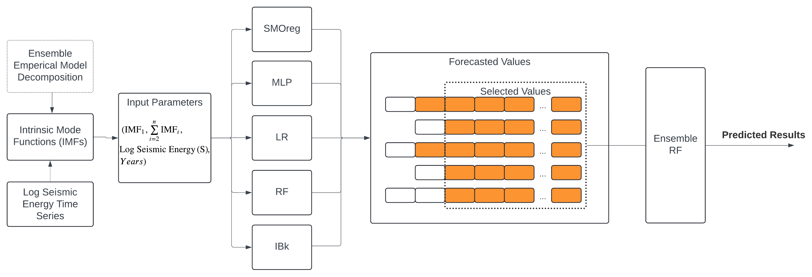

Seismic energy forecasting: five models, then a forest on their forecasts, tested on later years.

::: {.credit}
Shukla, Dhanya, Kumar, Priyanka and Dutt (2025), *Natural Hazards and Earth System Sciences* 25, 3713–3736, Fig. 6. [doi:10.5194/nhess-25-3713-2025](https://doi.org/10.5194/nhess-25-3713-2025). CC BY 4.0.
:::
:::
:::

::: {.takeaway}
Bagging and forests lower variance. Boosting lowers bias, one correction at a time. Stacking must learn from predictions on samples its members did not train on.
:::

::: {.notes}
Part 2 takes 10 minutes. Left panels: in a forest each tree gives its own estimate and they are averaged; in boosting the trees are added, each scaled by a learning rate. Right: Shukla and colleagues decompose annual log seismic energy into modes, feed them to five learners, and let a forest combine the forecasts. A good question for any such paper, and for the room: their text describes decomposing the series, and does not say the decomposition was fit on training years only. If it used later years, what would that do to the test score? Say that this is a question to ask, not a finding: I read the methods, not their code. Voting is the simplest combination: equal votes among different models. Pasting is bagging without replacement.
:::

## Boosting, tree by tree

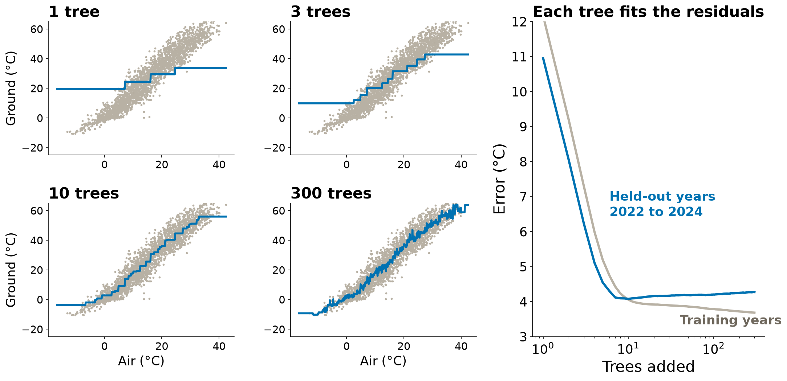{.r-stretch}

[📍 In-situ sensor]{.gb .src} [💧 Land water]{.gb .sys .water} [💧 Hydrology & land-surface modeling]{.gb .disc .water}

::: {.takeaway}
Held-out error falls from 15.6 °C at the mean to 4.08 °C with 10 trees, then climbs to 4.27 °C by 300 trees while training error keeps falling.
:::

::: {.notes}
USCRN WA Spokane 17 SSW, daily maximum air and ground temperature, trained on 2015 to 2021, tested on 2022 to 2024. Each tree has depth 2 and 30% of its correction is kept. One tree gives four stairs; each later tree refines the stairs. Compare Friday's forest: more trees never hurt a forest, because it averages. Boosting keeps fitting what remains, and after the signal, what remains is noise. So the number of trees is a setting to choose by validation inside the training years. On these held-out days: forest 4.39 °C, line 4.26 °C. The differences are small since one feature does most of the work. Students write this loop in 3.9, in three lines.
:::

## Three models on four source types

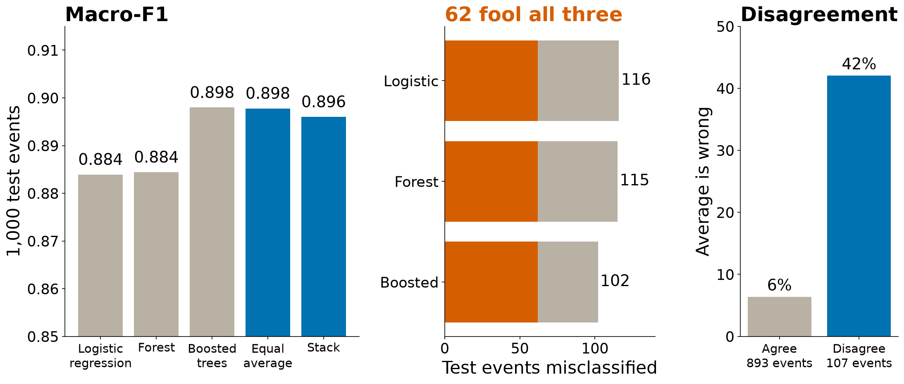{.r-stretch}

[📍 In-situ sensor]{.gb .src} [🪨 Solid Earth]{.gb .sys .solid} [📈 Seismology]{.gb .disc .solid}

::: {.takeaway}
Average and stack match the best member, since 62 of the boosted model's 102 errors are shared by all three. Where the models disagree, the average is wrong 42% of the time, against 6% where they agree.
:::

::: {.notes}
The 4,000 Pacific Northwest events, canonical split, 1,000 test events. The y-axis is truncated to show the differences: .896 and .898 differ by about two events. Macro-F1: logistic .884, forest .884, boosted .898, equal average .898, stack .896. Ask what those 62 events are. Likely explanations are waveform features that look like another class, or labels an analyst might revise: that is my reading, not something I checked event by event. Students could look at them in 3.9. One data set and one split, so do not generalize: stacking does help when members make different errors. Right panel: a combination that scores no higher can still tell you which predictions to send to an analyst. This is the same reading as Friday's vote agreement among trees, and it returns with deep ensembles in 4.5. Disagreement estimates epistemic uncertainty, what the models have not learned. It does not capture aleatoric uncertainty, the noise in the measurement itself.
:::

## Stream temperature: inputs beat model family

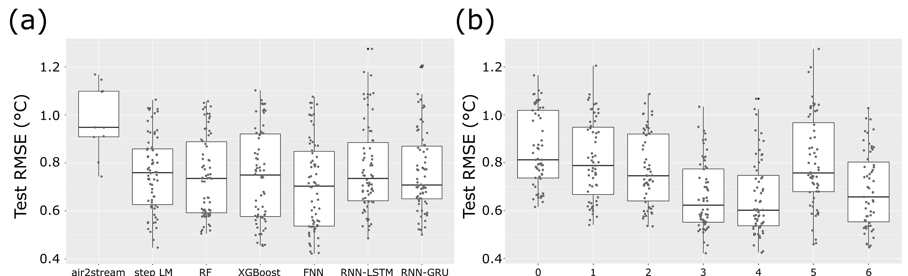{.r-stretch}

[📍 In-situ sensor]{.gb .src} [💧 Land water]{.gb .sys .water} [💧 Hydrology & land-surface modeling]{.gb .disc .water}

::: {.takeaway}
Ten Central European catchments, last 20% of each record as test. Model family (a): no significant difference, p = .11. Inputs (b): p < 10⁻¹⁴.
:::

::: {.credit}
Feigl, Lebiedzinski, Herrnegger and Schulz (2021), *Hydrology and Earth System Sciences* 25, 2951–2977, Fig. 4, panels a, b. [doi:10.5194/hess-25-2951-2021](https://doi.org/10.5194/hess-25-2951-2021). CC BY 4.0.
:::

::: {.notes}
Panel a: each box is one model family across catchments and input sets, against air2stream, a physically based benchmark. Panel b: the input sets; T is air temperature, Q discharge, P precipitation, GL global radiation. Input sets with discharge have the lowest medians. Best experiments of different families differ by a median of 0.08 °C. Boosted trees and feedforward networks were each best in 4 of 10 catchments. The best machine-learning model beat the benchmark in every catchment: 0.55 °C against 0.98 °C on average. The time split is what makes this comparison believable. Message for projects: before stacking models, ask what measurement you could add.
:::

## Open 3.9 (15 minutes)

::: {.columns}
::: {.column width="40%"}
::: {.roomy}
1. Part 1: average the three models, and count the events they all miss
2. Part 2: write the boosting loop, then read the two error curves
3. Part 3: fit the stack on out-of-fold predictions
4. **Your project:** do your models make different errors?
:::
:::
::: {.column width="60%"}
Each round fits a small tree to what is still wrong:

```python
for _ in range(rounds):
    residuals = fit["ground"] - fit_prediction
    tree = DecisionTreeRegressor(max_depth=2)
    tree.fit(fit[["air"]], residuals)
    fit_prediction += RATE * tree.predict(fit[["air"]])
```
:::
:::

::: {.dim}
Reading: [3.9](https://geo-smart.github.io/mlgeo-book/ensemble-learning). The first data cell takes about 10 seconds and the stack about 30. If you run short, skip Part 3.
:::

::: {.notes}
Pairs, 15 minutes. Task 2 is the most important: three lines that explain every boosted-tree package they will use.
:::

## Part 3, AutoML: the method is a loop

::: {.columns}
::: {.column width="62%"}
```python
def mini_automl(candidates, X, y, cv):
    scores = {}
    for name, model in candidates.items():
        scores[name] = -cross_val_score(
            model, X, y, cv=cv,
            scoring="neg_mean_absolute_error").mean()
    return pd.Series(scores).sort_values()
```

The argument that decides the result is `cv`.

| Candidates in 3.10 | |
|---|---|
| Linear models | Linear, Ridge |
| Nearest neighbors | 3, 30 |
| Forests | default, leaf 20 |
| Boosted trees | default, slow |
:::
::: {.column width="38%"}
Tools such as H2O AutoML, AutoGluon and auto-sklearn add to this loop:

- many families and settings
- search that spends time where scores look good
- a stack of the winners

They do not know how your model will be used.
:::
:::

::: {.notes}
Part 3 takes 10 minutes. This is the function students write in 3.10, with scikit-learn only. Earlier editions used pycaret and Optuna; neither is needed to understand the idea, and both are fine to use in a project. Optuna and similar libraries draw new settings near those that scored well, which saves time when a fit takes hours. Coding agents now often write this whole loop on request, which is where the audit at the end of this part comes in.
:::

## Soil moisture, South Korea: AutoML and a forest

::: {.columns}
::: {.column width="52%"}
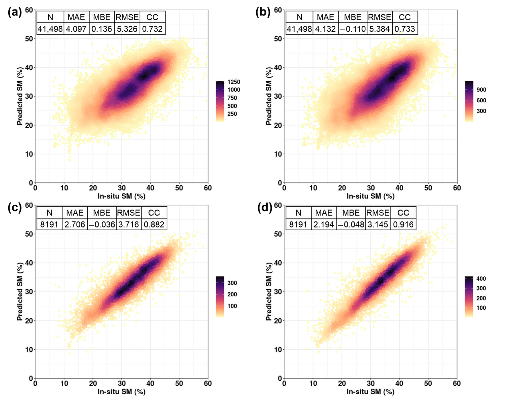{height="690"}
:::
::: {.column width="48%"}
[🛰️ Satellite & airborne]{.gb .src} [💧 Land water]{.gb .sys .water} [💧 Hydrology & land-surface modeling]{.gb .disc .water}

Daily soil moisture from satellite, weather model and terrain data, 2014 to 2021, against in-situ stations.

| Mean error (%) | Forest | AutoML |
|---|---|---|
| Random 20% held out | 2.71 | **2.21** |
| Each year held out | **4.10** | 4.13 |

AutoML's lead disappears when the test is a year it has not seen, and both errors grow by half or more.

::: {.credit}
Lee, Sohn, Kim, Park, Park and Lee (2023), *Remote Sensing* 15, 4168, Fig. 8, Tables 4 to 7. [doi:10.3390/rs15174168](https://doi.org/10.3390/rs15174168). CC BY 4.0.
:::
:::
:::

::: {.notes}
Panels a and b: leave-one-year-out, forest then AutoML. Panels c and d: random sampling, forest then AutoML, one round of five. The table gives the averages over all rounds. AutoML here is H2O; the forest used H2O defaults, 50 trees of depth 20. The authors conclude that AutoML tends to be more accurate, and they also state that leave-one-year-out is closer to real conditions. The tie is in their Tables 4 and 5. My reading, not theirs: on the random split a flexible search can benefit from neighbors in time and space, as our forest did at P395.
:::

## One search, two validations, two winners

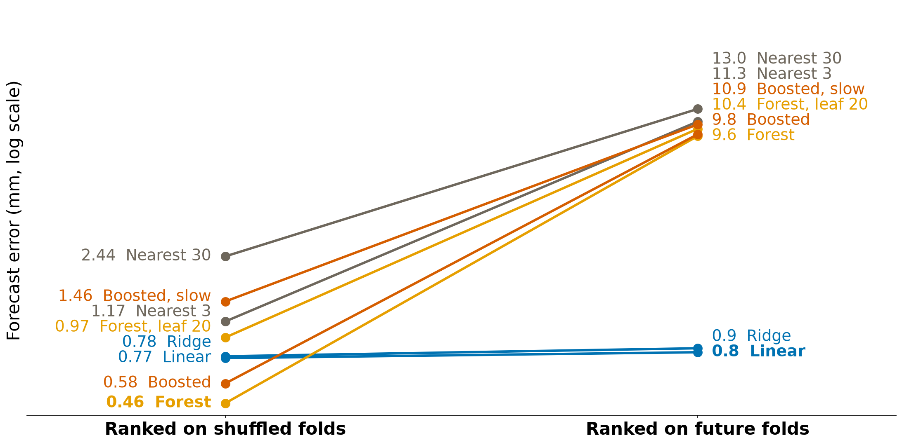{.r-stretch}

::: {.takeaway}
Final test on the last 20% of P395: the winner on shuffled folds errs by 13.4 mm, the winner on future folds by 0.74 mm. Persistence: 1.12 mm.
:::

::: {.notes}
Same eight candidates, same 1,185 samples, same loop. Only cv changed. Each line joins a candidate's error on shuffled folds and future folds; note the log scale. On shuffled folds, the forest wins and the linear models come third and fourth. On future folds, everything that cannot extrapolate falls together near 10 mm. A shuffled search would ship a model eighteen times worse on the final test. This is one record with a strong trend, which suits linear models. On a stationary series the gap would be smaller, and I would not generalize the 18. Students reproduce this in 3.10.
:::

## The best score of a search is optimistic

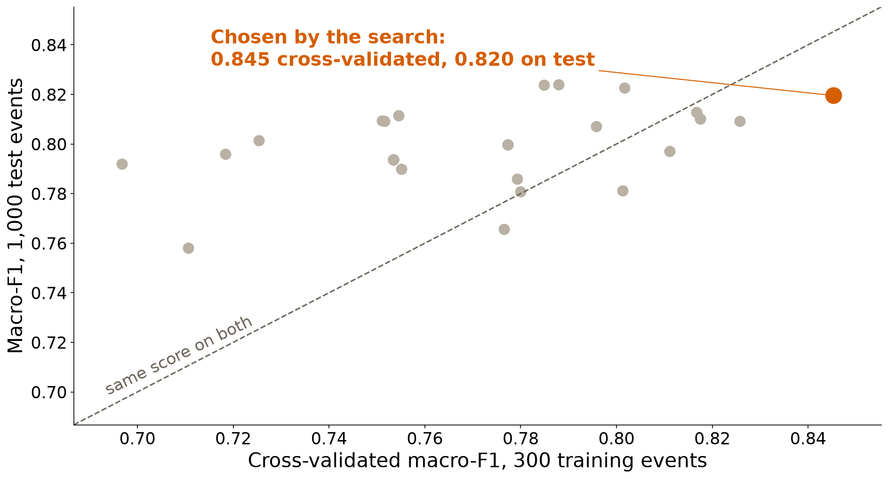{.r-stretch}

::: {.takeaway}
30 random settings on the seismic events: the search's best is .845 cross-validated and .820 on test. Report the winner's score on a test set used once.
:::

::: {.notes}
Thirty random settings of logistic regression, forests and nearest neighbors, on 300 of the seismic training events so the effect shows. The best test score among all 30 was .824, and that model was not the one the search selected, but we would not be allowed to look at that in practice. The gap grows with the number of tries and shrinks with more data. The same applies to 500 trials in a Bayesian search: the best trial's score is optimistic.
:::

## An agent wrote this. What is wrong with it?

```python
two_labels = seismic[seismic["source"] != "surface event"]   # remove noisy labels
features = StandardScaler().fit_transform(
    two_labels.drop(columns=["source", "serial_no"]))        # normalize features
a_train, a_test, b_train, b_test = train_test_split(
    features, two_labels["source"], test_size=0.25, random_state=7)

for name, model in models.items():
    model.fit(a_train, b_train)
    score = model.score(a_train, b_train)                    # evaluate each candidate
```

::: {.roomy}
| | Classes | Scored on | Score |
|---|---|---|---|
| The script prints | 3 of 4 | data it trained on | accuracy **1.000** (forest) |
| Repaired | 4 of 4 | cross-validation, then test once | macro-F1 **.871**, **.888** |
:::

::: {.takeaway}
Three flaws. Find them before you open 3.10.
:::

::: {.notes}
Give the room a minute, in pairs. One: a class is dropped under a comment about noisy labels, so the score describes an easier problem. Two: the scaler sees the test events before the split. The effect here is small, but with imputation or target encoding it can be large. Three: models are chosen on training accuracy, which rewards memorization. Warning signs: a near-perfect score, no baseline, no held-out score. This is a script written for this class, not a recorded agent output. It leads into Friday's lecture on evaluating agents (6.3): the same checks, applied to the agent.
:::

## Open 3.10 (20 minutes)

::: {.roomy}
1. Part 1: write `mini_automl`, run it twice, then score both winners once on the final test
2. Part 2: compare the search's best score with its test score
3. Part 3: list the three flaws, then repair the script
4. If you have time: ask your own agent for a short AutoML, and audit it against this list: what is held out, what baseline is reported, is the scaler fit on training folds only, is the test set used once?
:::

::: {.dim}
Reading: [3.10](https://geo-smart.github.io/mlgeo-book/automl). Before you run the search, write down which model you expect to win. If you run short, skip Part 2. Ch 3 quiz: Tue to Thu. Friday: evaluating agents (6.3). HW-CML due Fri Nov 20.
:::

::: {.notes}
Pairs, 20 minutes. Ask for predictions of the winners before they run the search; it makes the result stick.
:::

## Summary

::: {.roomy}
| Choice | What it decides | Check | Example today |
|---|---|---|---|
| **Split** | which question the score answers | keep what samples share on one side | P395: 0.46 mm shuffled, 12.4 mm future |
| **Baseline** | whether the score means anything | a rule with no learning, in physical units | persistence 1.17 mm |
| **Ensemble** | whether models can repair each other | do members make different errors? | 62 events fool all three |
| **Number of trees** | when boosting starts to fit noise | error on held-out data | 4.08 °C at 10 trees, 4.27 °C at 300 |
| **Search** | which model you ship | score the winner once on a test set | 13.4 mm or 0.74 mm |
:::

::: {.notes}
Five minutes of synthesis. Ask for one row where a student's project is exposed. Monday Nov 16's check-in asks each team for its data audit, baseline and split, so this table is the preparation. Friday applies the same discipline to agents.
:::
