## {background-color="#faf7f2"}

[🧠]{.lecture-icon}

### Today's question

Deep learning starts with one neuron, and you have already used it twice.

**What does one neuron compute, how are its weights set, and what does it miss?**

::: {.dim}
Part 1, Monday: one neuron (4.0). Wednesday: Part 2, gradient descent (4.0), then Part 3, a network (4.1, 4.2).
:::

::: {.notes}
This deck covers two class meetings. Part 1 (Monday Nov 16) is the perceptron: about 25 minutes of slides and 15 minutes in notebook 4.0, after the project check-ins. Wednesday Nov 18 has two parts. Part 2 is gradient descent on one neuron, one step at a time, in the notation of notebook 3.6 (observation, prediction, error, loss, gradient, learning rate): about 20 minutes of slides, then notebook 4.0 section 2. Part 3 builds a network and trains it with the same loop: about 15 minutes of slides, then notebook 4.1. The plan for Part 1 is to show that students already know the neuron: it is the weighted sum of template matching (lecture 1, section 2.9) and of logistic regression (lecture 16, notebook 3.6). Ask the room before starting: who thinks a neural network is a different kind of object from the regressions we have fitted? Come back to the answers on the summary slide. Reading: 4.0 Perceptrons, 4.1 Neural networks, 4.2 MLPs.
:::

## Chapter 4: four canonical networks

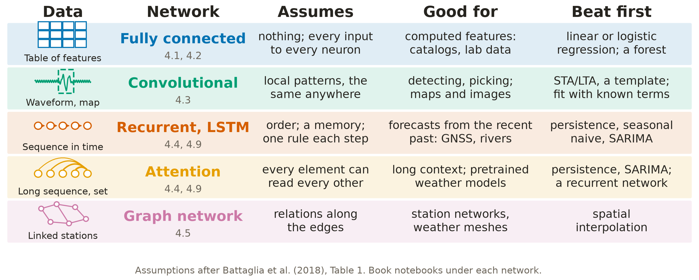{.r-stretch}

::: {.takeaway}
The data choose the network, and each network must first beat a simpler method. Every row is built from one neuron: today.
:::

::: {.notes}
The statement that opens and closes every deck of Chapter 4. Read it row by row: what one data sample is, the network, what it assumes, what it is good for, the baseline it must beat first. Each later deck highlights its own row: fully connected (lecture 21b, notebooks 4.1 and 4.2), convolutional (lecture 22, 4.3), recurrent and attention (lecture 23, 4.4), graph networks (lecture 23b, 4.5). Training and evaluating any of them: lecture 24a (4.7). Today, notebook 4.0: the neuron inside every row, and how its weights are found. Drawn by figscripts/lec_framework.py; assumptions after Battaglia et al. (2018, arXiv:1806.01261), Table 1.
:::

## One neuron: a weighted sum, then an activation

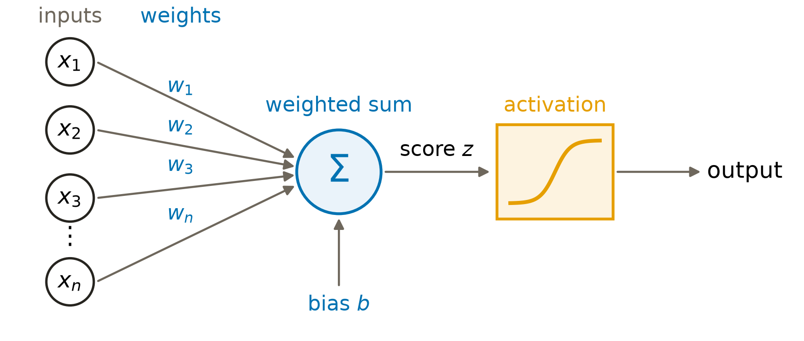{.r-stretch}

::: {.takeaway}
Score $z = \sum_i w_i x_i + b$: each input times its weight, added up, plus a bias. The activation turns the score into the output.
:::

::: {.notes}
Two minutes. Walk the figure left to right. Inputs: the numbers that describe one data sample, either features computed from a record or the samples of the record itself. Weights: one per input. The neuron multiplies, adds, and adds one more number, the bias, which shifts the score up or down (one bias per neuron, not one per input). The activation turns the score into the output. Define aloud: weight, bias, score, activation function.
:::

## The activation names the model

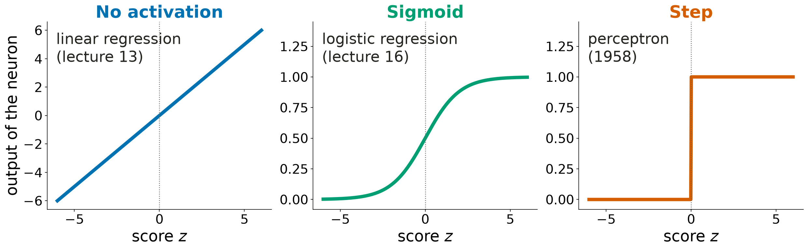{.r-stretch}

::: {.takeaway}
The same weighted sum gives three models you know. Only the last step differs.
:::

::: {.notes}
Two minutes. Three choices for the activation, three models the class has met. No activation: the output is the score, and the neuron is the linear regression of lecture 13. Sigmoid: the output is a probability between 0 and 1, and the neuron is the logistic regression of lecture 16. Step: the output is 1 if the score is positive and 0 otherwise; this is the threshold logic unit (TLU) of McCulloch and Pitts (1943, Bull. Math. Biophys. 5, 115-133). Rosenblatt (1958) gave it a learning rule, and a layer of such units is what he called the perceptron. The TLU is still studied today, in binarized and spiking networks (slide 22). The word survives today in multilayer perceptron, the fully connected network of Part 2. A fourth use of the same sum comes next: template matching, where the weights are not fitted at all.
:::

## Template matching 1: cut out a known earthquake

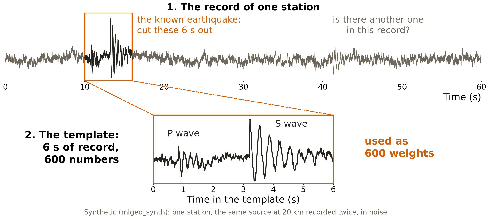{.r-stretch}

::: {.takeaway}
The template is 6 s of record around an earthquake we already know: 600 numbers. Is the same waveform anywhere else in the record?
:::

::: {.notes}
Two minutes. Start from what a seismologist has: the continuous record of one station (here 60 s, synthetic) and a catalog that lists one earthquake in it, at 10 s. Cut out the 6 s of record that hold it: the P wave, then the larger and slower S wave. Sampled 100 times per second, that is 600 numbers. This piece of record is the template. Nothing is fitted; it is copied from the data. Why it is useful: an earthquake that repeats on the same fault patch, recorded at the same station, sends nearly the same waveform, larger or smaller. So the question becomes: where else in the record does this shape occur? Ask the room to look at the record between 20 and 60 s and say where they see another earthquake. (There is one at 38 s, with a peak 2.5 times the noise; most will not see it.) The 600 numbers will be used as 600 weights: that is the link with the neuron of the previous slides.
:::

## Template matching 2: slide it, compute a score

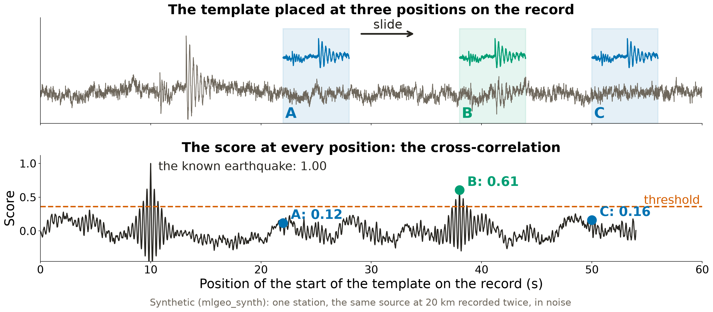{.r-stretch}

::: {.takeaway}
One score at each position of the template: together they are the cross-correlation. The score is 0.61 at B, where an earthquake hides in the noise.
:::

::: {.notes}
Three minutes. Place the template on the record at some position, compare it with the 6 s of record under it, and write down one number, the score (how it is computed is the next slide). Move the template by one sample and repeat. The curve of the score against the position is the cross-correlation of the template with the record; students computed one in section 2.9. Top: the template drawn at three of the positions, A, B and C. Bottom: the score at all 5,400 positions, with A, B and C marked. Read it with the room. At 10 s the template lies on the earthquake it was cut from: score 1.00, the largest possible. At A and C there is only noise under the template: 0.12 and 0.16. At B the score is 0.61, far above everything around it: the same waveform is there, too small to see by eye in the top panel. The dashed line is the detection threshold, 0.36: the largest score this template reaches on 10 minutes of noise with no earthquake. Every position above the threshold is declared a detection. Note the fast oscillation of the score around each earthquake: one sample too early or too late and the score drops, which the next slide explains.
:::

## Template matching 3: aligned waveforms score high

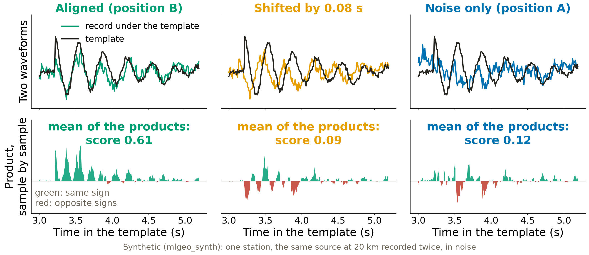{.r-stretch}

::: {.takeaway}
Score = mean of record × template, sample by sample. Aligned, peaks meet peaks and the products are positive: 0.61. Shifted or on noise, they cancel: 0.09 and 0.12.
:::

::: {.notes}
Four minutes; this is the slide that explains the method. The score is computed in three moves: standardize the template and the 6 s of record under it (subtract the mean, divide by the standard deviation), multiply them sample by sample, and take the mean of the 600 products. That mean is the correlation coefficient of lecture 7, between −1 and 1. The figure zooms on 2.2 s around the S wave. Top row: the two waveforms. Bottom row: their product at each sample, green where it is positive, red where it is negative.

Left, the template at position B, aligned with the hidden earthquake. Where the template is up, the record is up: positive times positive is positive. Where the template is down, the record is down: negative times negative is also positive. Every peak and every trough adds to the sum, and the mean is 0.61. It is not 1 because the record also holds noise.

Middle, the template moved by 0.08 s, a quarter of the 0.33 s period of the S wave. Now the peaks of one fall on the zero crossings of the other: half of the products are positive, half negative, and they cancel. The mean is 0.09. Move by half a period and peaks meet troughs: the score is negative. This is the fast oscillation seen on the previous slide.

Right, position A, noise only. The noise goes up and down with no relation to the template: positive and negative products in equal amounts, mean 0.12.

The link to say aloud: a sum of inputs times fixed numbers is the weighted sum of the neuron. Template matching is a neuron whose 600 weights are the template, and whose bias is minus the threshold. The weights were copied from one earthquake instead of being found by training.
:::

## On ten years of records: 1.81 million earthquakes

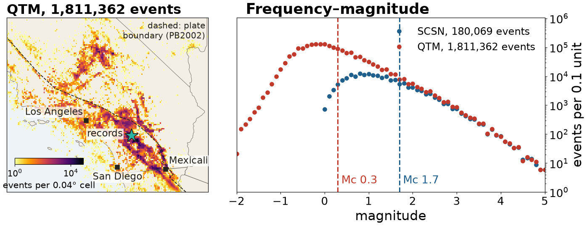{.r-stretch}

[🗂️ Catalog & compiled product]{.gb .src} [🪨 Solid Earth]{.gb .sys .solid} [📈 Seismology]{.gb .disc .solid}

::: {.takeaway}
Lecture 1: the same three steps, with the waveform of every known earthquake in Southern California as a template, found ten times more earthquakes than the catalog held.
:::

::: {.credit}
Our figure from the open QTM catalog of Ross, Trugman, Hauksson & Shearer (2019), *Science* 364, 767–771 (figscripts/qtm_hidden_earthquakes.py).
:::

::: {.notes}
One minute; a recall of lecture 1, now that the three steps are on the table. Ross et al. (2019) took the waveforms of the earthquakes in the Southern California Seismic Network catalog as templates and cross-correlated each with ten years of continuous records (2008 to 2017). Result: 1.81 million earthquakes, ten times the catalog, and a magnitude of completeness lowered from 1.7 to 0.3. Why it works: an earthquake that repeats on the same fault patch, recorded at the same station, sends nearly the same waveform. In section 2.9 students computed a cross-correlation themselves. At one lag, the cross-correlation is a sum of products, window sample times template sample: a neuron whose weights are the template, and whose bias is minus the detection threshold. The question for the next slide: if nobody supplies the template, and the neuron only gets labeled windows, what weights does it find?
:::

## Without a template: training finds the same waveform

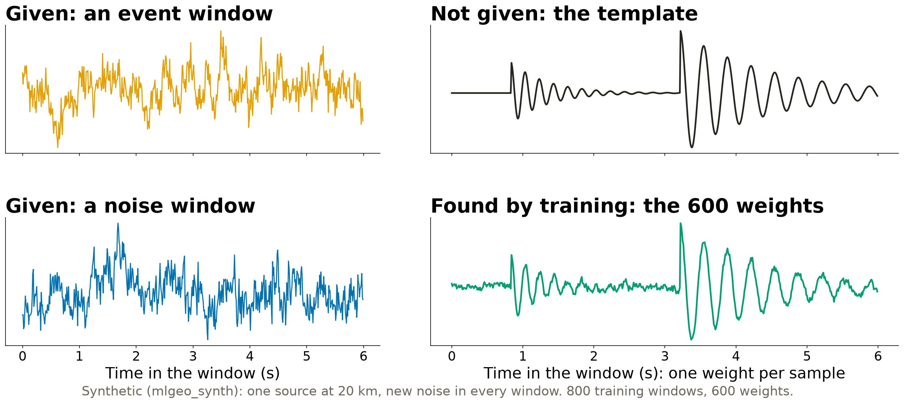{.r-stretch}

::: {.takeaway}
From 800 windows labeled event or noise, training gives weights that draw the waveform of the event: correlation 0.99 with the template.
:::

::: {.notes}
Three minutes. The previous slides copied the weights from a known earthquake. Now suppose nobody has a template: we only have 800 windows of 6 s, each labeled event or noise. The data are from the course generator, mlgeo_synth: a magnitude 2 source 20 km from the station, recorded again and again in new noise, with a signal-to-noise ratio (peak amplitude over the standard deviation of the noise, section 2.10) between 1.5 and 6. Each data sample is a window of 600 values, so the neuron has 600 weights, one per sample of the window. Left: what the neuron is given, an event window at a signal-to-noise ratio of 1.5 (hard to see by eye) and a noise window. Right, top: the template, the event without noise, which the neuron never sees. Right, bottom: the 600 weights after training on the labeled windows (logistic regression; how training works is Wednesday). Plotted against time, the weights draw the waveform of the event: P wave, then S wave. Training has built the template from the labels. This is the reading to keep for the whole chapter: a neuron's weights are the input pattern it responds to most strongly. Template matching with the true template classifies 399 of 400 test windows correctly, and so does the trained neuron.

For questions. The fit uses scikit-learn's logistic regression with a penalty on the size of the weights (C = 0.001). With a weak penalty (C = 1) the correlation drops to 0.90, because the noise of the generator is colored and the neuron spends part of its weights cancelling it: the matched filter in colored noise of lecture 9. The task is easy on purpose: one source, one station, a fixed arrival time. Part 2 moves the arrival. Numbers: figs/lec21_neuron/numbers.json, from figscripts/lec21_one_neuron.py. Notebook 4.0 section 5 reproduces the figure.
:::

## The 1958 rule: update the weights after each nonzero error

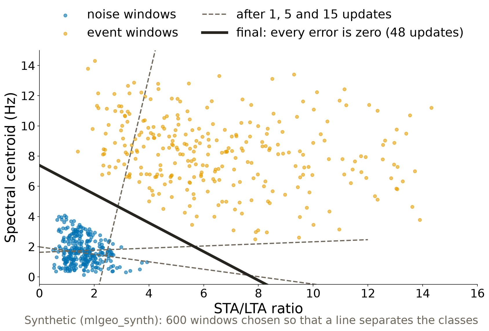{.r-stretch}

::: {.takeaway}
Error = prediction − observation: −1 for a missed event, +1 for a false alarm, 0 otherwise. From random weights the line stops moving after 48 updates.
:::

::: {.notes}
Three minutes. Rosenblatt's rule (1958), the first learning rule for a neuron, written out in notebook 4.0 section 4.2. Each point is a 30 s window described by two detector features: the STA/LTA ratio (short-term over long-term average amplitude, lecture 9) and the spectral centroid. The observation y is 1 for an event and 0 for noise. Start from random weights drawn with a seed (seed 0), not from zeros. Show one window and compute the prediction with the step, 0 or 1. The error is the prediction minus the observation. If it is zero, do nothing. If the neuron predicted noise and the window holds an event, the error is −1, and the rule adds the window's features to the weights, so that the score of similar windows goes up; if it predicted an event and the window is noise, the error is +1 and the rule subtracts them. In code: `error = yhat_i - y_i`, then `w = w - learningRate * error * x_i`. The dashed lines are the boundary (where the score is zero) after 1, 5 and 15 updates; the thick line is where it stops. All 48 updates happen in the first epoch (one pass through the 600 windows); in the second epoch every error is zero. Say what the notebook did to get this result: it removed the windows in the overlap band, so that a separating line exists. The rule is guaranteed to stop only then. Ask the room: what will happen on real events, which overlap?
:::

## On real events the rule never stops updating

{.r-stretch}

[📍 In-situ sensor]{.gb .src} [🪨 Solid Earth]{.gb .sys .solid} [📈 Seismology]{.gb .disc .solid}

::: {.takeaway}
Explosion or earthquake, Pacific Northwest: about 196 of 1,500 events still have a nonzero error at each epoch, and the test accuracy of the rule swings from 74.6% to 89.6%. Lowering the log-loss climbs steadily to 89.0%.
:::

::: {.notes}
Three minutes. The same data and the same split as lecture 16: 1,000 explosions and 1,000 earthquakes from the Pacific Northwest, 61 waveform features, 1,500 events to train and 500 to test, features standardized on the training events. Both runs start from the same random weights (seed 0). Left: the number of events with a nonzero error in each epoch of the 1958 rule. It falls from 263 to about 200 and stays there, because explosions and earthquakes overlap in these features and no plane separates them. Right, red: the test accuracy after each epoch. Over the last 100 epochs it ranges from 74.6% to 89.6%; the answer depends on the epoch at which we stop. Right, green: the same neuron trained by gradient descent on the log-loss, the method of lecture 16 and notebook 3.6. It reaches 89.0% after 300 epochs and is still improving slowly; run to convergence it gives the 90.2% quoted in lecture 16. The loss also gives a probability for each event, so the threshold, the ROC curve and the calibration of lecture 16 all apply. Numbers: figs/lec21_neuron/numbers.json, from figscripts/lec21_one_neuron.py, rerun on 2026-11-16 with random starting weights.
:::

## Why the rule cannot settle: the step gives no slope

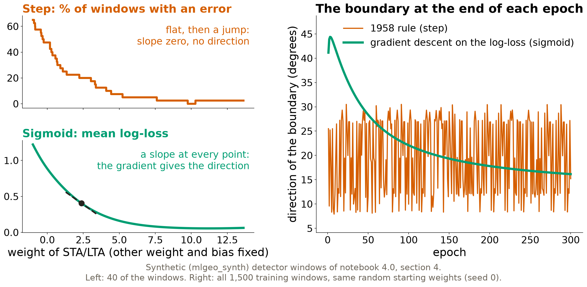{.r-stretch}

::: {.takeaway}
With the step, the only measure is how many windows are wrong: flat, then a jump, so no direction to move. With the sigmoid, the log-loss has a slope everywhere and the boundary settles.
:::

::: {.notes}
Three minutes; this is the idea Part 2 and every network rest on. Training needs two things: a number that says how wrong the neuron is, and the direction in which to move each weight to make that number smaller. The direction is the slope of the number with respect to the weight: the gradient.

Top left, the step. With an output of 0 or 1, the only measure of how wrong the neuron is: the share of windows with a nonzero error. Drawn against one weight (the weight of STA/LTA, the other weight and the bias held fixed), on 40 of the windows so the steps show: the curve is flat, then jumps when the line crosses one window, then flat again. The slope is zero on the flat parts and undefined at the jumps. Nothing tells the weight which way to go, or how far. The 1958 rule gets around this by moving the weights by a fixed amount for each window on the wrong side. When no line puts every window on the right side, some window is always wrong and the line keeps moving.

Bottom left, the sigmoid. The output is a probability, the error ŷ − y is a number between −1 and 1, and the mean log-loss is a smooth curve with a slope at every point (dashed tangent). The slope gives the direction and the size of the update, and it shrinks to zero at the lowest point, so the updates shrink and stop.

Right, both trainings on the 1,500 overlapping training windows, from the same random starting weights (seed 0). The direction of the boundary line at the end of each epoch. The rule (red) jumps between 8° and 30° for 300 epochs. Gradient descent on the log-loss (green) moves smoothly and settles near 16°, still drifting slowly.

Why this matters for networks. A hidden neuron's weights are trained by the chain rule from the output back to the input (backpropagation, Rumelhart, Hinton and Williams 1986). Every link in the chain multiplies by the slope of an activation. With a step, that slope is zero and nothing reaches the hidden weights. This is why networks use smooth activations: sigmoid, tanh, ReLU. A second limit is separate and is not fixed by the sigmoid: one neuron, whatever its activation, separates its two answers with a straight line. Hidden layers fix that (Wednesday, Part 3). Numbers: figs/lec21_neuron/numbers_step_vs_sigmoid.json, from figscripts/lec21_step_vs_sigmoid.py.
:::

## From the rule to the loss: the error becomes smooth

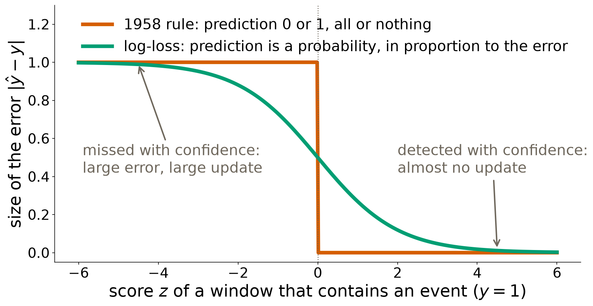{.r-stretch}

::: {.takeaway}
Replace the step by the sigmoid and the 1958 update becomes the gradient update on the log-loss of lecture 16. Every network in Chapter 4 is trained with this update.
:::

::: {.notes}
Three minutes. The two updates, to write on the board, with y the observation and ŷ the prediction: 1958 rule, `w = w - rate * (yhat - y) * x` with `yhat` equal to 0 or 1; log-loss, the same line with `yhat` the probability from the sigmoid. The figure shows the size of the error for a window that contains an event (y = 1), against the score the neuron gave it. Red, the rule: an error of 1 if the score is negative (a missed event), 0 if it is positive. Green, the log-loss: an event predicted with confidence barely moves the weights, a confident miss moves them almost as much as under the rule, and everything in between is proportional. This is exact: differentiate the log-loss with respect to a weight, for a sigmoid neuron, and the result is (ŷ − y) times the input, the error times the input. Notebook 3.6 checked that derivative against automatic differentiation. A smooth activation and a loss to lower are what made networks with several layers trainable. Wednesday takes this update apart one step at a time: loss, gradient, learning rate.
:::

## In the literature: where do aftershocks occur?

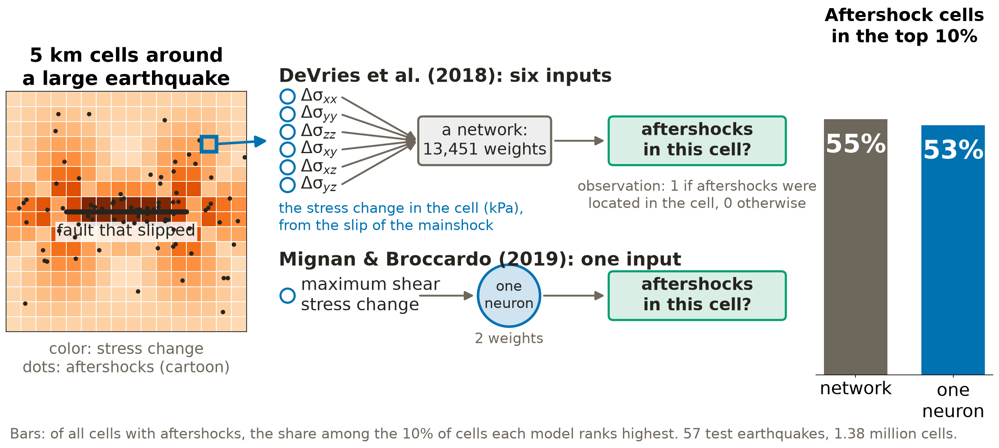{.r-stretch}

[🖥️ Model & simulation]{.gb .src} [🪨 Solid Earth]{.gb .sys .solid} [📈 Seismology]{.gb .disc .solid}

::: {.takeaway}
Input: stress change in a 5 km cell. Output: aftershocks there, yes or no. One neuron does about as well as a network of 13,451 weights: 53% against 55%.
:::

::: {.credit}
Our rerun of the open release of DeVries et al. (2018), *Nature* 560, 632–634; Mignan & Broccardo (2019), *Nature* 574, E1–E3. Map: cartoon.
:::

::: {.notes}
Two minutes; told in lectures 2 and 18, so go fast and keep the same care: disclose that I served on the PhD committee of the first author, credit the open data and weights, and avoid "debunked". Read the figure left to right. Left, a cartoon: after a large earthquake, the crust around the fault is cut into cells of 5 km. For each cell we know two things. The inputs: the change of stress caused by the slip of the mainshock, computed from its slip model, six numbers (the six components of the stress tensor, in kPa). The observation: 1 if aftershocks were located in the cell within a year, 0 otherwise. The task is a classification, like event or noise on Monday: inputs, then a probability that the observation is 1. DeVries et al. (2018) used 199 slip models of past earthquakes and fed the six inputs to a network with 13,451 weights (how a network is built comes on Wednesday; here it is a box). Mignan and Broccardo (2019) fed one input, the maximum shear stress change, to one neuron with a sigmoid: two weights, the neuron of the previous slides. Right: how well each does on the 57 test earthquakes (1.38 million cells), in plain terms. Rank the cells from the highest predicted probability to the lowest and keep the top 10%: they hold 55% of all the cells with aftershocks for the network, 53% for the neuron. Lecture 18 quoted the same comparison as an area under the curve, 0.849 against 0.847. Numbers: figs/lit_aftershock_2018/numbers.json, from figscripts/aftershock_auc_rerun.py (rerun 2026-11-17 on the cached open release); figure from figscripts/lec21_aftershock_cartoon.py. The lesson for Part 1: try the single neuron first; it is the baseline every network must beat. Mignan and Broccardo (2020, Seismological Research Letters 91, 2330-2342) reviewed 77 articles that used neural networks for earthquake prediction from 1994 to 2019 and concluded that far simpler models offer similar predictive power.
:::

## Open 4.0 (15 minutes)

1. Section 4.2: the rule stops after 2 epochs
2. Section 4.1: write the sigmoid, read the loss at each epoch
3. Section 5: compare the fitted weights with the template
4. Move the arrival by 0.1 s: what does the neuron detect now?

::: {.dim}
`pixi run jupyter lab`, then `mlgeo_4.0_perceptrons.ipynb` · Lab 3.8 due tonight · Chapter 6 quiz closes Wednesday · Classic ML project milestone (3.20) due Mon Nov 23
:::

::: {.notes}
Fifteen minutes, in pairs. Section numbers are those of the notebook as reorganized on 2026-11-16 (gradient descent is now section 2, the classification section 4, the template section 5). Results to expect. Task 1: 48 nonzero errors in the first epoch, none in the second. Task 2: on the 2,000 synthetic detector windows the log-loss falls from 0.76 to 0.12 in 300 epochs and the test accuracy reaches 93.8%; the 1958 rule keeps about 100 nonzero errors per epoch and its test accuracy moves between 91.4% and 94.0%. Task 3: correlation 0.986 between weights and template, 99.75% for both detectors. Task 4: with the arrival 0.1 s later the neuron detects none of the 200 events. The discussion to have before they leave: the weights are tied to positions in the window, so the pattern is recognized only where it was during training. Names in the notebook: `LogisticRegression(C=0.001)` (scikit-learn; C is the inverse of the penalty strength), `synthetic_seismogram` (the course generator).
:::

## Part 2. How are the weights found? Start from random weights

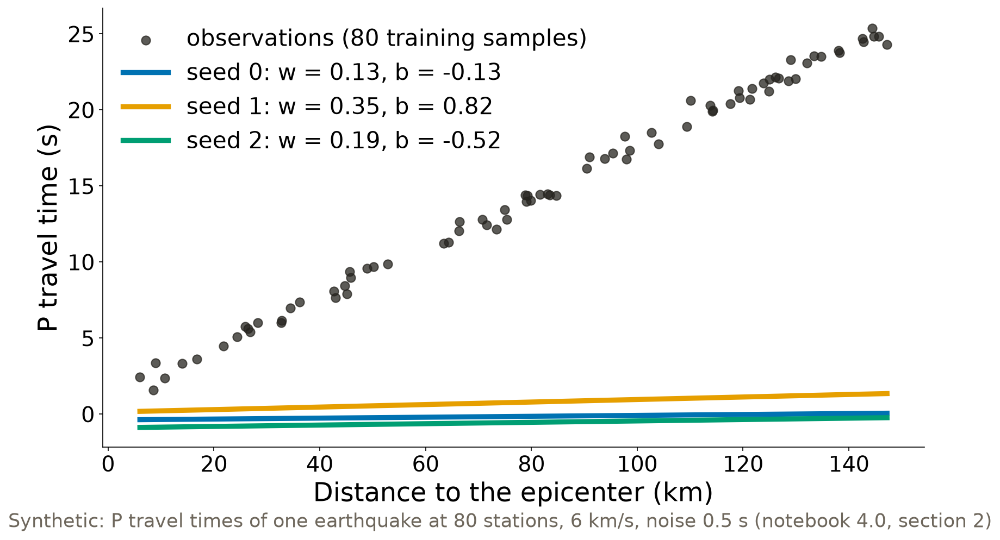{.r-stretch}

::: {.takeaway}
Travel time against distance: the neuron predicts w × distance + b. Its weight w and bias b start as random numbers drawn with a seed, not as zeros.
:::

::: {.notes}
Wednesday starts here. Three minutes. Say it plainly: Monday went too fast over how the weights are found. Today we take gradient descent one step at a time, with the words and symbols of notebook 3.6. Write them on the board and leave them up: observation $y_i$, prediction $\hat{y}_i$, error $e_i = \hat{y}_i - y_i$, loss $\mathcal{L}$, gradient $\partial \mathcal{L} / \partial w$, learning rate $\alpha$.

The geoscience. One earthquake, P-wave arrivals picked at 80 stations between 5 and 150 km. In a crust of uniform velocity the travel time is a line in distance, t = t0 + d / v, and its slope is the slowness 1 / v. Synthetic, written in notebook 4.0 section 2: 6 km/s, a delay of 1 s, 0.5 s of noise on each pick. Each station is one sample. The model is Monday's neuron with no activation: one input x (the distance, standardized), one weight w, one bias b.

Starting weights. Gradient descent improves weights, so they need a starting value. We draw w and b from a normal distribution with mean 0 and standard deviation 1. The three lines are what three seeds give before any training. Two questions for the room. Why not zeros? In a network, hidden neurons that start with the same weights receive the same gradient at every update and stay copies of each other; random weights make them differ. One neuron alone would train from zero, but we keep the habit every network needs. Why a seed? The same seed returns the same random numbers, so the run can be repeated exactly; the seed is reported with the result.
:::

## Errors: prediction minus observation

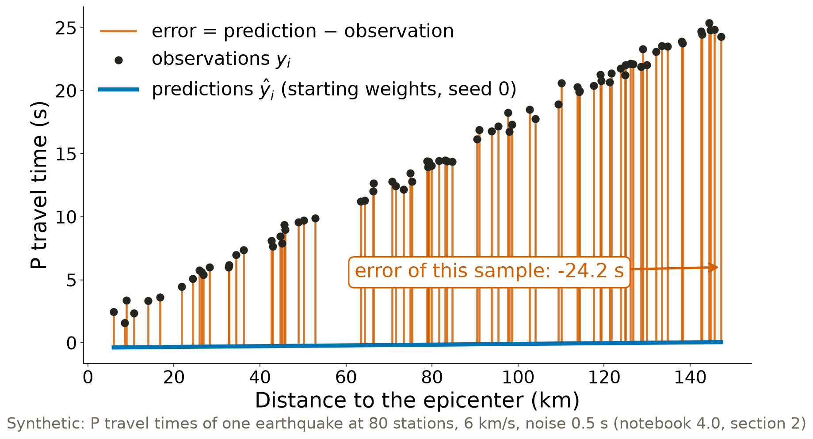{.r-stretch}

::: {.takeaway}
Each sample has an error: its prediction minus its observation. With the starting weights every prediction is too short: −24.2 s at the farthest station.
:::

::: {.notes}
Two minutes. Seed 0: w = 0.13, b = −0.13, the blue line. For each of the 80 samples, the prediction is the point on the line and the observation is the black dot. The error is the prediction minus the observation, in seconds: the red bar. It has a sign. Here all errors are negative, because the line lies below every observation, and they grow with distance. Ask the room to read two errors off the figure: a near station (about −2 s) and the farthest one (−24.2 s). Notebook 4.0 section 2.2: students write `error = yhat - y`. The word is error, as in the statistics of lectures 12 and 13: the difference between a prediction and an observation.
:::

## The loss of each sample, and its mean over the batch

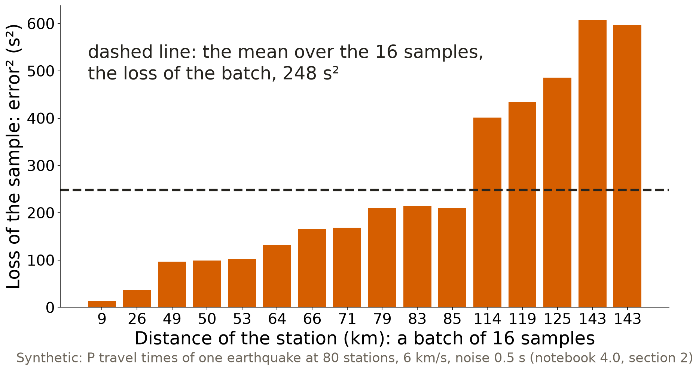{.r-stretch}

::: {.takeaway}
Loss of a sample: its error squared. In this batch of 16 samples it ranges from 14 to 608 s². The loss of the batch is their mean, 248 s².
:::

::: {.notes}
Three minutes. The loss turns the errors into one number to make small. First, one loss per sample: the squared error, $\mathcal{L}_i = (\hat{y}_i - y_i)^2$, in s². The bars are 16 of the 80 samples, in order of distance. The loss differs a great deal from sample to sample: 14 s² for the station at 9 km, 608 s² for a station at 143 km. Then one number for the batch: the mean of the losses of its samples, 248 s² here, the dashed line. A batch is the set of samples used for one update of the weights; it can be all the training samples (the mean over the 80 is 269 s²) or a subset, which comes four slides later. Two things to say. The mean is what training lowers, so samples with large errors count the most, and squaring makes that stronger. And the same construction holds for a classification: one log-loss per sample (lecture 16), then the mean. Notebook 4.0 section 2.3.
:::

## The chain rule: multiply the links

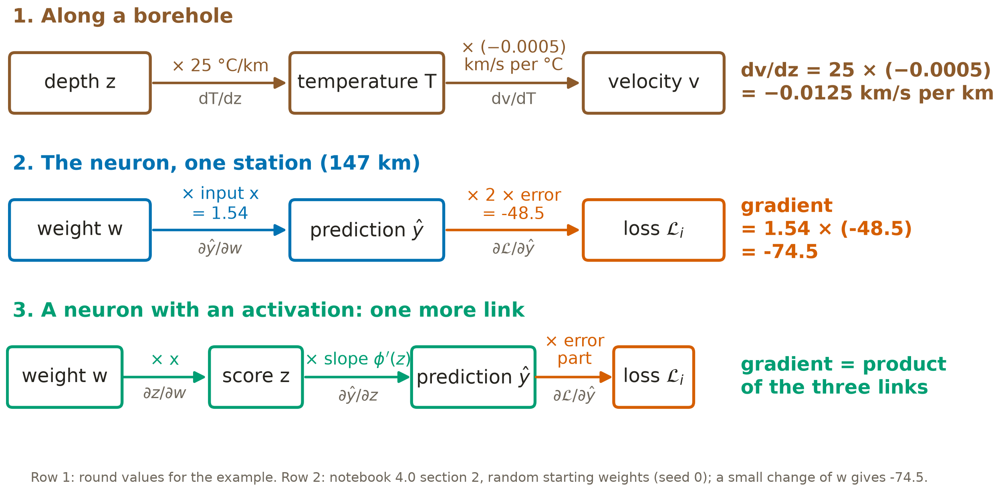{.r-stretch}

::: {.takeaway}
When A changes B and B changes C, the change of C with A is the product of the two links. The gradient of the loss is such a product: input × 2 × error = −74.5 for the farthest station.
:::

::: {.notes}
Three minutes; every gradient in the chapter is computed this way, so take it slowly. Start with the geoscience row. Along a borehole, temperature rises with depth, 25 °C per km, and P-wave velocity falls with temperature, about 0.0005 km/s per °C (round values for the example). How fast does velocity change with depth? Go one link at a time: one km deeper is 25 °C warmer, and 25 °C warmer is 25 × 0.0005 = 0.0125 km/s slower. The change along the chain is the product of the changes along each link. That is the chain rule: dv/dz = dv/dT × dT/dz.

Row 2, the neuron of the travel-time example, at its random starting weights (seed 0), for the farthest station (147 km). The weight changes the prediction: the prediction is w × x + b, so raising w by a little raises the prediction by x times as much; x = 1.54 for this station. The prediction changes the loss of the sample: the loss is error², so its change with the prediction is 2 × error = −48.5 (the prediction is 24.2 s too short). Multiply: −74.5. Raising w by a small amount and measuring the loss gives the same number. This answers the question "why is the input in the gradient": the input is the link from the weight to the prediction; it is the gradient of the prediction, not of the loss.

Row 3: with an activation, there is one more link, the slope of the activation, between the score and the prediction. The next two slides use this row. In a network, each hidden layer adds links, and the backward pass of Part 3 is this product, computed from the loss back to every weight.
:::

## The gradient of the loss: one number for each weight

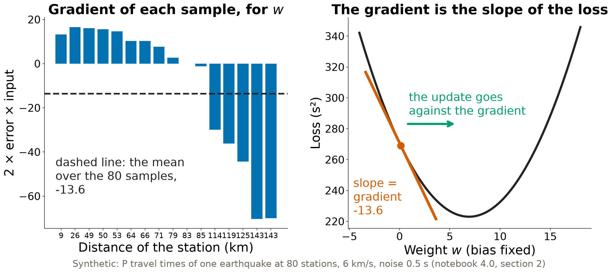{.r-stretch}

::: {.takeaway}
Gradient of the loss for weight $w_j$: the mean over the samples of 2 × error × input. Here −13.6: raising $w$ lowers the loss.
:::

::: {.notes}
Four minutes; this is the slide to spend time on. Question: if I raise w a little, does the loss go up or down, and by how much? That number is the gradient of the loss with respect to w, $\partial \mathcal{L} / \partial w$. As in notebook 3.6: positive if the loss increases when w increases, negative if it decreases.

Right panel first. The loss drawn against w, with the bias held fixed: a curve with one lowest point. We are at the red dot (w = 0.13). The gradient is the slope of the curve there, −13.6: the loss goes down by about 13.6 s² for each unit added to w. So w should go up.

Left panel: where the number comes from. For one sample, the loss is $(w x_i + b - y_i)^2$, and the chain rule gives $2 e_i x_i$: twice the error times the input. Each sample has its own gradient (the bars; same 16 samples as before). Stations nearer than the mean distance have a negative input x, so their gradient is positive; the far stations, with large errors, give large negative gradients. The loss is the mean of the losses of the samples, so its gradient is the mean of their gradients: the dashed line. There is one such number for each weight: here two, −13.6 for w and −29.9 for b. A network with 2,116 weights has 2,116 of them, computed the same way by the chain rule (backpropagation). Notebook 4.0 section 2.4 checks the −13.6 by raising w by 0.0001 and measuring the change of the loss.
:::

## Gradient of the loss = error part × slope × input

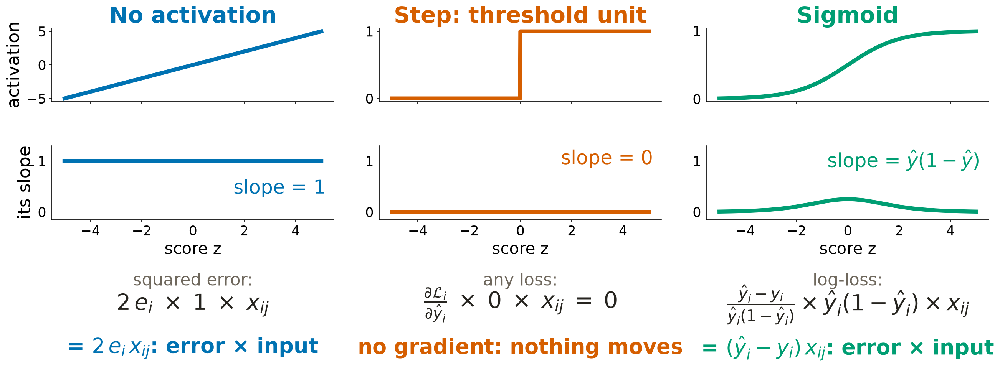{.r-stretch}

::: {.takeaway}
Gradient of one sample's loss, for three activations. Their mean over the batch, times − learning rate, is the change of the weight (next slide).
:::

::: {.notes}
Three minutes. The general formula, for one sample i and weight j. The neuron computes the score $z_i = \sum_j w_j x_{ij} + b$, then the prediction $\hat{y}_i = \phi(z_i)$. The loss of the sample depends on the weight through the prediction, and the prediction through the score. The chain rule multiplies the three links: $\partial \mathcal{L}_i / \partial w_j = \partial \mathcal{L}_i / \partial \hat{y}_i \times \phi'(z_i) \times x_{ij}$. In words: how the loss changes with the prediction (the error part), times how the prediction changes with the score (the slope of the activation), times how the score changes with the weight (the input). The gradient of the loss is the mean over the samples of the batch, as on the previous slide.

Read the three columns. Top row: the activation. Middle row: its slope.

No activation (left), with the squared error. The error part is $2 e_i$ and the slope is 1 everywhere: the gradient is $2 e_i x_{ij}$, error times input. This is the previous slide and notebook 4.0 section 2.4.

Step (middle). The slope is zero everywhere except at z = 0, where it is undefined. Whatever the loss, the gradient is zero: no update, the weights never move. Rosenblatt's rule of 1958 works around it by setting the slope to 1 by hand, which gives the update $(\hat{y}_i - y_i) x_{ij}$ with a prediction of 0 or 1. It has the form of a gradient step but it is not the gradient of any loss with a lowest point, which is why it never settles when the classes overlap (slide 12).

Sigmoid (right), with the log-loss of lecture 16. The error part of the log-loss is $(\hat{y}_i - y_i) / (\hat{y}_i (1 - \hat{y}_i))$ and the slope of the sigmoid is $\hat{y}_i (1 - \hat{y}_i)$: they cancel, and the gradient is again error times input, $(\hat{y}_i - y_i) x_{ij}$. That cancellation is why the log-loss goes with the sigmoid. With the squared error instead, the slope would stay in the gradient, and a confidently wrong prediction (where the sigmoid is flat) would get almost no correction.

Say it explicitly: the bottom row is the gradient for one sample, not the change of the weight. The change comes in two more steps: take the mean of these gradients over the samples of the batch, then multiply by minus the learning rate: Δw_j = −α × mean_i(∂L_i/∂w_j). For no activation that is −α × mean(2 e_i x_ij), for the sigmoid with the log-loss −α × mean((ŷ_i − y_i) x_ij), and for the step 0. The next slide shows these two steps with numbers.

The link to Part 3: in a network the chain has one more link per layer, and every link contains the slope of an activation. That is backpropagation, slides 33 to 35.
:::

## The threshold logic unit today

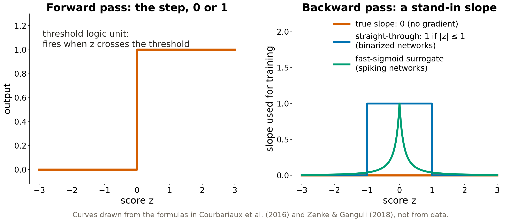{.r-stretch}

::: {.takeaway}
Binarized and spiking networks keep the threshold logic unit for the prediction. To train them, the backward pass replaces its zero slope by a stand-in: Rosenblatt's trick, made systematic.
:::

::: {.notes}
Two minutes; the answer to "is the step function dead?" No. Two research lines keep it, for hardware reasons. Binarized networks restrict activations, and often weights, to +1 or −1 with the sign function: a network then needs one bit per number and replaces multiplications by cheap operations, which matters on low-power chips, for example on sensors deployed in the field. Spiking networks copy the biological neuron: it emits a spike, a 1, when its membrane potential crosses a threshold, and stays silent otherwise; neuromorphic chips run them with very little energy. Both hit the problem of slide 21: the slope of the step is zero, so no gradient. Both solve it the same way: keep the step in the forward pass, and in the backward pass use a stand-in slope, called a surrogate. Blue: the straight-through estimator, slope 1 where the score is within 1 of the threshold and 0 beyond, used by Courbariaux, Hubara, Soudry, El-Yaniv and Bengio (2016, NeurIPS, arXiv:1602.02830) for binarized networks, after Bengio, Léonard and Courville (2013, arXiv:1308.3432). Green: a smooth surrogate peaked at the threshold, the fast sigmoid of SuperSpike (Zenke and Ganguli 2018, Neural Computation 30, 1514-1541); the review that made the method widely used is Neftci, Mostafa and Zenke (2019, IEEE Signal Processing Magazine 36(6), 51-63). Rosenblatt's 1958 rule did the same thing by hand: it set the slope to 1. Geoscience applications of spiking networks exist but are early (for example microseismic detection on distributed acoustic sensing data, a 2024 conference chapter); I have not seen them benchmarked against standard detectors, so I do not show them.
:::

## The update: each weight moves against its own gradient

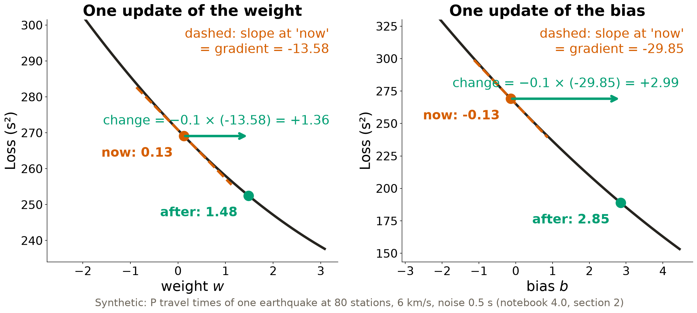{.r-stretch}

::: {.takeaway}
Change of a weight = − learning rate × its gradient. Both gradients are negative, so both values go up: w by 1.36, b by 2.99. The loss falls from 269 to 172 s².
:::

::: {.notes}
Three minutes; this is the step where the gradient is used, and the one students most often skip. The rule, from notebook 3.6: new weight = old weight − learning rate × gradient of the loss for that weight. Read the left panel. The black curve is the loss against the weight w, with the bias held at its current value. The red dot is where we are: w = 0.13. The dashed line is the slope of the loss there, the gradient, −13.58. The minus sign in the rule turns a negative gradient into a positive change: −0.1 × (−13.58) = +1.36, so w moves right, to 1.48 (green dot), down the curve. If the gradient had been positive, the same rule would have moved w left. Either way the loss goes down: the sign of the gradient says which way is uphill, and the update goes the other way. The size of the change is the learning rate times the gradient: a steep loss gives a large change, a flat loss a small one. Right panel: the bias, with its own gradient (−29.85) and its own change (+2.99). Both move at the same time. After this one update the loss is 172 s², down from 269. Notebook 4.0 section 2.5 has the table of these numbers and the same figure, and Your turn (4) asks students to write `wNew = w - learningRate * gradW`.
:::

## Many updates: the path to the lowest loss

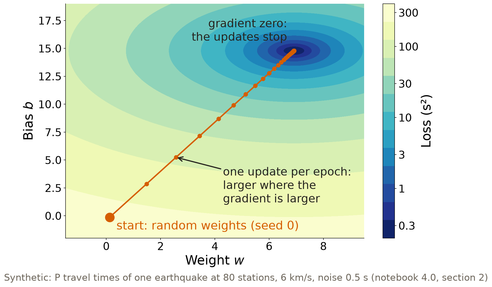{.r-stretch}

::: {.takeaway}
Each red dot is the weight and bias after one more update. The updates are long where the gradient is large and shrink near the lowest loss, where the gradient is zero.
:::

::: {.notes}
Two minutes. The previous slide, repeated 60 times.

The figure is a map of the loss for every pair (w, b), dark where it is low. The red dots are the weights after each update, starting from the random weights of seed 0. Read two things. The updates are long at the start, where the gradient is large, and shorten as the gradient shrinks: the size of an update is set by the gradient, we do not choose it step by step. And the path ends at the lowest point, where the gradient is zero for both weights, so the updates stop by themselves: w = 6.92, b = 14.79. For a line, least squares gives the same two numbers in one formula. For a network there is no formula, and this procedure is all we have.
:::

## Repeat: the loss at each epoch

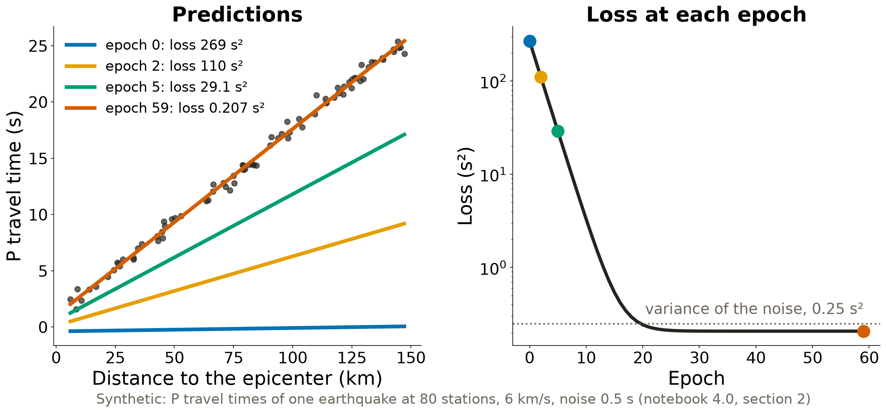{.r-stretch}

::: {.takeaway}
60 epochs: the loss falls from 269 s² to 0.21 s², close to the variance of the noise in the picks. The fitted line gives 6.04 km/s.
:::

::: {.notes}
Three minutes. Training repeats five lines: predictions, errors, loss (the mean over the samples), gradient, update. An epoch is one pass through all the training samples; here each update uses all 80, so one epoch is one update. Left: the predictions at epochs 0, 2, 5 and 59. Right: the loss at each epoch, on a logarithmic axis, with the same four epochs marked. The numbers the notebook prints: 269, 172, 110 s² at epochs 0, 1, 2; 29 at epoch 5; 3.3 at epoch 10; 0.24 at epoch 20; 0.21 from epoch 40 on. The loss stops near 0.25 s², the variance of the 0.5 s noise: the line cannot predict the noise of each pick, and a loss of zero is not the goal. Convert the weight back: the velocity is 6.04 km/s and the delay 1.04 s (true values 6 and 1). On the 20 test stations the loss is 0.40 s².

The habit to give them: print or plot the loss at each epoch, every time. It is the only view of whether training works. Notebook 4.0 section 2.6 also plots the gradient at each epoch (it goes to zero) and the loss of each of the 80 samples at four epochs.
:::

## Batches: several updates in one epoch

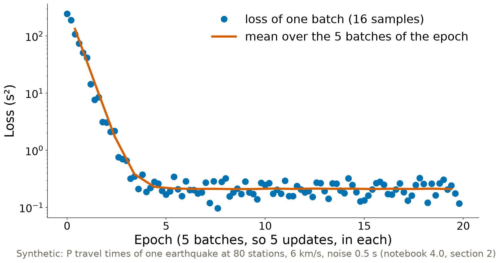{.r-stretch}

::: {.takeaway}
Batches of 16 samples: 5 updates per epoch. At the last epoch the five batch losses still range from 0.12 to 0.31 s². The loss of the epoch is their mean.
:::

::: {.notes}
Three minutes. With a large dataset, the loss and its gradient are computed on a batch, a small set of samples, and the weights are updated after each batch. Procedure at each epoch: shuffle the 80 samples, cut them into 5 batches of 16; for each batch compute the predictions, the errors, the mean loss over the 16 samples, the gradient of that mean, and update. Each blue dot is the loss of one batch; the red line is the mean of the five dots of each epoch.

Two things to read. In the first epoch the loss already falls from batch to batch (246, 189, 107, 74, 51 s²), because the weights are updated five times. At the end the weights hardly move, and the batch losses still differ, from 0.12 to 0.31 s² at the last epoch: each batch holds different samples with different noise. The loss of a batch is a noisy estimate of the loss of the training set, and so is its gradient. This is why a loss printed batch by batch jumps, and why notebooks 4.1 and 4.2 report a mean per epoch. Vocabulary: batch size (16 here, 128 in notebook 4.1), epoch. In PyTorch: a `DataLoader` shuffles and cuts the batches, `loss.backward()` computes the gradients, `optimizer.step()` updates the weights. Notebook 4.0 section 2.7.
:::

## The learning rate sets the size of the update

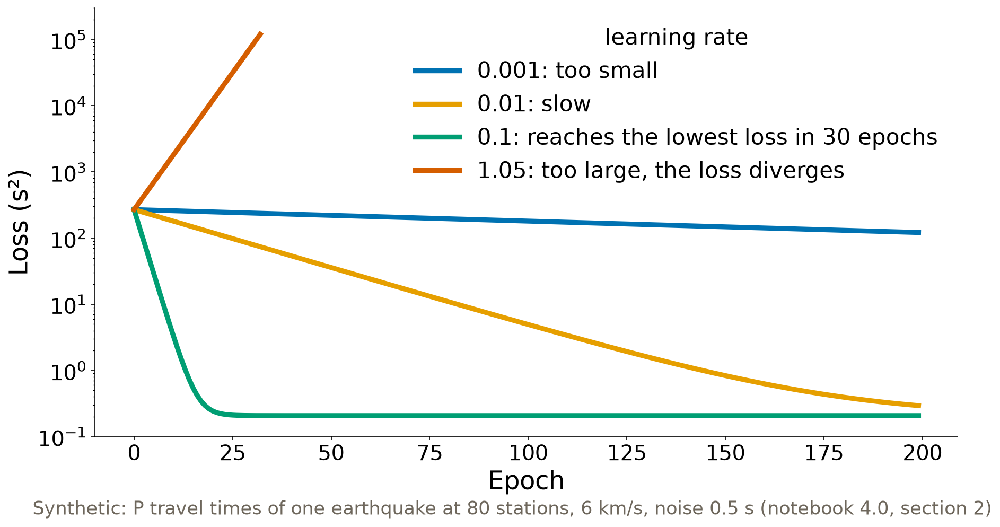{.r-stretch}

::: {.takeaway}
Same seed, 200 epochs. Learning rate 0.001 ends at 121 s², 0.01 at 0.29 s², 0.1 at 0.21 s². At 1.05 the loss grows at every epoch.
:::

::: {.notes}
Two minutes. The learning rate multiplies the gradient to give the update. Blue, 0.001: every update is tiny, and after 200 epochs the loss is still 121 s². Orange, 0.01: close after 200 epochs. Green, 0.1: there in about 30 epochs. Red, 1.05: each update goes past the lowest point and lands further from it than it started, so the loss grows at every epoch and exceeds 100,000 s² after 33. Nothing warns you except this curve. Notebook 4.0 section 3 has the four panels and an interactive version with the learning rate, the number of epochs and the seed. The optimizer used from notebook 4.1 on, Adam, adapts the size of the update for each weight, but it still has a learning rate to choose.
:::

## Open 4.0, section 2 (25 minutes)

1. Sections 2.1 to 2.5: write the error, the loss, the gradient, the update
2. Section 2.6: read the loss printed at each epoch
3. Section 2.7: write the loss of a batch, compare the five batches
4. Section 3: find a learning rate at which the loss diverges

::: {.dim}
`pixi run jupyter lab`, then `mlgeo_4.0_perceptrons.ipynb` · Each "Your turn" cell is one line; the hidden cell below it checks your answer
:::

::: {.notes}
Twenty-five minutes, in pairs. Five cells ask for one line each: `error = yhat - y`, `loss = lossPerSample.mean()`, `gradB = np.mean(2 * error)`, `wNew = w - learningRate * gradW`, and the loss of a batch, `np.mean(error ** 2)`. Results to expect, all with seed 0: starting weights w = 0.126 and b = −0.132; loss 269.1 s²; gradient −13.58 for w and −29.85 for b; after one update w = 1.484, b = 2.853 and the loss is 172.3 s²; after 60 epochs the loss is 0.207 s², the velocity 6.04 km/s. Questions to ask while circulating. Which sample has the largest loss, and why? What is the sign of the gradient for w, and which way does w move? What happens to the gradient at the end of training? Change the seed in section 2.8: does the result change? (No, for one neuron: the loss has one lowest point. For a network it does.) If time is short, tasks 1 and 2 are the ones to finish. Bring the room back for Part 3.
:::

## Part 3. A network: neurons that feed neurons

{.r-stretch}

::: {.takeaway}
Each hidden neuron is the same neuron, with its own weights. The output neurons take the hidden outputs as their inputs.
:::

::: {.notes}
Two minutes. Recall in one sentence: one neuron is a weighted sum and an activation; its weights are found by gradient descent on a loss. Its limit: the boundary between its two answers is a line or a plane, and its prediction of a number is a straight line. A hidden layer is a set of neurons that all read the same inputs, each with its own weights, so each responds to its own pattern. Their outputs are the inputs of the next layer. The activation between layers matters: a weighted sum of weighted sums is one weighted sum, so without it the network reduces to one neuron. Count weights with the room on the drawing: 4 inputs to 5 hidden neurons is 4 × 5 + 5 biases = 25; 5 hidden to 2 outputs is 5 × 2 + 2 = 12. This is also where the random starting weights matter: five hidden neurons that started with equal weights would stay equal. Hornik, Stinchcombe and White (1989) proved that one hidden layer with enough neurons can approximate any continuous function. The theorem does not say how many neurons, how much data, or whether training finds the weights. This fully connected network is called a multilayer perceptron (MLP). The next slides train one with the loop of Part 2.
:::

## A simple example: temperature against depth in the ocean

{.r-stretch}

[🖥️ Model & simulation]{.gb .src} [🌊 Ocean]{.gb .sys .ocean} [🌊 Oceanography]{.gb .disc .ocean}

::: {.takeaway}
One neuron predicts a straight line: 2.4 °C per 100 m, error 1.0 °C. It cannot bend at the two thermoclines. Synthetic profile, 60 samples.
:::

::: {.notes}
Two minutes. Geoscience first. The upper ocean is layered: a mixed layer stirred by wind, at nearly one temperature; a seasonal thermocline where temperature drops fast; a slower decrease through the main thermocline; cold deep water. The profile here is synthetic, written in the figure script (figscripts/lec21_network_training.py): 4 °C deep water, plus 6 °C lost across a seasonal thermocline near 60 m, plus 8 °C lost across a main thermocline near 300 m, sampled at 60 random depths between 0 and 600 m with 0.3 °C of noise, like a float profile. A second set of 40 samples with new noise is the validation set. The task: predict temperature from depth. One input, one output. The red line is the best one neuron can do with no activation: a straight line, 2.4 °C per 100 m, with a root-mean-square error of 1.0 °C, three times the noise. Ask: what shape would the model need? Steps. That is what a hidden neuron with a smooth activation provides.
:::

## Forward pass: three hidden neurons, added up

{.r-stretch}

::: {.takeaway}
Each hidden neuron makes one smooth step in depth. Scaled by its output weight and summed, the three steps build the profile: 10 weights in all.
:::

::: {.notes}
Three minutes. This is the trained network, read from input to output; computing the output from the input is called the forward pass. The network: 1 input (depth), 3 hidden neurons with a tanh activation, 1 output (temperature). Count the weights: 3 input weights and 3 biases for the hidden layer, 3 output weights and 1 bias: 10. Panel 1: the output of each hidden neuron against depth. Each is a smooth step between −1 and 1; its input weight sets how sharp the step is and its bias sets the depth where it occurs. Panel 2: each output multiplied by its output weight, in °C. Panel 3: their sum plus the output bias, over the 60 samples. Ask the room which hidden neuron carries the main thermocline (neuron 3, pink, centered near 280 m) and which carries the seasonal thermocline (neuron 2, green, near 70 m). Tanh is a sigmoid rescaled to run from −1 to 1; networks today more often use ReLU, max(0, z), which builds the curve from straight pieces. This is Monday's reading again: each hidden neuron responds to one pattern, here one step in depth.
:::

## The loss of the network: the same mean of squared errors

{.r-stretch}

::: {.takeaway}
Each red bar is the error of one sample, prediction minus observation. The loss is the mean of the squared errors; its square root here is 0.68 °C.
:::

::: {.notes}
Two minutes. Partway through training, after 1,000 updates: the network has found one bend and misses the plateau near 150 m. For each of the 60 samples, the red bar is the error, predicted minus measured temperature. Square them, take the mean: the loss, exactly as in Part 2. Its square root is in °C, 0.68 here, which is easier to judge than the loss itself: the noise in the data is 0.3 °C, so there is still structure left to fit. For classification the loss of a sample is the log-loss of lecture 16; the rest is identical. The gradient now has 10 numbers, one for each weight, computed by the chain rule from the output back to the input, layer by layer (backpropagation; notebook 3.6 did it for one neuron).
:::

## Backpropagation for one neuron

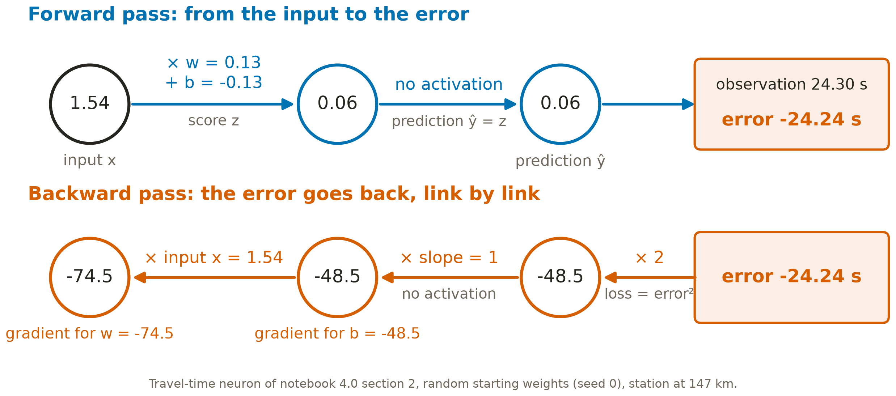{.r-stretch}

::: {.takeaway}
Backward, from the error: × 2 × slope gives the gradient for b (−48.5), then × input the gradient for w (−74.5).
:::

::: {.notes}
Three minutes. Before the network, the same picture for one neuron: the travel-time neuron of Part 2, at its random starting weights (seed 0), for the farthest station (147 km), the numbers of the chain-rule slide. Forward pass, top row: the standardized distance 1.54, times the weight 0.13, plus the bias −0.13, gives the score 0.06; there is no activation, so the prediction is 0.06 s. The observation is 24.30 s, so the error is −24.24 s. Backward pass, bottom row, read right to left: start from the error. The loss is error², so the first link multiplies by 2: −48.5. The activation is the next link back; with no activation its slope is 1, so −48.5 again. This number is the gradient for the bias, since the bias adds directly to the score. One more link back, through the weight, multiplies by the input 1.54: −74.5, the gradient for the weight. That is all backpropagation is: the chain rule of slide 19, computed from the error back to each weight, reusing the number at each node. With a sigmoid, the middle link would multiply by its slope ŷ(1 − ŷ) instead of 1 (slide 21). The next two slides do exactly this for a network with a hidden layer: more nodes, and each hidden neuron receives the error through its own connection.
:::

## Backpropagation 1: the forward pass gives the error

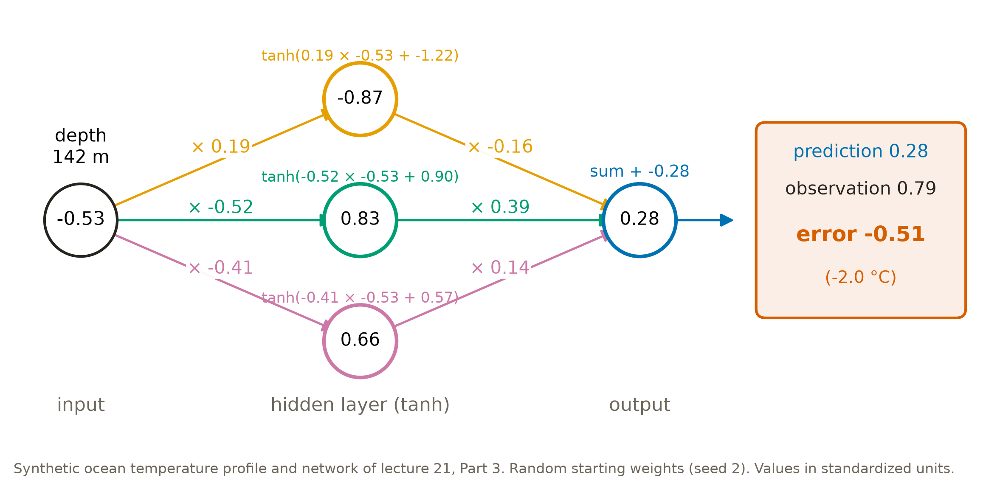{.r-stretch}

::: {.takeaway}
One sample at 142 m: depth in, each hidden neuron computes tanh of its weighted input, the output sums them. Prediction minus observation: error −0.51, or −2.0 °C.
:::

::: {.notes}
Three minutes. The question of Part 3: the output weights touch the prediction directly, so their gradient is error times input, as for one neuron. But how do we get the gradient for the input weights of the hidden layer, which never see the error? Answer: backpropagation, the error sent back through the network. First the forward pass, for one sample, with the real numbers at the random starting weights (seed 2). Input: depth 142 m, standardized to −0.53. Each hidden neuron multiplies it by its input weight, adds its bias, applies tanh: −0.87, 0.83, 0.66. The output multiplies each by its output weight (−0.16, 0.39, 0.14), sums, adds its bias (−0.28): prediction 0.28. The observation is 0.79 (all in standardized units; temperature divided by its standard deviation, about 4 °C). Error = prediction − observation = −0.51, about −2.0 °C: the network predicts too cold at this depth. Numbers: figs/lec21_neuron/numbers_backprop.json, from figscripts/lec21_backprop.py; notebook 4.0 section 6.1 prints the same.
:::

## Backpropagation 2: the error goes back

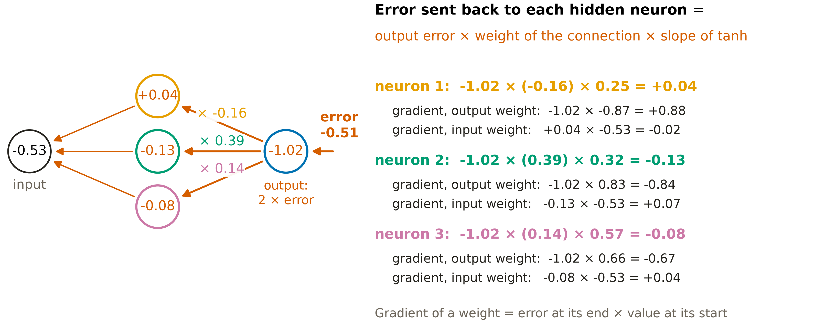{.r-stretch}

::: {.takeaway}
Each hidden neuron receives the output error × the weight that links it to the output × the slope of its tanh. The gradient of any weight is the error at its end × the value at its start.
:::

::: {.notes}
Four minutes; the slide that explains how every network is trained. Start at the output: the loss of this sample is error², and its slope with respect to the prediction is 2 × error = −1.02. Output weights: as for one neuron, gradient = −1.02 × the hidden output feeding that weight. For neuron 1: −1.02 × (−0.87) = +0.88.

Now send the error back. Hidden neuron j receives −1.02 × W2_j × (1 − h_j²). Read the three factors aloud. The output error: if the prediction were right, nothing would come back. The weight of the connection: neuron 1 is linked to the output by −0.16, a weak link, so it gets little of the blame. The slope of tanh at that neuron, 1 − h²: neuron 1 sits at −0.87, on the flat part of tanh (slope 0.25), so changing its score would barely change its output. Result: +0.04 for neuron 1, −0.13 for neuron 2, −0.08 for neuron 3. Each hidden neuron is now a single neuron with its own error, and its input weight's gradient is its error × its input: −0.13 × (−0.53) = +0.07 for neuron 2. The update then uses these gradients exactly as in Part 2, averaged over the samples of the batch.

Three points to make. First, these are the chain-rule derivatives; the script checks every one against a small change of the weight (agreement to 1e-6), and notebook 4.0 section 6.2 does the same check. Second, the whole backward pass costs about as much as the forward pass, whatever the number of weights: this is what makes networks with millions of weights trainable. Third, the slope of the activation is a factor in every hidden error. With a step function the slope is zero and nothing comes back: that is the 1958 problem again, and the reason networks use tanh, sigmoid or ReLU. In PyTorch, `loss.backward()` does exactly this computation for every layer. Students write it themselves in notebook 4.0 section 6, Your turn (8): `backError = 2 * error[:, None] * W2 * (1 - H ** 2)`.
:::

## Training the network: the same loop, 10 weights

{.r-stretch}

::: {.takeaway}
From random weights (seed 2) the root of the loss falls from 3.8 °C to 0.31 °C in 20,000 updates, with a long plateau near 0.7 °C before the network finds the second thermocline.
:::

::: {.notes}
Four minutes. The loop of Part 2, unchanged: predictions, errors, loss, gradient, update; one update per epoch on the 60 samples, learning rate 0.3. Left to right: the network at the start (random weights, nearly a vertical line, 3.76 °C), after 5 updates (2.69 °C), after 1,000 (one bend, 0.68 °C), after 20,000 (both thermoclines, 0.31 °C, the noise level). Right: the root of the loss at each update, on logarithmic axes, for the training samples and for the 40 validation samples that were never used to compute a gradient. Three things to read. First, most of the gain comes in the first ten updates. Second, the plateau from about update 10 to update 2,000: the loss barely moves, then drops again when one hidden neuron moves to the seasonal thermocline. A flat loss curve does not prove that training is finished; the loss of a line had one lowest point, the loss of a network does not. Third, the validation curve follows the training curve and ends at 0.32 °C: with 10 weights and 60 samples there is no overfitting. In notebook 4.2 students remove dropout from a larger network and watch the two curves separate. With a learning rate of 0.01 this network is still at 0.70 °C after 20,000 updates, and at 1.0 the loss diverges within 9 updates (figs/lec21_neuron/learning_rate_profile.png, not shown). In PyTorch the loop is spelled forward pass, loss, `loss.backward()`, `optimizer.step()`, on batches.
:::

## In the literature: glacier mass balance, French Alps

::: {.columns}
::: {.column width="42%"}
{height="600"}
:::
::: {.column width="58%"}
[🖥️ Model & simulation]{.gb .src} [🧊 Cryosphere]{.gb .sys .ice} [🧊 Glaciology]{.gb .disc .ice}

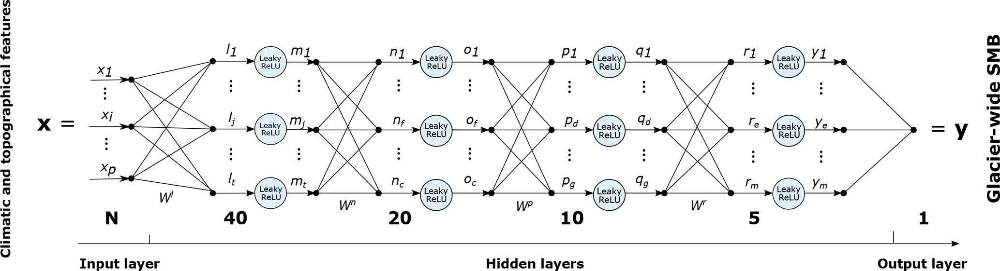{width="100%"}

::: {.credit}
Bolibar et al. (2020), *The Cryosphere* 14, 565–584, Figs. 6 and 3. [doi:10.5194/tc-14-565-2020](https://doi.org/10.5194/tc-14-565-2020). CC BY 4.0.
:::
:::
:::

::: {.takeaway}
On glaciers left out of training, the error falls from 0.74 m of water per year for the linear model (b) to 0.51 for the network (c).
:::

::: {.notes}
Two minutes; now that a hidden layer has been introduced, two examples where hidden layers earn their place. Bolibar et al. (2020): annual surface mass balance of 32 glaciers in the French Alps, 1,048 glacier-years, from topographic features and climate reanalysis. Left, their Figure 6: predicted against reference mass balance for glaciers held out of training (leave one glacier out, the grouped validation of lecture 18). Top row, linear models: ordinary least squares, error 0.81 m of water equivalent per year, and Lasso, 0.74. Bottom row, the network: 0.51 without sample weights and 0.62 with weights, with r² rising from 0.49 to 0.76 and 0.79. Right, their Figure 3: the network, fully connected, with four hidden layers of 40, 20, 10 and 5 neurons. The authors call it a quite small network. What to say: the linear model is a single neuron with no activation, it is the baseline in the top row, and the hidden layers earn their place here because mass balance responds nonlinearly to temperature and snowfall. Point also at the validation design: held-out glaciers, and in the paper held-out years as well.
:::

## In the literature: snow and ocean nutrients

::: {.columns}
::: {.column width="56%"}
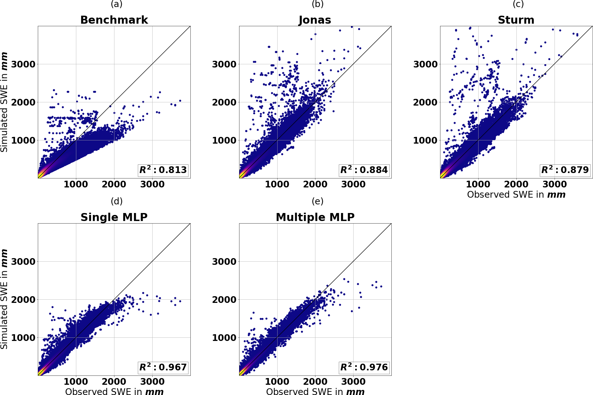{height="440"}

[📍 In-situ sensor]{.gb .src} [💧 Land water]{.gb .sys .water} [💧 Hydrology & land-surface modeling]{.gb .disc .water}

::: {.credit}
Ntokas et al. (2021), *Hydrol. Earth Syst. Sci.* 25, 3017–3040, Fig. 15. [doi:10.5194/hess-25-3017-2021](https://doi.org/10.5194/hess-25-3017-2021). CC BY 4.0.
:::
:::
::: {.column width="44%"}
{height="400"}

[📍 In-situ sensor]{.gb .src} [🌊 Ocean]{.gb .sys .ocean} [🌊 Oceanography]{.gb .disc .ocean}

::: {.credit}
Sauzède et al. (2017), *Front. Mar. Sci.* 4, 128, Fig. 2. [doi:10.3389/fmars.2017.00128](https://doi.org/10.3389/fmars.2017.00128). CC BY.
:::
:::
:::

::: {.takeaway}
Snow water from snow depth: one hidden layer, R² 0.97 against 0.88 for regression formulas. Ocean nitrate: two hidden layers, error 1.04 µmol/kg.
:::

::: {.notes}
Two minutes. Left, Ntokas et al. (2021): 234,779 records of snow depth, density and water equivalent from 2,878 locations across Canada. Each panel plots simulated against observed snow water equivalent in mm. (a) a constant density, (b) and (c) the regression formulas of Jonas et al. (2009) and Sturm et al. (2010), (d) an ensemble of 20 networks with 12 inputs and one hidden layer of 120 neurons, (e) one such model per snow class. R² goes from 0.88 for the regressions to 0.97 for the network; in the paper's Table 8 the mean absolute error on the testing set goes from 44.5 (Jonas) to 32.8.

Right, Sauzède et al. (2017): the CANYON networks. Inputs: position, day of year, pressure, temperature, salinity, oxygen. Two hidden layers (20 and 17 neurons for nitrate), one output. Trained on 549,561 bottle samples of the GLODAPv2 compilation, 137,219 held out; error on nitrate 1.04 µmol/kg. Use: a profiling float that measures only temperature, salinity and oxygen can report an estimate of nutrients. The held-out samples were drawn at random; the paper also withholds eight whole 10° by 10° zones, the check lecture 18 asks for.

Other examples if asked. Volcanoes: Picchiani et al. (2011, Atmos. Meas. Tech. 4, 2619-2631), ash in MODIS images of Etna from three infrared channels, ten hidden neurons, accuracy above 90% against the method that labeled the pixels. Exoplanets: Pearson, Palafox and Griffith (2018, MNRAS 474, 478-491), transits in light curves of 180 points, hidden layers of 64, 32 and 8 neurons: 88.7% of simulated transits found, a convolutional network 88.5%, the box-fitting search 63.1% (arXiv version). When small is not enough: Rasp, Pritchard and Gentine (2018, PNAS 115, 9684-9689) needed nine layers of 256 neurons to replace the subgrid physics of a climate model and report that one or two hidden layers were unstable; Brenowitz and Bretherton (2018, GRL 45, 6289-6298, here at UW) used one hidden layer of 128 neurons for a similar task (preprint read).
:::

## Four seismic source types: what the hidden layer adds

{.r-stretch}

[📍 In-situ sensor]{.gb .src} [🪨 Solid Earth]{.gb .sys .solid} [📈 Seismology]{.gb .disc .solid}

::: {.takeaway}
On 61 features, a hidden layer of 32 neurons adds 0.4 points to logistic regression: 3 of 800 test events, inside one standard error.
:::

::: {.notes}
Three minutes. Back to real data and to the baseline habit of lecture 18. Earthquake, explosion, surface event, noise: 4,000 Pacific Northwest events, 2,400 to train, 800 to validate, 800 to test (the split of notebook 4.1). Blue: no hidden layer, four output neurons with a softmax, the multiclass logistic regression of lecture 16: 248 weights (61 × 4 + 4), 86.8% (694 of 800). Green: the network of notebook 4.1, 61 inputs, 32 hidden neurons with ReLU, 4 outputs, 2,116 weights (61 × 32 + 32 = 1,984, plus 32 × 4 + 4 = 132): 87.1% (697). Grey: a random forest, 300 trees, default settings: 88.5% (708). The first and third are computed by figscripts/lec21_one_neuron.py on the same split; the second is read from the executed notebook 4.1. One standard error on 800 events is about 1.2 points: the first two cannot be told apart. Notebook 4.2's deeper model (hidden layers of 128, 64 and 32 neurons, dropout, batch normalization) reaches 89.0% on its own split. The published study on the full curated set (Kharita et al. 2026, lecture 16) reports 89% for its best random forest on features and above 92% for convolutional networks on spectrograms. What to say: the 61 features were built by seismologists and have already done the work; a hidden layer has little left to add. In the ocean profile the hidden layer was essential, because the input was raw (depth) and the relation was not a line. Networks gain when they read the record itself. That needs one more idea.
:::

## From Chapter 3 to Chapter 4

| Earlier in the course | In Chapter 4 | Example from these two days |
|---|---|---|
| template matching | a neuron's weights | correlation 0.99 with the event |
| logistic regression | a neuron trained on a loss | 89.0%, explosion or earthquake |
| gradient descent (3.6) | the training loop: loss, gradient, update | 269 s² to 0.21 s² in 60 epochs |
| baseline | the model with no hidden layer | 86.8% against 87.1% |
| new | layers, trained by backpropagation | ocean profile: 3.8 °C to 0.31 °C |

::: {.notes}
Leave this up during questions. Return to the opening question: is a neural network a different kind of object from the regressions of Chapter 3? Row by row: a neuron is the weighted sum of template matching (lecture 1, section 2.9); with a sigmoid and the log-loss it is logistic regression (lecture 16); training is the gradient descent of notebook 3.6 (predictions, errors, mean loss over the batch, gradient, update), repeated over batches and epochs; the baseline habit of lecture 18 carries over, and here the baseline is the model with no hidden layer. The train, validation and test sets also carry over unchanged (4.1 splits 60/20/20, stratified, with the scaler fit on the training events only). What is new is the last row: layers built to match how the data are organized. Fully connected layers for a table of features, convolution for records and maps where a pattern can occur anywhere (Friday), recurrence and attention for sequences where order matters (Monday Nov 23). Naming that structure is the scientist's part of the work.
:::

## Open 4.0 section 6, then 4.1

1. 4.0 section 6: write the error sent back to the hidden layer
2. 4.1: find the forward pass, the loss, `loss.backward()`, the update
3. Read the learning curves: where do training and validation part?
4. 4.2: retrain with `p_drop=0.0` and compare the curves

::: {.dim}
PyTorch names: `nn.Module`, `nn.Linear`, `nn.ReLU`, `nn.CrossEntropyLoss`, `Adam`, `DataLoader` · Chapter 6 quiz closes today · Classic ML project milestone (3.20) due Mon Nov 23 · Friday: convolution (4.3)
:::

::: {.notes}
Timing for Wednesday (10:00 to 11:20): Part 2 slides about 20 minutes, notebook 4.0 section 2 about 25 minutes, Part 3 slides about 15 minutes, notebook 4.1 for the rest; 4.2 is then finished outside class. Priorities if time is short: task 1 (the backward pass written by hand: one line, `backError = 2 * error[:, None] * W2 * (1 - H ** 2)`; expected values at 142 m: +0.041, −0.126, −0.081; loss 3.76 °C → 0.31 °C after 20,000 epochs) and task 2 (finding in the PyTorch loop the lines of Part 2: the loss is `criterion(outputs, targets)`, a mean over the batch; the gradient is `loss.backward()`; the update is `optimizer.step()`) and task 3 (the gap between training and validation curves opening when dropout is removed). PyTorch spellings students will meet: a subclass of `nn.Module` with `__init__` and `forward`, `nn.Linear`, `nn.ReLU`, `nn.CrossEntropyLoss` (the softmax is inside the loss, not the model, which often causes confusion), `torch.optim.Adam`, `Dataset` and `DataLoader`, `model.train()` against `model.eval()` (dropout and batch normalization behave differently in the two modes, 4.2 section 4.4). Dropout: during training, a random fraction of the hidden outputs is set to zero at each step, which limits overfitting. Question to collect at the end: where in your project data does position or order matter, and would a fully connected network see it?
:::

## Chapter 4: the neuron inside every network

{.r-stretch}

::: {.takeaway}
Each row is today's neuron, repeated and connected in a different way, and trained by the same gradient descent.
:::

::: {.notes}
The closing statement, the same figure as the opening. A fully connected layer is many neurons reading every input (Wednesday, lecture 21b, 4.1 and 4.2); a convolutional layer is one neuron slid along a record (Friday, lecture 22, 4.3); a recurrent layer is one neuron that also reads its own previous output (lecture 23, 4.4); a graph layer is one neuron applied at every station, reading its neighbors (lecture 23b, 4.5). The loss, the gradient and the update of today are unchanged in all of them (lecture 24a).
:::
