## {background-color="#faf7f2"}

[🧠]{.lecture-icon}

### Today's question

Deep learning starts with one neuron, and you have already used it twice.

**What does one neuron compute, how are its weights set, and what does it miss?**

::: {.dim}
Part 1, Monday: one neuron (4.0). Part 2, Wednesday: from a neuron to a network (4.1, 4.2).
:::

::: {.notes}
This deck covers two class meetings. Part 1 (Monday Nov 16) is the perceptron: about 25 minutes of slides and 15 minutes in notebook 4.0, after the project check-ins. Part 2 (Wednesday Nov 18) builds a network and trains it on a small example: about 20 minutes of slides, then notebooks 4.1 and 4.2. The plan for Part 1 is to show that students already know the neuron: it is the weighted sum of template matching (lecture 1, section 2.9) and of logistic regression (lecture 16, notebook 3.6). Ask the room before starting: who thinks a neural network is a different kind of object from the regressions we have fitted? Come back to the answers on the summary slide. Reading: 4.0 Perceptrons, 4.1 Neural networks, 4.2 MLPs.
:::

## One neuron: a weighted sum, then an activation

{.r-stretch}

::: {.takeaway}
Score $z = \sum_i w_i x_i + b$: each input times its weight, added up, plus a bias. The activation turns the score into the output.
:::

::: {.notes}
Two minutes. Walk the figure left to right. Inputs: the numbers that describe one data sample, either features computed from a record or the samples of the record itself. Weights: one per input. The neuron multiplies, adds, and adds one more number, the bias, which shifts the score up or down (one bias per neuron, not one per input). The activation turns the score into the output. Define aloud: weight, bias, score, activation function.
:::

## The activation names the model

{.r-stretch}

::: {.takeaway}
The same weighted sum gives three models you know. Only the last step differs.
:::

::: {.notes}
Two minutes. Three choices for the activation, three models the class has met. No activation: the output is the score, and the neuron is the linear regression of lecture 13. Sigmoid: the output is a probability between 0 and 1, and the neuron is the logistic regression of lecture 16. Step: the output is 1 if the score is positive and 0 otherwise; this is the threshold unit of Rosenblatt (1958), and a layer of such units is what he called the perceptron. The word survives today in multilayer perceptron, the fully connected network of Part 2. A fourth use of the same sum comes next: template matching, where the weights are not fitted at all.
:::

## Template matching: weights copied from one earthquake

{.r-stretch}

[🗂️ Catalog & compiled product]{.gb .src} [🪨 Solid Earth]{.gb .sys .solid} [📈 Seismology]{.gb .disc .solid}

::: {.takeaway}
Lecture 1: the waveform of each known earthquake, slid along ten years of records, found 1.81 million earthquakes in Southern California. At each position the detector computes a weighted sum, with the template as weights.
:::

::: {.credit}
Our figure from the open QTM catalog of Ross, Trugman, Hauksson & Shearer (2019), *Science* 364, 767–771 (figscripts/qtm_hidden_earthquakes.py).
:::

::: {.notes}
Two minutes; a recall of lecture 1. Ross et al. (2019) took the waveforms of the earthquakes in the Southern California Seismic Network catalog as templates and cross-correlated each with ten years of continuous records (2008 to 2017). Result: 1.81 million earthquakes, ten times the catalog, and a magnitude of completeness lowered from 1.7 to 0.3. Why it works: an earthquake that repeats on the same fault patch, recorded at the same station, sends nearly the same waveform. In section 2.9 students computed a cross-correlation themselves. At one lag, the cross-correlation is a sum of products, window sample times template sample: a neuron whose weights are the template, and whose bias is minus the detection threshold. The question for the next slide: if nobody supplies the template, and the neuron only gets labeled windows, what weights does it find?
:::

## Fitted on labeled windows, the weights become the template

{.r-stretch}

::: {.takeaway}
From 800 labeled windows the neuron recovers the event waveform: correlation 0.99. It detects as well as template matching, 99.75% of 400 test windows.
:::

::: {.notes}
Four minutes; this is the central figure of Part 1. The data are from the course generator, mlgeo_synth: a magnitude 2 source 20 km from the station, recorded again and again in new noise, with a signal-to-noise ratio (peak amplitude over the standard deviation of the noise, section 2.10) between 1.5 and 6. Each data sample is a 6 s window, 600 values, so the neuron has 600 weights. Left: three of the test windows. At a signal-to-noise ratio of 1.5 the event is hard to see by eye. Right, top: the template, the event without noise, P wave then S wave. Right, middle: the weights of a neuron fitted by logistic regression on 800 labeled windows. Nobody gave it the waveform; it recovered it from the labels. A neuron's weights are the input pattern it responds to most strongly, and this reading holds for every neuron in the chapter. Template matching with the true template classifies 399 of 400 test windows correctly, and so does the fitted neuron. Right, bottom: the weights from the 1958 rule of the next slide. That rule stops at the first weights that make no training mistake (13 passes here): correlation 0.29 with the template and 95.5% on the test windows.

For questions. The fit uses scikit-learn's logistic regression with a penalty on the size of the weights (C = 0.001). With a weak penalty (C = 1) the correlation drops to 0.90, because the noise of the generator is colored and the neuron spends part of its weights cancelling it: the matched filter in colored noise of lecture 9. The task is easy on purpose: one source, one station, a fixed arrival time. Part 2 moves the arrival. Numbers: figs/lec21_neuron/numbers.json, from figscripts/lec21_one_neuron.py. Notebook 4.0 section 2.4 reproduces the figure.
:::

## The 1958 rule: correct the weights after each mistake

{.r-stretch}

::: {.takeaway}
Missed event: add the window to the weights. False alarm: subtract it. Here the line stops moving after 42 corrections.
:::

::: {.notes}
Three minutes. Rosenblatt's rule (1958), the first learning rule for a neuron, written out in notebook 4.0 section 2.2. Each point is a 30 s window described by two detector features: the STA/LTA ratio (short-term over long-term average amplitude, lecture 9) and the spectral centroid. Start with the weights at zero. Show one window and compute the output with the step, 0 or 1. If it is right, do nothing. If the neuron said noise and it was an event, add the window's features to the weights, so that the score of similar windows goes up; if it said event and it was noise, subtract them. The dashed lines are the boundary (where the score is zero) after 1, 5 and 15 corrections; the thick line is where it stops. All 42 corrections happen in the first pass through the 600 windows; the second pass finds no mistake. In code: `error = thisTarget - out`, then `w = w + learningRate * error * thisInput`. Say what the notebook did to get this result: it removed the windows in the overlap band, so that a separating line exists. The rule is guaranteed to stop only then. Ask the room: what will happen on real events, which overlap?
:::

## On real events the rule never stops correcting

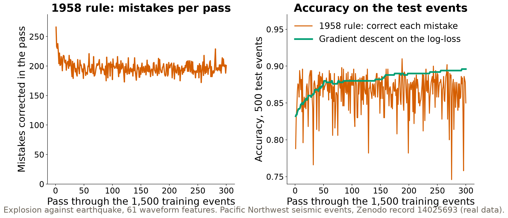{.r-stretch}

[📍 In-situ sensor]{.gb .src} [🪨 Solid Earth]{.gb .sys .solid} [📈 Seismology]{.gb .disc .solid}

::: {.takeaway}
Explosion or earthquake, Pacific Northwest: the rule still corrects about 196 of 1,500 events per pass, and its test accuracy swings from 74.6% to 90.2%. Lowering the log-loss climbs steadily to 89.6%.
:::

::: {.notes}
Three minutes. The same data and the same split as lecture 16: 1,000 explosions and 1,000 earthquakes from the Pacific Northwest, 61 waveform features, 1,500 events to train and 500 to test, features standardized on the training events. Left: the number of corrections the 1958 rule makes in each pass. It falls from 266 to about 200 and stays there, because explosions and earthquakes overlap in these features and no plane separates them. Right, red: the test accuracy after each pass. Over the last 100 passes it ranges from 74.6% to 90.2%; the answer depends on which pass we stop at. Right, green: the same neuron trained by gradient descent on the log-loss, the method of lecture 16 and notebook 3.6. It reaches 89.6% after 300 passes and is still improving slowly; run to convergence it gives the 90.2% quoted in lecture 16. The loss also gives a probability for each event, so the threshold, the ROC curve and the calibration of lecture 16 all apply. Numbers: figs/lec21_neuron/numbers.json.
:::

## From the rule to the loss: the correction becomes smooth

{.r-stretch}

::: {.takeaway}
Replace the step by the sigmoid and the 1958 correction becomes the gradient step on the log-loss of lecture 16. Every network in Chapter 4 is trained with this step.
:::

::: {.notes}
Three minutes. The two updates, to write on the board: 1958 rule, `w = w + rate * (t - out) * x` with `out` equal to 0 or 1; log-loss, `w = w + rate * (t - p) * x` with `p` the probability from the sigmoid. `t` is the true class. The figure shows the size of the correction for a window that contains an event (t = 1), against the score the neuron gave it. Red, the rule: full correction if the score is negative (a miss), none if it is positive. Green, the log-loss: an event stated with confidence barely moves the weights, a confident miss moves them almost as much as under the rule, and everything in between is proportional. This is exact, not an analogy: differentiate the log-loss with respect to a weight, for a sigmoid neuron, and the result is (p − t) times the input. Notebook 3.6 checked that derivative against automatic differentiation. A smooth activation and a loss to descend are what made networks with several layers trainable. Vocabulary to define aloud: loss (what we lower), gradient (the direction in which the loss rises fastest), learning rate (the size of the step).
:::

## In the literature: one neuron matched 13,451 weights

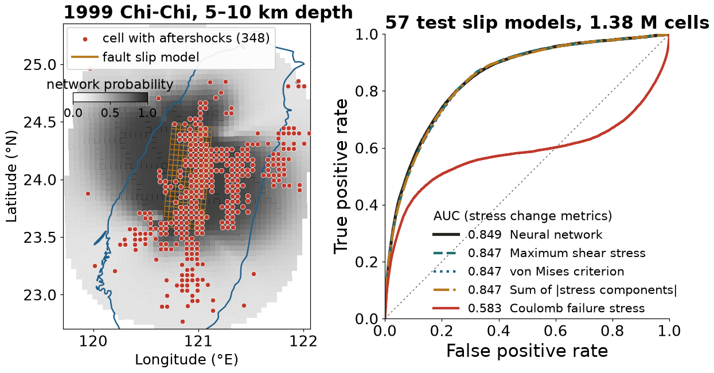{.r-stretch}

[🖥️ Model & simulation]{.gb .src} [🪨 Solid Earth]{.gb .sys .solid} [📈 Seismology]{.gb .disc .solid}

::: {.takeaway}
Where do aftershocks occur? A network with six hidden layers scores AUC 0.849. One neuron fed one stress quantity scores 0.847.
:::

::: {.credit}
Our rerun of the open data and weights of DeVries, Viégas, Wattenberg & Meade (2018), *Nature* 560, 632–634; comment by Mignan & Broccardo (2019), *Nature* 574, E1–E3; reply by Meade (2019), *Nature* 574, E4.
:::

::: {.notes}
Two minutes; told in lectures 2 and 18, so go fast and keep the same care: disclose that I served on the PhD committee of the first author, credit the open data and weights, and avoid "debunked". DeVries et al. (2018) trained six hidden layers of 50 neurons, 13,451 weights, on stress changes from 199 slip models. Mignan and Broccardo (2019) showed that a single neuron, a logistic regression with two parameters, fed the maximum shear stress change reaches the same AUC (0.847 against 0.849 in our rerun, figscripts/aftershock_auc_rerun.py). Today's reading of it: this is the neuron of the previous slides, used as the baseline. Mignan and Broccardo (2020, Seismological Research Letters 91, 2330-2342) then reviewed 77 articles that used neural networks for earthquake prediction from 1994 to 2019 and concluded that far simpler models offer similar predictive power. An older example for the same point: Dowla, Taylor and Anderson (1990, Bull. Seismol. Soc. Am. 80(5)) separated 83 western US earthquakes from 87 Nevada Test Site explosions with one hidden neuron on 82 spectral values, over 93% correct at a single station, and reported that it performed like a linear discriminant (abstract only read, OSTI record 7283112).
:::

## In the literature: glacier mass balance, French Alps

::: {.columns}
::: {.column width="42%"}
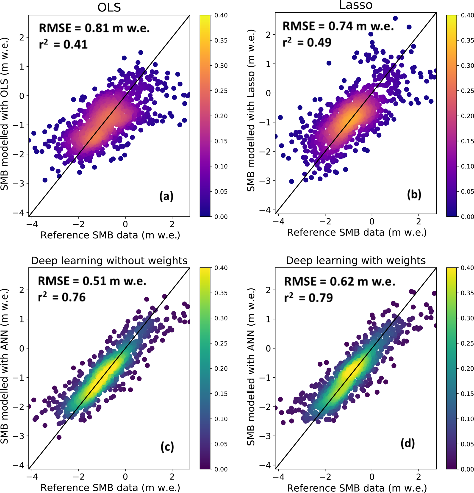{height="600"}
:::
::: {.column width="58%"}
[🖥️ Model & simulation]{.gb .src} [🧊 Cryosphere]{.gb .sys .ice} [🧊 Glaciology]{.gb .disc .ice}

{width="100%"}

::: {.credit}
Bolibar et al. (2020), *The Cryosphere* 14, 565–584, Figs. 6 and 3. [doi:10.5194/tc-14-565-2020](https://doi.org/10.5194/tc-14-565-2020). CC BY 4.0.
:::
:::
:::

::: {.takeaway}
On glaciers left out of training, the error falls from 0.74 m of water per year for the linear model (b) to 0.51 for the network (c).
:::

::: {.notes}
Two minutes. Bolibar et al. (2020): annual surface mass balance of 32 glaciers in the French Alps, 1,048 glacier-years, from topographic features and climate reanalysis. Left, their Figure 6: predicted against reference mass balance for glaciers held out of training (leave one glacier out, the grouped validation of lecture 18). Top row, linear models: ordinary least squares, error 0.81 m of water equivalent per year, and Lasso, 0.74. Bottom row, the network: 0.51 without sample weights and 0.62 with weights, with r² rising from 0.49 to 0.76 and 0.79. Right, their Figure 3: the network, fully connected, with four hidden layers of 40, 20, 10 and 5 neurons. The authors call it a quite small network. What to say: the linear model is a single neuron with no activation, it is the baseline in the top row, and the hidden layers earn their place here because mass balance responds nonlinearly to temperature and snowfall. Point also at the validation design: held-out glaciers, and in the paper held-out years as well.
:::

## In the literature: snow and ocean nutrients

::: {.columns}
::: {.column width="56%"}
{height="440"}

[📍 In-situ sensor]{.gb .src} [💧 Land water]{.gb .sys .water} [💧 Hydrology & land-surface modeling]{.gb .disc .water}

::: {.credit}
Ntokas et al. (2021), *Hydrol. Earth Syst. Sci.* 25, 3017–3040, Fig. 15. [doi:10.5194/hess-25-3017-2021](https://doi.org/10.5194/hess-25-3017-2021). CC BY 4.0.
:::
:::
::: {.column width="44%"}
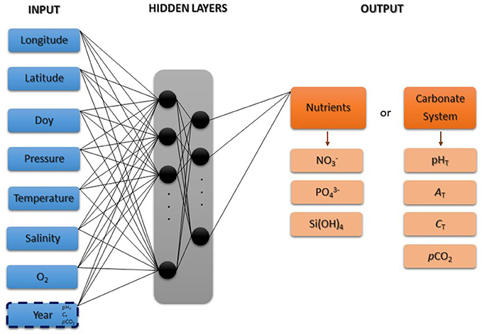{height="400"}

[📍 In-situ sensor]{.gb .src} [🌊 Ocean]{.gb .sys .ocean} [🌊 Oceanography]{.gb .disc .ocean}

::: {.credit}
Sauzède et al. (2017), *Front. Mar. Sci.* 4, 128, Fig. 2. [doi:10.3389/fmars.2017.00128](https://doi.org/10.3389/fmars.2017.00128). CC BY.
:::
:::
:::

::: {.takeaway}
Snow water from snow depth: one hidden layer, R² 0.97 against 0.88 for regression formulas. Ocean nitrate: two hidden layers, error 1.04 µmol/kg.
:::

::: {.notes}
Two minutes. Left, Ntokas et al. (2021): 234,779 records of snow depth, density and water equivalent from 2,878 locations across Canada. Each panel plots simulated against observed snow water equivalent in mm. (a) a constant density, (b) and (c) the regression formulas of Jonas et al. (2009) and Sturm et al. (2010), (d) an ensemble of 20 networks with 12 inputs and one hidden layer of 120 neurons, (e) one such model per snow class. R² goes from 0.88 for the regressions to 0.97 for the network; in the paper's Table 8 the mean absolute error on the testing set goes from 44.5 (Jonas) to 32.8.

Right, Sauzède et al. (2017): the CANYON networks. Inputs: position, day of year, pressure, temperature, salinity, oxygen. Two hidden layers (20 and 17 neurons for nitrate), one output. Trained on 549,561 bottle samples of the GLODAPv2 compilation, 137,219 held out; error on nitrate 1.04 µmol/kg. Use: a profiling float that measures only temperature, salinity and oxygen can report an estimate of nutrients. The held-out samples were drawn at random; the paper also withholds eight whole 10° by 10° zones, the check lecture 18 asks for.

Other examples if asked. Volcanoes: Picchiani et al. (2011, Atmos. Meas. Tech. 4, 2619-2631), ash in MODIS images of Etna from three infrared channels, ten hidden neurons, accuracy above 90% against the method that labeled the pixels. Exoplanets: Pearson, Palafox and Griffith (2018, MNRAS 474, 478-491), transits in light curves of 180 points, hidden layers of 64, 32 and 8 neurons: 88.7% of simulated transits found, a convolutional network 88.5%, the box-fitting search 63.1% (arXiv version). When small is not enough: Rasp, Pritchard and Gentine (2018, PNAS 115, 9684-9689) needed nine layers of 256 neurons to replace the subgrid physics of a climate model and report that one or two hidden layers were unstable; Brenowitz and Bretherton (2018, GRL 45, 6289-6298, here at UW) used one hidden layer of 128 neurons for a similar task (preprint read).
:::

## Open 4.0 (15 minutes)

1. Sections 1 and 2: the rule stops after 2 passes
2. Section 2.3: write the sigmoid, compare the rule and the log-loss
3. Section 2.4: compare the fitted weights with the template
4. Move the arrival by 0.1 s: what does the neuron detect now?

::: {.dim}
`pixi run jupyter lab`, then `mlgeo_4.0_perceptrons.ipynb` · Lab 3.8 due tonight · Chapter 6 quiz closes Wednesday · Classic ML project milestone (3.20) due Mon Nov 23
:::

::: {.notes}
Fifteen minutes, in pairs. Priorities if time is short: task 3 (the weights as a template) and task 4 (the shift), because Wednesday and Friday build on them. Results to expect. Task 2: on the 2,000 synthetic detector windows the rule keeps correcting about 100 windows per pass and its test accuracy moves between 91.2% and 92.4%; the log-loss descent reaches 93.8%. Task 3: correlation 0.986 between weights and template, 99.75% for both detectors. Task 4: with the arrival 0.1 s later the neuron detects none of the 200 events. The discussion to have before they leave: the weights are tied to positions in the window, so the pattern is recognized only where it was during training. Names in the notebook: `LogisticRegression(C=0.001)` (scikit-learn; C is the inverse of the penalty strength), `synthetic_seismogram` (the course generator). Sections 3 and 4 of the notebook (line fit by gradient descent, learning rate) are reading for Wednesday.
:::

## Part 2. A network: neurons that feed neurons

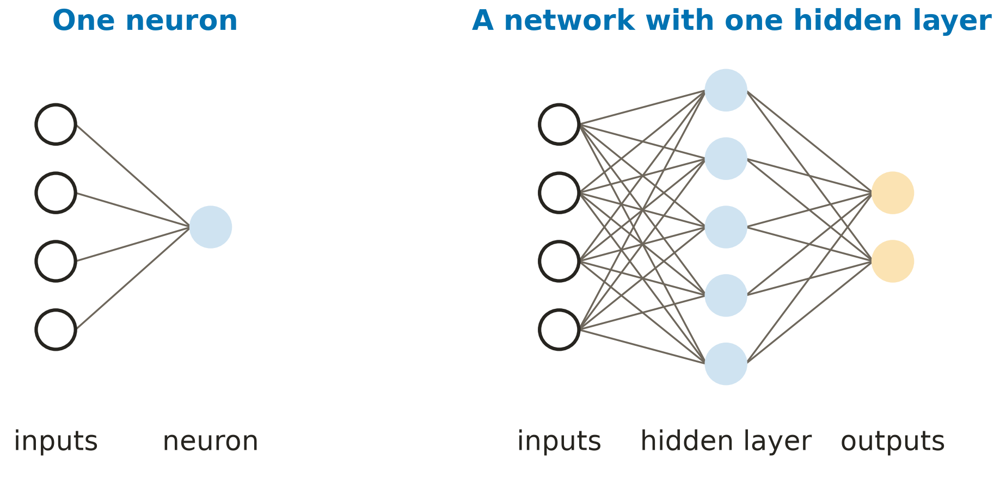{.r-stretch}

::: {.takeaway}
Each hidden neuron is Monday's neuron, with its own weights. The output neurons take the hidden outputs as their inputs.
:::

::: {.notes}
Wednesday starts here. Two minutes. Recall Monday in one sentence: one neuron is a weighted sum and an activation; its weights are a template; trained on a loss it is logistic regression. Its limit: the boundary between its two answers is a line or a plane, and its prediction of a number is a straight line. A hidden layer is a set of neurons that all read the same inputs, each with its own weights, so each responds to its own pattern. Their outputs are the inputs of the next layer. The activation between layers matters: a weighted sum of weighted sums is one weighted sum, so without it the network reduces to one neuron. Count weights with the room on the drawing: 4 inputs to 5 hidden neurons is 4 × 5 + 5 biases = 25; 5 hidden to 2 outputs is 5 × 2 + 2 = 12. Hornik, Stinchcombe and White (1989) proved that one hidden layer with enough neurons can approximate any continuous function. The theorem does not say how many neurons, how much data, or whether training finds the weights. This fully connected network is called a multilayer perceptron (MLP). The next five slides train one, on a small example.
:::

## A simple example: temperature against depth in the ocean

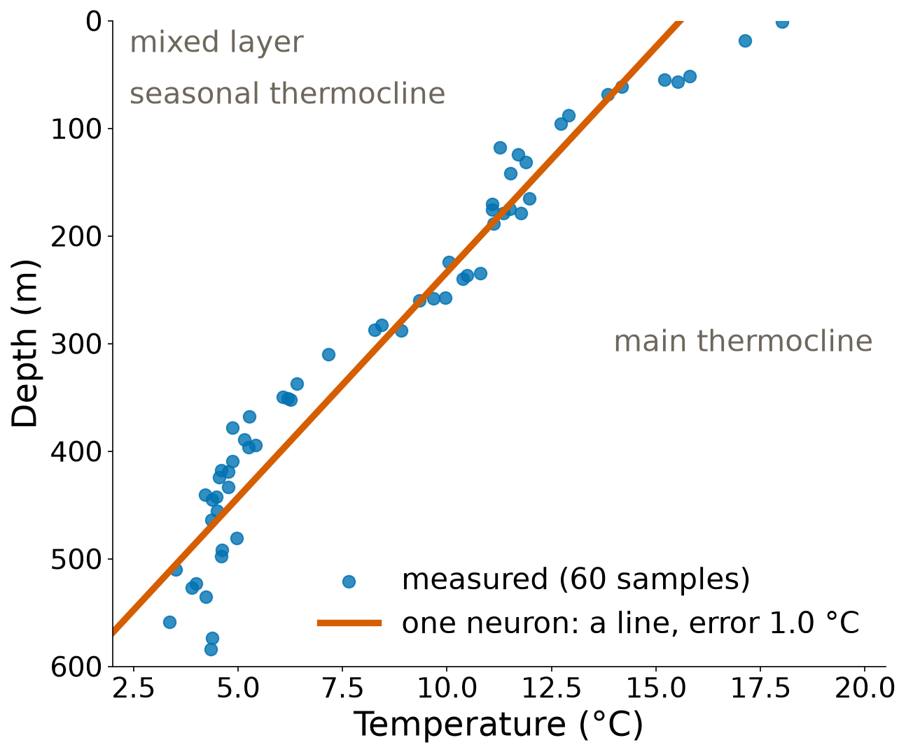{.r-stretch}

[🖥️ Model & simulation]{.gb .src} [🌊 Ocean]{.gb .sys .ocean} [🌊 Oceanography]{.gb .disc .ocean}

::: {.takeaway}
One neuron predicts a straight line: 2.4 °C per 100 m, error 1.0 °C. It cannot bend at the two thermoclines. Synthetic profile, 60 samples.
:::

::: {.notes}
Two minutes. Geoscience first. The upper ocean is layered: a mixed layer stirred by wind, at nearly one temperature; a seasonal thermocline where temperature drops fast; a slower decrease through the main thermocline; cold deep water. The profile here is synthetic, written in the figure script (figscripts/lec21_network_training.py): 4 °C deep water, plus 6 °C lost across a seasonal thermocline near 60 m, plus 8 °C lost across a main thermocline near 300 m, sampled at 60 random depths between 0 and 600 m with 0.3 °C of noise, like a float profile. A second set of 40 samples with new noise is the validation set. The task: predict temperature from depth. One input, one output. The red line is the best one neuron can do with no activation: a straight line, 2.4 °C per 100 m, with a root-mean-square error of 1.0 °C, three times the noise. Ask: what shape would the model need? Steps. That is what a hidden neuron with a smooth activation provides.
:::

## Forward pass: three hidden neurons, added up

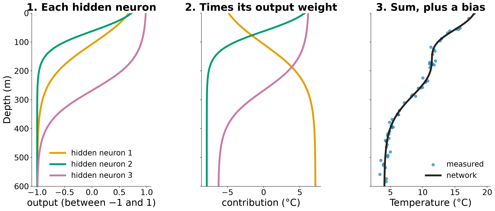{.r-stretch}

::: {.takeaway}
Each hidden neuron makes one smooth step in depth. Scaled by its output weight and summed, the three steps build the profile: 10 weights in all.
:::

::: {.notes}
Three minutes. This is the trained network, read from input to output; computing the output from the input is called the forward pass. The network: 1 input (depth), 3 hidden neurons with a tanh activation, 1 output (temperature). Count the weights: 3 input weights and 3 biases for the hidden layer, 3 output weights and 1 bias: 10. Panel 1: the output of each hidden neuron against depth. Each is a smooth step between −1 and 1; its input weight sets how sharp the step is and its bias sets the depth where it occurs. Panel 2: each output multiplied by its output weight, in °C. Panel 3: their sum plus the output bias, over the 60 samples. Ask the room which hidden neuron carries the main thermocline (the green one, centered near 280 m) and which carry the upper part. Tanh is a sigmoid rescaled to run from −1 to 1; networks today more often use ReLU, max(0, z), which builds the curve from straight pieces. This is Monday's reading again: each hidden neuron responds to one pattern, here one step in depth.
:::

## The loss: one number for the misfit

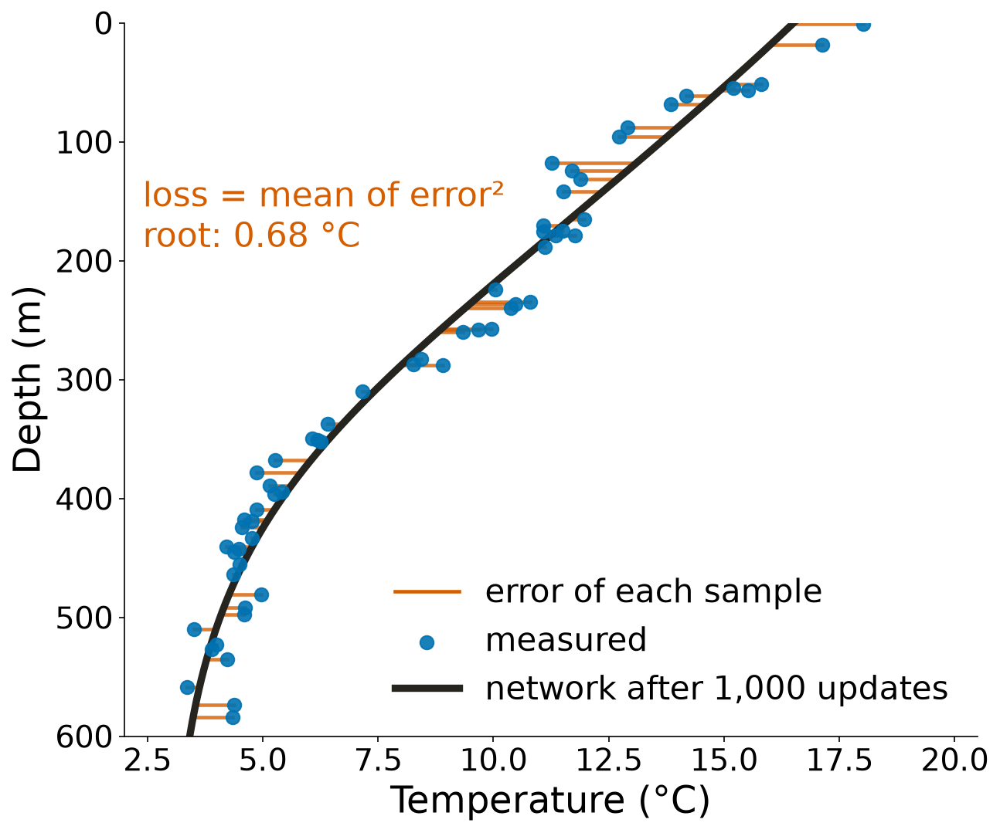{.r-stretch}

::: {.takeaway}
Each red bar is the misfit of one sample. The loss is the mean of the squared misfits; its square root here is 0.71 °C.
:::

::: {.notes}
Two minutes. Partway through training, after 1,000 steps: the network has found one bend and misses the plateau near 150 m. For each of the 60 samples, the red bar is predicted minus measured temperature. Square them, average: the mean squared error, the loss for a regression. Its square root is in °C, 0.71 here, which is easier to judge than the loss itself: the noise in the data is 0.3 °C, so there is still structure left to fit. For classification the loss was the log-loss of lecture 16; the rest of the procedure is identical. Training asks one question again and again: how should each of the 10 weights change to make this number smaller? The answer is the gradient, computed by the chain rule from the output back to the input, layer by layer (backpropagation; notebook 3.6 did it for one neuron).
:::

## Training: predict, measure, step, repeat

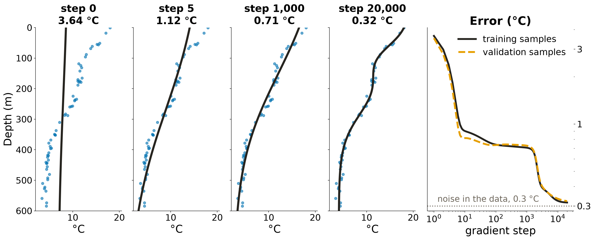{.r-stretch}

::: {.takeaway}
From random weights the error falls from 3.6 °C to 0.32 °C in 20,000 steps, with a long plateau near 0.7 °C before the network finds the second thermocline.
:::

::: {.notes}
Four minutes. The four steps of every training loop: predict with the current weights, measure the loss, step every weight against its gradient, repeat. Left to right: the network at step 0 (random weights, nearly a vertical line, error 3.64 °C), after 5 steps (the overall trend, 1.12 °C), after 1,000 steps (one bend, 0.71 °C), after 20,000 steps (both thermoclines, 0.32 °C, the noise level). Right: the error against the step, on logarithmic axes, for the training samples and for the 40 validation samples that were never used to compute a gradient. Three things to read. First, most of the gain comes in the first ten steps. Second, the plateau from about step 10 to step 2,000: the loss barely moves, then drops again when one hidden neuron moves to the seasonal thermocline. A flat loss curve does not prove that training is finished. Third, the validation curve follows the training curve and ends at 0.32 °C: with 10 weights and 60 samples there is no overfitting. In notebook 4.2 students remove dropout from a larger network and watch the two curves separate. In PyTorch the same four steps are spelled forward pass, loss, `loss.backward()`, `optimizer.step()`; and the loop works on small batches of samples (minibatches), one pass through all of them being an epoch.
:::

## The learning rate sets the size of each step

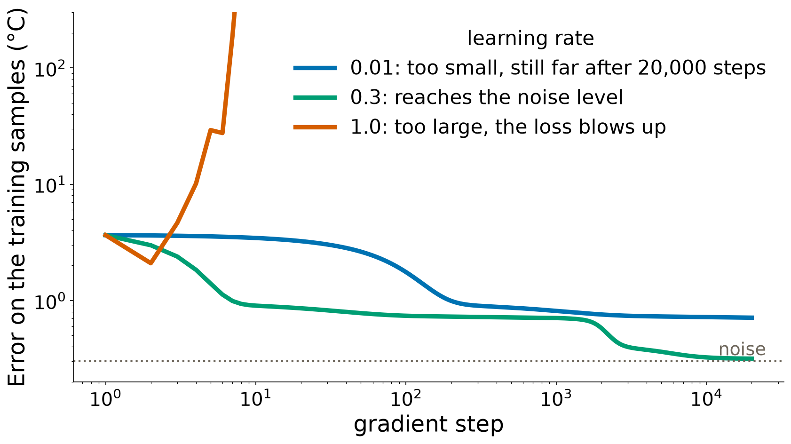{.r-stretch}

::: {.takeaway}
Same network, same start. At 0.01 the error is still 0.71 °C after 20,000 steps; at 0.3 it reaches 0.32 °C; at 1.0 it blows up within 9 steps.
:::

::: {.notes}
Two minutes. The learning rate multiplies the gradient to give the step. Blue, 0.01: every step is safe and small; after 20,000 steps the network is still on the plateau. Green, 0.3: the run of the previous slide. Red, 1.0: each step overshoots, the error grows, and the run stops after 9 steps with numbers too large to store. Nothing warns you except this curve, so plot the loss against the step every time you train. Notebook 4.0 section 4 shows the same three regimes for a single neuron fitting a line, with an interactive version. The optimizer used from notebook 4.1 on, Adam, adapts the step for each weight, but it still has a learning rate to choose.
:::

## Four seismic source types: what the hidden layer adds

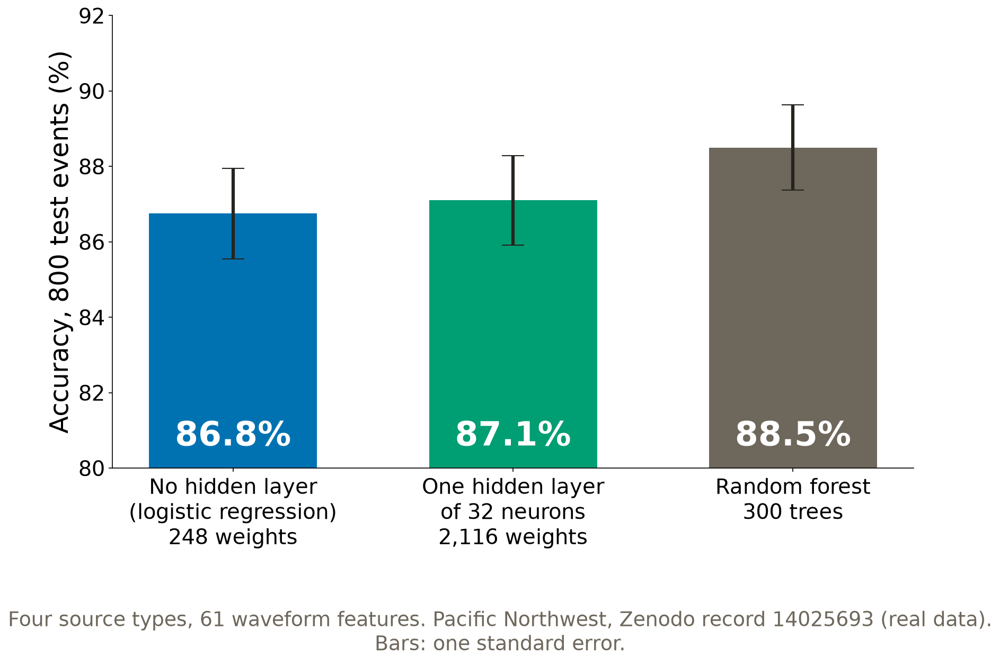{.r-stretch}

[📍 In-situ sensor]{.gb .src} [🪨 Solid Earth]{.gb .sys .solid} [📈 Seismology]{.gb .disc .solid}

::: {.takeaway}
On 61 features, a hidden layer of 32 neurons adds 0.4 points to logistic regression: 3 of 800 test events, inside one standard error.
:::

::: {.notes}
Three minutes. Back to real data and to the baseline habit of lecture 18. Earthquake, explosion, surface event, noise: 4,000 Pacific Northwest events, 2,400 to train, 800 to validate, 800 to test (the split of notebook 4.1). Blue: no hidden layer, four output neurons with a softmax, the multiclass logistic regression of lecture 16: 248 weights (61 × 4 + 4), 86.8% (694 of 800). Green: the network of notebook 4.1, 61 inputs, 32 hidden neurons with ReLU, 4 outputs, 2,116 weights (61 × 32 + 32 = 1,984, plus 32 × 4 + 4 = 132): 87.1% (697). Grey: a random forest, 300 trees, default settings: 88.5% (708). The first and third are computed by figscripts/lec21_one_neuron.py on the same split; the second is read from the executed notebook 4.1. One standard error on 800 events is about 1.2 points: the first two cannot be told apart. Notebook 4.2's deeper model (hidden layers of 128, 64 and 32 neurons, dropout, batch normalization) reaches 89.0% on its own split. The published study on the full curated set (Kharita et al. 2026, lecture 16) reports 89% for its best random forest on features and above 92% for convolutional networks on spectrograms. What to say: the 61 features were built by seismologists and have already done the work; a hidden layer has little left to add. In the ocean profile the hidden layer was essential, because the input was raw (depth) and the relation was not a line. Networks gain when they read the record itself. That needs one more idea.
:::

## A neuron loses an arrival that moves by 0.1 s

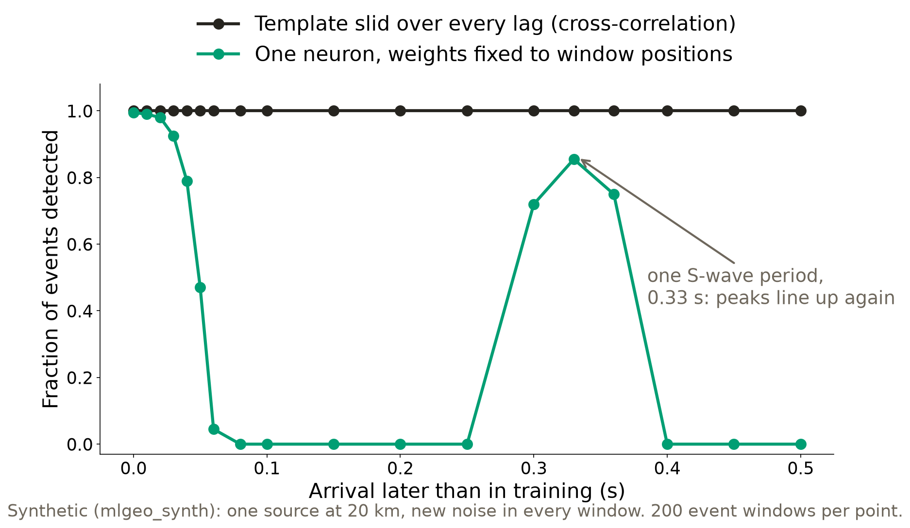{.r-stretch}

::: {.takeaway}
Monday's neuron detects 99.5% of events at the trained arrival time, 47% when the arrival is 0.05 s later, and none from 0.08 s to 0.25 s. The template slid over every lag detects all of them.
:::

::: {.notes}
Three minutes; this is the bridge to Friday. Monday's neuron on waveform windows, fitted on events whose P wave always arrived 0.83 s into the window. Now the arrival comes later, by the amount on the horizontal axis; 200 event windows per point, synthetic (mlgeo_synth). Green: the fraction the neuron still calls events. It halves at 0.05 s and is zero from 0.08 s. Each weight multiplies one position in the window; move the waveform by a third of a period and its peaks meet weights of the opposite sign. Ask the room why detection returns near 0.33 s: that is one period of the 3 Hz S wave, so the largest peaks line up with the right weights again, one cycle late. Black: template matching as it is done in practice, the same weighted sum computed at every lag (here within ±0.6 s), keeping the largest; threshold set on noise windows, false alarms 1% to 5%. It does not depend on where the event is.

A fully connected network has the same limit as the single neuron: every weight is tied to one input position. On the 61 features this is harmless, because features have no order. On a waveform, an image or a map, the network would have to see every pattern at every position during training. Friday's convolutional layer takes the idea in black: one small set of weights, slid along the record. Ask: which of your project data have patterns that can occur anywhere? (Tremor in a spectrogram, storm cells in radar, transits in a light curve.)
:::

## From Chapter 3 to Chapter 4

| Earlier in the course | In Chapter 4 | Example from these two days |
|---|---|---|
| template matching | a neuron's weights | correlation 0.99 with the event |
| logistic regression | a neuron trained on a loss | 89.6%, explosion or earthquake |
| gradient descent | the training loop | 3.6 °C to 0.32 °C |
| baseline | the model with no hidden layer | 86.8% against 87.1% |
| new | layers that match the data | Friday: a shifted arrival |

::: {.notes}
Leave this up during questions. Return to the opening question: is a neural network a different kind of object from the regressions of Chapter 3? Row by row: a neuron is the weighted sum of template matching (lecture 1, section 2.9); with a sigmoid and the log-loss it is logistic regression (lecture 16); training is the gradient descent of notebook 3.6 with bookkeeping; the baseline habit of lecture 18 carries over, and here the baseline is the model with no hidden layer. The train, validation and test sets also carry over unchanged (4.1 splits 60/20/20, stratified, with the scaler fit on the training events only). What is new is the last row: layers built to match how the data are organized. Fully connected layers for a table of features, convolution for records and maps where a pattern can occur anywhere (Friday), recurrence and attention for sequences where order matters (Monday Nov 23). Naming that structure is the scientist's part of the work.
:::

## Open 4.1, then 4.2

1. 4.1: run the training loop, find the four steps in the code
2. Read the learning curves: where do training and validation part?
3. 4.2: retrain with `p_drop=0.0` and compare the curves
4. Note your test accuracy next to the 86.8% baseline

::: {.dim}
PyTorch names: `nn.Module`, `nn.Linear`, `nn.ReLU`, `nn.CrossEntropyLoss`, `Adam`, `DataLoader` · Chapter 6 quiz closes today · Classic ML project milestone (3.20) due Mon Nov 23 · Friday: convolution (4.3)
:::

::: {.notes}
Timing for Wednesday (10:00 to 11:20): Part 2 slides about 20 minutes, notebooks about 50 minutes, synthesis 10 minutes. Priorities if time is short: task 1 (finding the four steps) and task 3 (the gap between training and validation curves opening when dropout is removed). PyTorch spellings students will meet: a subclass of `nn.Module` with `__init__` and `forward`, `nn.Linear`, `nn.ReLU`, `nn.CrossEntropyLoss` (the softmax is inside the loss, not the model, which often causes confusion), `torch.optim.Adam`, `Dataset` and `DataLoader`, `model.train()` against `model.eval()` (dropout and batch normalization behave differently in the two modes, 4.2 section 4.4). Dropout: during training, a random fraction of the hidden outputs is set to zero at each step, which limits overfitting. Question to collect at the end: where in your project data does position or order matter, and would a fully connected network see it?
:::
