## {background-color="#faf7f2"}

[🎯]{.lecture-icon}

### Today's question

A network always produces an answer.

**How do we train it, and how do we know the answer is any good?**

::: {.dim}
Reading: [4.1 Neural networks (classification)](https://geo-smart.github.io/mlgeo-book/mlgeo-4-1-nn) · [4.2 Regression with a neural network](https://geo-smart.github.io/mlgeo-book/mlgeo-4-2-mlp) · [4.8 The rubric](https://geo-smart.github.io/mlgeo-book/mlgeo-4-8-dl-rubric)
:::

::: {.notes}
This session is the first of four on the core of deep learning, one per kind of network: fully connected (today), convolutional, recurrent and attention, then how to choose among them. Each session ends with the best practices for its network, which become items of the rubric in book section 4.8, the specification our AI assistant will follow. Today: the fully connected network, on two problems that differ only in what is predicted, a class or a number. Lecture 21 trained one neuron and a small network by hand. Today the same loop runs in PyTorch, and the questions are the ones of a working scientist: which loss, which learning rate, when to stop, and how to tell whether the network is better than something simpler.
:::

## Four sessions, four kinds of network: today, a table

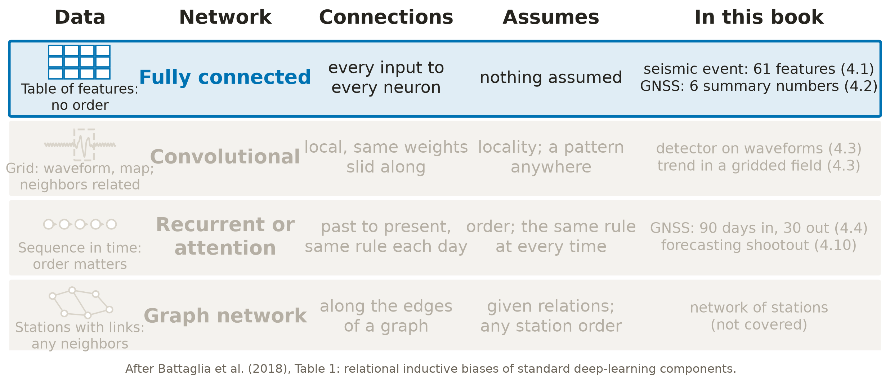{.r-stretch}

::: {.takeaway}
The structure of the data chooses the network. A table of features has no order between its columns: every input connects to every neuron, and the network assumes nothing.
:::

::: {.notes}
Two minutes; this figure returns in each of the next three sessions with its own row highlighted. It follows Battaglia et al. (2018, arXiv:1806.01261), Table 1, which lists for each standard layer the entities it works on, how they are related, and what that relation lets the network assume (its inductive bias). A fully connected layer assumes nothing about how the inputs are related: shuffle the 61 features of a seismic event, consistently in every sample, and the network learns the same thing. That is right for a table of hand-built features. It is wasteful for a waveform, where neighboring samples are related (next session, convolution), and for a series in time, where order matters (the session after, recurrence and attention). The last row, graphs, is where a seismic or GNSS network of stations would go; this course does not cover it. Today: two problems that are tables.
:::

## Inside an MLP: every input to every neuron

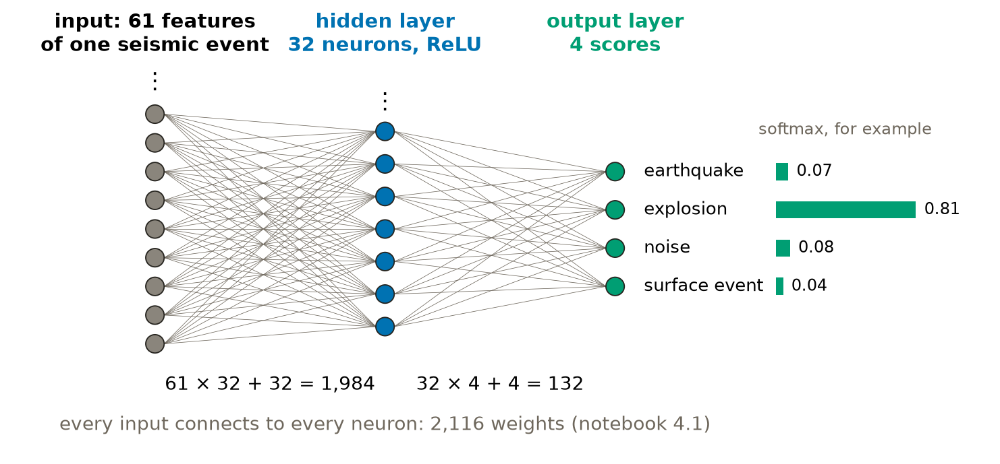{.r-stretch}

::: {.takeaway}
61 features in, 32 hidden neurons with ReLU, 4 scores out: 2,116 weights (notebook 4.1). The softmax turns the scores into probabilities.
:::

::: {.notes}
Two minutes; the map of the next eight slides. Notebook 4.1's network NN1: the input is one row of the table, 61 waveform, envelope and spectral features of one seismic event (Chapter 3's dataset). Every input is connected to every hidden neuron (gray links), every hidden neuron to every output. Hidden layer: 61 × 32 weights + 32 biases = 1,984. Output layer: 32 × 4 + 4 = 132. Total 2,116, the number 4.1 prints. The four outputs are scores (logits), one per class in 4.1's order: earthquake, explosion, noise, surface event; the probabilities drawn are an example. This is lecture 21's network of three neurons, grown: same weighted sums, same ReLU, same training loop.
:::

## One dense layer by hand

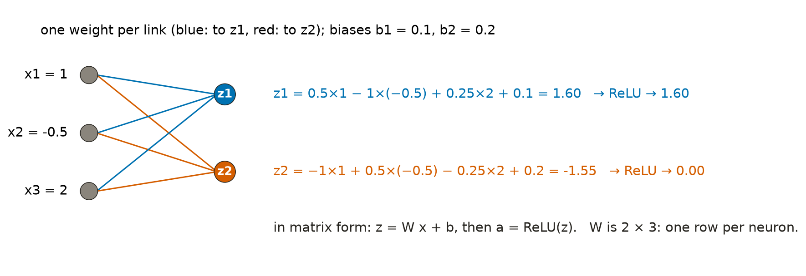{.r-stretch}

::: {.takeaway}
Each neuron: a weighted sum of all inputs plus its bias, then ReLU. Here z1 = 1.60 passes; z2 = −1.55 becomes 0. In matrix form, z = W x + b.
:::

::: {.notes}
Three minutes; do the arithmetic with the room. Inputs x = (1, −0.5, 2), already scaled. Neuron 1 (blue links): 0.5×1 − 1×(−0.5) + 0.25×2 + 0.1 = 1.60; ReLU keeps it. Neuron 2 (red links): −1×1 + 0.5×(−0.5) − 0.25×2 + 0.2 = −1.55; ReLU sets it to 0, so neuron 2 is silent for this sample and passes no gradient back for it. The weights of the layer form a matrix W with one row per neuron (2 × 3 here, 32 × 61 in 4.1); nn.Linear(3, 2) stores exactly this W and b. All numbers computed in figscripts/lec21b_mlp_cartoons.py.
:::

## Each hidden neuron cuts the input space

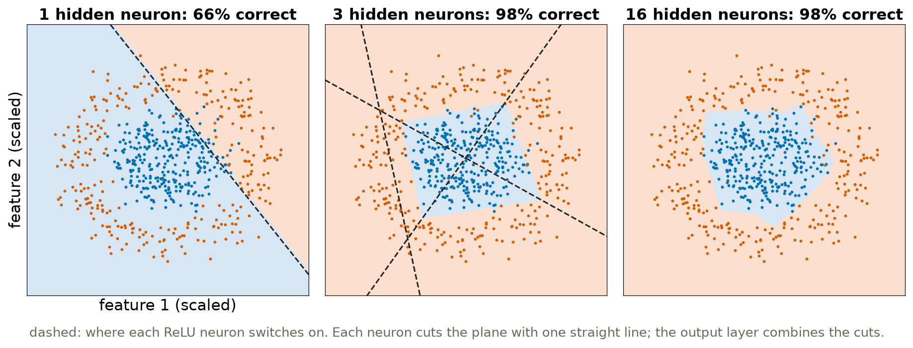{.r-stretch}

::: {.takeaway}
One ReLU neuron draws one straight line: 66% of the training samples right on a ring. Three lines enclose the core: 98%. Sixteen smooth the edge: 98%.
:::

::: {.notes}
Two minutes. Synthetic data: two scaled features, a core class (blue) surrounded by a ring class (orange), 600 samples. Networks with one hidden layer of 1, 3 and 16 ReLU neurons (scikit-learn, seeded). The dashed lines are where each hidden neuron switches on (w·x + b = 0). One neuron can only split the plane in two. Three neurons give three cuts, and the output layer combines them into a closed region around the core. Sixteen neurons make the boundary smoother, not more correct here. The scores are on the training samples: this slide is about what a layer can represent, not about generalization. Width is the number of cuts a layer can make.
:::

## How many weights to fit?

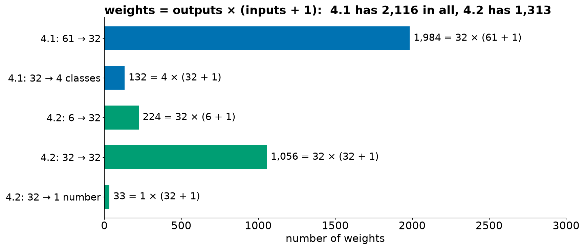{.r-stretch}

::: {.takeaway}
weights = outputs × (inputs + 1): 2,116 in 4.1, 1,313 in 4.2. Start small, one hidden layer of 16 to 64 neurons, and grow only if the training loss stays high.
:::

::: {.notes}
One minute. Every link is a weight, plus one bias per neuron. 4.1: 61 → 32 → 4. 4.2 (P395 regression): 6 → 32 → 32 → 1, so 224 + 1,056 + 33 = 1,313; the middle layer 32 → 32 holds most of them. Rubric item C1.3: compare the number of weights with the number of training samples; a network with more weights than samples can memorize them. Contrast with next session: a convolution shares its weights along the record, so its count does not grow with the length of the input; a dense layer's does.
:::

## Wide and shallow, or deep and narrow?

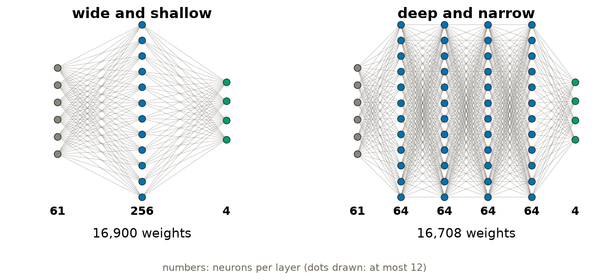{.r-stretch}

::: {.takeaway}
At about 17,000 weights each: 256 neurons in one layer, or 64 in each of four. Depth composes cuts of cuts; for a table of features, one or two hidden layers are usually enough.
:::

::: {.notes}
Two minutes. Both networks take the 61 features and give 4 scores. Wide: 61 × 256 + 256 + 256 × 4 + 4 = 16,900. Deep: 61 × 64 + 64 + 3 × (64 × 64 + 64) + 64 × 4 + 4 = 16,708. A wide layer makes many cuts of the input at once; each layer of a deep network cuts the output of the previous one, so it can build more complicated regions with the same weights, but it is harder to train (more layers for the gradient to cross) and benefits from batch normalization (notebook 4.1, section 7). On tables of hand-built features, start with one hidden layer and add width or depth only if the training loss stays high (rubric C1.3). The same width-or-depth question returns for convolutions next session.
:::

## An MLP sees no order

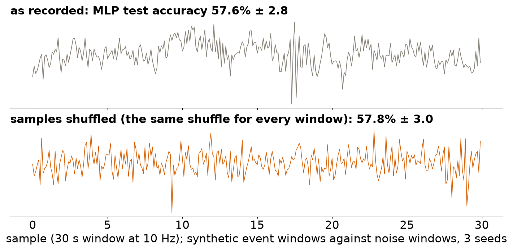{.r-stretch}

::: {.takeaway}
Shuffle the samples of every window in the same way and the MLP scores the same, 57.6% and 57.8%: it never used the shape of the waveform. Right for a table, wasteful for a waveform.
:::

::: {.notes}
Two minutes; the bridge to next session. Synthetic event and noise windows (mlgeo_synth, 400 + 400), 300 samples each at 10 Hz, fed directly to an MLP with 32 hidden neurons, 3 seeds. Top: the samples in their recorded order. Bottom: the same windows with the samples shuffled, the same shuffle for every window. The MLP gives each input its own weights, so shuffling the inputs only renames them: the test accuracy is the same within the seed spread. A seismologist cannot read the shuffled trace; the MLP does not care, because it never used neighbors or order. That is fine for 61 unordered features, where the column order means nothing. For a waveform it throws away the structure: the convolutional detector of notebook 4.3, built to use neighbors, reaches 88% on its synthetic test windows (different window length and data size, so compare the order of magnitude, not the digits).
:::

## Scale the inputs first

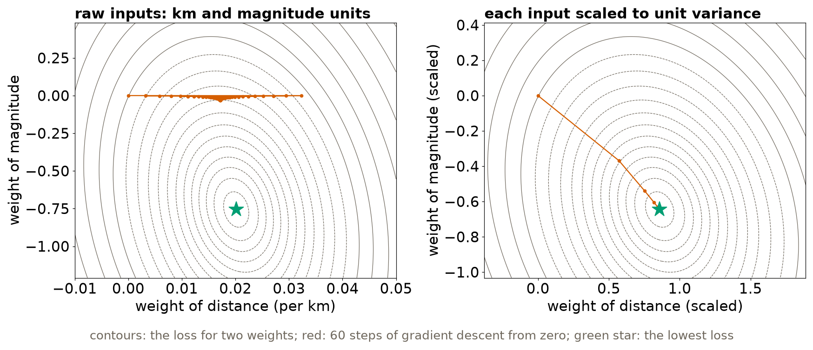{.r-stretch}

::: {.takeaway}
In km and magnitude units the loss is a narrow valley: after 60 steps the magnitude weight is −0.03 of −0.76. Scaled to unit variance, the same 60 steps reach the lowest loss.
:::

::: {.notes}
Two minutes; rubric items A5 and C1.1. Synthetic regression with two inputs, epicentral distance (5 to 150 km) and magnitude (1 to 4); the contours are the mean squared error as a function of the two weights. Raw units: the distance input varies 50 times more than the magnitude, so the loss changes 2,600 times faster along one weight than the other (the ratio of curvatures, computed). Gradient descent must use a learning rate small enough for the steep direction, and then crawls along the flat one: 60 steps leave the magnitude weight at −0.03 when its best value is −0.76. Scaled: the valley is round, and 60 steps with a larger learning rate reach the optimum. Scale with the mean and standard deviation of the training samples only, then apply the same numbers to validation and test.
:::

## Dropout: train with random neurons switched off

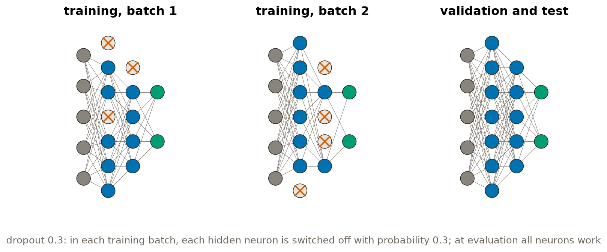{.r-stretch}

::: {.takeaway}
In each training batch, each hidden neuron is off with probability 0.3, so no neuron can rely on one particular other; at evaluation every neuron works.
:::

::: {.notes}
One minute; notebook 4.1, section 7. Dropout is a regularizer: a way to reduce overfitting when the training and validation curves part (rubric D6). Each batch trains a different random sub-network; the full network at test time behaves like an average of them. PyTorch scales the surviving outputs during training (by 1/(1 − 0.3)) so that nothing changes at evaluation. model.train() turns dropout on, model.eval() turns it off: forgetting model.eval() before evaluating is a classic error. In 4.1, removing dropout (Your turn 2) shows its effect on the two curves.
:::

## Classification or regression: the head decides

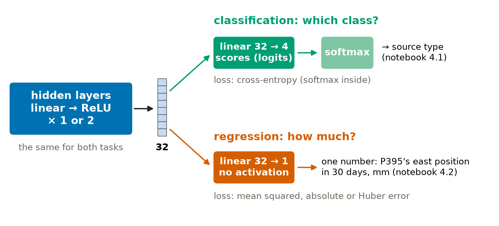{.r-stretch}

::: {.takeaway}
Classification: one score per class, softmax, cross-entropy (4.1). Regression: one number, no activation, squared, absolute or Huber error (4.2). The hidden layers can be identical.
:::

::: {.notes}
One minute; the table of the next slide in a picture. The last layer fits the quantity to predict (rubric C1.2): 4 scores for 4 source types, with the softmax inside nn.CrossEntropyLoss, so the model ends at the scores; or 1 number with no activation for P395's east position in 30 days, in mm, because a ReLU or sigmoid at the end would forbid negative or large values. Everything before the head can be the same network. Next session the hidden layers become convolutions; the head does not change.
:::

## Two problems, one loop

| | Classification (4.1) | Regression (4.2) |
|---|---|---|
| Sample, input X | seismic event: 61 features | GNSS window: 6 numbers |
| Y, to predict | source type, 4 classes | position in 30 days (mm) |
| Last layer, loss | 4 scores; cross-entropy | 1 number; MSE, MAE, Huber |
| Score, baseline | accuracy; logistic | error in mm; linear |

::: {.notes}
Two minutes. Read the table row by row. Classification: one seismic event from the Pacific Northwest, 61 waveform features, the source type among 4 classes, 4 scores in the last layer with the softmax inside the cross-entropy loss, scored by accuracy and the confusion matrix against the majority class and logistic regression. Regression: one window of GNSS station P395, 6 numbers from the past 60 days, the mean east position over the next 30 days in mm, 1 number in the last layer, with no activation, squared, absolute or Huber error, scored in mm against persistence and linear regression. Only the quantity to predict, the last layer and the loss change, and with them the score and the baseline. The loop itself does not change: forward pass, mean loss over the batch, backward pass, update. The rubric items behind this table are A1 (name the sample, X, Y and units), C1.2 (the last layer fits the quantity to predict), D2 (the loss fits the errors) and A6 (baselines). Ask the room to fill the same table for their project, on paper, now.
:::

## P395: a station that keeps moving

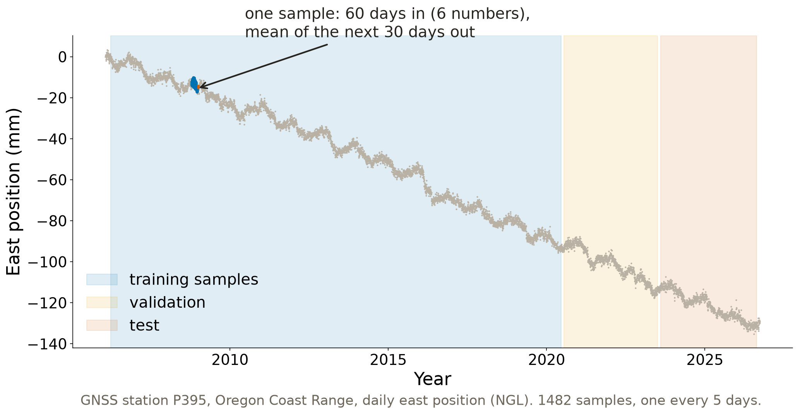{.r-stretch}

[📍 In-situ sensor]{.gb .src} [🪨 Solid Earth]{.gb .sys .solid} [📐 Geodesy]{.gb .disc .solid}

::: {.takeaway}
1,482 samples, one every 5 days, 2006–2026. Train on the first 70%, validate on the next 15%, test on the last 15%, in time order, with a gap so that no 30-day window overlaps.
:::

::: {.notes}
Two minutes. Geoscience first. NGL station P395 in the Oregon Coast Range, above the Cascadia subduction zone; the course file has its daily east position. It moves 6.4 ± 0.2 mm per year to the west in this frame (NGL's MIDAS velocity, −6.39 ± 0.19 mm/yr, as quoted in notebook 4.2), with a seasonal wiggle. The task is the one of lecture 18: six numbers summarize the past 60 days (the 60-day mean, the 10-day mean, the last value, the 60-day slope, and two numbers for the time of year), and the quantity to predict is the mean position over the next 30 days. The split follows how the forecast would be used: train on 2006–2020, validate on 2020–2023, test on 2023.6–2026.6. A gap of 6 samples (30 days) separates the partitions so that a 30-day window never overlaps the next partition. Rubric items A3 and A4.
:::

## The loss for a number: what a large error costs

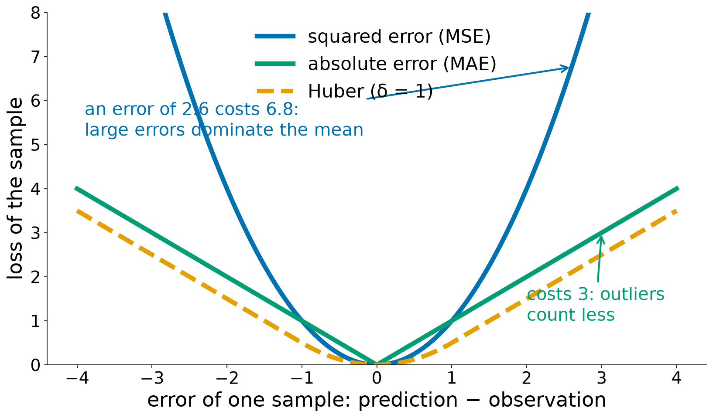{.r-stretch}

::: {.takeaway}
Squared error makes large errors dominate the mean; absolute error weights every millimeter the same; Huber is squared near zero and absolute beyond.
:::

::: {.notes}
Two minutes. The loss of one sample, against its error (prediction minus observation). Squared error (MSE when averaged): the right choice when errors are roughly Gaussian; an error twice as large costs four times as much, so a few outliers steer training. Absolute error (MAE): every millimeter costs the same; it suits heavy-tailed errors, such as GNSS positions with occasional jumps. Huber: squared for small errors (a smooth gradient near the minimum), absolute for large ones (outliers do not dominate); δ sets the switch. The training loss is always the mean of these over the batch. Rubric item D2. We compare the three on P395 in three slides.
:::

## The loss for a class: the probability given to the truth

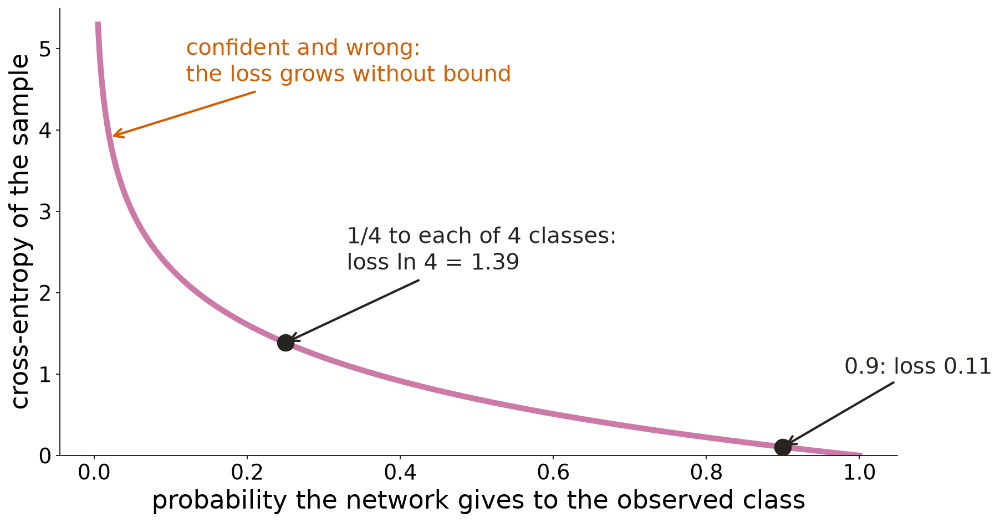{.r-stretch}

::: {.takeaway}
Cross-entropy only looks at the probability the network gives to the observed class: 0.9 costs 0.11, a uniform guess over 4 classes costs 1.39, confident and wrong costs without bound.
:::

::: {.notes}
Two minutes. For a class, the network outputs one score per class, the softmax turns them into probabilities that add up to 1, and the loss of a sample is minus the log of the probability given to the observed class. Two numbers to remember. A network that knows nothing and gives 1/4 to each of the 4 source types has a loss of ln 4 = 1.39 for every event: in notebook 4.1 the random starting weights give 1.42 on the first batch, close to this. A network that is confident and wrong pays a large price, which is what pushes it to be calibrated. With two classes the same loss is the log-loss of lecture 16. In PyTorch, `nn.CrossEntropyLoss` contains the softmax, so the model outputs raw scores.
:::

## Optimization: the learning rate sets how fast the loss falls

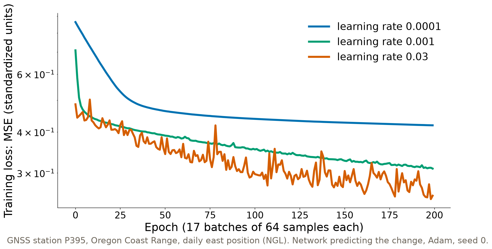{.r-stretch}

::: {.takeaway}
Adam, 200 epochs. At 0.0001 the training loss falls slowly and smoothly; at 0.001 faster; at 0.03 fastest, with jumps from update to update.
:::

::: {.notes}
Two minutes. Optimization is the method that turns gradients into updates. Plain gradient descent (lecture 21) multiplies every gradient by the same learning rate. Adam, the default in this chapter, keeps a running average of each weight's gradients and of their squares, and scales each weight's update by them; it still needs a learning rate. The figure: the training loss of the P395 network for three learning rates, same seed. The rule of practice: start at 0.001 with Adam; if the loss crawls, raise the learning rate by a factor of 3 to 10; if it jumps or diverges, lower it; always look at this curve. Batch size is the other setting: 64 samples here, so 17 updates per epoch; a larger batch gives a smoother but slower descent. Rubric item D5. Note what the figure does not show: a lower training loss is not a better model. The next slide.
:::

## Training: stop at the lowest validation loss

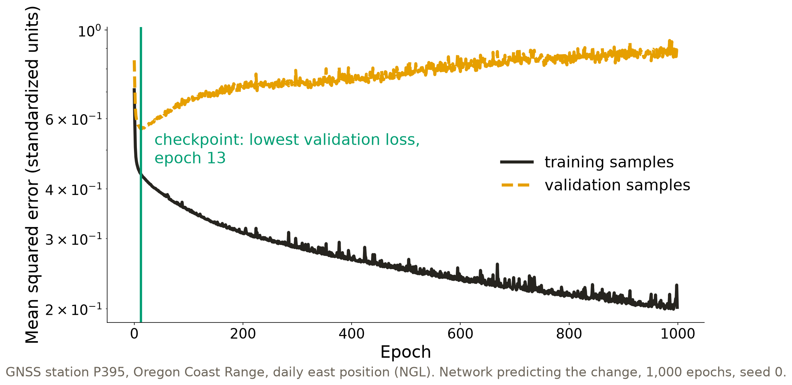{.r-stretch}

::: {.takeaway}
Over 1,000 epochs the training loss keeps falling, but the validation loss is lowest at epoch 13 and rises after. Keep the weights of that epoch: early stopping with a checkpoint.
:::

::: {.notes}
Three minutes. The same network trained for 1,000 epochs, with the loss on the training samples and on the validation samples (later in time, never used for a gradient). From epoch 13 on, the network fits details of the training years that do not repeat in the validation years: overfitting. Three strategies, in the order to try them: stop at the lowest validation loss and keep a copy of those weights (a checkpoint; notebook 4.1 section 8); make the network smaller; regularize, with dropout or weight decay (notebook 4.1 section 7), only once the two curves part. And train with several seeds: one curve is one draw. Rubric items D4, D6, D7.
:::

## Classification: loss curves, confusion matrix

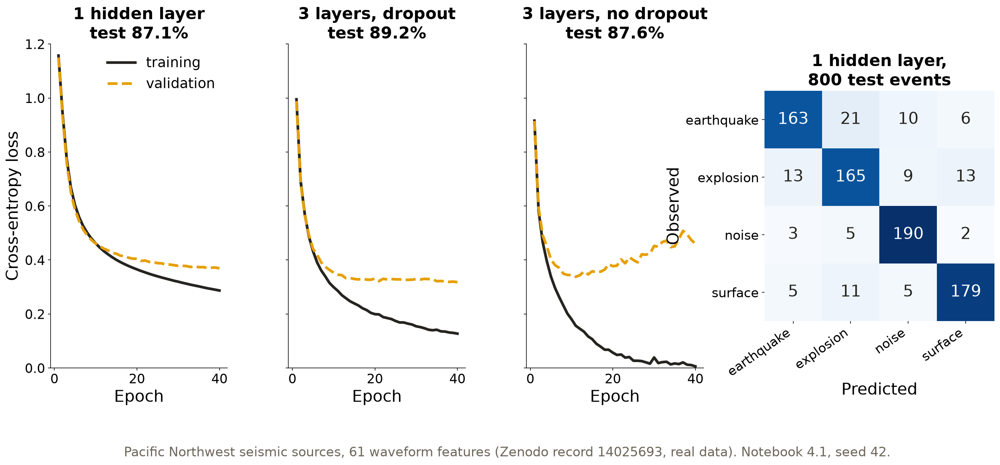{.r-stretch}

[📍 In-situ sensor]{.gb .src} [🪨 Solid Earth]{.gb .sys .solid} [📈 Seismology]{.gb .disc .solid}

::: {.takeaway}
One hidden layer: 87.1%. Three hidden layers with dropout: 89.2%. Without dropout the validation loss climbs after epoch 11. Earthquakes and explosions are confused most.
:::

::: {.notes}
Three minutes. Pacific Northwest seismic sources, notebook 4.1, 61 waveform features, 2,400 events to train, 800 to validate, 800 to test. Left three panels: training (solid) and validation (dashed) loss per epoch. One hidden layer of 32 neurons: the curves stay together; test accuracy 87.1%. Three hidden layers (128, 64, 32 neurons) with batch normalization and dropout 0.3: lower losses, curves still together, 89.2%. The same network without dropout: the training loss falls toward zero while the validation loss is lowest at epoch 11 and then climbs: overfitting; its last-epoch weights give 87.6%, and its checkpoint (notebook 4.1 section 8.2) 88.8%. Dropout sets a random 30% of the hidden outputs to zero at each update, so no neuron can rely on another; it is used only during training (`model.train()` against `model.eval()`). Right: the confusion matrix of the one-hidden-layer network on the 800 test events. Noise is recognized best (recall 0.95), earthquakes and explosions are confused most (recall 0.82 and 0.83): they produce similar waveforms, the same pattern as in Chapter 3. Two baselines to state with these numbers: the majority class gives 25% (balanced classes), and logistic regression, the network with no hidden layer, 86.8% (lecture 21). One standard error on 800 events is 1.2 points: the one-hidden-layer network ties logistic regression; the deeper network with dropout beats both by about two standard errors, on one split and one seed, so the claim needs the seed spread (rubric D7, E3). Numbers: figs/lec21b_train_evaluate/numbers_classification.json, from figscripts/lec21b_classification.py, which runs the notebook's code.
:::

## Regression: the test samples lie outside the training range

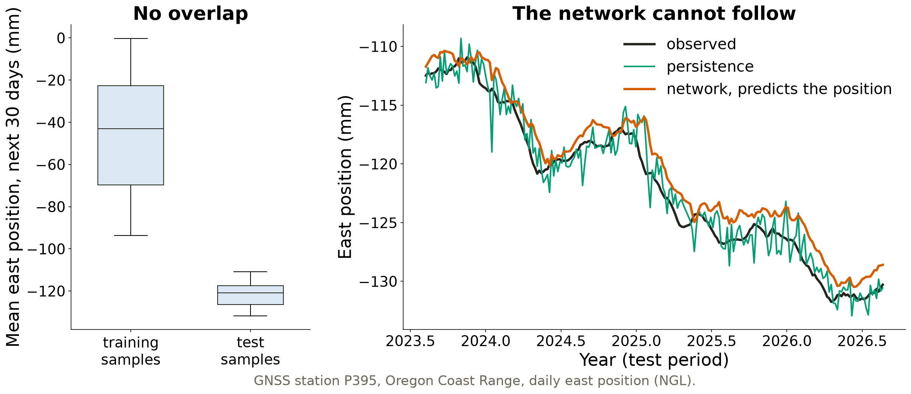{.r-stretch}

::: {.takeaway}
Every test observation, −132 to −111 mm, is below the training range, −94 to 0 mm. A network that predicts the position itself must extrapolate.
:::

::: {.notes}
Three minutes; the most useful check of the day. Left: the positions to predict in the training samples, and in the test samples. They do not overlap, because the station keeps moving. Right: in the test period, the observed position (black), persistence (green: the forecast is the last observed position) and the network that predicts the position (red, seed 0). A network with ReLU neurons does not know what to do outside the range of its training inputs: its test error is 1.6 mm with seed 0, 4.6 mm with seed 1 and 1.1 mm with seed 2, all worse than persistence. The random forest of lecture 18 failed in the same way (12.4 mm). The fix is in what we ask the network to predict, not in the network: predict the change from the last observed position, whose range is the same in every year (all but 1 of the 217 test changes fall inside the training range, notebook 4.2). Rubric item A7: before training, print the ranges.
:::

## Regression: test error in millimeters, three seeds

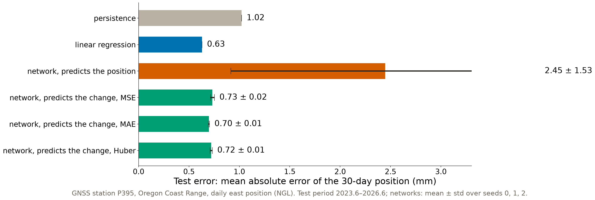{.r-stretch}

::: {.takeaway}
Predicting the change, the network reaches 0.70 to 0.73 mm, better than persistence (1.02) but not than linear regression (0.63). The linear model is the one to use.
:::

::: {.notes}
Three minutes. Test error, mean absolute error of the 30-day position in mm, test period 2023.6–2026.6; networks trained with seeds 0, 1 and 2, mean ± standard deviation. Persistence 1.02. Linear regression 0.63. Network predicting the position 2.45 ± 1.53 (1.15 to 4.60): worse than persistence, and the spread over seeds is itself a warning. Network predicting the change: 0.73 with squared error, 0.70 with absolute error, 0.72 with Huber, each ± 0.01 to 0.02. The absolute-error loss is best, consistent with heavy-tailed GNSS errors, and the differences between losses are a few hundredths of a mm. The conclusion a scientist writes: on six hand-built numbers, a linear model already captures the forecast; the network adds weights and no skill. That is a result, not a failure. Rubric items E1, E3, F4. Numbers: figs/lec21b_train_evaluate/numbers.json; notebook 4.2 reproduces them.
:::

## Best practices: the fully connected network

| Step | Practice | Rubric |
|---|---|---|
| Frame | split along the deployment axis | A1–A4 |
| Check | inside the training range? | A7 |
| Baseline | no learning; linear or logistic | A6 |
| Design | small; last layer fits Y | C1 |
| Train | seed; loss; curves; checkpoint | D1–D6 |
| Evaluate | test once; units; three seeds | D7–E3 |

::: {.notes}
Leave this up. Each row is a line of the rubric in book section 4.8, with its identifier. The rubric is a draft: every session of Chapter 4 adds the items of its network. Ask the room: which of these rows does your project already satisfy, and which has no evidence yet?
:::

## Our rubric: what the AI assistant must show

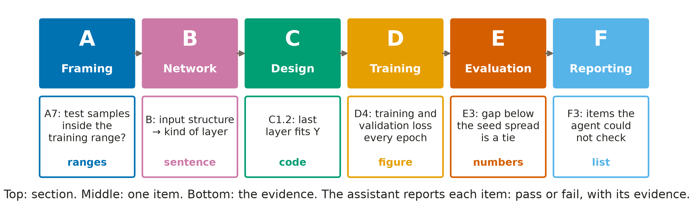{.r-stretch}

::: {.takeaway}
Each rubric item has an identifier, a check and the evidence. The assistant reports pass or fail for each item, with the evidence, and says which items it could not check.
:::

::: {.notes}
Three minutes. Why a rubric: a coding agent will happily build and train a network and report a single good number. The rubric turns the habits of this course into a specification it must follow, and into the checklist you use to review its work (lecture 19 built evaluation sets for agents; this is the same idea for deep learning). Six sections: A framing, B choosing the network from the data structure (session 25), C design checks for each network, D training, E evaluation, F reporting. The evidence column is what makes it checkable: a seed in the code, a figure of the loss curves, a table of baselines. Item A7 is the one that catches today's regression before training, and F4 the one that stops a claim of improvement smaller than the seed spread.
:::

## Open 4.1 sections 7–9, then 4.2

1. 4.1: dropout and batch normalization; compare the learning curves
2. 4.1: save the best model with a checkpoint
3. 4.2: build X, Y and the time split; compute persistence
4. 4.2: predict the change; compare the three losses

::: {.dim}
`pixi run jupyter lab` · PyTorch names: `nn.MSELoss`, `nn.L1Loss`, `nn.HuberLoss`, `nn.CrossEntropyLoss`, `optim.Adam`, `state_dict`
:::

::: {.notes}
Timing for 80 minutes: slides 25 minutes, notebooks 45, synthesis 10. Priorities if time is short: task 3 (the time split and persistence) and task 4 (predicting the change), because the next three sessions reuse the habit. Expected results: 4.2 test errors as on the score slide, within a few hundredths of a mm. Synthesis question: for your project, write the rubric rows A1, A3, A6 and A7 with their evidence.
:::
