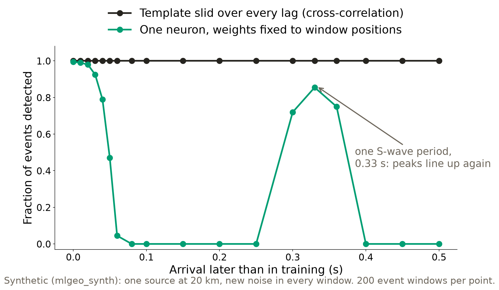
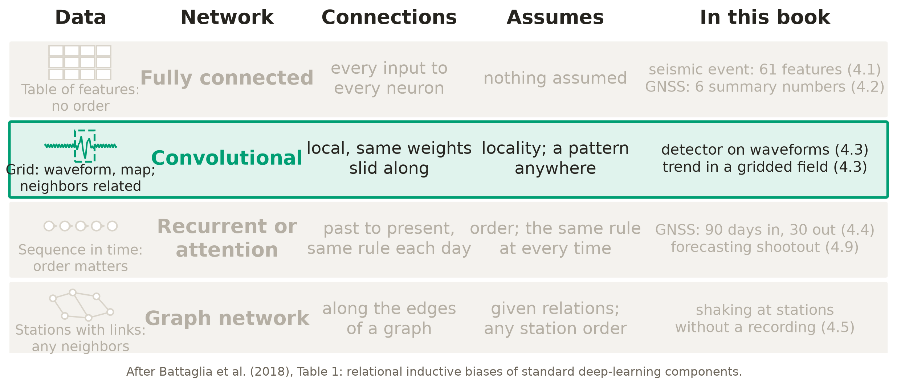
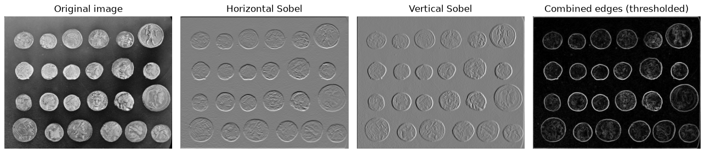
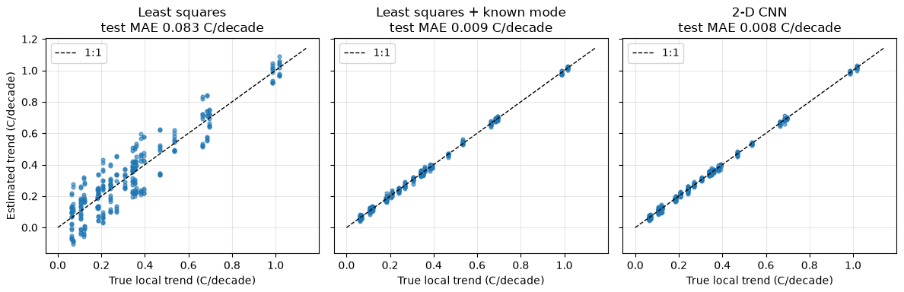
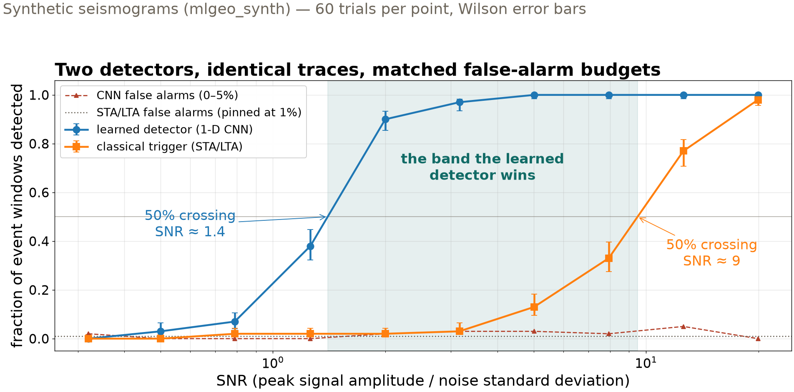
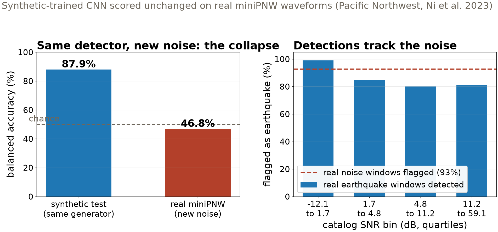

## {background-color="#faf7f2"}

[📡]{.lecture-icon}

### Today's question

Observatories have run one detector for fifty years.

**When does a learned detector beat the classical one — and how would you know?**

::: {.dim}
Reading: [4.3 Convolutional neural networks](https://geo-smart.github.io/mlgeo-book/mlgeo-4-3-cnn)
:::

::: {.notes}
Frame the session: Wednesday's MLP could not see a pattern that moves. Today's fix — convolution — is also the day the course puts a deep model head-to-head against a classical method, twice, with the deck ending on a number that fails. Both reality checks are the lesson, not embarrassments. Ask the room: who has run an STA/LTA trigger (they all did, in 2.10)? Today it defends its title. HW-CML is due today.
:::

## This lecture in the literature



::: {.takeaway}
From digits (1998) to earthquake catalogs (2018) — and the shortcut failure mode we will measure ourselves today.
:::

::: {.notes}
Two minutes. LeCun: LeNet-5, the architecture we warm up on, read checks for banks in the 1990s — convolution is not new, compute and data are. Perol/Gharbi/Denolle: ConvNetQuake, an early 1-D CNN on continuous seismograms in Oklahoma, found events the catalog missed — the research-scale version of today's toy detector; modern pickers (PhaseNet, EQTransformer) scaled the idea to global catalogs. Geirhos: names "shortcut learning" — networks that pass the test by keying on an unintended cue; hold that word for the last figure, where our detector turns out to key on the noise model, not the earthquakes. Bergen: the survey that maps where learned methods actually displaced classical pipelines in solid Earth geoscience — useful for placing today's crossover plot in context.
:::

## Wednesday's neuron loses an arrival that moves by 0.1 s

{.r-stretch}

::: {.takeaway}
The neuron of lecture 21 detects 99.5% of events at the trained arrival time, 47% when the arrival is 0.05 s later, and none from 0.08 s to 0.25 s. The template slid over every lag detects all of them.
:::

::: {.notes}
Three minutes; the problem this lecture solves. Recall the neuron of lecture 21 (notebook 4.0 section 5) on waveform windows, fitted on events whose P wave always arrived 0.83 s into the window. Now the arrival comes later, by the amount on the horizontal axis; 200 event windows per point, synthetic (mlgeo_synth). Green: the fraction the neuron still calls events. It halves at 0.05 s and is zero from 0.08 s. Each weight multiplies one position in the window; move the waveform by a third of a period and its peaks meet weights of the opposite sign. Ask the room why detection returns near 0.33 s: that is one period of the 3 Hz S wave, so the largest peaks line up with the right weights again, one cycle late. Black: template matching as it is done in practice, the same weighted sum computed at every lag (here within ±0.6 s), keeping the largest; threshold set on noise windows, false alarms 1% to 5%. It does not depend on where the event is.

A fully connected network has the same limit as the single neuron: every weight is tied to one input position. On the 61 features this is harmless, because features have no order. On a waveform, an image or a map, the network would have to see every pattern at every position during training. Today's convolutional layer takes the idea in black: one small set of weights, slid along the record. Next slide. Ask: which of your project data have patterns that can occur anywhere? (Tremor in a spectrogram, storm cells in radar, transits in a light curve.)
:::

## Where the convolutional network fits: data on a grid

{.r-stretch}

::: {.takeaway}
A waveform, a spectrogram or a map is a grid: neighbors are related, and the same pattern can appear anywhere. A convolutional layer assumes both, and pays for each pattern once.
:::

::: {.notes}
Two minutes; the framework figure of the four core sessions, second row (after Battaglia et al. 2018, Table 1). Last session the input was a table of 61 hand-built features, with no order: fully connected. Today the same seismic events come as waveforms, a grid in time. Two assumptions fit that data: locality (a sample is related to its neighbors, so each neuron looks at a short window) and translation (a P wave is the same P wave at second 9 or at second 14, so the same weights are slid along the record). The previous slide showed what happens without them: a fully connected neuron loses an arrival moved by 0.1 s. The convolutional layer is the template matching of lecture 21, with the templates learned.
:::

## Convolution: one pattern detector, slid everywhere

{.r-stretch}

::: {.takeaway}
A 3×3 kernel finds edges wherever they occur. A CNN learns its kernels from data — early layers rediscover edge detectors on their own. (Sample photograph, scikit-image.)
:::

::: {.notes}
Define convolution physically: a small set of weights (the kernel) slides across the input, computing the same weighted sum at every position. Hand-designed kernels the room may know: the mean filter blurs, Sobel filters approximate the gradient and light up edges — that is what this figure shows. The CNN's move: stop designing kernels, learn them by gradient descent, and stack layers so later kernels combine earlier features into larger-scale patterns. The key vocabulary, stated carefully (the book's corrected sentence): a convolution layer is translation *equivariant* — shift the input and the feature map shifts with it, so a pattern learned anywhere is detected everywhere. Approximate translation *invariance* — the same final answer wherever the pattern sits — comes from the pooling layers that discard position as they downsample. Equivariance in the features, invariance from pooling: that division of labor is the whole architecture.
:::

## 2-D case: reading a warming trend from a gridded field

{.r-stretch}

::: {.takeaway}
The CNN beats naive least squares 10× (0.008 vs 0.083 °C/decade MAE) — but give the classical fit the one confounding mode it was missing and it matches the CNN at 0.009. A 10× win over an underspecified baseline. Synthetic (mlgeo_synth).
:::

::: {.notes}
The task: regress each 8×8-pixel patch's local warming trend (°C per decade) from 30 annual-mean anomaly maps stacked as channels — channels-as-time, the standard trick for time-evolving fields. Split is grouped by field (18 train, 6 test), the 3.8 doctrine applied: patches from one field never straddle the boundary. Walk the three panels left to right: naive straight-line fit, MAE 0.083 — scattered; same fit plus one extra regressor (the generator's known 5-year interannual mode, which aliases into a straight-line slope over 30 years), MAE 0.009; the 17,953-parameter CNN, 0.008 — indistinguishable from the informed classical fit. The honest reading, say it verbatim: what the network extracted from 18 training fields is the confounding mode — deep models earn their keep when the confounders are unknown or unwritable; when you can write the physics down, the classical fit with the right regressors matches the CNN at a fraction of the cost. This is the lecture's thesis, and the 1-D detector gets the same treatment next.
:::

## 1-D case: an earthquake detector in 4,658 weights

{.r-stretch}

::: {.takeaway}
Event windows at low SNR are invisible by eye — exactly the regime where a detector must be measured, and where real catalogs cannot measure it. Synthetic (mlgeo_synth).
:::

::: {.notes}
The data: 1,600 30-second windows at 100 Hz from the course generator — a P arrival then a stronger S on colored noise, or noise alone — each with exact metadata: arrival times and SNR (peak signal amplitude over noise standard deviation). Point at the top trace: SNR near 0.6, nothing visible; that is where we want to know detector behavior, and real data can never tell us, because catalogs only contain the events someone already found — a bias against exactly the low-SNR regime. The model: three Conv1d–ReLU–MaxPool blocks, global average pooling, a 2-class head — 4,658 parameters against LeNet's 61,706. Per-trace standardization first, so the network cannot classify on amplitude alone. Synthetic test accuracy: 87.9%, imperfect because the set deliberately includes near-undetectable events. The interesting question is not the average — it is *where* it fails. Next slide.
:::

## Reality check 1: same traces, classical opponent

{.r-stretch}

::: {.takeaway}
At matched ~1% false alarms: CNN crosses 50% at SNR ≈ 1.5, the trigger at ≈ 4.8. At SNR 2 the CNN catches 92% of events; STA/LTA catches 7%. Half a decade of SNR is the entire territory the learned detector wins.
:::

::: {.notes}
The design makes the comparison fair, and each choice is worth naming: identical traces for both detectors; the trigger's threshold set from noise alone (99th percentile of 600 noise-only windows → 1% false alarms by construction, no peeking at events); CNN false alarms measured at 0–5%, comparable, so the detection curves can be read directly; 60 trials per point with binomial error bars. Three regimes: below SNR ~0.8 both detectors sit at their false-alarm floor — no algorithm rescues a signal buried in noise of the same color; above ~8 both detect everything, and there the classical trigger is the right engineering choice — free to train, impossible to drift. The shaded band is the CNN's whole case. Whether that band matters is a scientific question, not an architectural one — in seismology it is where most small earthquakes live, which is why learned detectors displaced energy triggers in catalog building (Perol et al.; the pickers that followed). Also in the notebook: template matching, the classical method that beats both at low SNR when the source repeats — narrower question, different tool.
:::

## Reality check 2: real waveforms, no retraining

{.r-stretch}

::: {.takeaway}
87.9% on synthetic test → 46.8% on real miniPNW: chance. The network flags 93% of real *noise* windows — it responds to Pacific Northwest microseism noise, not to earthquakes. The gap is the measurement. Real data: miniPNW (Ni et al. 2023).
:::

::: {.notes}
The uncomfortable question the book insists on asking: every number so far came from the same generator that produced the training data — so score the unchanged detector on real labeled miniPNW waveforms (a few hundred earthquake windows, P pick 7 s in, plus matched pre-event noise windows; preprocessing mirrors training exactly, no threshold moved, no bandpass chosen to fix things afterward). Left panel: balanced accuracy collapses 41 points to chance. Right panel is the diagnosis: detection is *highest* (99%) in the lowest-SNR quartile — where the window is mostly noise — and the whole curve is indistinguishable from the 93% false-alarm line. The network is not responding to earthquakes at all: it learned "synthetic event vs the one synthetic noise model," and real nonstationary, microseism-dominated noise resembles neither, so nearly everything triggers. Name the concept: **distribution shift** — train and deployment data drawn from different distributions — and this is Geirhos's shortcut learning measured by us. The sentence to leave in the room: a model validated only on synthetic data has not been validated. Closing the gap takes real data on the training side (fine-tune on miniPNW, or physics-informed noise from 2.10) — that path is the notebook's, and 4.6 continues it.
:::

## Two baselines, two verdicts

| Case | Naive classical | Informed classical | CNN | Verdict |
|---|---|---|---|---|
| Warming trend (2-D) | 0.083 °C/dec | **0.009** °C/dec | 0.008 °C/dec | write the physics down and they tie |
| Detection floor (1-D) | 50% at SNR ≈ 4.8 | — | 50% at **SNR ≈ 1.5** | CNN wins the low-SNR band |
| Real miniPNW | — | — | **46.8%** (chance) | synthetic-only validation is not validation |

::: {.takeaway}
The learned detector earns its keep only where the classical method cannot reach — and only on data from the world it was trained in.
:::

::: {.notes}
Leave this up for questions; it is the lecture in one screen. Row 1: the CNN's 10× headline dissolves when the classical baseline gets the one regressor it was missing — always ask what the baseline was denied. Row 2: with matched false-alarm budgets on identical traces, the CNN genuinely extends detection half a decade of SNR deeper — the honest win, and the reason this architecture took over catalog building. Row 3: the same detector, on real ground motion, is a coin flip — distribution shift eats the entire margin. The three rows are one discipline applied three times: baseline first, matched conditions, report the failure as measured. Connect forward: Monday's forecasting shootout carries a persistence baseline row for exactly the same reason.
:::

## Best practices: the convolutional network

| Step | Practice | Rubric |
|---|---|---|
| Design | kernel and receptive field match the phase period | C2.1 |
| Design | normalize each record; no amplitude shortcut | C2.2 |
| Design | pooling where position does not matter | C2.3 |
| Baseline | STA/LTA or the informed regression, same records | C2.4 |
| Evaluate | detection against SNR, matched false alarms | E4 |
| Evaluate | real records before any claim | E5 |

::: {.notes}
Leave this up. Each row is a line of the rubric in book section 4.8, and each comes from today's numbers. C2.1: the three convolution blocks see a window long enough to hold a P wave and its coda; check the receptive field in seconds against the period of the phase. C2.2: per-trace standardization, so the network cannot classify on amplitude. C2.3: global average pooling makes the detector independent of the arrival time; a picker, which must report the time, would keep position. C2.4: the trend case tied the informed regression (0.008 against 0.009 °C per decade); the detector beat STA/LTA at matched 1% false alarms (50% detection at SNR 1.5 against 4.8). E4: report detection as a function of SNR, not one accuracy. E5: 87.9% on synthetic test windows fell to 46.8% on real miniPNW waveforms; validation on synthetics alone is not validation. The rubric grows by these six items today.
:::

## Start your team's agent now: it works while you train

One laptop per team runs the agent; the rest of the team goes to the stations. First: `git pull` in your `mlgeo-book` folder, and open that folder in VS Code.

::: {.columns .steps}
::: {.column width="34%"}
### GitHub Copilot

1. Open Chat: ⌃⌘I (Mac) or Ctrl+Alt+I
2. Mode menu under the chat box: **Agent**
3. Paste the prompt
4. Allow the commands it asks to run
:::
::: {.column width="30%"}
### Claude Code

1. In the VS Code terminal: `claude`
2. Paste the prompt
3. Allow the commands it asks to run
:::
::: {.column width="36%"}
### UW Purple only

1. purple.uw.edu, NetID
2. Attach `seismic.py` from `book/mlgeo_synth/` (as `.txt` if refused)
3. Run B: also attach the rubric file named in the prompt
4. Paste the prompt and the Purple line
:::
:::

::: {.takeaway}
Odd-numbered teams run **A**, even-numbered teams run **B**. The two prompts differ by one paragraph.
:::

::: {.notes}
Two minutes, then move on. In the dry run on Nov 20 (Claude Code, model claude-opus-5, both runs at once on one laptop), run A took 26 minutes and run B 30 minutes, each with 5 to 6 minutes of training; weaker models or slower laptops may take longer. Nobody should watch it: it runs while the team does the stations, and we read its report at the end of class. Write the team numbers on the board and the A/B assignment next to them. One person per team owns the agent laptop: they approve the commands it asks to run (a training script; nothing to install, everything is in pixi) and refuse any git command or any write outside the run folder. Copilot: the agent mode is what lets it run code; in Ask mode it only writes text. Claude Code: the panel in VS Code works too. Purple reads but cannot run code (as in HW1 step 8c), so a Purple run produces a script and the report it expects, with no measured numbers; that is a third condition worth comparing, not a failure. Note the tool and model each team used; we tally them at minute 68. Students who have none of the three pair with a team that does.
:::

## The prompt: copy it exactly

Replace `<team>` with your team number and `<A or B>` with your run.

::: {.prompt}
```{.text code-line-numbers="false"}
Build a 1-D convolutional network that detects earthquakes in 30 s vertical-component seismograms sampled at 100 Hz. Train it on synthetic records from mlgeo_synth.seismogram_dataset (source: book/mlgeo_synth/seismic.py). The detector will run on real stations, where the background noise differs from the generator's (the ocean microseism makes it redder, for example). Write one script, run it, and write report.md with your results and your verdict: is this detector ready to run on a real station?

Rules: run all code with `pixi run python`, on the CPU, with less than 10 minutes of training in total. Do not download anything. Write files only in book/Chapter4-DeepLearning/s22_agent_runs/team<team>_<A or B>/. Do not edit, commit, push or stash any other file.
```

**Run B only**, add:

```{.text code-line-numbers="false"}
Follow every item of book/Chapter4-DeepLearning/mlgeo_4.8_dl_rubric.md. End report.md with a table of item ID, pass or fail, and evidence; then list the items you could not check, and why.
```
:::

::: {.dim}
**Purple only**, add: *You cannot run code. Write the script and the report you expect it to produce, and mark every number as not computed.*
:::

::: {.notes}
The two runs are an experiment with one variable: same task, same data, same rules, and only run B gets the rubric. Do not open the rubric file yourselves; we read it together after the stations. The deployment sentence (real stations, redder noise) is in both prompts on purpose: it is the information a careful modeler would act on, and we will see which runs test on noise unlike the training noise without being told how. The rules paragraph is the same contract as the session 7 lab: pixi only, no downloads (thirty laptops pulling the 670 MB miniPNW file on the room's network would stall everyone), writes confined to one ignored folder. If an agent asks a question, answer only "use your judgment and say what you chose in report.md", so all runs get the same information.
:::

## When it stops: save, do not judge yet

1. Save the conversation as `transcript.md` in your run folder
    - Claude Code: `/export`
    - Copilot Chat: right-click in the chat, **Copy All**, paste
    - Purple: copy the conversation, or print the page to PDF
2. `git status`: no book file should be listed. If one is, `git checkout -- <file>` and note it
3. On the board: team, A or B, tool and model, minutes to finish, finished or not

::: {.takeaway}
Do not read report.md yet. At minute 68 we score every run against the rubric the class writes today.
:::

::: {.notes}
The transcript is evidence for the audit: we check that every command the report says it ran appears in the transcript, as in HW1 step 8 and the session 7 lab. Ask teams not to read the report early, so the class writes its own rubric items from the station measurements without anchoring on what the agent did. An agent still running at minute 65 gets stopped; "did not finish in 45 minutes" is a result and goes on the board.
:::

## Now measure it yourself — open 4.3

1. `pixi run jupyter lab` → `mlgeo_4.3_CNN.ipynb`: run the convolution and LeNet warm-up quickly
2. Run the detection-floor sweep; estimate both 50% crossings from the printed table
3. Retrain with only 2 epochs, rerun the sweep: whose floor moves — the CNN's or STA/LTA's, and why?
4. Run the miniPNW reality check; report the balanced-accuracy gap as measured

::: {.dim}
PyTorch names live here: `nn.Conv1d`/`nn.Conv2d`, `nn.MaxPool1d`, `nn.AdaptiveAvgPool1d`, `torchinfo.summary` · HW-CML due today · Mon: sequence models (4.4), HW-DL assigned
:::

::: {.notes}
Timing for the 80-minute block (10:00–11:20): pulse talks ~10 min, this deck ~20 min, guided notebook work ~40 min, synthesis ~10 min. If time is short, cut task 1 to a skim — tasks 2–4 are the payload. Task 3 is the conceptual trap worth circulating for: the CNN's floor rises when undertrained, STA/LTA's does not move because it has no parameters to undertrain — that is what makes it a stable baseline. Section 7 of the notebook (recoding the Rouet-Leduc tremor CNN from its published architecture table, verified by shape checks with `torchinfo.summary`) is the take-home skill for reading papers — flag it for project teams reproducing published models. Synthesis question to collect: for your project, what is your STA/LTA — the zero-parameter method your model must beat on identical data? That question is graded in check-in #2.
:::
