## {background-color="#faf7f2"}

[📡]{.lecture-icon}

### Today's question

Observatories have run one detector for fifty years.

**What is inside a convolutional network, and when does it beat the classical detector?**

::: {.dim}
Reading: [4.3 Convolutional neural networks](https://geo-smart.github.io/mlgeo-book/mlgeo-4-3-cnn)
:::

::: {.notes}
Frame the session: Wednesday's MLP could not see a pattern that moves. Today's fix — convolution — is also the day the course puts a deep model head-to-head against a classical method, twice, with the deck ending on a number that fails. Both reality checks are the lesson, not embarrassments. Ask the room: who has run an STA/LTA trigger (they all did, in 2.10)? Today it defends its title. HW-CML is due today.
:::

## Four canonical networks: today, convolutional

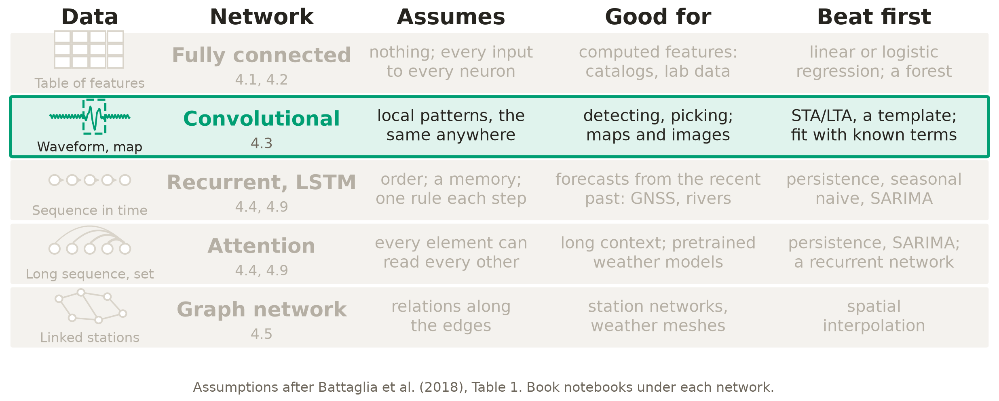{.r-stretch}

::: {.takeaway}
A waveform, a spectrogram or a map is a grid: neighbors are related, and the same pattern can appear anywhere. A convolutional layer assumes both, and pays for each pattern once.
:::

::: {.notes}
Two minutes; the figure that opens and closes every deck of Chapter 4, second row: data, network, what it assumes, what it is good for, the baseline to beat first (assumptions after Battaglia et al. 2018, Table 1). Last session the input was a table of 61 hand-built features, with no order: fully connected. Today the same seismic events come as waveforms, a grid in time. Two assumptions fit that data: locality (a sample is related to its neighbors, so each neuron looks at a short window) and translation (a P wave is the same P wave at second 9 or at second 14, so the same weights are slid along the record). The slide after the literature shows what happens without them: a fully connected neuron loses an arrival moved by 0.1 s. The convolutional layer is the template matching of lecture 21, with the templates learned.
:::

## This lecture in the literature

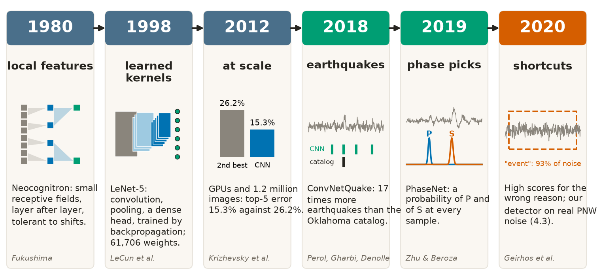{.r-stretch}

::: {.takeaway}
From local features to earthquake catalogs, and the shortcut we measure today.
:::

::: {.credit}
Fukushima (1980) *Biol. Cybern.* 36, 193–202 · LeCun et al. (1998) *Proc. IEEE* 86, 2278–2324 · Krizhevsky, Sutskever & Hinton (2012) *NeurIPS* 25 · Perol, Gharbi & Denolle (2018) *Sci. Adv.* 4, e1700578 · Zhu & Beroza (2019) *Geophys. J. Int.* 216, 261–273 · Geirhos et al. (2020) *Nat. Mach. Intell.* 2, 665–673. Icons drawn; LeNet-5's 61,706 weights as printed by notebook 4.3.
:::

::: {.notes}
Two minutes. Read the thread left to right; each card is one idea we use today. Fukushima's neocognitron: small receptive fields stacked in layers, tolerant to shifts, but with hand-set learning rules. LeCun: the same structure trained by backpropagation; LeNet-5, our warm-up in notebook 4.3. Krizhevsky et al. (AlexNet): the same idea with GPUs and 1.2 million labeled images, top-5 error 15.3% against 26.2% for the next entry of the 2012 ImageNet challenge; the start of the deep-learning decade. Then seismology. LeCun: LeNet-5, the architecture we warm up on, read checks for banks in the 1990s — convolution is not new, compute and data are. Perol/Gharbi/Denolle: ConvNetQuake, an early 1-D CNN on continuous seismograms in Oklahoma, found events the catalog missed — the research-scale version of today's toy detector; modern pickers (PhaseNet, EQTransformer) scaled the idea to global catalogs. Geirhos: names "shortcut learning" — networks that pass the test by keying on an unintended cue; hold that word for the last figure, where our detector turns out to key on the noise model, not the earthquakes. Bergen: the survey that maps where learned methods actually displaced classical pipelines in solid Earth geoscience — useful for placing today's crossover plot in context. Zhu & Beroza (PhaseNet) changed the output, not the block: a probability of P and of S at every sample, which is the per-step head of the cartoon slides (Bergen, Johnson, de Hoop & Beroza 2019, *Science* 363, eaau0323, is the review to point students to).
:::

## Wednesday's neuron loses an arrival that moves by 0.1 s

{.r-stretch}

::: {.takeaway}
The neuron of lecture 21 detects 99.5% of events at the trained arrival time, 47% when the arrival is 0.05 s later, and none from 0.08 s to 0.25 s. The template slid over every lag detects all of them.
:::

::: {.notes}
Three minutes; the problem this lecture solves. Recall the neuron of lecture 21 (notebook 4.0 section 5) on waveform windows, fitted on events whose P wave always arrived 0.83 s into the window. Now the arrival comes later, by the amount on the horizontal axis; 200 event windows per point, synthetic (mlgeo_synth). Green: the fraction the neuron still calls events. It halves at 0.05 s and is zero from 0.08 s. Each weight multiplies one position in the window; move the waveform by a third of a period and its peaks meet weights of the opposite sign. Ask the room why detection returns near 0.33 s: that is one period of the 3 Hz S wave, so the largest peaks line up with the right weights again, one cycle late. Black: template matching as it is done in practice, the same weighted sum computed at every lag (here within ±0.6 s), keeping the largest; threshold set on noise windows, false alarms 1% to 5%. It does not depend on where the event is.

A fully connected network has the same limit as the single neuron: every weight is tied to one input position. On the 61 features this is harmless, because features have no order. On a waveform, an image or a map, the network would have to see every pattern at every position during training. Today's convolutional layer takes the idea in black: one small set of weights, slid along the record. Next slide. Ask: which of your project data have patterns that can occur anywhere? (Tremor in a spectrogram, storm cells in radar, transits in a light curve.)
:::

## Inside a CNN: a block finds, a head decides

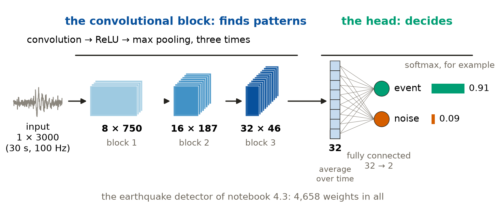{.r-stretch}

::: {.takeaway}
Three blocks of convolution, ReLU and pooling turn 3,000 samples into 32 numbers; a fully connected head turns them into one probability per class.
:::

::: {.notes}
Two minutes; the map of the next twelve slides. Read it left to right with the shapes: 1 channel of 3,000 samples (30 s at 100 Hz); after block 1, 8 feature maps of 750 samples; after block 2, 16 of 187; after block 3, 32 of 46. Channels go up as the length goes down: a funnel. The head averages each of the 32 maps over time, then a fully connected layer (the network of 4.1) gives two scores, and the softmax turns them into probabilities. Every slide that follows zooms into one box of this picture. The detector of notebook 4.3: 4,658 weights in all (computed in figscripts/lec22_cnn_cartoons.py).
:::

## Conv1D by hand: multiply, add, slide

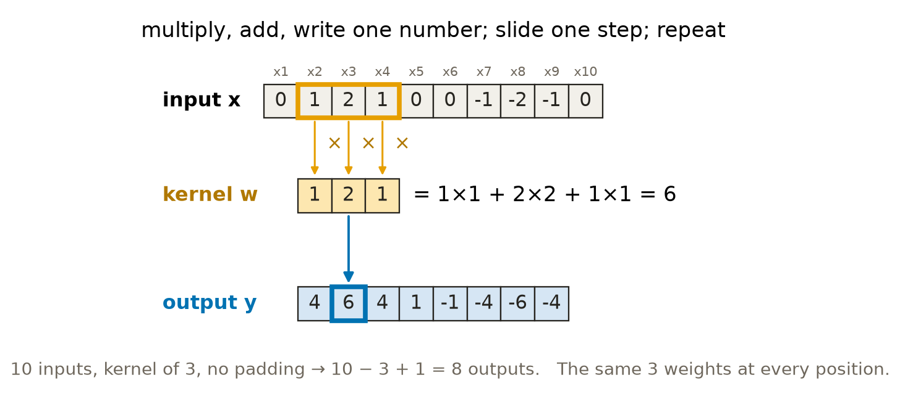{.r-stretch}

::: {.takeaway}
One output = the sum of kernel × the samples under it. Slide one step and repeat: 10 inputs and a kernel of 3 give 8 outputs, with the same 3 weights everywhere.
:::

::: {.notes}
Three minutes; do the arithmetic aloud. Input x = 0, 1, 2, 1, 0, 0, −1, −2, −1, 0; kernel w = 1, 2, 1. At the highlighted position: 1×1 + 2×2 + 1×1 = 6. Ask the room for the next output (2×1 + 1×2 + 0×1 = 4) and the one on the negative bump (−6). The output is large and positive where the input looks like the kernel (a positive bump), large and negative where it looks like its opposite. Without padding the output is shorter by kernel − 1; padding with zeros at both ends keeps the length. Add a bias b to every output in a real layer. Vocabulary: libraries do not flip the kernel (a cross-correlation) and still call it convolution; with learned weights it makes no difference.
:::

## Convolution: multiply, add, slide

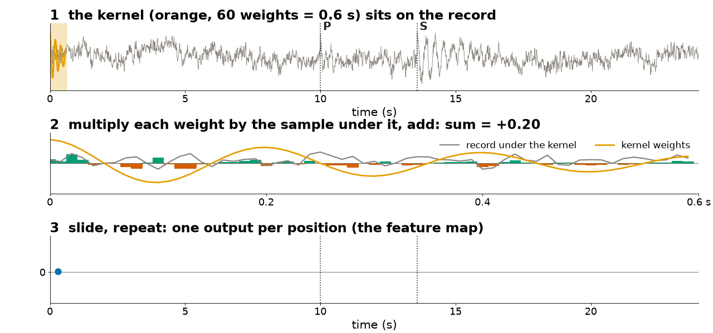{.r-stretch}

::: {.takeaway}
At every position: multiply each weight by the sample under it, add, write one number. The output is largest (6.7) where the record looks like the kernel, at the P wave; before P it scatters with a spread of 1.0.
:::

::: {.notes}
Three minutes; let the animation loop twice before speaking. Synthetic record from the course generator (mlgeo_synth): one event at 30 km, P at 10.0 s, S at 13.6 s, SNR 4, standardized. The kernel is the generator's own P wavelet (5 Hz, 0.6 s, 60 weights), so this is template matching, the black curve of the previous slide, written as a layer. Panel 2 is the whole computation: green bars where weight and sample have the same sign, red where they disagree; the sum is one output sample. Panel 3 collects one output per position: the feature map. Its largest value, 6.66, is at 10.3 s, against a standard deviation of 1.03 before the P arrival (figs/lec22_convolution/numbers.json). It responds less to the S wave, which has a lower dominant frequency (3 Hz) than the kernel. Ask the room: what would the output look like with a 3 Hz kernel? Vocabulary: PyTorch's Conv1d computes exactly this, without flipping the kernel (a cross-correlation; the mathematical convolution flips it). In a network the 60 weights are not chosen: they start as seeded random numbers and are updated by gradient descent, like the weights of lecture 21. The 4.3 detector uses kernels of 7 weights (0.07 s); 60 here so that the pattern is visible.
:::

## Kernel size against the length of the pattern

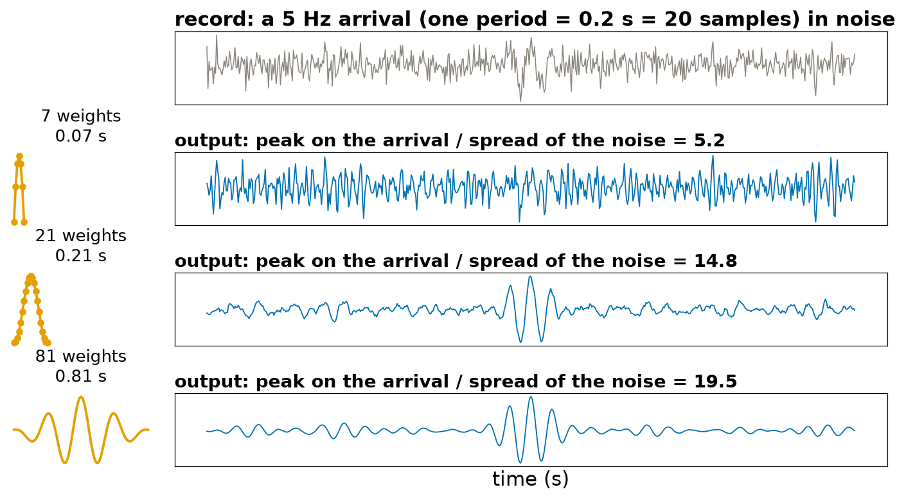{.r-stretch}

::: {.takeaway}
Shorter than one period (7 weights), a kernel responds to any wiggle; one period or more (21, 81), it matches the arrival: peak over noise 5.2, 14.8, 19.5.
:::

::: {.notes}
Two minutes; rubric item C2.1. Synthetic record: a 5 Hz arrival (period 0.2 s, 20 samples at 100 Hz) in white noise. Three kernels, each cut from the same wave packet and normalized, of 7, 21 and 81 weights. The number in each title is the peak of the output on the arrival divided by the standard deviation of the output away from it (computed in the figscript). 7 weights cover a third of a period: the kernel can only measure a local slope or curvature, so noise excites it as much as the arrival. 21 weights cover one period: the kernel is now a template of the oscillation. 81 weights cover the whole packet: the most selective, but four times the weights, and it only fits arrivals of that length. Networks usually use short kernels (3 to 7) and get the long span by stacking layers with pooling: slide on the receptive field.
:::

## One layer, several kernels: each sees something else

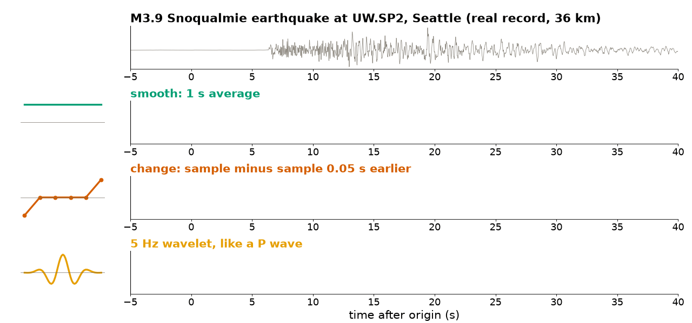{.r-stretch}

::: {.takeaway}
Three kernels, one real record: an average keeps the slow motion, a difference keeps the sharp changes, a 5 Hz wavelet keeps the P-wave band. The first layer of the 4.3 detector has 8 kernels, learned, not chosen.
:::

::: {.notes}
Two minutes. Real data: the M3.9 earthquake 9 km NNE of Snoqualmie, WA, 2023-08-08 10:17:23.87 UTC, depth 15.9 km (USGS ComCat uw61939452), recorded 36 km away at UW.SP2, Seward Park in Seattle (HHZ, 100 Hz; EarthScope FDSN web service). Raw counts, mean removed, scaled to its peak (37,024 counts); P arrives about 6.5 s after the origin time, S about 11 s. Each output is scaled to its own maximum. Read the three kernels as filters the room knows from 2.8 and 2.9: the 1 s average is a low-pass filter; the difference of two samples 0.05 s apart is a high-pass filter that marks sudden changes; the 5 Hz wavelet is a band-pass filter at the P-wave frequency. A convolutional layer is a bank of such filters run in parallel; each output is one channel of the next layer. What is new in a network is only that the filters are learned for the task. Ask: which of the three would you keep to detect this earthquake against microseism noise near 0.2 Hz? Script: figscripts/lec22_convolution_gifs.py.
:::

## Conv2D by hand: a 3 × 3 window

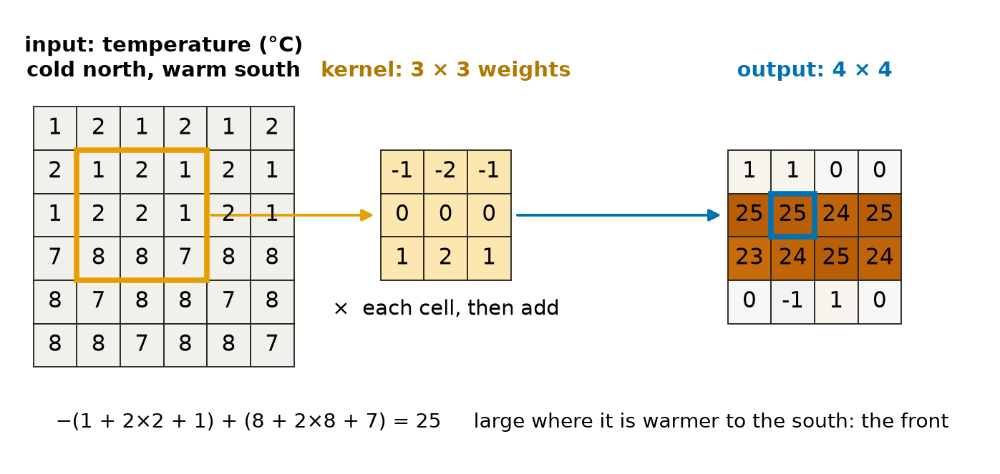{.r-stretch}

::: {.takeaway}
Nine values × nine weights, added: one output. South row +, north row −: the output is 23 to 25 on the front, −1 to 1 elsewhere.
:::

::: {.notes}
Two minutes. Input: a toy temperature map, cold north (1 to 2 °C), warm south (7 to 8 °C). Kernel: −1 −2 −1 / 0 0 0 / 1 2 1, a Sobel filter for the north-south change. At the highlighted window: −(1 + 2×2 + 1) + (8 + 2×8 + 7) = 25. The rows of the output where the window straddles the front are 23 to 25; elsewhere −1 to 1. A 6 × 6 input and a 3 × 3 kernel without padding give a 4 × 4 output. In 2-D a layer slides along both directions; everything else (bias, padding, stride, channels) is as in 1-D.
:::

## In 2-D: the same sum over a 3×3 window

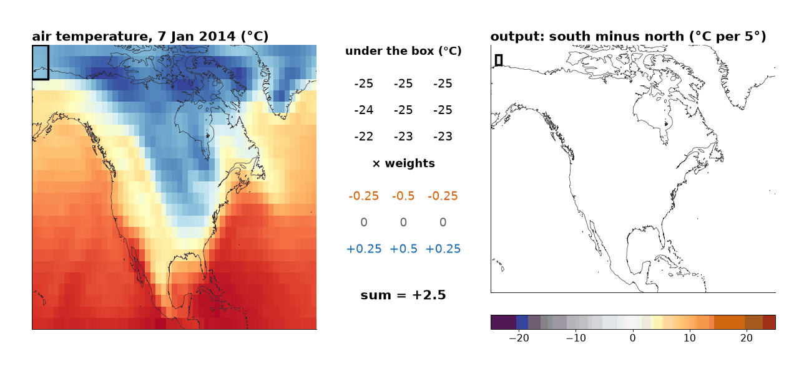{.r-stretch}

::: {.takeaway}
North row −¼ −½ −¼, south row +¼ +½ +¼: the output is how much warmer it is 5° to the south. It traces the edge of the Arctic air mass of 7 January 2014 across North America.
:::

::: {.notes}
Two minutes. NCEP/NCAR Reanalysis 1 air temperature at sigma 0.995 (Kalnay et al., 1996) on its 2.5° grid, 2014-01-07 00 UTC, during the Arctic outbreak of early January 2014 (same file and checksum as notebook 2.5: pydata/xarray-data air_temperature.nc at commit 2baf0c2). The middle column is the whole computation for the box: nine temperatures, nine weights, one sum, in °C per 5° of latitude. This kernel is a Sobel filter (from image processing) for the north-south gradient, the same kind of edge detector the first layers of image networks learn on their own. Strong positive values (orange) mark where it is much colder to the north: along the edge of the cold air from Alberta to the Gulf of Mexico, and along the coasts and the edge of the Greenland ice sheet, where the largest value, 31 °C per 5°, sits at 62.5° N, 45° W (numbers.json, gif4; the sigma 0.995 level follows the terrain, so the ice sheet is cold air at high elevation). The one-row and one-column border is lost: a 3×3 kernel has no full window there (padding fills it in a network). Next slide: a network with such kernels, trained on 30 maps, reads a warming trend.
:::

## Channel or kernel?

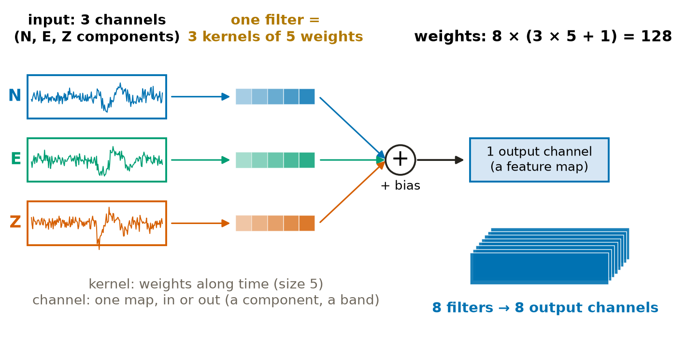{.r-stretch}

::: {.takeaway}
A filter has one kernel per input channel; their outputs add into one output channel. 8 filters on N, E, Z, kernels of 5: 8 × (3 × 5 + 1) = 128 weights.
:::

::: {.notes}
Three minutes; the most common confusion of the session. Channel: one map of the data, in or out: the three components of a seismometer, the three color bands of an image, the bands of a satellite scene, and inside the network the feature maps of the previous layer. Kernel: the weights a filter slides along time (or space). A filter spans all input channels: here 3 kernels of 5 weights, one per component; each convolves its own channel and the three results are added with one bias, giving one output channel. A layer of 8 filters gives 8 output channels. In PyTorch: nn.Conv1d(in_channels=3, out_channels=8, kernel_size=5), weights of shape (8, 3, 5) plus 8 biases.
:::

## How many weights to fit?

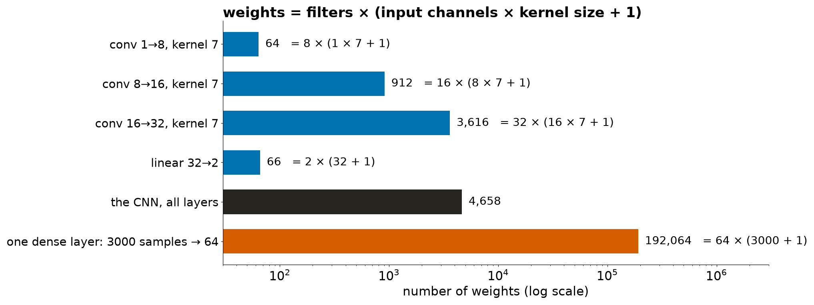{.r-stretch}

::: {.takeaway}
The whole 4.3 detector has 4,658 weights. One dense layer from the 3,000 samples to 64 neurons would need 192,064: sharing the kernel along time is what keeps a CNN small.
:::

::: {.notes}
Two minutes. Each bar is computed from the layer: conv 1→8, kernel 7: 8 × (1 × 7 + 1) = 64; conv 8→16: 16 × (8 × 7 + 1) = 912; conv 16→32: 32 × (16 × 7 + 1) = 3,616; the head, linear 32→2: 2 × (32 + 1) = 66; total 4,658. Note that the length of the record (3,000) appears nowhere in the formula: the same weights are used at every position. A fully connected layer gives each sample its own weight: 64 × (3,000 + 1) = 192,064 for 64 neurons, 40 times the whole CNN. In 2-D the kernel size is height × width: nn.Conv2d(3, 64, kernel_size=6) of notebook 4.3 has 64 × (3 × 6 × 6 + 1) = 6,976. Ask: which layer would you widen if the training loss stayed high, and what would it cost?
:::

## Activation: ReLU keeps the matches

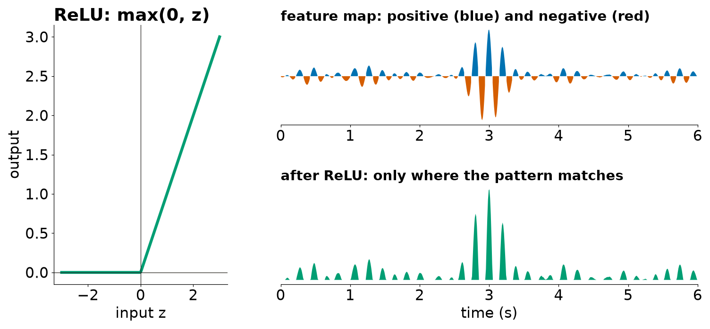{.r-stretch}

::: {.takeaway}
After each convolution, ReLU sets negative values to zero. Without it, three stacked convolutions are still one linear filter.
:::

::: {.notes}
One minute. Left: ReLU(z) = max(0, z). Right: the feature map of the 5 Hz kernel on the synthetic record of the kernel-size slide, before ReLU (blue positive, red negative) and after (green). Two reasons for the activation: it makes the network nonlinear (a stack of linear filters is a single linear filter, however deep), and it keeps only the places where the record matches the kernel's pattern. Notebook 4.3, section 2.2, plots ReLU, leaky ReLU, sigmoid, tanh and GELU side by side; ReLU is the default in CNNs because its slope is 1 for every positive input, so gradients do not shrink through many layers.
:::

## Pooling: shorter maps, no weights

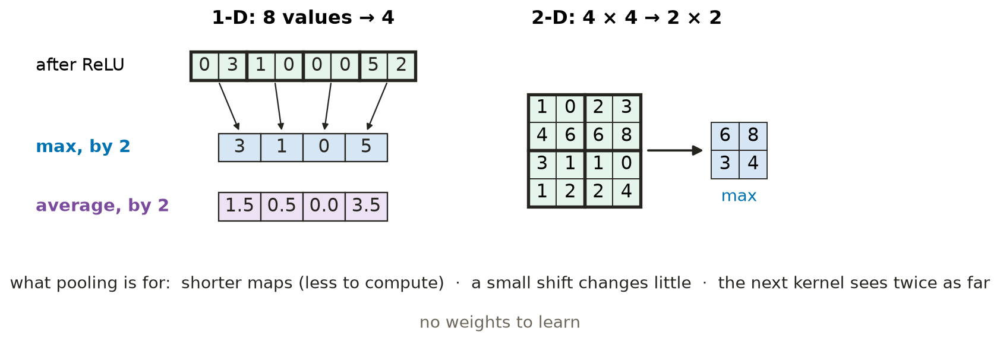{.r-stretch}

::: {.takeaway}
Max pooling keeps the largest value of each group, average pooling the mean. Each pooling by 2 halves the map, so the next kernel sees twice as far.
:::

::: {.notes}
Two minutes. 1-D: eight values after ReLU, groups of two: max gives 3, 1, 0, 5; average gives 1.5, 0.5, 0.0, 3.5. 2-D: a 4 × 4 map in 2 × 2 groups gives 6, 8 / 3, 4. What pooling is for: (1) fewer values for the next layer (less computation and memory); (2) a pattern that moves by less than the pooling size gives almost the same output; (3) the next convolution, with the same kernel size, spans twice as much of the input. Pooling has no weights. The 4.3 detector pools by 4 three times: 3,000 samples become 46. Max pooling is the usual choice for detection (was the pattern present anywhere in the group?).
:::

## The same weights at every position

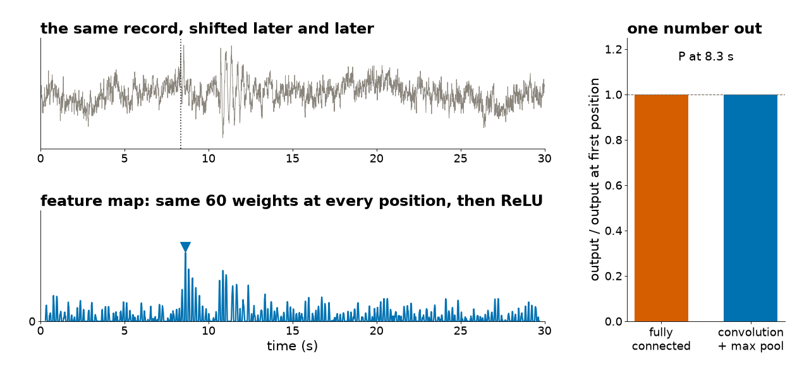{.r-stretch}

::: {.takeaway}
Shift the record and the feature map shifts with it; its maximum stays at 1.00. The fully connected neuron, one weight per position, falls to −0.62 after a shift of 0.5 s.
:::

::: {.notes}
Two minutes; this answers the opening slide. Same synthetic event (20 km, SNR 5), the whole record moved later in steps of 0.25 s, from P at 8.3 s to P at 21.3 s. Left, bottom: the feature map of the P kernel after ReLU; the triangle marks its maximum, and it travels with the event. That is equivariance: shift the input, the map shifts the same way. Right: two single numbers, each divided by its value at the first position. Red: a fully connected neuron whose weights are the noise-free record at the first position (the neuron of lecture 21); its output drops at once and changes sign (−0.62 at a 0.5 s shift, a few cycles of the 5 Hz wave). Blue: the maximum over the feature map (max pooling over the whole record); it stays at 1.00 for every shift (numbers.json, gif2). Equivariance comes from sharing weights across positions; invariance comes from the pooling that throws the position away. Detection wants invariance; picking an arrival time wants to keep the position, so a picker does not pool it away.
:::

## Stacking layers widens the view

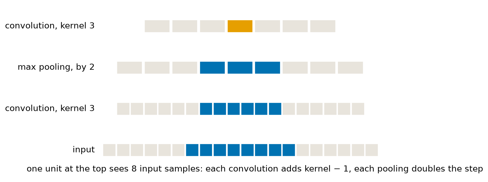{.r-stretch}

::: {.takeaway}
Convolution (kernel 3), pooling (by 2), convolution (kernel 3): one unit at the top depends on 8 input samples. That span is its receptive field.
:::

::: {.notes}
One minute; then the GIF of the next slide gives the numbers for the real detector. Follow the blue cells down from the orange unit: it combines 3 pooled values, which come from 6 convolution outputs, which depend on 8 input samples. Each convolution adds kernel − 1 steps; each pooling doubles the size of a step for every layer above it. Short kernels plus pooling therefore reach far with few weights.
:::

## How far one unit sees: 1.9 s in this detector

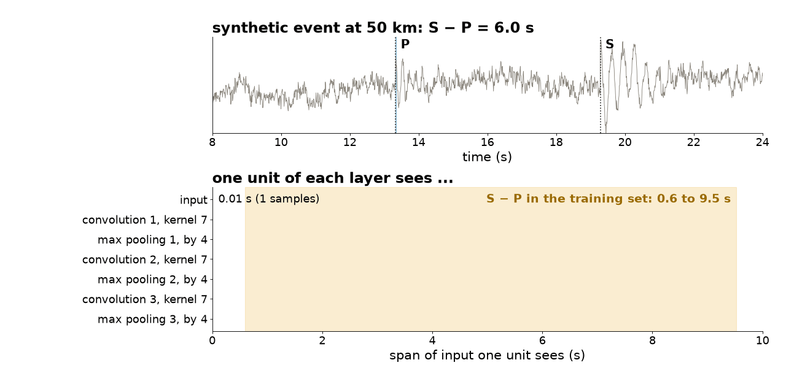{.r-stretch}

::: {.takeaway}
Each block widens the view: 0.07, 0.34, 1.42 s after the three convolutions, 1.90 s after the last pooling. S − P exceeds 1.9 s beyond about 16 km, so no unit sees the P and S waves together.
:::

::: {.notes}
Two minutes; rubric item C2.1 (receptive field against the physical scale of the pattern). The detector of notebook 4.3: three blocks of convolution (kernel 7) and max pooling by 4, then a global average. The receptive field r grows by (kernel − 1) × the spacing of the layer's input, and the spacing grows by 4 after each pooling: 7, 10, 34, 46, 142, 190 samples (numbers.json, gif5). At 100 Hz, 1.90 s. The generator's S − P time is distance × (1/3.5 − 1/6) s/km: 0.6 s at 5 km to 9.5 s at 80 km, so beyond 16 km no unit spans both arrivals; the global average adds evidence from separate P and S detectors but cannot use the S − P time. Two ways to see further: more blocks or wider pooling, or dilated convolutions (gaps between the weights). In the dry run of this morning's agent task, the rubric-guided run built a detector whose receptive field was 14.8 s, and justified it against the same 0.6 to 9.5 s range.
:::

## Wide and shallow, or long and skinny?

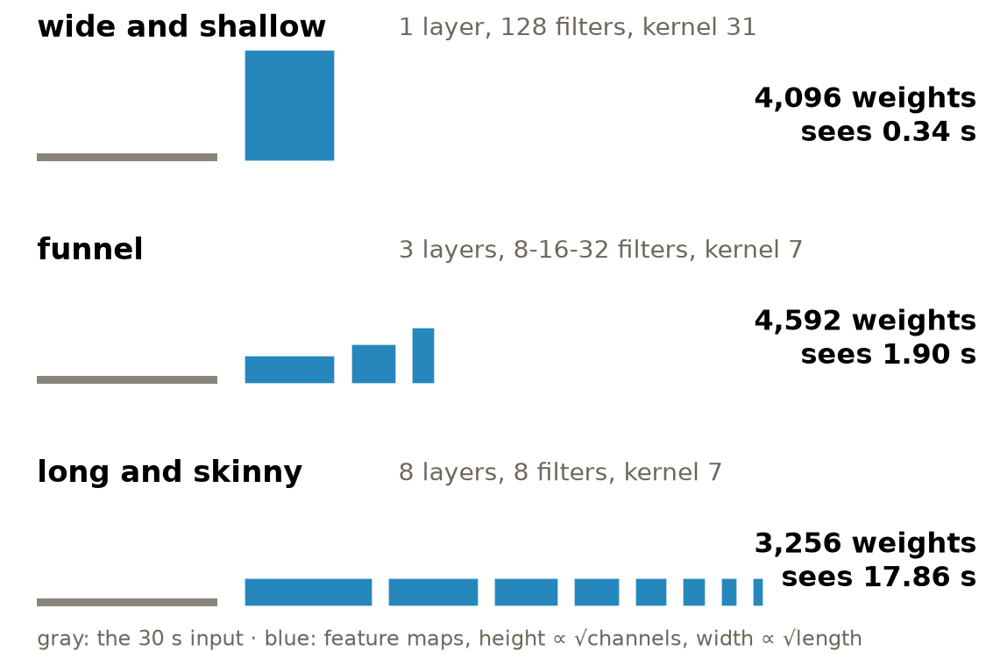{.r-stretch}

::: {.takeaway}
With about 4,000 weights each, one wide layer sees 0.34 s, the funnel 1.90 s, eight skinny layers 17.86 s. Depth buys reach and combinations of patterns; width buys variety at one scale.
:::

::: {.notes}
Three minutes; numbers from notebook 4.3, section 2.5 (same three networks, 30 s input at 100 Hz). Wide and shallow: one layer of 128 filters of 31 weights: many patterns, all shorter than a third of a second, no combination of patterns. Funnel: 8, 16, 32 filters, the detector of 4.3: the usual compromise, channels grow as the maps shorten, so each layer costs about the same. Long and skinny: eight layers of 8 filters: sees 18 s, enough for P and S together at any distance of the training set, but each layer has only 8 channels to carry information, and the gradient has to pass back through eight layers, which is why very deep networks need batch normalization or residual connections (ResNet). Ask: S − P at 80 km is 9.5 s; which of the three can see a P and its S together?
:::

## Flatten, or average over time?

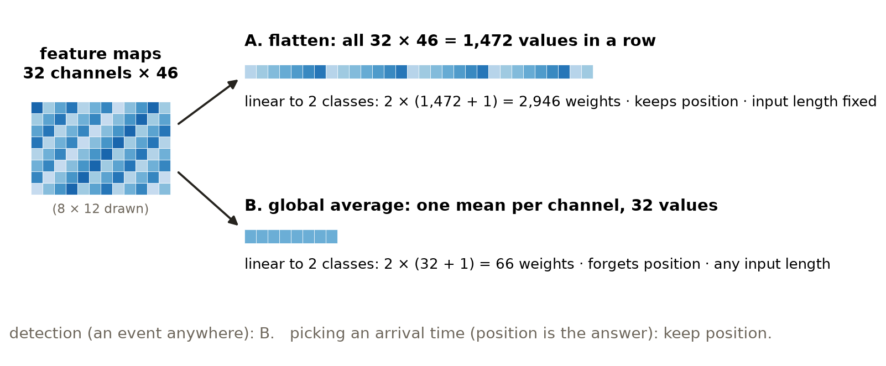{.r-stretch}

::: {.takeaway}
Flatten keeps every value and its position: 2,946 weights, one input length. Global average keeps one mean per channel: 66 weights, any length.
:::

::: {.notes}
Two minutes. The convolutional block ends with 32 maps of 46 values. The fully connected head needs one vector per record. Option A, nn.Flatten: lay all 1,472 values in a row; the linear layer then has a weight for each position, so it can use where things happened, and it only accepts records of exactly 3,000 samples. Option B, nn.AdaptiveAvgPool1d(1) then flatten (global average pooling): one mean per channel; 66 weights; the answer no longer depends on where the event sits, and records of any length fit. LeNet-5 (section 3 of the notebook) uses flatten; the 4.3 detector uses global average. Exercise 3 of the notebook makes the flatten head fail on a 2,000-sample record.
:::

## Classification or regression: the head decides

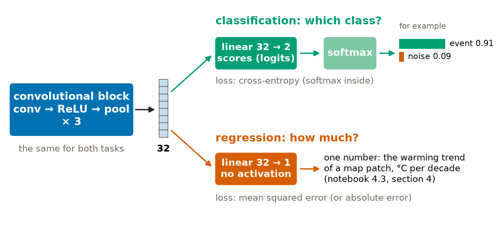{.r-stretch}

::: {.takeaway}
Classification: one score per class, softmax, cross-entropy. Regression: one number, no activation, mean squared error. The block before it is the same.
:::

::: {.notes}
Two minutes; this is what makes a CNN a classifier or a regression. Classification (the detector): linear 32 → 2 gives two scores (logits); the softmax turns them into probabilities that sum to 1; the loss is cross-entropy, and in PyTorch nn.CrossEntropyLoss applies the softmax itself, so the model ends at the logits. Regression (the warming-trend CNN of notebook 4.3, section 4, next slide): linear 32 → 1, no activation, because the answer can be any real number; the loss is mean squared error, or absolute error when errors have heavy tails. Everything before the head can be identical. The probabilities drawn are an example, not a model output.
:::

## 2-D case: reading a warming trend from a gridded field

{.r-stretch}

::: {.takeaway}
The CNN beats naive least squares 10× (0.008 vs 0.083 °C/decade MAE) — but give the classical fit the one confounding mode it was missing and it matches the CNN at 0.009. A 10× win over an underspecified baseline. Synthetic (mlgeo_synth).
:::

::: {.notes}
The task: regress each 8×8-pixel patch's local warming trend (°C per decade) from 30 annual-mean anomaly maps stacked as channels — channels-as-time, the standard trick for time-evolving fields. Split is grouped by field (18 train, 6 test), the 3.8 doctrine applied: patches from one field never straddle the boundary. Walk the three panels left to right: naive straight-line fit, MAE 0.083 — scattered; same fit plus one extra regressor (the generator's known 5-year interannual mode, which aliases into a straight-line slope over 30 years), MAE 0.009; the 17,953-parameter CNN, 0.008 — indistinguishable from the informed classical fit. The honest reading, say it verbatim: what the network extracted from 18 training fields is the confounding mode — deep models earn their keep when the confounders are unknown or unwritable; when you can write the physics down, the classical fit with the right regressors matches the CNN at a fraction of the cost. This is the lecture's thesis, and the 1-D detector gets the same treatment next.
:::

## Leaderboard 1: a warming trend from maps (4.3)

| Model | Weights | Test error (°C/decade) |
|---|---|---|
| 2-D CNN | 17,953 | **0.008** |
| least squares, with the known 5-year mode | — | 0.009 |
| least squares, straight line | — | 0.083 |

::: {.takeaway}
A 10× win over the straight line; a tie with the fit that knows the generator's terms. Always ask what the baseline was denied.
:::

::: {.notes}
Leaderboard format of lecture 24a: ranked by the score, baselines as rows. Notebook 4.3 section 3, executed output: test MAE of the local warming trend on 300 patches from 6 held-out fields (900 training patches from 18 fields), "naive least squares: 0.083, + known mode: 0.009, 2-D CNN: 0.008". One seed: the 0.001 gap is a tie until a seed spread says otherwise (rubric E3). Weights: 17,953 counted from the model_clim definition in 4.3; the least-squares fits have a handful of coefficients per patch.
:::

## 1-D case: an earthquake detector in 4,658 weights

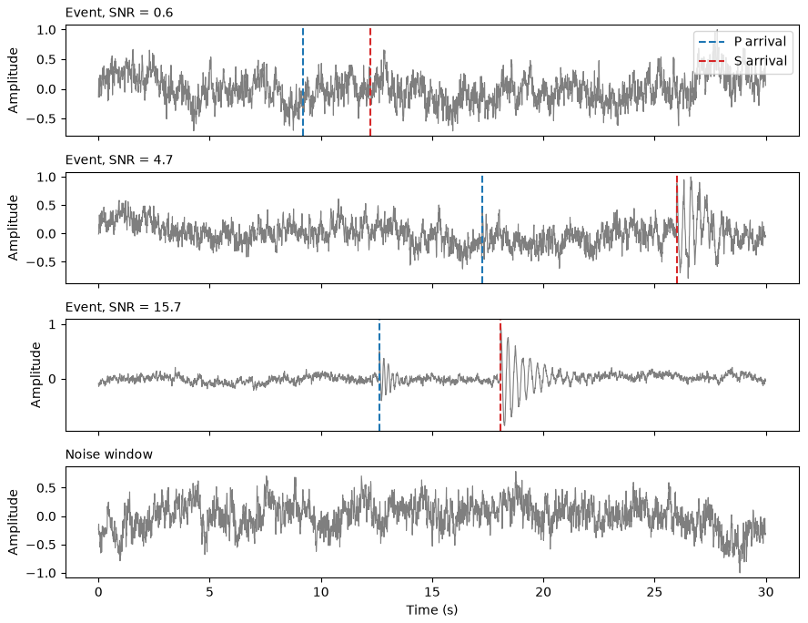{.r-stretch}

::: {.takeaway}
Event windows at low SNR are invisible by eye — exactly the regime where a detector must be measured, and where real catalogs cannot measure it. Synthetic (mlgeo_synth).
:::

::: {.notes}
The data: 1,600 30-second windows at 100 Hz from the course generator — a P arrival then a stronger S on colored noise, or noise alone — each with exact metadata: arrival times and SNR (peak signal amplitude over noise standard deviation). Point at the top trace: SNR near 0.6, nothing visible; that is where we want to know detector behavior, and real data can never tell us, because catalogs only contain the events someone already found — a bias against exactly the low-SNR regime. The model: three Conv1d–ReLU–MaxPool blocks, global average pooling, a 2-class head — 4,658 parameters against LeNet's 61,706. Per-trace standardization first, so the network cannot classify on amplitude alone. Synthetic test accuracy: 87.9%, imperfect because the set deliberately includes near-undetectable events. The interesting question is not the average — it is *where* it fails. Next slide.
:::

## Reality check 1: same traces, classical opponent

{.r-stretch}

::: {.takeaway}
At ~1% false alarms the CNN crosses 50% at SNR ≈ 1.4, STA/LTA at ≈ 9. At SNR 2: 90% of events against 2%.
:::

::: {.notes}
The design makes the comparison fair, and each choice is worth naming: identical traces for both detectors; the trigger's threshold set from noise alone (99th percentile of 600 noise-only windows → 1% false alarms by construction, no peeking at events); CNN false alarms measured at 0–5%, comparable, so the detection curves can be read directly; 60 trials per point with binomial error bars. Three regimes: below SNR ~0.8 both detectors sit at their false-alarm floor — no algorithm rescues a signal buried in noise of the same color; at SNR 20 both detect nearly everything, and there the classical trigger is the right engineering choice — free to train, impossible to drift. The shaded band is the CNN's whole case. Whether that band matters is a scientific question, not an architectural one — in seismology it is where most small earthquakes live, which is why learned detectors displaced energy triggers in catalog building (Perol et al.; the pickers that followed). Also in the notebook: template matching, the classical method that beats both at low SNR when the source repeats — narrower question, different tool.
:::

## Leaderboard 2: the earthquake detector (4.3)

| Detector | Weights | 50% detected at SNR | Detected at SNR 2 |
|---|---|---|---|
| 1-D CNN | 4,658 | **≈ 1.4** | 90% |
| STA/LTA, threshold at 1% false alarms | 0 | ≈ 9 | 2% |

::: {.takeaway}
Lower is better: the CNN detects half of the events at an SNR six times lower. It earns its keep where the classical method cannot reach.
:::

::: {.notes}
Notebook 4.3 section 4.4, executed table, 40 events and noise windows per SNR level (synthetic, mlgeo_synth with noise colors 0.5–2.0 and dominant frequencies 2–8 Hz). CNN: 0.38 detected at SNR 1.26 and 0.90 at 2.00, false alarms 0 to 5%; STA/LTA with its threshold at the 99th percentile of noise-only peaks (4.11): 0.33 at 7.94, 0.77 at 12.59. The 50% crossings are read between those levels. Test accuracy of the CNN on the synthetic test windows: 81.7%. One seed; the next slide is the deployment test (rubric E5).
:::

## Reality check 2: real waveforms, no retraining

{.r-stretch}

::: {.takeaway}
87.9% on synthetic test → 46.8% on real miniPNW, with 93% of real *noise* windows flagged. Measured 2026-11-20 (4.3 at commit 4b4775c).
:::

::: {.notes}
The uncomfortable question the book insists on asking: every number so far came from the same generator that produced the training data — so score the unchanged detector on real labeled miniPNW waveforms (a few hundred earthquake windows, P pick 7 s in, plus matched pre-event noise windows; preprocessing mirrors training exactly, no threshold moved, no bandpass chosen to fix things afterward). Left panel: balanced accuracy collapses 41 points to chance. Right panel is the diagnosis: detection is *highest* (99%) in the lowest-SNR quartile — where the window is mostly noise — and the whole curve is indistinguishable from the 93% false-alarm line. The network is not responding to earthquakes at all: it learned "synthetic event vs the one synthetic noise model," and real nonstationary, microseism-dominated noise resembles neither, so nearly everything triggers. Name the concept: **distribution shift** — train and deployment data drawn from different distributions — and this is Geirhos's shortcut learning measured by us. The sentence to leave in the room: a model validated only on synthetic data has not been validated. Closing the gap takes real data on the training side (fine-tune on miniPNW, or physics-informed noise from 2.10) — that path is the notebook's, and 4.6 continues it.
:::

## Best practices: the convolutional network

| Step | Practice | Rubric |
|---|---|---|
| Design | kernel and receptive field match the phase period | C2.1 |
| Design | normalize each record; no amplitude shortcut | C2.2 |
| Design | pooling where position does not matter | C2.3 |
| Baseline | STA/LTA or the informed regression, same records | C2.4 |
| Evaluate | detection against SNR, matched false alarms | E4 |
| Evaluate | real records before any claim | E5 |

::: {.notes}
Leave this up. Each row is a line of the rubric in book section 4.7, and each comes from today's numbers. C2.1: the three convolution blocks see a window long enough to hold a P wave and its coda; check the receptive field in seconds against the period of the phase. C2.2: per-trace standardization, so the network cannot classify on amplitude. C2.3: global average pooling makes the detector independent of the arrival time; a picker, which must report the time, would keep position. C2.4: the trend case tied the informed regression (0.008 against 0.009 °C per decade); the detector beat STA/LTA at matched 1% false alarms (50% detection at SNR 1.4 against about 9). E4: report detection as a function of SNR, not one accuracy. E5: 87.9% on synthetic test windows fell to 46.8% on real miniPNW waveforms; validation on synthetics alone is not validation. The rubric grows by these six items today.
:::

## Start your team's agent now: it works while you train

One laptop per team runs the agent; the rest of the team goes to the stations. First: `git pull` in your `mlgeo-book` folder, and open that folder in VS Code.

::: {.columns .steps}
::: {.column width="34%"}
### GitHub Copilot

1. Open Chat: ⌃⌘I (Mac) or Ctrl+Alt+I
2. Mode menu under the chat box: **Agent**
3. Paste the prompt
4. Allow the commands it asks to run
:::
::: {.column width="30%"}
### Claude Code

1. In the VS Code terminal: `claude`
2. Paste the prompt
3. Allow the commands it asks to run
:::
::: {.column width="36%"}
### UW Purple only

1. purple.uw.edu, NetID
2. Attach `seismic.py` from `book/mlgeo_synth/` (as `.txt` if refused)
3. Run B: also attach the rubric file named in the prompt
4. Paste the prompt and the Purple line
:::
:::

::: {.takeaway}
Odd-numbered teams run **A**, even-numbered teams run **B**. The two prompts differ by one paragraph.
:::

::: {.notes}
Two minutes, then move on. In the dry run on Nov 20 (Claude Code, model claude-opus-5, both runs at once on one laptop), run A took 26 minutes and run B 30 minutes, each with 5 to 6 minutes of training; weaker models or slower laptops may take longer. Nobody should watch it: it runs while the team does the stations, and we read its report at the end of class. Write the team numbers on the board and the A/B assignment next to them. One person per team owns the agent laptop: they approve the commands it asks to run (a training script; nothing to install, everything is in pixi) and refuse any git command or any write outside the run folder. Copilot: the agent mode is what lets it run code; in Ask mode it only writes text. Claude Code: the panel in VS Code works too. Purple reads but cannot run code (as in HW1 step 8c), so a Purple run produces a script and the report it expects, with no measured numbers; that is a third condition worth comparing, not a failure. Note the tool and model each team used; we tally them at minute 68. Students who have none of the three pair with a team that does.
:::

## The prompt: copy it exactly

Replace `<team>` with your team number and `<A or B>` with your run.

::: {.prompt}
```{.text code-line-numbers="false"}
Build a 1-D convolutional network that detects earthquakes in 30 s vertical-component seismograms sampled at 100 Hz. Train it on synthetic records from mlgeo_synth.seismogram_dataset (source: book/mlgeo_synth/seismic.py). The detector will run on real stations, where the background noise differs from the generator's (the ocean microseism makes it redder, for example). Write one script, run it, and write report.md with your results and your verdict: is this detector ready to run on a real station?

Rules: run all code with `pixi run python`, on the CPU, with less than 10 minutes of training in total. Do not download anything. Write files only in book/Chapter4-DeepLearning/s22_agent_runs/team<team>_<A or B>/. Do not edit, commit, push or stash any other file.
```

**Run B only**, add:

```{.text code-line-numbers="false"}
Follow every item of book/Chapter4-DeepLearning/mlgeo_4.7_dl_rubric.md. End report.md with a table of item ID, pass or fail, and evidence; then list the items you could not check, and why.
```
:::

::: {.dim}
**Purple only**, add: *You cannot run code. Write the script and the report you expect it to produce, and mark every number as not computed.*
:::

::: {.notes}
The two runs are an experiment with one variable: same task, same data, same rules, and only run B gets the rubric. Do not open the rubric file yourselves; we read it together after the stations. The deployment sentence (real stations, redder noise) is in both prompts on purpose: it is the information a careful modeler would act on, and we will see which runs test on noise unlike the training noise without being told how. The rules paragraph is the same contract as the session 7 lab: pixi only, no downloads (thirty laptops pulling the 670 MB miniPNW file on the room's network would stall everyone), writes confined to one ignored folder. If an agent asks a question, answer only "use your judgment and say what you chose in report.md", so all runs get the same information.
:::

## When it stops: save, do not judge yet

1. Save the conversation as `transcript.md` in your run folder
    - Claude Code: `/export`
    - Copilot Chat: right-click in the chat, **Copy All**, paste
    - Purple: copy the conversation, or print the page to PDF
2. `git status`: no book file should be listed. If one is, `git checkout -- <file>` and note it
3. On the board: team, A or B, tool and model, minutes to finish, finished or not

::: {.takeaway}
Do not read report.md yet. At minute 68 we score every run against the rubric the class writes today.
:::

::: {.notes}
The transcript is evidence for the audit: we check that every command the report says it ran appears in the transcript, as in HW1 step 8 and the session 7 lab. Ask teams not to read the report early, so the class writes its own rubric items from the station measurements without anchoring on what the agent did. An agent still running at minute 65 gets stopped; "did not finish in 45 minutes" is a result and goes on the board.
:::

## Now measure it yourself — open 4.3

1. `mlgeo_4.3_CNN.ipynb`: sections 1–2, with the two Your-turn cells (a kernel by hand, the weights of a layer)
2. Run the detection-floor sweep; estimate both 50% crossings from the printed table
3. Retrain with only 2 epochs, rerun the sweep: whose floor moves — the CNN's or STA/LTA's, and why?
4. Real seismograms: the same detector on miniPNW is Homework_DL

::: {.dim}
PyTorch names live here: `nn.Conv1d`/`nn.Conv2d`, `nn.MaxPool1d`, `nn.AdaptiveAvgPool1d`, `torchinfo.summary` · HW-CML due today · Mon: sequence models (4.4), HW-DL assigned
:::

::: {.notes}
Timing for the 80-minute block (10:00–11:20): pulse talks ~10 min, this deck ~20 min, guided notebook work ~40 min, synthesis ~10 min. If time is short, cut task 1 to a skim — tasks 2–4 are the payload. Task 3 is the conceptual trap worth circulating for: the CNN's floor rises when undertrained, STA/LTA's does not move because it has no parameters to undertrain — that is what makes it a stable baseline. Section 5 of the notebook (recoding the Rouet-Leduc tremor CNN from its published architecture table, verified by shape checks with `torchinfo.summary`) is the take-home skill for reading papers — flag it for project teams reproducing published models. Synthesis question to collect: for your project, what is your STA/LTA — the zero-parameter method your model must beat on identical data? That question is graded in check-in #2.
:::


## Four canonical networks: where convolutional fits

{.r-stretch}

::: {.takeaway}
Convolutional: for patterns that can sit anywhere on a grid. It beat STA/LTA by a factor of six in SNR, and tied the fit that knew the physics.
:::

::: {.notes}
The closing statement, the same figure as the opening. What is left out by a convolution: order and memory along time beyond the receptive field (Monday, recurrence and attention). The real-data test of this detector is Homework_DL (miniPNW), with a leaderboard that has STA/LTA as a row. Training and leaderboard format: lecture 24a.
:::
