## {background-color="#faf7f2"}

[🔁]{.lecture-icon}

### Today's question

A forecast reads the past to write the future.

**How does a network carry information across 90 days — and does it beat "tomorrow equals today"?**

::: {.dim}
Reading: [4.4 Sequence models](https://geo-smart.github.io/mlgeo-book/mlgeo-4-4-rnn) · HW-DL assigned today
:::

::: {.notes}
Frame the session: Friday's convolution slides one pattern across time; today's architectures *carry state* across time — memory. We build four of them on one forecasting task and end at a table where the winner is a baseline question, not an architecture question. Announce: HW-DL is assigned today, due Fri Dec 4 — it uses everything from 4.1 through today. Also: the classification leaderboard closes tomorrow. Ask the room: who can define "forecast horizon" from their own field (weather, hydrology, aftershocks)?
:::

## This lecture in the literature

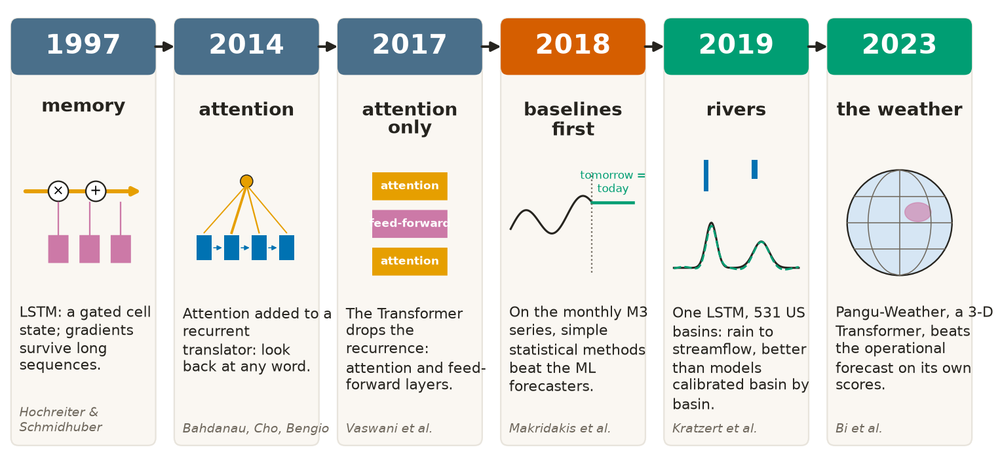{.r-stretch}

::: {.takeaway}
Memory → attention → attention only; then baselines first, rivers, the weather.
:::

::: {.credit}
Hochreiter & Schmidhuber (1997) *Neural Comput.* 9, 1735–1780 · Bahdanau, Cho & Bengio (2015) *ICLR*, arXiv:1409.0473 (2014) · Vaswani et al. (2017) *NeurIPS* 30 · Makridakis, Spiliotis & Assimakopoulos (2018) *PLOS ONE* 13, e0194889 · Kratzert et al. (2019) *Hydrol. Earth Syst. Sci.* 23, 5089–5110 · Bi et al. (2023) *Nature* 619, 533–538. Icons drawn.
:::

::: {.notes}
Two minutes. Kratzert et al. (2019): one LSTM trained on 531 basins of the US CAMELS dataset, daily meteorology in, streamflow out, better than conceptual hydrological models calibrated basin by basin; the LSTM's cell state was found to track snow storage, a memory with a physical meaning. It is the geoscience proof that gated memory earns its keep when the process has long memory, which our GNSS series mostly does not. Hochreiter & Schmidhuber: the LSTM predates most of the room; it solved a specific measured pathology (vanishing gradients — slide 5) with gates, and ran everything from speech recognition to flood forecasting for two decades. Bahdanau: attention entered as a *fix bolted onto* recurrent translation models — the attribution the book is careful about, because popular history starts at 2017; Vaswani et al. then showed the recurrence could be dropped entirely. Makridakis: the M-competition finding that fashionable ML forecasters lost to simple statistical methods across thousands of series — the field had skipped its baselines; today's persistence row is that discipline in miniature. Bi et al.: Pangu-Weather, a 3-D transformer that beat the operational ECMWF forecast on its own headline metrics — attention applied at planetary scale *and* judged against the right baseline. The arc: mechanism first, honest scoreboard always.
:::

## The task: 90 days in, 30 days out

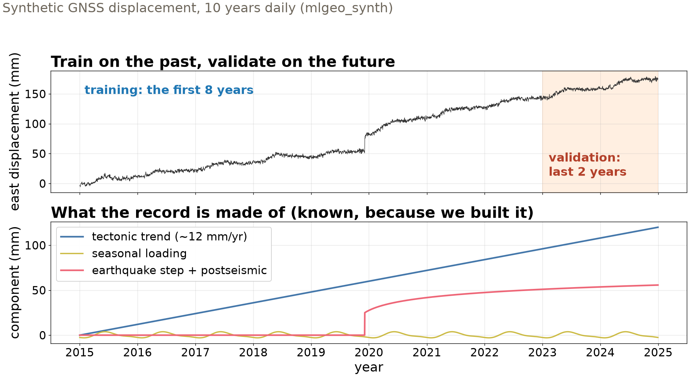{.r-stretch}

::: {.takeaway}
Context window = what the model reads; forecast horizon = what it must write. Temporal split, no window crossing the boundary — lecture 18's rule, unchanged.
:::

::: {.notes}
Define the two terms of the day: context window (the stretch of past the model reads — 90 days here) and forecast horizon (how far it must predict — 30 days). The record: 10 years of daily synthetic GNSS displacement with known components — ~12 mm/yr tectonic trend, seasonal loading, an earthquake step with postseismic relaxation, noise. We know the components because we built them; that is what lets us diagnose the models later. Data design: standardize using training-portion statistics only; slide a window to build (90-in, 30-out) pairs; first 8 years train, last 2 validate, no window straddles the boundary — a random split would let a validation window overlap two training windows almost entirely. One subtlety worth saying aloud: each window is *anchored* — the model forecasts change relative to its last observed day — because the trend puts validation windows at absolute levels training never saw; without anchoring every model would extrapolate outside its range and the saturating activations would fail. All four models share windows, loss, optimizer, and metric: mean absolute error over the 30-day horizon, in millimeters.
:::

## Where recurrent networks fit: sequences

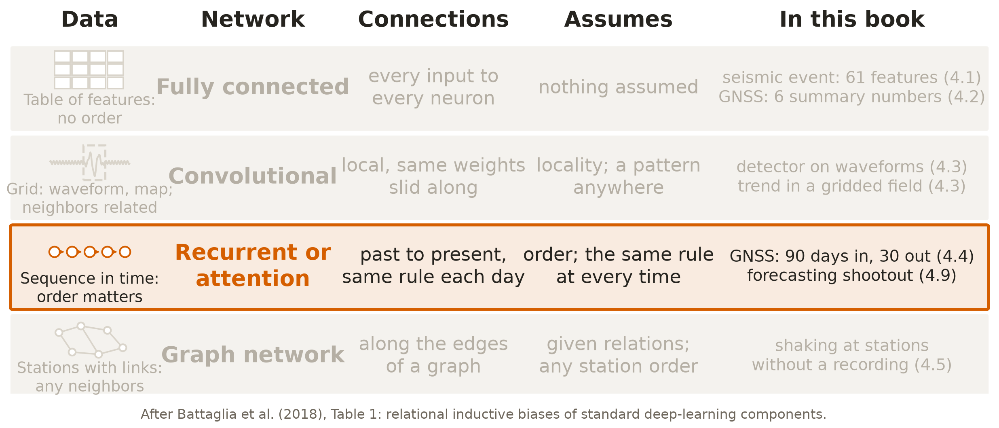{.r-stretch}

::: {.takeaway}
A series in time has an order, and the past informs the future. Recurrence applies the same rule at every day and carries a memory; attention lets every day look at every other day.
:::

::: {.notes}
Two minutes; the framework figure, third row (after Battaglia et al. 2018, Table 1). In session 22 the GNSS series of P395 came as six summary numbers, a table, and a fully connected network could not beat linear regression. Today the series comes as 90 daily values, a sequence. Two assumptions fit it: order (day 50 comes after day 49) and a rule that does not change from day to day (time translation). A recurrent layer builds both in: it reads one day at a time and updates a memory with the same weights each day. Attention keeps the same weights for every day too, but compares every pair of days directly, and needs positional encodings because it is otherwise blind to order. Same question as session 22, different structure, different network.
:::

## Inside an RNN: one day at a time, one memory

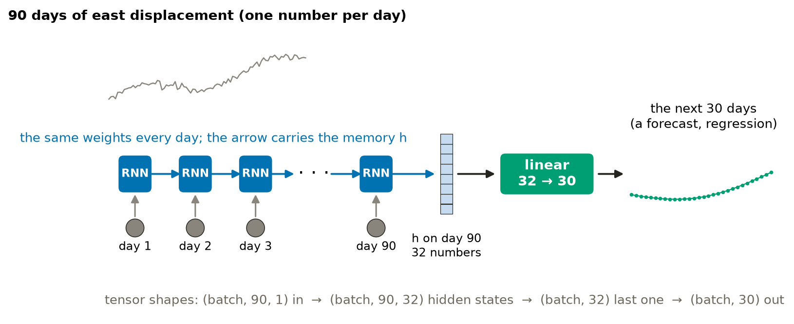{.r-stretch}

::: {.takeaway}
The same cell reads day 1 to day 90 and updates a memory h of 32 numbers; a linear head turns the last memory into the next 30 days.
:::

::: {.notes}
Two minutes; the map of the next slides. Notebook 4.4's VanillaRNN: the input is a window of 90 daily east displacements, one number per day, so the tensor is (batch, 90, 1). nn.RNN(1, 32) reads the days in order; at each day it combines the new value with its memory h from the day before, using the same weights every day. It returns all 90 memories, shape (batch, 90, 32); the model keeps the last one, (batch, 32), and nn.Linear(32, 30) turns it into the 30 forecast days. The output is a regression: 30 numbers, trained with mean squared error. The series and forecast drawn are illustrative.
:::

## The recurrence by hand

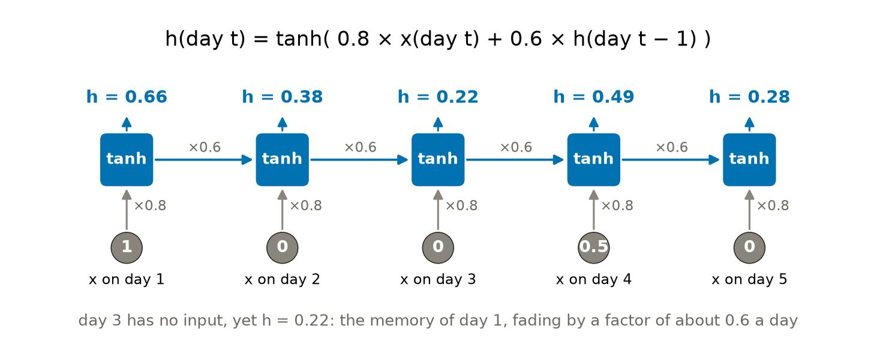{.r-stretch}

::: {.takeaway}
h = tanh(0.8 × x + 0.6 × h of the day before). Day 3 has no input, yet h = 0.22: the network still carries day 1.
:::

::: {.notes}
Three minutes; compute two steps with the room. One hidden number, w_x = 0.8, w_h = 0.6, no bias. Day 1: tanh(0.8 × 1) = 0.66. Day 2, no input: tanh(0.6 × 0.66) = 0.38. Day 3: tanh(0.6 × 0.38) = 0.22. Day 4, input 0.5: tanh(0.4 + 0.6 × 0.22) = 0.49. Day 5: 0.28. The memory of day 1 fades by roughly the factor 0.6 each day. In nn.RNN with hidden size 32, w_x becomes a 32 × 1 matrix, w_h a 32 × 32 matrix, and there are two bias vectors: the same computation with vectors. All numbers computed in figscripts/lec23_rnn_cartoons.py.
:::

## How long a memory lasts

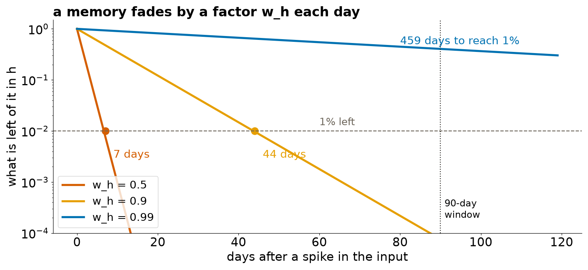{.r-stretch}

::: {.takeaway}
A spike fades by w_h each day: below 1% after 7 days (0.5), 44 days (0.9), 459 days (0.99). The same factor, multiplied over the days, shrinks the gradient.
:::

::: {.notes}
Two minutes. For small values tanh is nearly linear, so a spike in the input survives in h as w_h to the power of the number of days since. With w_h = 0.5 the network forgets in a week; with 0.9, in about six weeks; only with w_h very close to 1 does it remember across the 90-day window, and then it also keeps every bit of noise. The next slide shows the same product from the other side: the gradient that trains day 1 is multiplied by about one such factor per day on its way back.
:::

## Why the plain recurrent network forgets

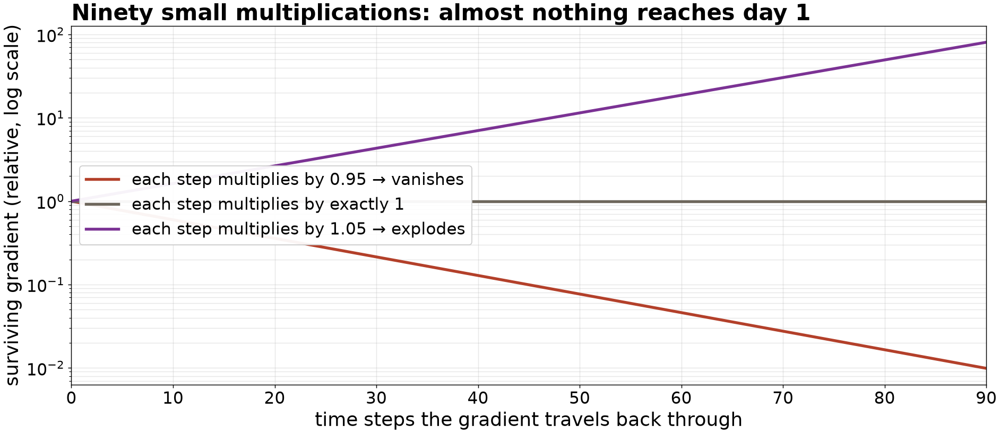{.r-stretch}

::: {.takeaway}
Training pushes the gradient back through all 90 steps — a product of ~90 factors. Slightly under one → vanishes; slightly over → explodes. Simple recurrent memory tops out at tens of steps.
:::

::: {.notes}
First the mechanism: a recurrent neuron receives the current input *and* its own previous output — the hidden state is the memory, updated each day as h_t = tanh(Wx·x_t + Wh·h_(t-1) + b). Training unrolls the network over the 90 steps and backpropagates through time: the gradient reaching day 1 is a product of roughly 90 Jacobians, one per step. The figure is just powers of a single number, and that is the entire argument: 0.95^90 ≈ 0.01, 1.05^90 ≈ 80. When the product shrinks (the common case with tanh), early steps receive no training signal — the network cannot learn that something 80 days back matters, because the lesson never travels that far. Exploding is controlled by gradient clipping; there is no equally simple fix for vanishing. That asymmetry motivated both fixes on the next slide. Our vanilla RNN still forecasts respectably here (2,110 parameters, 1.83 mm) — because this series needs mostly recent context; the pathology bites when long memory is genuinely required.
:::

## How many weights to fit?

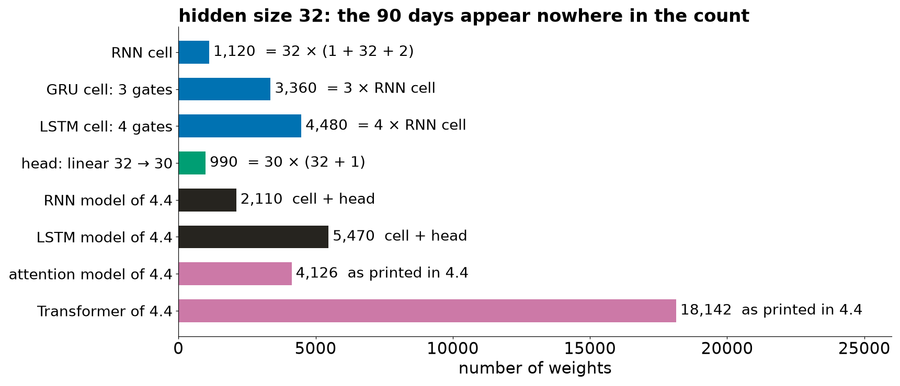{.r-stretch}

::: {.takeaway}
RNN cell 1,120, LSTM cell 4,480 (four gates); with the head, 2,110 and 5,470, as notebook 4.4 prints. The 90 days appear nowhere: the same weights every day.
:::

::: {.notes}
One minute. RNN cell, hidden size 32, one input: 32 × 1 input weights + 32 × 32 recurrent weights + 2 × 32 biases = 1,120 (PyTorch keeps two bias vectors). A GRU has 3 such sets (3,360), an LSTM 4 (4,480). The head nn.Linear(32, 30): 990. The attention and Transformer counts are those printed by notebook 4.4. Like a convolution, a recurrent layer reuses its weights along time, so a window of 900 days costs no more weights than 90 days; it costs more computation, one step per day.
:::

## LSTM: a memory changed by addition

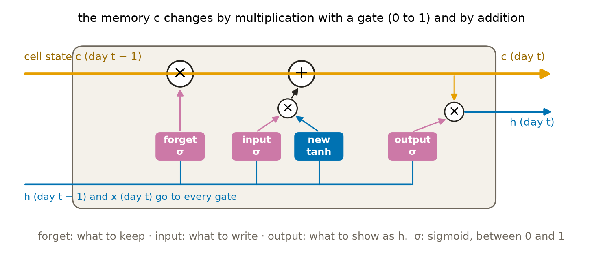{.r-stretch}

::: {.takeaway}
Gates between 0 and 1 decide what to forget, what to write and what to show. The cell state is changed by addition, so the gradient is not multiplied by a small factor every day.
:::

::: {.notes}
Three minutes. Hochreiter & Schmidhuber (1997). Alongside h, the LSTM keeps a cell state c (orange line). Each day: the forget gate (a sigmoid, 0 to 1) multiplies c, keeping or erasing each of its 32 numbers; the input gate scales a new candidate (tanh) that is added to c; the output gate decides how much of tanh(c) to show as h. All four boxes read h of the day before and x of the day: four weight sets, hence four times the weights of a plain cell. Because c is updated by addition, a forget gate near 1 lets information and gradients cross many days without shrinking. In 4.4 the LSTM scores the same as the plain RNN (1.86 against 1.83 mm), because this series needs mostly recent memory.
:::

## Attention by hand: every day looks at every day

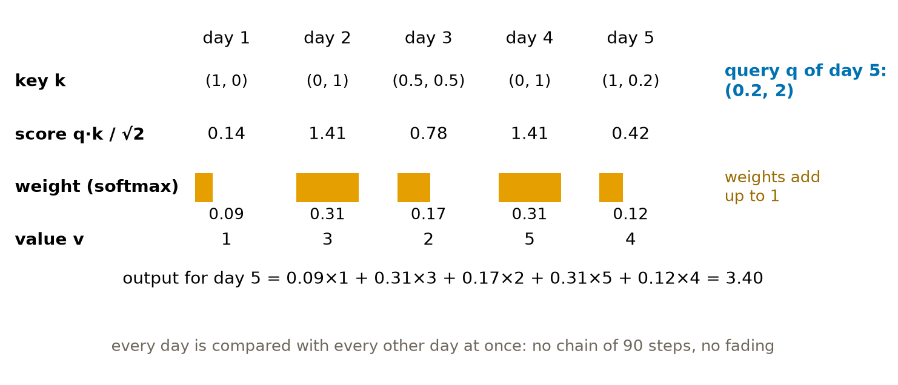{.r-stretch}

::: {.takeaway}
Scores q·k, softmax weights that add up to 1, then a weighted average of the values: 3.40 for day 5. No chain of steps, so nothing fades; positions must be added.
:::

::: {.notes}
Three minutes; Bahdanau et al. (2014) as an addition to recurrent models, Vaswani et al. (2017) attention only. Each day gets three learned vectors: a query (what it looks for), a key (what it contains), a value (what it passes on). Here day 5's query (0.2, 2) is compared with the five keys; the scores are divided by √2 (the square root of the vector length) and turned into weights by the softmax: days 2 and 4, whose keys match the query, get 0.31 each. The output is the weighted average of the values, 3.40. For 90 days this is a 90 × 90 table of weights, computed at once. Shuffle the days and the result is the same, so Transformers add a positional encoding to each day. Notebook 4.4 writes one attention head in about 15 lines, then uses nn.TransformerEncoderLayer.
:::

## Stacked and bidirectional layers

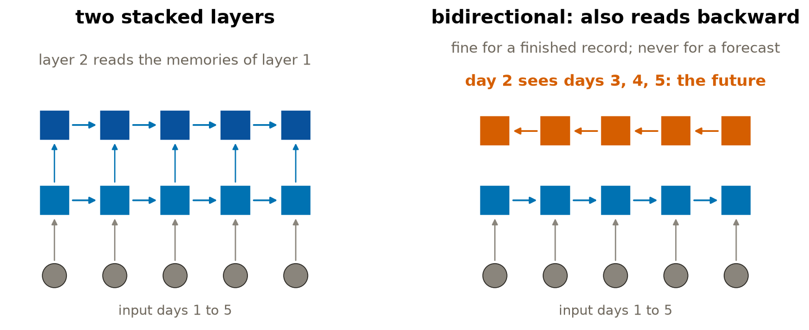{.r-stretch}

::: {.takeaway}
Stacking adds depth: layer 2 reads the memories of layer 1. A bidirectional layer also reads backward, from the future: right for a finished record, a leak in a forecast.
:::

::: {.notes}
One minute; rubric item C3.1. nn.RNN(..., num_layers=2) stacks two recurrent layers. bidirectional=True runs a second chain from the last day to the first and joins the two memories: each day's output then depends on later days. For classifying a finished record (is there tremor in this hour?) that is allowed and often helps. For a forecast it uses information that would not exist at forecast time, and the validation score becomes too good to be true.
:::

## The head: a forecast, a class, or one output per day

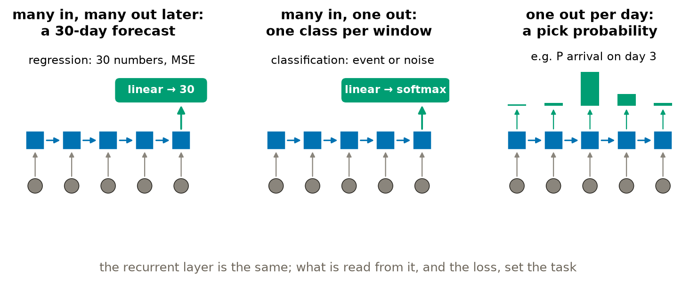{.r-stretch}

::: {.takeaway}
From the last memory: 30 forecast days (regression) or one class per window. From every memory: one output per day, such as the probability of a P arrival.
:::

::: {.notes}
One minute. The recurrent layer is the same in the three cases; what changes is which memories the head reads and the loss. Notebook 4.4 reads the last memory and predicts 30 numbers at once (mean squared error). A window classifier reads the last memory and applies a softmax (cross-entropy). A phase picker reads every memory and gives a probability per sample, the design of recurrent and attention pickers in seismology. The pick probabilities drawn are an example.
:::

## The shootout — baselines first

| Model | Parameters | Val MAE, 30-day horizon |
|---|---|---|
| **Persistence** (tomorrow = today) | 0 | **2.10 mm** |
| **Seasonal naive** (value 365 d ago) | 0 | 15.53 mm |
| Vanilla RNN | 2,110 | 1.83 mm |
| LSTM | 5,470 | 1.86 mm |
| Attention (from scratch) | 4,126 | 1.87 mm |
| Transformer encoder | 18,142 | 1.84 mm |

::: {.dim}
Same windows, same loss, same optimizer, same metric — MAE in millimeters over the 30-day horizon, so the numbers are directly comparable.
:::

::: {.takeaway}
The learned models beat persistence by ~13% — real but modest. Seasonal naive fails because the 12 mm/yr trend makes last year systematically low: a baseline informs only when it matches the structure it targets.
:::

::: {.notes}
Read the baseline rows first — always. Persistence: every forecast day equals the last observed day; zero parameters, 2.10 mm, and any learned forecaster that loses to it has learned nothing. The four architectures land at 1.83–1.87 mm: about 13% better, the correct headline for a series dominated by smooth trend and seasonality that a 90-day context largely pins down. Seasonal naive is the teaching failure: 15.53 mm, worse than doing nothing fancy — because on a 12 mm/yr trend, the value 365 days earlier is systematically ~12 mm low. It is the right baseline for a purely seasonal series and the wrong one here; a baseline is a hypothesis about structure, and it informs only when the hypothesis matches. Then the architecture rows: the four scores sit within noise of each other — rerun with a different seed and the ranking shuffles. Say it plainly: **the ranking is not the lesson; the mechanics are** — how each model moves information across time and what that costs in parameters, training time (4.5 s to 24 s here), and gradient behavior. Echo Makridakis from the literature slide: entire fields have skipped this table's first row.
:::

## Same discipline, three lectures

| Session | Learned model | The baseline it faced | Verdict |
|---|---|---|---|
| Wed — MLP | PNW source classifier | Chapter 3 random forest | tie on tabular features |
| Fri — CNN | earthquake detector | STA/LTA at matched false alarms | wins half a decade of SNR |
| Today — sequence | GNSS forecasters | persistence, 0 parameters | +13%, all four architectures |

::: {.takeaway}
Architecture follows data structure: dense for tables, convolution for patterns that move, memory or attention for sequences. The baseline row decides whether any of it mattered.
:::

::: {.notes}
The week in one screen — leave it up for questions. The pattern students should carry to projects: pick the block that mirrors the data's structure (unordered features → dense; translation structure → convolution; order and long-range dependence → recurrence or attention), then earn the complexity against the strongest zero- or few-parameter baseline you can write. Also worth saying: attention is the block behind the pretrained weather and time-series forecasters now entering the geosciences (Pangu on the literature slide) — the mechanics built today are the reading skills for that literature. Wednesday continues into the model-training lab (4.5, data curation and label quality); the forecasting rematch on real data is 4.10 in week 10, where the persistence row returns with a leaderboard attached.
:::

## Best practices: recurrent networks and attention

| Step | Practice | Rubric |
|---|---|---|
| Frame | windows from the past only; split in time | C3.1, A4 |
| Design | context window matches the memory needed | C3.2 |
| Baseline | persistence and seasonal naive, each horizon | C3.3 |
| Evaluate | error against forecast horizon | C3.4 |
| Evaluate | seeds; gaps inside the spread are ties | D7, E3 |

::: {.notes}
Leave this up. Each row is a line of the rubric in book section 4.8, with today's numbers. C3.1 and A4: every input window ends before its forecast window starts, and no window crosses the 8-year boundary. C3.2: 90 days of context for a 30-day horizon; task 3 doubles the horizon to see what breaks. C3.3: persistence 2.10 mm, seasonal naive 15.53 mm (the wrong baseline for a trending series, which is itself the lesson). C3.4: the error grows with the lead day; report the curve, not one number. D7 and E3: the four networks land between 1.83 and 1.87 mm; rerun with other seeds before ranking them, because differences of 0.04 mm are likely inside the seed spread. The rubric grows by these items today.
:::

## Now race them yourself — open 4.4

1. `pixi run jupyter lab` → `mlgeo_4.4_RNN.ipynb`: the three Your-turn cells (recurrence, LSTM line, one attention query)
2. Train all four models; reproduce the comparison table *with its baseline rows*
3. Double the horizon to 60 days, retrain: which errors grow, and why?
4. **HW-DL assigned today** (due Fri Dec 4): a CNN detector on real miniPNW seismograms; download the 671 MB at home first

::: {.dim}
PyTorch names live here: `nn.RNN`, `nn.LSTM`, `nn.TransformerEncoderLayer`, `register_buffer` for positional encodings · classification leaderboard closes Tue · Wed: training lab I (4.5)
:::

::: {.notes}
Timing for the 80-minute block (10:00–11:20): pulse talks ~10 min, this deck ~20 min, guided notebook work ~40 min, synthesis ~10 min. The models are tiny and train on CPU in seconds to half a minute (the notebook deliberately pins CPU — recurrent layers launch one small op per step, so accelerator overhead dominates); nobody needs a GPU today. Circulate during task 3: the per-lead-day error growth (day 60 much worse than day 31) is where forecast-horizon intuition forms. Implementation spellings: `nn.RNN`/`nn.LSTM` are one-line swaps in the same module; the from-scratch attention head uses plain `nn.Linear` maps for Q, K, V; `nn.TransformerEncoderLayer` wraps attention + feed-forward + residuals + layer norm. HW-DL guidance to say aloud: it chains 4.1→4.4 skills; teams should budget the Thanksgiving-short week — Wednesday's lab is the last new scaffolding before it. Synthesis question to collect: what is the persistence forecast in your project's domain, and what would seasonal-naive's failure mode be on your data?
:::
