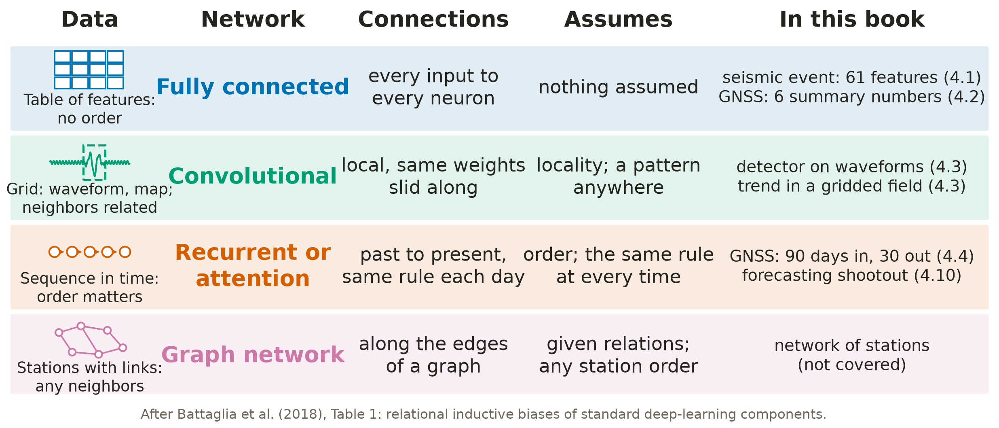
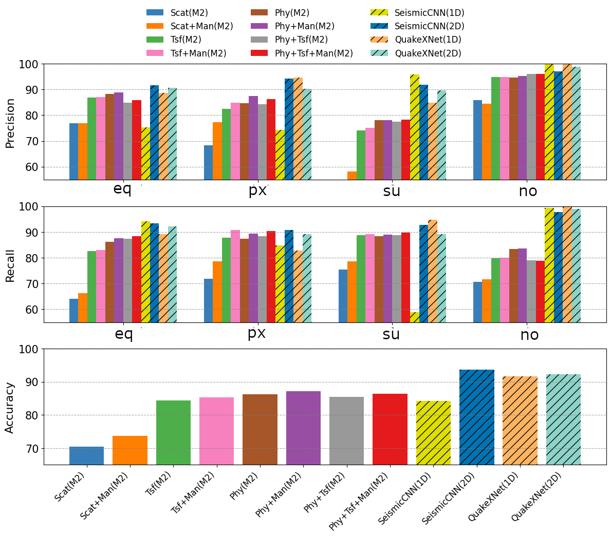
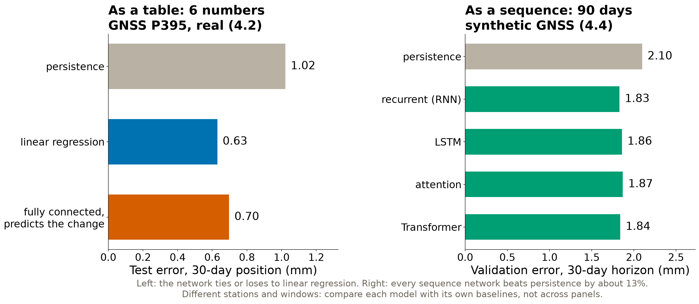
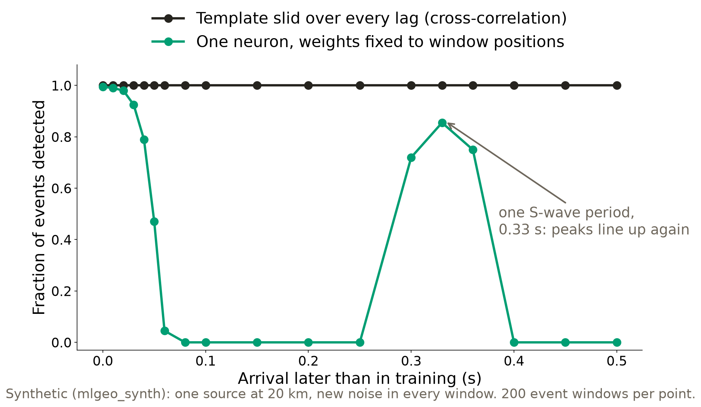
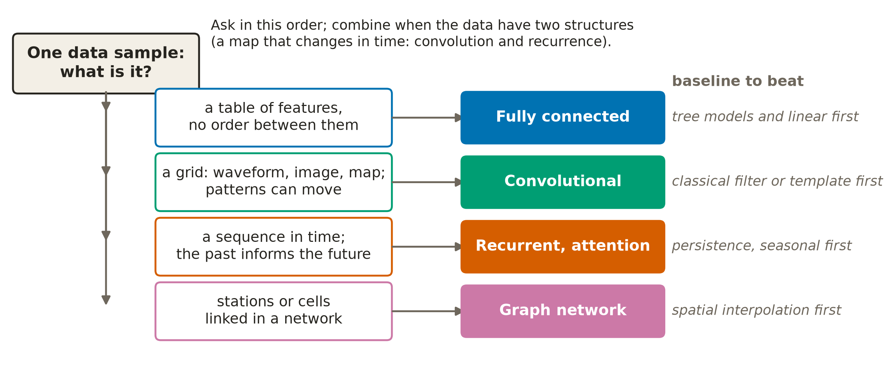
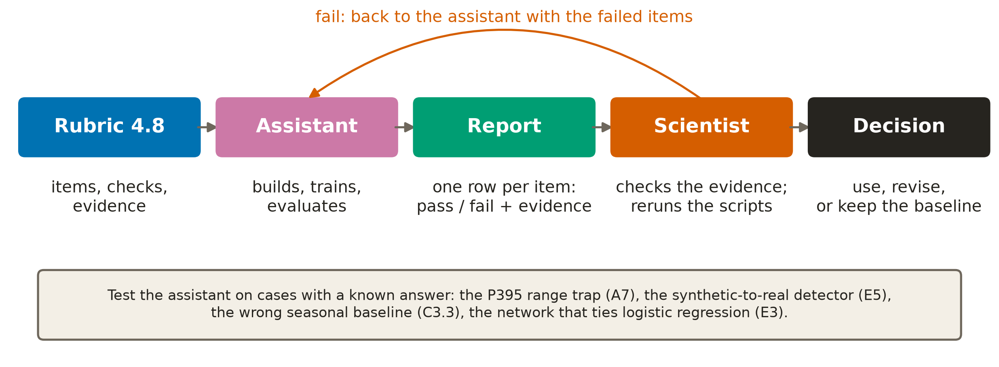

## {background-color="#faf7f2"}

[🧭]{.lecture-icon}

### Today's question

Three sessions, three networks.

**Given a geoscience dataset, which network should we try, and how will we know it was worth it?**

::: {.dim}
Reading: [4.8 A best-practice rubric for deep learning](https://geo-smart.github.io/mlgeo-book/mlgeo-4-8-dl-rubric) · review 4.1–4.4
:::

::: {.notes}
The fourth and last session on the core of deep learning. The first three each trained one kind of network: fully connected on tables (4.1, 4.2), convolutional on waveforms and maps (4.3), recurrent and attention on sequences (4.4). Each ended with best practices that became rubric items. Today we put them side by side: one framework that says which network fits which data, the evidence from our own notebooks and from the literature, and the rubric that a student or an AI assistant follows to build and judge a network. Ask the room before starting: for your project, which of the four kinds of data do you have?
:::

## The framework: data structure chooses the network

{.r-stretch}

::: {.takeaway}
Each layer assumes how its inputs are related. Choose the one whose assumption is true for your data.
:::

::: {.notes}
Three minutes. This is Table 1 of Battaglia et al. (2018, arXiv:1806.01261), redrawn with our examples. They call the assumption a relational inductive bias: "inductive biases which impose constraints on relationships and interactions among entities in a learning process". Read the columns. Fully connected: units, all-to-all, no assumption. Convolutional: grid elements, local relations, invariance to translation in space (or time, for a waveform). Recurrent: time steps, sequential relations, invariance to translation in time. Graph network: nodes, edges, invariance to the order in which nodes are listed. The value of an assumption comes from what it rules out: a convolutional layer does not have to learn a P wave separately at every position, so it needs far fewer weights and samples. When the assumption is false (a table of features has no neighbors), it costs instead of helps.
:::

## In the literature: one result for each kind of network



::: {.takeaway}
Each study chose the network that matches how its data are organized.
:::

::: {.notes}
Two minutes, one sentence per card. All four were in earlier lectures (21 and 1); today read them by the row of the framework they occupy. Full citations: Bolibar et al. (2020, The Cryosphere 14, 565-584, doi:10.5194/tc-14-565-2020); Ham, Kim and Luo (2019, Nature 573, 568-572, doi:10.1038/s41586-019-1559-7); Nearing et al. (2024, Nature 627, 559-563, doi:10.1038/s41586-024-07145-1); Lam et al. (2023, Science 382, 1416-1421, doi:10.1126/science.adi2336). Bolibar et al. (2020): a fully connected network on a table of topographic and climate features per glacier and year; the gain over Lasso (0.51 against 0.74 m water equivalent per year on held-out glaciers) comes from the nonlinear response to temperature and snowfall. Ham et al. (2019): a convolutional network on maps of sea surface temperature and heat content; locality and translation fit ocean anomalies that move. Nearing et al. (2024): an LSTM on daily sequences of weather; the memory carries the state of the basin. Lam et al. (2023), GraphCast: a graph network on a mesh of cells covering the globe, where each cell talks to its neighbors. Each also checked against a strong baseline, the habit of lecture 18.
:::

## Same seismic events, two structures

{.r-stretch}

[📍 In-situ sensor]{.gb .src} [🪨 Solid Earth]{.gb .sys .solid} [📈 Seismology]{.gb .disc .solid}

::: {.takeaway}
Pacific Northwest events as a table of features: random forests and our networks reach 87–89%. As waveforms and spectrograms: convolutional networks reach higher scores on the same curated set.
:::

::: {.credit}
Kharita, Denolle, Hutko, Hartog & Malone (2026), *Seismica* 5(1), Fig. 5. doi:10.26443/seismica.v5i1.2068. CC BY 4.0.
:::

::: {.notes}
Three minutes. Figure 5 of Kharita et al. (2026), seen in lecture 16: precision, recall and accuracy on the curated test set (10,000 traces per class, split 80:20) for deep models on waveforms and spectrograms (hatched) and feature-based models (solid). Lecture 21 quoted the summary: about 89% for the best random forest on features, above 92% for the convolutional networks on spectrograms. Our own numbers, on the course table of 61 features (4.1, 800 test events): logistic regression 86.8%, one hidden layer 87.1%, three hidden layers with dropout 89.2%, random forest 88.5%. On features, the kind of model barely matters: the features were designed by seismologists and already hold the information. The gain comes from changing the structure of the input to the record itself, with a network whose assumptions fit it. The same paper found the deep models held up better on the routine network data (lecture 16).
:::

## Same GNSS question, two structures

{.r-stretch}

[📍 In-situ sensor]{.gb .src} [🪨 Solid Earth]{.gb .sys .solid} [📐 Geodesy]{.gb .disc .solid}

::: {.takeaway}
As six summary numbers, the network does not beat linear regression. As a 90-day sequence, every sequence network beats persistence by about 13%. Compare each with its own baselines.
:::

::: {.notes}
Three minutes. Left: notebook 4.2, real station P395, test period 2023.6–2026.6: persistence 1.02 mm, linear regression 0.63, the fully connected network predicting the change 0.70 (MAE loss, mean of three seeds). Right: notebook 4.4, synthetic GNSS series with a 12 mm per year trend, seasonal loading and an earthquake step, validation error at the 30-day horizon: persistence 2.10 mm, the four sequence networks 1.83 to 1.87. The two panels are different stations and windows, so compare each model with its own baselines, not across panels. The lesson is the pattern: on hand-built summaries, a linear model already captures most of what can be predicted; given the sequence itself, a network can use the order of the days. Whether that gain holds on the real P395 sequence is a good project question, and a test the rubric would ask for (E5).
:::

## What an assumption buys: a pattern learned once

{.r-stretch}

::: {.takeaway}
A fully connected neuron trained on arrivals at one position detects none when the arrival moves by 0.08–0.25 s. The same weights slid along the record detect all of them.
:::

::: {.notes}
Two minutes; the figure of lecture 22. Green: one neuron with one weight per position in the window, trained on events whose P wave always arrives at the same time. Black: template matching, the same weighted sum slid over every lag, which is what a convolutional layer does with learned weights. The fully connected network would need training events at every position to recover; the convolutional layer gets the translation for free. That is the general argument: when an assumption is true for the data, building it into the network saves weights and samples. When it is false, it hurts: a convolution over 61 unordered features would invent neighbors that do not exist.
:::

## A decision guide

{.r-stretch}

::: {.takeaway}
Start from one data sample and ask what it is. The answer chooses the network, and also the baseline it must beat.
:::

::: {.notes}
Three minutes. Walk it top to bottom. A table of features: fully connected, after trees and linear models, which are often as good (4.1, 4.2). A grid where patterns can move: convolutional, after the classical filter, template or regression with the known terms (4.3). A sequence where the past informs the future: recurrent or attention, after persistence and a seasonal forecast (4.4). Stations or cells linked in a network: a graph network, after spatial interpolation; not covered in this course, but GraphCast is the example. Data with two structures combine layers: a radar map that changes in time uses convolution inside a recurrent layer (ConvLSTM, Shi et al. 2015, for precipitation nowcasting); a seismic picker combines convolution, recurrence and attention on a waveform. And when the physics is known, encode it (4.7, physics-informed networks). Rubric section B.
:::

## Best practices across the three networks

| | Fully connected | Convolutional | Recurrent, attention |
|---|---|---|---|
| Input | standardized features | normalized records | causal windows |
| Size it by | samples per weight | receptive field vs pattern | context vs memory |
| Baseline | linear, logistic, forest | STA/LTA, template | persistence, seasonal |
| Report | units, confusion matrix | score against SNR | error against horizon |

::: {.notes}
Leave this up; it is the design part of the rubric (section C) in one screen. The training and evaluation parts (D, E) are the same for all three: seeded random weights, a loss that fits the errors, training and validation loss at every epoch, a checkpoint, three seeds, the test set once, differences inside the seed spread reported as ties, and one test along the deployment axis (real records, a later period, another region).
:::

## The rubric drives the assistant; the scientist checks

{.r-stretch}

::: {.takeaway}
The assistant builds and reports one row per rubric item, with its evidence. The scientist checks the evidence and reruns the scripts. Failed items go back to the assistant.
:::

::: {.notes}
Four minutes. How we will use book section 4.8. Give the rubric to the coding assistant as its specification: before any model, it must report items A1 to A7 (sample, X, Y, deployment axis, split, baselines, ranges); then the design items for the network it chose, the training items and the evaluation items, each with its evidence (a code line, a figure, a table). Its report is a table of item, pass or fail, evidence. The scientist does not trust the table: she checks the evidence, reruns the scripts (F1), and sends back what fails. Then we test the assistant itself, as in lecture 19: on cases where we know the right answer. Four from this chapter: P395 predicted as a position (it should catch A7 before training), the synthetic detector applied to real records (E5), the seasonal baseline on a trending series (C3.3), and the network that ties logistic regression (E3). An assistant that misses these is not ready for your project.
:::

## Open 4.8 and your project

1. Write rubric section A for your project, with its evidence
2. Use the decision guide: which network, and which baseline?
3. Give 4.8 to your coding assistant on one task; collect its report
4. Check two items of its report yourself: was the evidence real?

::: {.dim}
Book section 4.8 · bring your report to the next project check-in
:::

::: {.notes}
Timing for 80 minutes: slides 30 minutes, project work 40, synthesis 10. Task 1 is the one to finish in class: most projects fail at A3 (no deployment axis named) or A6 (no baseline). Task 3 takes the assistant through one rubric section only, to keep it short. Synthesis question to collect: which rubric item did your assistant fail first, and which item is missing from the rubric? The answers become version 2 of book section 4.8.
:::
