## {background-color="#faf7f2"}

[🕸️]{.lecture-icon}

### Today's question

A seismic network is a set of stations at irregular places, and some of them miss every earthquake.

**How does a network learn from neighboring stations, and does it predict shaking at a silent station better than interpolation?**

::: {.dim}
Reading: [4.5 Graph networks](https://geo-smart.github.io/mlgeo-book/mlgeo-4-5-gnn) · training and evaluating any network: [lecture 24a](lec24a_train_and_evaluate.html)
:::

::: {.notes}
The deck of graph networks, tied to notebook 4.5 (mlgeo_4.5_GNN.ipynb). It opens and closes on the canonical networks of Chapter 4, with the graph row highlighted. The training loop and the leaderboard format are those of the reference deck, lecture 24a. Lecture 22 slid one kernel over a regular grid; lecture 23 carried a memory along a sequence. Today the data are stations at irregular places, in no particular order, and their number changes as instruments are installed or fail. We build three networks on one task, shaking at stations that did not record, and end at a leaderboard where the interpolation row and the floors from the known truth decide. Ask the room: who has looked at a USGS ShakeMap after an earthquake, and how do they think the colors between the stations are filled in?
:::

## Four canonical networks: today, graph networks

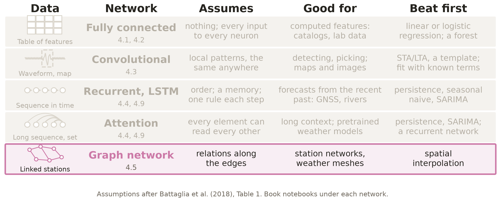{.r-stretch}

::: {.takeaway}
A station network has no grid and no order: stations are nodes, nearby stations are joined by edges, and the same weights apply at every station.
:::

::: {.notes}
Two minutes; the figure that opens and closes every deck of Chapter 4, last row: data, network, what it assumes, what it is good for, the baseline to beat first (assumptions after Battaglia et al. 2018, arXiv:1806.01261, Table 1). A graph network assumes that what matters is carried along the edges: a station's state is computed from the states of its neighbors. It assumes nothing about how many neighbors a station has or in which order the stations are listed. That is right for a seismic or GNSS network, a river network of gauges, or the mesh of a weather model. The baseline to beat first is spatial interpolation: inverse-distance weighting today, kriging in a real study. Drawn by figscripts/lec_framework.py.
:::

## This lecture in the literature

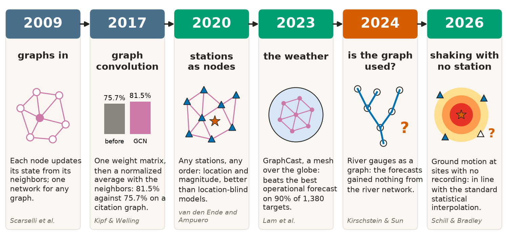{.r-stretch}

::: {.takeaway}
Neighbors pass messages, stations become nodes, the globe a mesh; then check that the graph helps, and run the baseline.
:::

::: {.credit}
Scarselli et al. (2009) *IEEE Trans. Neural Netw.* 20, 61–80 · Kipf & Welling (2017) *ICLR*, arXiv:1609.02907 (2016) · van den Ende & Ampuero (2020) *Geophys. Res. Lett.* 47, e2020GL088690 · Lam et al. (2023) *Science* 382, 1416–1421 · Kirschstein & Sun (2024) *ICML*, PMLR 235, 24713–24725 · Schill & Bradley (2026) *Earthquake Spectra* 42, e70094. Icons drawn.
:::

::: {.notes}
Two minutes. Scarselli et al. (2009) gave the full graph neural network model: a node's state is computed from its neighbors' states, so one network can read a graph of any size and shape. Kipf & Welling (2017) made it cheap: one shared weight matrix, then a normalized average over the node and its neighbors, the node itself included (the D̃^-1/2 (A + I) D̃^-1/2 of the graph-by-hand slide); it raised accuracy on the Cora citation graph from 75.7% (the best earlier method, Planetoid) to 81.5%, the mean of 100 runs, their Table 2. Gilmer et al. (2017, ICML, PMLR 70, 1263–1272) called the general recipe message passing, the word we use today. van den Ende & Ampuero (2020) brought it to seismology: stations are nodes that carry their coordinates and waveforms, so the network works with any number of stations, in any order, and it located earthquakes and estimated magnitudes better than models blind to station positions (their abstract). GraphCast (Lam et al., 2023) runs the same send, average, update step on a mesh around the globe and beat the most accurate operational deterministic system on 90% of 1,380 verification targets (abstract). Then the warning: Kirschstein & Sun (2024) gave a graph network the river network of central European gauges (LamaH-CE) and found that the discharge forecasts did not benefit from it; a later preprint (arXiv:2410.05536, not peer reviewed) argues that the topology helps, so call it debated. A graph in the architecture is a hypothesis to test. Schill & Bradley (2026) did today's task on New Zealand data, shaking at sites with no recording, and the graph network performed "in line with the established multivariate normal conditional" method (their abstract); the abstract claims a match, not a gain. Two Italian studies predict peak ground motion across a network with graph convolutions: Bloemheuvel et al. (2023, Int. J. Data Sci. Anal. 16, 317–332) and Trappolini et al. (2025, Seismica 4(2)), the second with stations masked as in our notebook. All citations checked against Crossref, PMLR or arXiv on 2026-11-24.
:::

## The task: shaking at stations that did not record

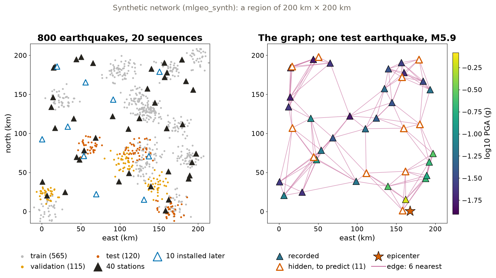{.r-stretch}

::: {.takeaway}
Node: a station. Edge: one station is among the other's 6 nearest. The question: log10 PGA at the 8 to 12 hidden stations, from the stations that recorded.
:::

::: {.notes}
Three minutes; geoscience first. After an earthquake, shaking is measured only where there are stations; ShakeMap fills in the rest with a ground-motion model and a site term for the ground under each location. Soft sediments amplify shaking, rock does not: seismologists call a station's average amplification its station term. The data are synthetic (mlgeo_synth.event_station_table, seed 0), so every term is known: 800 earthquakes of magnitude 3 to 6 in 20 sequences over one year, recorded by 50 stations in a region of 200 km by 200 km, with log10 PGA = 0.5 M − 1.5 log10(R + 10) − 1.0 + event term (standard deviation 0.25) + station term (0.15, from −0.29 to 0.30) + noise (0.1). Left: the split by sequence in time, 14 sequences train (565 earthquakes), 3 validate (115), 3 test (120); a random split by earthquake would put near-copies of a sequence on both sides. Ten stations (open triangles, drawn with default_rng(100)) are held out and "installed later" for test 2. Right: the 6-nearest-neighbor graph of the 40 training stations, 142 station pairs (284 directed edges), 6 to 10 neighbors each, median edge 39.6 km; and the largest test earthquake, M5.9, with one of its sets of hidden stations (11 here). Each data sample hides 20 to 30% of the stations, 8 to 12 of 40; training draws new hidden stations at every epoch, validation and test use 4 fixed sets per earthquake (460 and 480 data samples, 4,786 hidden test values). Magnitude and epicenter are not inputs. Numbers: figs/lec23b_gnn/numbers.json (figscripts/lec23b_gnn_numbers.py, a copy of the notebook's code); the map is drawn by figscripts/lec23b_gnn_figs.py from the same data.
:::

## Where graph networks fit

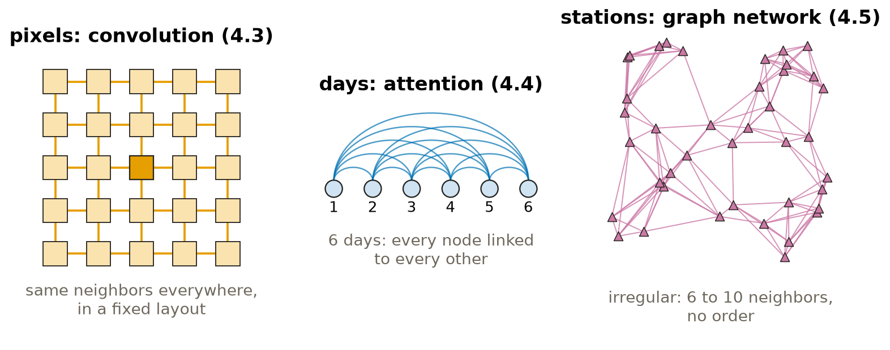{.r-stretch}

::: {.takeaway}
A convolution is a graph network on a grid of pixels; attention is a graph network in which every node is linked to every other. Stations need the general case.
:::

::: {.notes}
Two minutes; the bridge from lectures 22 and 23. Pixels: every pixel has the same neighbors in the same layout, so a convolution can give each relative position its own weight (the kernel) and slide it everywhere. Days with attention: every day is linked to every other day, and the weights of the average are computed from the data (query times key), not given by a graph. Stations: the neighbors are irregular, 6 to 10 per station in our graph (numbers.json), and there is no first or last station. A graph network keeps the two ideas that made convolution work, local neighbors and the same weights everywhere, and drops the grid. The message-passing layer of today even gets the "relative position" back, as edge features: the distance and the east and north offsets to each neighbor. Who is a neighbor is a choice of the scientist, made before training (rubric C4.1): the k nearest stations, or all stations within a radius in km.
:::

## Inside a graph network: two layers and a head

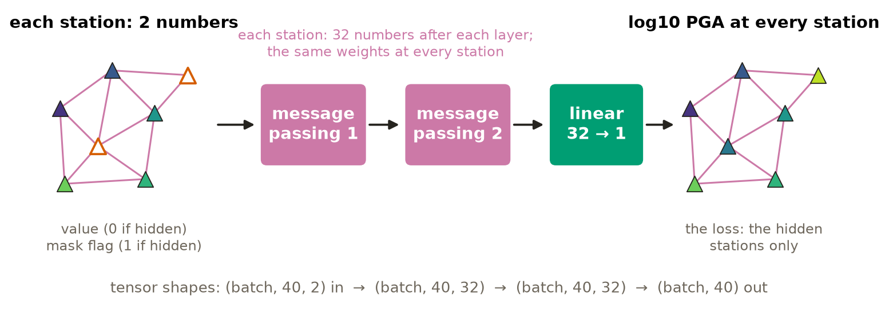{.r-stretch}

::: {.takeaway}
Each station enters with 2 numbers, its value and a mask flag; two message-passing layers give it 32; one linear head, the same at every station, gives its log10 PGA.
:::

::: {.notes}
Two minutes; the map of the next slides. Notebook 4.5's MessagePassing model. Input: for each of the 40 stations, the standardized log10 PGA (0 where hidden) and a mask flag (1 where hidden), so that the network can tell "no recording" from "average shaking"; tensor (batch, 40, 2). Standardization uses the training earthquakes only. Each message-passing layer computes a message along every edge, averages the messages arriving at each station, and updates the station: (batch, 40, 32). The head nn.Linear(32, 1) is applied to every station: (batch, 40). The loss is the mean squared error over the hidden stations of the batch; recorded stations are inputs and do not count. The graph convolution of section 7 has the same shape with a simpler layer. The colors drawn are illustrative.
:::

## The graph by hand: five stations

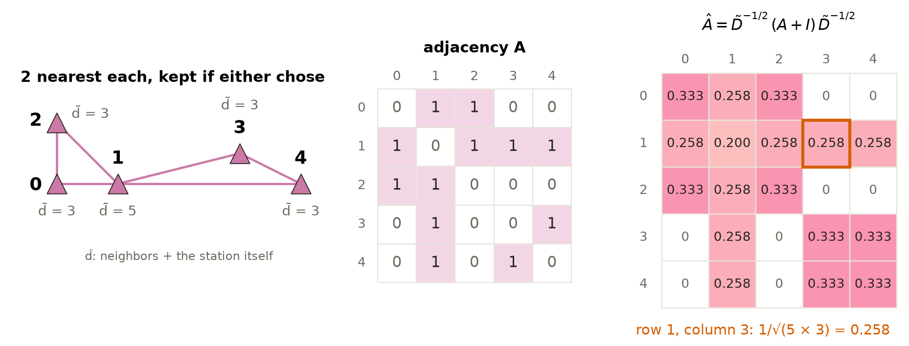{.r-stretch}

::: {.takeaway}
Each station picks its 2 nearest; an edge is kept if either picked it, and each station keeps itself. Station 1 has degree 5 with itself, so its weight for station 3 is 1/√(5 × 3) = 0.258.
:::

::: {.notes}
Three minutes; Your turn (1) of the notebook, do it with the room. Stations at (0, 0), (10, 0), (0, 10), (30, 5) and (40, 0) km. Nearest two: station 0 picks 1 and 2, station 1 picks 0 and 2, station 2 picks 0 and 1, station 3 picks 4 and 1, station 4 picks 3 and 1. "Nearest" is not symmetric: station 1 did not pick 3 or 4, but they picked it, so after symmetrizing station 1 has 4 neighbors, degree 5 counting itself. The normalized adjacency of Kipf & Welling: add the identity (each station keeps its own value), then divide each entry by the square root of the two degrees. Each row is a set of averaging weights over a station and its neighbors, and a neighbor with many neighbors weighs less. Row 0: 0.333, 0.258, 0.333. All values from numbers.json (your_turn_1), recomputed and checked in figscripts/lec23b_gnn_figs.py; the notebook's hidden answer prints the same matrix.
:::

## Message passing by hand: one station

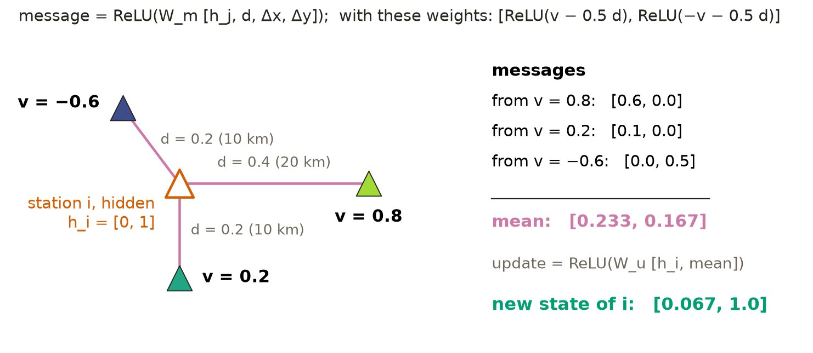{.r-stretch}

::: {.takeaway}
Three messages, [0.6, 0], [0.1, 0] and [0, 0.5]; their mean [0.233, 0.167]; the update gives the hidden station the state [0.067, 1.0].
:::

::: {.notes}
Three minutes; Your turn (2). Station i is hidden: h_i = [0, 1]. Its three neighbors recorded standardized values 0.8, 0.2 and −0.6; the edge features are distance, east and north offsets, divided by 50 km: [0.4, 0.4, 0], [0.2, 0, −0.2], [0.2, −0.12, 0.16]. The weights are set by hand, no biases. With these W_m the first number of a message is ReLU(v − 0.5 d), the second ReLU(−v − 0.5 d): the neighbor's value pulled toward 0, the training mean, by half its distance. 0.8 − 0.2 = 0.6; 0.2 − 0.1 = 0.1; 0.6 − 0.1 = 0.5 in the second number. Mean: [0.233, 0.167]. The update W_u subtracts the two numbers of the mean and carries the mask flag forward: [0.067, 1.0]. In this hand-set layer the offsets have zero weights; in the trained network W_m has 32 rows and every weight, offsets included, is learned. This is the difference from the graph convolution: the message depends on how far and in which direction the neighbor is. Values from numbers.json (your_turn_2), recomputed in the figure script.
:::

## How far one station sees: one layer, one hop

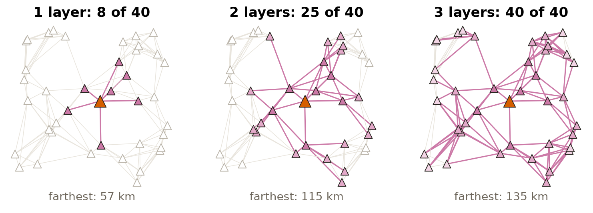{.r-stretch}

::: {.takeaway}
Each layer adds one ring of neighbors: on average 8, 16 and 27 of the 40 stations after 1, 2 and 3 layers. The notebook uses 2.
:::

::: {.notes}
Two minutes; the receptive field of lecture 22, on a graph. After one layer a station has heard from its direct neighbors; after two, from the neighbors of its neighbors. For the station closest to the center of the region (drawn, red): 8, 25 and 40 stations after 1, 2 and 3 layers, out to 57, 115 and 135 km. Averaged over the 40 stations: 8.1, 16.1 and 26.6 stations, the station itself included (from 7 to 11 after one layer, 10 to 29 after two). Computed from the 6-nearest-neighbor graph in figscripts/lec23b_gnn_figs.py, figs/lec23b_gnn/figs_numbers.json. How many layers is a physical choice: enough hops to reach the distance over which shaking stays correlated, not so many that every station averages the whole network. The notebook tested 3 layers: 0.132 ± 0.006 against 0.137 ± 0.005 for 2, inside the seed spread, for about 1.5 times the training time (42.7 s per message-passing run against 27.7 to 28.9 s; the `--layers 3` run of figscripts/lec23b_gnn_numbers.py quoted in notebook 4.5, section 9).
:::

## How many weights to fit?

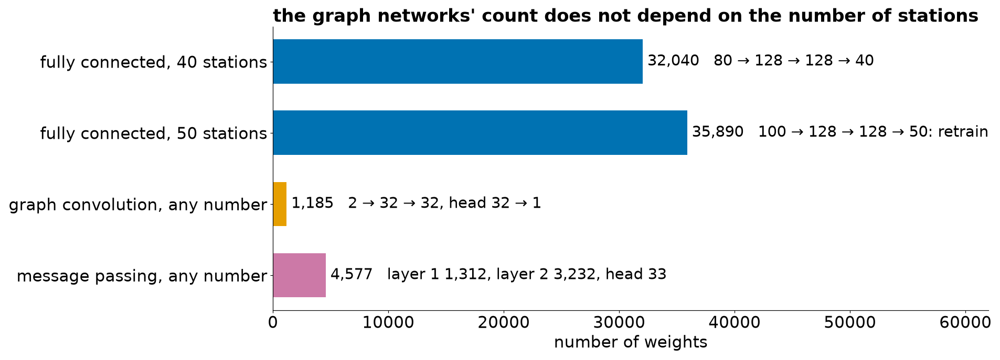{.r-stretch}

::: {.takeaway}
Fully connected: 32,040 weights for 40 stations, 35,890 for 50, and a new training. Graph convolution 1,185 and message passing 4,577, for any number of stations.
:::

::: {.notes}
One minute. Fully connected: 80 inputs (40 stations × 2 numbers) → 128 → 128 → 40 predictions: 80 × 128 + 128 = 10,368, 128 × 128 + 128 = 16,512, 128 × 40 + 40 = 5,160, total 32,040. Graph convolution: nn.Linear(2, 32) = 96, nn.Linear(32, 32) = 1,056, head 33: 1,185. Message passing: layer 1 has a message map (2 + 3 inputs → 32, 192 weights) and an update map (2 + 32 → 32, 1,120), layer 2 has 1,152 and 2,080, head 33: 4,577. The number of stations appears nowhere in the graph networks, as the 90 days appeared nowhere in the recurrent network of lecture 23: the same weights at every station. Counted by instantiating the notebook's classes in figscripts/lec23b_gnn_figs.py; the 40-station counts equal numbers.json and the notebook's printout.
:::

## Station order: the list is bookkeeping

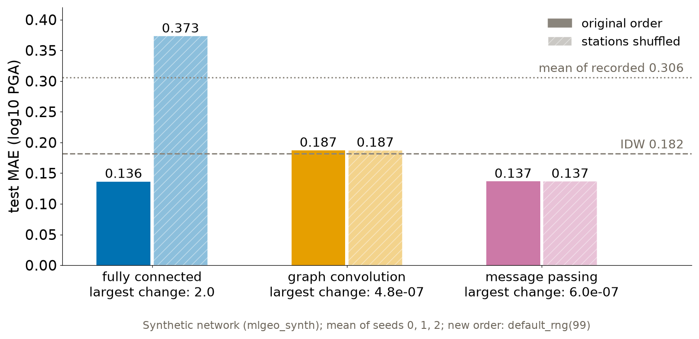{.r-stretch}

::: {.takeaway}
Reorder the station list: the fully connected network goes from 0.136 to 0.373, worse than the mean of recorded stations. The graph networks change by less than 1e-6.
:::

::: {.notes}
Two minutes; test 1 of the notebook and Your turn (3). The order in which we list the stations is not a property of the Earth. We draw a new order of the 40 stations (default_rng(99)), reorder the test inputs, rebuild the graph from the reordered coordinates, and predict with the trained networks, mean of seeds 0, 1 and 2. The fully connected network reads each input by its position: its test MAE goes from 0.136 to 0.373, above the mean of recorded stations (0.306), and one prediction changes by 2.0 in log10 PGA, a factor of 93 (10^1.97). The graph networks change by at most 4.8e-07 (graph convolution) and 6.0e-07 (message passing), the rounding of 32-bit numbers: a station's prediction depends on its own numbers and on its neighbors, found through the graph. The name is permutation equivariance. In practice, a fully connected network must be retrained when a station is renamed, swapped or reordered. Numbers: numbers.json, test1_station_order. Rubric C4.5.
:::

## The head: per station, per earthquake, or per pair

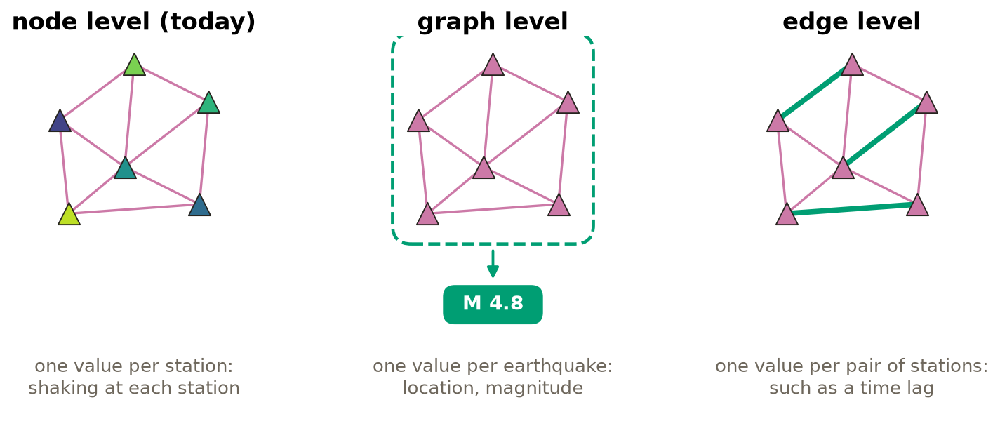{.r-stretch}

::: {.takeaway}
Node level: shaking at each station (today). Graph level: one value per earthquake, as van den Ende & Ampuero (2020) estimated location and magnitude. Edge level: one per station pair.
:::

::: {.notes}
One minute. The message-passing layers are the same in the three cases; what changes is what the head reads. Node level, notebook 4.5: one linear map applied to every station. Graph level: average or sum the states of all stations into one vector (pooling, the global average of lecture 22), then a head for the earthquake: van den Ende & Ampuero (2020) estimated the location and magnitude of an earthquake from the waveforms and coordinates of all the stations that recorded it. Edge level: a head on each pair of joined stations, for a quantity that belongs to the pair, such as the time lag between their records. The M 4.8 and the colors drawn are illustrative. The loss follows the head: squared error for log10 PGA, as in 4.5.
:::

## Leaderboard: hidden stations, three seeds (4.5)

| Model | Weights | Test error, log10 PGA | Training (s) |
|---|---|---|---|
| floor 2: noise only |  | 0.080 |  |
| fully connected | 32,040 | **0.136 ± 0.001** | 1.3 |
| message passing | 4,577 | 0.137 ± 0.005 | 28 |
| floor 1: station term + noise |  | 0.138 |  |
| IDW (interpolation) | 0 | 0.182 | 0 |
| graph convolution | 1,185 | 0.187 ± 0.000 | 2.8 |
| mean of recorded stations | 0 | 0.306 | 0 |

: {tbl-colwidths="[42,16,26,16]"}

::: {.takeaway}
Message passing ties the fully connected network, and both beat IDW by 25% by learning the station terms. The graph convolution only smooths, like IDW.
:::

::: {.notes}
The leaderboard format of lecture 24a: ranked by the score, baselines and floors as rows, weights and time as the cost. Mean absolute error over the 4,786 hidden test values, in log10 PGA; mean ± sample standard deviation over seeds 0, 1, 2. As factors: 1.37 for the two networks, 1.52 for IDW, 2.02 for the mean. Read the floors first: floor 1 is what is left if the median attenuation and the event term were known exactly (the station term plus noise), floor 2 if the station terms were known too (noise only); only synthetic data can give them. Both networks sit at floor 1 even though they do not know the earthquake: they gain the error back by learning each station's term (next slide). 25%: (0.182 − 0.136)/0.182, and 0.137 gives 25% too. The fully connected network and message passing tie: 0.136 ± 0.001 against 0.137 ± 0.005, per seed 0.137, 0.137, 0.136 against 0.135, 0.142, 0.132. The graph convolution is slightly worse than IDW (0.187 against 0.182, seed spread 7e-5). Near the epicenter every method is far from floor 1: 0.291 for message passing and 0.392 for IDW within 40 km, against 0.149 for floor 1; no method is given the epicenter (rubric C4.6). All three message-passing runs reached the 200-epoch limit (best epochs 194, 190, 193). Training times: wall-clock seconds per run, one CPU thread on a laptop, mean of the three seeds, as the notebook's leaderboard prints them (1.35, 2.83 and 27.7 s); the rerun in numbers.json gave 1.37, 2.94 and 28.9 s, so they vary by about a second from run to run. Source: figs/lec23b_gnn/numbers.json from figscripts/lec23b_gnn_numbers.py, which equals the notebook's printed leaderboard in every score.
:::

## Where the gain comes from: station terms

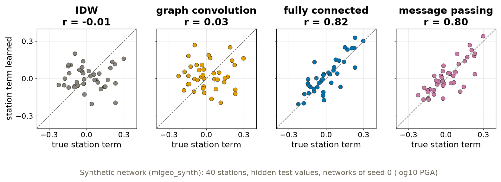{.r-stretch}

::: {.takeaway}
Station terms learned (seed 0) at r = 0.82 (fully connected) and 0.80 (message passing). IDW and the graph convolution learn none: r = −0.01 and 0.03.
:::

::: {.notes}
Two minutes. For each of the 40 stations, the term a method applied: the mean over its hidden test values of (prediction − median attenuation − event term), against the true station term, networks of seed 0 (r over three seeds: 0.83 and 0.80, numbers.json). IDW gives every station the average of its neighbors, so a station on soft ground is always under-predicted. The fully connected network learns a station's term from its position in the input list; the message-passing network has no coordinates and no station numbers, so it learns it from the pattern of distances and offsets to its neighbors, which differs from station to station. The graph convolution sees only who is a neighbor, not how far or in which direction, and every station with a similar neighborhood is treated alike. Hold the message-passing trick in mind: the next slide is what it costs. Values: numbers.json, site_terms_seed0.
:::

## New stations: the deployment test

| Method | 10 new stations | Hidden old stations |
|---|---|---|
| floor 1: station term + noise | 0.193 | |
| graph convolution | 0.199 ± 0.000 | 0.188 ± 0.001 |
| IDW (interpolation) | 0.200 | 0.182 |
| message passing | 0.233 ± 0.008 | 0.196 ± 0.020 |
| mean of recorded stations | 0.319 | 0.306 |
| fully connected | cannot run | cannot run |

: {tbl-colwidths="[44,28,28]"}

::: {.takeaway}
The graph networks run on the grown network; the fully connected one cannot. At the new stations none beats IDW by a useful margin: a new station has no history.
:::

::: {.notes}
Three minutes; test 2, rubric C4.3 and E5. The 10 stations held out since the split are installed after training: we build the graph of all 50 stations, hide the new ones in every test data sample, keep the same hidden old stations, and predict with the networks trained on 40. The fully connected network cannot run: its first layer expects exactly 80 inputs. IDW is close to the floor (0.200 against 0.193). The floor is higher than on the old stations because, with data seed 0, the new stations sit on ground with larger station terms (root mean square 0.200 against 0.133). The graph convolution and IDW differ by 0.001, a negligible difference. Message passing is worse, 0.233: it applies station terms at the new stations as if it knew them (standard deviation 0.15) but they correlate with the true ones at only r = 0.33 (10 stations, seed 0). Growing the network also hurts it at the old stations, 0.137 to 0.196, because the new stations changed the neighborhoods by which it recognized each station. The optional exercise (section 12, figscripts/lec23b_gnn_numbers.py --subnetworks) trains on random sub-networks: 0.149 on the fixed network, 0.220 at the new stations, 0.168 at the hidden old ones, so better than IDW on the old stations and still not on the new ones. The physics: a station term is learned from a history of recordings. ShakeMap does not learn it either; it uses Vs30, the shear-wave velocity of the top 30 m mapped from geology and topography, which a graph network could take as a node feature. Numbers: numbers.json, test2_new_stations and test2_site_terms; the exercise: numbers_subnetworks.json, quoted in the notebook.
:::

## Best practices: graph networks

| Step | Practice | Rubric |
|---|---|---|
| Graph | k nearest or a radius, from the correlation distance | C4.1 |
| Edges | distance and direction, with their scale | C4.2 |
| Split | sequences in time; stations held out | C4.3 |
| Baseline | IDW or kriging, same hidden stations | C4.4 |
| Test | shuffle the stations; grow the network | C4.5, E5 |
| Evaluate | error against distance to the source | C4.6 |

: {tbl-colwidths="[17,68,15]"}

::: {.notes}
Leave this up. Each row is a line of the rubric in book section 4.7, section C4, with today's numbers. C4.1: k = 6, 284 directed edges, 6 to 10 neighbors, median distance to a neighbor 39.6 km; justify k (or a radius in km) against the distance over which shaking stays correlated. C4.2: distance, east and north offsets, divided by 50 km; without them a layer can only smooth (the graph convolution, 0.187). C4.3: 14, 3 and 3 sequences in time order, plus 10 stations never seen in training. C4.4: IDW on the same 4,786 hidden test values, and with synthetic data the two floors. C4.5: the largest change of a prediction after reordering, 6.0e-07 for message passing. C4.6: 0.291 within 40 km of the epicenter against 0.137 overall. E5, the deployment test: the 10 new stations. The rubric grows by these items today.
:::

## Now build it yourself: open 4.5

1. `pixi run jupyter lab` → `mlgeo_4.5_GNN.ipynb`, Your turn (1): the adjacency of five stations
2. Your turn (2): one message-passing update by hand
3. Your turn (3): shuffle the station order; print the largest change
4. Optional, section 12: train on random sub-networks, then rerun test 2

::: {.dim}
PyTorch names: `nn.Linear`, `A_hat @ h`, `h[:, src]`, `S @ m`; no graph library needed · the notebook runs in under 2 minutes on a laptop CPU · training block: [lecture 24a](lec24a_train_and_evaluate.html)
:::

::: {.notes}
Timing for the 80-minute block (10:00 to 11:20): pulse talks about 10 min, this deck about 20 min, guided notebook work about 40 min, synthesis about 10 min. Have everyone start "Run all" first: the full notebook takes about 100 s on a laptop CPU (99.5 s from the first cell to the last in the cell timestamps of the executed notebook; Apple M1 Max, one thread), most of it the three message-passing runs; the three Your-turn cells need only the cells above them. Priorities if time is short: task 3, because the permutation test is the property that justifies a graph network, then task 1. Expected answers: degrees with self-loop [3, 5, 3, 3, 3] and 0.258 (task 1); messages [[0.6, 0], [0.1, 0], [0, 0.5]], mean [0.233, 0.167], new state [0.067, 1.0] (task 2); a largest change of about 5e-07 (task 3, the notebook prints 4.8e-07). Implementation: the notebook writes the layers in plain PyTorch, so students see every operation; `h[:, src]` collects the sending station of every edge and `S @ m` averages the messages arriving at each station. Libraries such as PyTorch Geometric do the same with sparse operations for large graphs. Synthesis question to collect: in your project's data, what would a node be, what would an edge be, and what is the interpolation baseline?
:::

## Where graph networks fit

{.r-stretch}

::: {.takeaway}
Graph networks: for stations at irregular places, in any number and order. Here message passing tied the fully connected network; at new stations nothing beat IDW by a useful margin.
:::

::: {.notes}
The closing statement, the same figure as the opening. A graph network is the right structure when the order of the stations means nothing and the network changes; whether it adds skill is a measurement against interpolation and, where possible, floors from a known truth. Today it tied a fully connected network on a fixed network and failed where the information was missing, at stations without a history. The next sessions: the training block (4.7, lectures 24a, 24 and 25), then forecasting (4.9, lecture 26), with autoencoders (4.6) and physics-informed networks (4.8) as enrichment.
:::
