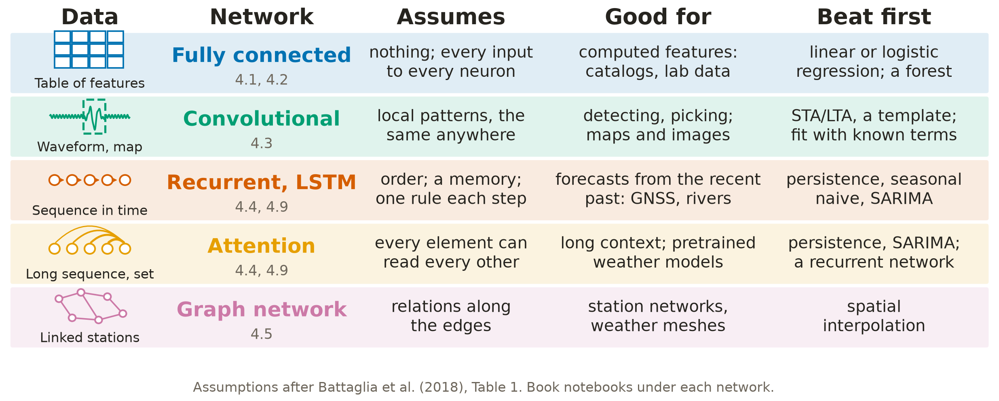
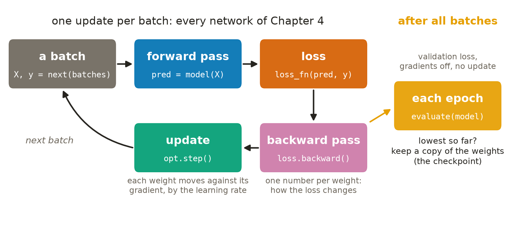
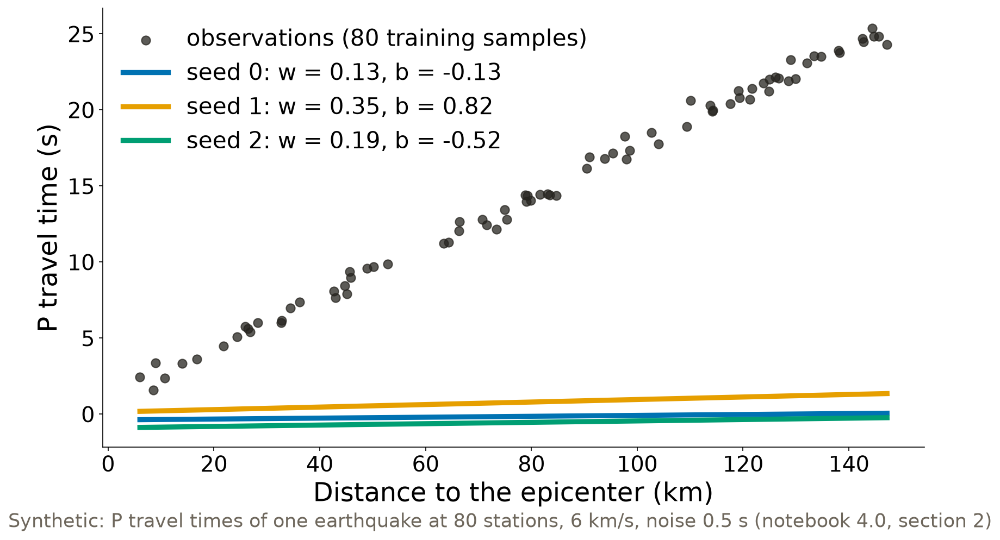
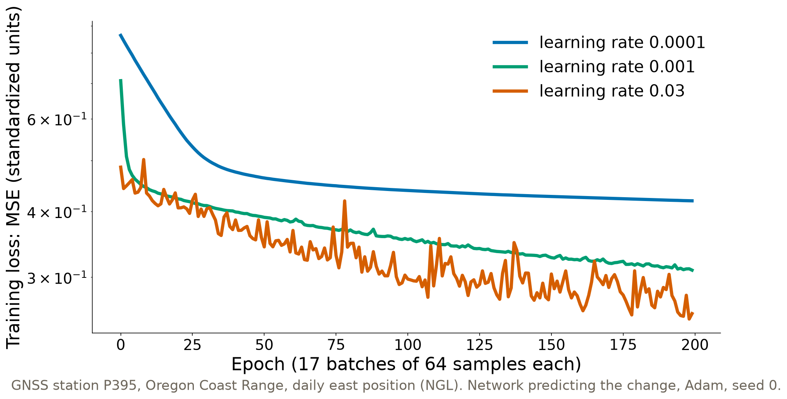
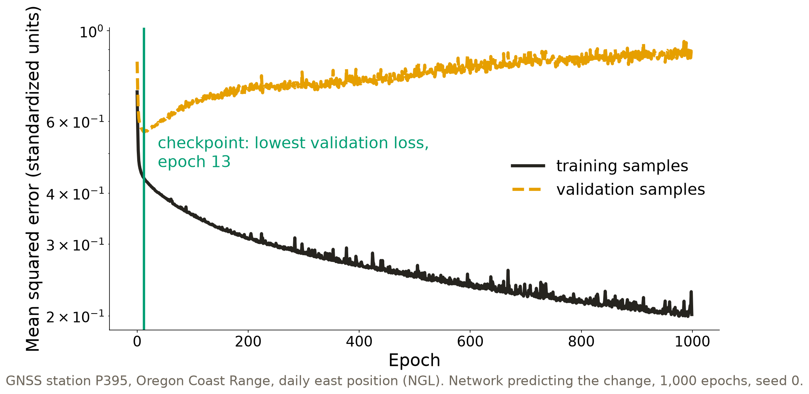
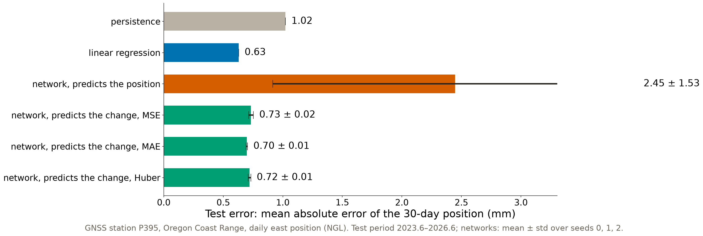

## {background-color="#faf7f2"}

[🏁]{.lecture-icon}

### The question of this deck

Every network of Chapter 4 is trained by the same loop and judged by the same table.

**How do we train a network, and how do we publish a score that others can trust?**

::: {.dim}
Lab: [4.7 Training and evaluating a network](https://geo-smart.github.io/mlgeo-book/mlgeo-4-7-modeltraining) · rubric: [4.7, continued](https://geo-smart.github.io/mlgeo-book/mlgeo-4-7-dl-rubric) · a reference deck, updated as the course goes
:::

::: {.notes}
A reference deck, not one lecture: it opens the 4.7 lab (Wed Nov 25) and is the slide set to return to for HW-DL, the 4.9 forecasting leaderboard and the projects. Part 1 is the training loop and its checks; part 2 is evaluation, ending with how to publish a leaderboard. Every number is from a notebook of the chapter, and each slide names which. The decks for each kind of network (21b fully connected, 22 convolutional, 23 recurrent and attention, 23b graph networks) end with their own leaderboard in the format of part 2.
:::

## Four canonical networks, one way to train them

{.r-stretch}

::: {.takeaway}
The data choose the network. The loop that trains it and the table that judges it are the same for all four.
:::

::: {.notes}
The statement that opens and closes every deck of Chapter 4. Read one row: a sequence in time (data), recurrent network (network, notebooks 4.4 and 4.9), it assumes order and a memory, it is good for forecasts from the recent past, and it must first beat persistence, seasonal naive and SARIMA. Everything that follows in this deck applies to every row. Drawn by figscripts/lec_framework.py; assumptions after Battaglia et al. (2018, arXiv:1806.01261), Table 1.
:::

## Part 1. Training: one loop for every network

{.r-stretch}

::: {.takeaway}
Four lines per batch, one check per epoch. A fully connected, convolutional, recurrent, attention or graph network changes only `model`.
:::

::: {.notes}
Walk the ring once. A batch of samples and their observations; the forward pass gives predictions; the loss compares them with the observations (one number, the mean over the batch, rubric D3); the backward pass gives one gradient per weight; the optimizer moves each weight against its gradient, scaled by the learning rate. After all batches, one epoch: the validation loss, with gradients off and no update, and a copy of the weights when it is the lowest so far. This is train_model in 4.3, 4.4 and 4.7, the loop in 4.1, and train in 4.5, where the graph of the stations is one more input of `model`. Drawn by figscripts/lec23_training_loop.py; no data.
:::

## The loop in code

::: {style="font-size: 1.12em;"}
```{.python code-line-numbers="false"}
torch.manual_seed(0)                              # seeded random starting weights
model = make_model()
opt = torch.optim.Adam(model.parameters(), lr=1e-3)
best = float("inf")
for epoch in range(n_epochs):
    model.train()
    for X, y in train_loader:                     # one update per batch
        opt.zero_grad()
        loss = loss_fn(model(X), y)               # mean loss over the batch
        loss.backward()                           # one gradient per weight
        opt.step()                                # the update
    model.eval()
    with torch.no_grad():                         # validation: no gradient, no update
        val = sum(loss_fn(model(X), y).item() for X, y in val_loader) / len(val_loader)
    if val < best:                                # the checkpoint
        best, best_state = val, copy.deepcopy(model.state_dict())
model.load_state_dict(best_state)
```
:::

::: {.notes}
The drawing of the previous slide, line by line; train_model in notebook 4.3 section 4.3 is this loop plus the bookkeeping of accuracy and the learning curves. Three lines students forget: opt.zero_grad() (PyTorch adds gradients up between batches otherwise), model.train() and model.eval() (dropout and batch normalization act differently in the two), and torch.no_grad() for validation. Ask the room to point at the line where each rubric item lives: D1 the seed, D3 the batch mean, D6 the checkpoint.
:::

## Before the first epoch: four checks

| Check | What goes wrong without it | Rubric |
|---|---|---|
| Split along how the model will be used | a random split leaks neighbors into validation | A3, A4 |
| Scale with training statistics only | the validation set leaks into training | A5 |
| A baseline that learns nothing | no number to beat | A6 |
| Print the ranges of X and Y | the network extrapolates, silently | A7 |

::: {.notes}
Rubric section A of book section 4.7; these come before any training. Examples from the chapter. Split: P395 was split in time with a 30-day gap (lecture 21b); the 4.4 GNSS windows are split at 8 years with no window crossing. Scaling: the 4.4 series is standardized with the mean and standard deviation of the first 8 years only. Baseline: persistence, 2.10 mm at the 30-day horizon in 4.4. Ranges: P395's test positions (−132 to −111 mm) lie entirely below the training range (−94 to 0 mm), and every network that predicted the position failed; predicting the change fixed it (lecture 21b, figs/lec21b_train_evaluate/numbers.json).
:::

## The loss fits Y and its errors

| Y | Last layer | Loss (rubric D2) |
|---|---|---|
| a class | one score per class | cross-entropy |
| a rare class | one score per class | cross-entropy with class weights |
| a number, Gaussian errors | one number | squared error |
| a number, heavy tails | one number | absolute error, Huber |
| a number with its σ | one number | squared error × 1/σ² |

::: {.notes}
The loss is a statement about the errors you expect. 4.1 and 4.2 (lecture 21b) show the first and the fourth row: on P395 the absolute-error loss gave 0.70 mm against 0.73 for squared error, three seeds each. The rare class: 4.7 section 3.3, andesite recall with and without class weights. The weighted loss: 4.7 section 3.4 and lecture 24, mixed lab- and field-grade samples, 0.933 accuracy ignoring σ and 0.946 weighting by 1/σ².
:::

## Start from seeded random weights

{.r-stretch}

::: {.takeaway}
Random, so that the neurons of a layer differ; seeded, so that the run can be repeated. Never zeros: every neuron would get the same gradient.
:::

::: {.notes}
The figure of lecture 21 (notebook 4.0 section 2): three seeds, three starting lines, all far from the data. With all weights at zero, every neuron of a hidden layer computes the same output and receives the same gradient, so they stay identical: a layer of 32 neurons behaves like one. PyTorch draws random weights by default, scaled to the size of the layer; torch.manual_seed fixes the draw. 4.7 section 5.1 measures what the starting weights do. Rubric D1.
:::

## The learning rate sets how fast the loss falls

{.r-stretch}

::: {.takeaway}
Adam, same network, same seed. 0.0001 crawls, 0.001 descends, 0.03 jumps. Start at 0.001 and look at the curve.
:::

::: {.notes}
Lecture 21b, P395 network predicting the change, 200 epochs. If the loss crawls, raise the learning rate by 3 to 10; if it jumps or diverges, lower it. Batch size is the other setting: a larger batch gives a smoother, slower descent; 4.7 sections 5.2 and 5.3 measure both. Recurrent networks add gradient clipping (torch.nn.utils.clip_grad_norm_) when the gradient through many steps explodes. Rubric D5.
:::

## Stop at the lowest validation loss

{.r-stretch}

::: {.takeaway}
Training loss falls for 1,000 epochs; validation loss is lowest at epoch 13. Keep those weights: the checkpoint.
:::

::: {.notes}
Lecture 21b, P395, 1,000 epochs, seed 0. A falling training loss is not progress: from epoch 13 the network fits details of the training years that do not come back. In order: early stopping with a checkpoint, a smaller network, then dropout or weight decay once the curves part. Rubric D4, D6.
:::

## Read the two curves

| Training loss | Validation loss | Diagnosis | First fix |
|---|---|---|---|
| high, flat | high, flat | learns nothing | learning rate; check the inputs |
| jumps | jumps | learning rate too large | divide it by 3 to 10 |
| falls | falls with it | still learning | more epochs |
| falls | lowest, then rises | overfitting | checkpoint; smaller network; dropout |
| low | far above, from the start | validation unlike training | the split, the ranges (A4, A7) |

::: {.notes}
Rubric D4: the two curves at every epoch are the first evidence of any training. Each row was met in the chapter. Jumps: lecture 21b at learning rate 0.03. Overfitting: the three-layer network of 4.1 without dropout, validation loss lowest at epoch 11 (figs/lec21b_train_evaluate/numbers_classification.json). Validation unlike training: P395 predicting the position, test observations outside the training range. 4.7 section 7 gives six broken runs to diagnose with this table.
:::

## The training checklist, for any network

| Step | Practice | Rubric |
|---|---|---|
| Before | split, scale, baseline, ranges | A3–A7 |
| Start | seeded random weights | D1 |
| Loss | fits Y and its errors; class weights if unbalanced | D2, D3 |
| Optimizer | Adam at 0.001; look at the curve | D5 |
| Stop | lowest validation loss; checkpoint | D4, D6 |
| Repeat | three seeds | D7 |

::: {.notes}
Rubric sections A and D of book section 4.7 on one screen. Notebook 4.7 measures most rows on one task. Now, part 2: what to do with the trained networks.
:::

## Part 2. Evaluating: one run is one draw

{.r-stretch}

::: {.takeaway}
Predicting the position: 1.15 to 4.60 mm over three seeds. Predicting the change: 0.70 to 0.73 mm. A gap inside the spread is a tie.
:::

::: {.notes}
Lecture 21b, test error on P395, seeds 0, 1 and 2 (figs/lec21b_train_evaluate/numbers.json). The spread over seeds is the noise floor of any comparison: differences smaller than it are ties (rubric D7, E3). For a classifier with one split, one standard error of an accuracy p on n test samples, √(p(1−p)/n), gives the same floor: 1.2 points on the 800 events of 4.1.
:::

## A leaderboard is a contract

| Fixed before any model | Why |
|---|---|
| the split, and who holds the test set | a score on data used for choices is not a test |
| one metric, in physical units | mm, °C, accuracy per class: readers compare |
| baseline rows: no learning, classical | the score means nothing without them |
| three seeds; mean and spread | a gap inside the spread is a tie |
| weights and training time per row | the cost of each point of skill |
| the test set is scored once | after every choice, on validation (D8) |

::: {.notes}
A leaderboard is how a community compares models: the M-competitions for forecasting (Makridakis et al. 2018, lecture 23), WeatherBench for weather models, the course's own classification (3.5) and forecasting (4.9) leaderboards. Everything in the left column is fixed before the first model is trained, and written down. Then every row of the table, including the baselines, is computed the same way. Rubric D7, D8, E1, E2, E3.
:::

## A leaderboard: P395, 30 days ahead

| Model | Weights | Test error (mm), 3 seeds |
|---|---|---|
| linear regression | 7 | **0.63** |
| network on the change, absolute error | 1,313 | 0.70 ± 0.01 |
| network on the change, Huber | 1,313 | 0.72 ± 0.01 |
| network on the change, squared error | 1,313 | 0.73 ± 0.02 |
| persistence | 0 | 1.02 |
| network on the position | 1,313 | 2.45 ± 1.88 |

::: {.takeaway}
The linear model wins; the three losses tie; predicting the position loses to doing nothing.
:::

::: {.notes}
Notebook 4.2 and lecture 21b (figs/lec21b_train_evaluate/numbers.json): mean absolute error of the position 30 days ahead, test period 2023.6–2026.6, mean ± sample standard deviation (n − 1, the pandas default) over seeds 0, 1, 2; numbers.json stores the standard deviation with n (1.53 for the position network). Linear regression and persistence are deterministic. Weights: the 4.2 network has 224 + 1,056 + 33 = 1,313 (figs/lec21b_mlp/numbers.json); linear regression has 6 coefficients and an intercept. Read it top to bottom: the best model is the cheapest learned one; the three losses differ by less than two spreads; the position network is worse than persistence and its spread is a warning in itself.
:::

## Public score, hidden score

| Leaderboard | Public holdout | Hidden holdout | Graded on |
|---|---|---|---|
| source classification (3.5) | scored by CI on each pull request | instructor's test set | hidden |
| CO₂ forecast (4.9, track A) | NOAA months, public | none | not graded |
| synthetic GNSS forecast (4.9, track B) | none | private seed | hidden |

::: {.takeaway}
A holdout that anyone can see is a diagnostic. A gap between the public and the hidden score is the overfitting signal.
:::

::: {.notes}
From book/leaderboard_standings.md and lecture 26. The public score lets every team check its pipeline; the hidden one is what was not used for any choice (rubric E5). Track A of 4.9 can be gamed by copying public numbers, and the book says so: the lesson is that a leaderboard is only as meaningful as its holdout is inaccessible.
:::

## Publish your leaderboard in code

::: {style="font-size: 1.12em;"}
```{.python code-line-numbers="false"}
rows = []
for name, make_model in models.items():
    for seed in (0, 1, 2):
        torch.manual_seed(seed)
        model = make_model()
        train(model, train_loader, val_loader)            # the loop of part 1
        rows.append(dict(model=name, seed=seed,
                         weights=sum(p.numel() for p in model.parameters()),
                         score=evaluate(model, val_loader)))
for name, score in baselines.items():                     # rows that learn nothing
    rows.append(dict(model=name, seed=0, weights=0, score=score))
board = (pd.DataFrame(rows).groupby("model")
         .agg(weights=("weights", "first"), mean=("score", "mean"), spread=("score", "std"))
         .sort_values("mean"))
print(board.round(2).to_markdown())
```
:::

::: {.notes}
Fifteen lines that make every table of this deck. Scored on validation while choices are being made; the test set replaces val_loader once, at the end, for the final table. sort_values ascending for an error; ascending=False for an accuracy. HW-DL and the project ask for this table with its baseline rows.
:::

## The evaluation checklist, for any network

| Step | Practice | Rubric |
|---|---|---|
| Units | error in mm, °C, s; per class for a classifier | E1, E2 |
| Baselines | rows of the same table, same split | A6 |
| Spread | three seeds; gaps inside it are ties | D7, E3 |
| Physics | error against SNR, distance, season, lead time | E4 |
| Test | once, after every choice | D8 |
| Deploy | one test along the deployment axis | E5 |

::: {.notes}
Rubric section E of book section 4.7. E4 is where the network says something about the system: the detector's score against SNR (4.3), the forecast error against lead day (4.4, 4.9), the error within 40 km of the epicenter (4.5). E5 is the test that was not used for any choice: a later period, another region, stations installed after training (4.5), real records for a model trained on synthetics (HW-DL).
:::

## Four networks, one loop, one leaderboard

{.r-stretch}

::: {.takeaway}
Choose the row from the data. Train it with the loop, judge it on the leaderboard, beside the baseline of its last column.
:::

::: {.notes}
The closing statement, the same figure as the opening. Where students use this deck next: 4.7 (labs, Wed Nov 25 and Mon Nov 30), HW-DL (due Fri Dec 4, a leaderboard with baseline rows on real miniPNW records), the 4.9 forecasting leaderboard (opens Wed Dec 2), and the deep-learning project milestone.
:::
