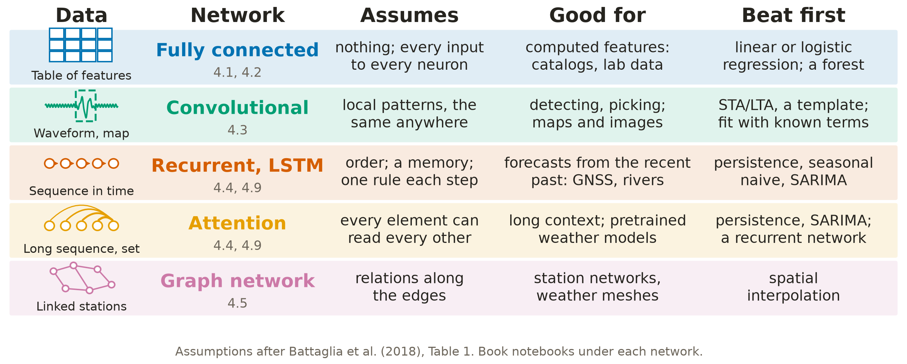
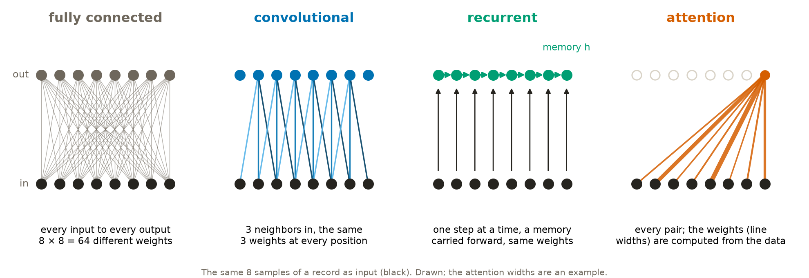
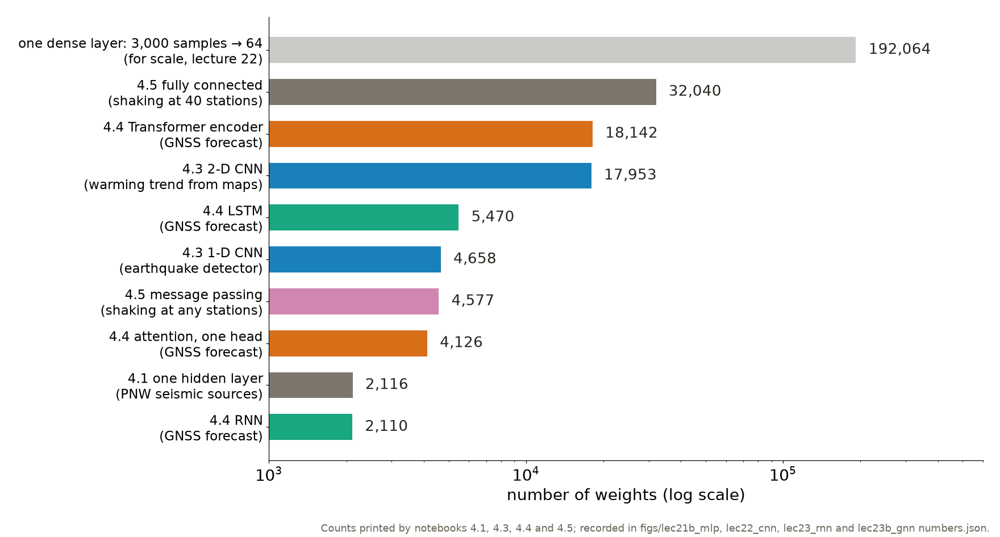
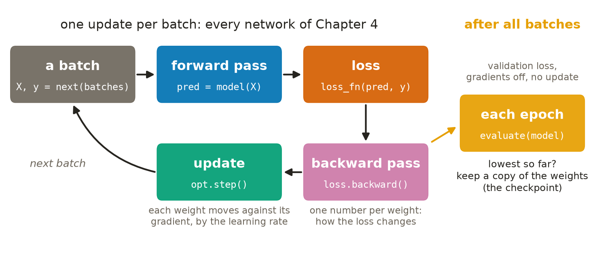
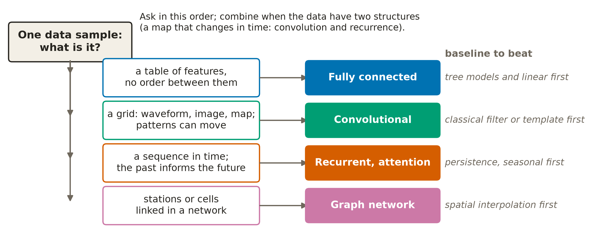

## {background-color="#faf7f2"}

[🧭]{.lecture-icon}

### The question of the chapter

Fully connected, convolutional, recurrent, attention, graph.

**Given a geoscience dataset, which network, which baseline, and how do we know it was worth it?**

::: {.dim}
Reference deck for the end of Chapter 4 and for projects · rubric: [4.7](https://geo-smart.github.io/mlgeo-book/mlgeo-4-7-dl-rubric)
:::

::: {.notes}
A deck to come back to, not a new lecture: every number on it was measured in a notebook of this chapter, and each slide names where. Use it at the end of Chapter 4, at the project check-ins, and whenever a team has to justify its choice of network. Order: what each network assumes and connects; what it costs in weights; how each one did against its baseline in this chapter; the training loop and checklist they all share; the design checks that differ; the failures we met; the decision guide; the literature.
:::

## The canonical networks, and what each is good for

{.r-stretch}

::: {.takeaway}
Each layer assumes how its inputs are related. Choose the one whose assumption holds for your data.
:::

::: {.notes}
The statement that opens and closes every deck of Chapter 4; assumptions after Table 1 of Battaglia et al. (2018, arXiv:1806.01261). Fully connected: no assumption, every input to every unit. Convolutional: local relations, the same pattern anywhere in space or time. Recurrent: order, and the same rule at every time step. Graph: relations along the edges of a network of stations or cells, independent of the order in which the nodes are listed (lecture 23b, notebook 4.5: shaking at seismic stations without a recording; GraphCast is the example on a global mesh). The value of an assumption is what it rules out: when it holds, the network needs fewer weights and fewer samples; when it is false, it costs.
:::

## What one layer connects

{.r-stretch}

::: {.takeaway}
Dense: all pairs, all different. Convolution: neighbors, shared. Recurrence: one step at a time, with memory. Attention: all pairs, weighted by the data.
:::

::: {.notes}
The same 8 samples of a record, four layers. Fully connected: 64 different weights, so a pattern learned at one position is not known at another (lecture 21, the shift-blindness figure). Convolution: 3 weights reused at every position; how far one output sees grows with depth (the receptive field, lecture 22). Recurrence: the same weights at every step, and a memory h that carries the past forward; a spike fades by about w_h per step (lecture 23), the LSTM's gates slow that fading. Attention: every output can read every input directly, nothing fades with distance, and the weights are computed from the data by the softmax of query-key scores; the cost is a table of n × n weights, and positions must be added because attention alone is blind to order. Drawn by figscripts/ch4_compared.py; the attention widths are an example.
:::

## How many weights?

{.r-stretch}

::: {.takeaway}
Every network of the chapter has 2,000 to 32,000 weights. One dense layer on a 30-s record would need 192,064: sharing weights is what keeps them small.
:::

::: {.notes}
Counts printed by the notebooks (torchinfo or a sum over model.parameters()), recorded with the lecture figures. 4.1 one hidden layer of 32 on 61 features, 2,116. 4.3 1-D detector, three convolution blocks, 4,658. 4.3 2-D CNN on 30 yearly maps, 17,953. 4.4: RNN 2,110, LSTM 5,470 (four gates), one attention head 4,126, Transformer encoder 18,142. 4.5 (figs/lec23b_gnn/numbers.json): fully connected on 40 stations × 2 numbers, two hidden layers of 128, 32,040; message passing, 4,577, the same weights at every station, so the count does not change when the network grows from 40 to 50 stations. For scale: a dense layer from 3,000 samples (30 s at 100 Hz) to 64 neurons has 192,064 weights, 40 times the whole detector. A recurrent layer costs the same weights for 90 or 900 days; it costs more computation, one step per day. Compare the weights with the number of training samples: 2,400 events in 4.1, 1,120 traces in 4.3, 565 earthquakes in 4.5.
:::

## Each network against its baseline

| Data (notebook) | Network | Baseline | Verdict |
|---|---|---|---|
| PNW features (4.1) | 89.2% | forest 88.5% | tie |
| P395 summaries (4.2) | 0.70 mm | linear 0.63 | linear |
| waveforms (4.3) | SNR 1.4 | STA/LTA ≈ 9 | network |
| warming maps (4.3) | 0.008 | known terms 0.009 | tie |
| GNSS series (4.4) | 1.87–1.95 mm | persistence 2.10 | network |
| shaking at stations (4.5) | 0.137 | IDW 0.182 | network |
| CO₂ (4.9) | MASE 0.327 | SARIMA 0.256 | SARIMA |

::: {.notes}
The scoreboard of the chapter, each row from its notebook; units in the notes. 4.1: three hidden layers with dropout, test accuracy on 800 events; logistic regression 86.8%, random forest 88.5%; one standard error is 1.2 points, so the gain over the forest is a tie. 4.2: test MAE of the 30-day position, network predicting the change (MAE loss, mean of three seeds), persistence 1.02 mm. 4.3 detector: SNR at which half of the events are detected at 1% false alarms. 4.3 maps: MAE of the warming trend in °C per decade; the straight-line fit alone gives 0.083, adding the generator's 5-year mode gives 0.009. 4.4: validation MAE at the 30-day horizon, the means over three seeds of the four sequence networks (figs/lec23_rnn/seeds_4.4.json; they tie). 4.5: test MAE in log10 PGA at the hidden stations of the fixed 40-station network, message passing, mean of three seeds (0.137 ± 0.005, a typical error of a factor of 1.37); inverse-distance weighting (IDW) 0.182 (a factor of 1.52); the fully connected network ties at 0.136 ± 0.001; floor 1 (station term and noise left) is 0.138. At the 10 stations installed after training no network beats IDW by a useful margin: graph convolution 0.199 ± 0.000, message passing 0.233 ± 0.008, IDW 0.200 (figs/lec23b_gnn/numbers.json). 4.9: test MASE over 48 months, best network (transformer; the LSTM 0.808); seasonal naive 5.44. Networks win where the structure is in the raw record and no classical method reads it (waveforms), or where they learn something per station that interpolation cannot (station terms, 4.5); they tie or lose where hand-built features or a classical model already encode the structure.
:::

## The same loop for every network

{.r-stretch}

::: {.takeaway}
Four lines per batch, one check per epoch. Only `model` changes between the five kinds of network.
:::

::: {.notes}
From lecture 23, part 1. train_model in 4.3, 4.4 and 4.7, the loop in 4.1 and train in 4.5 (where the graph is one more input of `model`) are this drawing: forward pass, mean loss over the batch, backward pass, optimizer step; after each epoch, the validation loss with gradients off, and a copy of the weights when it is the lowest so far.
:::

## The training checklist, for any network

| Step | Practice | Rubric |
|---|---|---|
| Before | split, scale, baseline, ranges | A3–A7 |
| Start | seeded random weights | D1 |
| Loss | fits Y and its errors; class weights if unbalanced | D2 |
| Optimizer | Adam at 0.001; look at the curve | D5 |
| Stop | lowest validation loss; checkpoint | D4, D6 |
| Report | three seeds; test once; ties are ties | D7, D8, E3 |

::: {.notes}
Rubric sections A and D of book section 4.7. Notebook 4.7 measures most rows on one task: the split and leakage, class weights (recall of the rare andesite class), starting weights, learning rate and batch size, early stopping.
:::

## What differs: design checks per network

| | Fully connected | Convolutional | Recurrent | Attention | Graph |
|---|---|---|---|---|---|
| Input | standardized features | normalized records | causal windows | windows + positions | stations, edges |
| Size it by | samples per weight | receptive field | memory needed | context; cost n² | neighbors (km) |
| Baseline | linear, forest | STA/LTA, known terms | persistence, seasonal | same | IDW, kriging |
| Report | confusion matrix | score vs SNR | error vs horizon | same | error vs distance |

::: {.notes}
Rubric section C of 4.7, one column per network. Fully connected: standardize with training statistics; keep weights well below the number of samples. Convolutional: normalize each record so amplitude is not a shortcut; the receptive field (in seconds or pixels) must hold the pattern; report the score against SNR or another physical variable. Recurrent: windows that end before the forecast starts; a context long enough for the memory the process needs; persistence and a seasonal forecast at every horizon; error against lead time. Attention: the same, plus a positional encoding, and a cost that grows with the square of the window length (90 × 90 weights per head in 4.4). Graph (C4): who is a neighbor, stated from the physics (6 nearest stations in 4.5, median neighbor distance 40 km); distance and direction as edge features; split by earthquake sequence and score separately at stations never seen in training; inverse-distance weighting on the same hidden stations; a reordering of the stations that changes no prediction; error near the epicenter.
:::

## Six failures we met, and the check that catches each

| Failure | Where, measured | Check |
|---|---|---|
| test outside training range | 4.2: worse than persistence | A7 |
| baseline misses the trend | 4.4: 15.5 against 2.1 mm | C3.3 |
| baseline misses a term | 4.3: 0.083 → 0.009 | A6 |
| training too long | 21b: best epoch 13 of 1,000 | D6 |
| a seed that changes nothing | 4.9: spread 0.000 | D7 |
| synthetic to real | 4.3: 87.9% → 46.8% | E5 |

::: {.notes}
Each failure appeared in a notebook of this chapter. 4.2: the network predicting the P395 position lost to persistence with every seed, because the test positions lie below the training range; predicting the change fixed it. 4.4: the value of 365 days earlier is about 12 mm low on a 12 mm/yr trend, so seasonal naive is the wrong baseline for this series. 4.3: the CNN beat the straight-line fit by 10 times, and tied the fit that included the generator's 5-year mode. Lecture 21b: P395, validation loss lowest at epoch 13 of 1,000. 4.9: LightGBM, as configured, does not use its seed, so its spread over seeds says nothing; the transformer moves from 0.327 to 0.403. 4.3 at commit 4b4775c: the synthetic-trained detector scored 87.9% on synthetic test windows and 46.8% on labeled miniPNW waveforms; Homework DL trains on the real records.
:::

## A decision guide

{.r-stretch}

::: {.takeaway}
Start from one data sample and ask what it is. The answer chooses the network and the baseline it must beat.
:::

::: {.notes}
Walk it top to bottom. A table of features: fully connected, after trees and linear models, which are often as good. A grid where patterns can move: convolutional, after the classical filter, template or regression with the known terms. A sequence where the past informs the future: recurrent or attention, after persistence and a seasonal forecast. Stations or cells linked in a network: a graph network, after spatial interpolation. Data with two structures combine layers: ConvLSTM for radar maps in time (Shi et al. 2015); a phase picker combines convolution, recurrence and attention. When the physics is known, encode it: 4.8, physics-informed networks. Rubric section B.
:::

## In the literature: one result for each kind of network



::: {.notes}
Bolibar et al. (2020, The Cryosphere 14, 565–584, doi:10.5194/tc-14-565-2020): fully connected network on topographic and climate features per glacier and year, 0.51 against 0.74 m w.e./yr for Lasso on held-out glaciers. Ham, Kim and Luo (2019, Nature 573, 568–572, doi:10.1038/s41586-019-1559-7): CNN on ocean maps for ENSO forecasts. Nearing et al. (2024, Nature 627, 559–563, doi:10.1038/s41586-024-07145-1): LSTM on daily weather sequences for floods in ungauged basins. Lam et al. (2023, Science 382, 1416–1421, doi:10.1126/science.adi2336): GraphCast, a graph network on a global mesh.
:::

## For your project

1. What is one sample? Table, grid, sequence or network of stations
2. Which network does that choose, and which baseline must it beat?
3. Run the training checklist; three seeds; test once
4. One test along the deployment axis: a later period, another region, real records

::: {.dim}
Book section 4.7 is the rubric; give it to your coding assistant and check its evidence yourself
:::

## Four canonical networks: the chapter in one table

{.r-stretch}

::: {.takeaway}
Choose the row from one data sample. Train it with the one loop; publish a leaderboard with the last column as a row.
:::

::: {.notes}
The closing statement, the same figure as the opening. Decks per network: 21 (the neuron, 4.0), 21b (fully connected, 4.1 and 4.2), 22 (convolutional, 4.3), 23 (recurrent and attention, 4.4), 23b (graph networks, 4.5); training and evaluation, with the leaderboard format: 24a (4.7); forecasting leaderboard: 26 (4.9).
:::
